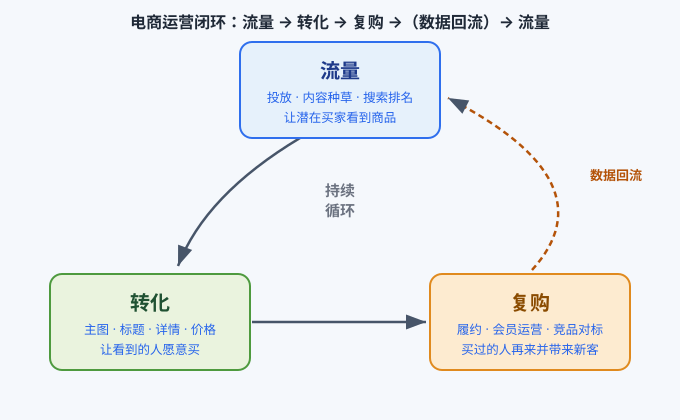
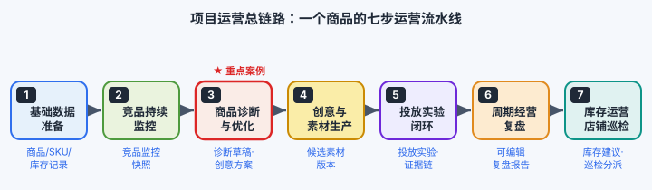
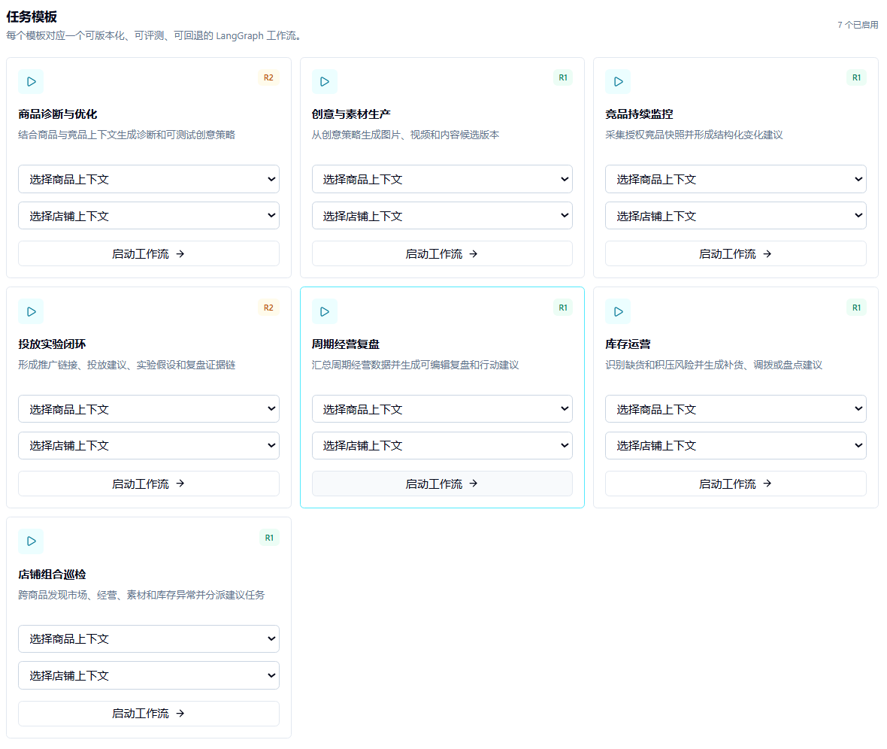
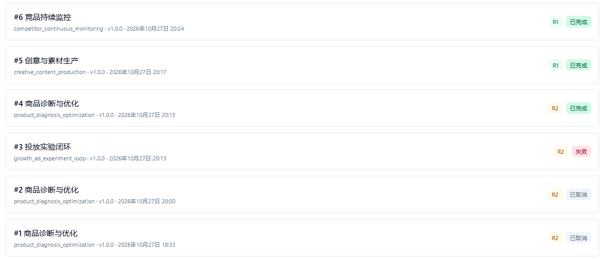
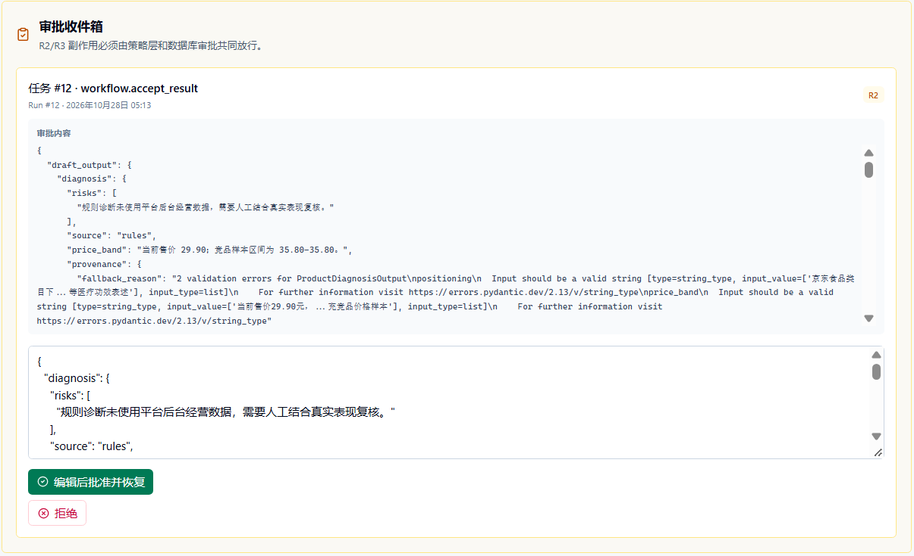
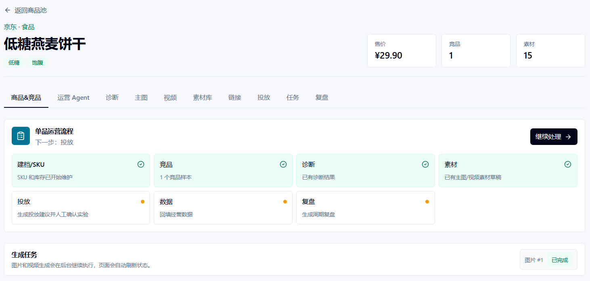
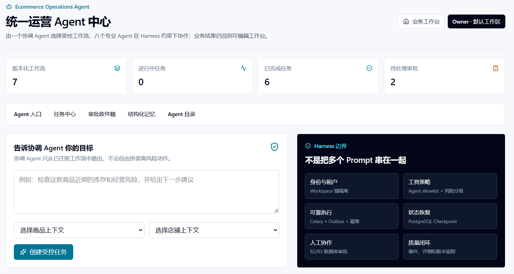

# 《电商运营助手》项目介绍

> 本课件是《电商运营助手》系列的开篇，先建立三幅画面：
> 1. **为什么要做**——电商运营的业务本质与痛点；
> 2. **做什么**——一个商品从上架到持续运营要经历哪些步骤；
> 3. **怎么做**——为什么用「多 Agent + Harness」，而不是「一个 LLM 写到底」。

---

## 一、项目背景介绍

### 1.1 电商业务的本质

> 电商业务的本质，是「流量、转化与复购」三者构成的持续循环。

电商看起来是「开个店、上架商品、等买家下单」，但真正决定一家店能否活下来的，是三个环节的持续循环：

- **流量**：让潜在买家看到商品（搜索排名、投放广告、内容种草）；
- **转化**：让看到的人愿意买（主图、标题、详情、价格、评价）；
- **复购与口碑**：让买过的人再来、并带来新客（履约体验、会员运营、竞品对标）。

这三个环节不是一次性动作，而是**每天都要做、且要根据数据不断调整的运营动作**。

### 1.2 运营为什么是电商的「生死线」

同样是卖「低糖燕麦饼干」，两家店的差距往往不在商品本身，而在运营：

- 主图是否一眼传达「低糖、健康、早餐」的卖点？
- 价格带是否卡在目标人群的心理预期？
- 是否盯着竞品的价格波动和上新节奏？
- 库存是否在大促前补到位、又不在淡季积压？
- 投放的每一分钱，是否带来了可观测的回报？

这些决策**高度依赖经验**，且**重复、繁琐、易遗漏**。一个有经验的运营每天要在十几款商品间来回切换，人工完成「看数据 → 想策略 → 出文案 → 上计划 → 看结果」的闭环，既慢又难规模化。

### 1.3 运营助手的出现

> 运营助手要解决的，是把专家经验变成可复用系统。

《电商运营助手》要解决的，正是「**专家经验无法复制、运营动作难以规模化**」的问题：

- 不是替人做所有决策，而是把**重复的、有章法的**运营动作系统化；
- 用 AI Agent 承载不同领域的运营专家能力（诊断、创意、投放、复盘、库存）；
- 用工程化手段保证这些 Agent **可控、可恢复、可验证、可观测**，而不是「黑盒生成一段文字就完事」。

电商业务不是一次性动作，而是「流量 → 转化 → 复购 →（数据回流）→ 流量」的持续循环，每个节点对应一类运营动作（投放 / 主图优化 / 会员运营 / 竞品对标）。

---

## 二、项目核心业务

> 围绕「一个商品的运营生命周期」展开。

### 2.1 运营是一条流水线

本项目把「运营一款商品」拆成一条**有先后、有数据依赖**的流水线。每往前一步，都以上一步的结构化结果为输入。

下图是项目的整体运营链路：

一个商品的运营被拆成一条有先后、有数据依赖的流水线，每往前一步都以上一步的结构化产物为输入。

### 2.2 七步运营流程

项目在 `registry.py` 中把运营能力注册为 **7 条工作流（Workflow）**，对应一个商品的典型运营步骤：

| 步骤 | 工作流（key） | 中文名 | 核心业务 | 产物 |
|---|---|---|---|---|
| 1 | 基础数据准备 | 店铺/商品/SKU/库存 | 录入商品、建立 SKU、维护库存档案 | 商品、SKU、库存记录 |
| 2 | `competitor_continuous_monitoring` | 竞品持续监控 | 建立竞品档案、解析公开链接、采集快照 | 竞品监控快照 |
| 3 | `product_diagnosis_optimization` | **商品诊断与优化** | 定位/价格带/人群/卖点诊断 + 创意方案草稿 | 诊断草稿、创意方案 |
| 4 | `creative_content_production` | 创意与素材生产 | 基于创意策略生成主图/视频脚本/标题详情候选 | 候选素材版本 |
| 5 | `growth_ad_experiment_loop` | 投放实验闭环 | 推广链接、投放建议、创建投放实验 | 投放实验、证据链 |
| 6 | `periodic_performance_review` | 周期经营复盘 | 汇总经营数据/素材/实验生成复盘 | 可编辑复盘报告 |
| 7 | `inventory_operations` / `store_portfolio_inspection` | 库存运营 / 店铺巡检 | 缺货积压风险、补货调拨盘点；跨商品异常巡检 | 库存建议、巡检分派 |

> 其中**第 3 步「商品诊断与优化」是本课程的重点案例**——它串联了「Agent 协作」「人工审批闸门」「结构化落库」等核心概念，后续章节会反复回到这条工作流。

### 2.3 运营助手总控台

项目前端以「运营助手总控台」为统一入口，核心由三块组成：

- **任务模板**：列出 7 条工作流，选择商品/店铺上下文后即可「启动工作流」；
- **任务中心**：展示每个任务（Task）与运行（Run）的状态——`queued → running → awaiting_approval → completed`；
- **审批收件箱**：R2/R3 级工作流产生的副作用（如诊断草稿、投放实验）必须人工「编辑后批准并恢复」才落库。

**图 2-2：运营助手总控台——任务模板区**

总控台「任务模板」区列出本项目的 7 条工作流（商品诊断与优化、创意与素材生产、竞品持续监控、投放实验闭环、周期经营复盘、库存运营、店铺组合巡检），选择商品/店铺上下文后即可「启动工作流」。

**图 2-3：任务中心与状态流转**

「任务中心」展示每个任务（Task）与运行（Run）的状态流转——`queued → running → awaiting_approval → completed`，是观察工作流执行情况的总览。

**图 2-4：审批收件箱（人工闸门）**

R2 工作流产生的副作用（如诊断草稿、投放实验）进入「审批收件箱」，需人工「编辑后批准并恢复 / 拒绝」才落库——这正是需要人工把关的原因。

**图 2-5：商品详情页的运营面板**

在商品详情页，竞品监控、投放实验、草稿等运营动作都聚合在同一个商品上下文下，体现「以商品为中心」的运营视图。

---

## 三、多 Agent 设计

### 3.1 手动运营的局限与 Agent 的引入

纯人工运营有三道坎，单靠「调一个大模型」也跨不过去：

1. **慢且不可规模化**：一个人管 10 款商品已吃力，管 100 款必然顾此失彼；
2. **质量依赖个人经验**：新手写的主图和资深运营写的，转化天差地别；
3. **大模型「裸用」不可靠**：LLM 会幻觉、不会查你家的真实库存、也不会帮你创建投放实验。

**Agent 的思路**是：把「某个领域的运营专家」封装成一个可调工具、有边界、能查数据的智能体，再由工作流把它们编排起来。

### 3.2 多 Agent 设计解决的问题

电商小二：   问题——>意图识别——>意图校验——>轨道分发——>生成回复

| 要解决的问题 | 多 Agent 的应对方式 |
|---|---|
| 职责混乱、一个模型啥都干 | **职责分离**：每个 Agent 只负责一个领域（诊断 / 创意 / 投放 / 复盘 / 库存 / 合规） |
| 模型乱调工具、越权 | **工具白名单 + 风险分级**：每个 Agent 只允许调用注册过的工具，且按 R0–R3 分级管控 |
| 能力无法复用 | **注册表化**：Agent、工作流、工具全部版本化注册，可组合、可审计 |
| 没有兜底、错误直接进库 | **质量合规 Agent + 人工闸门**：先出草稿，审查/审批通过才落正式库 |

### 3.3 Agent 设计（9 个）

项目在 `registry.py` 中注册了 **9 个 Agent**，其中协调 Agent 与质量合规 Agent 不持有任何工具（白名单为空），体现「编排与执行分离、生成与审查分离」：

| Agent（key） | 角色 | 职责 | 持有工具 |
|---|---|---|---|
| `ecommerce_operations_agent` | 协调 Agent | 意图识别、受控路由、结果汇总 | 无（白名单空） |
| `market_intelligence_agent` | 市场情报 | 竞品变化、市场机会、卖点趋势 | product.read / store.read / competitor.read / competitor.monitor.run |
| `product_strategy_agent` | 商品策略 | 定位、价格带、人群、卖点、优化动作 | product.read / competitor.read / diagnosis.draft |
| `creative_strategy_agent` | 创意策略 | 主图、视频脚本、标题与详情策略 | product.read / diagnosis.draft / creative.plan.draft |
| `content_production_agent` | 内容生产 | 候选素材生产、版本与供应商编排 | product.read / content.image.generate / content.video.generate |
| `growth_experiment_agent` | 增长实验 | 推广链接、投放建议、实验假设 | product.read / promotion.link.draft / ad.recommendation.draft / ad.experiment.create |
| `performance_review_agent` | 经营复盘 | 汇总经营数据/素材/实验生成复盘 | product.read / store.read / performance.review.draft |
| `inventory_operations_agent` | 库存运营 | 库存风险、补货、调拨、盘点建议 | product.read / store.read / inventory.read / inventory.advice.draft / inventory.adjust |
| `quality_compliance_agent` | 质量合规 | 结构/事实/合规/风险/质量审查 | 无（纯规则，白名单空） |

### 3.4 Workflow 设计（7 条）

每条工作流声明「由哪些 Agent 协作、需要什么上下文、默认风险级别」，并统一走注册表路由：

<table style="width:100%; border-collapse:collapse; font-size:14px; line-height:1.5;">
  <colgroup>
    <col style="width:24%">
    <col style="width:14%">
    <col style="width:36%">
    <col style="width:16%">
    <col style="width:10%">
  </colgroup>
  <thead>
    <tr style="background:#E6F1FB; color:#1E3A8A;">
      <th style="border:1px solid #C9D6E5; padding:6px 8px; text-align:left; font-weight:700;">工作流（key）</th>
      <th style="border:1px solid #C9D6E5; padding:6px 8px; text-align:left; font-weight:700;">业务目标</th>
      <th style="border:1px solid #C9D6E5; padding:6px 8px; text-align:left; font-weight:700;">参与 Agent</th>
      <th style="border:1px solid #C9D6E5; padding:6px 8px; text-align:left; font-weight:700;">必需上下文</th>
      <th style="border:1px solid #C9D6E5; padding:6px 8px; text-align:left; font-weight:700;">风险级</th>
    </tr>
  </thead>
  <tbody>
    <tr>
      <td style="border:1px solid #E2E8F0; padding:6px 8px;"><code>product_diagnosis_optimization</code></td>
      <td style="border:1px solid #E2E8F0; padding:6px 8px;">商品诊断与优化</td>
      <td style="border:1px solid #E2E8F0; padding:6px 8px;">product_strategy   creative_strategy    quality_compliance</td>
      <td style="border:1px solid #E2E8F0; padding:6px 8px;">product_id</td>
      <td style="border:1px solid #E2E8F0; padding:6px 8px;">R2</td>
    </tr>
    <tr>
      <td style="border:1px solid #E2E8F0; padding:6px 8px;"><code>creative_content_production</code></td>
      <td style="border:1px solid #E2E8F0; padding:6px 8px;">创意与素材生产</td>
      <td style="border:1px solid #E2E8F0; padding:6px 8px;">creative_strategy    content_production    quality_compliance</td>
      <td style="border:1px solid #E2E8F0; padding:6px 8px;">product_id</td>
      <td style="border:1px solid #E2E8F0; padding:6px 8px;">R1</td>
    </tr>
    <tr>
      <td style="border:1px solid #E2E8F0; padding:6px 8px;"><code>competitor_continuous_monitoring</code></td>
      <td style="border:1px solid #E2E8F0; padding:6px 8px;">竞品持续监控</td>
      <td style="border:1px solid #E2E8F0; padding:6px 8px;">market_intelligence    quality_compliance</td>
      <td style="border:1px solid #E2E8F0; padding:6px 8px;">product_id / store_id</td>
      <td style="border:1px solid #E2E8F0; padding:6px 8px;">R1</td>
    </tr>
    <tr>
      <td style="border:1px solid #E2E8F0; padding:6px 8px;"><code>growth_ad_experiment_loop</code></td>
      <td style="border:1px solid #E2E8F0; padding:6px 8px;">投放实验闭环</td>
      <td style="border:1px solid #E2E8F0; padding:6px 8px;">growth_experiment    performance_review    quality_compliance</td>
      <td style="border:1px solid #E2E8F0; padding:6px 8px;">product_id</td>
      <td style="border:1px solid #E2E8F0; padding:6px 8px;">R2</td>
    </tr>
    <tr>
      <td style="border:1px solid #E2E8F0; padding:6px 8px;"><code>periodic_performance_review</code></td>
      <td style="border:1px solid #E2E8F0; padding:6px 8px;">周期经营复盘</td>
      <td style="border:1px solid #E2E8F0; padding:6px 8px;">performance_review    quality_compliance</td>
      <td style="border:1px solid #E2E8F0; padding:6px 8px;">product_id / store_id</td>
      <td style="border:1px solid #E2E8F0; padding:6px 8px;">R1</td>
    </tr>
    <tr>
      <td style="border:1px solid #E2E8F0; padding:6px 8px;"><code>inventory_operations</code></td>
      <td style="border:1px solid #E2E8F0; padding:6px 8px;">库存运营</td>
      <td style="border:1px solid #E2E8F0; padding:6px 8px;">inventory_operations    quality_compliance</td>
      <td style="border:1px solid #E2E8F0; padding:6px 8px;">product_id / store_id</td>
      <td style="border:1px solid #E2E8F0; padding:6px 8px;">R1</td>
    </tr>
    <tr>
      <td style="border:1px solid #E2E8F0; padding:6px 8px;"><code>store_portfolio_inspection</code></td>
      <td style="border:1px solid #E2E8F0; padding:6px 8px;">店铺组合巡检</td>
      <td style="border:1px solid #E2E8F0; padding:6px 8px;">market_intelligence    product_strategy    performance_review    inventory_operations    quality_compliance</td>
      <td style="border:1px solid #E2E8F0; padding:6px 8px;">store_id</td>
      <td style="border:1px solid #E2E8F0; padding:6px 8px;">R1</td>
    </tr>
  </tbody>
</table>

> 用户自然语言意图会通过 `route_intent()` 按关键词匹配到对应工作流，无命中则兜底走「商品诊断与优化」。

### 3.5 工具列表定义（16 个，R0–R3）

工具按**风险级别**分级，级别越高越需要审批与权限约束（`inventory.adjust` 为 R3 且仅 owner 可用）：

**R0 只读**

| 工具（key） | 说明 |
|---|---|
| `product.read` | 读取商品与经营上下文 |
| `store.read` | 读取店铺组合与经营上下文 |
| `competitor.read` | 读取竞品与监控快照 |
| `inventory.read` | 读取 SKU 与库存状态 |

**R1 草稿类**

| 工具（key） | 说明 |
|---|---|
| `competitor.monitor.run` | 生成竞品监控快照 |
| `diagnosis.draft` | 生成商品诊断草稿 |
| `creative.plan.draft` | 生成可编辑创意方案 |
| `content.image.generate` | 调用图片供应商生成候选素材 |
| `content.video.generate` | 调用视频供应商生成候选素材 |
| `promotion.link.draft` | 生成推广链接配置草稿 |
| `ad.recommendation.draft` | 生成投放建议草稿 |
| `performance.review.draft` | 生成周期经营复盘草稿 |
| `inventory.advice.draft` | 生成库存建议草稿 |

**R2 执行类**

| 工具（key） | 说明 |
|---|---|
| `ad.experiment.create` | 创建正式投放实验 |
| `artifact.persist` | 采用草稿并写入正式业务对象 |

**R3 高危**

| 工具（key） | 说明 |
|---|---|
| `inventory.adjust` | 写入真实库存调整流水（仅 owner） |

---

## 四、Harness 工程思想

### 4.1 多 Agent 协作引发的工程问题

把多个 Agent 编排成一条工作流后，麻烦才真正开始。直接「让 LLM 自由发挥」会遇到四类典型问题：

- **不可控**：Agent 擅自调用了它不该用的工具（比如没审批就改了库存）；
- **不可恢复**：工作流跑了 5 分钟、第 8 步宕机，重启后从头再来、前面白算；
- **不可验证**：诊断写错了价格、创意带了违规词，却直接落库变成「官方结论」；
- **不可观测**：跑了半天不知道卡在哪一步、花了多少 token、谁批准的。

这些问题靠「prompt 写得好」解决不了，需要一套**工程骨架**来兜底——这就是 Harness。

### 4.2 Harness 的概念与工程定位

> Harness 的目标可以归纳为四个维度。

Harness（具柄/ harness）本意是「套在马身上用以驾驭的挽具」。在 AI 工程里，它就是**驾驭多个 Agent 的工程框架**，目标可归纳为四个维度：

| 维度 | 要回答的问题 | 不做会怎样 |
|---|---|---|
| **可控 Controllable** | Agent 能调什么工具、谁来批准 | 越权、误改业务数据 |
| **可恢复 Recoverable** | 中途断了能从哪续上 | 长流程重跑、资源浪费 |
| **可验证 Verifiable** | 产出对不对、该不该进库 | 错误结论直接生效 |
| **可观测 Observable** | 跑到哪了、花了多少、谁决策 | 黑盒、无法排障 |

### 4.3 可控

- **注册表白名单**：Agent 只能调用 `registry.py` 中声明过的工具，未注册一律拒绝（`tool_gateway` 校验）；
- **风险分级 R0–R3**：只读 < 草稿 < 执行 < 高危，R2/R3 的副作用被「人工审核门」拦截；
- **协调 Agent 零工具**：`ecommerce_operations_agent` 只做路由与汇总，本身没有任何写能力；
- **人工闸门**：R2 工作流（如商品诊断与优化）在 `human_review_gate` 处 `interrupt`，产出草稿待人工「编辑后批准并恢复」才继续。

### 4.4 可恢复

- **Checkpoint（PostgreSQL）**：LangGraph 把工作流状态按节点持久化，崩溃后可从最近节点 `resume`，不必重跑；
- **租约 Lease + 心跳**：一条 Run 由哪个 worker 持有靠 `agent_leases` 记录，心跳超时即释放，避免僵尸占用；
- **Outbox 事务发件箱**：任务触发先写 `outbox_events` 再异步派发，保证「至少一次」投递，不丢任务；
- **Celery 退避重试**：worker 用 `task_acks_late` + 指数退避，瞬时故障自动恢复。

### 4.5 可验证

- **结构化数据合同**（`contracts.py`）：Agent 产出必须符合预定义 schema，杜绝「一段自由文本」；
- **质量合规 Agent**：纯规则审查结构与事实依据，不持工具、不参与生成，独立把关；
- **落库闸门**：只有 `artifact.persist` 工具（R2）才把草稿写入正式业务表，草稿阶段绝不污染主数据。

### 4.6 可观测

- **事件流**（`agent_run_events`）：Run 的每一步（queued / started / 各 Agent 完成 / 人工审核请求）都留痕；
- **预算与用量**（`usage`）：记录 token 与成本，便于评估单次运营开销；
- **明确状态机**：Task 在 `queued → running → awaiting_approval → completed / failed` 间流转，前端任务中心据此展示；
- **后台可监控**：Celery worker 与 beat 的队列、重试、死信都可观测。

### 4.7 本项目如何落地

> 模块映射一览

| Harness 维度 | 项目对应实现 |
|---|---|
| 可控 | `registry.py`（注册表/白名单）、`policy.py`（风险分级）、`tool_gateway.py`（工具网关）、`graph.py`（`human_review_gate` 中断） |
| 可恢复 | `agent_leases.py`（租约心跳）、`outbox.py`（事务发件箱）、`worker/celery_app.py`（退避重试）、LangGraph Checkpoint |
| 可验证 | `contracts.py`（数据合同）、`QualityComplianceAgent`（规则审查）、`artifact.persist`（落库闸门） |
| 可观测 | `agent_run_events` 表、`usage` 字段、Task/Run 状态机、`agent_maintenance` 巡检 |

**本节小结**：Harness 不是某个具体功能，而是一种「让多 Agent 可靠协作」的工程方法论。本项目的 `registry → policy → tool_gateway → graph → outbox → leases` 链路，正是这套方法论在电商运营场景下的具体落地。理解这条链路，就理解了后续每一章代码的「为什么这么写」。