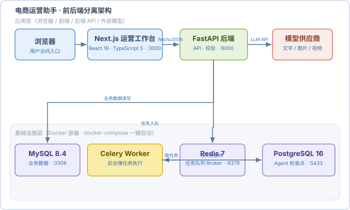
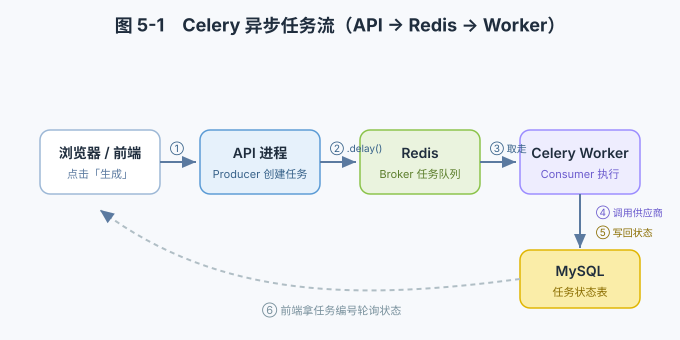
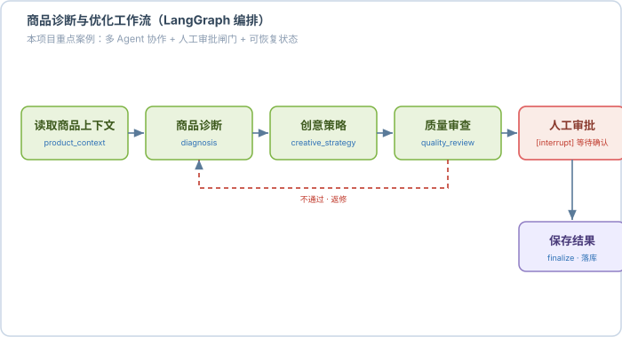
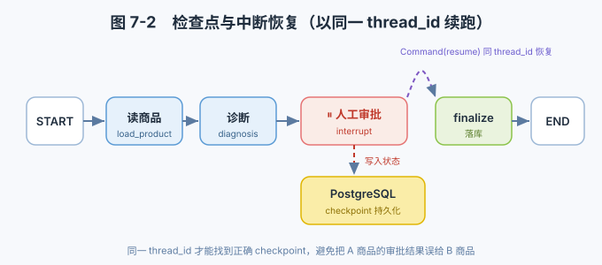

# 02 《电商运营助手》项目技术架构

> 本课件从工程视角拆解「用什么技术做」：先建立前后端分离的整体认知、列出前后端技术栈，再逐一说明每个核心技术在项目中承担的职责。

## 一、项目技术架构总览

> 本节先建立前后端分离的整体认知，再分别列出前端与后端技术栈。阅读完本节，你应能说出项目由哪些层组成、每层用什么技术。

### 1.1 前后端分离架构设计

电商运营助手采用**前后端分离**架构。理解这套架构，只需要记住五个角色各自的职责：

- **浏览器**负责把界面呈现给用户，收集点击与输入。
- **前端（Next.js 运营工作台）**负责把运营数据变成可交互的页面，通过 HTTP/JSON 调用后端接口。
- **后端（FastAPI）**负责接收请求、校验数据、执行业务逻辑、把结果写入数据库，并在需要时调用模型供应商。
- **后台 Worker（Celery）**负责图片生成、视频生成、投放实验等慢任务，避免阻塞接口。
- **基础设施（MySQL / Redis / PostgreSQL）**负责长期记忆：业务数据、任务队列、Agent 可恢复状态。

前端只管「展示与交互」，后端只管「业务与数据」，两者通过约定好的数据合同通信。这正是本项目能够被多人协作、长期维护的基础。

**图 1-1　电商运营助手前后端分离架构**



图中实线箭头表示一次典型请求的数据流向：浏览器访问前端，前端调用后端 API，后端读写业务数据库、把慢任务投递到 Redis、由 Worker 取走执行，并把 Agent 状态持久化到 PostgreSQL；文字、图片、视频等能力则通过统一的 LLM API 调用外部模型供应商。MySQL、Redis、PostgreSQL 三个服务由 `docker-compose.yml` 一键启动，无需在本地分别安装数据库软件。

### 1.2 前端技术栈

前端以 Next.js 为核心，配合 React 与 TypeScript 构建运营工作台，使用 Tailwind CSS 统一视觉、用 react-hook-form 与 zod 处理表单与校验、用 echarts 呈现经营数据。

<table>
<colgroup>
  <col style="width:22%"><col style="width:38%"><col style="width:40%">
</colgroup>
<thead><tr><th>技术</th><th>说明</th><th>在项目中职责</th></tr></thead>
<tbody>
  <tr><td><code>Next.js 16.3.1</code></td><td>基于 React 的全栈 Web 框架（App Router）</td><td>页面与路由、开发服务器（默认 <code>:3000</code>）、服务端渲染</td></tr>
  <tr><td><code>React 19.2.4</code></td><td>组件化 UI 库</td><td>把按钮、卡片、面板拆成可复用组件</td></tr>
  <tr><td><code>TypeScript 5</code></td><td>带类型检查的 JavaScript</td><td>编译期发现字段名、类型错误，减少运行时崩溃</td></tr>
  <tr><td><code>Tailwind CSS v4</code></td><td>原子化样式框架</td><td>统一视觉风格与响应式布局</td></tr>
  <tr><td><code>react-hook-form</code> + <code>zod</code></td><td>表单状态 + 数据校验</td><td>表单收集，并在前端先校验输入合法性</td></tr>
  <tr><td><code>echarts 6</code></td><td>图表库</td><td>经营数据、复盘结果的可视化</td></tr>
  <tr><td><code>lucide-react</code></td><td>图标库</td><td>界面图标</td></tr>
  <tr><td><code>npm</code></td><td>前端包管理器</td><td>安装依赖、运行 <code>dev</code> / <code>build</code> / <code>lint</code></td></tr>
</tbody>
</table>

### 1.3 后端技术栈

后端以 FastAPI 为入口，使用 SQLAlchemy 操作 MySQL，用 Celery 处理异步任务，用 LangGraph 编排多 Agent 工作流，并把可恢复状态写入 PostgreSQL。配置与密钥统一放在 `.env`，由 `pydantic-settings` 读取。

<table>
<colgroup>
  <col style="width:24%"><col style="width:36%"><col style="width:40%">
</colgroup>
<thead><tr><th>技术</th><th>说明</th><th>在项目中职责</th></tr></thead>
<tbody>
  <tr><td><code>Python 3.12+</code></td><td>编程语言</td><td>API、Worker、Agent 的运行基础</td></tr>
  <tr><td><code>FastAPI</code> + <code>Uvicorn</code></td><td>Web 框架 + ASGI 服务器</td><td>接收 HTTP 请求、返回 JSON（默认 <code>:8000</code>）</td></tr>
  <tr><td><code>Pydantic</code> / <code>pydantic-settings</code></td><td>数据校验 / 配置管理</td><td>接口输入输出合同、读取 <code>.env</code> 配置</td></tr>
  <tr><td><code>SQLAlchemy</code></td><td>ORM（对象关系映射）</td><td>Python 类映射数据库表，减少手写 SQL</td></tr>
  <tr><td><code>Alembic</code></td><td>数据库迁移</td><td>表结构版本管理与变更记录</td></tr>
  <tr><td><code>PyMySQL</code></td><td>MySQL 驱动</td><td>Python 连接并操作 MySQL</td></tr>
  <tr><td><code>Celery[redis]</code></td><td>异步任务框架</td><td>后台执行图片/视频生成、投放实验等慢任务</td></tr>
  <tr><td><code>LangGraph</code> + <code>langgraph-checkpoint-postgres</code></td><td>Agent 编排 + 检查点</td><td>多步工作流、人工中断与状态恢复</td></tr>
  <tr><td><code>psycopg</code></td><td>PostgreSQL 驱动</td><td>读写 Agent 检查点</td></tr>
  <tr><td><code>httpx</code></td><td>HTTP 客户端</td><td>调用大模型与媒体供应商</td></tr>
  <tr><td><code>OpenTelemetry</code></td><td>可观测性</td><td>链路追踪与运行监控</td></tr>
  <tr><td><code>Ruff</code> / <code>Pytest</code></td><td>代码检查 / 测试</td><td>质量保障</td></tr>
  <tr><td><code>uv</code></td><td>Python 包管理器</td><td>依赖与虚拟环境管理</td></tr>
</tbody>
</table>

## 二、前端核心框架

**React** 负责用「组件」描述界面：一个按钮、一个商品卡片、一个库存面板都是组件，组件接收数据并返回界面。**Next.js** 建立在 React 之上，约定 `src/app/` 目录结构自动生成页面与路由，并提供开发服务器与生产构建。本项目前端正是 Next.js 的 App Router 模式。**TypeScript** 给 JavaScript 加上类型检查，字段拼错或把字符串当数字这类问题会在编辑器和构建阶段被发现，而不是到浏览器运行时才暴露。

前后端之间有一份「数据合同」：后端用 Pydantic 定义接口的输入输出，前端用 `zod` 定义同名同含义的字段。两者不是共享同一段代码，而是遵守同一份约定。一次完整数据流如下：

```text
React 表单收集运营输入
        ↓ fetch 调用后端接口
FastAPI 用 Pydantic 校验
        ↓
Service 写入 SQLAlchemy 模型（MySQL）
        ↓
JSON 响应 → TypeScript 类型 → React 重新渲染
```

开发时最常用的三条命令：`npm install`（安装依赖）、`npm run dev`（启动开发服务器，访问 `http://localhost:3000`）、`npm run build`（生产构建，同时检查类型与打包）。

## 三、后端 Web 框架与数据校验

**FastAPI** 是 Python Web 框架，它把普通函数变成 HTTP 接口。项目里 `api/app/main.py` 是应用入口，`api/app/api/routes/` 中每个文件按业务分类组织路由（商品、库存、Agent 等），路由不直接堆逻辑，而是调用 Service 层与数据库层。FastAPI 还提供自动生成的 `/docs` 交互式接口文档。

**Pydantic** 负责数据建模与校验：你声明「商品名 1–100 字符、价格大于 0」，它会在业务函数运行前检查请求是否合法。一个最小示例：

```python
from pydantic import BaseModel, Field

class ProductCreate(BaseModel):
    name: str = Field(min_length=1, max_length=100)
    price: float = Field(gt=0)
```

当 `price` 传成 `0` 或字符串时，FastAPI 直接返回 422 并说明字段问题，业务代码根本不会执行——这就是「把不合法数据挡在门外」。正式项目中这类模型集中在 `schemas.py`，与数据库模型分开。后端配置（数据库地址、模型密钥等）则由 `pydantic-settings` 从 `.env` 读取，密钥永不进入代码或终端命令。

## 四、持久化与数据库

- **MySQL 8.4** 是项目的业务数据库，长期保存商品、SKU、库存、店铺、任务与诊断结果，程序关闭后数据依然存在。

- **SQLAlchemy** 是 ORM 工具，把 Python 类映射为数据库表，让你用类型和表达式组织查询，而不是拼接字符串 SQL。

- **Alembic** 是迁移工具，把「表结构从版本 A 变成版本 B」的过程保存为可执行文件。三者关系如下：

```text
SQLAlchemy Model（Python 中的表蓝图）
              ↓ 生成/编写迁移
Alembic revision（结构变更记录）
              ↓ 执行迁移
MySQL Table（真正保存数据的表）
```

新增一个字段时，只需在模型里加字段并提交一条迁移，执行 `alembic upgrade head` 即可同步到最新结构；每个迁移都有版本和变更说明，便于回看历史。

ORM 模型、迁移文件、真实数据表是三个不同的东西，理解这一点对排查问题很重要。

## 五、异步任务与可恢复状态

生成一张图片可能要几十秒甚至几分钟。若让一次 HTTP 请求一直等待，用户无法关闭页面、取消任务或查看进度，接口也容易超时。因此后端只负责「创建任务」，真正的慢工作交给后台 **Worker** 执行：

```text
点击「生成图片」 → API 创建任务 → Redis 排队 → 立即返回任务编号
                                                     ↓
浏览器轮询状态 ← 数据库更新 ← Celery Worker 执行供应商调用
```

### 5.1 Redis 作为任务中转站

Redis 是内存中的键值数据库，读写极快，常用于缓存、限流与会话。本项目不把它当业务数据库，而是作为 Celery 的 Broker（任务中转站）：API 把「请生成第 42 个创意」这样的小消息交给 Redis，空闲的 Worker 再取走执行。这样即使 API 重启或同时收到多个请求，也不必亲自等待生成服务返回。理解 Celery，可以先记住四个角色：

| 概念 | 好理解的比喻 | 本项目里的含义 |
|---|---|---|
| Broker | 快递分拣中心 | Redis 暂存等待处理的 Celery 任务 |
| Queue | 不同业务的队列 | `generation`、`agent` 等任务通道 |
| Producer | 寄快递的人 | FastAPI API 创建并投递任务 |
| Consumer | 收快递并处理的人 | Celery Worker 执行任务 |

### 5.2 用 Celery 处理后台慢任务

Celery 是 Python 后台任务框架。它由 API 进程发送任务，由一个或多个 Worker 进程执行。被 `@celery_app.task` 装饰的函数不会因为加了装饰器就自动在后台运行；只有调用 `.delay()` 或 `.apply_async()` 时，任务才会被投递到 Broker。把耗时动作交给 Celery 之后，前后对比非常明显：

| 操作 | 同步写法的后果 | Celery 写法 |
|---|---|---|
| 调用图片 / 视频供应商 | 浏览器持续等待，易超时 | 立即返回任务编号，Worker 后台执行 |
| 失败后重试 | API 函数结束后信息丢失 | 记录失败状态、重试次数与错误原因 |
| 多个耗时任务 | 一个 API 进程容易被占满 | 增加多个 Worker 并行消费队列 |
| 查看进度 | 用户只能等待 | 数据库保存 `pending / running / succeeded / failed` 状态 |

**最小实践案例**

一个任务的定义与调用长这样（Broker 地址来自 `.env`，这里用项目默认的 Redis）：

```python
from celery import Celery

celery_app = Celery("ecommerce", broker="redis://127.0.0.1:6379/0")

@celery_app.task
def generate_creative_image(plan_id: int) -> None:
    # 真正调用图片供应商，可能耗时几十秒
    ...

# 在 API 进程中调用：只投递，不等待结果
generate_creative_image.delay(plan_id)
```

启动 Worker（终端保持运行）：

```text
uv run celery -A tasks.celery_app worker --loglevel=INFO
```

要点：`.delay()` 返回的是「任务编号」而不是计算结果——前端拿编号去数据库轮询状态，而不是在原地等图片。若 Worker 没有收到任务，按顺序检查：Docker 是否运行 → `docker ps` 是否看到 Redis → Worker 的 broker 地址是否一致 → Worker 终端是否保持运行。Windows 环境需在配置里加 `worker_pool='solo'`。

**图 5-1　Celery 异步任务流（API → Redis → Worker）**



图中实线表示一次异步任务的流转：API 作为 Producer 创建任务并 `.delay()` 投递到 Redis（Broker），空闲的 Worker（Consumer）取走消息执行供应商调用，再把 `pending → running → succeeded / failed` 状态写回 MySQL；浏览器拿任务编号轮询数据库，随时查看进度，而不必阻塞在原请求上。

### 5.3 用 PostgreSQL 保存可恢复状态

PostgreSQL 也是关系型数据库，和 MySQL 一样保存表和记录，但本项目按职责把它与 MySQL 分开：MySQL 保存商品、店铺、任务等核心业务数据；PostgreSQL 保存 LangGraph 的 checkpoint，也就是 Agent 每走到一个节点后留下的可恢复状态。checkpoint 不能只放内存，三种保存方式对比如下：

| 保存位置 | 服务重启后 | 能否多进程读取 | 适合场景 |
|---|---|---|---|
| Python 变量 | 丢失 | 否 | 一次性小脚本 |
| `MemorySaver`（内存） | 丢失 | 不可靠 | 本地学习示例 |
| PostgreSQL 中的 checkpoint | 保留 | 可以 | 正式 Agent、人工审批、断点续跑 |

例如 Agent 已完成「读取商品」和「生成诊断」，正准备等待运营人员审批。此时 API 或 Worker 重启，系统必须知道它停在哪里、谁要审批什么——这正是持久化 checkpoint 的价值。第七章介绍 LangGraph 时，会把这个概念接回真正的 Agent 工作流。

## 六、大模型接入

> 本节聚焦 OpenAI 兼容协议与媒体生成：文字、图片、视频模型如何在项目中被统一调用、审核与落地。

**LLM（大语言模型）**根据输入文字生成、归纳或判断文字，它不是数据库，也不会天然知道你的真实库存。项目必须先把业务数据整理成提示词，再把模型输出校验后保存。

不同供应商的地址、账户、模型名不同，但许多都兼容 OpenAI 的 Chat Completions 请求格式。项目统一「请求 URL、请求头、JSON 字段与响应读取方式」，就能在 DeepSeek、通义千问或本地 vLLM 之间切换，而不必重写每个业务功能。一次请求由 `model`、`messages`（含 `system` 角色设定与 `user` 具体任务）、`temperature`（控制随机性，结构化输出通常用较低值）组成。

文字模型返回文本；图片模型根据画面提示词生成图片；视频模型根据分镜生成视频。三者都属于「调用云端模型」，但图片与视频通常慢得多，结果也不是可直接入库的文本，而是需要下载、审核、关联业务计划的媒体素材。因此项目遵循统一链路：

```text
确认创意计划 → API 创建 GenerationJob（PENDING）
        ↓
后台任务提交给图片/视频供应商 → 拿到远端 task_id → 按间隔轮询
        ↓
下载成品到本地 → 创建 GeneratedAsset → 任务 SUCCEEDED
        ↓
前端展示，等待人工审核与后续投放
```

模型输出是「候选建议」，不是可信事实，更不是自动执行命令。项目用 Pydantic 校验 JSON、在模型不可用时走规则兜底，并要求人确认高风险动作。密钥只放在后端 `.env`，前端永远拿不到，浏览器绝不直接调用模型 API。

## 七、基于 LangGraph 的 Agent 编排

**LangGraph** 是 Python 工作流框架，把多步任务表示为一张可执行的图（Graph）。每个节点做一件小事，边决定下一步，图可以根据状态分支、暂停等待人类输入，并保存状态后恢复。项目中的 Agent 会经历「读取上下文 → 诊断 → 创意 → 质量检查 → 人工审批 → 保存结果」等多步，用显式状态和边来管理失败、返修与人工暂停。

### 7.1 三个核心组件

LangGraph 的最小骨架由三部分组成：

```text
State（本次任务携带的数据）
  ↓
Node（做一件事的 Python 函数）
  ↓
Edge（下一步去哪里）
```

把它们放进一张表，对应到项目的电商例子：

| 概念 | 它是什么 | 电商例子 |
|---|---|---|
| State（状态） | 节点之间传递的数据字典 | 商品 ID、诊断结果、审批结论、错误信息 |
| Node（节点） | 读取状态并返回更新的函数 | `load_product`、`generate_diagnosis` |
| Edge（边） | 节点执行后的去向 | 诊断后去创意节点 |
| Conditional Edge（条件边） | 根据状态选不同去向 | 审核不通过则返修，通过则保存 |
| Checkpointer（检查点） | 持久化图状态 | 记录 Agent 在审批前暂停 |
| Interrupt（中断） | 主动暂停等待外部输入 | 等待运营人员确认投放 |

### 7.2 四个最小示例

下面四个示例由浅入深，每一段都对应项目里真实用到的一个机制。学习示例用 `MemorySaver`（内存版）便于观察，正式项目会换成第五章讲的 PostgreSQL 持久化实现。

**示例一：状态、节点与边（counter.py）**

最朴素的图只有「一个状态、一个节点、一条固定边」：

```python
from typing import TypedDict

from langgraph.graph import END, START, StateGraph


# 1. 声明状态
class CounterState(TypedDict):
    count: int
    log: str

# 2. 声明节点
def add_node(state: CounterState) -> CounterState:
    # 只更新 count，其余状态保持不变
    return {"count": state["count"] + 1}

# 3. 构建图
builder = StateGraph(state_schema=CounterState)
builder.add_node("add_node", add_node)
builder.add_edge(START, "add_node")
builder.add_edge("add_node", END)

# 4. 编译并执行
graph = builder.compile()
result = graph.invoke({"count": 0, "log": "start"})
print(result)  # {'count': 1, ...}
```

`CounterState` 是状态，`add_node` 是节点，`START → add_node → END` 是边。注意节点只返回要更新的字段，未修改的状态保持不变——这是 LangGraph 推荐的「部分更新」写法，项目里诊断节点、创意节点都遵循同样约定。

**示例二：条件边让图根据状态分支（conditional_route.py）**

订单金额决定走「人工审核」还是「自动通过」，对应项目里「质量审查通过 / 返修」的分支：

```python
from typing import Literal, TypedDict

from langgraph.graph import END, START, StateGraph


class OrderState(TypedDict):
    amount: int
    route: str

def decide_route(state: OrderState) -> OrderState:
    return {"route": "manual_review" if state["amount"] > 1000 else "auto_approve"}

def choose_next(state: OrderState) -> Literal["manual_review", "auto_approve"]:
    return state["route"]

def manual_review(state: OrderState) -> OrderState:
    return {"route": "进入人工审核"}

def auto_approve(state: OrderState) -> OrderState:
    return {"route": "自动审批通过"}

builder = StateGraph(state_schema=OrderState)
builder.add_node("decide_route", decide_route)
builder.add_node("manual_review", manual_review)
builder.add_node("auto_approve", auto_approve)
builder.add_edge(START, "decide_route")
builder.add_conditional_edges("decide_route", choose_next,
    {"manual_review": "manual_review", "auto_approve": "auto_approve"})
builder.add_edge("manual_review", END)
builder.add_edge("auto_approve", END)

graph = builder.compile()
print(graph.invoke({"amount": 500}))
print(graph.invoke({"amount": 1500}))
```

条件边有两个易错点：第一，`choose_next()` 返回的字符串必须恰好等于已注册节点名；第二，判断函数读取的是当前 State，所以前一个节点必须先写入 `route`。项目里质量审查节点正是用同样的机制在「继续执行 / 等待审批 / 需要返修」之间选择。

**示例三：检查点保存状态（checkpoint_demo.py）**

编译图时挂上 Checkpointer，并用 `thread_id` 区分「这一次运行会话」：

```python
from typing import TypedDict

from langgraph.checkpoint.memory import MemorySaver
from langgraph.graph import END, START, StateGraph


class TodoState(TypedDict):
    task: str
    completed: bool

def mark_completed(state: TodoState) -> TodoState:
    return {"completed": True}

builder = StateGraph(state_schema=TodoState)
builder.add_node("mark_completed", mark_completed)
builder.add_edge(START, "mark_completed")
builder.add_edge("mark_completed", END)

graph = builder.compile(checkpointer=MemorySaver())
config = {"configurable": {"thread_id": "todo_001"}}

print(graph.invoke({"task": "检查商品库存", "completed": False}, config=config))
# 同一 thread_id 再次调用，图能读回上一次的状态
print(graph.invoke({}, config=config))
```

`thread_id` 是这次工作流的「会话编号」。要区分「业务最终结果」（写回 MySQL 的数据）和「checkpoint」（为暂停、恢复、排查而保存的运行状态）。正式项目把 thread、运行记录与审批记录对应起来，运营人员就不会把 A 商品的审批结果误给 B 商品。学习示例用内存版 `MemorySaver`，项目里换 PostgreSQL（见第五章）。

**示例四：中断把决定权交给人（interrupt_demo.py）**

`interrupt()` 主动暂停图的运行，等待外部输入后才继续——这正是项目「人工审批闸门」的实现基础：

```python
from typing import TypedDict

from langgraph.checkpoint.memory import MemorySaver
from langgraph.graph import END, START, StateGraph
from langgraph.types import Command, interrupt


class ApprovalState(TypedDict):
    request: str
    approved: bool | None
    result: str

def request_approval(state: ApprovalState) -> ApprovalState:
    # 触发中断：停止运行，等待外部决策后输入结果
    # 注意：中断前不要写其他业务代码，中断会导致之前的代码重复执行
    approve = interrupt({"question": "是否批准该请求？", "request": state["request"]})
    return {"approved": approve}

def finish(state: ApprovalState) -> ApprovalState:
    return {"result": "请求已批准" if state["approved"] else "请求已拒绝"}

builder = StateGraph(state_schema=ApprovalState)
builder.add_node("request_approval", request_approval)
builder.add_node("finish", finish)
builder.add_edge(START, "request_approval")
builder.add_edge("request_approval", "finish")
builder.add_edge("finish", END)

graph = builder.compile(checkpointer=MemorySaver())
config = {"configurable": {"thread_id": "approval_001"}}

# 第一次运行会暂停
paused = graph.invoke({"request": "请求访问敏感数据"}, config=config)
print(paused["__interrupt__"])

# 第二次运行是恢复：必须传入完全相同的 thread_id
completed = graph.invoke(Command(resume=False), config=config)
print(completed)
```

第一次 `invoke()` 触发中断并打印问题；第二次用 `Command(resume=...)` 输入审批结果，图才继续。项目中的 Agent 不能绕过这一层直接执行高风险动作（如创建正式投放实验）。恢复时必须使用和暂停时**完全相同**的 `thread_id`，LangGraph 才能找到正确的 checkpoint。

### 7.3 从示例到正式 Agent 平台

把四个示例的概念映射到项目里的真实对应物，就能看清 LangGraph 不是孤立玩具，而是这套架构的编排核心：

| 基础示例概念 | 正式项目中的对应物 |
|---|---|
| `TypedDict` 状态 | Agent 任务、上下文与运行结果的合同 |
| 普通节点 | 诊断、创意、复盘等专家 Agent |
| 条件边 | 政策校验、返修、取消与失败路由 |
| `interrupt()` | 人工审批 API 与前端审批按钮 |
| `MemorySaver` | 第五章讲的 PostgreSQL checkpoint |

项目里「商品诊断与优化」是重点案例，它把上述概念全部串联起来：读取商品上下文后进入诊断节点，产出定位/价格带/人群/卖点诊断与创意方案草稿，经质量审查后到达人工审批节点（此处触发 `interrupt` 暂停，等待运营人员「编辑后批准并恢复 / 拒绝」），通过后由 finalize 节点落库。质量审查不通过时，条件边会把流程带回诊断节点返修。

**图 7-1　商品诊断与优化工作流（LangGraph 编排）**



图中绿色节点是正常处理步骤，红色「人工审批」节点代表 `interrupt` 暂停点——必须有人确认才能继续；虚线红色箭头表示质量不通过时的返修回路。

**图 7-2　检查点与中断恢复（以同一 thread_id 续跑）**



图中蓝色步骤是正常推进，红色「人工审批」节点处 `interrupt` 暂停并把状态写入 PostgreSQL；运营人员作出决策后，系统用完全相同的 `thread_id` 调用 `Command(resume=...)` 从检查点恢复，而不是从头重跑。

## 八、开发工具链与基础设施

> 本节聚焦把上述技术串起来的工具：Git、uv、VS Code、Node.js、Docker，以及一键启动基础服务的 docker-compose。

| 工具 | 在本项目中的作用 |
|---|---|
| Git | 版本控制，记录每次修改、支持协作与回退 |
| `uv` | 管理 Python 依赖与虚拟环境，按 `pyproject.toml` + `uv.lock` 同步，速度快且跨平台一致 |
| VS Code | 统一编辑代码、运行集成终端、调试 |
| Node.js / npm | 运行 Next.js 开发服务器、管理前端依赖 |
| Docker Desktop | 用容器运行 MySQL、Redis、PostgreSQL，免去分别安装配置 |
| `docker-compose.yml` | 一份配置启动三个基础服务，端口映射为 3308 / 6379 / 5433 |

`docker-compose.yml` 声明了三个服务：`mysql:8.4`（业务数据）、`redis:7-alpine`（任务队列）、`postgres:16-alpine`（Agent 检查点，库名 `agent_checkpoints`）。执行 `docker compose up -d` 即可在本地拉起整套基础设施，前端用 `npm`、后端用 `uv`，各自管理依赖，互不影响。

---

本篇从架构总览出发，逐层说明了电商运营助手所用的前端框架、后端 Web 框架、持久化方案、异步与可恢复机制、大模型接入方式、Agent 编排框架与开发工具链。这些技术共同支撑起一个**可控、可恢复、可验证、可观测**的运营助手：规则程序保证稳定，大模型提供建议，人保留最终决定权。后续章节将回到具体工作流，逐节点拆解代码实现。
