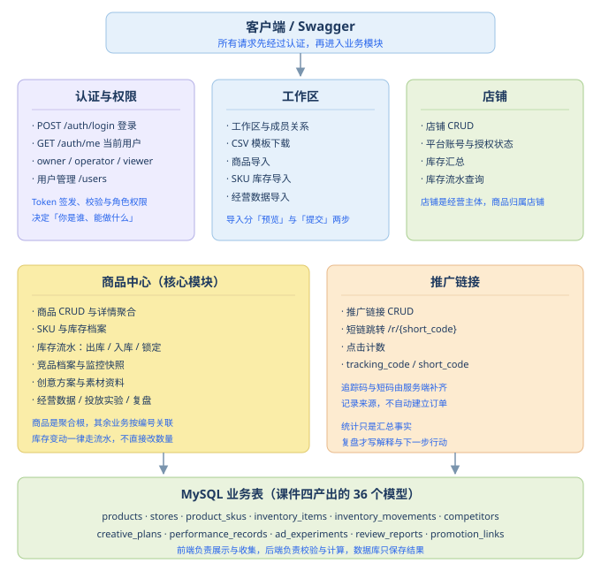
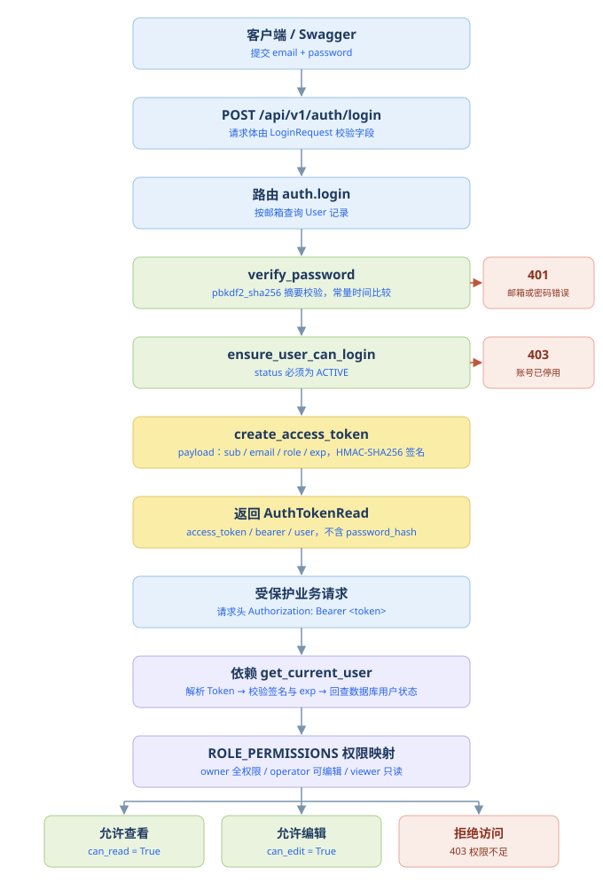

# 《电商运营助手》基础业务功能

> 前两章已经让项目「能存数据」并「能建表」。本章做两件事：先把基础业务模块一次性接入项目，再沿三条业务线完成验收——店铺、商品与库存，竞品、链接与运营资料，经营数据与系统验收。
>
> 本章结束时，一个已登录的运营人员可以完整地走通：新建店铺 → 新建商品 → 建 SKU → 出库 → 录入竞品 → 保存创意 → 建推广链接 → 建实验 → 录经营数据 → 看统计 → 存复盘。这条链路不依赖任何模型密钥，即使没有大模型也能运行。

---

## 一、基础业务功能介绍

> 本节先回答「基础业务包含哪些模块」，再逐个说明每个模块具体实现了什么功能。后续各节的编码与验收都围绕这些模块展开。

### 1.1 基础业务模块全景

《电商运营助手》的基础业务由五个模块组成：认证与权限负责「谁在调用、能做什么」，工作区负责租户边界与批量导入，店铺是经营主体，商品中心是核心聚合，推广链接负责来源追踪。所有模块共用同一套认证边界与同一批数据表。

**图 1-1 基础业务模块全景**



图中自上而下是请求的方向：客户端请求先经过认证，再进入各业务模块，最终由业务模块写入 MySQL。需要特别注意的是「商品中心」是最大的一个模块，SKU、库存、竞品、创意、经营数据都挂在具体商品之下，通过编号关联，而不是通过页面上的显示顺序关联。

### 1.2 认证与权限模块

> 认证回答「你是谁」，授权回答「你能做什么」。两者必须分开理解，也必须在后端分别实现。

<table>
  <colgroup><col style="width:22%"><col style="width:26%"><col style="width:52%"></colgroup>
  <thead><tr><th>功能</th><th>接口</th><th>说明</th></tr></thead>
  <tbody>
    <tr><td>登录</td><td><code>POST /api/v1/auth/login</code></td><td>校验邮箱与密码摘要，签发 Access Token，返回用户资料与权限</td></tr>
    <tr><td>当前用户</td><td><code>GET /api/v1/auth/me</code></td><td>携带 Token 读取当前登录者的资料，用于前端渲染与自检</td></tr>
    <tr><td>查看权限</td><td><code>require_view_permission</code></td><td>只读接口统一依赖，任何已激活账号都可通过</td></tr>
    <tr><td>编辑权限</td><td><code>require_edit_permission</code></td><td>写接口统一依赖，仅 owner 与 operator 可通过</td></tr>
    <tr><td>用户管理权限</td><td><code>require_manage_users_permission</code></td><td>用户管理接口依赖，仅 owner 可通过</td></tr>
    <tr><td>投放确认权限</td><td><code>require_ad_confirmation_permission</code></td><td>投放建议确认接口依赖，避免只读账号形成运营决策记录</td></tr>
  </tbody>
</table>

三种角色对应的权限如下。权限从角色统一派生，避免每个接口各自维护布尔值导致边界漂移。

| 角色 | can_read | can_edit | can_manage_users | can_confirm_ad_actions |
|---|---|---|---|---|
| `owner` | 是 | 是 | 是 | 是 |
| `operator` | 是 | 是 | 否 | 是 |
| `viewer` | 是 | 否 | 否 | 否 |

### 1.3 工作区模块

> 工作区是数据的租户边界。同一个账号可以属于多个工作区，业务数据按工作区隔离。

<table>
  <colgroup><col style="width:24%"><col style="width:30%"><col style="width:46%"></colgroup>
  <thead><tr><th>功能</th><th>接口</th><th>说明</th></tr></thead>
  <tbody>
    <tr><td>工作区与成员</td><td><code>GET /api/v1/workspace/</code></td><td>列出当前用户有权限的工作区，默认环境通常只有一个</td></tr>
    <tr><td>CSV 模板下载</td><td><code>GET /api/v1/workspace/templates/*.csv</code></td><td>提供商品、SKU 库存、经营数据三套标准表头，不需要自己猜字段</td></tr>
    <tr><td>商品导入</td><td><code>POST /api/v1/workspace/imports/products</code></td><td>先预览校验，确认后再提交写库</td></tr>
    <tr><td>SKU 库存导入</td><td><code>POST /api/v1/workspace/imports/sku-inventory</code></td><td>依赖已存在的商品，按顺序先建商品</td></tr>
    <tr><td>经营数据导入</td><td><code>POST /api/v1/workspace/imports/performance-records</code></td><td>批量补录经营数据，同样分预览与提交</td></tr>
    <tr><td>到期监控批量检查</td><td><code>POST /api/v1/workspace/competitor-monitors/run-due</code></td><td>本次调用时检查到期任务，不是常驻定时器</td></tr>
  </tbody>
</table>

### 1.4 店铺模块

> 店铺是经营主体，商品归属店铺。同一类商品可以在不同店铺经营，因此不能只用商品名称区分一切。

<table>
  <colgroup><col style="width:24%"><col style="width:34%"><col style="width:42%"></colgroup>
  <thead><tr><th>功能</th><th>接口</th><th>说明</th></tr></thead>
  <tbody>
    <tr><td>店铺管理</td><td><code>POST|GET|PATCH /api/v1/stores</code></td><td>创建、列表、修改店铺，创建后返回店铺编号</td></tr>
    <tr><td>平台账号</td><td><code>POST /api/v1/stores/{id}/platform-accounts</code></td><td>记录店铺在外部平台的账号，属于本地资料管理</td></tr>
    <tr><td>授权流程演示</td><td>授权开始与 <code>callback-placeholder</code></td><td>仅演示状态流转，不代表完成真实平台授权</td></tr>
    <tr><td>库存汇总</td><td><code>GET /api/v1/stores/{id}/inventory-summary</code></td><td>按店铺汇总各 SKU 的当前库存与预警状态</td></tr>
    <tr><td>库存流水</td><td><code>GET /api/v1/stores/{id}/inventory-movements</code></td><td>查看该店铺下所有出入库记录，用于回溯数量变化</td></tr>
  </tbody>
</table>

### 1.5 商品中心模块

> 商品中心是核心模块。它既保存商品本身，也把 SKU、库存、竞品、创意、经营数据都聚合在同一个商品编号之下。

<table>
  <colgroup><col style="width:22%"><col style="width:38%"><col style="width:40%"></colgroup>
  <thead><tr><th>功能</th><th>接口</th><th>说明</th></tr></thead>
  <tbody>
    <tr><td>商品管理</td><td><code>POST|GET|PATCH /api/v1/products</code></td><td>创建、列表、详情、修改商品；详情会聚合该商品下的全部业务资料</td></tr>
    <tr><td>SKU 与库存档案</td><td><code>POST /api/v1/products/{id}/skus</code></td><td>按规格建 SKU，同时自动创建库存档案与初始数量</td></tr>
    <tr><td>库存流水</td><td><code>POST .../skus/{sku_id}/inventory-movements</code></td><td>出库、入库与锁定，均通过流水改变数量，超量会被拒绝</td></tr>
    <tr><td>平台商品映射</td><td><code>POST /api/v1/products/{id}/platform-mappings</code></td><td>关联本地商品编号与平台商品编号</td></tr>
    <tr><td>竞品档案</td><td><code>POST /api/v1/products/{id}/competitors</code></td><td>手工录入竞品名称、价格与卖点，作为后续诊断的输入</td></tr>
    <tr><td>链接解析</td><td><code>POST .../competitors/import-url</code></td><td>从允许访问的公开页面提取资料，不需要模型密钥</td></tr>
    <tr><td>竞品监控与快照</td><td><code>POST .../competitors/{cid}/monitor</code></td><td>建立监控并生成快照，保留每次检查结果以便比较</td></tr>
    <tr><td>创意方案</td><td><code>POST /api/v1/products/{id}/creative-plans</code></td><td>保存「想表达什么、画面如何安排」，是素材资料的来源</td></tr>
    <tr><td>素材资料</td><td><code>POST .../assets/sync</code></td><td>从已有创意内容同步素材记录，不是生成新媒体</td></tr>
    <tr><td>经营数据</td><td><code>POST .../performance-records</code></td><td>录入展现、点击、转化、花费、收入，后端补算比率</td></tr>
    <tr><td>投放实验</td><td><code>POST .../ad-experiments</code></td><td>建立可追踪的投放计划，含预算与关联推广链接</td></tr>
    <tr><td>统计看板</td><td><code>GET .../ad-experiments/dashboard</code></td><td>汇总各实验的花费、收入与转化表现</td></tr>
    <tr><td>人工复盘</td><td><code>POST .../review-reports</code></td><td>写出解释与下一步行动，本篇由人填写</td></tr>
  </tbody>
</table>

### 1.6 推广链接模块

> 推广链接用来区分流量来源。没有它，就只能看到总量，无法判断哪个入口带来了转化。

<table>
  <colgroup><col style="width:26%"><col style="width:34%"><col style="width:40%"></colgroup>
  <thead><tr><th>功能</th><th>接口</th><th>说明</th></tr></thead>
  <tbody>
    <tr><td>推广链接管理</td><td><code>POST|GET /api/v1/products/{id}/promotion-links</code></td><td>创建与查询链接，追踪码与短码由服务端补齐</td></tr>
    <tr><td>短链跳转</td><td><code>GET /api/v1/links/r/{short_code}</code></td><td>执行跳转并累加点击计数，不会自动建立订单</td></tr>
    <tr><td>点击明细</td><td><code>PromotionLinkClick</code> 记录</td><td>每次跳转留下一条点击记录，作为统计依据</td></tr>
  </tbody>
</table>

---

## 二、认证与授权

> 本节实现项目的第一个受保护能力。数据库已经能保存数据，但如果任何人都能修改商品或确认投放，系统就没有安全边界。认证与授权是后面所有业务接口的前置条件。

本节按最小闭环推进：初始化管理员 → 登录换取 Token → 带 Token 读取当前用户 → 未登录请求被拒绝。工作区分级权限、用户管理接口等内容属于完整工程实现，在第三节接入工程代码时一并到位，本节不涉及。

### 2.1 认证与授权的业务场景

认证与授权解决的是两个不同的问题，必须分开理解。

```text
邮箱 + 密码
   ↓ 登录接口校验密码摘要
Access Token（证明身份）
   ↓ 每个受保护请求携带 Bearer Token
后端重新读取用户状态和角色
   ↓
允许查看 / 允许编辑 / 拒绝访问
```

| 名词 | 在项目中的含义 |
|---|---|
| 用户（User） | 拥有邮箱、显示名、角色和密码摘要的账号 |
| 密码摘要（hash） | 由密码计算出的不可逆结果，数据库不保存明文 |
| Token | 登录成功后颁发的短文本凭证，不是密码 |
| Owner | 可以管理用户、编辑业务数据 |
| Operator | 可以编辑运营数据，但不能管理用户 |
| Viewer | 只能查看 |

三种角色对应的权限如下。权限从角色统一派生，避免每个接口各自维护布尔值导致边界漂移。

| 角色 | can_read | can_edit | can_manage_users |
|---|---|---|---|
| `owner` | 是 | 是 | 是 |
| `operator` | 是 | 是 | 否 |
| `viewer` | 是 | 否 | 否 |

页面的界面限制只能改善体验，真正的权限判断必须在后端完成。任何人都可能绕过页面直接调用接口，因此后端每个受保护接口都要自己校验身份。

### 2.2 认证与授权流程

**图 2-1 认证与授权流程**



图中上半部分是登录：校验密码摘要、校验账号状态、签发 Token；下半部分是每次受保护请求都会走的路径：解析 Token、校验签名与过期时间、回查数据库用户状态、按角色映射权限。Token 中只保存用户身份、角色和过期时间，用户状态每次回查数据库，这样管理员停用账号后旧 Token 会立即失效。

### 2.3 接口设计

> 本节说明认证与授权涉及的接口。每个接口按「接口描述 → 请求信息 → 请求参数 → 返回示例 → 返回字段 → 状态码说明」依次展开，可直接对照编码实现与联调验证。

本功能只涉及两个接口，一个换凭证、一个读身份，路径都以 `/api/v1` 开头。

<table>
  <colgroup><col style="width:26%"><col style="width:12%"><col style="width:32%"><col style="width:30%"></colgroup>
  <thead><tr><th>接口</th><th>方法</th><th>作用</th><th>身份要求</th></tr></thead>
  <tbody>
    <tr><td><code>/api/v1/auth/login</code></td><td>POST</td><td>用邮箱与密码换取 Access Token</td><td>无</td></tr>
    <tr><td><code>/api/v1/auth/me</code></td><td>GET</td><td>读取当前登录者的资料与权限</td><td>有效 Token</td></tr>
  </tbody>
</table>

---

#### 2.3.1 登录接口

**接口描述**

校验邮箱与密码摘要，通过后签发 Access Token，同时返回用户资料与派生权限。这是系统中唯一的「用凭证换 Token」入口，其余受保护接口都只认 Token。

**请求信息**

| 项目 | 内容 |
|---|---|
| 请求方式 | `POST` |
| 请求 URL | `/api/v1/auth/login` |
| Content-Type | `application/json` |
| 身份要求 | 无需登录 |

**请求参数**

请求体为 JSON 对象，只接收两个字段。角色、状态这类可由调用方伪造的字段一律不放进请求体，以数据库记录为准。

<table>
  <colgroup><col style="width:18%"><col style="width:14%"><col style="width:10%"><col style="width:58%"></colgroup>
  <thead><tr><th>参数名</th><th>类型</th><th>必填</th><th>约束与说明</th></tr></thead>
  <tbody>
    <tr><td><code>email</code></td><td>string</td><td>是</td><td>登录邮箱，长度 3–255。服务端先去除首尾空格并转小写再查询，避免大小写差异产生两套登录态</td></tr>
    <tr><td><code>password</code></td><td>string</td><td>是</td><td>明文密码，长度 8–128。仅用于与数据库中的摘要比对，不落库、不写入日志</td></tr>
  </tbody>
</table>

请求示例：

```json
{
  "email": "owner@example.com",
  "password": "Atguigu123!"
}
```

**返回示例**

状态码 `200`：

```json
{
  "access_token": "eyJzdWIiOiIxIiwiZW1haWwiOiJvd25lckBleGFtcGxlLmNvbSIsInJvbGUiOiJvd25lciIsImV4cCI6MTc2MTcwMjQwMH0.5dQ2Zk9Xb1RfQm8tN0pXeA",
  "token_type": "bearer",
  "user": {
    "id": 1,
    "email": "owner@example.com",
    "display_name": "课程管理员",
    "role": "owner",
    "status": "active",
    "permissions": {
      "can_read": true,
      "can_edit": true,
      "can_manage_users": true
    },
    "last_login_at": null,
    "created_at": "2026-10-29T09:12:33",
    "updated_at": "2026-10-29T09:12:33"
  }
}
```

**返回字段说明**

顶层字段：

| 字段 | 类型 | 说明 |
|---|---|---|
| `access_token` | string | 访问凭证，格式为 `载荷.签名`。后续请求放在 `Authorization: Bearer <token>` 请求头中 |
| `token_type` | string | 固定为 `bearer`，告诉调用方使用哪种请求头格式 |
| `user` | object | 当前登录用户的资料，见下表 |

`user` 对象字段：

| 字段 | 类型 | 说明 |
|---|---|---|
| `id` | int | 用户主键，同时是 Token 载荷中的 `sub` |
| `email` | string | 登录邮箱，全局唯一标识 |
| `display_name` | string | 展示名称 |
| `role` | string | 角色，取值 `owner` / `operator` / `viewer` |
| `status` | string | 账号状态，取值 `active` / `disabled` |
| `permissions` | object | 由角色派生的三项布尔权限，供页面控制展示 |
| `last_login_at` | string / null | 最近登录时间，本节登录接口未回写该字段，因此为 `null` |
| `created_at` | string | 创建时间 |
| `updated_at` | string | 更新时间 |

返回的用户资料刻意不包含 `password_hash`。即使密码摘要不是明文，也不应作为接口响应传给调用方。

**状态码说明**

| 状态码 | 含义 | 排查方向 |
|---|---|---|
| 200 | 登录成功，返回 Token 与用户资料 | 复制 `access_token` 时不要带上引号或字段名 |
| 401 | 邮箱不存在、密码错误，或该账号未设置密码 | 管理员是否已初始化；邮箱密码是否与初始化时一致 |
| 403 | 密码正确，但账号状态不是 `active` | 数据库中该用户的 `status` 是否被改为 `disabled` |
| 422 | 请求体不符合数据合同 | `email`、`password` 是否都是字符串；密码是否少于 8 位；JSON 双引号是否完整 |

错误响应体统一为 `detail` 字段：

```json
{ "detail": "Invalid email or password" }
```

---

#### 2.3.2 获取用户信息接口

**接口描述**

读取当前登录者的资料与权限。它用来验证 Token 是否被后端接受，也是后续页面渲染用户信息与按权限控制按钮显隐的数据来源。

**请求信息**

| 项目 | 内容 |
|---|---|
| 请求方式 | `GET` |
| 请求 URL | `/api/v1/auth/me` |
| 请求头 | `Authorization: Bearer <token>` |
| 身份要求 | 需携带有效 Token |

**请求参数**

无路径参数、无查询参数、无请求体。身份完全由请求头中的 Token 决定，接口不接收任何调用方传入的身份信息。

**返回示例**

状态码 `200`：

```json
{
  "id": 1,
  "email": "owner@example.com",
  "display_name": "课程管理员",
  "role": "owner",
  "status": "active",
  "permissions": {
    "can_read": true,
    "can_edit": true,
    "can_manage_users": true
  },
  "last_login_at": null,
  "created_at": "2026-10-29T09:12:33",
  "updated_at": "2026-10-29T09:12:33"
}
```

**返回字段说明**

字段与 2.3.1 中 `user` 对象的定义完全相同。需要注意的是用户状态每次都回查数据库，因此管理员停用账号后，旧 Token 访问本接口会立即返回 401。

**状态码说明**

| 状态码 | 含义 | 排查方向 |
|---|---|---|
| 200 | Token 有效且账号处于 `active`，返回用户资料 | 返回的 `role` 与 `permissions` 是否符合预期 |
| 401 | 缺失请求头、格式不是 `Bearer`、签名不符、已过期，或账号被停用 | 是否为「`Bearer` + 一个空格 + 完整 Token」 |
| 422 | 请求头或参数格式不合法 | 请求头名称是否为 `Authorization` |

常见的 401 响应体：

```json
{ "detail": "Missing auth token" }
```

```json
{ "detail": "Invalid auth header" }
```

```json
{ "detail": "Invalid auth token" }
```

---

### 2.4 编码实现

> 本节按「数据合同 → 密码与 Token → 登录路由 → 应用入口 → 初始化管理员」的顺序落地代码。每个代码块都是所属文件的完整内容，已包含该文件需要的全部导入，直接粘贴即可运行，不需要另外补 `import`。

本节会新建 `api/app/services/` 下的模块。先补上服务层的包声明文件，否则跨目录导入会失败。

```powershell
cd api
New-Item -ItemType Directory -Force -Path app/services | Out-Null
New-Item -ItemType File -Force -Path app/services/__init__.py | Out-Null
```

`app/api/routes/__init__.py` 在创建目录结构时已经建好，这里不再重复创建。

#### 2.4.1 交互模型定义

创建 `api/app/schemas.py`。本项目最终的 `schemas.py` 会随着业务增长而变大，当前阶段先创建最小版本，第三节接入工程代码时会替换成完整版本。

```python
from datetime import datetime

from pydantic import BaseModel, Field


class LoginRequest(BaseModel):
    email: str = Field(min_length=3, max_length=255)
    password: str = Field(min_length=8, max_length=128)


class UserRead(BaseModel):
    id: int
    email: str
    display_name: str
    role: str
    status: str
    permissions: dict[str, bool]
    last_login_at: datetime | None
    created_at: datetime
    updated_at: datetime


class AuthTokenRead(BaseModel):
    access_token: str
    token_type: str
    user: UserRead
```

`LoginRequest` 只接收登录真正需要的两个字段。`UserRead` 刻意没有 `password_hash`：即使密码摘要不是明文，也不应作为接口响应传给调用方。这里的 `role` 与 `status` 用字符串承载，`permissions` 用字典承载，避免这一阶段的数据合同依赖模型层的枚举定义。

#### 2.4.2 密码摘要与角色权限

创建 `api/app/services/users.py`。下面是该文件的完整内容，密码摘要使用随机盐与 PBKDF2，数据库不保存明文。

```python
import base64
import hashlib
import hmac
import os

from app.models import User, UserRole


ROLE_PERMISSIONS = {
    UserRole.OWNER: {"can_read": True, "can_edit": True, "can_manage_users": True},
    UserRole.OPERATOR: {"can_read": True, "can_edit": True, "can_manage_users": False},
    UserRole.VIEWER: {"can_read": True, "can_edit": False, "can_manage_users": False},
}


def user_permissions(user: User) -> dict[str, bool]:
    # 权限从角色统一派生，避免接口之间各自维护权限布尔值导致边界漂移。
    return ROLE_PERMISSIONS[user.role]


def user_to_read(user: User) -> dict:
    return {
        "id": user.id,
        "email": user.email,
        "display_name": user.display_name,
        "role": user.role.value,
        "status": user.status.value,
        "permissions": user_permissions(user),
        "last_login_at": user.last_login_at,
        "created_at": user.created_at,
        "updated_at": user.updated_at,
    }


def hash_password(password: str) -> str:
    # 使用随机盐和 PBKDF2 保存密码摘要；代码和数据库都不保存明文密码。
    salt = os.urandom(16)
    digest = hashlib.pbkdf2_hmac("sha256", password.encode("utf-8"), salt, 120_000)
    return f"pbkdf2_sha256${base64.b64encode(salt).decode()}${base64.b64encode(digest).decode()}"


def verify_password(password: str, password_hash: str) -> bool:
    try:
        algorithm, salt_value, digest_value = password_hash.split("$", 2)
    except ValueError:
        return False
    if algorithm != "pbkdf2_sha256":
        return False

    salt = base64.b64decode(salt_value)
    expected = base64.b64decode(digest_value)
    actual = hashlib.pbkdf2_hmac("sha256", password.encode("utf-8"), salt, 120_000)
    # 常量时间比较降低摘要校验被时序侧信道观察的风险。
    return hmac.compare_digest(actual, expected)
```

同一个密码每次生成的摘要都不同，因为 `os.urandom(16)` 会生成随机盐。验证时从摘要中取回盐，重新计算后用常量时间比较。这样即使数据库泄露，攻击者也不能直接读到用户密码。

`user_to_read` 中用 `user.role.value` 与 `user.status.value` 取出枚举的字符串值，与上一节数据合同中 `role`、`status` 为字符串的约定保持一致。

#### 2.4.3 Token 签发与解析

创建 `api/app/services/auth.py`。这里不引入第三方 JWT 库，用 HMAC 签名保持依赖轻量，签名结构保留清晰边界，后续可平滑替换为标准 JWT。

```python
import base64
import hashlib
import hmac
import json
from datetime import UTC, datetime, timedelta
from typing import Any

from app.core.config import Settings, get_settings
from app.models import User, UserStatus


class AuthTokenError(ValueError):
    pass


def create_access_token(user: User, settings: Settings | None = None) -> str:
    settings = settings or get_settings()
    expires_at = datetime.now(UTC) + timedelta(minutes=settings.auth_token_expire_minutes)
    # Token 只放用户身份、角色和过期时间，避免把可变权限明细或敏感配置写进客户端可见载荷。
    payload = {
        "sub": str(user.id),
        "email": user.email,
        "role": user.role.value,
        "exp": int(expires_at.timestamp()),
    }
    encoded_payload = _base64url_encode(json.dumps(payload, separators=(",", ":")).encode("utf-8"))
    return f"{encoded_payload}.{_sign(encoded_payload, settings.auth_secret_key)}"


def parse_access_token(token: str, settings: Settings | None = None) -> dict[str, Any]:
    settings = settings or get_settings()
    try:
        encoded_payload, signature = token.split(".", 1)
    except ValueError as exc:
        raise AuthTokenError("Token format is invalid") from exc

    # 先校验签名再解析载荷，避免未受信任的客户端内容影响后续鉴权分支。
    if not hmac.compare_digest(signature, _sign(encoded_payload, settings.auth_secret_key)):
        raise AuthTokenError("Token signature is invalid")

    try:
        payload = json.loads(_base64url_decode(encoded_payload))
    except (ValueError, json.JSONDecodeError) as exc:
        raise AuthTokenError("Token payload is invalid") from exc

    if int(payload.get("exp", 0)) < int(datetime.now(UTC).timestamp()):
        raise AuthTokenError("Token has expired")
    return payload


def ensure_user_can_login(user: User | None) -> User:
    # 登录态每次都回表校验用户状态，便于后台停用账号后立即阻断继续操作。
    if user is None:
        raise AuthTokenError("User not found")
    if user.status != UserStatus.ACTIVE:
        raise AuthTokenError("User is disabled")
    return user


def _sign(encoded_payload: str, secret_key: str) -> str:
    digest = hmac.new(secret_key.encode("utf-8"), encoded_payload.encode("utf-8"), hashlib.sha256).digest()
    return _base64url_encode(digest)


def _base64url_encode(value: bytes) -> str:
    return base64.urlsafe_b64encode(value).decode("ascii").rstrip("=")


def _base64url_decode(value: str) -> bytes:
    return base64.urlsafe_b64decode(value + "=" * (-len(value) % 4))
```

Token 中只保存用户身份、角色和过期时间；每个请求仍然需要回查数据库的用户状态。这样管理员停用账号后，旧 Token 也会立即失效。

#### 2.4.4 登录路由与身份依赖

创建 `api/app/api/routes/auth.py`。下面是该文件的完整内容。

```python
from typing import Annotated

from fastapi import APIRouter, Depends, Header, HTTPException, status
from sqlalchemy import select
from sqlalchemy.orm import Session

from app.db.session import get_db
from app.models import User
from app.schemas import AuthTokenRead, LoginRequest, UserRead
from app.services.auth import (
    AuthTokenError,
    create_access_token,
    ensure_user_can_login,
    parse_access_token,
)
from app.services.users import user_to_read, verify_password


router = APIRouter(prefix="/auth", tags=["auth"])
SessionDep = Annotated[Session, Depends(get_db)]


@router.post("/login", response_model=AuthTokenRead)
def login(payload: LoginRequest, db: SessionDep) -> dict:
    # 邮箱统一归一化后查询，避免大小写差异导致同一运营账号出现多套登录态。
    user = db.scalars(select(User).where(User.email == payload.email.strip().lower())).first()
    if user is None or not user.password_hash or not verify_password(payload.password, user.password_hash):
        raise HTTPException(status_code=status.HTTP_401_UNAUTHORIZED, detail="Invalid email or password")
    try:
        ensure_user_can_login(user)
    except AuthTokenError as exc:
        raise HTTPException(status_code=status.HTTP_403_FORBIDDEN, detail=str(exc)) from exc
    return {"access_token": create_access_token(user), "token_type": "bearer", "user": user_to_read(user)}


def get_current_user(
    db: SessionDep,
    authorization: Annotated[str | None, Header()] = None,
) -> User:
    # 依赖层只接受 Bearer token，并在每次请求里重新校验账号可用性，保证权限收口在后端。
    if not authorization:
        raise HTTPException(status_code=status.HTTP_401_UNAUTHORIZED, detail="Missing auth token")
    scheme, _, token = authorization.partition(" ")
    if scheme.lower() != "bearer" or not token:
        raise HTTPException(status_code=status.HTTP_401_UNAUTHORIZED, detail="Invalid auth header")
    try:
        payload = parse_access_token(token)
        return ensure_user_can_login(db.get(User, int(payload.get("sub", 0))))
    except (AuthTokenError, ValueError) as exc:
        raise HTTPException(status_code=status.HTTP_401_UNAUTHORIZED, detail="Invalid auth token") from exc


@router.get("/me", response_model=UserRead)
def get_me(current_user: Annotated[User, Depends(get_current_user)]) -> dict:
    return user_to_read(current_user)
```

`Depends(get_current_user)` 是 FastAPI 的依赖注入。任何后续路由只要把它写在参数上，就不需要重复解析 Token。登录路由里邮箱先 `strip().lower()` 再查询，保证 `Owner@example.com` 与 `owner@example.com` 是同一个账号。

#### 2.4.5 应用入口

用下列内容替换 `api/app/main.py`，把健康检查与登录路由注册进应用。

```python
import uvicorn

from fastapi import FastAPI
from fastapi.middleware.cors import CORSMiddleware
from fastapi import FastAPI
from fastapi.middleware.cors import CORSMiddleware

from app.api.routes import auth, health
from app.core.config import get_settings


settings = get_settings()
app = FastAPI(title=settings.app_name)
app.add_middleware(
    CORSMiddleware,
    allow_origins=settings.cors_origins,
    allow_credentials=True,
    allow_methods=["*"],
    allow_headers=["*"],
)
app.include_router(health.router)
app.include_router(auth.router, prefix="/api/v1")

def main():
       print("Hello from api!")
       uvicorn.run("app.main:app", host="127.0.0.1", port=8000, reload=True)

if __name__ == "__main__":
   main()
```

`health` 路由不挂版本前缀，因此健康检查的地址是 `/health`；`auth` 路由挂在 `/api/v1` 下，登录与当前用户接口的地址分别是 `/api/v1/auth/login` 与 `/api/v1/auth/me`。第三节接入基础业务后，这个文件会被替换成注册七个路由的版本。

#### 2.4.6 初始化第一位管理员

创建 `api/app/services/bootstrap.py`。新环境没有用户时，需要一个受控的初始化入口，密码只来自环境变量，不写进代码。

```python
from sqlalchemy import select
from sqlalchemy.orm import Session

from app.models import User, UserRole, UserStatus
from app.services.users import hash_password


def ensure_bootstrap_user(
    db: Session,
    *,
    email: str,
    display_name: str,
    password: str,
    role: UserRole = UserRole.OWNER,
) -> tuple[User, bool]:
    normalized_email = email.strip().lower()
    existing = db.scalars(select(User).where(User.email == normalized_email)).first()
    if existing is not None:
        return existing, False
    user = User(
        email=normalized_email,
        display_name=display_name.strip() or normalized_email,
        role=role,
        status=UserStatus.ACTIVE,
        password_hash=hash_password(password),
    )
    db.add(user)
    db.commit()
    db.refresh(user)
    return user, True
```

创建 `api/scripts/bootstrap_user.py` 作为命令行入口。

```python
import os
import sys
from pathlib import Path

# 直接执行 scripts/bootstrap_user.py 时，Python 默认只搜索 scripts/。
# 把 api/ 项目根目录加入搜索路径后，下面的 from app... 导入才能找到同级 app/。
sys.path.insert(0, str(Path(__file__).resolve().parents[1]))

from app.db.session import SessionLocal
from app.models import UserRole
from app.services.bootstrap import ensure_bootstrap_user


def main() -> int:
    email = os.getenv("BOOTSTRAP_EMAIL", "").strip()
    password = os.getenv("BOOTSTRAP_PASSWORD", "")
    display_name = os.getenv("BOOTSTRAP_DISPLAY_NAME", "Owner").strip()
    if not email or not password:
        print("请设置 BOOTSTRAP_EMAIL 和 BOOTSTRAP_PASSWORD 后再初始化首个账号。")
        return 1
    with SessionLocal() as db:
        user, created = ensure_bootstrap_user(
            db,
            email=email,
            display_name=display_name,
            password=password,
            role=UserRole.OWNER,
        )
    print(f"{'已创建' if created else '已存在'}初始化账号：{user.email}")
    return 0


if __name__ == "__main__":
    raise SystemExit(main())
```

在 PowerShell 中为当前窗口设置变量并运行。密码只是本地示例，正式环境不得使用。

```powershell
cd api
$env:BOOTSTRAP_EMAIL = "owner@example.com"
$env:BOOTSTRAP_PASSWORD = "Atguigu123!"
$env:BOOTSTRAP_DISPLAY_NAME = "课程管理员"
uv run python scripts/bootstrap_user.py
Remove-Item Env:BOOTSTRAP_PASSWORD
```

脚本可重复运行：第一次显示「已创建」，后续显示「已存在」。这叫幂等，能避免重复执行时创建多个相同管理员。邮箱已存在时脚本不会重设密码，后续登录要用该账号原来的密码。

### 2.5 登录功能测试

本节不编写前端，也不需要记忆复杂的命令行请求。FastAPI 已经根据后端路由自动生成接口调试页面，保持后端运行后在浏览器打开 `http://127.0.0.1:8000/docs`。这不是项目的前端页面，而是自动生成的接口文档。

如果页面打不开，先回到后端终端确认启动命令仍在运行：

```powershell
cd api
uv run uvicorn app.main:app --reload --port 8000
```

按以下顺序操作，每一步都只需要点击页面上的按钮：

1. 在调试页面找到 `POST /api/v1/auth/login`，点击这一行展开，再点击 **Try it out**。
2. 在 Request body 中填入管理员邮箱与自己设置的密码。

   ```json
   {
     "email": "owner@example.com",
     "password": "Atguigu123!"
   }
   ```

3. 点击 **Execute**。响应状态应为 `200`；在 Response body 中复制 `access_token` 的值。注意只复制那串 Token，不要复制 JSON 的引号、字段名或逗号。
5. 执行 `GET /api/v1/auth/me`，应返回当前用户，状态码 `200`。
6. 清空授权输入框后再次执行 `GET /api/v1/auth/me`，应返回 `401`，证明后端会独立校验身份。

也可以用 PowerShell 直接调用受保护接口：

```powershell
$t = "粘贴刚才复制的 Token"

Invoke-RestMethod -Uri "http://127.0.0.1:8000/api/v1/auth/me" `
         -Headers @{ Authorization = "Bearer $t" }
```

| 验收项 | 操作 | 预期结果 |
|---|---|---|
| 管理员初始化 | 执行 `uv run python scripts/bootstrap_user.py` | 首次「已创建」，重复运行「已存在」 |
| 登录 | `POST /api/v1/auth/login` | 返回 Token 与用户资料，不含 `password_hash` |
| 已登录身份 | 带 Token 调用 `GET /api/v1/auth/me` | 返回当前用户，状态码 200 |
| 未登录访问 | 清空授权后再调用 `/auth/me` | 状态码 401 |

| 状态码 | 代表什么 | 此时检查什么 |
|---|---|---|
| 200 | 登录成功，或成功读取当前用户 | Token 与用户资料是否正确 |
| 401 | 没有 Token、格式错误、签名错误或已过期 | 是否填写完整的 `Bearer` + 空格 + Token |
| 403 | Token 有效，但账号被停用 | 用户的 `status` |
| 422 | 请求体不符合数据合同 | `email`、`password` 是否都是字符串且 JSON 完整 |

| 现象 | 优先检查 |
|---|---|
| 调试页面打不开 | Uvicorn 是否仍在运行，地址是否为 `http://127.0.0.1:8000/docs` |
| 登录返回 422 | 请求体字段名是否为 `email`、`password`，密码是否少于 8 位，JSON 双引号是否完整 |
| `/auth/me` 返回 401 | 是否填写 `Bearer` + 一个空格 + 完整 Token |
| 登录返回 401 | 管理员是否已初始化，邮箱密码是否与初始化时一致 |
| 接口连不上数据库 | 回看 Uvicorn 终端第一条报错，优先检查 `api/.env` 与 MySQL 容器 |

到这里已经完成第一条纯后端的受保护业务链：初始化账号 → 调用登录接口 → 复制 Bearer Token → 调用受保护接口 → 验证 401 边界。第三节接入基础业务后，所有商品与库存接口都会复用这条身份边界。

---

## 三、基础业务代码接入

> 第二节已经让「谁在调用」变得可信。本节保留认证代码，在其上一次性接入基础业务模块。完整代码放在配套代码的 `05-配套代码/` 目录下，按原工程路径组织，本节说明每个模块放在哪里、负责什么。

### 3.1 接入前的准备

这一节不是重新创建项目，也不是把认证代码推倒重来。已经完成的 `.env`、迁移记录、管理员账号与 `auth.py`，是本次接入的起点。

先停止已有的后端与前端终端进程，再确认以下文件必须保留、不从配套代码覆盖。

| 必须保留 | 原因 |
|---|---|
| `api/.env` | 数据库地址与密钥是本机的，覆盖后会连不上 |
| `api/alembic.ini` 与迁移目录 | 迁移历史与数据库现状对应，重新初始化会造成版本错乱 |
| Docker 数据卷 | 已保存的业务数据 |
| 上传文件目录 | 已上传的素材 |

本节不要求删除数据库，不要求重新执行 `alembic init`，也不要求生成重复的初始化迁移。

### 3.2 接入的模块清单

配套代码目录下的 `文件清单.md` 给出了每个文件的目标路径、行数与职责。整体分为四层，复制时按目录对应即可，包内路径与项目的目标路径一致。

<table>
  <colgroup><col style="width:16%"><col style="width:34%"><col style="width:50%"></colgroup>
  <thead><tr><th>层次</th><th>目标路径</th><th>职责</th></tr></thead>
  <tbody>
    <tr><td>数据合同</td><td><code>api/app/schemas.py</code></td><td>规定所有接口的输入与输出字段，一份文件覆盖全部业务</td></tr>
    <tr><td>业务服务</td><td><code>api/app/services/</code></td><td>库存计算、导入解析、竞品监控、指标统计等可复用逻辑</td></tr>
    <tr><td>路由接口</td><td><code>api/app/api/routes/</code></td><td>接收 HTTP 请求，检查权限后组织业务操作</td></tr>
    <tr><td>应用入口</td><td><code>api/app/main.py</code></td><td>注册路由、挂载静态目录</td></tr>
  </tbody>
</table>

同名业务文件在备份后整体替换，不是把内容追加到旧文件末尾。复制完成后先检查 `api/app/main.py` 注册的是基础业务七个路由，而不是含 Agent 与模型设置的完整入口。

### 3.3 数据合同层

`api/app/schemas.py` 一份文件定义了全部业务的接口字段。

它随业务增长逐步扩展，本篇提供的是覆盖基础业务的阶段版本。

其中与认证相关的部分在 2.4.1 给出最小版本，本节的完整版会覆盖它；其余按业务分为商品与 SKU、库存、竞品与监控、创意与素材、经营数据与复盘、投放实验、工作区与导入几组。

复制时整体替换该文件。若自己改动过字段，先核对差异，不要盲目替换自己的修正。

### 3.4 服务层

服务层按业务分组，职责如下。这些文件是路由的业务实现，路由只负责接收请求与组织调用。

<table>
  <colgroup><col style="width:20%"><col style="width:34%"><col style="width:46%"></colgroup>
  <thead><tr><th>分组</th><th>模块</th><th>职责</th></tr></thead>
  <tbody>
    <tr>
        <td>认证与账号</td>
        <td>
            <code>auth.py</code><br>
            <code>users.py</code><br>
            <code>bootstrap.py</code>
        </td>
        <td>Token 签发解析、密码摘要与角色权限、管理员初始化</td>
      </tr>
    <tr>
        <td>工作区</td>
        <td><code>workspaces.py</code></td>
        <td>工作区访问解析、默认工作区与成员关系</td>
      </tr>
    <tr>
        <td>库存</td>
        <td>
            <code>inventory.py</code><br>
            <code>inventory_advice.py</code>
        </td>
        <td>库存档案创建、出入库调整与超量校验、库存建议</td>
      </tr>
    <tr>
        <td>竞品与链接</td>
        <td>
            <code>competitor_monitoring.py</code><br>
            <code>competitor_monitor_scheduler.py</code><br>
            <code>link_extraction.py</code><br>
            <code>public_link_parse_tasks.py</code>
        </td>
        <td>竞品监控与快照、到期批量检查、公开链接资料提取、解析任务</td>
      </tr>
    <tr>
        <td>创意与素材</td>
        <td>
            <code>creative_plans.py</code><br>
            <code>generated_assets.py</code>
        </td>
        <td>创意方案生成、素材资料同步与去重</td>
      </tr>
    <tr>
        <td>投放与复盘</td>
        <td>
            <code>ad_experiments.py</code><br>
            <code>ad_experiment_stats.py</code><br>
            <code>ad_recommendations.py</code><br>
            <code>review.py</code>
        </td>
        <td>实验载荷构建、统计看板、投放建议与确认、指标补算与复盘</td>
      </tr>
    <tr>
        <td>批量导入</td>
        <td>
            <code>product_import.py</code><br>
            <code>sku_inventory_import.py</code><br>
            <code>performance_import.py</code>
        </td>
        <td>三类 CSV 的预览与提交，预览只校验不写库</td>
      </tr>
    <tr>
        <td>推广链接</td>
        <td><code>promotion_links.py</code></td>
        <td>链接载荷构建、追踪码与短码生成</td>
      </tr>
    <tr>
        <td>模型与媒体</td>
        <td>
            <code>llm.py</code><br>
            <code>model_settings.py</code><br>
            <code>diagnosis.py</code><br>
            <code>generation_jobs.py</code><br>
            <code>image_generation.py</code><br>
            <code>video_generation.py</code><br>
            <code>volcengine.py</code>
        </td>
        <td>本篇接口存在但 AI 能力尚未接入，相关入口会返回未接入提示</td>
      </tr>
  </tbody>
</table>


最后一组需要特别说明：商品路由在顶层引用了诊断、创意生成与生成任务等模块，因此这些文件必须存在，否则导入会失败。但本篇不配置模型密钥，调用这些接口只会得到「尚未接入」的提示。表结构与功能实现是两回事——已经存在相关数据表，不代表本篇加载了模型服务。

### 3.5 路由层

路由层七个文件与第一节的模块划分一一对应。

| 目标路径 | 对应模块 | 说明 |
|---|---|---|
| `api/app/api/routes/auth.py` | 认证与权限 | 2.4.4 是最小实现，本篇用配套代码中的完整版覆盖，补齐查看、编辑、用户管理等权限依赖 |
| `api/app/api/routes/health.py` | 健康检查 | 无需登录，用于确认服务可用 |
| `api/app/api/routes/stores.py` | 店铺 | 店铺、平台账号、库存汇总与流水 |
| `api/app/api/routes/products.py` | 商品中心 | 商品、SKU、库存、竞品、创意、经营数据、实验、复盘 |
| `api/app/api/routes/workspace.py` | 工作区 | 工作区、模板下载、三类导入 |
| `api/app/api/routes/users.py` | 用户管理 | 仅 owner 可用 |
| `api/app/api/routes/promotion_links.py` | 推广链接 | 列表查询与短链跳转 |

### 3.6 应用入口

用下列内容替换 `api/app/main.py`。相比 2.4.5 的版本，这里注册了全部基础业务路由，仍然不注册 Agent 与模型设置入口。

```python
import uvicorn
from fastapi import FastAPI
from fastapi.middleware.cors import CORSMiddleware
from fastapi.staticfiles import StaticFiles

from app.api.routes import auth, health, products, promotion_links, stores, users, workspace
from app.core.config import API_DIR, get_settings

settings = get_settings()
app = FastAPI(title=settings.app_name + " — 基础业务")
app.add_middleware(
    CORSMiddleware,
    allow_origins=settings.cors_origins,
    allow_credentials=True,
    allow_methods=["*"],
    allow_headers=["*"],
)

app.include_router(health.router)
for route in [auth, products, promotion_links, stores, users, workspace]:
    app.include_router(route.router, prefix="/api/v1")

uploads_dir = API_DIR / "uploads"
uploads_dir.mkdir(parents=True, exist_ok=True)
app.mount("/uploads", StaticFiles(directory=uploads_dir), name="uploads")

if __name__ == '__main__':
    print("Hello from api!")
    uvicorn.run("app.main:app", host="127.0.0.1", port=8000, reload=True)
```

### 3.7 安装依赖与启动验证

在后端目录逐行执行：

```powershell
cd api
uv sync --extra dev
uv run alembic current
uv run alembic heads
```

`uv sync --extra dev` 安装运行依赖与含 Pytest 的开发依赖。后两条只检查迁移状态：当前数据库版本应与第四章已经应用的迁移头对应。若版本落后，先确认迁移文件与数据库地址，再执行约定的升级步骤，不要为了消除报错删除数据库。

确认 `.env` 中的 `DATABASE_URL` 端口是 Docker 映射到 Windows 的端口，密码与数据库实际账号一致。本阶段不需要启动 Agent Worker、配置模型密钥或接通 PostgreSQL。

初始化或补齐管理员与默认工作区关系，然后启动后端：

```powershell
$env:BOOTSTRAP_EMAIL = "admin@guigu.com"
$env:BOOTSTRAP_DISPLAY_NAME = "课程管理员"
$env:BOOTSTRAP_PASSWORD = "admin123"
uv run python scripts/bootstrap_user.py
Remove-Item Env:BOOTSTRAP_PASSWORD
uv run uvicorn app.main:app --reload
```

看到启动成功信息后保留这个终端。打开 `http://127.0.0.1:8000/docs`，先执行 `GET /api/v1/auth/me` 确认登录态仍有效，再执行 `GET /api/v1/products`。新环境返回空数组 `[]` 是正常的，它的含义是「认证已通过，但还没有创建商品」，不是接口出错。

若浏览器保留了上一节的授权状态，可直接跳到商品接口；若出现 401 重新登录，出现 403 检查身份或工作区权限，出现 422 检查本次接口的请求字段，而不是重新安装依赖。

### 3.8 测试环境与本章验收

自动化测试是提前写好的检查程序。它会创建临时数据、调用函数或接口，并判断结果是否符合预期。学生不需要把测试函数复制进开发文件，直接运行配套 `api/tests` 下的文件。

测试目录中的 `conftest.py` 把测试数据库切换为内存 SQLite，并设置仅用于测试的环境值。各测试使用临时数据库或替身，不使用开发环境 MySQL 数据；不要把这套测试配置复制到应用的 `.env`。内存测试通过也不等于 MySQL 迁移已经通过，二者分别验收。

在 `api` 目录的新终端运行：

```powershell
uv run python -m pytest tests/test_health.py tests/test_auth.py tests/test_bootstrap.py tests/test_users.py tests/test_permissions.py -q
```

看到 `passed` 且没有 `failed`、`ERROR` 后，再核对：Swagger 可打开、能登录、能查询当前用户，`.env` 和迁移历史仍然保留。若提示找不到 `pytest`，检查是否执行过 `uv sync --extra dev`。

### 3.9 清空数据库数据

直接在mysql客户端执行以下命令即可: 这里面先关闭了外键检查,然后清空了对应库名的数据,不删除表格

```sql
SET FOREIGN_KEY_CHECKS = 0;

TRUNCATE TABLE ad_experiments;
TRUNCATE TABLE ad_recommendations;
TRUNCATE TABLE agent_approvals;
TRUNCATE TABLE agent_conversation_messages;
TRUNCATE TABLE agent_conversations;
TRUNCATE TABLE agent_memories;
TRUNCATE TABLE agent_run_events;
TRUNCATE TABLE agent_run_operations;
TRUNCATE TABLE agent_run_reviews;
TRUNCATE TABLE agent_runs;
TRUNCATE TABLE agent_tasks;
TRUNCATE TABLE alembic_version;
TRUNCATE TABLE competitor_monitor_snapshots;
TRUNCATE TABLE competitor_monitors;
TRUNCATE TABLE competitors;
TRUNCATE TABLE creative_plans;
TRUNCATE TABLE generated_assets;
TRUNCATE TABLE generation_job_events;
TRUNCATE TABLE generation_jobs;
TRUNCATE TABLE inventory_items;
TRUNCATE TABLE inventory_movements;
TRUNCATE TABLE model_provider_settings;
TRUNCATE TABLE outbox_events;
TRUNCATE TABLE performance_records;
TRUNCATE TABLE platform_accounts;
TRUNCATE TABLE platform_product_mappings;
TRUNCATE TABLE product_diagnoses;
TRUNCATE TABLE product_skus;
TRUNCATE TABLE products;
TRUNCATE TABLE promotion_link_clicks;
TRUNCATE TABLE promotion_links;
TRUNCATE TABLE public_link_parse_tasks;
TRUNCATE TABLE review_reports;
TRUNCATE TABLE stores;
TRUNCATE TABLE users;
TRUNCATE TABLE workspace_memberships;
TRUNCATE TABLE workspaces;

SET FOREIGN_KEY_CHECKS = 1;
```

重新添加用户信息！

---

## 四、前端工程接入

> 本节不开发前端源码。前端工程由课程提供完整代码，你的任务是把整个 `web` 目录复制到工作空间、安装依赖并启动，用来观察后端接口最终呈现成什么页面。

### 4.1 复制前端工程到工作空间

先停止任何已有的前端终端进程。把提供的整个 `web` 文件夹复制到项目根目录，使其与 `api` 同级。已有同名 `web` 时先将旧目录改名备份。

复制完成后检查目标路径是 `<项目根>/web/package.json`，不能出现 `web/web/package.json` 这样的嵌套目录。

### 4.2 配置前端环境变量

进入前端目录，用示例文件生成本地环境变量文件：

```powershell
cd web
Copy-Item .env.example .env.local
```

### 4.3 安装前端依赖

`npm ci` 严格依据 `package-lock.json` 安装依赖，适合需要版本严格一致的场合。

```powershell
npm ci
```

若网络较慢，可以指定国内镜像后再安装：

```powershell
npm config set registry https://registry.npmmirror.com
npm ci
```

依赖只需在首次接入时安装一次，后续替换源码时保留 `node_modules` 与 `.env.local` 即可。

### 4.4 启动前端并访问工作台

```powershell
npm run dev
```

启动后打开 `http://127.0.0.1:3000`，使用第二节创建的账号登录。首页应能看到店铺、商品等统计卡片，并可进入创建店铺、创建商品、导入资料等页面。

页面展示是帮助理解业务流程，后端验收仍以接口调试页面为准。不能仅凭页面中出现一行文字，就认定数据库已经正确保存。如果点击模型配置或 Agent 等入口看到「尚未接入」提示，这是本篇的正确结果，不是故障。

---

## 五、店铺、商品与库存流程

> 本节沿第一条业务线操作：店铺 → 商品 → SKU → 库存流水 → 查询汇总。所有请求都在已授权的接口调试页面中完成。

### 5.1 先建店铺再建商品的原因

店铺相当于经营主体，商品是店铺销售的对象。同一类商品可能在不同平台或店铺经营，因此不能只用商品名称区分一切。系统为每个店铺、商品分配独立编号，后面的 SKU、竞品和经营数据通过编号关联。

SKU 是具体可销售的规格。例如「低糖燕麦饼干」是商品，「12 包装」和「24 包装」是两个 SKU，库存应分别统计。若把库存只记在商品上，就无法回答「12 包装还剩多少」。

本节使用的路由与服务已经在第三节接入，不再追加源码。

### 5.2 创建店铺与商品

展开 `POST /api/v1/stores`，输入：

```json
{
    "name":"示例食品店",
    "platform":"douyin"
}
```

预期 `201` 表示创建成功，记下返回的 `id`，这是店铺编号。接着在 `POST /api/v1/products` 中输入下面内容，把 `store_id` 改成刚才实际返回的编号：

```json
{
    "store_id":1,
    "name":"低糖燕麦饼干",
    "platform":"douyin",
    "price":29.9,
    "cost":12.5,
    "selling_points":["独立包装","便于携带"]
}
```

再次返回 `201`，记下商品 `id`。后文路径中的 `{product_id}` 都填这个值，不要把店铺编号误当成商品编号。已有数据时编号不一定从 1 开始。

执行 `GET /api/v1/products/{product_id}`，确认店铺关联、名称、售价与卖点与输入一致。修改售价时使用 `PATCH /api/v1/products/{product_id}`，只提交 `{"price":31.9}`，其他未提交字段保持原值。POST 表示新增记录，PATCH 表示局部修改。

### 5.3 创建 SKU 与库存档案

执行 `POST /api/v1/products/{product_id}/skus`：

```json
{"sku_code":"OAT-12","name":"12 包装","initial_quantity":100,"warning_threshold":20}
```

预期 `201`。响应同时包含 SKU 与库存档案。记录 SKU 的 `id`，不要误用库存档案的 `id`。`initial_quantity` 是初始库存，`warning_threshold` 是预警阈值，它不是当前库存数量。

库存功能同时记录「现在是多少」和「为什么变成这个数量」，因此后续出入库要提交库存流水，不直接到数据库修改数量。

### 5.4 出库一次并验证失败不改库存

执行 `POST /api/v1/products/{product_id}/skus/{sku_id}/inventory-movements`：

```json
{"movement_type":"outbound","quantity_delta":-10,"reason":"出库演示"}
```

`outbound` 表示出库，`-10` 表示实际数量减少 10。预期响应中 `before_quantity` 为 100、`after_quantity` 为 90。再查询商品详情，在对应 SKU 下确认库存为 90，并查看库存流水。

接着提交同一路径，把 `quantity_delta` 改为 `-1000`。本例库存不够，预期 `400`；再次查询仍应是 90。错误返回只是第一步，「失败请求没有改变库存」才是完整验收。

锁定库存是为某个业务占用一部分库存，不是实物已经出库。接口把 `quantity_delta` 与 `locked_delta` 分开，正是为了防止锁定时扣一次、真实出库又扣一次。

执行 `GET /api/v1/stores/{store_id}/inventory-summary` 查看店铺汇总，执行同一店铺的 `/inventory-movements` 查看流水。

### 5.5 平台账号与平台商品映射

平台账号用来记录某家店铺在外部平台的账号信息，可在 `POST /api/v1/stores/{store_id}/platform-accounts` 中提交 `{"platform":"douyin","account_name":"示例账号"}`。平台映射则关联本地商品编号与平台商品编号，对应 `POST /api/v1/products/{product_id}/platform-mappings`。

这些都是本地资料管理。授权开始接口与名为 `callback-placeholder` 的接口用于演示状态流程，不代表完成真实授权。不要把真实平台密钥放进 `auth_metadata`，也不要认为点击一次按钮就能同步真实订单。

### 5.6 表格导入的预览与提交

手工输入适合理解一个商品，批量业务则需要导入。CSV 是按行保存的表格文本：第一行是字段名称，后面每一行是一条记录。后端提供模板，不需要自己猜表头。

| 模板接口（GET） | 导入接口（POST） |
|---|---|
| `/api/v1/workspace/templates/products.csv` | `/api/v1/workspace/imports/products` |
| `/api/v1/workspace/templates/sku-inventory.csv` | `/api/v1/workspace/imports/sku-inventory` |
| `/api/v1/workspace/templates/performance-records.csv` | `/api/v1/workspace/imports/performance-records` |

先演示商品导入，在导入接口填写：

```json
{"csv_text":"store_name,platform,name,price\n示例食品店,douyin,示例导入商品,19.90","commit":false}
```

`\n` 表示换行，`commit:false` 表示只校验不写数据库。检查 `rows` 中的状态与错误字段，再到商品列表确认没有新增。修正错误后，把同一份输入的 `commit` 改为 `true`，重新提交并查询商品列表。

导入结果不只看 HTTP 状态码，还要看 `created_count`、`error_count` 与每行错误。一次请求正常返回，并不代表每一行都成功。不要反复点击提交来排查问题，否则可能重复新增资料。

SKU 库存导入依赖已经存在的商品，经营数据导入也必须先能定位到商品。先建商品、再导入 SKU 和经营数据，不是文件名顺序，而是数据依赖顺序。

### 5.7 验收与回归测试

在 `api` 目录运行本节相关测试：

```powershell
uv run python -m pytest tests/test_inventory.py tests/test_store_inventory_summary.py tests/test_platform_authorization.py -q
```

验收时请自己回答：SKU 与商品有什么不同？为什么初始库存 100、出库 10 后是 90？为什么失败的超量出库不会留下新数量？为什么导入预览后商品列表不变？能把操作和数据变化说清楚，比记住路由文件有多少行更重要。

---

## 六、竞品、链接与运营资料

> 第二条业务线操作：竞品档案 → 链接解析 → 监控快照 → 创意方案 → 素材资料。这些资料是后续智能分析的输入。

### 6.1 先建立资料再谈智能分析

模型不能凭空知道你的商品和竞争环境。竞品资料是后续诊断的输入，创意方案是后续图片、视频生成的输入。先能手工建立和查询这些资料，后面才能区分「模型没有生成正确」与「系统没有正确保存」。

### 6.2 手工建立竞品档案

执行 `POST /api/v1/products/{product_id}/competitors`：

```json
{
    "name":"同类早餐饼干",
    "platform":"douyin",
    "price":25.9,
    "selling_points":["大包装"]
}
```

预期 `201`，记录竞品编号。再查询商品详情，确认 `competitors` 中有这条记录。本例不依赖网络，适合第一轮验收。竞品关联的是当前商品，不是自动成为本店商品，更不会因为录入一条竞品而改变自己的库存。

名称、价格和卖点只是运营记录，不能据此证明外部平台的实时销售情况。没有来源的数据要明确为示例数据。

### 6.3 公开链接解析与任务状态

如果有允许访问的公开商品页面，可以使用 `POST /api/v1/products/{product_id}/competitors/import-url`，输入 `url` 与 `platform`。这个功能通过网页信息提取资料，不需要模型密钥，也不是绕过登录、验证码或平台限制的采集工具。

不要把示例地址当成可解析的真实商品页，它只能用于演示字段结构。真实解析可能因为页面没有商品字段、网络超时或网站限制而失败，遇到失败可继续用手工录入完成基础验收。

需要先记录解析任务时，使用 `/competitors/import-url-tasks` 创建任务并保存任务编号，随后通过 `POST /api/v1/products/{product_id}/link-parse-tasks/{task_id}/run` 人工执行，再检查响应中的状态与错误信息。任务创建成功不等于解析成功，本阶段不承诺有后台进程自动执行这些任务。

### 6.4 竞品监控与快照

竞品档案保存当前资料，快照保存某次检查结果。例如上周价格 25.9，本周价格 24.9，若直接覆盖价格就无法回看变化；保存快照后才能比较不同检查时间的结果。

给已有有效公开 URL 的竞品执行 `POST /api/v1/products/{product_id}/competitors/{competitor_id}/monitor`，输入 `{"interval_days":1}`，记录返回的监控编号。再执行 `POST /api/v1/products/{product_id}/competitor-monitors/{monitor_id}/run`，查看返回快照的 `status`、`checked_at`、`changes` 与 `error`。

没有 URL 的竞品不应启用监控，预期返回 `400`。有 URL 也可能获取失败，HTTP 请求完成不代表快照内容成功，必须检查快照状态。批量检查到期监控的接口为 `POST /api/v1/workspace/competitor-monitors/run-due`，它是本次调用时检查到期任务，不是常驻定时器。

一个监控可以对应多个快照，查询监控时通过 `snapshots` 查看各次检查的记录。

### 6.5 手工保存创意方案

创意方案不是图片文件，它描述「想表达什么、画面如何安排、为什么这样设计」。执行 `POST /api/v1/products/{product_id}/creative-plans`：

```json
{
    "type":"main_image",
    "title":"人工主图方案",
    "content":{
        "headline":"早餐随身带",
        "description":"突出独立包装"
    },
    "status":"draft"
}
```

预期 `201`，查询商品详情中的 `creative_plans`，确认标题与内容。这里的 `content` 是可扩展的 JSON 对象，本例只是人工资料示例，不代表已完成后续模型生成所需的完整提示词合同。

使用 `PATCH /api/v1/products/{product_id}/creative-plans/{creative_plan_id}` 可以修改标题和内容。接口中名称带有 `generate` 的生成操作留到后续环节，保存一份人工方案不应该启动图片供应商，也不应该扣除模型额度。

### 6.6 素材资料与生成功能的区别

已有素材可以有地址、评分、标签、备注和审核状态。管理这些字段是普通业务，调用供应商生成一个新图片或视频才属于模型功能。

本阶段保留已有素材的同步、查看与编辑能力。`POST /api/v1/products/{product_id}/assets/sync` 从已有创意内容中同步素材记录，不是生成新媒体；空创意中没有素材时，不应期待出现图片。素材编辑接口的具体字段可在接口文档的 `GeneratedAssetUpdate` 中查看。

若项目中尚无真实素材，本节只验收人工创意，不伪造一次「图片生成成功」。真实模型生成与结果入库会在媒体生成部分完整展开。

### 6.7 验收与回归测试

在 `api` 目录运行：

```powershell
uv run python -m pytest tests/test_link_extraction.py tests/test_public_link_parse_tasks.py tests/test_competitor_monitoring.py tests/test_competitor_monitor_scheduler.py tests/test_generated_assets.py -q
```

这些测试验证解析、状态、快照与素材管理，不需要真实模型账户。手工验收至少完成：录入一个竞品、查询到所属商品、保存一份人工创意，并确认没有生成任务被自动创建。公开网页抓取作为有网络条件时的补充演示，不把外部网站不可访问当成必须解决的阻塞。

---

## 七、经营数据与业务系统

> 第三条业务线操作：推广链接 → 投放实验 → 经营数据 → 统计 → 人工复盘。一个已登录的运营人员可以走通完整链路。

### 7.1 从运营动作到经营结果

前面已经有了商品和创意，现在需要记录「用了哪个推广入口、尝试了什么方案、花了多少、带来多少收入」。否则后续让模型复盘时，只能得到没有数据依据的泛泛建议。

本节流程对应推广链接、投放实验统计、经营数据导入与复盘报告，复盘当前只保留指标计算，不包含模型复盘实现。

### 7.2 创建推广链接

执行 `POST /api/v1/products/{product_id}/promotion-links`：

```json
{
    "label":"示例推广入口",
    "url":"https://example.com/oat",
    "scenario":"演示场景"
}
```

预期 `201`。记录返回的链接 `id`，观察 `tracking_code`、`short_code` 与 `tracking_url`。这些字段由服务端补齐，用于追踪来源，不是随意填写点击量。

此 URL 仅是格式示例，不代表真实商品落地页。短链入口是 `GET /api/v1/links/r/{short_code}`，它执行跳转和点击计数，不自动建立订单。稳定验收以创建、查询与后端测试为主。

这里的 `/promotion-links/generate` 使用规则组装链接，不调用大模型，仍属于本篇基础功能。不能仅凭接口名字有 `generate` 就判断它是 AI。

### 7.3 创建人工投放实验

投放实验是一份可追踪的计划，例如面向早餐人群观察某条入口的点击和转化。执行

 `POST /api/v1/products/{product_id}/ad-experiments`

把链接编号替换成实际值：

```json
{
    "name":"早餐人群实验",
    "objective":"观察点击和转化",
    "daily_budget":50,
    "promotion_link_id":1
}
```

预期 `201`，记录实验编号。`daily_budget` 是计划预算，不会产生实际扣费。后续可通过 `PATCH /api/v1/products/{product_id}/ad-experiments/{experiment_id}` 更新状态，例如 `{"status":"active"}`，这也只是更新本地记录。

AI 推荐生成接口暂不接入，已有建议的人工确认逻辑仍保留。新环境中没有建议记录是正常情况，不需要伪造一条模型建议才能继续。

### 7.4 录入经营数据并理解指标

执行 `POST /api/v1/products/{product_id}/performance-records`，把实验编号和链接编号替换成各自实际值：

```json
{
    "ad_experiment_id":1,
    "promotion_link_id":1,
    "period_start":"2026-09-01",
    "period_end":"2026-09-07",
    "impressions":1000,
    "clicks":100,
    "conversions":10,
    "spend":100,
    "revenue":300
}
```

这些是示例数据，不是真实经营报表。日期用于说明统计区间，开始日期应早于或等于结束日期。关联编号必须属于当前商品，不能把另一个商品的数据混进来。

本例没有主动填写三个比率，后端会补算：

| 指标 | 计算方式 | 示例结果 |
|---|---|---|
| `ctr` | 点击数 ÷ 展现数 | 0.1，即 10% |
| `conversion_rate` | 转化数 ÷ 点击数 | 0.1，即 10% |
| `roi` | 收入 ÷ 花费 | 3 |

这里的 `roi` 是收入与花费的比值，不是扣除商品成本后的净利润率，不能看到 3 就说净利润增长了三倍。分母为零或数据缺失时也不能硬算为有效指标，统计服务有对应边界处理。

若填写了平台原始指标，服务会保留该口径而不是强制覆盖。所以第一次验收先不填写 `ctr` 等计算字段，才能观察后端补算结果。经营记录反复新增会影响统计，不要重复提交同一周期来模拟刷新。

### 7.5 查看统计并保存人工复盘

执行 `GET /api/v1/products/{product_id}/ad-experiments/dashboard`。在本节只创建一个实验、一条经营记录的前提下，应看到一个有测量数据的实验，对应累计花费 100、累计收入 300。已有其他数据时要查看具体实验行，不直接套用全局合计。

统计只是汇总事实，复盘则要写出解释和下一步行动。执行 `POST /api/v1/products/{product_id}/review-reports`：

```json
{"period_start":"2026-09-01","period_end":"2026-09-07","summary":"人工复盘：继续观察","insights":["已有点击和转化"],"next_actions":["下周比较不同标题"]}
```

预期 `201`。再查询商品详情，确认 `performance_records` 与 `review_reports` 都保存成功。后续模型复盘会复用同样的资料关系，但本篇的文字由人输入，不标记为模型生成。

### 7.6 工作台功能与阶段边界

回到前端首页查看店铺和商品，进入商品详情观察竞品、创意、经营数据和复盘资料，进入导入页面理解预览与提交。这是对业务流程的展示，不是另开一套前端开发课程。

部分页面仍保留完整产品的布局与 AI 入口，用于帮助理解后续用途。点击尚未接入的生成入口会转到阶段说明。

在接口调试页面调用 `POST /api/v1/products/{product_id}/diagnoses/generate`，有效登录且参数正确时预期 `501`，提示本阶段尚未接入。再查询商品详情，确认没有新增诊断和生成任务。这是阶段边界验收，不是要求把 501 改成一份看似成功的假报告。

### 7.7 回归测试与整篇验收

先运行本节相关测试：

```powershell
uv run python -m pytest tests/test_promotion_links.py tests/test_ad_experiment_stats.py tests/test_ad_recommendation_confirmation.py -q
```

再执行当前阶段全部测试：

```powershell
uv run python -m pytest -q
```

最后按顺序核对完整链路：登录 → 新建店铺 → 新建商品 → 创建 SKU → 出库 → 查询库存 → 录入竞品 → 保存人工创意 → 创建推广链接 → 建立实验 → 录入经营数据 → 查看统计 → 保存人工复盘。

自动化测试通过后，还要在自己的 Docker MySQL 环境用接口调试页面完成一次这条链路。遇到 `500` 先看后端终端，遇到 `401` 先重新授权，遇到前端空列表先在接口页面查询，不直接认定数据丢失。


