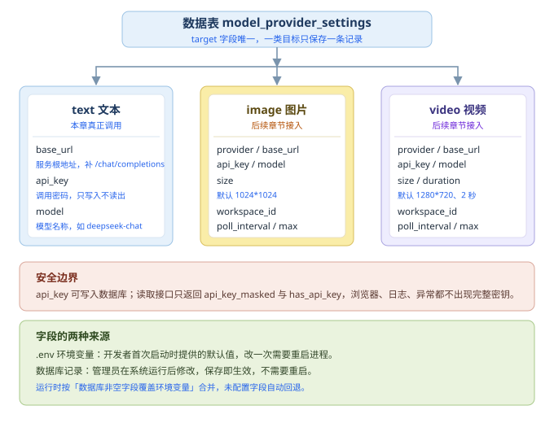
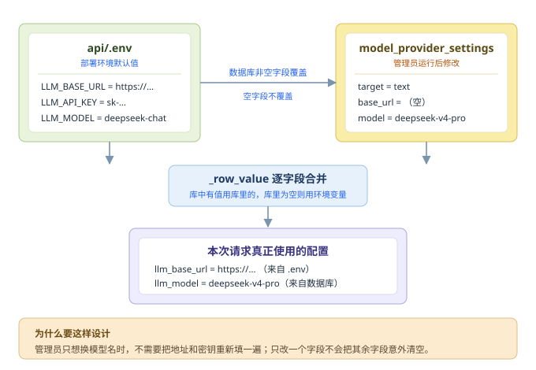
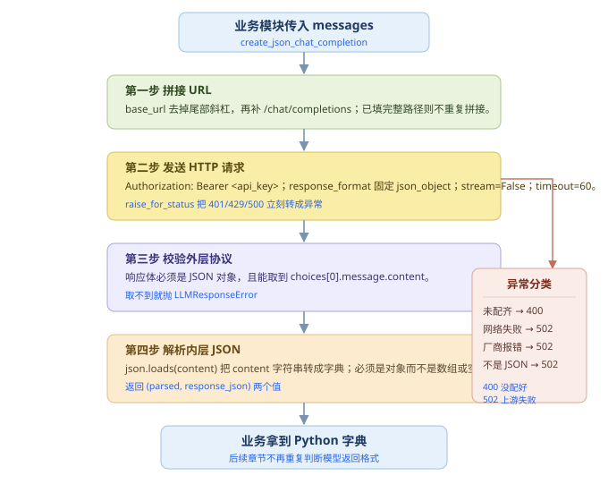

# 06 《电商运营助手》模型配置与调用

> 前面的章节里，商品、店铺、库存这些业务数据都由使用者填写或上传。从本章开始，后端要具备「调用文本大模型」的能力。
>
> 本章不做商品诊断，也不做文案或图片生成，只完成后续所有智能功能都会复用的底座：配置从哪里来、请求如何发出、返回内容如何变成可靠的 JSON、出错时如何向调用方说明问题。
>
> 本章完成后，你可以在 Swagger 中保存一套文本模型配置，调用「测试连接」接口，由后端向兼容 OpenAI Chat Completions 协议的模型服务发起一次结构化请求，并拿到确定的结果。

## 一、模型配置项说明

> 模型服务可以来自云厂商、公司内部网关或本机部署。它们地址不同，但只要兼容 OpenAI 的 Chat Completions 协议，就可以共用同一套调用函数。区分它们的，就是下面这组配置项。

### 1.1 三类配置目标

项目把模型配置按 `text`（文本）、`image`（图片）、`video`（视频）三个目标分开保存，落在同一张数据表 `model_provider_settings` 里，用 `target` 字段区分。

本章只真正调用 `text`。图片和视频的配置先保留位置，后续章节接入各自的生成接口。这样你现在就能理解「配置是统一的」，又不会在还没讲到图片与视频协议时被大量细节打断。

**图 1-1 模型配置项结构**



三类目标共用同一张表，每类目标只保存一条记录（`target` 唯一）。文本配置只有三个字段，图片与视频因为要轮询异步任务，额外需要供应商标识、尺寸、时长和轮询参数。

### 1.2 四个核心配置项

<table>
<colgroup>
<col style="width:14%">
<col style="width:30%">
<col style="width:32%">
<col style="width:24%">
</colgroup>
<thead>
<tr><th>配置项</th><th>可以理解成</th><th>示例</th><th>能否返回给浏览器</th></tr>
</thead>
<tbody>
<tr><td><code>provider</code></td><td>这套配置的服务商名称</td><td><code>deepseek</code>、<code>company-gateway</code></td><td>可以</td></tr>
<tr><td><code>base_url</code></td><td>模型服务的门牌号</td><td><code>https://api.example.com/v1</code></td><td>可以</td></tr>
<tr><td><code>model</code></td><td>要使用的具体模型名</td><td><code>deepseek-chat</code></td><td>可以</td></tr>
<tr><td><code>api_key</code></td><td>调用服务的密码</td><td><code>sk-...</code></td><td><strong>不可以明文返回</strong></td></tr>
</tbody>
</table>
`api_key` 是唯一有安全约束的字段。它可以写入数据库，但读取接口只能返回脱敏后的形式，例如 `sk-abcd...wxyz`。浏览器、日志和异常消息里都不应出现完整密钥。

### 1.3 数据表中的字段

`ModelProviderSetting` 模型在数据模型设计中已经建立，它对应表 `model_provider_settings`。字段如下。

<table>
<colgroup>
<col style="width:26%">
<col style="width:20%">
<col style="width:54%">
</colgroup>
<thead>
<tr><th>字段</th><th>类型</th><th>说明</th></tr>
</thead>
<tbody>
<tr><td><code>target</code></td><td>枚举，唯一</td><td>取值 <code>text</code> / <code>image</code> / <code>video</code>，一类目标一条记录</td></tr>
<tr><td><code>provider</code></td><td>字符串 50</td><td>服务商标识，文本目标不使用</td></tr>
<tr><td><code>base_url</code></td><td>字符串 1024</td><td>服务根地址，不含 <code>/chat/completions</code></td></tr>
<tr><td><code>api_key</code></td><td>文本</td><td>密钥，只写入不读出</td></tr>
<tr><td><code>model</code></td><td>字符串 120</td><td>模型名称</td></tr>
<tr><td><code>size</code></td><td>字符串 50</td><td>图片或视频尺寸，文本目标不使用</td></tr>
<tr><td><code>duration</code></td><td>整数</td><td>视频时长秒数，只有视频目标使用</td></tr>
<tr><td><code>workspace_id</code></td><td>字符串 120</td><td>供应商侧的工作空间标识</td></tr>
<tr><td><code>poll_interval_seconds</code></td><td>整数</td><td>轮询间隔秒数</td></tr>
<tr><td><code>poll_max_attempts</code></td><td>整数</td><td>轮询最大次数，超过即判定失败</td></tr>
</tbody>
</table>

### 1.4 环境变量中的默认值

`api/app/core/config.py` 为每个字段提供了环境变量默认值，配置类通过别名读取同名的大写环境变量。

<table>
<colgroup>
<col style="width:34%">
<col style="width:22%">
<col style="width:44%">
</colgroup>
<thead>
<tr><th>配置项</th><th>默认值</th><th>环境变量</th></tr>
</thead>
<tbody>
<tr><td><code>llm_base_url</code></td><td>无</td><td><code>LLM_BASE_URL</code></td></tr>
<tr><td><code>llm_api_key</code></td><td>无</td><td><code>LLM_API_KEY</code></td></tr>
<tr><td><code>llm_model</code></td><td>无</td><td><code>LLM_MODEL</code></td></tr>
<tr><td><code>image_provider</code></td><td><code>jimeng</code></td><td><code>IMAGE_PROVIDER</code></td></tr>
<tr><td><code>image_base_url</code></td><td><code>https://visual.volcengineapi.com</code></td><td><code>IMAGE_BASE_URL</code></td></tr>
<tr><td><code>image_model</code></td><td><code>jimeng_t2i_v30</code></td><td><code>IMAGE_MODEL</code></td></tr>
<tr><td><code>image_size</code></td><td><code>1024*1024</code></td><td><code>IMAGE_SIZE</code></td></tr>
<tr><td><code>image_poll_interval_seconds</code></td><td><code>5</code></td><td><code>IMAGE_POLL_INTERVAL_SECONDS</code></td></tr>
<tr><td><code>image_poll_max_attempts</code></td><td><code>24</code></td><td><code>IMAGE_POLL_MAX_ATTEMPTS</code></td></tr>
<tr><td><code>video_provider</code></td><td><code>jimeng</code></td><td><code>VIDEO_PROVIDER</code></td></tr>
<tr><td><code>video_model</code></td><td><code>jimeng_t2v_v30</code></td><td><code>VIDEO_MODEL</code></td></tr>
<tr><td><code>video_size</code></td><td><code>1280*720</code></td><td><code>VIDEO_SIZE</code></td></tr>
<tr><td><code>video_duration</code></td><td><code>5</code></td><td><code>VIDEO_DURATION</code></td></tr>
<tr><td><code>video_poll_interval_seconds</code></td><td><code>10</code></td><td><code>VIDEO_POLL_INTERVAL_SECONDS</code></td></tr>
<tr><td><code>video_poll_max_attempts</code></td><td><code>36</code></td><td><code>VIDEO_POLL_MAX_ATTEMPTS</code></td></tr>
</tbody>
</table>

文本三项没有默认值是有意设计的：没有地址、密钥和模型名，调用一定失败，与其给一个错误默认值，不如保持为空，让接口明确返回「尚未配置」。

## 二、模型配置的必要性

> 一个自然的疑问是：密钥不是已经写在 `.env` 里了吗，为什么还要存一份到数据库？这一节回答这个问题。

### 2.1 只靠环境变量会遇到的问题

若业务路由各自保存 API Key、各自拼接 URL、各自解析模型回复，很快会产生三类问题。

<table>
<colgroup>
<col style="width:30%">
<col style="width:70%">
</colgroup>
<thead>
<tr><th>问题</th><th>具体表现</th></tr>
</thead>
<tbody>
<tr><td>改模型要动很多文件</td><td>模型名散落在各个业务模块，换供应商时需要逐处修改并重新部署</td></tr>
<tr><td>密钥容易被接口回显</td><td>哪个模块都能读到完整密钥，稍不注意就随响应或日志输出</td></tr>
<tr><td>返回格式无法保证</td><td>某个模型返回了普通说明文字，业务数据就存不进去，且错误发生在深处难以定位</td></tr>
</tbody>
</table>

### 2.2 环境变量与数据库的分工

两种配置方式不是替代关系，而是各有适用场景。

<table>
<colgroup>
<col style="width:16%">
<col style="width:42%">
<col style="width:42%">
</colgroup>
<thead>
<tr><th>对比维度</th><th><code>.env</code> 环境变量</th><th>数据库配置</th></tr>
</thead>
<tbody>
<tr><td>修改者</td><td>部署或开发人员</td><td>系统管理员、运营负责人</td></tr>
<tr><td>修改时机</td><td>部署前，写进文件或容器环境变量</td><td>系统运行期间，在界面上随时改</td></tr>
<tr><td>生效方式</td><td>通常需要重启进程</td><td>保存即生效，不需要重启</td></tr>
<tr><td>适合保存</td><td>首次启动必需的默认值、数据库地址、签名密钥</td><td>会频繁调整的供应商、模型名、轮询参数</td></tr>
<tr><td>不适合保存</td><td>需要按租户或按环境频繁切换的模型参数</td><td>数据库地址本身（先有库才有这条配置）</td></tr>
<tr><td>本项目承担的角色</td><td>提供兜底默认值，保证库还没建表时也能启动</td><td>运行期的权威配置，非空字段覆盖环境变量</td></tr>
</tbody>
</table>

### 2.3 运行时的合并规则

两种方式按固定优先级合并：数据库中目标类型对应的**非空字段**覆盖 `.env` 中的同名默认字段，得到本次请求真正使用的配置。

**图 2-1 配置优先级与合并过程**



图中右侧数据库记录的 `base_url` 为空，所以最终地址仍来自 `.env`；`model` 有值，于是覆盖环境变量的模型名。这种「非空覆盖」避免了只改一个字段时把其余字段意外清空。

合并结果是一份运行时的配置副本，不会反过来改写 `.env` 文件。数据库临时不可用时，代码回退到环境变量默认配置，这有利于本地排查，也不会把数据库故障伪装成「配置已保存」。

### 2.4 密钥的安全边界

<table>
<colgroup>
<col style="width:30%">
<col style="width:70%">
</colgroup>
<thead>
<tr><th>环节</th><th>规则</th></tr>
</thead>
<tbody>
<tr><td>写入</td><td>可以写入完整的 <code>api_key</code>；提交空字符串表示「不更新密钥」</td></tr>
<tr><td>读取</td><td>只返回 <code>api_key_masked</code> 脱敏值与 <code>has_api_key</code> 布尔值</td></tr>
<tr><td>调用</td><td>密钥只在服务端拼进 <code>Authorization</code> 请求头，不出现在请求体里</td></tr>
<tr><td>异常处理</td><td>异常消息只说明类别，不回显密钥原文</td></tr>
</tbody>
</table>

## 三、模型配置读写服务

> 这一节创建最底层的 `model_settings.py`。路由和模型调用都依赖它，所以必须最先写。

### 3.1 数据合同定义

在 `api/app/schemas.py` 末尾追加下列模型。读取模型只暴露脱敏字段，更新模型的每个字段都可空，支持「只改一项」。（此步骤在基础业务代码导入部分已经实现）

```python
class TextModelSettingsRead(BaseModel):
    base_url: str = ""
    api_key_masked: str = ""
    has_api_key: bool = False
    model: str = ""


class ImageModelSettingsRead(BaseModel):
    provider: str = ""
    base_url: str = ""
    api_key_masked: str = ""
    has_api_key: bool = False
    model: str = ""
    size: str = "1024*1024"
    workspace_id: str = ""
    poll_interval_seconds: int = 5
    poll_max_attempts: int = 24


class VideoModelSettingsRead(BaseModel):
    provider: str = ""
    base_url: str = ""
    api_key_masked: str = ""
    has_api_key: bool = False
    model: str = ""
    size: str = "1280*720"
    duration: int = 2
    workspace_id: str = ""
    poll_interval_seconds: int = 10
    poll_max_attempts: int = 36


class ModelSettingsRead(BaseModel):
    # 设置读取模型只返回脱敏值和 has_api_key，前端不会拿到明文供应商密钥。
    text: TextModelSettingsRead
    image: ImageModelSettingsRead
    video: VideoModelSettingsRead


class TextModelSettingsUpdate(BaseModel):
    base_url: str | None = None
    api_key: str | None = None
    model: str | None = None


class ImageModelSettingsUpdate(BaseModel):
    provider: str | None = None
    base_url: str | None = None
    api_key: str | None = None
    model: str | None = None
    size: str | None = None
    workspace_id: str | None = None
    poll_interval_seconds: int | None = Field(default=None, ge=1)
    poll_max_attempts: int | None = Field(default=None, ge=1)


class VideoModelSettingsUpdate(BaseModel):
    provider: str | None = None
    base_url: str | None = None
    api_key: str | None = None
    model: str | None = None
    size: str | None = None
    duration: int | None = Field(default=None, ge=1)
    workspace_id: str | None = None
    poll_interval_seconds: int | None = Field(default=None, ge=1)
    poll_max_attempts: int | None = Field(default=None, ge=1)


class ModelSettingsUpdate(BaseModel):
    # 设置更新按 text/image/video 局部提交，未提交目标保持原供应商配置。
    text: TextModelSettingsUpdate | None = None
    image: ImageModelSettingsUpdate | None = None
    video: VideoModelSettingsUpdate | None = None


class ModelSettingsTestRequest(BaseModel):
    target: str = Field(pattern="^(text|image|video)$")


class ModelSettingsTestResult(BaseModel):
    target: str
    ok: bool
    message: str
```

`ModelSettingsTestRequest` 用 `pattern` 把 `target` 限制在三个取值内，非法值在进入函数前就会被 FastAPI 拦下。

### 3.2 创建配置读写服务

创建 `api/app/services/model_settings.py`模块。

先看这个模块包含哪些函数。带下划线开头的是私有函数，只在模块内部使用，不对外暴露。

<table>
<colgroup>
<col style="width:28%">
<col style="width:14%">
<col style="width:58%">
</colgroup>
<thead>
<tr><th>函数名</th><th>公共 / 私有</th><th>说明</th></tr>
</thead>
<tbody>
<tr><td><code>read_model_settings()</code></td><td>公共</td><td>读取三类配置，密钥以脱敏形式返回，供读取接口使用</td></tr>
<tr><td><code>update_model_settings()</code></td><td>公共</td><td>按提交的目标局部更新或新建数据库记录，保存后回读最新配置</td></tr>
<tr><td><code>get_runtime_settings()</code></td><td>公共</td><td>合并数据库与环境变量，返回本次调用真正使用的运行时配置</td></tr>
<tr><td><code>_read_rows()</code></td><td>私有</td><td>按 target 取出全部配置行并组成字典，库不可用时回退为空字典</td></tr>
<tr><td><code>_rows_from_session()</code></td><td>私有</td><td>在一个会话内查询配置行并转成 target 到记录的映射</td></tr>
<tr><td><code>_effective_text()</code></td><td>私有</td><td>计算文本目标最终生效的地址、密钥与模型名</td></tr>
<tr><td><code>_effective_image()</code></td><td>私有</td><td>计算图片目标最终生效的字段，含尺寸与轮询默认参数</td></tr>
<tr><td><code>_effective_video()</code></td><td>私有</td><td>计算视频目标最终生效的字段，含尺寸、时长与轮询默认参数</td></tr>
<tr><td><code>_row_value()</code></td><td>私有</td><td>逐字段取值，数据库非空才覆盖，否则回退环境变量</td></tr>
<tr><td><code>_apply_payload()</code></td><td>私有</td><td>把一个目标类型的提交内容应用到一条配置记录上</td></tr>
<tr><td><code>_set_if_present()</code></td><td>私有</td><td>字段出现在请求中才赋值，字符串去空白后为空则置为 None</td></tr>
<tr><td><code>_set_secret_if_present()</code></td><td>私有</td><td>只写入非空密钥，空字符串表示不更新已有密钥</td></tr>
<tr><td><code>_mask_secret()</code></td><td>私有</td><td>把密钥转成部分可见的脱敏字符串</td></tr>
</tbody>
</table>
三个公共函数是模块的对外入口：读取、保存、取得运行时配置。其余私有函数各管一件事，共同支撑「非空覆盖」与「密钥不泄露」两条规则。

下面是`api/app/services/model_settings.py`模块的增量代码实现：

#### 3.2.1 添加依赖

```python
from types import SimpleNamespace
from typing import Any

from sqlalchemy import select
from sqlalchemy.exc import SQLAlchemyError
from sqlalchemy.orm import Session

from app.core.config import Settings, get_settings
from app.db.session import SessionLocal
from app.models import ModelProviderSetting, ModelTarget

# 定义文本与模型类型枚举的字典映射
TARGETS = {
    "text": ModelTarget.TEXT,
    "image": ModelTarget.IMAGE,
    "video": ModelTarget.VIDEO,
}
```

#### 3.2.2 读取模型配置信息（面向前端）

- 读取模型配置信息响应给前端，需要对敏感数据进行脱敏操作

##### read_model_settings

```python
def read_model_settings(db: Session | None = None, settings: Settings | None = None) -> dict:
    """读取模型配置；集中执行业务校验、状态变更与持久化，并返回可验证结果。"""
    # 按“输入归一化 → 业务校验 → 状态或持久化”推进，异常不得留下半完成结果。
    settings = settings or get_settings()
    rows = _read_rows(db)
    text = _effective_text(settings, rows.get(ModelTarget.TEXT))
    image = _effective_image(settings, rows.get(ModelTarget.IMAGE))
    video = _effective_video(settings, rows.get(ModelTarget.VIDEO))

    # 配置读取接口只返回脱敏 key 和是否已配置，避免前端或浏览器日志暴露供应商密钥。
    return {
        "text": {
            "base_url": text.llm_base_url or "",
            "api_key_masked": _mask_secret(text.llm_api_key),
            "has_api_key": bool(text.llm_api_key),
            "model": text.llm_model or "",
        },
        "image": {
            "provider": image.image_provider or "",
            "base_url": image.image_base_url or "",
            "api_key_masked": _mask_secret(image.image_api_key),
            "has_api_key": bool(image.image_api_key),
            "model": image.image_model or "",
            "size": image.image_size,
            "workspace_id": image.image_workspace_id or "",
            "poll_interval_seconds": image.image_poll_interval_seconds,
            "poll_max_attempts": image.image_poll_max_attempts,
        },
        "video": {
            "provider": video.video_provider or "",
            "base_url": video.video_base_url or "",
            "api_key_masked": _mask_secret(video.video_api_key),
            "has_api_key": bool(video.video_api_key),
            "model": video.video_model or "",
            "size": video.video_size,
            "duration": video.video_duration,
            "workspace_id": video.video_workspace_id or "",
            "poll_interval_seconds": video.video_poll_interval_seconds,
            "poll_max_attempts": video.video_poll_max_attempts,
        },
    }
```

##### _read_rows

```python
def _read_rows(db: Session | None = None) -> dict[ModelTarget, ModelProviderSetting]:
    """读取行，统一主流程中的格式、默认值和异常边界。"""
    # 按“输入归一化 → 业务校验 → 状态或持久化”推进，异常不得留下半完成结果。
    if db is not None:
        return _rows_from_session(db)
    try:
        with SessionLocal() as session:
            return _rows_from_session(session)
    except SQLAlchemyError:
        # 应用启动或迁移前可能还没有配置表，回退环境变量，保证健康检查和初始化脚本可运行。
        return {}
```

##### _rows_from_session

```python
def _rows_from_session(db: Session) -> dict[ModelTarget, ModelProviderSetting]:
    """行from会话，统一主流程中的格式、默认值和异常边界。"""
    rows = db.scalars(select(ModelProviderSetting)).all()
    return {row.target: row for row in rows}
```

##### _effective_text

返回类型`SimpleNamespace`：SimpleNamespace 是 Python 标准库 types 模块提供的一个轻量级对象类，它允许你通过关键字参数动态创建属性，生成一个可以用 . 语法访问属性的对象。

```python
def _effective_text(settings: Settings, row: ModelProviderSetting | None) -> SimpleNamespace:
    """生效文本，统一主流程中的格式、默认值和异常边界。"""
    return SimpleNamespace(
        llm_base_url=_row_value(row, "base_url", settings.llm_base_url),
        llm_api_key=_row_value(row, "api_key", settings.llm_api_key),
        llm_model=_row_value(row, "model", settings.llm_model),
    )
```

```python
def _row_value(row: ModelProviderSetting | None, field: str, fallback: Any) -> Any:
    """行值，统一主流程中的格式、默认值和异常边界。"""
    if row is None:
        return fallback
    value = getattr(row, field)
    if value is None or value == "":
        return fallback
    return value
```

##### _effective_image

```python
def _effective_image(settings: Settings, row: ModelProviderSetting | None) -> SimpleNamespace:
    """生效图片，统一主流程中的格式、默认值和异常边界。"""
    # 按“输入归一化 → 业务校验 → 状态或持久化”推进，异常不得留下半完成结果。
    return SimpleNamespace(
        image_provider=_row_value(row, "provider", settings.image_provider),
        image_base_url=_row_value(row, "base_url", settings.image_base_url),
        image_api_key=_row_value(row, "api_key", settings.image_api_key),
        image_model=_row_value(row, "model", settings.image_model),
        image_size=_row_value(row, "size", settings.image_size) or "1024*1024",
        image_workspace_id=_row_value(row, "workspace_id", settings.image_workspace_id),
        image_poll_interval_seconds=_row_value(row,"poll_interval_seconds",
            settings.image_poll_interval_seconds,) or 5,
        image_poll_max_attempts=_row_value(row,"poll_max_attempts",
            settings.image_poll_max_attempts,) or 24,
    )
```

##### _effective_video

```python
def _effective_video(settings: Settings, row: ModelProviderSetting | None) -> SimpleNamespace:
    """生效视频，统一主流程中的格式、默认值和异常边界。"""
    # 按“输入归一化 → 业务校验 → 状态或持久化”推进，异常不得留下半完成结果。
    return SimpleNamespace(
        video_provider=_row_value(row, "provider", settings.video_provider),
        video_base_url=_row_value(row, "base_url", settings.video_base_url),
        video_api_key=_row_value(row, "api_key", settings.video_api_key),
        video_model=_row_value(row, "model", settings.video_model),
        video_size=_row_value(row, "size", settings.video_size) or "1280*720",
        video_duration=_row_value(row, "duration", settings.video_duration) or 2,
        video_workspace_id=_row_value(row, "workspace_id", settings.video_workspace_id),
        video_poll_interval_seconds=_row_value(
            row,
            "poll_interval_seconds",
            settings.video_poll_interval_seconds,
        )
        or 10,
        video_poll_max_attempts=_row_value(
            row,
            "poll_max_attempts",
            settings.video_poll_max_attempts,
        )
        or 36,
    )
```

##### _row_value

```python
def _row_value(row: ModelProviderSetting | None, field: str, fallback: Any) -> Any:
    """行值，统一主流程中的格式、默认值和异常边界。"""
    if row is None:
        return fallback
    value = getattr(row, field)
    if value is None or value == "":
        return fallback
    return value
```

##### _mask_secret

```python
def _mask_secret(value: str | None) -> str:
    """脱敏密钥，统一主流程中的格式、默认值和异常边界。"""
    # 按“输入归一化 → 业务校验 → 状态或持久化”推进，异常不得留下半完成结果。
    if not value:
        return ""
    if len(value) <= 6:
        return "******"
    if len(value) <= 16:
        return f"{value[:3]}...{value[-3:]}"
    return f"{value[:7]}...{value[-6:]}"
```

#### 3.2.3 读取模型配置信息（面向应用）

##### get_runtime_settings

```python
def get_runtime_settings(settings: Settings | None = None) -> Any:
    """获取runtime配置；集中执行业务校验、状态变更与持久化，并返回可验证结果。"""
    # 按“输入归一化 → 业务校验 → 状态或持久化”推进，异常不得留下半完成结果。
    settings = settings or get_settings()
    rows = _read_rows()
    text = _effective_text(settings, rows.get(ModelTarget.TEXT))
    image = _effective_image(settings, rows.get(ModelTarget.IMAGE))
    video = _effective_video(settings, rows.get(ModelTarget.VIDEO))

    # 运行态配置允许数据库覆盖环境变量，便于运营后台调整模型；未配置字段仍回退到部署环境。
    return SimpleNamespace(
        app_name=settings.app_name,
        database_url=settings.database_url,
        api_cors_origins=settings.api_cors_origins,
        llm_base_url=text.llm_base_url,
        llm_api_key=text.llm_api_key,
        llm_model=text.llm_model,
        image_provider=image.image_provider,
        image_base_url=image.image_base_url,
        image_api_key=image.image_api_key,
        image_model=image.image_model,
        image_size=image.image_size,
        image_workspace_id=image.image_workspace_id,
        image_poll_interval_seconds=image.image_poll_interval_seconds,
        image_poll_max_attempts=image.image_poll_max_attempts,
        video_provider=video.video_provider,
        video_base_url=video.video_base_url,
        video_api_key=video.video_api_key,
        video_model=video.video_model,
        video_size=video.video_size,
        video_duration=video.video_duration,
        video_workspace_id=video.video_workspace_id,
        video_poll_interval_seconds=video.video_poll_interval_seconds,
        video_poll_max_attempts=video.video_poll_max_attempts,
    )
```

#### 3.2.4 更新模型配置信息

##### update_model_settings

```python
def update_model_settings(payload: dict, db: Session) -> dict:
    """更新模型配置；集中执行业务校验、状态变更与持久化，并返回可验证结果。"""
    # 按“输入归一化 → 业务校验 → 状态或持久化”推进，异常不得留下半完成结果。
    for target_name, model_target in TARGETS.items():
        target_payload = payload.get(target_name) or {}
        if not target_payload:
            continue
        # 文本、图片、视频供应商分开保存，避免后续只换图片模型时影响文本生成链路。
        row = db.scalars(
            select(ModelProviderSetting).where(ModelProviderSetting.target == model_target)
        ).first()
        if row is None:
            row = ModelProviderSetting(target=model_target)
            db.add(row)

        _apply_payload(row, target_name, target_payload)

    db.commit()
    return read_model_settings(db)
```

##### _apply_payload

```python
def _apply_payload(row: ModelProviderSetting, target_name: str, payload: dict) -> None:
    """应用载荷，统一主流程中的格式、默认值和异常边界。"""
    if target_name == "text":
        _set_if_present(row, "base_url", payload, "base_url")
        _set_secret_if_present(row, payload)
        _set_if_present(row, "model", payload, "model")
        return

    _set_if_present(row, "provider", payload, "provider")
    _set_if_present(row, "base_url", payload, "base_url")
    _set_secret_if_present(row, payload)
    _set_if_present(row, "model", payload, "model")
    _set_if_present(row, "size", payload, "size")
    _set_if_present(row, "workspace_id", payload, "workspace_id")
    _set_if_present(row, "poll_interval_seconds", payload, "poll_interval_seconds")
    _set_if_present(row, "poll_max_attempts", payload, "poll_max_attempts")
    if target_name == "video":
        _set_if_present(row, "duration", payload, "duration")
```

##### _set_if_present

```python
def _set_if_present(row: ModelProviderSetting, field: str, payload: dict, payload_field: str) -> None:
    """设置ifpresent，统一主流程中的格式、默认值和异常边界。"""
    if payload_field not in payload:
        return
    value = payload[payload_field]
    if isinstance(value, str):
        value = value.strip() or None
    setattr(row, field, value)
```

##### _set_secret_if_present

```python
def _set_secret_if_present(row: ModelProviderSetting, payload: dict) -> None:
    """设置密钥ifpresent，统一主流程中的格式、默认值和异常边界。"""
    # 按“输入归一化 → 业务校验 → 状态或持久化”推进，异常不得留下半完成结果。
    if "api_key" not in payload:
        return
    value = payload["api_key"]
    if isinstance(value, str):
        value = value.strip()
    # 空字符串表示“不更新密钥”，防止保存表单时把已有供应商 key 意外清空。
    if value:
        row.api_key = value
```

### 3.3 model_settings完整代码

在 `api/app/services/model_settings.py`写入下面的完整代码：

```python
from types import SimpleNamespace
from typing import Any

from sqlalchemy import select
from sqlalchemy.exc import SQLAlchemyError
from sqlalchemy.orm import Session

from app.core.config import Settings, get_settings
from app.db.session import SessionLocal
from app.models import ModelProviderSetting, ModelTarget


TARGETS = {
    "text": ModelTarget.TEXT,
    "image": ModelTarget.IMAGE,
    "video": ModelTarget.VIDEO,
}


def read_model_settings(db: Session | None = None, settings: Settings | None = None) -> dict:
    """读取模型配置；集中执行业务校验、状态变更与持久化，并返回可验证结果。"""
    # 按“输入归一化 → 业务校验 → 状态或持久化”推进，异常不得留下半完成结果。
    settings = settings or get_settings()
    rows = _read_rows(db)
    text = _effective_text(settings, rows.get(ModelTarget.TEXT))
    image = _effective_image(settings, rows.get(ModelTarget.IMAGE))
    video = _effective_video(settings, rows.get(ModelTarget.VIDEO))

    # 配置读取接口只返回脱敏 key 和是否已配置，避免前端或浏览器日志暴露供应商密钥。
    return {
        "text": {
            "base_url": text.llm_base_url or "",
            "api_key_masked": _mask_secret(text.llm_api_key),
            "has_api_key": bool(text.llm_api_key),
            "model": text.llm_model or "",
        },
        "image": {
            "provider": image.image_provider or "",
            "base_url": image.image_base_url or "",
            "api_key_masked": _mask_secret(image.image_api_key),
            "has_api_key": bool(image.image_api_key),
            "model": image.image_model or "",
            "size": image.image_size,
            "workspace_id": image.image_workspace_id or "",
            "poll_interval_seconds": image.image_poll_interval_seconds,
            "poll_max_attempts": image.image_poll_max_attempts,
        },
        "video": {
            "provider": video.video_provider or "",
            "base_url": video.video_base_url or "",
            "api_key_masked": _mask_secret(video.video_api_key),
            "has_api_key": bool(video.video_api_key),
            "model": video.video_model or "",
            "size": video.video_size,
            "duration": video.video_duration,
            "workspace_id": video.video_workspace_id or "",
            "poll_interval_seconds": video.video_poll_interval_seconds,
            "poll_max_attempts": video.video_poll_max_attempts,
        },
    }


def update_model_settings(payload: dict, db: Session) -> dict:
    """更新模型配置；集中执行业务校验、状态变更与持久化，并返回可验证结果。"""
    # 按“输入归一化 → 业务校验 → 状态或持久化”推进，异常不得留下半完成结果。
    for target_name, model_target in TARGETS.items():
        target_payload = payload.get(target_name) or {}
        if not target_payload:
            continue
        # 文本、图片、视频供应商分开保存，避免后续只换图片模型时影响文本生成链路。
        row = db.scalars(
            select(ModelProviderSetting).where(ModelProviderSetting.target == model_target)
        ).first()
        if row is None:
            row = ModelProviderSetting(target=model_target)
            db.add(row)

        _apply_payload(row, target_name, target_payload)

    db.commit()
    return read_model_settings(db)


def get_runtime_settings(settings: Settings | None = None) -> Any:
    """获取runtime配置；集中执行业务校验、状态变更与持久化，并返回可验证结果。"""
    # 按“输入归一化 → 业务校验 → 状态或持久化”推进，异常不得留下半完成结果。
    settings = settings or get_settings()
    rows = _read_rows()
    text = _effective_text(settings, rows.get(ModelTarget.TEXT))
    image = _effective_image(settings, rows.get(ModelTarget.IMAGE))
    video = _effective_video(settings, rows.get(ModelTarget.VIDEO))

    # 运行态配置允许数据库覆盖环境变量，便于运营后台调整模型；未配置字段仍回退到部署环境。
    return SimpleNamespace(
        app_name=settings.app_name,
        database_url=settings.database_url,
        api_cors_origins=settings.api_cors_origins,
        llm_base_url=text.llm_base_url,
        llm_api_key=text.llm_api_key,
        llm_model=text.llm_model,
        image_provider=image.image_provider,
        image_base_url=image.image_base_url,
        image_api_key=image.image_api_key,
        image_model=image.image_model,
        image_size=image.image_size,
        image_workspace_id=image.image_workspace_id,
        image_poll_interval_seconds=image.image_poll_interval_seconds,
        image_poll_max_attempts=image.image_poll_max_attempts,
        video_provider=video.video_provider,
        video_base_url=video.video_base_url,
        video_api_key=video.video_api_key,
        video_model=video.video_model,
        video_size=video.video_size,
        video_duration=video.video_duration,
        video_workspace_id=video.video_workspace_id,
        video_poll_interval_seconds=video.video_poll_interval_seconds,
        video_poll_max_attempts=video.video_poll_max_attempts,
    )


def _read_rows(db: Session | None = None) -> dict[ModelTarget, ModelProviderSetting]:
    """读取行，统一主流程中的格式、默认值和异常边界。"""
    # 按“输入归一化 → 业务校验 → 状态或持久化”推进，异常不得留下半完成结果。
    if db is not None:
        return _rows_from_session(db)

    try:
        with SessionLocal() as session:
            return _rows_from_session(session)
    except SQLAlchemyError:
        # 应用启动或迁移前可能还没有配置表，回退环境变量，保证健康检查和初始化脚本可运行。
        return {}


def _rows_from_session(db: Session) -> dict[ModelTarget, ModelProviderSetting]:
    """行from会话，统一主流程中的格式、默认值和异常边界。"""
    rows = db.scalars(select(ModelProviderSetting)).all()
    return {row.target: row for row in rows}


def _effective_text(settings: Settings, row: ModelProviderSetting | None) -> SimpleNamespace:
    """生效文本，统一主流程中的格式、默认值和异常边界。"""
    return SimpleNamespace(
        llm_base_url=_row_value(row, "base_url", settings.llm_base_url),
        llm_api_key=_row_value(row, "api_key", settings.llm_api_key),
        llm_model=_row_value(row, "model", settings.llm_model),
    )


def _effective_image(settings: Settings, row: ModelProviderSetting | None) -> SimpleNamespace:
    """生效图片，统一主流程中的格式、默认值和异常边界。"""
    # 按“输入归一化 → 业务校验 → 状态或持久化”推进，异常不得留下半完成结果。
    return SimpleNamespace(
        image_provider=_row_value(row, "provider", settings.image_provider),
        image_base_url=_row_value(row, "base_url", settings.image_base_url),
        image_api_key=_row_value(row, "api_key", settings.image_api_key),
        image_model=_row_value(row, "model", settings.image_model),
        image_size=_row_value(row, "size", settings.image_size) or "1024*1024",
        image_workspace_id=_row_value(row, "workspace_id", settings.image_workspace_id),
        image_poll_interval_seconds=_row_value(
            row,
            "poll_interval_seconds",
            settings.image_poll_interval_seconds,
        )
        or 5,
        image_poll_max_attempts=_row_value(
            row,
            "poll_max_attempts",
            settings.image_poll_max_attempts,
        )
        or 24,
    )


def _effective_video(settings: Settings, row: ModelProviderSetting | None) -> SimpleNamespace:
    """生效视频，统一主流程中的格式、默认值和异常边界。"""
    # 按“输入归一化 → 业务校验 → 状态或持久化”推进，异常不得留下半完成结果。
    return SimpleNamespace(
        video_provider=_row_value(row, "provider", settings.video_provider),
        video_base_url=_row_value(row, "base_url", settings.video_base_url),
        video_api_key=_row_value(row, "api_key", settings.video_api_key),
        video_model=_row_value(row, "model", settings.video_model),
        video_size=_row_value(row, "size", settings.video_size) or "1280*720",
        video_duration=_row_value(row, "duration", settings.video_duration) or 2,
        video_workspace_id=_row_value(row, "workspace_id", settings.video_workspace_id),
        video_poll_interval_seconds=_row_value(
            row,
            "poll_interval_seconds",
            settings.video_poll_interval_seconds,
        )
        or 10,
        video_poll_max_attempts=_row_value(
            row,
            "poll_max_attempts",
            settings.video_poll_max_attempts,
        )
        or 36,
    )


def _row_value(row: ModelProviderSetting | None, field: str, fallback: Any) -> Any:
    """行值，统一主流程中的格式、默认值和异常边界。"""
    if row is None:
        return fallback
    value = getattr(row, field)
    if value is None or value == "":
        return fallback
    return value


def _apply_payload(row: ModelProviderSetting, target_name: str, payload: dict) -> None:
    """应用载荷，统一主流程中的格式、默认值和异常边界。"""
    if target_name == "text":
        _set_if_present(row, "base_url", payload, "base_url")
        _set_secret_if_present(row, payload)
        _set_if_present(row, "model", payload, "model")
        return

    _set_if_present(row, "provider", payload, "provider")
    _set_if_present(row, "base_url", payload, "base_url")
    _set_secret_if_present(row, payload)
    _set_if_present(row, "model", payload, "model")
    _set_if_present(row, "size", payload, "size")
    _set_if_present(row, "workspace_id", payload, "workspace_id")
    _set_if_present(row, "poll_interval_seconds", payload, "poll_interval_seconds")
    _set_if_present(row, "poll_max_attempts", payload, "poll_max_attempts")
    if target_name == "video":
        _set_if_present(row, "duration", payload, "duration")


def _set_if_present(row: ModelProviderSetting, field: str, payload: dict, payload_field: str) -> None:
    """设置ifpresent，统一主流程中的格式、默认值和异常边界。"""
    if payload_field not in payload:
        return
    value = payload[payload_field]
    if isinstance(value, str):
        value = value.strip() or None
    setattr(row, field, value)


def _set_secret_if_present(row: ModelProviderSetting, payload: dict) -> None:
    """设置密钥ifpresent，统一主流程中的格式、默认值和异常边界。"""
    # 按“输入归一化 → 业务校验 → 状态或持久化”推进，异常不得留下半完成结果。
    if "api_key" not in payload:
        return
    value = payload["api_key"]
    if isinstance(value, str):
        value = value.strip()
    # 空字符串表示“不更新密钥”，防止保存表单时把已有供应商 key 意外清空。
    if value:
        row.api_key = value


def _mask_secret(value: str | None) -> str:
    """脱敏密钥，统一主流程中的格式、默认值和异常边界。"""
    # 按“输入归一化 → 业务校验 → 状态或持久化”推进，异常不得留下半完成结果。
    if not value:
        return ""
    if len(value) <= 6:
        return "******"
    if len(value) <= 16:
        return f"{value[:3]}...{value[-3:]}"
    return f"{value[:7]}...{value[-6:]}"
```

### 3.4 函数与常量职责

<table>
<colgroup>
<col style="width:28%">
<col style="width:34%">
<col style="width:38%">
</colgroup>
<thead>
<tr><th>函数或常量</th><th>作用</th><th>为什么需要它</th></tr>
</thead>
<tbody>
<tr><td><code>TARGETS</code></td><td>固定三类目标与枚举的映射</td><td>避免调用方随手写出不受支持的字符串</td></tr>
<tr><td><code>read_model_settings()</code></td><td>读取三类配置并对 Key 脱敏</td><td>供读取接口安全展示</td></tr>
<tr><td><code>update_model_settings()</code></td><td>按提交字段更新或新建数据库记录</td><td>支持「只更新一个字段」</td></tr>
<tr><td><code>get_runtime_settings()</code></td><td>合并数据库和 <code>.env</code>，返回运行时配置</td><td>让所有模型调用使用同一规则</td></tr>
<tr><td><code>_apply_payload()</code></td><td>把一个目标类型的输入应用到一条记录</td><td>新增和更新共用同一套字段处理</td></tr>
<tr><td><code>_row_value()</code></td><td>逐字段做非空覆盖</td><td>空字符串不覆盖环境变量，避免误清空</td></tr>
<tr><td><code>_mask_secret()</code></td><td>把 Key 变成部分可见的字符串</td><td>防止配置页泄露密钥</td></tr>
</tbody>
</table>
`get_runtime_settings()` 返回的是本次调用使用的配置副本，不会反过来改写 `.env` 文件。数据库临时不可用时，代码回退到环境变量默认配置，这有利于本地排查，也不会把数据库故障伪装成「配置已保存」。

### 3.5 完成后的最小检查

在 `api` 目录运行：

```powershell
uv run python -c "from app.services.model_settings import get_runtime_settings; print(get_runtime_settings().llm_model)"
```

命令能输出模型名（允许为空，输出 `None`）就说明模块可被导入。这一步不要求真的拥有 API Key，只验证 Python 的导入路径和依赖顺序正确。

## 四、文本模型统一调用

> 配置服务已经能提供运行时配置，现在创建唯一允许业务模块直接请求文本模型的文件。

### 4.1 一次调用要跨过的四道关

> 1. 获取文本模型的配置信息：base_url  ----------->   url=base_url +"`/chat/completions`"
>
> 2. 发送http请求，调用模型
> 3. 模型响应数据解析（外层协议）
> 4. 结果解析（JSON---数据对象）

调用方只配置到服务根地址，例如 `https://api.example.com/v1`，`llm.py` 会补上 `/chat/completions`。若已经填写完整路径，也不会重复拼接。

模型服务的 HTTP 响应本身是 JSON，而 `content` 里面又是一段字符串，这段字符串才是业务想用的 JSON：

```json
{
  "choices": [
    {"message": {"content": "{\"title\": \"新品文案\"}"}}
  ]
}
```

这就是「两层 JSON」：外层是厂商协议，内层是业务数据。统一调用函数必须连续完成四步，任何一步失败都要给出明确异常。

**图 4-1 文本模型统一调用的四个步骤**



业务模块从这个函数拿到的永远是 `dict`，不需要每次重新判断模型返回格式。后续章节只会调用 `create_json_chat_completion()`，不会在业务路由里直接写 `httpx.Client()`。

### 4.2 创建统一文本调用服务

创建 `api/app/services/llm.py`模块

#### 4.2.1 增量代码实现

##### 导入模块

```python
import json
from typing import Any

import httpx

from app.core.config import Settings
from app.services.model_settings import get_runtime_settings
```

##### 自定义异常

```python
class LLMNotConfiguredError(RuntimeError):
    pass

class LLMResponseError(RuntimeError):
    pass
```

##### 文本模型调用入口函数

> create_json_chat_completion

```python
def create_json_chat_completion(
    messages: list[dict[str, str]],
    *,
    max_tokens: int = 1800,
    temperature: float = 0.3,
    settings: Settings | None = None,
) -> tuple[dict[str, Any], dict[str, Any]]:
    settings = settings or get_runtime_settings()
    if not is_llm_configured(settings):
        raise LLMNotConfiguredError("LLM provider is not configured.")

    response_json = _post_chat_completion(
        settings=settings,
        messages=messages,
        max_tokens=max_tokens,
        temperature=temperature,
    )
    content = _extract_message_content(response_json)
    try:
        parsed = json.loads(content)
    except json.JSONDecodeError as exc:
        raise LLMResponseError("LLM response was not valid JSON.") from exc

    if not isinstance(parsed, dict):
        raise LLMResponseError("LLM response must be a JSON object.")
    return parsed, response_json
```

##### 判断模型是否配置

```python
def is_llm_configured(settings: Settings | None = None) -> bool:
    settings = settings or get_runtime_settings()
    return bool(settings.llm_base_url and settings.llm_api_key and settings.llm_model)
```

##### 发送模型请求获取结果

````python
def _post_chat_completion(
    *,
    settings: Settings,
    messages: list[dict[str, str]],
    max_tokens: int,
    temperature: float,
) -> dict[str, Any]:
    url = _chat_completion_url(settings.llm_base_url or "")
    payload: dict[str, Any] = {
        "model": settings.llm_model,
        "messages": messages,
        "response_format": {"type": "json_object"},
        "max_tokens": max_tokens,
        "temperature": temperature,
        "stream": False,
    }
    if (settings.llm_model or "").startswith("deepseek-v4"):
        payload["thinking"] = {"type": "disabled"}

    try:
        with httpx.Client(timeout=60) as client:
            response = client.post(
                url,
                headers={
                    "Authorization": f"Bearer {settings.llm_api_key}",
                    "Content-Type": "application/json",
                },
                json=payload,
            )
            response.raise_for_status()
    except httpx.HTTPStatusError as exc:
        detail = f"HTTP {exc.response.status_code}"
        raise LLMResponseError(f"LLM provider returned an error: {detail}") from exc
    except httpx.HTTPError as exc:
        raise LLMResponseError("LLM provider request failed.") from exc

    try:
        data = response.json()
    except ValueError as exc:
        raise LLMResponseError("LLM provider response was not JSON.") from exc
    if not isinstance(data, dict):
        raise LLMResponseError("LLM provider response must be a JSON object.")
    return data
````

##### 拼接模型请求URL

```python
def _chat_completion_url(base_url: str) -> str:
    normalized = base_url.strip().rstrip("/")
    if normalized.endswith("/chat/completions"):
        return normalized
    return f"{normalized}/chat/completions"
```

##### 解析模型响应接口

```python
def _extract_message_content(response_json: dict[str, Any]) -> str:
    try:
        content = response_json["choices"][0]["message"]["content"]
    except (KeyError, IndexError, TypeError) as exc:
        raise LLMResponseError("LLM response did not contain message content.") from exc

    if not isinstance(content, str) or not content.strip():
        raise LLMResponseError("LLM response content was empty.")
    return content
```


#### 4.2.2 完整参考代码

`api/app/services/llm.py`的完整代码

```python
import json
from typing import Any

import httpx

from app.core.config import Settings
from app.services.model_settings import get_runtime_settings


class LLMNotConfiguredError(RuntimeError):
    pass


class LLMResponseError(RuntimeError):
    pass


def is_llm_configured(settings: Settings | None = None) -> bool:
    settings = settings or get_runtime_settings()
    return bool(settings.llm_base_url and settings.llm_api_key and settings.llm_model)


def create_json_chat_completion(
    messages: list[dict[str, str]],
    *,
    max_tokens: int = 1800,
    temperature: float = 0.3,
    settings: Settings | None = None,
) -> tuple[dict[str, Any], dict[str, Any]]:
    settings = settings or get_runtime_settings()
    if not is_llm_configured(settings):
        raise LLMNotConfiguredError("LLM provider is not configured.")

    response_json = _post_chat_completion(
        settings=settings,
        messages=messages,
        max_tokens=max_tokens,
        temperature=temperature,
    )
    content = _extract_message_content(response_json)
    try:
        parsed = json.loads(content)
    except json.JSONDecodeError as exc:
        raise LLMResponseError("LLM response was not valid JSON.") from exc

    if not isinstance(parsed, dict):
        raise LLMResponseError("LLM response must be a JSON object.")
    return parsed, response_json


def _post_chat_completion(
    *,
    settings: Settings,
    messages: list[dict[str, str]],
    max_tokens: int,
    temperature: float,
) -> dict[str, Any]:
    url = _chat_completion_url(settings.llm_base_url or "")
    payload: dict[str, Any] = {
        "model": settings.llm_model,
        "messages": messages,
        "response_format": {"type": "json_object"},
        "max_tokens": max_tokens,
        "temperature": temperature,
        "stream": False,
    }
    if (settings.llm_model or "").startswith("deepseek-v4"):
        payload["thinking"] = {"type": "disabled"}

    try:
        with httpx.Client(timeout=60) as client:
            response = client.post(
                url,
                headers={
                    "Authorization": f"Bearer {settings.llm_api_key}",
                    "Content-Type": "application/json",
                },
                json=payload,
            )
            response.raise_for_status()
    except httpx.HTTPStatusError as exc:
        detail = f"HTTP {exc.response.status_code}"
        raise LLMResponseError(f"LLM provider returned an error: {detail}") from exc
    except httpx.HTTPError as exc:
        raise LLMResponseError("LLM provider request failed.") from exc

    try:
        data = response.json()
    except ValueError as exc:
        raise LLMResponseError("LLM provider response was not JSON.") from exc
    if not isinstance(data, dict):
        raise LLMResponseError("LLM provider response must be a JSON object.")
    return data


def _chat_completion_url(base_url: str) -> str:
    normalized = base_url.strip().rstrip("/")
    if normalized.endswith("/chat/completions"):
        return normalized
    return f"{normalized}/chat/completions"


def _extract_message_content(response_json: dict[str, Any]) -> str:
    try:
        content = response_json["choices"][0]["message"]["content"]
    except (KeyError, IndexError, TypeError) as exc:
        raise LLMResponseError("LLM response did not contain message content.") from exc

    if not isinstance(content, str) or not content.strip():
        raise LLMResponseError("LLM response content was empty.")
    return content
```

### 4.3 关键设计逐项理解

<table>
<colgroup>
<col style="width:38%">
<col style="width:62%">
</colgroup>
<thead>
<tr><th>代码</th><th>设计原因</th></tr>
</thead>
<tbody>
<tr><td><code>settings or get_runtime_settings()</code></td><td>测试可传入一份临时配置；真实业务不传时自动取得当前运行配置</td></tr>
<tr><td><code>response_format</code></td><td>明确要求模型返回 JSON，降低后续解析失败概率</td></tr>
<tr><td><code>stream: False</code></td><td>这一阶段先等完整结果，避免处理分片流式响应</td></tr>
<tr><td><code>timeout=60</code></td><td>防止上游长时间无响应时 Web 请求无限卡住</td></tr>
<tr><td><code>response.raise_for_status()</code></td><td>把 401、429、500 立即转成可处理的异常</td></tr>
<tr><td><code>json.loads(content)</code></td><td>把模型返回的 JSON 字符串变成真正的 Python 字典</td></tr>
<tr><td>返回 <code>(parsed, response_json)</code></td><td>前者给业务使用；后者保留给需要审计或排查的场景</td></tr>
</tbody>
</table>

### 4.4 异常分类与状态码

<table>
<colgroup>
<col style="width:30%">
<col style="width:26%">
<col style="width:18%">
<col style="width:26%">
</colgroup>
<thead>
<tr><th>场景</th><th>服务层抛出的异常</th><th>HTTP 状态</th><th>排查方向</th></tr>
</thead>
<tbody>
<tr><td>地址、密钥或模型名未配齐</td><td><code>LLMNotConfiguredError</code></td><td>400</td><td>先保存文本模型配置</td></tr>
<tr><td>网络断开、超时、DNS 失败</td><td><code>LLMResponseError</code></td><td>502</td><td>检查网络与 Base URL</td></tr>
<tr><td>厂商返回 401、429、500 等</td><td><code>LLMResponseError</code></td><td>502</td><td>检查 Key、余额、模型名或厂商状态</td></tr>
<tr><td>返回不是 JSON 或没有 content</td><td><code>LLMResponseError</code></td><td>502</td><td>检查模型是否支持 JSON 输出</td></tr>
</tbody>
</table>

`400` 表示调用方还没有完成必要配置；`502` 表示应用已经按要求去请求上游，但上游通信或返回内容不合格。这个区分会沿用到后续所有智能业务接口。

### 4.5 完成后的最小检查

```powershell
uv run python -c "from app.services.llm import _chat_completion_url; print(_chat_completion_url('https://example.com/v1'))"
```

预期输出 `https://example.com/v1/chat/completions`。该检查不访问网络，只确认 URL 规则正确。

- 在`.env`中配置可用的模型配置，也可以在` llm.py`中运行如下调用代码：

```python
if __name__ == '__main__':
    d1, d2 = create_json_chat_completion([
        {
            "role": "system",
            "content": "你是一个电商助手，响应数据一直都是一个 JSON object.",
        },
        {
            "role": "user",
            "content": '你好！',
        },
    ])
    print(d1)
    print(d2)
```

## 五、路由定义与实现

> 服务层不能被浏览器直接调用，所以最后增加路由。这里的接口要求已登录且有编辑权限：配置模型属于系统管理动作，不应开放给匿名请求。

### 5.1 接口清单

本章共三个接口，统一挂在 `/api/v1/model-settings` 前缀下。  

<table>
<colgroup>
<col style="width:8%">
<col style="width:30%">
<col style="width:14%">
<col style="width:48%">
</colgroup>
<thead>
<tr><th>序号</th><th>接口</th><th>方法</th><th>作用</th></tr>
</thead>
<tbody>
<tr><td>1</td><td><code>/api/v1/model-settings</code></td><td>GET</td><td>读取三类模型配置，密钥以脱敏形式返回</td></tr>
<tr><td>2</td><td><code>/api/v1/model-settings</code></td><td>PATCH</td><td>按目标局部更新配置，未提交的目标保持原值</td></tr>
<tr><td>3</td><td><code>/api/v1/model-settings/test</code></td><td>POST</td><td>用已保存的配置实际调用一次文本模型</td></tr>
</tbody>
</table>

### 5.2 读取配置接口

**接口描述**

读取文本、图片、视频三类模型的当前生效配置，供配置页面展示。密钥只返回脱敏值与是否已配置的布尔值。

**请求信息**

| 项目 | 内容 |
|---|---|
| 请求方式 | GET |
| 请求 URL | `/api/v1/model-settings` |
| 鉴权要求 | 请求头 `Authorization: Bearer <token>`，且用户具备编辑权限 |
| 请求参数 | 无 |

**返回示例**

```json
{
  "text": {
    "base_url": "https://api.example.com/v1",
    "api_key_masked": "sk-abc...wxyz",
    "has_api_key": true,
    "model": "deepseek-chat"
  },
  "image": {
    "provider": "jimeng",
    "base_url": "https://visual.volcengineapi.com",
    "api_key_masked": "",
    "has_api_key": false,
    "model": "jimeng_t2i_v30",
    "size": "1024*1024",
    "workspace_id": "",
    "poll_interval_seconds": 5,
    "poll_max_attempts": 24
  },
  "video": {
    "provider": "jimeng",
    "base_url": "https://visual.volcengineapi.com",
    "api_key_masked": "",
    "has_api_key": false,
    "model": "jimeng_t2v_v30",
    "size": "1280*720",
    "duration": 2,
    "workspace_id": "",
    "poll_interval_seconds": 10,
    "poll_max_attempts": 36
  }
}
```

**返回字段说明**

<table>
<colgroup>
<col style="width:26%">
<col style="width:18%">
<col style="width:56%">
</colgroup>
<thead>
<tr><th>字段</th><th>类型</th><th>说明</th></tr>
</thead>
<tbody>
<tr><td><code>base_url</code></td><td>字符串</td><td>当前生效的服务地址，来自数据库或环境变量</td></tr>
<tr><td><code>api_key_masked</code></td><td>字符串</td><td>脱敏后的密钥，未配置时为空字符串</td></tr>
<tr><td><code>has_api_key</code></td><td>布尔</td><td>是否已保存密钥，前端据此提示用户是否需要填写</td></tr>
<tr><td><code>model</code></td><td>字符串</td><td>当前生效的模型名</td></tr>
<tr><td><code>size</code> / <code>duration</code></td><td>字符串 / 整数</td><td>图片尺寸、视频时长，文本目标不返回这两项</td></tr>
<tr><td><code>poll_interval_seconds</code></td><td>整数</td><td>异步任务轮询间隔秒数</td></tr>
<tr><td><code>poll_max_attempts</code></td><td>整数</td><td>异步任务最大轮询次数</td></tr>
</tbody>
</table>

**状态码说明**

| 状态码 | 含义 | 排查方向 |
|---|---|---|
| 200 | 读取成功 | 核对地址与模型名是否为当前生效值 |
| 401 | 未携带 Token、格式错误、签名错误或已过期 | 检查是否填写完整的 `Bearer` + 空格 + Token |
| 403 | Token 有效但角色不具备编辑权限 | 确认用户角色为 owner 或 operator |

### 5.3 更新配置接口

**接口描述**

按目标局部更新模型配置。未出现在请求体中的目标保持原值；`api_key` 传空字符串表示不更新密钥。

**请求信息**

| 项目 | 内容 |
|---|---|
| 请求方式 | PATCH |
| 请求 URL | `/api/v1/model-settings` |
| Content-Type | `application/json` |
| 鉴权要求 | 请求头 `Authorization: Bearer <token>`，且用户具备编辑权限 |

**请求参数**

请求体顶层可选 `text`、`image`、`video` 三个对象，每个对象内部字段全部可选。

<table>
<colgroup>
<col style="width:22%">
<col style="width:16%">
<col style="width:18%">
<col style="width:12%">
<col style="width:32%">
</colgroup>
<thead>
<tr><th>字段</th><th>类型</th><th>约束</th><th>必填</th><th>说明</th></tr>
</thead>
<tbody>
<tr><td><code>text.base_url</code></td><td>字符串</td><td>最长 1024</td><td>否</td><td>文本服务根地址</td></tr>
<tr><td><code>text.api_key</code></td><td>字符串</td><td>空串表示不更新</td><td>否</td><td>文本服务密钥</td></tr>
<tr><td><code>text.model</code></td><td>字符串</td><td>最长 120</td><td>否</td><td>文本模型名称</td></tr>
<tr><td><code>image.provider</code></td><td>字符串</td><td>最长 50</td><td>否</td><td>图片服务商标识</td></tr>
<tr><td><code>image.api_key</code></td><td>字符串</td><td>空串表示不更新</td><td>否</td><td>图片服务密钥</td></tr>
<tr><td><code>image.size</code></td><td>字符串</td><td>最长 50</td><td>否</td><td>图片尺寸，默认 <code>1024*1024</code></td></tr>
<tr><td><code>image.poll_interval_seconds</code></td><td>整数</td><td>&ge; 1</td><td>否</td><td>轮询间隔秒数</td></tr>
<tr><td><code>image.poll_max_attempts</code></td><td>整数</td><td>&ge; 1</td><td>否</td><td>最大轮询次数</td></tr>
<tr><td><code>video.duration</code></td><td>整数</td><td>&ge; 1</td><td>否</td><td>视频时长秒数</td></tr>
<tr><td><code>video.*</code></td><td>同图片</td><td>同图片</td><td>否</td><td>视频目标的同名字段，含义一致</td></tr>
</tbody>
</table>

**请求示例**

只改文本模型名称，其余字段不动：

```json
{
  "text": {
    "base_url": "https://api.example.com/v1",
    "api_key": "sk-真实密钥写在这里",
    "model": "deepseek-chat"
  }
}
```

**返回示例**

返回结构与 5.2 读取接口完全一致，返回的是保存后的最新配置。

**状态码说明**

| 状态码 | 含义 | 排查方向 |
|---|---|---|
| 200 | 保存成功 | 回读返回的 `has_api_key` 确认密钥已写入 |
| 401 | 未携带或 Token 无效 | 重新登录后重试 |
| 403 | 角色不具备编辑权限 | 确认用户角色为 owner 或 operator |
| 422 | 请求体字段不符合约束 | 检查轮询参数是否小于 1、字段类型是否正确 |

### 5.4 测试连接接口

**接口描述**

用已保存的配置实际调用一次文本模型，验证配置是否可用。请求体只接收目标类型，不接收密钥。

**请求信息**

| 项目 | 内容 |
|---|---|
| 请求方式 | POST |
| 请求 URL | `/api/v1/model-settings/test` |
| Content-Type | `application/json` |
| 鉴权要求 | 请求头 `Authorization: Bearer <token>`，且用户具备编辑权限 |

**请求参数**

<table>
<colgroup>
<col style="width:22%">
<col style="width:16%">
<col style="width:22%">
<col style="width:12%">
<col style="width:28%">
</colgroup>
<thead>
<tr><th>字段</th><th>类型</th><th>约束</th><th>必填</th><th>说明</th></tr>
</thead>
<tbody>
<tr><td><code>target</code></td><td>字符串</td><td>取值 <code>text</code> / <code>image</code> / <code>video</code></td><td>是</td><td>要测试的目标类型，本章仅 <code>text</code> 可用</td></tr>
</tbody>
</table>

**请求示例**

```json
{
  "target": "text"
}
```

**返回示例**

```json
{
  "target": "text",
  "ok": true,
  "message": "Text model is reachable and returned ok=true."
}
```

**返回字段说明**

| 字段 | 类型 | 说明 |
|---|---|---|
| `target` | 字符串 | 被测试的目标类型 |
| `ok` | 布尔 | 是否连通并返回了符合要求的结果 |
| `message` | 字符串 | 结论描述，失败时说明失败类别 |

**状态码说明**

| 状态码 | 含义 | 排查方向 |
|---|---|---|
| 200 | 连通成功 | 模型返回了 `ok=true` |
| 400 | 文本模型尚未配齐 | 先保存 `base_url`、`api_key`、`model` 三项 |
| 401 | 未携带或 Token 无效 | 重新登录后重试 |
| 403 | 角色不具备编辑权限 | 确认用户角色为 owner 或 operator |
| 422 | `target` 取值非法 | 只允许 `text`、`image`、`video` |
| 501 | 目标尚未实现 | 图片与视频测试将在后续章节接入 |
| 502 | 上游通信失败或返回不合格 | 检查地址、密钥、模型名与账户状态 |

### 5.5 创建路由文件

创建 `api/app/api/routes/model_settings.py`，写入下面的完整代码。

```python
from typing import Annotated

from fastapi import APIRouter, Depends, HTTPException
from sqlalchemy.orm import Session

from app.api.routes.auth import require_edit_permission
from app.db.session import get_db
from app.models import User
from app.schemas import ModelSettingsRead, ModelSettingsUpdate
from app.schemas import ModelSettingsTestRequest, ModelSettingsTestResult
from app.services.llm import LLMNotConfiguredError, LLMResponseError, create_json_chat_completion
from app.services.model_settings import get_runtime_settings, read_model_settings, update_model_settings

router = APIRouter(prefix='/model-settings', tags=['model-settings'])
SessionDep = Annotated[Session, Depends(get_db)]
EditorDep = Annotated[User, Depends(require_edit_permission)]


# 查询模型配置
@router.get('', response_model=ModelSettingsRead)
def get_model_settings(db: SessionDep, _current_user: EditorDep) -> dict:
    return read_model_settings(db)

# 修改模型配置
@router.patch('', response_model=ModelSettingsRead)
def patch_model_settings(payload: ModelSettingsUpdate, db: SessionDep, _current_user: EditorDep) -> dict:
    return update_model_settings(payload.model_dump(exclude_unset=True), db)

# 测试模型调用
@router.post('/test', response_model=ModelSettingsTestResult)
def test_model_settings(payload: ModelSettingsTestRequest, _current_user: EditorDep) -> dict:
    """
    {
       "target":"text"
    }
    """
    if payload.target != 'text':
        raise HTTPException(status_code=501, detail='图片与视频模型测试将在第16章接入。')
    return _test_text_model()


def _test_text_model() -> dict:
    settings = get_runtime_settings()
    try:
        result, _raw = create_json_chat_completion(
            [
                {'role': 'system', 'content': '你是一个接口连通性测试助手，只返回 JSON。'},
                {'role': 'user', 'content': '返回 {"ok": true, "message": "ready"}'},
            ],
            max_tokens=80,
            temperature=0,
            settings=settings,
        )
    except LLMNotConfiguredError as exc:
        raise HTTPException(status_code=400, detail=str(exc)) from exc
    except LLMResponseError as exc:
        raise HTTPException(status_code=502, detail=str(exc)) from exc

    if result.get('ok') is not True:
        raise HTTPException(status_code=502, detail='Text model test response must contain ok=true.')
    return {'target': 'text', 'ok': True, 'message': 'Text model is reachable and returned ok=true.'}
```

三个端点分别对应「读取配置」「保存配置」「实际连一次文本模型」。`POST /test` 没有把 API Key 放进请求体，而是只接收目标类型，再从已经安全保存的配置中获取密钥。

`require_edit_permission` 来自认证模块接入的 `api/app/api/routes/auth.py`，它要求用户角色为 `owner` 或 `operator`，否则返回 403。

### 5.6 在入口程序注册路由

在 `api/app/main.py` 中把 `model_settings` 加入导入列表，并放进注册列表中。

```python
from app.api.routes import model_settings, auth, health, products, promotion_links, stores, users, workspace

app.include_router(health.router)
for route in [model_settings, auth, products, promotion_links, stores, users, workspace]:
    app.include_router(route.router, prefix='/api/v1')
```

`main.py` 的其余代码保持原样。路由对象自身声明了前缀 `model-settings`，注册时统一加 `/api/v1`，所以最终接口地址是 `/api/v1/model-settings`，而不是 `/model-settings`。

顺序上要注意：先把 `model_settings.py`、`llm.py`、`services/model_settings.py` 三个文件创建好，再修改 `main.py`。否则被导入的模块还不存在，应用启动会直接失败。

## 六、模型配置与调用测试

> 本章的测试不访问真实模型服务，它们用替身响应验证 URL 拼接、配置脱敏、错误分类和 JSON 解析边界。这样没有密钥也能完成验收。

### 6.1 编写测试文件

创建 `api/tests/test_llm.py`，写入下面的完整代码。

```python
from types import SimpleNamespace

import pytest

from app.services.llm import (
    LLMNotConfiguredError,
    LLMResponseError,
    _chat_completion_url,
    create_json_chat_completion,
    is_llm_configured,
)
import app.services.llm as llm_module


def _settings(base_url="https://example.com/v1", api_key="sk-test", model="demo-model"):
    return SimpleNamespace(llm_base_url=base_url, llm_api_key=api_key, llm_model=model)


def test_chat_completion_url_appends_path():
    assert _chat_completion_url("https://example.com/v1") == "https://example.com/v1/chat/completions"


def test_chat_completion_url_keeps_full_path():
    given = "https://example.com/v1/chat/completions"
    assert _chat_completion_url(given) == given


def test_is_llm_configured_requires_three_fields():
    assert is_llm_configured(_settings()) is True
    assert is_llm_configured(_settings(api_key="")) is False
    assert is_llm_configured(_settings(model="")) is False


def test_not_configured_raises():
    with pytest.raises(LLMNotConfiguredError):
        create_json_chat_completion([{"role": "user", "content": "hi"}], settings=_settings(api_key=""))


def test_returns_parsed_dict(monkeypatch):
    monkeypatch.setattr(
        llm_module,
        "_post_chat_completion",
        lambda **kwargs: {"choices": [{"message": {"content": '{"ok": true}'}}]},
    )
    parsed, raw = create_json_chat_completion([{"role": "user", "content": "hi"}], settings=_settings())
    assert parsed == {"ok": True}
    assert raw["choices"][0]["message"]["content"] == '{"ok": true}'


def test_rejects_non_object_json(monkeypatch):
    monkeypatch.setattr(
        llm_module,
        "_post_chat_completion",
        lambda **kwargs: {"choices": [{"message": {"content": "[1, 2, 3]"}}]},
    )
    with pytest.raises(LLMResponseError):
        create_json_chat_completion([{"role": "user", "content": "hi"}], settings=_settings())


def test_rejects_invalid_json(monkeypatch):
    monkeypatch.setattr(
        llm_module,
        "_post_chat_completion",
        lambda **kwargs: {"choices": [{"message": {"content": "这不是 JSON"}}]},
    )
    with pytest.raises(LLMResponseError):
        create_json_chat_completion([{"role": "user", "content": "hi"}], settings=_settings())


def test_rejects_empty_content(monkeypatch):
    monkeypatch.setattr(
        llm_module,
        "_post_chat_completion",
        lambda **kwargs: {"choices": [{"message": {"content": "   "}}]},
    )
    with pytest.raises(LLMResponseError):
        create_json_chat_completion([{"role": "user", "content": "hi"}], settings=_settings())


def test_rejects_missing_content(monkeypatch):
    monkeypatch.setattr(llm_module, "_post_chat_completion", lambda **kwargs: {"choices": []})
    with pytest.raises(LLMResponseError):
        create_json_chat_completion([{"role": "user", "content": "hi"}], settings=_settings())
```

创建 `api/tests/test_model_settings.py`，写入下面的完整代码。

```python
from sqlalchemy import create_engine, select
from sqlalchemy.orm import sessionmaker
from sqlalchemy.pool import StaticPool

from app.db.base import Base
from app.models import ModelProviderSetting, ModelTarget
from app.services.model_settings import _mask_secret, read_model_settings, update_model_settings


def _session():
    engine = create_engine(
        "sqlite://",
        connect_args={"check_same_thread": False},
        poolclass=StaticPool,
    )
    Base.metadata.create_all(engine)
    return sessionmaker(bind=engine)()


def test_mask_secret_short_and_long():
    assert _mask_secret(None) == ""
    assert _mask_secret("abc") == "******"
    assert _mask_secret("sk-1234567890") == "sk-...890"
    # 长度超过 16 时保留前 7 位与后 6 位
    assert _mask_secret("sk-" + "x" * 30 + "wxyz") == "sk-xxxx...xxwxyz"


def test_read_masks_api_key():
    db = _session()
    update_model_settings(
        {"text": {"base_url": "https://example.com/v1", "api_key": "sk-secret-key-1234567890", "model": "demo"}},
        db,
    )
    result = read_model_settings(db)
    assert result["text"]["has_api_key"] is True
    assert result["text"]["api_key_masked"] != "sk-secret-key-1234567890"
    assert result["text"]["model"] == "demo"


def test_partial_update_keeps_other_fields():
    db = _session()
    update_model_settings({"text": {"base_url": "https://example.com/v1", "model": "old-model"}}, db)
    update_model_settings({"text": {"model": "new-model"}}, db)
    result = read_model_settings(db)
    assert result["text"]["model"] == "new-model"
    assert result["text"]["base_url"] == "https://example.com/v1"


def test_empty_api_key_does_not_clear_existing():
    db = _session()
    update_model_settings({"text": {"api_key": "sk-first-key"}}, db)
    update_model_settings({"text": {"api_key": ""}}, db)
    assert read_model_settings(db)["text"]["has_api_key"] is True


def test_three_targets_are_separate():
    db = _session()
    update_model_settings({"text": {"model": "text-model"}, "image": {"model": "image-model"}}, db)
    rows = db.scalars(select(ModelProviderSetting)).all()
    assert {row.target for row in rows} == {ModelTarget.TEXT, ModelTarget.IMAGE}
    result = read_model_settings(db)
    assert result["text"]["model"] == "text-model"
    assert result["image"]["model"] == "image-model"
```

### 6.2 运行测试

在 `api` 目录运行：

```powershell
uv run pytest tests/test_llm.py tests/test_model_settings.py -q
```

预期看到全部通过。这些测试不依赖真实模型服务，也不需要网络。

如果 `test_model_settings.py` 提示 `app.db.base` 导入失败，说明数据库基类文件还不在位，先确认 `api/app/db/base.py` 已创建。

已有业务的回归测试可额外运行：

```powershell
uv run pytest tests/test_auth.py tests/test_permissions.py -q
```

### 6.3 用 Swagger 做人工验收

1. 启动后端：`uv run uvicorn app.main:app --reload`。
2. 浏览器打开 `http://127.0.0.1:8000/docs`，先调用登录接口完成授权。
3. 找到 `model-settings` 分组，执行 `GET /api/v1/model-settings`，确认密钥是脱敏形式。
4. 执行 `PATCH /api/v1/model-settings`，只填写文本模型需要更新的字段。
5. 执行 `POST /api/v1/model-settings/test`，请求体填写 `text`。配置正确时返回 `ok: true`。

### 6.4 常见问题排查

<table>
<colgroup>
<col style="width:34%">
<col style="width:66%">
</colgroup>
<thead>
<tr><th>现象</th><th>检查方向</th></tr>
</thead>
<tbody>
<tr><td>启动报模块不存在</td><td>确认 <code>services/model_settings.py</code>、<code>services/llm.py</code>、<code>routes/model_settings.py</code> 三个文件都已创建，再改 <code>main.py</code></td></tr>
<tr><td>接口地址 404</td><td>地址是 <code>/api/v1/model-settings</code>，不是 <code>/model-settings</code></td></tr>
<tr><td>测试接口返回 400</td><td>文本三项未配齐，先执行 PATCH 保存 <code>base_url</code>、<code>api_key</code>、<code>model</code></td></tr>
<tr><td>测试接口返回 502</td><td>检查 Base URL 是否可达、密钥是否有效、模型名是否存在、账户余额是否充足</td></tr>
<tr><td>模型返回 501</td><td>图片与视频目标本章尚未实现，属于预期行为</td></tr>
<tr><td>保存后密钥被清空</td><td>确认 PATCH 时没有把 <code>api_key</code> 提交为空字符串以外的无效值；空字符串表示不更新</td></tr>
<tr><td>读取不到刚保存的配置</td><td>确认 PATCH 的目标键名是 <code>text</code>、<code>image</code>、<code>video</code> 之一</td></tr>
</tbody>
</table>
