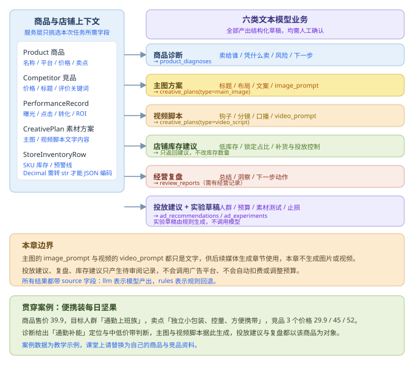
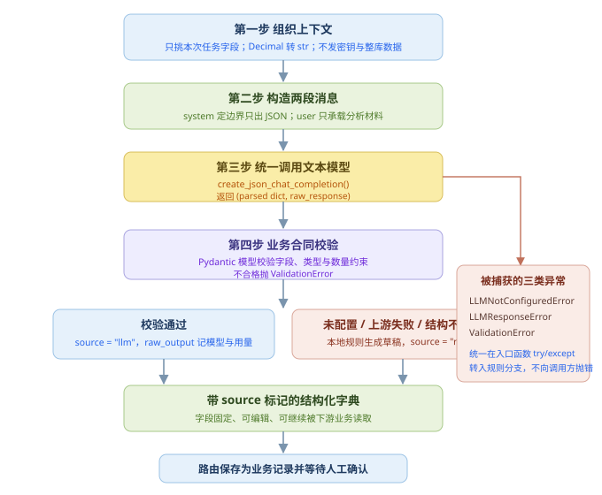
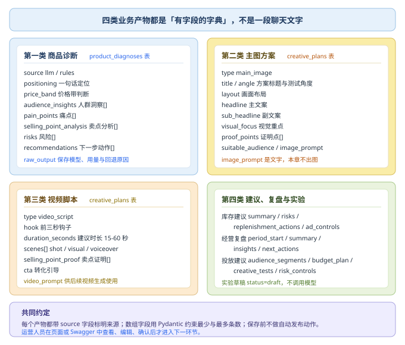

# 07 《电商运营助手》文本模型服务

> 文本模型的统一调用已经就绪，本篇解决更接近业务的问题：如何把商品资料交给模型，又如何把模型的回答变成系统能够保存、展示和继续使用的运营资料。
>
> 本篇完成后，针对一个已有商品，系统可以生成商品诊断、主图创意方案、视频脚本、店铺库存建议、经营复盘与投放建议，并自动生成投放实验草稿。每一项结果都是有字段、有来源标记、可人工修改的业务记录；它们不是直接发布的广告，也不会直接调用图片或视频供应商。
>
## 一、文本模型相关业务说明

> 本章先认识六类文本业务各自解决什么问题、输入什么、产出什么。后面六章再逐个实现它们的服务代码。

为了避免讲解抽象，本篇全程使用一个贯穿案例：

| 项目 | 贯穿案例取值 |
|---|---|
| 商品 | 便携装每日坚果 25g×30 袋 |
| 平台与类目 | 某电商平台 / 坚果炒货 |
| 售价与成本 | 39.9 元 / 22.5 元 |
| 目标人群 | 通勤上班族 |
| 已录入卖点 | 独立小包装、控量 25g、开袋即食 |
| 竞品样本 | 同款 29.9 元、礼盒装 45 元、进口款 52 元 |

### 1.1 六类业务的职责与产物

**图 1-1：文本模型业务全景**



图中左侧是服务层可以使用的数据来源，右侧是本篇实现的六类文本业务与它们的落库位置。六类业务都只读取系统内已有的商品、竞品、素材、经营记录与库存数据，不假设平台后台的真实成交或广告数据。

| 业务 | 回答什么问题 | 主要输入 | 产物与落库 | 是否调用模型 |
|---|---|---|---|---|
| 商品诊断 | 卖给谁、凭什么卖、风险是什么、下一步做什么 | 商品 + 竞品 | `ProductDiagnosis` → `product_diagnoses` | 是，失败回退规则 |
| 主图方案 | 首屏应该讲什么、画面怎么排 | 商品 + 竞品 + 最新诊断 | `CreativePlan(type=main_image)` → `creative_plans` | 是，失败回退规则 |
| 视频脚本 | 前三秒说什么、镜头怎么拆 | 商品 + 竞品 + 最新诊断 | `CreativePlan(type=video_script)` → `creative_plans` | 是，失败回退规则 |
| 店铺库存建议 | 哪些 SKU 要补货、投放要不要收着点 | 店铺 + SKU 库存行 | 建议字典 → 不落库，直接返回 | 是，失败回退规则 |
| 经营复盘 | 这个周期表现如何、下一步做什么 | 商品 + 经营记录 + 诊断 | `ReviewReport` → `review_reports` | 是，失败回退规则 |
| 投放建议 | 投给谁、多少钱、测什么素材 | 商品 + 诊断 + 素材 + 经营记录 | `AdRecommendation` → `ad_recommendations` | 是，失败回退规则 |
| 实验草稿 | 用哪个素材和链接先跑一版小预算测试 | 商品 + 素材 + 链接 + 经营记录 | `AdExperiment` → `ad_experiments` | **否，纯规则生成** |

最后一行需要特别留意：自动生成实验草稿的服务**不导入 `llm.py`**，它是按已有数据挑选候选素材与链接的规则服务。接口名字里带 `generate`，不代表它就是大模型功能。

### 1.2 商品诊断

诊断是整条运营链路的上游。它把一件商品的基本情况整理成运营能直接使用的判断：一句话定位、价格带位置、人群与场景洞察、用户痛点、卖点该怎么证明、有哪些风险、下一步先做什么。

以贯穿案例为例，诊断会说明：

- 这件 25g 装坚果适合围绕「通勤随手补能」表达；
- 售价 39.9 在竞品样本 29.9–52 之间处于中低价格带，可以先测转化效率；
- 卖点里「独立小包装」是差异化点，应优先做成首屏画面证明；
- 风险是竞品样本不足 3 个时价格判断不够稳定。

诊断保存为 `product_diagnoses` 表的一条记录。后面的主图方案和视频脚本会优先读取最新诊断，使它们不必每次从零猜测商品定位。

### 1.3 创意方案

创意方案分两类，都保存在 `creative_plans` 表，用 `type` 字段区分。

**主图方案**是一个设计任务，不是图片文件。一条方案包含方案标题、测试角度、画面布局、主副文案、视觉重点、证明点、适用人群，以及给后续图片生成模型使用的 `image_prompt`。它不改变商品售价、库存或投放预算。

**视频脚本**也不是 MP4 文件。它包含脚本标题、测试角度、前三秒钩子、建议时长、分镜列表、卖点证明、转化引导和 `video_prompt`。其中 `duration_seconds` 是脚本建议的时长，不等于系统已经生成了对应时长的视频。

主图与视频脚本都优先读取最新诊断：诊断里识别出的差异化卖点会直接影响方案的测试角度与文案方向。

### 1.4 店铺库存建议

库存建议面向一个店铺的全部 SKU 库存行，回答三个问题：当前库存整体情况如何、有哪些风险、补货与投放节奏该怎么配合。

它读取 `StoreInventoryRow` 聚合行（含总库存、锁定库存、可用库存、预警线、是否低库存），产出总体判断、风险清单、补货动作、运营动作与投放控制建议。

库存建议**只返回给运营查看，不产生库存流水，也不修改任何库存数量**。真正的库存调整走既有的出入库接口，并且需要权限与超量校验。

### 1.5 经营复盘

复盘针对一个商品最近一个经营周期的数据做判断：曝光、点击、转化、花费、收入和 ROI 分别表现如何，问题出在素材、详情页还是人群，下一步应该换素材、改承接页、调价还是补数据。

复盘要求商品已经有经营记录；没有任何经营记录时服务会抛出 `ValueError`，由路由转换成 400 提示调用者先补齐数据。

如果最近一条经营记录关联了投放实验，复盘会要求在总结或洞察中点名该实验，并判断继续、暂停还是复制。

### 1.6 投放建议与实验草稿

**投放建议**把诊断、素材和经营数据转成一份可执行的投放计划：本轮目标、人群分层与定向、日预算与分配、止损规则、素材测试安排、出价策略、风险控制与下一步动作。它保存为 `ad_recommendations` 记录，状态是「待人工确认」，不会对接广告平台，也不会自动扣费或调整预算。

**实验草稿**是规则服务从已有素材、推广链接和经营记录中挑出表现最好的候选，拼出一份 `status="draft"` 的实验计划：用哪个素材、配哪个链接、日预算多少、成功指标是什么。它只是帮运营把计划草稿准备好，不会创建真实广告计划。

## 二、结构化业务结果

> 本章说明为什么模型输出必须先变成固定字段，以及模型不可用时的规则回退意味着什么。

### 2.1 为什么不能直接存一段聊天文字

「建议突出独立包装，并测试通勤场景」这段话对人有帮助，却无法让程序稳定知道定位、风险、行动建议分别是什么。后端需要先把模型内容约束成固定字段，后续的页面展示、主图方案生成和 Agent 编排才能读取同一份结果。

以诊断为例，模型输出会被约束为下面这些字段：

| 字段 | 作用 | 贯穿案例中的取值 |
|---|---|---|
| `positioning` | 一句话定位 | 面向通勤上班族的 25g 控量坚果，主打随手一袋不过量 |
| `price_band` | 价格带判断 | 处于中低价格带，可优先测试转化效率 |
| `audience_insights` | 人群与场景洞察 | 通勤补能、控量需求、办公室常备 |
| `pain_points` | 用户顾虑 | 大包装吃不完受潮、单次食用量不好控制 |
| `selling_point_analysis` | 卖点该怎么证明 | 用拆包画面证明独立小包装 |
| `risks` | 仍需人工核实的问题 | 竞品样本不足，价格带结论待验证 |
| `recommendations` | 可执行的下一步 | 用通勤场景做首屏图测试 |

`ProductDiagnosisOutput` 就是诊断的 Pydantic 合同。它不仅规定字段名和类型，也会拒绝空定位、错误类型这类「看起来像 JSON、却不能用于诊断」的结果。统一调用层只保证拿到一个 `dict`；本篇的业务服务才知道这个字典是不是一份合格诊断。

### 2.2 上下文不是把数据库全部发给模型

诊断服务只组织商品名称、平台、分类、价格、成本、目标人群、卖点和竞品资料；竞品也只提取名称、价格、标题、卖点、评价关键词等与任务相关的字段。

| 可以提供给模型 | 不应放进提示词 |
|---|---|
| 商品价格、卖点、目标人群、竞品公开资料 | 用户 Token、模型 API Key、平台账号密码 |
| 已保存的经营指标和创意方案摘要 | 与当前商品无关的整库数据 |
| 「资料不足时要说明缺什么」这类任务要求 | 来自网页文本的「忽略此前指令」等内容 |

有两个实现细节需要留意。第一，价格在组织 JSON 时要转换成字符串，因为 `Decimal` 不能直接被 JSON 编码。第二，输入资料可能不可信，所以系统消息固定业务边界，用户消息只承载分析材料；最终仍由 Pydantic 校验，不让商品备注改写系统的保存逻辑。

### 2.3 source 字段与规则回退的含义

**图 2-1：结构化结果生成链路**



图中是本篇所有模型业务的统一流程：组织上下文 → 构造两段消息 → 调用统一入口 → 业务合同校验 → 通过则标记 `llm`，失败则走本地规则分支标记 `rules`。

| `source` | 代表什么 | 是否调用真实模型 |
|---|---|---|
| `llm` | 模型返回的对象通过了业务合同校验 | 是 |
| `rules` | 模型未配置、上游失败或返回不合格时，本地规则生成的草稿 | 不一定 |

规则回退不是伪造 AI。它会在 `raw_output` 中写入 `fallback_reason` 说明回退原因，而且只能使用已有的商品资料：没有目标人群就提示补资料；没有竞品价格样本就说明无法判断价格带；不会编造精确画像或销量结论。

被捕获并转入规则分支的异常有三类：`LLMNotConfiguredError`（未配置）、`LLMResponseError`（上游失败或结构不合格）、`ValidationError`（业务合同校验失败）。它们统一在入口函数的 `try/except` 中处理，不会向路由层抛出。

## 三、四类业务产物

> 本章逐个说明四类产物的字段结构，并给出对应的 JSON 示例。示例中的数值与文案来自贯穿案例，用于说明结构，不是真实模型输出。

### 3.1 商品诊断

诊断是后续创意的输入。它保存为 `product_diagnoses` 记录，七个业务字段加一个 `raw_output` 摘要字典。

| 属性                     | 一句话说明                                           |
| :----------------------- | :--------------------------------------------------- |
| `source`                 | 标明诊断由模型（`llm`）还是规则兜底（`rules`）产生。 |
| `positioning`            | 一句话定位商品面向谁、在什么场景、解决什么。         |
| `price_band`             | 依据商品售价与竞品样本判断所处价格带及相应测试策略。 |
| `audience_insights`      | 把目标人群细化为具体使用时刻，供素材选画面。         |
| `pain_points`            | 列出用户未明说的顾虑，作为文案要回应的对象。         |
| `selling_point_analysis` | 盘点已录入卖点并指出哪些具备差异化价值。             |
| `risks`                  | 主动标注本次判断的数据缺口与不确定性。               |
| `recommendations`        | 给出可立即执行的下一步素材与测试动作。               |
| `raw_output`             | 保存模型调用的原始留痕，不参与业务判断。             |

```json
{
  "source": "llm",
  "positioning": "面向通勤上班族的 25g 控量每日坚果，主打随手一袋、不过量的加餐补充",
  "price_band": "处于中低价格带，可优先测试转化效率；竞品样本价格区间为 29.90-52.00，均价约 42.30。",
  "audience_insights": [
    "通勤与办公室场景是高频使用场景，素材应直接对应早上出门和下午加餐两个时刻。",
    "控量需求来自「大包装吃不完」的真实顾虑，可做成量化表达。"
  ],
  "pain_points": [
    "用户可能在意大包装开袋后受潮、不好保存。",
    "用户可能在意单次食用量不好控制，容易摄入过量。"
  ],
  "selling_point_analysis": [
    "当前已录入 3 个卖点，可用于生成素材测试方向。",
    "差异化卖点包括：独立小包装、控量 25g。"
  ],
  "risks": [
    "竞品样本少于 3 个时，价格带和卖点判断还不够稳定。",
    "目标人群描述偏宽泛，投放和内容测试会缺少方向。"
  ],
  "recommendations": [
    "优先用「独立小包装」做一版主图首屏测试。",
    "下一步生成 3 个主图方向和 3 条短视频脚本，用点击率和转化率做判断。"
  ],
  "raw_output": {
    "provider": "deepseek",
    "model": "deepseek-chat",
    "usage": { "prompt_tokens": 812, "completion_tokens": 640, "total_tokens": 1452 },
    "llm_output": { "...": "模型原始结构化输出" }
  }
}
```

`raw_output` 只保存模型名、用量和结构化输出，不保存密钥或请求头。回退时 `raw_output` 中是 `fallback_reason`、`competitor_count`、`overlap_points` 等规则分支的中间量。

### 3.2 主图方案

主图方案是设计任务，不是图片文件。它保存为 `type="main_image"` 的 `CreativePlan` 草稿，其中 `content` 保存完整结构，`title` 与 `rationale` 单独成列便于列表展示。

```json
{
  "title": "独立小包装场景首屏",
  "angle": "用具体使用场景承接用户需求，适合作为第一张点击测试图。",
  "layout": "左侧放商品清晰主体，右侧放大场景文案；底部用 2-3 个小标签补充利益点。",
  "headline": "25g 一袋，通勤随手补能",
  "sub_headline": "坚果炒货 · 到手价 39.90",
  "visual_focus": "突出「独立小包装」对应的拆包动作，画面保持干净、明亮、可快速识别。",
  "proof_points": [
    "围绕「独立小包装」给出可视化证明",
    "围绕「控量 25g」给出可视化证明",
    "价格锚点：39.90",
    "人群锚点：通勤上班族"
  ],
  "suitable_audience": "通勤上班族",
  "image_prompt": "明亮简洁的电商主图，一袋 25g 坚果被手拆开放在通勤包旁，主体清晰，留白放文案",
  "source": "llm",
  "llm_model": "deepseek-chat",
  "llm_usage": { "prompt_tokens": 1105, "completion_tokens": 980, "total_tokens": 2085 }
}
```

`image_prompt` 是给后续图片生成模型使用的中文画面提示词，本篇只保存文字，不会调用图片供应商，也不会生成文件。

### 3.3 视频脚本

视频脚本保存为 `type="video_script"` 的 `CreativePlan`。`scenes` 是分镜数组，每个分镜含时间区间、画面说明和口播文案。

```json
{
  "title": "独立小包装痛点钩子脚本",
  "angle": "先抛出用户高频痛点，再用商品卖点给出解决方案，适合投放冷启动。",
  "hook": "通勤上班族出门前最怕的不是麻烦，是东西不好带还不好用。",
  "duration_seconds": 25,
  "scenes": [
    {
      "shot": "0-3s",
      "visual": "快速展示用户出门、补用或使用前的困扰场景。",
      "voiceover": "大包装开袋后容易受潮，单次食用量也不好控制。"
    },
    {
      "shot": "4-10s",
      "visual": "商品特写，镜头对准「独立小包装」对应的拆包细节。",
      "voiceover": "这款每日坚果主打独立小包装，日常使用更省心。"
    },
    {
      "shot": "11-18s",
      "visual": "用手部演示、对比画面或使用前后状态证明效果。",
      "voiceover": "再加上控量 25g，不是只看起来好，而是真的方便控制。"
    },
    {
      "shot": "19-25s",
      "visual": "商品、价格与核心标签收尾，画面保持清晰。",
      "voiceover": "39.90 先试这一款，适合通勤上班族。"
    }
  ],
  "selling_point_proof": [
    "围绕「独立小包装」给出可视化证明",
    "围绕「控量 25g」给出可视化证明",
    "价格锚点：39.90"
  ],
  "cta": "点击商品卡，先看详情和优惠。",
  "video_prompt": "竖屏短镜头，通勤包旁取出一袋坚果拆开食用，光线自然，节奏轻快",
  "source": "llm",
  "llm_model": "deepseek-chat",
  "llm_usage": { "prompt_tokens": 1280, "completion_tokens": 1420, "total_tokens": 2700 }
}
```

`duration_seconds` 受合同约束在 15 到 60 秒之间，分镜数量约束在 4 到 8 段。这些约束保证脚本能被拍摄或交给视频生成模型执行。

### 3.4 建议、复盘与实验草稿

**图 3-1：四类业务产物结构**



图中把四类产物的字段与落库表并列展示。第四类包含库存建议、经营复盘、投放建议与实验草稿，它们都不替人执行动作。

**店铺库存建议**返回给前端查看，不落库：

```json
{
  "source": "rules",
  "summary": "坚果旗舰店 有 2 个 SKU 低于预警线，需要优先处理补货和投放节奏。",
  "risks": [
    "2 个 SKU 可用库存低于或等于预警线。",
    "1 个 SKU 锁定库存占比较高，需要检查未发货订单或释放异常锁定。"
  ],
  "replenishment_actions": [
    "优先补货 便携装每日坚果 / NUT-25G-30，当前可用 18，预警线 50。"
  ],
  "operation_actions": [
    "检查低库存 SKU 是否仍在主推素材、直播间或投放计划中。",
    "核对锁定库存较高的 SKU，确认是否存在订单未发货或异常占用。"
  ],
  "ad_controls": [
    "低库存 SKU 暂缓放量，避免投放带来履约压力。",
    "如果必须继续投放，优先把预算转向库存充足的同款或替代 SKU。"
  ],
  "raw_output": {
    "store_id": 1,
    "sku_count": 6,
    "low_stock_sku_ids": [12, 15],
    "locked_risk_sku_ids": [15],
    "fallback_reason": "模型未配置，已使用规则版建议"
  }
}
```

**经营复盘**保存为 `review_reports` 记录：

```json
{
  "period_start": "2026-10-20",
  "period_end": "2026-10-26",
  "summary": "2026-10-20 至 2026-10-26，商品《便携装每日坚果》累计曝光 18420，点击 736，成交 41，ROI 为 1.86。",
  "insights": [
    "本次复盘关联素材：独立小包装场景首屏。",
    "点击率 4.00% 处于可测试区间，需要结合转化判断。",
    "点击到成交转化率 5.57% 较好，可优先复制素材结构。",
    "ROI 1.86 接近临界区，需要优化点击成本或转化效率。"
  ],
  "next_actions": [
    "保留当前素材结构，复制 2-3 个同结构不同卖点版本继续测。",
    "下一版素材优先围绕「独立小包装」做更直接的画面证明。"
  ]
}
```

**投放建议**保存为 `ad_recommendations` 记录，`summary` 单独成列，`content` 保存完整结构：

```json
{
  "source": "llm",
  "summary": "围绕「独立小包装」先做小预算素材测试，再根据 CTR、转化率和 ROI 决定放量。",
  "content": {
    "objective": "提升点击：优先测试首屏卖点和画面吸引力。",
    "audience_segments": [
      {
        "name": "核心需求人群",
        "rationale": "已对坚果炒货有明确需求，最适合验证基础转化。",
        "targeting": ["通勤上班族", "关注独立小包装相关内容的人群", "近 7-30 天互动或加购相似商品人群"]
      }
    ],
    "budget_plan": {
      "daily_budget": "暂不明显放量，参考最近消耗 600.00 做平行素材测试。",
      "allocation": ["60% 用于已选中素材验证", "30% 用于新主图或视频 A/B 测试", "10% 预留给临时表现突出的素材加码"],
      "stop_loss_rule": "单素材花费达到目标客单价 1-1.5 倍仍无转化时暂停。"
    },
    "creative_tests": [
      {
        "name": "独立小包装场景首屏",
        "hypothesis": "验证 独立小包装 是否能拉动点击和转化。",
        "asset_direction": "突出「独立小包装」对应的拆包动作，画面保持干净、明亮、可快速识别。",
        "success_metric": "CTR、点击成本、转化率、ROI 同时观察，至少跑满 1000 曝光再判断。"
      }
    ],
    "bid_strategy": ["先控预算测素材，不建议直接提高出价抢量。"],
    "risk_controls": ["不要在样本太小时直接放量，至少观察点击和转化两层指标。"],
    "next_steps": ["选择 2-3 个主图或视频素材建立第一轮 A/B 测试。"],
    "llm_model": "deepseek-chat"
  }
}
```

**实验草稿**保存为 `ad_experiments` 记录，由规则服务生成：

```json
{
  "generated_asset_id": 7,
  "promotion_link_id": 3,
  "name": "1029 小预算素材承接实验",
  "objective": "验证推荐素材和承接链接在小预算投放下的点击、转化与 ROI 稳定性",
  "audience": "通勤上班族",
  "daily_budget": 300.0,
  "status": "draft",
  "success_metric": "连续 2 天 ROI >= 2.5 且 CTR >= 4%，再进入人工确认放量",
  "hypothesis": "围绕「独立小包装」继续放大表达；优先使用素材「通勤首屏图」；搭配链接「坚果主推短链」",
  "note": "仅生成实验计划，不自动创建广告计划或执行资金操作；投放前需要人工确认。"
}
```

注意这个草稿里没有 `source` 字段，`status` 固定为 `draft`，真实投放仍要运营人工创建或确认。

## 四、商品诊断服务实现

> 本章按「增量步骤 → 完整代码」的顺序落地商品诊断服务。步骤部分讲清每一步在哪建什么、为什么这样组织；完整代码可直接写入文件。

### 4.1 增量接入步骤

按下面的顺序把代码写入 `api/app/services/diagnosis.py`，每一步都紧接着上一步的产物，**粘贴即可运行**：先建文件并写入导入，再定义输出合同，然后补函数，最后一步接入路由。步骤四完成后，本文件与 4.3 完整代码完全一致。

#### 4.1.1 创建文件并写入导入

新建 `api/app/services/diagnosis.py`，先放导入块。后面的模型与函数都依赖这些导入，所以这一步必须在最前面，否则第三步用到 `Product`、`create_json_chat_completion` 等名字时会报 `NameError`。

```python
import json
from decimal import Decimal
from typing import Any

from pydantic import BaseModel, Field, ValidationError

from app.models import Product
from app.services.llm import (
    LLMNotConfiguredError,
    LLMResponseError,
    create_json_chat_completion,
)
```

#### 4.1.2 定义输出合同

在导入之后追加 `ProductDiagnosisOutput`。它规定七个业务字段的类型与约束：`positioning` 与 `price_band` 是必填非空字符串，其余五个是字符串数组。合同的意义是拒绝「看起来像 JSON、却不能用于诊断」的结果。

```python
class ProductDiagnosisOutput(BaseModel):
    """商品诊断输出结果"""
    positioning: str = Field(min_length=1, description="一句话定位建议")
    price_band: str = Field(min_length=1, description="价格带判断")
    audience_insights: list[str] = Field(default_factory=list, description="人群洞察")
    pain_points: list[str] = Field(default_factory=list, description="痛点")
    selling_point_analysis: list[str] = Field(default_factory=list, description="卖点分析")
    risks: list[str] = Field(default_factory=list, description="风险")
    recommendations: list[str] = Field(default_factory=list, description="下一步动作")
```

#### 4.1.3 实现入口

追加入口 `generate_product_diagnosis()`，入口用 `try/except` 包住模型分支：成功直接返回；捕获异常时转入规则分支

入口函数

```python
def generate_product_diagnosis(product: Product) -> dict[str, Any]:
    """生成商品商品诊断；集中执行业务校验、状态变更与持久化，并返回可验证结果。"""
    try:
        return generate_llm_diagnosis(product)
    except (LLMNotConfiguredError, LLMResponseError, ValidationError) as exc:
        # 诊断是素材和投放建议的上游，模型不可用时用规则版保持单品运营链路可继续。
        fallback = generate_rule_based_diagnosis(product)
        fallback["raw_output"]["fallback_reason"] = str(exc)
        return fallback
```

#### 4.1.4 实现模型生成诊断

##### 1. 模型诊断入口

```python
def generate_llm_diagnosis(product: Product) -> dict[str, Any]:
    """生成llm商品诊断；集中执行业务校验、状态变更与持久化，并返回可验证结果。"""
    # 按“输入归一化 → 业务校验 → 状态或持久化”推进，异常不得留下半完成结果。
    parsed, raw_response = create_json_chat_completion(
        _build_diagnosis_messages(product),
        max_tokens=2200,
        temperature=0.25,
    )
    diagnosis = ProductDiagnosisOutput.model_validate(parsed)

    return {
        "source": "llm",
        **diagnosis.model_dump(),
        "raw_output": {
            "provider": "deepseek",
            "model": raw_response.get("model"),
            "usage": raw_response.get("usage", {}),
            "llm_output": parsed,
        },
    }
```

##### 2. 提示词 _build_diagnosis_messages

```python
def _build_diagnosis_messages(product: Product) -> list[dict[str, str]]:
    """构建商品诊断消息，统一主流程中的格式、默认值和异常边界。"""
    # 按“输入归一化 → 业务校验 → 状态或持久化”推进，异常不得留下半完成结果。
    return [
        {
            "role": "system",
            "content": (
                "你是一个资深电商运营策略助手，擅长商品定位、竞品拆解、素材测试和投放复盘。"
                "你必须只输出合法 json，不要输出 markdown，不要输出解释性前后缀。"
            ),
        },
        {
            "role": "user",
            "content": (
                "请基于以下商品和竞品信息，生成电商运营诊断。输出 json 必须严格符合示例结构：\n"
                "{\n"
                '  "positioning": "一句话定位建议",\n'
                '  "price_band": "价格带判断",\n'
                '  "audience_insights": ["人群洞察1", "人群洞察2"],\n'
                '  "pain_points": ["痛点1", "痛点2"],\n'
                '  "selling_point_analysis": ["卖点分析1", "卖点分析2"],\n'
                '  "risks": ["风险1", "风险2"],\n'
                '  "recommendations": ["下一步动作1", "下一步动作2"]\n'
                "}\n\n"
                "要求：\n"
                "- 所有内容使用简体中文。\n"
                "- 建议要可执行，适合运营人员马上拿去改主图、短视频脚本或投放测试。\n"
                "- 如果信息不足，请明确指出需要补充哪些数据。\n"
                "- 每个数组建议输出 2 到 5 条。\n\n"
                f"商品信息 json：{_product_payload(product)}"
            ),
        },
    ]
```

##### 3. 商品信息载荷  _product_payload

```python
def _product_payload(product: Product) -> str:
    # 诊断只使用系统内已有商品与竞品资料，不假设平台后台真实成交、评价或库存数据。
    """商品载荷，统一主流程中的格式、默认值和异常边界。"""
    payload = {
        "name": product.name,
        "platform": product.platform,
        "category": product.category,
        "price": str(product.price) if product.price is not None else None,
        "cost": str(product.cost) if product.cost is not None else None,
        "target_audience": product.target_audience,
        "selling_points": product.selling_points,
        "product_url": product.product_url,
        "competitors": [
            {
                "name": competitor.name,
                "platform": competitor.platform,
                "price": str(competitor.price) if competitor.price is not None else None,
                "sales_hint": competitor.sales_hint,
                "title": competitor.title,
                "selling_points": competitor.selling_points,
                "review_keywords": competitor.review_keywords,
            }
            for competitor in product.competitors
        ],
    }
    return json.dumps(payload, ensure_ascii=False)
```

#### 4.1.5 实现规则生成诊断

追加 `generate_rule_based_diagnosis()` 以及它调用的八个私有辅助函数。到此 `diagnosis.py` 的所有函数齐全，本文件与 4.3 完整代码一致，可直接被路由导入。

##### 1. 规则诊断入口 

```python
def generate_rule_based_diagnosis(product: Product) -> dict:
    # 规则诊断只做启发式判断，重点提示缺口和下一步测试方向，不替代真实经营分析。
    """生成rulebased商品诊断；集中执行业务校验、状态变更与持久化，并返回可验证结果。"""
    competitor_prices = [
        competitor.price for competitor in product.competitors if competitor.price is not None
    ]
    price_band = _price_band(product.price, competitor_prices)
    competitor_points = _flatten([competitor.selling_points for competitor in product.competitors])
    overlap_points = sorted(set(product.selling_points).intersection(competitor_points))
    differentiated_points = [
        point for point in product.selling_points if point not in set(competitor_points)
    ]

    positioning = _positioning(product, differentiated_points, overlap_points)
    audience_insights = _audience_insights(product)
    pain_points = _pain_points(product, competitor_points)
    selling_point_analysis = _selling_point_analysis(
        product.selling_points,
        differentiated_points,
        overlap_points,
    )
    risks = _risks(product, competitor_prices, overlap_points)
    recommendations = _recommendations(product, competitor_prices, differentiated_points)

    return {
        "source": "rules",
        "positioning": positioning,
        "price_band": price_band,
        "audience_insights": audience_insights,
        "pain_points": pain_points,
        "selling_point_analysis": selling_point_analysis,
        "risks": risks,
        "recommendations": recommendations,
        "raw_output": {
            "competitor_count": len(product.competitors),
            "competitor_prices": [str(price) for price in competitor_prices],
            "overlap_points": overlap_points,
            "differentiated_points": differentiated_points,
        },
    }

```

##### 2. 价格诊断 _price_band

```python
def _price_band(product_price: Decimal | None, competitor_prices: list[Decimal]) -> str:
    """用商品价与竞价样本比较，给出价格带判断或缺样本提示"""
    if product_price is None:
        return "商品售价未录入，暂时无法判断价格带。"

    if not competitor_prices:
        return f"当前商品售价为 {product_price}，还缺少竞品价格样本。"

    min_price = min(competitor_prices)
    max_price = max(competitor_prices)
    avg_price = sum(competitor_prices, Decimal("0")) / Decimal(len(competitor_prices))

    if product_price < min_price:
        position = "低于现有竞品样本，适合测试性价比或引流定位"
    elif product_price > max_price:
        position = "高于现有竞品样本，需要更强卖点证明和信任背书"
    elif product_price > avg_price:
        position = "处于偏高价格带，需要突出差异化价值"
    else:
        position = "处于中低价格带，可优先测试转化效率"

    return f"{position}；竞品样本价格区间为 {min_price}-{max_price}，均价约 {avg_price:.2f}。"
```

##### 3. 产品定位 _positioning

```python
def _positioning(
    product: Product,
    differentiated_points: list[str],
    overlap_points: list[str],
) -> str:
    """按差异化卖点、重合卖点或基础信息三档生成定位表述"""
    audience = product.target_audience or "目标人群未明确"
    category = product.category or "当前类目"

    if differentiated_points:
        point_text = "、".join(differentiated_points[:3])
        return f"{category}商品可围绕“{point_text}”做差异化表达，优先面向{audience}。"

    if overlap_points:
        point_text = "、".join(overlap_points[:3])
        return f"{category}商品目前与竞品共同卖点集中在“{point_text}”，需要补充更具体的使用场景或信任证明。"

    return f"{category}商品信息还偏基础，建议先明确核心卖点和目标人群，再做素材测试。"
```

##### 4. 目标人群洞察 _audience_insights

```python
def _audience_insights(product: Product) -> list[str]:
    """根据商品目标人群生成可执行洞察；缺失人群时返回补录建议而不是臆测。"""
    # 只使用用户录入的人群事实；没有事实时明确提示补充，不让规则兜底伪造画像。
    audience = product.target_audience
    if audience:
        return [
            f"当前目标人群为“{audience}”，素材表达应直接对应其高频场景。",
            "建议把人群从宽泛标签细化到使用场景、购买动机和决策顾虑。",
        ]
    return [
        "目标人群尚未明确，后续主图和视频脚本容易变得泛泛。",
        "建议补充年龄段、使用场景、购买理由和价格敏感度。",
    ]
```

##### 5. 痛点分析 _pain_points

```python
def _pain_points(product: Product, competitor_points: list[str]) -> list[str]:
    """按卖点关键词匹配可能的痛点，匹配不到则返回提炼建议"""
    points = list(product.selling_points) + competitor_points
    if not points:
        return [
            "缺少卖点和竞品关键词，暂时无法稳定推断用户痛点。",
            "建议从评价区补充差评、追评和问大家中的真实顾虑。",
        ]

    pain_points = []
    joined = " ".join(points)
    if any(word in joined for word in ["便携", "轻薄", "小巧"]):
        pain_points.append("用户可能在意携带方便、通勤补用或使用负担。")
    if any(word in joined for word in ["控油", "持妆", "不卡粉"]):
        pain_points.append("用户可能在意使用效果稳定，以及长时间使用后的表现。")
    if any(word in joined for word in ["低糖", "低脂", "健康"]):
        pain_points.append("用户可能在意健康负担、成分安全和长期复购理由。")
    if any(word in joined for word in ["低价", "大规格", "买一送一"]):
        pain_points.append("用户可能在意价格是否划算，以及规格和赠品带来的确定收益。")

    if pain_points:
        return pain_points

    return [
        "用户痛点需要通过评论、客服咨询和竞品标题进一步提炼。",
        "建议把卖点改写成用户能感知的结果，而不只是商品属性。",
    ]
```

##### 6. 卖点分析  _selling_point_analysis

```python
def _selling_point_analysis(
    selling_points: list[str],
    differentiated_points: list[str],
    overlap_points: list[str],
) -> list[str]:
    """卖点分析"""
    if not selling_points:
        return ["商品核心卖点缺失，建议先补 3-5 个可被画面证明的卖点。"]

    analysis = [f"当前已录入 {len(selling_points)} 个卖点，可用于生成素材测试方向。"]
    if differentiated_points:
        analysis.append(f"差异化卖点包括：{'、'.join(differentiated_points[:5])}。")
    if overlap_points:
        analysis.append(f"与竞品重合卖点包括：{'、'.join(overlap_points[:5])}，需要更具体的证明方式。")
    return analysis
```

##### 7. 风险分析 _risks

```python
def _risks(
    product: Product,
    competitor_prices: list[Decimal],
    overlap_points: list[str],
) -> list[str]:
    """按竞品数量、价格、人群与重合度给出风险清单"""
    risks = []
    if len(product.competitors) < 3:
        risks.append("竞品样本少于 3 个，价格带和卖点判断还不够稳定。")
    if product.price is None:
        risks.append("商品售价缺失，无法判断价格竞争力。")
    if product.price is not None and competitor_prices and product.price > max(competitor_prices):
        risks.append("当前售价高于竞品样本最高价，需要加强利益点、品牌信任或赠品机制。")
    if overlap_points and len(overlap_points) >= len(product.selling_points):
        risks.append("卖点与竞品重合度较高，素材容易陷入同质化。")
    if not product.target_audience:
        risks.append("目标人群缺失，投放和内容测试会缺少方向。")
    return risks or ["暂无明显结构性风险，下一步重点是用素材测试验证判断。"]
```

##### 8. 执行建议 _recommendations

```python
def _recommendations(
    product: Product,
    competitor_prices: list[Decimal],
    differentiated_points: list[str],
) -> list[str]:
    """给出可执行的下一步动作，始终包含素材测试建议"""
    recommendations = []
    if len(product.competitors) < 3:
        recommendations.append("继续补充至少 3 个竞品，覆盖同价位爆款、低价引流款和高价标杆款。")
    if differentiated_points:
        recommendations.append(f"优先用“{differentiated_points[0]}”做一版主图首屏测试。")
    elif product.selling_points:
        recommendations.append(f"先把“{product.selling_points[0]}”改写成用户结果，再做主图和短视频钩子。")
    if competitor_prices and product.price is not None:
        min_price = min(competitor_prices)
        if product.price > min_price:
            recommendations.append("投放素材中避免只打低价，应增加效果证明、场景证明或赠品机制。")
    recommendations.append("下一步生成 3 个主图方向和 3 条短视频脚本，用点击率和转化率做判断。")
    return recommendations


def _flatten(values: list[list[str]]) -> list[str]:
    """展平，统一主流程中的格式、默认值和异常边界。"""
    return [item for sublist in values for item in sublist]
```

#### 4.1.6 在商品路由中接入

打开 `api/app/api/routes/products.py`，先补充导入（下面的别名用于避免路由函数与服务函数同名冲突）：

```python
from app.services.diagnosis import generate_product_diagnosis as build_product_diagnosis
```

然后查找并替换 `generate_product_diagnosis()` 函数**及其上方的 `@router.post(...)` 装饰器**。不要在文件末尾再添加同名、同路径的第二份路由，否则旧的占位接口可能先匹配请求，Swagger 里能看到接口但调用仍返回 501。

```python
@router.post(
    "/{product_id}/diagnoses/generate",
    response_model=ProductDiagnosisRead,
    status_code=status.HTTP_201_CREATED,
)
def generate_product_diagnosis(
    product_id: int,
    db: SessionDep,
    _current_user: Annotated[User, Depends(require_edit_permission)],
) -> ProductDiagnosis:
    """处理生成商品诊断接口；完成身份、Workspace、资源归属和输入校验后返回结构化结果。"""
    # 先完成认证、Workspace 与资源归属校验，再进入会产生副作用的服务调用。
    get_product_or_404(db, product_id)
    statement = (
        select(Product)
        .where(Product.id == product_id)
        .options(selectinload(Product.competitors))
    )
    product = db.scalars(statement).first()
    if product is None:
        raise HTTPException(status_code=status.HTTP_404_NOT_FOUND, detail="Product not found")

    diagnosis_payload = build_product_diagnosis(product)
    diagnosis = ProductDiagnosis(product_id=product_id, **diagnosis_payload)
    db.add(diagnosis)
    db.commit()
    db.refresh(diagnosis)
    return diagnosis
```

`selectinload(Product.competitors)` 是必需的：诊断要读竞品，不预加载就会在访问 `product.competitors` 时触发额外查询，甚至在会话关闭后报错。

`db.add()`、`commit()`、`refresh()` 依次完成加入会话、提交保存、读取数据库生成的字段（如 `id` 与时间戳）。

### 4.2 模块函数清单

`api/app/services/diagnosis.py` 共 13 个函数，按文件中的先后顺序排列。带下划线开头的是私有函数，只在模块内部使用。

<table>
  <colgroup><col style="width:30%"><col style="width:14%"><col style="width:56%"></colgroup>
  <thead><tr><th>函数名</th><th>公共 / 私有</th><th>说明</th></tr></thead>
  <tbody>
    <tr><td><code>generate_product_diagnosis()</code></td><td>公共</td><td>诊断入口，先试模型分支，失败转规则分支并写入回退原因</td></tr>
    <tr><td><code>generate_llm_diagnosis()</code></td><td>公共</td><td>调用统一入口并用 Pydantic 合同校验，返回 source=llm 的结果</td></tr>
    <tr><td><code>_build_diagnosis_messages()</code></td><td>私有</td><td>构造 system 与 user 两段消息，system 固定只输出 JSON 的边界</td></tr>
    <tr><td><code>_product_payload()</code></td><td>私有</td><td>组织商品与竞品资料，Decimal 价格转字符串后 JSON 序列化</td></tr>
    <tr><td><code>generate_rule_based_diagnosis()</code></td><td>公共</td><td>规则回退分支，只用既有资料生成可编辑草稿</td></tr>
    <tr><td><code>_price_band()</code></td><td>私有</td><td>用商品价与竞价样本比较，给出价格带判断或缺样本提示</td></tr>
    <tr><td><code>_positioning()</code></td><td>私有</td><td>按差异化卖点、重合卖点或基础信息三档生成定位表述</td></tr>
    <tr><td><code>_audience_insights()</code></td><td>私有</td><td>有人群则给场景化洞察，无人群则返回补录建议不臆测</td></tr>
    <tr><td><code>_pain_points()</code></td><td>私有</td><td>按卖点关键词匹配可能的痛点，匹配不到则返回提炼建议</td></tr>
    <tr><td><code>_selling_point_analysis()</code></td><td>私有</td><td>统计卖点数量并区分差异化点与重合点</td></tr>
    <tr><td><code>_risks()</code></td><td>私有</td><td>按竞品数量、价格、人群与重合度给出风险清单</td></tr>
    <tr><td><code>_recommendations()</code></td><td>私有</td><td>给出可执行的下一步动作，始终包含素材测试建议</td></tr>
    <tr><td><code>_flatten()</code></td><td>私有</td><td>把二维卖点列表展平成一维，用于求卖点差集</td></tr>
  </tbody>
</table>

三个公共函数中，只有 `generate_product_diagnosis()` 是对外入口，另外两个公共函数按模型分支与规则分支拆分，便于单独测试。

### 4.3 完整代码

将下面内容写入 `api/app/services/diagnosis.py`：

```python
import json
from decimal import Decimal
from typing import Any

from pydantic import BaseModel, Field, ValidationError

from app.models import Product
from app.services.llm import (
    LLMNotConfiguredError,
    LLMResponseError,
    create_json_chat_completion,
)


class ProductDiagnosisOutput(BaseModel):
    """商品诊断输出结果"""
    positioning: str = Field(min_length=1, description="一句话定位建议")
    price_band: str = Field(min_length=1, description="价格带判断")
    audience_insights: list[str] = Field(default_factory=list, description="人群洞察")
    pain_points: list[str] = Field(default_factory=list, description="痛点")
    selling_point_analysis: list[str] = Field(default_factory=list, description="卖点分析")
    risks: list[str] = Field(default_factory=list, description="风险")
    recommendations: list[str] = Field(default_factory=list, description="下一步动作")


def generate_product_diagnosis(product: Product) -> dict[str, Any]:
    """生成商品商品诊断；集中执行业务校验、状态变更与持久化，并返回可验证结果。"""
    try:
        return generate_llm_diagnosis(product)
    except (LLMNotConfiguredError, LLMResponseError, ValidationError) as exc:
        # 诊断是素材和投放建议的上游，模型不可用时用规则版保持单品运营链路可继续。
        fallback = generate_rule_based_diagnosis(product)
        fallback["raw_output"]["fallback_reason"] = str(exc)
        return fallback


def generate_llm_diagnosis(product: Product) -> dict[str, Any]:
    """生成llm商品诊断；集中执行业务校验、状态变更与持久化，并返回可验证结果。"""
    # 按“输入归一化 → 业务校验 → 状态或持久化”推进，异常不得留下半完成结果。
    parsed, raw_response = create_json_chat_completion(
        _build_diagnosis_messages(product),
        max_tokens=2200,
        temperature=0.25,
    )
    diagnosis = ProductDiagnosisOutput.model_validate(parsed)

    return {
        "source": "llm",
        **diagnosis.model_dump(),
        "raw_output": {
            "provider": "deepseek",
            "model": raw_response.get("model"),
            "usage": raw_response.get("usage", {}),
            "llm_output": parsed,
        },
    }


def _build_diagnosis_messages(product: Product) -> list[dict[str, str]]:
    """构建商品诊断消息，统一主流程中的格式、默认值和异常边界。"""
    # 按“输入归一化 → 业务校验 → 状态或持久化”推进，异常不得留下半完成结果。
    return [
        {
            "role": "system",
            "content": (
                "你是一个资深电商运营策略助手，擅长商品定位、竞品拆解、素材测试和投放复盘。"
                "你必须只输出合法 json，不要输出 markdown，不要输出解释性前后缀。"
            ),
        },
        {
            "role": "user",
            "content": (
                "请基于以下商品和竞品信息，生成电商运营诊断。输出 json 必须严格符合示例结构：\n"
                "{\n"
                '  "positioning": "一句话定位建议",\n'
                '  "price_band": "价格带判断",\n'
                '  "audience_insights": ["人群洞察1", "人群洞察2"],\n'
                '  "pain_points": ["痛点1", "痛点2"],\n'
                '  "selling_point_analysis": ["卖点分析1", "卖点分析2"],\n'
                '  "risks": ["风险1", "风险2"],\n'
                '  "recommendations": ["下一步动作1", "下一步动作2"]\n'
                "}\n\n"
                "要求：\n"
                "- 所有内容使用简体中文。\n"
                "- 建议要可执行，适合运营人员马上拿去改主图、短视频脚本或投放测试。\n"
                "- 如果信息不足，请明确指出需要补充哪些数据。\n"
                "- 每个数组建议输出 2 到 5 条。\n\n"
                f"商品信息 json：{_product_payload(product)}"
            ),
        },
    ]


def _product_payload(product: Product) -> str:
    # 诊断只使用系统内已有商品与竞品资料，不假设平台后台真实成交、评价或库存数据。
    """商品载荷，统一主流程中的格式、默认值和异常边界。"""
    # 按“输入归一化 → 业务校验 → 状态或持久化”推进，异常不得留下半完成结果。
    payload = {
        "name": product.name,
        "platform": product.platform,
        "category": product.category,
        "price": str(product.price) if product.price is not None else None,
        "cost": str(product.cost) if product.cost is not None else None,
        "target_audience": product.target_audience,
        "selling_points": product.selling_points,
        "product_url": product.product_url,
        "competitors": [
            {
                "name": competitor.name,
                "platform": competitor.platform,
                "price": str(competitor.price) if competitor.price is not None else None,
                "sales_hint": competitor.sales_hint,
                "title": competitor.title,
                "selling_points": competitor.selling_points,
                "review_keywords": competitor.review_keywords,
            }
            for competitor in product.competitors
        ],
    }
    return json.dumps(payload, ensure_ascii=False)


def generate_rule_based_diagnosis(product: Product) -> dict:
    # 规则诊断只做启发式判断，重点提示缺口和下一步测试方向，不替代真实经营分析。
    """生成rulebased商品诊断；集中执行业务校验、状态变更与持久化，并返回可验证结果。"""
    # 按“输入归一化 → 业务校验 → 状态或持久化”推进，异常不得留下半完成结果。
    competitor_prices = [
        competitor.price for competitor in product.competitors if competitor.price is not None
    ]
    price_band = _price_band(product.price, competitor_prices)
    competitor_points = _flatten([competitor.selling_points for competitor in product.competitors])
    overlap_points = sorted(set(product.selling_points).intersection(competitor_points))
    differentiated_points = [
        point for point in product.selling_points if point not in set(competitor_points)
    ]

    positioning = _positioning(product, differentiated_points, overlap_points)
    audience_insights = _audience_insights(product)
    pain_points = _pain_points(product, competitor_points)
    selling_point_analysis = _selling_point_analysis(
        product.selling_points,
        differentiated_points,
        overlap_points,
    )
    risks = _risks(product, competitor_prices, overlap_points)
    recommendations = _recommendations(product, competitor_prices, differentiated_points)

    return {
        "source": "rules",
        "positioning": positioning,
        "price_band": price_band,
        "audience_insights": audience_insights,
        "pain_points": pain_points,
        "selling_point_analysis": selling_point_analysis,
        "risks": risks,
        "recommendations": recommendations,
        "raw_output": {
            "competitor_count": len(product.competitors),
            "competitor_prices": [str(price) for price in competitor_prices],
            "overlap_points": overlap_points,
            "differentiated_points": differentiated_points,
        },
    }


def _price_band(product_price: Decimal | None, competitor_prices: list[Decimal]) -> str:
    """价格band，统一主流程中的格式、默认值和异常边界。"""
    # 按“输入归一化 → 业务校验 → 状态或持久化”推进，异常不得留下半完成结果。
    if product_price is None:
        return "商品售价未录入，暂时无法判断价格带。"

    if not competitor_prices:
        return f"当前商品售价为 {product_price}，还缺少竞品价格样本。"

    min_price = min(competitor_prices)
    max_price = max(competitor_prices)
    avg_price = sum(competitor_prices, Decimal("0")) / Decimal(len(competitor_prices))

    if product_price < min_price:
        position = "低于现有竞品样本，适合测试性价比或引流定位"
    elif product_price > max_price:
        position = "高于现有竞品样本，需要更强卖点证明和信任背书"
    elif product_price > avg_price:
        position = "处于偏高价格带，需要突出差异化价值"
    else:
        position = "处于中低价格带，可优先测试转化效率"

    return f"{position}；竞品样本价格区间为 {min_price}-{max_price}，均价约 {avg_price:.2f}。"

def _positioning(
    product: Product,
    differentiated_points: list[str],
    overlap_points: list[str],
) -> str:
    """positioning，统一主流程中的格式、默认值和异常边界。"""
    # 按“输入归一化 → 业务校验 → 状态或持久化”推进，异常不得留下半完成结果。
    audience = product.target_audience or "目标人群未明确"
    category = product.category or "当前类目"

    if differentiated_points:
        point_text = "、".join(differentiated_points[:3])
        return f"{category}商品可围绕“{point_text}”做差异化表达，优先面向{audience}。"

    if overlap_points:
        point_text = "、".join(overlap_points[:3])
        return f"{category}商品目前与竞品共同卖点集中在“{point_text}”，需要补充更具体的使用场景或信任证明。"

    return f"{category}商品信息还偏基础，建议先明确核心卖点和目标人群，再做素材测试。"


def _audience_insights(product: Product) -> list[str]:
    """根据商品目标人群生成可执行洞察；缺失人群时返回补录建议而不是臆测。"""
    # 只使用用户录入的人群事实；没有事实时明确提示补充，不让规则兜底伪造画像。
    audience = product.target_audience
    if audience:
        return [
            f"当前目标人群为“{audience}”，素材表达应直接对应其高频场景。",
            "建议把人群从宽泛标签细化到使用场景、购买动机和决策顾虑。",
        ]
    return [
        "目标人群尚未明确，后续主图和视频脚本容易变得泛泛。",
        "建议补充年龄段、使用场景、购买理由和价格敏感度。",
    ]


def _pain_points(product: Product, competitor_points: list[str]) -> list[str]:
    """painpoints，统一主流程中的格式、默认值和异常边界。"""
    # 按“输入归一化 → 业务校验 → 状态或持久化”推进，异常不得留下半完成结果。
    points = list(product.selling_points) + competitor_points
    if not points:
        return [
            "缺少卖点和竞品关键词，暂时无法稳定推断用户痛点。",
            "建议从评价区补充差评、追评和问大家中的真实顾虑。",
        ]

    pain_points = []
    joined = " ".join(points)
    if any(word in joined for word in ["便携", "轻薄", "小巧"]):
        pain_points.append("用户可能在意携带方便、通勤补用或使用负担。")
    if any(word in joined for word in ["控油", "持妆", "不卡粉"]):
        pain_points.append("用户可能在意使用效果稳定，以及长时间使用后的表现。")
    if any(word in joined for word in ["低糖", "低脂", "健康"]):
        pain_points.append("用户可能在意健康负担、成分安全和长期复购理由。")
    if any(word in joined for word in ["低价", "大规格", "买一送一"]):
        pain_points.append("用户可能在意价格是否划算，以及规格和赠品带来的确定收益。")

    if pain_points:
        return pain_points

    return [
        "用户痛点需要通过评论、客服咨询和竞品标题进一步提炼。",
        "建议把卖点改写成用户能感知的结果，而不只是商品属性。",
    ]


def _selling_point_analysis(
    selling_points: list[str],
    differentiated_points: list[str],
    overlap_points: list[str],
) -> list[str]:
    """sellingpointanalysis，统一主流程中的格式、默认值和异常边界。"""
    # 按“输入归一化 → 业务校验 → 状态或持久化”推进，异常不得留下半完成结果。
    if not selling_points:
        return ["商品核心卖点缺失，建议先补 3-5 个可被画面证明的卖点。"]

    analysis = [f"当前已录入 {len(selling_points)} 个卖点，可用于生成素材测试方向。"]
    if differentiated_points:
        analysis.append(f"差异化卖点包括：{'、'.join(differentiated_points[:5])}。")
    if overlap_points:
        analysis.append(f"与竞品重合卖点包括：{'、'.join(overlap_points[:5])}，需要更具体的证明方式。")
    return analysis


def _risks(
    product: Product,
    competitor_prices: list[Decimal],
    overlap_points: list[str],
) -> list[str]:
    """risks，统一主流程中的格式、默认值和异常边界。"""
    # 按“输入归一化 → 业务校验 → 状态或持久化”推进，异常不得留下半完成结果。
    risks = []
    if len(product.competitors) < 3:
        risks.append("竞品样本少于 3 个，价格带和卖点判断还不够稳定。")
    if product.price is None:
        risks.append("商品售价缺失，无法判断价格竞争力。")
    if product.price is not None and competitor_prices and product.price > max(competitor_prices):
        risks.append("当前售价高于竞品样本最高价，需要加强利益点、品牌信任或赠品机制。")
    if overlap_points and len(overlap_points) >= len(product.selling_points):
        risks.append("卖点与竞品重合度较高，素材容易陷入同质化。")
    if not product.target_audience:
        risks.append("目标人群缺失，投放和内容测试会缺少方向。")
    return risks or ["暂无明显结构性风险，下一步重点是用素材测试验证判断。"]


def _recommendations(
    product: Product,
    competitor_prices: list[Decimal],
    differentiated_points: list[str],
) -> list[str]:
    """recommendations，统一主流程中的格式、默认值和异常边界。"""
    # 按“输入归一化 → 业务校验 → 状态或持久化”推进，异常不得留下半完成结果。
    recommendations = []
    if len(product.competitors) < 3:
        recommendations.append("继续补充至少 3 个竞品，覆盖同价位爆款、低价引流款和高价标杆款。")
    if differentiated_points:
        recommendations.append(f"优先用“{differentiated_points[0]}”做一版主图首屏测试。")
    elif product.selling_points:
        recommendations.append(f"先把“{product.selling_points[0]}”改写成用户结果，再做主图和短视频钩子。")
    if competitor_prices and product.price is not None:
        min_price = min(competitor_prices)
        if product.price > min_price:
            recommendations.append("投放素材中避免只打低价，应增加效果证明、场景证明或赠品机制。")
    recommendations.append("下一步生成 3 个主图方向和 3 条短视频脚本，用点击率和转化率做判断。")
    return recommendations


def _flatten(values: list[list[str]]) -> list[str]:
    """展平，统一主流程中的格式、默认值和异常边界。"""
    return [item for sublist in values for item in sublist]
```

### 4.4 完成后的最小检查

服务文件写好后，可以在 `api` 目录下用下面命令确认导入正常：

```powershell
uv run python -c "from app.services.diagnosis import generate_product_diagnosis; print('ok')"
```

如果提示缺少 `app.services.llm`，说明统一调用服务 `llm.py` 还没创建，需要先完成它与模型配置服务。

## 五、创意方案服务实现

> 本章实现主图方案与视频脚本两份服务。它们共用同一个上下文组织函数，也共用同一套「模型分支 + 规则分支」结构。

### 5.1 增量接入步骤

按下面的顺序把代码写入 `api/app/services/creative_plans.py`，每一步都紧接着上一步的产物，**粘贴即可运行**。步骤一到步骤五依次写入导入、两组合同、主图函数、视频脚本函数、公共辅助函数；步骤五完成后，本文件与 5.3 完整代码完全一致。最后一步接入路由。

#### 5.1.1 创建文件并写入导入

新建 `api/app/services/creative_plans.py`，先放导入块。后面的合同与函数都依赖它，所以这一步必须在最前面。

```python
import json
from typing import Any

from pydantic import BaseModel, Field, ValidationError

from app.models import Product, ProductDiagnosis
from app.services.llm import (
    LLMNotConfiguredError,
    LLMResponseError,
    create_json_chat_completion,
)
```

#### 5.1.2 定义两组输出合同

主图侧：`MainImagePlanOutput` 定义单条方案的九个字段，`MainImagePlansOutput` 用 `min_length=3, max_length=6` 约束整体数量。

视频侧：`VideoScriptSceneOutput` 定义分镜（时间区间、画面、口播），`VideoScriptPlanOutput` 定义单条脚本，`VideoScriptPlansOutput` 约束 3 到 5 条。

分两层定义的原因是：单条合同保证每条方案字段完整，外层合同保证数量在可用区间，避免模型只返回一条或返回几十条。

```python
class MainImagePlanOutput(BaseModel):
    """主图方案"""
    title: str = Field(min_length=1)
    angle: str = Field(min_length=1)
    layout: str = Field(min_length=1)
    headline: str = Field(min_length=1)
    sub_headline: str = Field(min_length=1)
    visual_focus: str = Field(min_length=1)
    proof_points: list[str] = Field(default_factory=list)
    suitable_audience: str = Field(min_length=1)
    image_prompt: str = Field(min_length=1)


class MainImagePlansOutput(BaseModel):
    plans: list[MainImagePlanOutput] = Field(min_length=3, max_length=6)


class VideoScriptSceneOutput(BaseModel):
    shot: str = Field(min_length=1)
    visual: str = Field(min_length=1)
    voiceover: str = Field(min_length=1)


class VideoScriptPlanOutput(BaseModel):
    title: str = Field(min_length=1)
    angle: str = Field(min_length=1)
    hook: str = Field(min_length=1)
    duration_seconds: int = Field(ge=15, le=60)
    scenes: list[VideoScriptSceneOutput] = Field(min_length=4, max_length=8)
    selling_point_proof: list[str] = Field(default_factory=list)
    cta: str = Field(min_length=1)
    video_prompt: str = Field(min_length=1)


class VideoScriptPlansOutput(BaseModel):
    scripts: list[VideoScriptPlanOutput] = Field(min_length=3, max_length=5)
```

#### 5.1.3 实现主图方案函数

追加主图侧入口 `generate_main_image_plans()`、模型分支 `generate_llm_main_image_plans()`、消息构造 `_build_main_image_messages()`、规则分支 `generate_rule_based_main_image_plans()`，以及它们共用的上下文载荷 `_creative_context_payload()`。

这两个入口都返回**列表**：模型失败时转规则分支，并给每一条方案补上 `source="rules"` 与 `fallback_reason`，而不是写在某个统一的 `raw_output` 里。

```python
def generate_main_image_plans(product: Product, diagnosis: ProductDiagnosis | None) -> list[dict]:
    """生成主图方案；集中执行业务校验、状态变更与持久化，并返回可验证结果。"""
    # 按“输入归一化 → 业务校验 → 状态或持久化”推进，异常不得留下半完成结果。
    try:
        return generate_llm_main_image_plans(product, diagnosis)
    except (LLMNotConfiguredError, LLMResponseError, ValidationError) as exc:
        # 主图方案是运营工作流入口，模型不可用时仍返回可编辑的规则方案，避免流程停在空白页。
        fallback_plans = generate_rule_based_main_image_plans(product, diagnosis)
        for plan in fallback_plans:
            plan["source"] = "rules"
            plan["fallback_reason"] = str(exc)
        return fallback_plans


def generate_llm_main_image_plans(
    product: Product,
    diagnosis: ProductDiagnosis | None,
) -> list[dict[str, Any]]:
    """生成llm主图方案；集中执行业务校验、状态变更与持久化，并返回可验证结果。"""
    # 按“输入归一化 → 业务校验 → 状态或持久化”推进，异常不得留下半完成结果。
    parsed, raw_response = create_json_chat_completion(
        _build_main_image_messages(product, diagnosis),
        max_tokens=2600,
        temperature=0.35,
    )
    output = MainImagePlansOutput.model_validate(parsed)
    usage = raw_response.get("usage", {})
    model = raw_response.get("model")

    plans: list[dict[str, Any]] = []
    for plan in output.plans:
        payload = plan.model_dump()
        # 保存模型和用量用于质量复盘；方案内容仍是结构化字段，便于人工改文案和布局。
        payload["source"] = "llm"
        payload["llm_model"] = model
        payload["llm_usage"] = usage
        plans.append(payload)
    return plans


def _build_main_image_messages(
    product: Product,
    diagnosis: ProductDiagnosis | None,
) -> list[dict[str, str]]:
    """构建主图方案消息，统一主流程中的格式、默认值和异常边界。"""
    # 按“输入归一化 → 业务校验 → 状态或持久化”推进，异常不得留下半完成结果。
    return [
        {
            "role": "system",
            "content": (
                "你是一个资深电商主图策划和投放素材策略专家。"
                "你擅长把商品卖点、竞品差异和用户痛点转成设计师可执行的主图方案。"
                "你必须只输出合法 json，不要输出 markdown，不要输出解释性前后缀。"
            ),
        },
        {
            "role": "user",
            "content": (
                "请生成 4 个商品主图方案，用于电商详情页首屏、搜索列表或信息流素材测试。"
                "输出 json 必须严格符合以下结构：\n"
                "{\n"
                '  "plans": [\n'
                "    {\n"
                '      "title": "方案标题",\n'
                '      "angle": "这个方案的测试角度",\n'
                '      "layout": "画面布局，说明商品、人物、文案、标签分别放哪里",\n'
                '      "headline": "主文案，尽量短",\n'
                '      "sub_headline": "副文案",\n'
                '      "visual_focus": "视觉重点和拍摄/设计要求",\n'
                '      "proof_points": ["证明点1", "证明点2"],\n'
                '      "suitable_audience": "适合的人群或场景",\n'
                '      "image_prompt": "后续给图片生成模型用的中文画面提示词"\n'
                "    }\n"
                "  ]\n"
                "}\n\n"
                "要求：\n"
                "- 所有内容使用简体中文。\n"
                "- 4 个方案角度必须明显不同，避免同质化。\n"
                "- 主文案适合放在主图上，不要太长，不要堆砌抽象形容词。\n"
                "- 布局和视觉重点必须可交给设计师或图片生成模型执行。\n"
                "- 不要使用夸大、绝对化、违规医疗功效或无法证明的表达。\n\n"
                f"商品、竞品和诊断信息 json：{_creative_context_payload(product, diagnosis)}"
            ),
        },
    ]


def generate_rule_based_main_image_plans(
    product: Product,
    diagnosis: ProductDiagnosis | None,
) -> list[dict]:
    """生成rulebased主图方案；集中执行业务校验、状态变更与持久化，并返回可验证结果。"""
    # 按“输入归一化 → 业务校验 → 状态或持久化”推进，异常不得留下半完成结果。
    focus_points = _focus_points(product, diagnosis)
    audience = product.target_audience or "目标用户"
    category = product.category or "商品"
    price_text = f"{product.price}" if product.price is not None else "当前售价"

    templates = [
        {
            "title": f"{focus_points[0]}场景首屏",
            "angle": "用具体使用场景承接用户需求，适合作为第一张点击测试图。",
            "layout": "左侧放商品清晰主体，右侧放大场景文案；底部用 2-3 个小标签补充利益点。",
            "headline": f"{focus_points[0]}，{audience}也能轻松用",
            "sub_headline": f"{category} · 到手价 {price_text}",
            "visual_focus": f"突出“{focus_points[0]}”对应的使用结果，画面保持干净、明亮、可快速识别。",
            "proof_points": _proof_points(product, focus_points[:2]),
            "suitable_audience": audience,
        },
        {
            "title": "竞品对比利益点",
            "angle": "把用户最关心的差异点做成一眼能懂的对比，适合测试转化效率。",
            "layout": "上方一句强利益标题，中间用左右对比结构，下方放商品和价格利益点。",
            "headline": f"别只看同款，重点看{focus_points[0]}",
            "sub_headline": "把差异点放在首屏，减少用户理解成本",
            "visual_focus": "用对比表、勾叉符号或前后效果承接差异化表达。",
            "proof_points": _proof_points(product, focus_points),
            "suitable_audience": audience,
        },
        {
            "title": "痛点结果型主图",
            "angle": "先点出用户顾虑，再给出商品结果，适合投放素材和搜索场景。",
            "layout": "顶部痛点短句，中间商品大图，右下角用结果型标签做强化。",
            "headline": f"想要{focus_points[0]}，先看这一款",
            "sub_headline": _diagnosis_pain_point(diagnosis),
            "visual_focus": "避免堆字，用 1 个主结果 + 2 个辅助卖点完成表达。",
            "proof_points": _proof_points(product, focus_points[:3]),
            "suitable_audience": audience,
        },
        {
            "title": "价格理由型主图",
            "angle": "当价格低于或接近竞品时，用价值组合解释为什么值得点。",
            "layout": "价格/权益放左上角，商品主体居中，卖点标签围绕主体分布。",
            "headline": f"{price_text} 先试这一套",
            "sub_headline": f"{'、'.join(focus_points[:3])}",
            "visual_focus": "价格信息要醒目，但不要压过商品主体和核心卖点。",
            "proof_points": _proof_points(product, focus_points),
            "suitable_audience": audience,
        },
    ]

    return templates


def _creative_context_payload(product: Product, diagnosis: ProductDiagnosis | None) -> str:
    # Prompt 只包含商品、竞品和诊断上下文，不注入平台账号授权信息或敏感配置。
    """创意上下文载荷，统一主流程中的格式、默认值和异常边界。"""
    # 按“输入归一化 → 业务校验 → 状态或持久化”推进，异常不得留下半完成结果。
    payload = {
        "product": {
            "name": product.name,
            "platform": product.platform,
            "category": product.category,
            "price": str(product.price) if product.price is not None else None,
            "cost": str(product.cost) if product.cost is not None else None,
            "target_audience": product.target_audience,
            "selling_points": product.selling_points,
            "product_url": product.product_url,
            "images": product.images,
        },
        "competitors": [
            {
                "name": competitor.name,
                "platform": competitor.platform,
                "price": str(competitor.price) if competitor.price is not None else None,
                "sales_hint": competitor.sales_hint,
                "title": competitor.title,
                "selling_points": competitor.selling_points,
                "review_keywords": competitor.review_keywords,
            }
            for competitor in product.competitors
        ],
        "diagnosis": None
        if diagnosis is None
        else {
            "source": diagnosis.source,
            "positioning": diagnosis.positioning,
            "price_band": diagnosis.price_band,
            "audience_insights": diagnosis.audience_insights,
            "pain_points": diagnosis.pain_points,
            "selling_point_analysis": diagnosis.selling_point_analysis,
            "risks": diagnosis.risks,
            "recommendations": diagnosis.recommendations,
        },
    }
    return json.dumps(payload, ensure_ascii=False)
```

#### 5.1.4 实现视频脚本函数

追加入口 `generate_video_script_plans()`、模型分支、消息构造与规则分支。结构与主图侧完全一致，仅 prompt 与字段不同。

```python
def generate_video_script_plans(product: Product, diagnosis: ProductDiagnosis | None) -> list[dict]:
    """生成视频脚本方案；集中执行业务校验、状态变更与持久化，并返回可验证结果。"""
    # 按“输入归一化 → 业务校验 → 状态或持久化”推进，异常不得留下半完成结果。
    try:
        return generate_llm_video_script_plans(product, diagnosis)
    except (LLMNotConfiguredError, LLMResponseError, ValidationError) as exc:
        # 视频脚本需要能被运营和拍摄人员继续编辑，规则兜底也保持分镜结构。
        fallback_scripts = generate_rule_based_video_script_plans(product, diagnosis)
        for script in fallback_scripts:
            script["source"] = "rules"
            script["fallback_reason"] = str(exc)
        return fallback_scripts


def generate_llm_video_script_plans(
    product: Product,
    diagnosis: ProductDiagnosis | None,
) -> list[dict[str, Any]]:
    """生成llm视频脚本方案；集中执行业务校验、状态变更与持久化，并返回可验证结果。"""
    # 按“输入归一化 → 业务校验 → 状态或持久化”推进，异常不得留下半完成结果。
    parsed, raw_response = create_json_chat_completion(
        _build_video_script_messages(product, diagnosis),
        max_tokens=3200,
        temperature=0.45,
    )
    output = VideoScriptPlansOutput.model_validate(parsed)
    usage = raw_response.get("usage", {})
    model = raw_response.get("model")

    scripts: list[dict[str, Any]] = []
    for script in output.scripts:
        payload = script.model_dump()
        payload["source"] = "llm"
        payload["llm_model"] = model
        payload["llm_usage"] = usage
        scripts.append(payload)
    return scripts


def _build_video_script_messages(
    product: Product,
    diagnosis: ProductDiagnosis | None,
) -> list[dict[str, str]]:
    """构建视频脚本消息，统一主流程中的格式、默认值和异常边界。"""
    # 按“输入归一化 → 业务校验 → 状态或持久化”推进，异常不得留下半完成结果。
    return [
        {
            "role": "system",
            "content": (
                "你是一个资深电商短视频编导和投放素材策略专家。"
                "你擅长为抖音、小红书、信息流广告生成可拍摄、可测试的带货短视频脚本。"
                "你必须只输出合法 json，不要输出 markdown，不要输出解释性前后缀。"
            ),
        },
        {
            "role": "user",
            "content": (
                "请生成 3 条商品短视频脚本，用于小额投放测试。"
                "输出 json 必须严格符合以下结构：\n"
                "{\n"
                '  "scripts": [\n'
                "    {\n"
                '      "title": "脚本标题",\n'
                '      "angle": "测试角度",\n'
                '      "hook": "开头 3 秒钩子口播",\n'
                '      "duration_seconds": 30,\n'
                '      "scenes": [\n'
                '        {"shot": "0-3s", "visual": "画面说明", "voiceover": "口播文案"}\n'
                "      ],\n"
                '      "selling_point_proof": ["卖点证明1", "卖点证明2"],\n'
                '      "cta": "转化引导",\n'
                '      "video_prompt": "后续给视频生成模型用的中文镜头提示词"\n'
                "    }\n"
                "  ]\n"
                "}\n\n"
                "要求：\n"
                "- 所有内容使用简体中文。\n"
                "- 3 条脚本角度必须不同，至少包含痛点钩子、竞品/同类对比、场景种草或测评证明中的三类。\n"
                "- 每条脚本 25 到 45 秒，镜头拆成 4 到 6 段。\n"
                "- visual 要能指导拍摄或视频生成，voiceover 要像真人口播，不要像说明书。\n"
                "- 避免夸大、绝对化、违规医疗功效、无法证明的承诺。\n"
                "- cta 要自然，适合电商商品卡或详情页转化。\n\n"
                f"商品、竞品和诊断信息 json：{_creative_context_payload(product, diagnosis)}"
            ),
        },
    ]


def generate_rule_based_video_script_plans(
    product: Product,
    diagnosis: ProductDiagnosis | None,
) -> list[dict]:
    """生成rulebased视频脚本方案；集中执行业务校验、状态变更与持久化，并返回可验证结果。"""
    # 按“输入归一化 → 业务校验 → 状态或持久化”推进，异常不得留下半完成结果。
    focus_points = _focus_points(product, diagnosis)
    audience = product.target_audience or "目标用户"
    pain_point = _diagnosis_pain_point(diagnosis)
    product_name = product.name
    price_text = f"{product.price}" if product.price is not None else "当前价格"

    templates = [
        {
            "title": f"{focus_points[0]}痛点钩子脚本",
            "angle": "先抛出用户高频痛点，再用商品卖点给出解决方案，适合投放冷启动。",
            "hook": f"{audience}出门前最怕的不是麻烦，是东西不好带还不好用。",
            "duration_seconds": 25,
            "scenes": [
                {
                    "shot": "0-3s",
                    "visual": "快速展示用户出门、补用或使用前的困扰场景。",
                    "voiceover": pain_point,
                },
                {
                    "shot": "4-10s",
                    "visual": f"商品特写，镜头对准“{focus_points[0]}”对应的使用细节。",
                    "voiceover": f"{product_name}主打{focus_points[0]}，日常使用更省心。",
                },
                {
                    "shot": "11-18s",
                    "visual": "用手部演示、对比画面或使用前后状态证明效果。",
                    "voiceover": f"再加上{focus_points[1] if len(focus_points) > 1 else focus_points[0]}，不是只看起来好，而是真的方便用。",
                },
                {
                    "shot": "19-25s",
                    "visual": "商品+价格+核心标签收尾，画面保持清晰。",
                    "voiceover": f"{price_text} 先试这一款，适合{audience}。",
                },
            ],
            "selling_point_proof": _proof_points(product, focus_points[:3]),
            "cta": "点击商品卡，先看详情和优惠。",
        },
        {
            "title": "竞品对比型脚本",
            "angle": "把同类商品的共同卖点和本品差异点做成短平快对比，适合搜索和信息流。",
            "hook": f"同样是{product.category or '这类商品'}，为什么我更建议先看这一款？",
            "duration_seconds": 30,
            "scenes": [
                {
                    "shot": "0-4s",
                    "visual": "左右对比开场，一边是普通选择，一边是本品。",
                    "voiceover": "别只看标题相似，真正影响体验的是这些细节。",
                },
                {
                    "shot": "5-12s",
                    "visual": f"放大展示“{focus_points[0]}”的画面证明。",
                    "voiceover": f"第一点，看{focus_points[0]}，这是首屏最值得讲清楚的差异。",
                },
                {
                    "shot": "13-22s",
                    "visual": "叠加 2-3 个卖点标签，配合实拍演示。",
                    "voiceover": f"同时还有{'、'.join(focus_points[1:3] or focus_points[:1])}，适合日常反复使用。",
                },
                {
                    "shot": "23-30s",
                    "visual": "回到商品整体和价格权益画面。",
                    "voiceover": f"预算在 {price_text} 左右，可以先点进来对比一下。",
                },
            ],
            "selling_point_proof": _proof_points(product, focus_points),
            "cta": "点进商品页，对比参数和评价再决定。",
        },
        {
            "title": "场景种草型脚本",
            "angle": "围绕目标人群的一天使用场景展开，适合内容种草和达人口播。",
            "hook": f"如果你也是{audience}，这个小东西可能会让日常轻松一点。",
            "duration_seconds": 35,
            "scenes": [
                {
                    "shot": "0-5s",
                    "visual": f"展示{audience}的高频生活/工作/通勤场景。",
                    "voiceover": "很多东西不是买回来不用，而是场景不够顺手。",
                },
                {
                    "shot": "6-14s",
                    "visual": "商品进入场景，展示取用、打开、使用过程。",
                    "voiceover": f"这款重点解决的是{focus_points[0]}，不用额外增加负担。",
                },
                {
                    "shot": "15-26s",
                    "visual": "连续 2-3 个小镜头展示不同使用时刻。",
                    "voiceover": f"{'、'.join(focus_points[:3])}这几个点，刚好对应日常真实需求。",
                },
                {
                    "shot": "27-35s",
                    "visual": "自然收尾，商品在桌面/包内/手边出现。",
                    "voiceover": "不需要夸张演，真实场景里好用才是复购理由。",
                },
            ],
            "selling_point_proof": _proof_points(product, focus_points[:3]),
            "cta": "先收藏或点商品卡，看是否适合你的使用场景。",
        },
    ]

    return templates
```

#### 5.1.5 实现公共辅助函数

追加 `_focus_points()`、`_proof_points()`、`_diagnosis_pain_point()`。到此 `creative_plans.py` 的所有函数齐全，本文件与 5.3 完整代码一致，可直接被路由导入。

```python
def _focus_points(product: Product, diagnosis: ProductDiagnosis | None) -> list[str]:
    """focuspoints，统一主流程中的格式、默认值和异常边界。"""
    # 按“输入归一化 → 业务校验 → 状态或持久化”推进，异常不得留下半完成结果。
    raw_points = []
    if diagnosis is not None:
        differentiated = diagnosis.raw_output.get("differentiated_points", [])
        if isinstance(differentiated, list):
            raw_points.extend(str(point) for point in differentiated if point)

    raw_points.extend(product.selling_points)

    # 优先使用诊断里的差异化点，再补商品卖点，保证生成方案围绕可测试的差异表达。
    unique_points = []
    for point in raw_points:
        if point not in unique_points:
            unique_points.append(point)

    return unique_points or ["核心卖点", "使用效果", "购买理由"]


def _proof_points(product: Product, focus_points: list[str]) -> list[str]:
    """proofpoints，统一主流程中的格式、默认值和异常边界。"""
    # 按“输入归一化 → 业务校验 → 状态或持久化”推进，异常不得留下半完成结果。
    proof_points = [f"围绕“{point}”给出可视化证明" for point in focus_points if point]
    if product.price is not None:
        proof_points.append(f"价格锚点：{product.price}")
    if product.target_audience:
        proof_points.append(f"人群锚点：{product.target_audience}")
    return proof_points[:4]


def _diagnosis_pain_point(diagnosis: ProductDiagnosis | None) -> str:
    """商品诊断painpoint，统一主流程中的格式、默认值和异常边界。"""
    if diagnosis is not None and diagnosis.pain_points:
        return diagnosis.pain_points[0]
    return "把用户顾虑改写成结果承诺，提升首屏理解效率"
```

#### 5.1.6 在商品路由中接入

`app/api/routes/product.py`

补充导入：

```python
from app.services.creative_plans import generate_main_image_plans, generate_video_script_plans
```

替换 `generate_main_image_creative_plans()` 及其装饰器：

```python
@router.post(
    "/{product_id}/creative-plans/main-images/generate",
    response_model=list[CreativePlanRead],
    status_code=status.HTTP_201_CREATED,
)
def generate_main_image_creative_plans(
    product_id: int,
    db: SessionDep,
    _current_user: Annotated[User, Depends(require_edit_permission)],
) -> list[CreativePlan]:
    """处理生成主图创意方案接口；完成身份、Workspace、资源归属和输入校验后返回结构化结果。"""
    # 先完成认证、Workspace 与资源归属校验，再进入会产生副作用的服务调用。
    get_product_or_404(db, product_id)
    statement = (
        select(Product)
        .where(Product.id == product_id)
        .options(
            selectinload(Product.competitors),
            selectinload(Product.diagnoses),
        )
    )
    product = db.scalars(statement).first()
    if product is None:
        raise HTTPException(status_code=status.HTTP_404_NOT_FOUND, detail="Product not found")

    latest_diagnosis = product.diagnoses[0] if product.diagnoses else None
    plan_payloads = generate_main_image_plans(product, latest_diagnosis)
    creative_plans = [
        CreativePlan(
            product_id=product_id,
            type=CreativePlanType.MAIN_IMAGE,
            title=payload["title"],
            content=payload,
            rationale=payload["angle"],
        )
        for payload in plan_payloads
    ]

    db.add_all(creative_plans)
    db.commit()
    for creative_plan in creative_plans:
        db.refresh(creative_plan)
    return creative_plans
```

再替换 `generate_video_script_creative_plans()` 及其装饰器，结构与上面一致，只有三处不同：`type=CreativePlanType.VIDEO_SCRIPT`、调用 `generate_video_script_plans`、接口路径为 `/{product_id}/creative-plans/video-scripts/generate`。

```python
@router.post(
    "/{product_id}/creative-plans/video-scripts/generate",
    response_model=list[CreativePlanRead],
    status_code=status.HTTP_201_CREATED,
)
def generate_video_script_creative_plans(
    product_id: int,
    db: SessionDep,
    _current_user: Annotated[User, Depends(require_edit_permission)],
) -> list[CreativePlan]:
    """处理生成视频脚本创意方案接口；完成身份、Workspace、资源归属和输入校验后返回结构化结果。"""
    # 先完成认证、Workspace 与资源归属校验，再进入会产生副作用的服务调用。
    get_product_or_404(db, product_id)
    statement = (
        select(Product)
        .where(Product.id == product_id)
        .options(
            selectinload(Product.competitors),
            selectinload(Product.diagnoses),
        )
    )
    product = db.scalars(statement).first()
    if product is None:
        raise HTTPException(status_code=status.HTTP_404_NOT_FOUND, detail="Product not found")

    latest_diagnosis = product.diagnoses[0] if product.diagnoses else None
    plan_payloads = generate_video_script_plans(product, latest_diagnosis)
    creative_plans = [
        CreativePlan(
            product_id=product_id,
            type=CreativePlanType.VIDEO_SCRIPT,
            title=payload["title"],
            content=payload,
            rationale=payload["angle"],
        )
        for payload in plan_payloads
    ]

    db.add_all(creative_plans)
    db.commit()
    for creative_plan in creative_plans:
        db.refresh(creative_plan)
    return creative_plans
```

两个路由都要预加载 `Product.diagnoses`：创意方案优先读取最新诊断，不预加载会触发额外查询。

### 5.2 模块函数清单

`api/app/services/creative_plans.py` 共 14 个函数，按文件中的先后顺序排列。

<table>
  <colgroup><col style="width:32%"><col style="width:14%"><col style="width:54%"></colgroup>
  <thead><tr><th>函数名</th><th>公共 / 私有</th><th>说明</th></tr></thead>
  <tbody>
    <tr><td><code>generate_main_image_plans()</code></td><td>公共</td><td>主图方案入口，失败时给每条方案标 rules 与回退原因</td></tr>
    <tr><td><code>generate_llm_main_image_plans()</code></td><td>公共</td><td>调用统一入口并校验，为每条方案补模型名与用量</td></tr>
    <tr><td><code>_build_main_image_messages()</code></td><td>私有</td><td>构造主图方案的两段消息，要求 4 个角度明显不同</td></tr>
    <tr><td><code>generate_rule_based_main_image_plans()</code></td><td>公共</td><td>返回四套规则模板：场景、对比、痛点结果、价格理由</td></tr>
    <tr><td><code>_creative_context_payload()</code></td><td>私有</td><td>组织商品、竞品与诊断上下文，供主图与视频共用</td></tr>
    <tr><td><code>generate_video_script_plans()</code></td><td>公共</td><td>视频脚本入口，失败时给每条脚本标 rules 与回退原因</td></tr>
    <tr><td><code>generate_llm_video_script_plans()</code></td><td>公共</td><td>调用统一入口并校验，为每条脚本补模型名与用量</td></tr>
    <tr><td><code>_build_video_script_messages()</code></td><td>私有</td><td>构造视频脚本两段消息，约束时长与分镜数量</td></tr>
    <tr><td><code>generate_rule_based_video_script_plans()</code></td><td>公共</td><td>返回三套规则脚本：痛点钩子、竞品对比、场景种草</td></tr>
    <tr><td><code>_focus_points()</code></td><td>私有</td><td>优先取诊断差异化卖点，再补商品卖点并去重</td></tr>
    <tr><td><code>_proof_points()</code></td><td>私有</td><td>把卖点转成可视化证明文案，并附价格与人群锚点</td></tr>
    <tr><td><code>_diagnosis_pain_point()</code></td><td>私有</td><td>取诊断第一条痛点，无诊断时返回通用文案</td></tr>
  </tbody>
</table>

两个入口函数 `generate_main_image_plans()` 与 `generate_video_script_plans()` 是模块的对外入口；`_creative_context_payload()` 被两条链路共用，是主图与视频共享同一份上下文的关键。

### 5.3 完整代码

将下面内容写入 `api/app/services/creative_plans.py`：

```python
import json
from typing import Any

from pydantic import BaseModel, Field, ValidationError

from app.models import Product, ProductDiagnosis
from app.services.llm import (
    LLMNotConfiguredError,
    LLMResponseError,
    create_json_chat_completion,
)


class MainImagePlanOutput(BaseModel):
    """主图方案"""
    title: str = Field(min_length=1)
    angle: str = Field(min_length=1)
    layout: str = Field(min_length=1)
    headline: str = Field(min_length=1)
    sub_headline: str = Field(min_length=1)
    visual_focus: str = Field(min_length=1)
    proof_points: list[str] = Field(default_factory=list)
    suitable_audience: str = Field(min_length=1)
    image_prompt: str = Field(min_length=1)


class MainImagePlansOutput(BaseModel):
    plans: list[MainImagePlanOutput] = Field(min_length=3, max_length=6)


class VideoScriptSceneOutput(BaseModel):
    shot: str = Field(min_length=1)
    visual: str = Field(min_length=1)
    voiceover: str = Field(min_length=1)


class VideoScriptPlanOutput(BaseModel):
    title: str = Field(min_length=1)
    angle: str = Field(min_length=1)
    hook: str = Field(min_length=1)
    duration_seconds: int = Field(ge=15, le=60)
    scenes: list[VideoScriptSceneOutput] = Field(min_length=4, max_length=8)
    selling_point_proof: list[str] = Field(default_factory=list)
    cta: str = Field(min_length=1)
    video_prompt: str = Field(min_length=1)


class VideoScriptPlansOutput(BaseModel):
    scripts: list[VideoScriptPlanOutput] = Field(min_length=3, max_length=5)


def generate_main_image_plans(product: Product, diagnosis: ProductDiagnosis | None) -> list[dict]:
    """生成主图方案；集中执行业务校验、状态变更与持久化，并返回可验证结果。"""
    # 按“输入归一化 → 业务校验 → 状态或持久化”推进，异常不得留下半完成结果。
    try:
        return generate_llm_main_image_plans(product, diagnosis)
    except (LLMNotConfiguredError, LLMResponseError, ValidationError) as exc:
        # 主图方案是运营工作流入口，模型不可用时仍返回可编辑的规则方案，避免流程停在空白页。
        fallback_plans = generate_rule_based_main_image_plans(product, diagnosis)
        for plan in fallback_plans:
            plan["source"] = "rules"
            plan["fallback_reason"] = str(exc)
        return fallback_plans


def generate_llm_main_image_plans(
    product: Product,
    diagnosis: ProductDiagnosis | None,
) -> list[dict[str, Any]]:
    """生成llm主图方案；集中执行业务校验、状态变更与持久化，并返回可验证结果。"""
    # 按“输入归一化 → 业务校验 → 状态或持久化”推进，异常不得留下半完成结果。
    parsed, raw_response = create_json_chat_completion(
        _build_main_image_messages(product, diagnosis),
        max_tokens=2600,
        temperature=0.35,
    )
    output = MainImagePlansOutput.model_validate(parsed)
    usage = raw_response.get("usage", {})
    model = raw_response.get("model")

    plans: list[dict[str, Any]] = []
    for plan in output.plans:
        payload = plan.model_dump()
        # 保存模型和用量用于质量复盘；方案内容仍是结构化字段，便于人工改文案和布局。
        payload["source"] = "llm"
        payload["llm_model"] = model
        payload["llm_usage"] = usage
        plans.append(payload)
    return plans


def _build_main_image_messages(
    product: Product,
    diagnosis: ProductDiagnosis | None,
) -> list[dict[str, str]]:
    """构建主图方案消息，统一主流程中的格式、默认值和异常边界。"""
    # 按“输入归一化 → 业务校验 → 状态或持久化”推进，异常不得留下半完成结果。
    return [
        {
            "role": "system",
            "content": (
                "你是一个资深电商主图策划和投放素材策略专家。"
                "你擅长把商品卖点、竞品差异和用户痛点转成设计师可执行的主图方案。"
                "你必须只输出合法 json，不要输出 markdown，不要输出解释性前后缀。"
            ),
        },
        {
            "role": "user",
            "content": (
                "请生成 4 个商品主图方案，用于电商详情页首屏、搜索列表或信息流素材测试。"
                "输出 json 必须严格符合以下结构：\n"
                "{\n"
                '  "plans": [\n'
                "    {\n"
                '      "title": "方案标题",\n'
                '      "angle": "这个方案的测试角度",\n'
                '      "layout": "画面布局，说明商品、人物、文案、标签分别放哪里",\n'
                '      "headline": "主文案，尽量短",\n'
                '      "sub_headline": "副文案",\n'
                '      "visual_focus": "视觉重点和拍摄/设计要求",\n'
                '      "proof_points": ["证明点1", "证明点2"],\n'
                '      "suitable_audience": "适合的人群或场景",\n'
                '      "image_prompt": "后续给图片生成模型用的中文画面提示词"\n'
                "    }\n"
                "  ]\n"
                "}\n\n"
                "要求：\n"
                "- 所有内容使用简体中文。\n"
                "- 4 个方案角度必须明显不同，避免同质化。\n"
                "- 主文案适合放在主图上，不要太长，不要堆砌抽象形容词。\n"
                "- 布局和视觉重点必须可交给设计师或图片生成模型执行。\n"
                "- 不要使用夸大、绝对化、违规医疗功效或无法证明的表达。\n\n"
                f"商品、竞品和诊断信息 json：{_creative_context_payload(product, diagnosis)}"
            ),
        },
    ]


def generate_rule_based_main_image_plans(
    product: Product,
    diagnosis: ProductDiagnosis | None,
) -> list[dict]:
    """生成rulebased主图方案；集中执行业务校验、状态变更与持久化，并返回可验证结果。"""
    # 按“输入归一化 → 业务校验 → 状态或持久化”推进，异常不得留下半完成结果。
    focus_points = _focus_points(product, diagnosis)
    audience = product.target_audience or "目标用户"
    category = product.category or "商品"
    price_text = f"{product.price}" if product.price is not None else "当前售价"

    templates = [
        {
            "title": f"{focus_points[0]}场景首屏",
            "angle": "用具体使用场景承接用户需求，适合作为第一张点击测试图。",
            "layout": "左侧放商品清晰主体，右侧放大场景文案；底部用 2-3 个小标签补充利益点。",
            "headline": f"{focus_points[0]}，{audience}也能轻松用",
            "sub_headline": f"{category} · 到手价 {price_text}",
            "visual_focus": f"突出“{focus_points[0]}”对应的使用结果，画面保持干净、明亮、可快速识别。",
            "proof_points": _proof_points(product, focus_points[:2]),
            "suitable_audience": audience,
        },
        {
            "title": "竞品对比利益点",
            "angle": "把用户最关心的差异点做成一眼能懂的对比，适合测试转化效率。",
            "layout": "上方一句强利益标题，中间用左右对比结构，下方放商品和价格利益点。",
            "headline": f"别只看同款，重点看{focus_points[0]}",
            "sub_headline": "把差异点放在首屏，减少用户理解成本",
            "visual_focus": "用对比表、勾叉符号或前后效果承接差异化表达。",
            "proof_points": _proof_points(product, focus_points),
            "suitable_audience": audience,
        },
        {
            "title": "痛点结果型主图",
            "angle": "先点出用户顾虑，再给出商品结果，适合投放素材和搜索场景。",
            "layout": "顶部痛点短句，中间商品大图，右下角用结果型标签做强化。",
            "headline": f"想要{focus_points[0]}，先看这一款",
            "sub_headline": _diagnosis_pain_point(diagnosis),
            "visual_focus": "避免堆字，用 1 个主结果 + 2 个辅助卖点完成表达。",
            "proof_points": _proof_points(product, focus_points[:3]),
            "suitable_audience": audience,
        },
        {
            "title": "价格理由型主图",
            "angle": "当价格低于或接近竞品时，用价值组合解释为什么值得点。",
            "layout": "价格/权益放左上角，商品主体居中，卖点标签围绕主体分布。",
            "headline": f"{price_text} 先试这一套",
            "sub_headline": f"{'、'.join(focus_points[:3])}",
            "visual_focus": "价格信息要醒目，但不要压过商品主体和核心卖点。",
            "proof_points": _proof_points(product, focus_points),
            "suitable_audience": audience,
        },
    ]

    return templates


def _creative_context_payload(product: Product, diagnosis: ProductDiagnosis | None) -> str:
    # Prompt 只包含商品、竞品和诊断上下文，不注入平台账号授权信息或敏感配置。
    """创意上下文载荷，统一主流程中的格式、默认值和异常边界。"""
    # 按“输入归一化 → 业务校验 → 状态或持久化”推进，异常不得留下半完成结果。
    payload = {
        "product": {
            "name": product.name,
            "platform": product.platform,
            "category": product.category,
            "price": str(product.price) if product.price is not None else None,
            "cost": str(product.cost) if product.cost is not None else None,
            "target_audience": product.target_audience,
            "selling_points": product.selling_points,
            "product_url": product.product_url,
            "images": product.images,
        },
        "competitors": [
            {
                "name": competitor.name,
                "platform": competitor.platform,
                "price": str(competitor.price) if competitor.price is not None else None,
                "sales_hint": competitor.sales_hint,
                "title": competitor.title,
                "selling_points": competitor.selling_points,
                "review_keywords": competitor.review_keywords,
            }
            for competitor in product.competitors
        ],
        "diagnosis": None
        if diagnosis is None
        else {
            "source": diagnosis.source,
            "positioning": diagnosis.positioning,
            "price_band": diagnosis.price_band,
            "audience_insights": diagnosis.audience_insights,
            "pain_points": diagnosis.pain_points,
            "selling_point_analysis": diagnosis.selling_point_analysis,
            "risks": diagnosis.risks,
            "recommendations": diagnosis.recommendations,
        },
    }
    return json.dumps(payload, ensure_ascii=False)


def generate_video_script_plans(product: Product, diagnosis: ProductDiagnosis | None) -> list[dict]:
    """生成视频脚本方案；集中执行业务校验、状态变更与持久化，并返回可验证结果。"""
    # 按“输入归一化 → 业务校验 → 状态或持久化”推进，异常不得留下半完成结果。
    try:
        return generate_llm_video_script_plans(product, diagnosis)
    except (LLMNotConfiguredError, LLMResponseError, ValidationError) as exc:
        # 视频脚本需要能被运营和拍摄人员继续编辑，规则兜底也保持分镜结构。
        fallback_scripts = generate_rule_based_video_script_plans(product, diagnosis)
        for script in fallback_scripts:
            script["source"] = "rules"
            script["fallback_reason"] = str(exc)
        return fallback_scripts


def generate_llm_video_script_plans(
    product: Product,
    diagnosis: ProductDiagnosis | None,
) -> list[dict[str, Any]]:
    """生成llm视频脚本方案；集中执行业务校验、状态变更与持久化，并返回可验证结果。"""
    # 按“输入归一化 → 业务校验 → 状态或持久化”推进，异常不得留下半完成结果。
    parsed, raw_response = create_json_chat_completion(
        _build_video_script_messages(product, diagnosis),
        max_tokens=3200,
        temperature=0.45,
    )
    output = VideoScriptPlansOutput.model_validate(parsed)
    usage = raw_response.get("usage", {})
    model = raw_response.get("model")

    scripts: list[dict[str, Any]] = []
    for script in output.scripts:
        payload = script.model_dump()
        payload["source"] = "llm"
        payload["llm_model"] = model
        payload["llm_usage"] = usage
        scripts.append(payload)
    return scripts


def _build_video_script_messages(
    product: Product,
    diagnosis: ProductDiagnosis | None,
) -> list[dict[str, str]]:
    """构建视频脚本消息，统一主流程中的格式、默认值和异常边界。"""
    # 按“输入归一化 → 业务校验 → 状态或持久化”推进，异常不得留下半完成结果。
    return [
        {
            "role": "system",
            "content": (
                "你是一个资深电商短视频编导和投放素材策略专家。"
                "你擅长为抖音、小红书、信息流广告生成可拍摄、可测试的带货短视频脚本。"
                "你必须只输出合法 json，不要输出 markdown，不要输出解释性前后缀。"
            ),
        },
        {
            "role": "user",
            "content": (
                "请生成 3 条商品短视频脚本，用于小额投放测试。"
                "输出 json 必须严格符合以下结构：\n"
                "{\n"
                '  "scripts": [\n'
                "    {\n"
                '      "title": "脚本标题",\n'
                '      "angle": "测试角度",\n'
                '      "hook": "开头 3 秒钩子口播",\n'
                '      "duration_seconds": 30,\n'
                '      "scenes": [\n'
                '        {"shot": "0-3s", "visual": "画面说明", "voiceover": "口播文案"}\n'
                "      ],\n"
                '      "selling_point_proof": ["卖点证明1", "卖点证明2"],\n'
                '      "cta": "转化引导",\n'
                '      "video_prompt": "后续给视频生成模型用的中文镜头提示词"\n'
                "    }\n"
                "  ]\n"
                "}\n\n"
                "要求：\n"
                "- 所有内容使用简体中文。\n"
                "- 3 条脚本角度必须不同，至少包含痛点钩子、竞品/同类对比、场景种草或测评证明中的三类。\n"
                "- 每条脚本 25 到 45 秒，镜头拆成 4 到 6 段。\n"
                "- visual 要能指导拍摄或视频生成，voiceover 要像真人口播，不要像说明书。\n"
                "- 避免夸大、绝对化、违规医疗功效、无法证明的承诺。\n"
                "- cta 要自然，适合电商商品卡或详情页转化。\n\n"
                f"商品、竞品和诊断信息 json：{_creative_context_payload(product, diagnosis)}"
            ),
        },
    ]


def generate_rule_based_video_script_plans(
    product: Product,
    diagnosis: ProductDiagnosis | None,
) -> list[dict]:
    """生成rulebased视频脚本方案；集中执行业务校验、状态变更与持久化，并返回可验证结果。"""
    # 按“输入归一化 → 业务校验 → 状态或持久化”推进，异常不得留下半完成结果。
    focus_points = _focus_points(product, diagnosis)
    audience = product.target_audience or "目标用户"
    pain_point = _diagnosis_pain_point(diagnosis)
    product_name = product.name
    price_text = f"{product.price}" if product.price is not None else "当前价格"

    templates = [
        {
            "title": f"{focus_points[0]}痛点钩子脚本",
            "angle": "先抛出用户高频痛点，再用商品卖点给出解决方案，适合投放冷启动。",
            "hook": f"{audience}出门前最怕的不是麻烦，是东西不好带还不好用。",
            "duration_seconds": 25,
            "scenes": [
                {
                    "shot": "0-3s",
                    "visual": "快速展示用户出门、补用或使用前的困扰场景。",
                    "voiceover": pain_point,
                },
                {
                    "shot": "4-10s",
                    "visual": f"商品特写，镜头对准“{focus_points[0]}”对应的使用细节。",
                    "voiceover": f"{product_name}主打{focus_points[0]}，日常使用更省心。",
                },
                {
                    "shot": "11-18s",
                    "visual": "用手部演示、对比画面或使用前后状态证明效果。",
                    "voiceover": f"再加上{focus_points[1] if len(focus_points) > 1 else focus_points[0]}，不是只看起来好，而是真的方便用。",
                },
                {
                    "shot": "19-25s",
                    "visual": "商品+价格+核心标签收尾，画面保持清晰。",
                    "voiceover": f"{price_text} 先试这一款，适合{audience}。",
                },
            ],
            "selling_point_proof": _proof_points(product, focus_points[:3]),
            "cta": "点击商品卡，先看详情和优惠。",
        },
        {
            "title": "竞品对比型脚本",
            "angle": "把同类商品的共同卖点和本品差异点做成短平快对比，适合搜索和信息流。",
            "hook": f"同样是{product.category or '这类商品'}，为什么我更建议先看这一款？",
            "duration_seconds": 30,
            "scenes": [
                {
                    "shot": "0-4s",
                    "visual": "左右对比开场，一边是普通选择，一边是本品。",
                    "voiceover": "别只看标题相似，真正影响体验的是这些细节。",
                },
                {
                    "shot": "5-12s",
                    "visual": f"放大展示“{focus_points[0]}”的画面证明。",
                    "voiceover": f"第一点，看{focus_points[0]}，这是首屏最值得讲清楚的差异。",
                },
                {
                    "shot": "13-22s",
                    "visual": "叠加 2-3 个卖点标签，配合实拍演示。",
                    "voiceover": f"同时还有{'、'.join(focus_points[1:3] or focus_points[:1])}，适合日常反复使用。",
                },
                {
                    "shot": "23-30s",
                    "visual": "回到商品整体和价格权益画面。",
                    "voiceover": f"预算在 {price_text} 左右，可以先点进来对比一下。",
                },
            ],
            "selling_point_proof": _proof_points(product, focus_points),
            "cta": "点进商品页，对比参数和评价再决定。",
        },
        {
            "title": "场景种草型脚本",
            "angle": "围绕目标人群的一天使用场景展开，适合内容种草和达人口播。",
            "hook": f"如果你也是{audience}，这个小东西可能会让日常轻松一点。",
            "duration_seconds": 35,
            "scenes": [
                {
                    "shot": "0-5s",
                    "visual": f"展示{audience}的高频生活/工作/通勤场景。",
                    "voiceover": "很多东西不是买回来不用，而是场景不够顺手。",
                },
                {
                    "shot": "6-14s",
                    "visual": "商品进入场景，展示取用、打开、使用过程。",
                    "voiceover": f"这款重点解决的是{focus_points[0]}，不用额外增加负担。",
                },
                {
                    "shot": "15-26s",
                    "visual": "连续 2-3 个小镜头展示不同使用时刻。",
                    "voiceover": f"{'、'.join(focus_points[:3])}这几个点，刚好对应日常真实需求。",
                },
                {
                    "shot": "27-35s",
                    "visual": "自然收尾，商品在桌面/包内/手边出现。",
                    "voiceover": "不需要夸张演，真实场景里好用才是复购理由。",
                },
            ],
            "selling_point_proof": _proof_points(product, focus_points[:3]),
            "cta": "先收藏或点商品卡，看是否适合你的使用场景。",
        },
    ]

    return templates


def _focus_points(product: Product, diagnosis: ProductDiagnosis | None) -> list[str]:
    """focuspoints，统一主流程中的格式、默认值和异常边界。"""
    # 按“输入归一化 → 业务校验 → 状态或持久化”推进，异常不得留下半完成结果。
    raw_points = []
    if diagnosis is not None:
        differentiated = diagnosis.raw_output.get("differentiated_points", [])
        if isinstance(differentiated, list):
            raw_points.extend(str(point) for point in differentiated if point)

    raw_points.extend(product.selling_points)

    # 优先使用诊断里的差异化点，再补商品卖点，保证生成方案围绕可测试的差异表达。
    unique_points = []
    for point in raw_points:
        if point not in unique_points:
            unique_points.append(point)

    return unique_points or ["核心卖点", "使用效果", "购买理由"]


def _proof_points(product: Product, focus_points: list[str]) -> list[str]:
    """proofpoints，统一主流程中的格式、默认值和异常边界。"""
    # 按“输入归一化 → 业务校验 → 状态或持久化”推进，异常不得留下半完成结果。
    proof_points = [f"围绕“{point}”给出可视化证明" for point in focus_points if point]
    if product.price is not None:
        proof_points.append(f"价格锚点：{product.price}")
    if product.target_audience:
        proof_points.append(f"人群锚点：{product.target_audience}")
    return proof_points[:4]


def _diagnosis_pain_point(diagnosis: ProductDiagnosis | None) -> str:
    """商品诊断painpoint，统一主流程中的格式、默认值和异常边界。"""
    if diagnosis is not None and diagnosis.pain_points:
        return diagnosis.pain_points[0]
    return "把用户顾虑改写成结果承诺，提升首屏理解效率"
```

### 5.4 完成后的最小检查

```powershell
uv run python -c "from app.services.creative_plans import generate_main_image_plans, generate_video_script_plans; print('ok')"
```

导入成功后再启动服务，替换路由函数并调用接口验证。

## 六、店铺库存建议服务实现

> 本章实现面向店铺的库存建议服务。它的输入是店铺与 SKU 库存聚合行，输出只返回给运营查看，不写库、不改库存。

### 6.1 增量接入步骤

按下面的顺序把代码写入 `api/app/services/inventory_advice.py`，每一步都紧接着上一步的产物，**粘贴即可运行**。本服务第二个参数是 `list[StoreInventoryRow]`：它是 `app/schemas.py` 里已有的聚合展示模型（字段含商品/SKU 标识、总库存、锁定库存、可用库存、预警线、是否低库存、库位），路由层用既有 `build_store_inventory_rows()` 构造，服务层直接使用，这里不再重复定义。步骤四完成后，本文件与 6.3 完整代码完全一致。

#### 6.1.1 创建文件并写入导入

新建 `api/app/services/inventory_advice.py`，先放导入块。注意 `StoreInventoryRow` 从 `app.schemas` 导入，不是从 `app.models`，这一步必须放在最前面。

```python
import json
from typing import Any

from pydantic import BaseModel, Field, ValidationError

from app.models import Store
from app.schemas import StoreInventoryRow
from app.services.llm import LLMNotConfiguredError, LLMResponseError, create_json_chat_completion
```

#### 6.1.2 定义输出合同

追加 `InventoryAdviceOutput`：包含总体判断 `summary` 与四个动作数组——风险、补货动作、运营动作、投放控制。

```python
class InventoryAdviceOutput(BaseModel):
    # 整体结论摘要
    summary: str = Field(min_length=1)
    # 风险清单
    risks: list[str] = Field(default_factory=list)
    # 补货建议
    replenishment_actions: list[str] = Field(default_factory=list)
    # 运营动作建议
    operation_actions: list[str] = Field(default_factory=list)
    # 广告投放控制建议
    ad_controls: list[str] = Field(default_factory=list)
```

#### 6.1.3 实现入口与两条分支

追加入口 `generate_inventory_advice()`、模型分支 `generate_llm_inventory_advice()` 与规则分支 `generate_rule_based_inventory_advice()`。入口先试模型分支，失败转规则分支并写入 `fallback_reason`。

规则分支按三类条件筛选：低于预警线的 SKU、可用库存小于等于 0 的 SKU、锁定占比超过一半的 SKU。没有数据时明确提示先补齐 SKU 与初始库存，而不是给出空建议。

```python
def generate_inventory_advice(store: Store, rows: list[StoreInventoryRow]) -> dict[str, Any]:
    """生成库存建议"""
    try:
        return generate_llm_inventory_advice(store, rows)
    except (LLMNotConfiguredError, LLMResponseError, ValidationError) as exc:
        # 库存预警属于高频运营能力，模型不可用时也要给出规则版建议，避免工作台空白。
        fallback = generate_rule_based_inventory_advice(store, rows)
        fallback["raw_output"]["fallback_reason"] = str(exc)
        return fallback


def generate_llm_inventory_advice(store: Store, rows: list[StoreInventoryRow]) -> dict[str, Any]:
    """生成llm库存建议"""
    # 按“输入归一化 → 业务校验 → 状态或持久化”推进，异常不得留下半完成结果。
    parsed, raw_response = create_json_chat_completion(
        _build_inventory_messages(store, rows),
        max_tokens=1800,
        temperature=0.25,
    )
    advice = InventoryAdviceOutput.model_validate(parsed)
    # 只保存模型、用量和结构化输出，不保存供应商请求头或密钥相关内容。
    return {
        "source": "llm",
        **advice.model_dump(),
        "raw_output": {
            "model": raw_response.get("model"),
            "usage": raw_response.get("usage", {}),
            "llm_output": parsed,
        },
    }


def generate_rule_based_inventory_advice(store: Store, rows: list[StoreInventoryRow]) -> dict[str, Any]:
    # 规则版只基于用户录入/导入的库存字段，不推断平台后台真实销量或订单明细。
    """生成rulebased库存建议"""
    # 按“输入归一化 → 业务校验 → 状态或持久化”推进，异常不得留下半完成结果。
    low_stock_rows = [row for row in rows if row.is_low_stock]
    locked_risk_rows = [
        row for row in rows if row.quantity > 0 and row.locked_quantity / row.quantity >= 0.5
    ]
    no_stock_rows = [row for row in rows if row.available_quantity <= 0]

    if not rows:
        summary = "当前店铺还没有 SKU 库存数据，建议先补齐 SKU 和初始库存。"
    elif low_stock_rows:
        summary = f"{store.name} 有 {len(low_stock_rows)} 个 SKU 低于预警线，需要优先处理补货和投放节奏。"
    else:
        summary = f"{store.name} 当前没有低库存 SKU，库存风险较低。"

    risks = []
    if low_stock_rows:
        risks.append(f"{len(low_stock_rows)} 个 SKU 可用库存低于或等于预警线。")
    if no_stock_rows:
        risks.append(f"{len(no_stock_rows)} 个 SKU 可用库存为 0 或负数，可能影响成交履约。")
    if locked_risk_rows:
        risks.append(f"{len(locked_risk_rows)} 个 SKU 锁定库存占比较高，需要检查未发货订单或释放异常锁定。")
    if not risks:
        risks.append("暂未发现明显库存异常，建议保持每日巡检。")

    replenishment_actions = [
        f"优先补货 {row.product_name} / {row.sku_code}，当前可用 {row.available_quantity}，预警线 {row.warning_threshold}。"
        for row in low_stock_rows[:5]
    ] or ["为核心商品设置预警线，并补齐供应商交期和安全库存。"]

    operation_actions = [
        "检查低库存 SKU 是否仍在主推素材、直播间或投放计划中。",
        "核对锁定库存较高的 SKU，确认是否存在订单未发货或异常占用。",
        "对无平台映射的商品补齐平台商品 ID 和平台 SKU ID，避免跨平台库存对账断点。",
    ]
    ad_controls = [
        "低库存 SKU 暂缓放量，避免投放带来履约压力。",
        "如果必须继续投放，优先把预算转向库存充足的同款或替代 SKU。",
    ]

    return {
        "source": "rules",
        "summary": summary,
        "risks": risks,
        "replenishment_actions": replenishment_actions,
        "operation_actions": operation_actions,
        "ad_controls": ad_controls,
        "raw_output": {
            "store_id": store.id,
            "sku_count": len(rows),
            "low_stock_sku_ids": [row.sku_id for row in low_stock_rows],
            "locked_risk_sku_ids": [row.sku_id for row in locked_risk_rows],
        },
    }
```

#### 6.1.4 实现私有辅助函数

追加 `_build_inventory_messages()` 与 `_inventory_payload()`。到此 `inventory_advice.py` 的所有函数齐全，本文件与 6.3 完整代码一致，可直接被路由导入。

```python
def _build_inventory_messages(store: Store, rows: list[StoreInventoryRow]) -> list[dict[str, str]]:
    """构建库存消息，统一主流程中的格式、默认值和异常边界。"""
    # 按“输入归一化 → 业务校验 → 状态或持久化”推进，异常不得留下半完成结果。
    return [
        {
            "role": "system",
            "content": (
                "你是资深电商 ERP 和投放协同运营助手。你必须只输出合法 JSON，"
                "不要输出 markdown，不要输出解释性前后缀。"
            ),
        },
        {
            "role": "user",
            "content": (
                "请基于店铺 SKU 库存数据，生成库存异常运营建议。输出 JSON 必须符合结构：\n"
                "{\n"
                '  "summary": "总体判断",\n'
                '  "risks": ["风险1"],\n'
                '  "replenishment_actions": ["补货动作1"],\n'
                '  "operation_actions": ["运营动作1"],\n'
                '  "ad_controls": ["投放控制1"]\n'
                "}\n\n"
                "要求：\n"
                "- 所有内容使用简体中文。\n"
                "- 只能给建议，不要建议自动扣费、自动投放或自动资金操作。\n"
                "- 建议要能被运营人员立刻执行。\n\n"
                f"库存数据 JSON：{_inventory_payload(store, rows)}"
            ),
        },
    ]


def _inventory_payload(store: Store, rows: list[StoreInventoryRow]) -> str:
    """库存载荷，统一主流程中的格式、默认值和异常边界。"""
    # 只发送店铺摘要与结构化 SKU 库存行，并关闭 ASCII 转义，便于模型理解中文字段。
    payload = {
        "store": {
            "id": store.id,
            "name": store.name,
            "platform": store.platform,
            "status": store.status,
        },
        "skus": [row.model_dump(mode="json") for row in rows],
    }
    return json.dumps(payload, ensure_ascii=False)
```

#### 6.1.5 在店铺路由中接入

打开 `api/app/api/routes/stores.py`，在已有 import 区域追加：

```python
from app.services.inventory_advice import generate_inventory_advice
```

然后查找并替换 `generate_store_inventory_advice()` 及其装饰器：

```python
@router.post("/{store_id}/inventory-advice", response_model=StoreInventoryAdviceRead)
def generate_store_inventory_advice(
    store_id: int,
    db: SessionDep,
    _current_user: Annotated[User, Depends(require_edit_permission)],
) -> StoreInventoryAdviceRead:
    """处理生成店铺库存建议接口；完成身份、Workspace、资源归属和输入校验后返回结构化结果。"""
    store = get_store_or_404(db, store_id)
    rows = build_store_inventory_rows(db, store_id)
    return StoreInventoryAdviceRead.model_validate(generate_inventory_advice(store, rows))
```

这里继续使用既有的 `get_store_or_404()` 与 `build_store_inventory_rows()`，先检查店铺归属，再取得库存明细。`model_validate()` 把服务返回的字典转换为接口响应模型。库存建议只返回给用户查看，不产生库存流水，也不直接变更库存数量。

### 6.2 模块函数清单

`api/app/services/inventory_advice.py` 共 5 个函数，按文件中的先后顺序排列。

<table>
  <colgroup><col style="width:38%"><col style="width:14%"><col style="width:48%"></colgroup>
  <thead><tr><th>函数名</th><th>公共 / 私有</th><th>说明</th></tr></thead>
  <tbody>
    <tr><td><code>generate_inventory_advice()</code></td><td>公共</td><td>库存建议入口，失败时转规则分支并写入回退原因</td></tr>
    <tr><td><code>generate_llm_inventory_advice()</code></td><td>公共</td><td>调用统一入口并用合同校验，返回 source=llm 的结果</td></tr>
    <tr><td><code>generate_rule_based_inventory_advice()</code></td><td>公共</td><td>按低库存、零库存与锁定占比三类条件生成规则建议</td></tr>
    <tr><td><code>_build_inventory_messages()</code></td><td>私有</td><td>构造两段消息，明确要求只给建议不自动扣费或投放</td></tr>
    <tr><td><code>_inventory_payload()</code></td><td>私有</td><td>组织店铺摘要与 SKU 库存行，关闭 ASCII 转义</td></tr>
  </tbody>
</table>

三个公共函数中，`generate_inventory_advice()` 是对外入口，另外两个按模型分支与规则分支拆分，便于分别验证。

### 6.3 完整代码

将下面内容写入 `api/app/services/inventory_advice.py`：

```python
import json
from typing import Any

from pydantic import BaseModel, Field, ValidationError

from app.models import Store
from app.schemas import StoreInventoryRow
from app.services.llm import LLMNotConfiguredError, LLMResponseError, create_json_chat_completion


class InventoryAdviceOutput(BaseModel):
    summary: str = Field(min_length=1)
    risks: list[str] = Field(default_factory=list)
    replenishment_actions: list[str] = Field(default_factory=list)
    operation_actions: list[str] = Field(default_factory=list)
    ad_controls: list[str] = Field(default_factory=list)


def generate_inventory_advice(store: Store, rows: list[StoreInventoryRow]) -> dict[str, Any]:
    """生成库存建议；集中执行业务校验、状态变更与持久化，并返回可验证结果。"""
    try:
        return generate_llm_inventory_advice(store, rows)
    except (LLMNotConfiguredError, LLMResponseError, ValidationError) as exc:
        # 库存预警属于高频运营能力，模型不可用时也要给出规则版建议，避免工作台空白。
        fallback = generate_rule_based_inventory_advice(store, rows)
        fallback["raw_output"]["fallback_reason"] = str(exc)
        return fallback


def generate_llm_inventory_advice(store: Store, rows: list[StoreInventoryRow]) -> dict[str, Any]:
    """生成llm库存建议；集中执行业务校验、状态变更与持久化，并返回可验证结果。"""
    # 按“输入归一化 → 业务校验 → 状态或持久化”推进，异常不得留下半完成结果。
    parsed, raw_response = create_json_chat_completion(
        _build_inventory_messages(store, rows),
        max_tokens=1800,
        temperature=0.25,
    )
    advice = InventoryAdviceOutput.model_validate(parsed)
    # 只保存模型、用量和结构化输出，不保存供应商请求头或密钥相关内容。
    return {
        "source": "llm",
        **advice.model_dump(),
        "raw_output": {
            "model": raw_response.get("model"),
            "usage": raw_response.get("usage", {}),
            "llm_output": parsed,
        },
    }


def generate_rule_based_inventory_advice(store: Store, rows: list[StoreInventoryRow]) -> dict[str, Any]:
    # 规则版只基于用户录入/导入的库存字段，不推断平台后台真实销量或订单明细。
    """生成rulebased库存建议；集中执行业务校验、状态变更与持久化，并返回可验证结果。"""
    # 按“输入归一化 → 业务校验 → 状态或持久化”推进，异常不得留下半完成结果。
    low_stock_rows = [row for row in rows if row.is_low_stock]
    locked_risk_rows = [
        row for row in rows if row.quantity > 0 and row.locked_quantity / row.quantity >= 0.5
    ]
    no_stock_rows = [row for row in rows if row.available_quantity <= 0]

    if not rows:
        summary = "当前店铺还没有 SKU 库存数据，建议先补齐 SKU 和初始库存。"
    elif low_stock_rows:
        summary = f"{store.name} 有 {len(low_stock_rows)} 个 SKU 低于预警线，需要优先处理补货和投放节奏。"
    else:
        summary = f"{store.name} 当前没有低库存 SKU，库存风险较低。"

    risks = []
    if low_stock_rows:
        risks.append(f"{len(low_stock_rows)} 个 SKU 可用库存低于或等于预警线。")
    if no_stock_rows:
        risks.append(f"{len(no_stock_rows)} 个 SKU 可用库存为 0 或负数，可能影响成交履约。")
    if locked_risk_rows:
        risks.append(f"{len(locked_risk_rows)} 个 SKU 锁定库存占比较高，需要检查未发货订单或释放异常锁定。")
    if not risks:
        risks.append("暂未发现明显库存异常，建议保持每日巡检。")

    replenishment_actions = [
        f"优先补货 {row.product_name} / {row.sku_code}，当前可用 {row.available_quantity}，预警线 {row.warning_threshold}。"
        for row in low_stock_rows[:5]
    ] or ["为核心商品设置预警线，并补齐供应商交期和安全库存。"]

    operation_actions = [
        "检查低库存 SKU 是否仍在主推素材、直播间或投放计划中。",
        "核对锁定库存较高的 SKU，确认是否存在订单未发货或异常占用。",
        "对无平台映射的商品补齐平台商品 ID 和平台 SKU ID，避免跨平台库存对账断点。",
    ]
    ad_controls = [
        "低库存 SKU 暂缓放量，避免投放带来履约压力。",
        "如果必须继续投放，优先把预算转向库存充足的同款或替代 SKU。",
    ]

    return {
        "source": "rules",
        "summary": summary,
        "risks": risks,
        "replenishment_actions": replenishment_actions,
        "operation_actions": operation_actions,
        "ad_controls": ad_controls,
        "raw_output": {
            "store_id": store.id,
            "sku_count": len(rows),
            "low_stock_sku_ids": [row.sku_id for row in low_stock_rows],
            "locked_risk_sku_ids": [row.sku_id for row in locked_risk_rows],
        },
    }


def _build_inventory_messages(store: Store, rows: list[StoreInventoryRow]) -> list[dict[str, str]]:
    """构建库存消息，统一主流程中的格式、默认值和异常边界。"""
    # 按“输入归一化 → 业务校验 → 状态或持久化”推进，异常不得留下半完成结果。
    return [
        {
            "role": "system",
            "content": (
                "你是资深电商 ERP 和投放协同运营助手。你必须只输出合法 JSON，"
                "不要输出 markdown，不要输出解释性前后缀。"
            ),
        },
        {
            "role": "user",
            "content": (
                "请基于店铺 SKU 库存数据，生成库存异常运营建议。输出 JSON 必须符合结构：\n"
                "{\n"
                '  "summary": "总体判断",\n'
                '  "risks": ["风险1"],\n'
                '  "replenishment_actions": ["补货动作1"],\n'
                '  "operation_actions": ["运营动作1"],\n'
                '  "ad_controls": ["投放控制1"]\n'
                "}\n\n"
                "要求：\n"
                "- 所有内容使用简体中文。\n"
                "- 只能给建议，不要建议自动扣费、自动投放或自动资金操作。\n"
                "- 建议要能被运营人员立刻执行。\n\n"
                f"库存数据 JSON：{_inventory_payload(store, rows)}"
            ),
        },
    ]


def _inventory_payload(store: Store, rows: list[StoreInventoryRow]) -> str:
    """库存载荷，统一主流程中的格式、默认值和异常边界。"""
    # 只发送店铺摘要与结构化 SKU 库存行，并关闭 ASCII 转义，便于模型理解中文字段。
    payload = {
        "store": {
            "id": store.id,
            "name": store.name,
            "platform": store.platform,
            "status": store.status,
        },
        "skus": [row.model_dump(mode="json") for row in rows],
    }
    return json.dumps(payload, ensure_ascii=False)
```

### 6.4 完成后的最小检查

```powershell
uv run python -c "from app.services.inventory_advice import generate_inventory_advice; print('ok')"
```

## 七、经营复盘服务实现

> 本章实现经营复盘服务。它多了一个前置条件：商品必须已经有经营记录，否则无法复盘。本章还要顺带接入指标补算函数 `enrich_performance_metrics()`。

### 7.1 增量接入步骤

按下面的顺序把代码写入 `api/app/services/review.py`，每一步都紧接着上一步的产物，**粘贴即可运行**。本服务有两个对外入口：`enrich_performance_metrics()` 用于经营数据录入时补算指标，`generate_review()` 生成复盘报告。步骤五完成后，本文件与 7.3 完整代码完全一致。

#### 7.1.1 创建文件并写入导入

新建 `api/app/services/review.py`，先放导入块。后面的合同与函数都依赖它，这一步必须放在最前面。

```python
import json
from decimal import Decimal
from typing import Any

from pydantic import BaseModel, Field, ValidationError

from app.models import PerformanceRecord, Product
from app.services.llm import (
    LLMNotConfiguredError,
    LLMResponseError,
    create_json_chat_completion,
)
```

#### 7.1.2 定义输出合同

追加 `ReviewReportOutput`：包含一句话总结 `summary`、洞察数组 `insights` 与下一步动作数组 `next_actions`，两个数组都约束 1 到 8 条。

```python
class ReviewReportOutput(BaseModel):
    summary: str = Field(min_length=1)
    insights: list[str] = Field(min_length=1, max_length=8)
    next_actions: list[str] = Field(min_length=1, max_length=8)
```

#### 7.1.3 实现指标补算、入口与模型分支

追加 `enrich_performance_metrics()`：在用户未填报指标时补算点击率（点击/曝光）、转化率（成交/点击）、ROI（收入/花费）；已填报字段保持原值，不覆盖平台报表既有口径。

再追加入口 `generate_review()`、模型分支 `generate_llm_review()` 与消息构造 `_build_review_messages()`。入口先试模型分支，失败时转规则分支（规则分支在步骤四补上），并把回退原因追加到 `insights`。

```python
def enrich_performance_metrics(payload: dict) -> dict:
    # 只在用户未填报指标时补算，保留平台报表已有 CTR、CVR、ROI 的原始口径。
    """补充经营数据指标；集中执行业务校验、状态变更与持久化，并返回可验证结果。"""
    impressions = payload.get("impressions")
    clicks = payload.get("clicks")
    conversions = payload.get("conversions")
    spend = payload.get("spend")
    revenue = payload.get("revenue")

    if payload.get("ctr") is None:
        payload["ctr"] = _ratio(clicks, impressions)
    if payload.get("conversion_rate") is None:
        payload["conversion_rate"] = _ratio(conversions, clicks)
    if payload.get("roi") is None:
        payload["roi"] = _ratio(revenue, spend)

    return payload


def generate_review(product: Product) -> dict:
    """生成经营复盘；集中执行业务校验、状态变更与持久化，并返回可验证结果。"""
    try:
        return generate_llm_review(product)
    except (LLMNotConfiguredError, LLMResponseError, ValidationError) as exc:
        # 复盘是投放闭环的末端，模型失败时也要产出规则版下一步动作，方便继续人工决策。
        fallback = generate_rule_based_review(product)
        fallback["insights"].append(f"本次复盘使用规则版兜底，原因：{exc}")
        return fallback


def generate_llm_review(product: Product) -> dict[str, Any]:
    """生成llm经营复盘；集中执行业务校验、状态变更与持久化，并返回可验证结果。"""
    # 按“输入归一化 → 业务校验 → 状态或持久化”推进，异常不得留下半完成结果。
    latest_record = _latest_record(product.performance_records)
    if latest_record is None:
        raise ValueError("No performance records available")

    # 只复盘最近一个经营周期，并带上近几期数据作上下文，避免模型把历史样本混成实时结论。
    parsed, _raw_response = create_json_chat_completion(
        _build_review_messages(product, latest_record),
        max_tokens=2400,
        temperature=0.35,
    )
    report = ReviewReportOutput.model_validate(parsed)

    return {
        "period_start": latest_record.period_start,
        "period_end": latest_record.period_end,
        **report.model_dump(),
    }


def _build_review_messages(
    product: Product,
    latest_record: PerformanceRecord,
) -> list[dict[str, str]]:
    """构建经营复盘消息，统一主流程中的格式、默认值和异常边界。"""
    # 按“输入归一化 → 业务校验 → 状态或持久化”推进，异常不得留下半完成结果。
    return [
        {
            "role": "system",
            "content": (
                "你是一个资深电商投放复盘和增长分析专家。"
                "你擅长根据曝光、点击、转化、花费、收入、ROI 和素材内容，判断下一步应该放量、换素材、改详情页、调价或补数据。"
                "你必须只输出合法 json，不要输出 markdown，不要输出解释性前后缀。"
            ),
        },
        {
            "role": "user",
            "content": (
                "请基于以下商品和经营数据，生成一份运营复盘报告。"
                "输出 json 必须严格符合以下结构：\n"
                "{\n"
                '  "summary": "一句话总结本周期表现，必须包含曝光、点击、成交和 ROI",\n'
                '  "insights": ["洞察1", "洞察2"],\n'
                '  "next_actions": ["下一步动作1", "下一步动作2"]\n'
                "}\n\n"
                "要求：\n"
                "- 所有内容使用简体中文。\n"
                "- insights 要解释为什么，不要只复述数字。\n"
                "- next_actions 必须可执行，适合运营马上安排下一轮素材或投放实验。\n"
                "- 如果样本量太小或数据缺失，要明确提醒，不要过度下结论。\n"
                "- 如果 latest_record 关联了 ad_experiment，summary、insights 或 next_actions 至少一处必须点名该实验，并判断继续、暂停还是复制。\n"
                "- 如果 CTR 好但转化弱，要优先建议检查详情页、价格、信任证明或人群匹配。\n"
                "- 如果 ROI 好且样本不太小，可以建议小步放量和复制素材结构。\n\n"
                f"复盘上下文 json：{_review_context_payload(product, latest_record)}"
            ),
        },
    ]
```

#### 7.1.4 实现规则分支与上下文载荷

追加 `generate_rule_based_review()`、上下文载荷 `_review_context_payload()` 与单条记录载荷 `_performance_record_payload()`。两个分支都先取最近一条经营记录；取不到时抛出 `ValueError("No performance records available")`，由路由转换为 400。

```python
def generate_rule_based_review(product: Product) -> dict:
    """生成rulebased经营复盘；集中执行业务校验、状态变更与持久化，并返回可验证结果。"""
    latest_record = _latest_record(product.performance_records)
    if latest_record is None:
        raise ValueError("No performance records available")

    creative_title = latest_record.creative_plan.title if latest_record.creative_plan else "未关联素材"
    experiment_name = latest_record.ad_experiment.name if latest_record.ad_experiment else None
    summary = (
        f"{latest_record.period_start} 至 {latest_record.period_end}，"
        f"商品《{product.name}》累计曝光 {latest_record.impressions or 0}，"
        f"点击 {latest_record.clicks or 0}，成交 {latest_record.conversions or 0}，"
        f"ROI 为 {_format_decimal(latest_record.roi)}。"
    )

    return {
        "period_start": latest_record.period_start,
        "period_end": latest_record.period_end,
        "summary": summary,
        "insights": _insights(latest_record, creative_title, experiment_name),
        "next_actions": _next_actions(latest_record, product, experiment_name),
    }


def _review_context_payload(product: Product, latest_record: PerformanceRecord) -> str:
    """经营复盘上下文载荷，统一主流程中的格式、默认值和异常边界。"""
    records = sorted(
        product.performance_records,
        key=lambda record: (record.period_end, record.created_at),
        reverse=True,
    )
    latest_diagnosis = product.diagnoses[0] if product.diagnoses else None
    # 复盘 prompt 只提供经营记录、诊断和素材实验上下文，不包含广告账号凭据或资金操作入口。
    payload = {
        "product": {
            "name": product.name,
            "platform": product.platform,
            "category": product.category,
            "price": str(product.price) if product.price is not None else None,
            "cost": str(product.cost) if product.cost is not None else None,
            "target_audience": product.target_audience,
            "selling_points": product.selling_points,
        },
        "latest_diagnosis": None
        if latest_diagnosis is None
        else {
            "source": latest_diagnosis.source,
            "positioning": latest_diagnosis.positioning,
            "price_band": latest_diagnosis.price_band,
            "pain_points": latest_diagnosis.pain_points,
            "risks": latest_diagnosis.risks,
            "recommendations": latest_diagnosis.recommendations,
        },
        "latest_record": _performance_record_payload(latest_record),
        "recent_records": [_performance_record_payload(record) for record in records[:5]],
    }
    return json.dumps(payload, ensure_ascii=False)


def _performance_record_payload(record: PerformanceRecord) -> dict[str, Any]:
    """经营数据记录载荷，统一主流程中的格式、默认值和异常边界。"""
    creative_plan = record.creative_plan
    ad_experiment = record.ad_experiment
    return {
        "period_start": str(record.period_start),
        "period_end": str(record.period_end),
        "impressions": record.impressions,
        "clicks": record.clicks,
        "ctr": str(record.ctr) if record.ctr is not None else None,
        "conversions": record.conversions,
        "conversion_rate": str(record.conversion_rate)
        if record.conversion_rate is not None
        else None,
        "spend": str(record.spend) if record.spend is not None else None,
        "revenue": str(record.revenue) if record.revenue is not None else None,
        "roi": str(record.roi) if record.roi is not None else None,
        "notes": record.notes,
        "ad_experiment": None
        if ad_experiment is None
        else {
            "id": ad_experiment.id,
            "name": ad_experiment.name,
            "status": ad_experiment.status,
            "objective": ad_experiment.objective,
            "success_metric": ad_experiment.success_metric,
            "hypothesis": ad_experiment.hypothesis,
        },
        "creative_plan": None
        if creative_plan is None
        else {
            "id": creative_plan.id,
            "type": creative_plan.type,
            "title": creative_plan.title,
            "rationale": creative_plan.rationale,
            "content": creative_plan.content,
        },
    }
```

#### 7.1.5 实现私有辅助函数

追加 `_ratio()`、`_latest_record()`、`_insights()`、`_next_actions()`、`_format_decimal()`、`_format_percent()`。到此 `review.py` 的所有函数齐全，本文件与 7.3 完整代码一致，可直接被路由导入。工程文件中的 `_ratio()` 出现过两次定义且内容相同，这里只保留一处，运行效果一致。

```python
def _ratio(numerator: Decimal | int | None, denominator: Decimal | int | None) -> Decimal | None:
    """比率，统一主流程中的格式、默认值和异常边界。"""
    if numerator is None or denominator is None:
        return None

    numerator_decimal = Decimal(str(numerator))
    denominator_decimal = Decimal(str(denominator))
    if denominator_decimal == 0:
        return None

    return (numerator_decimal / denominator_decimal).quantize(Decimal("0.0001"))


def _latest_record(records: list[PerformanceRecord]) -> PerformanceRecord | None:
    """最新记录，统一主流程中的格式、默认值和异常边界。"""
    if not records:
        return None
    return max(records, key=lambda record: (record.period_end, record.created_at))


def _insights(
    record: PerformanceRecord,
    creative_title: str,
    experiment_name: str | None = None,
) -> list[str]:
    """洞察，统一主流程中的格式、默认值和异常边界。"""
    insights = [f"本次复盘关联素材：{creative_title}。"]
    if experiment_name:
        insights.insert(0, f"本次数据来自投放实验「{experiment_name}」，可以直接用于判断该实验是否继续、暂停或复制。")

    if record.ctr is not None:
        if record.ctr < Decimal("0.0200"):
            insights.append(f"点击率 {_format_percent(record.ctr)} 偏低，首屏卖点或画面吸引力需要优先优化。")
        elif record.ctr >= Decimal("0.0500"):
            insights.append(f"点击率 {_format_percent(record.ctr)} 表现较好，素材有继续放量测试价值。")
        else:
            insights.append(f"点击率 {_format_percent(record.ctr)} 处于可测试区间，需要结合转化判断。")

    if record.conversion_rate is not None:
        if record.conversion_rate < Decimal("0.0200"):
            insights.append(
                f"点击到成交转化率 {_format_percent(record.conversion_rate)} 偏低，详情页、价格或信任证明可能拖后腿。"
            )
        elif record.conversion_rate >= Decimal("0.0500"):
            insights.append(f"转化率 {_format_percent(record.conversion_rate)} 较好，可优先复制素材结构。")
        else:
            insights.append(f"转化率 {_format_percent(record.conversion_rate)} 中等，建议继续测试不同卖点。")

    if record.roi is not None:
        if record.roi < Decimal("1.0000"):
            insights.append(f"ROI {_format_decimal(record.roi)} 未覆盖投放成本，暂不建议盲目加预算。")
        elif record.roi >= Decimal("2.0000"):
            insights.append(f"ROI {_format_decimal(record.roi)} 有放量潜力，但仍需观察稳定性。")
        else:
            insights.append(f"ROI {_format_decimal(record.roi)} 接近临界区，需要优化点击成本或转化效率。")

    return insights


def _next_actions(
    record: PerformanceRecord,
    product: Product,
    experiment_name: str | None = None,
) -> list[str]:
    # 下一步动作只给运营建议，不会在这里改变实验状态、预算或素材审核结果。
    """下一步动作，统一主流程中的格式、默认值和异常边界。"""
    actions = []

    if record.ctr is not None and record.ctr < Decimal("0.0200"):
        actions.append("优先换主图首屏：把核心卖点前置到 3 秒内能看懂的位置。")
    if record.conversion_rate is not None and record.conversion_rate < Decimal("0.0200"):
        actions.append("检查详情页承接：补充效果证明、评价背书、价格权益和售后信息。")
    if record.roi is not None and record.roi < Decimal("1.0000"):
        actions.append("控制预算，先小额测试新素材，不建议直接扩大投放。")
    if record.ctr is not None and record.ctr >= Decimal("0.0500"):
        actions.append("保留当前素材结构，复制 2-3 个同结构不同卖点版本继续测。")
    if experiment_name and record.roi is not None and record.roi >= Decimal("2.5000"):
        actions.append(f"实验「{experiment_name}」达到放量观察线，可标记完成并新建一条复制结构的放量实验。")
    if experiment_name and record.roi is not None and record.roi < Decimal("1.0000"):
        actions.append(f"实验「{experiment_name}」暂不放量，建议标记暂停并回到素材或承接页优化。")
    if product.selling_points:
        actions.append(f"下一版素材优先围绕“{product.selling_points[0]}”做更直接的画面证明。")

    return actions or ["继续补充更多周期数据，再判断是否换图、调价或调整投放人群。"]


def _format_decimal(value: Decimal | None) -> str:
    """格式化小数，统一主流程中的格式、默认值和异常边界。"""
    if value is None:
        return "-"
    return f"{value:.2f}"


def _format_percent(value: Decimal | None) -> str:
    """格式化百分比，统一主流程中的格式、默认值和异常边界。"""
    if value is None:
        return "-"
    return f"{value * Decimal('100'):.2f}%"
```

#### 7.1.6 在商品路由中接入

打开 `api/app/api/routes/products.py`，找到原来的 `from app.services.review import enrich_performance_metrics`，替换为下面两行，其余已有 import 保留：

```python
from app.services.review import enrich_performance_metrics, generate_review as build_review_report
```

然后查找并替换 `generate_review_report()` 及其装饰器：

```python
@router.post(
    "/{product_id}/review-reports/generate",
    response_model=ReviewReportRead,
    status_code=status.HTTP_201_CREATED,
)
def generate_review_report(
    product_id: int,
    db: SessionDep,
    _current_user: Annotated[User, Depends(require_edit_permission)],
) -> ReviewReport:
    """处理生成经营复盘接口；完成身份、Workspace、资源归属和输入校验后返回结构化结果。"""
    # 先完成认证、Workspace 与资源归属校验，再进入会产生副作用的服务调用。
    get_product_or_404(db, product_id)
    statement = (
        select(Product)
        .where(Product.id == product_id)
        .options(
            selectinload(Product.performance_records).selectinload(
                PerformanceRecord.creative_plan
            ),
            selectinload(Product.performance_records).selectinload(
                PerformanceRecord.ad_experiment
            ),
            selectinload(Product.performance_records).selectinload(
                PerformanceRecord.promotion_link
            ),
            selectinload(Product.diagnoses),
        )
    )
    product = db.scalars(statement).first()
    if product is None:
        raise HTTPException(status_code=status.HTTP_404_NOT_FOUND, detail="Product not found")

    try:
        review_payload = build_review_report(product)
    except ValueError as exc:
        raise HTTPException(status_code=status.HTTP_400_BAD_REQUEST, detail=str(exc)) from exc

    review_report = ReviewReport(product_id=product_id, **review_payload)
    db.add(review_report)
    db.commit()
    db.refresh(review_report)
    return review_report
```

复盘需要经营记录以及关联的创意方案、实验和推广链接，所以用链式 `selectinload` 把这些关联一并加载出来。服务认为数据不足时抛出的 `ValueError` 在这里转换为 400，告诉调用者先补齐业务数据。

### 7.2 模块函数清单

`api/app/services/review.py` 共 13 个函数，按文件中的先后顺序排列。

<table>
  <colgroup><col style="width:34%"><col style="width:14%"><col style="width:52%"></colgroup>
  <thead><tr><th>函数名</th><th>公共 / 私有</th><th>说明</th></tr></thead>
  <tbody>
    <tr><td><code>enrich_performance_metrics()</code></td><td>公共</td><td>用户未填报时补算点击率、转化率与 ROI，已填报则保留原值</td></tr>
    <tr><td><code>generate_review()</code></td><td>公共</td><td>复盘入口，失败时把回退原因追加到 insights</td></tr>
    <tr><td><code>generate_llm_review()</code></td><td>公共</td><td>取最近一期记录调用统一入口，返回含周期区间的报告</td></tr>
    <tr><td><code>_build_review_messages()</code></td><td>私有</td><td>构造两段消息，要求解释原因并点名关联实验</td></tr>
    <tr><td><code>generate_rule_based_review()</code></td><td>公共</td><td>按点击率、转化率、ROI 三个阈值档位生成洞察与动作</td></tr>
    <tr><td><code>_review_context_payload()</code></td><td>私有</td><td>组织商品、最新诊断、最近记录与近五期记录</td></tr>
    <tr><td><code>_performance_record_payload()</code></td><td>私有</td><td>把单条经营记录与其关联实验、素材转成可序列化字典</td></tr>
    <tr><td><code>_ratio()</code></td><td>私有</td><td>安全除法，分母为 0 或缺失时返回 None</td></tr>
    <tr><td><code>_latest_record()</code></td><td>私有</td><td>按周期结束时间与创建时间取最近一条经营记录</td></tr>
    <tr><td><code>_insights()</code></td><td>私有</td><td>按三项指标的阈值区间生成解释性洞察</td></tr>
    <tr><td><code>_next_actions()</code></td><td>私有</td><td>按指标表现给出换素材、改承接页或放量的下一步</td></tr>
    <tr><td><code>_format_decimal()</code></td><td>私有</td><td>把 Decimal 格式化为两位小数，空值返回短横线</td></tr>
    <tr><td><code>_format_percent()</code></td><td>私有</td><td>把比率格式化为百分比字符串</td></tr>
  </tbody>
</table>

四个公共函数中，`enrich_performance_metrics()` 与 `generate_review()` 是对外入口：前者用于经营数据录入时的指标补算，后者生成复盘报告。工程文件中的 `_ratio()` 出现过两次定义且内容相同，下面代码只保留一处，运行效果一致。

### 7.3 完整代码

将下面内容写入 `api/app/services/review.py`：

```python
import json
from decimal import Decimal
from typing import Any

from pydantic import BaseModel, Field, ValidationError

from app.models import PerformanceRecord, Product
from app.services.llm import (
    LLMNotConfiguredError,
    LLMResponseError,
    create_json_chat_completion,
)


class ReviewReportOutput(BaseModel):
    summary: str = Field(min_length=1)
    insights: list[str] = Field(min_length=1, max_length=8)
    next_actions: list[str] = Field(min_length=1, max_length=8)


def enrich_performance_metrics(payload: dict) -> dict:
    # 只在用户未填报指标时补算，保留平台报表已有 CTR、CVR、ROI 的原始口径。
    """补充经营数据指标；集中执行业务校验、状态变更与持久化，并返回可验证结果。"""
    # 按“输入归一化 → 业务校验 → 状态或持久化”推进，异常不得留下半完成结果。
    impressions = payload.get("impressions")
    clicks = payload.get("clicks")
    conversions = payload.get("conversions")
    spend = payload.get("spend")
    revenue = payload.get("revenue")

    if payload.get("ctr") is None:
        payload["ctr"] = _ratio(clicks, impressions)
    if payload.get("conversion_rate") is None:
        payload["conversion_rate"] = _ratio(conversions, clicks)
    if payload.get("roi") is None:
        payload["roi"] = _ratio(revenue, spend)

    return payload


def generate_review(product: Product) -> dict:
    """生成经营复盘；集中执行业务校验、状态变更与持久化，并返回可验证结果。"""
    try:
        return generate_llm_review(product)
    except (LLMNotConfiguredError, LLMResponseError, ValidationError) as exc:
        # 复盘是投放闭环的末端，模型失败时也要产出规则版下一步动作，方便继续人工决策。
        fallback = generate_rule_based_review(product)
        fallback["insights"].append(f"本次复盘使用规则版兜底，原因：{exc}")
        return fallback


def generate_llm_review(product: Product) -> dict[str, Any]:
    """生成llm经营复盘；集中执行业务校验、状态变更与持久化，并返回可验证结果。"""
    # 按“输入归一化 → 业务校验 → 状态或持久化”推进，异常不得留下半完成结果。
    latest_record = _latest_record(product.performance_records)
    if latest_record is None:
        raise ValueError("No performance records available")

    # 只复盘最近一个经营周期，并带上近几期数据作上下文，避免模型把历史样本混成实时结论。
    parsed, _raw_response = create_json_chat_completion(
        _build_review_messages(product, latest_record),
        max_tokens=2400,
        temperature=0.35,
    )
    report = ReviewReportOutput.model_validate(parsed)

    return {
        "period_start": latest_record.period_start,
        "period_end": latest_record.period_end,
        **report.model_dump(),
    }


def _build_review_messages(
    product: Product,
    latest_record: PerformanceRecord,
) -> list[dict[str, str]]:
    """构建经营复盘消息，统一主流程中的格式、默认值和异常边界。"""
    # 按“输入归一化 → 业务校验 → 状态或持久化”推进，异常不得留下半完成结果。
    return [
        {
            "role": "system",
            "content": (
                "你是一个资深电商投放复盘和增长分析专家。"
                "你擅长根据曝光、点击、转化、花费、收入、ROI 和素材内容，判断下一步应该放量、换素材、改详情页、调价或补数据。"
                "你必须只输出合法 json，不要输出 markdown，不要输出解释性前后缀。"
            ),
        },
        {
            "role": "user",
            "content": (
                "请基于以下商品和经营数据，生成一份运营复盘报告。"
                "输出 json 必须严格符合以下结构：\n"
                "{\n"
                '  "summary": "一句话总结本周期表现，必须包含曝光、点击、成交和 ROI",\n'
                '  "insights": ["洞察1", "洞察2"],\n'
                '  "next_actions": ["下一步动作1", "下一步动作2"]\n'
                "}\n\n"
                "要求：\n"
                "- 所有内容使用简体中文。\n"
                "- insights 要解释为什么，不要只复述数字。\n"
                "- next_actions 必须可执行，适合运营马上安排下一轮素材或投放实验。\n"
                "- 如果样本量太小或数据缺失，要明确提醒，不要过度下结论。\n"
                "- 如果 latest_record 关联了 ad_experiment，summary、insights 或 next_actions 至少一处必须点名该实验，并判断继续、暂停还是复制。\n"
                "- 如果 CTR 好但转化弱，要优先建议检查详情页、价格、信任证明或人群匹配。\n"
                "- 如果 ROI 好且样本不太小，可以建议小步放量和复制素材结构。\n\n"
                f"复盘上下文 json：{_review_context_payload(product, latest_record)}"
            ),
        },
    ]


def generate_rule_based_review(product: Product) -> dict:
    """生成rulebased经营复盘；集中执行业务校验、状态变更与持久化，并返回可验证结果。"""
    # 按“输入归一化 → 业务校验 → 状态或持久化”推进，异常不得留下半完成结果。
    latest_record = _latest_record(product.performance_records)
    if latest_record is None:
        raise ValueError("No performance records available")

    creative_title = latest_record.creative_plan.title if latest_record.creative_plan else "未关联素材"
    experiment_name = latest_record.ad_experiment.name if latest_record.ad_experiment else None
    summary = (
        f"{latest_record.period_start} 至 {latest_record.period_end}，"
        f"商品《{product.name}》累计曝光 {latest_record.impressions or 0}，"
        f"点击 {latest_record.clicks or 0}，成交 {latest_record.conversions or 0}，"
        f"ROI 为 {_format_decimal(latest_record.roi)}。"
    )

    return {
        "period_start": latest_record.period_start,
        "period_end": latest_record.period_end,
        "summary": summary,
        "insights": _insights(latest_record, creative_title, experiment_name),
        "next_actions": _next_actions(latest_record, product, experiment_name),
    }


def _review_context_payload(product: Product, latest_record: PerformanceRecord) -> str:
    """经营复盘上下文载荷，统一主流程中的格式、默认值和异常边界。"""
    # 按“输入归一化 → 业务校验 → 状态或持久化”推进，异常不得留下半完成结果。
    records = sorted(
        product.performance_records,
        key=lambda record: (record.period_end, record.created_at),
        reverse=True,
    )
    latest_diagnosis = product.diagnoses[0] if product.diagnoses else None
    # 复盘 prompt 只提供经营记录、诊断和素材实验上下文，不包含广告账号凭据或资金操作入口。
    payload = {
        "product": {
            "name": product.name,
            "platform": product.platform,
            "category": product.category,
            "price": str(product.price) if product.price is not None else None,
            "cost": str(product.cost) if product.cost is not None else None,
            "target_audience": product.target_audience,
            "selling_points": product.selling_points,
        },
        "latest_diagnosis": None
        if latest_diagnosis is None
        else {
            "source": latest_diagnosis.source,
            "positioning": latest_diagnosis.positioning,
            "price_band": latest_diagnosis.price_band,
            "pain_points": latest_diagnosis.pain_points,
            "risks": latest_diagnosis.risks,
            "recommendations": latest_diagnosis.recommendations,
        },
        "latest_record": _performance_record_payload(latest_record),
        "recent_records": [_performance_record_payload(record) for record in records[:5]],
    }
    return json.dumps(payload, ensure_ascii=False)


def _performance_record_payload(record: PerformanceRecord) -> dict[str, Any]:
    """经营数据记录载荷，统一主流程中的格式、默认值和异常边界。"""
    # 按“输入归一化 → 业务校验 → 状态或持久化”推进，异常不得留下半完成结果。
    creative_plan = record.creative_plan
    ad_experiment = record.ad_experiment
    return {
        "period_start": str(record.period_start),
        "period_end": str(record.period_end),
        "impressions": record.impressions,
        "clicks": record.clicks,
        "ctr": str(record.ctr) if record.ctr is not None else None,
        "conversions": record.conversions,
        "conversion_rate": str(record.conversion_rate)
        if record.conversion_rate is not None
        else None,
        "spend": str(record.spend) if record.spend is not None else None,
        "revenue": str(record.revenue) if record.revenue is not None else None,
        "roi": str(record.roi) if record.roi is not None else None,
        "notes": record.notes,
        "ad_experiment": None
        if ad_experiment is None
        else {
            "id": ad_experiment.id,
            "name": ad_experiment.name,
            "status": ad_experiment.status,
            "objective": ad_experiment.objective,
            "success_metric": ad_experiment.success_metric,
            "hypothesis": ad_experiment.hypothesis,
        },
        "creative_plan": None
        if creative_plan is None
        else {
            "id": creative_plan.id,
            "type": creative_plan.type,
            "title": creative_plan.title,
            "rationale": creative_plan.rationale,
            "content": creative_plan.content,
        },
    }


def _ratio(numerator: Decimal | int | None, denominator: Decimal | int | None) -> Decimal | None:
    """比率，统一主流程中的格式、默认值和异常边界。"""
    # 按“输入归一化 → 业务校验 → 状态或持久化”推进，异常不得留下半完成结果。
    if numerator is None or denominator is None:
        return None

    numerator_decimal = Decimal(str(numerator))
    denominator_decimal = Decimal(str(denominator))
    if denominator_decimal == 0:
        return None

    return (numerator_decimal / denominator_decimal).quantize(Decimal("0.0001"))


def _latest_record(records: list[PerformanceRecord]) -> PerformanceRecord | None:
    """最新记录，统一主流程中的格式、默认值和异常边界。"""
    if not records:
        return None
    return max(records, key=lambda record: (record.period_end, record.created_at))


def _insights(
    record: PerformanceRecord,
    creative_title: str,
    experiment_name: str | None = None,
) -> list[str]:
    """洞察，统一主流程中的格式、默认值和异常边界。"""
    # 按“输入归一化 → 业务校验 → 状态或持久化”推进，异常不得留下半完成结果。
    insights = [f"本次复盘关联素材：{creative_title}。"]
    if experiment_name:
        insights.insert(0, f"本次数据来自投放实验「{experiment_name}」，可以直接用于判断该实验是否继续、暂停或复制。")

    if record.ctr is not None:
        if record.ctr < Decimal("0.0200"):
            insights.append(f"点击率 {_format_percent(record.ctr)} 偏低，首屏卖点或画面吸引力需要优先优化。")
        elif record.ctr >= Decimal("0.0500"):
            insights.append(f"点击率 {_format_percent(record.ctr)} 表现较好，素材有继续放量测试价值。")
        else:
            insights.append(f"点击率 {_format_percent(record.ctr)} 处于可测试区间，需要结合转化判断。")

    if record.conversion_rate is not None:
        if record.conversion_rate < Decimal("0.0200"):
            insights.append(
                f"点击到成交转化率 {_format_percent(record.conversion_rate)} 偏低，详情页、价格或信任证明可能拖后腿。"
            )
        elif record.conversion_rate >= Decimal("0.0500"):
            insights.append(f"转化率 {_format_percent(record.conversion_rate)} 较好，可优先复制素材结构。")
        else:
            insights.append(f"转化率 {_format_percent(record.conversion_rate)} 中等，建议继续测试不同卖点。")

    if record.roi is not None:
        if record.roi < Decimal("1.0000"):
            insights.append(f"ROI {_format_decimal(record.roi)} 未覆盖投放成本，暂不建议盲目加预算。")
        elif record.roi >= Decimal("2.0000"):
            insights.append(f"ROI {_format_decimal(record.roi)} 有放量潜力，但仍需观察稳定性。")
        else:
            insights.append(f"ROI {_format_decimal(record.roi)} 接近临界区，需要优化点击成本或转化效率。")

    return insights


def _next_actions(
    record: PerformanceRecord,
    product: Product,
    experiment_name: str | None = None,
) -> list[str]:
    # 下一步动作只给运营建议，不会在这里改变实验状态、预算或素材审核结果。
    """下一步动作，统一主流程中的格式、默认值和异常边界。"""
    # 按“输入归一化 → 业务校验 → 状态或持久化”推进，异常不得留下半完成结果。
    actions = []

    if record.ctr is not None and record.ctr < Decimal("0.0200"):
        actions.append("优先换主图首屏：把核心卖点前置到 3 秒内能看懂的位置。")
    if record.conversion_rate is not None and record.conversion_rate < Decimal("0.0200"):
        actions.append("检查详情页承接：补充效果证明、评价背书、价格权益和售后信息。")
    if record.roi is not None and record.roi < Decimal("1.0000"):
        actions.append("控制预算，先小额测试新素材，不建议直接扩大投放。")
    if record.ctr is not None and record.ctr >= Decimal("0.0500"):
        actions.append("保留当前素材结构，复制 2-3 个同结构不同卖点版本继续测。")
    if experiment_name and record.roi is not None and record.roi >= Decimal("2.5000"):
        actions.append(f"实验「{experiment_name}」达到放量观察线，可标记完成并新建一条复制结构的放量实验。")
    if experiment_name and record.roi is not None and record.roi < Decimal("1.0000"):
        actions.append(f"实验「{experiment_name}」暂不放量，建议标记暂停并回到素材或承接页优化。")
    if product.selling_points:
        actions.append(f"下一版素材优先围绕“{product.selling_points[0]}”做更直接的画面证明。")

    return actions or ["继续补充更多周期数据，再判断是否换图、调价或调整投放人群。"]


def _format_decimal(value: Decimal | None) -> str:
    """格式化小数，统一主流程中的格式、默认值和异常边界。"""
    if value is None:
        return "-"
    return f"{value:.2f}"


def _format_percent(value: Decimal | None) -> str:
    """格式化百分比，统一主流程中的格式、默认值和异常边界。"""
    if value is None:
        return "-"
    return f"{value * Decimal('100'):.2f}%"
```

### 7.4 完成后的最小检查

```powershell
uv run python -c "from app.services.review import enrich_performance_metrics, generate_review; print('ok')"
```

复盘接口要求商品已有经营记录。若调用返回 400 且 `detail` 为 `No performance records available`，说明该商品还没有录入任何一期经营数据，需要先补录。

## 八、投放建议服务实现

> 本章实现投放建议服务。它把诊断、素材与经营数据转成一份待人工确认的投放计划，不对接广告平台，也不自动调整预算。

### 8.1 增量接入步骤

按下面的顺序把代码写入 `api/app/services/ad_recommendations.py`，每一步都紧接着上一步的产物，**粘贴即可运行**。步骤五完成后，本文件与 8.3 完整代码完全一致。

#### 8.1.1 创建文件并写入导入

新建 `api/app/services/ad_recommendations.py`，先放导入块。后面的四个合同与函数都依赖它，这一步必须放在最前面。

```python
import json
from decimal import Decimal
from typing import Any

from pydantic import BaseModel, Field, ValidationError

from app.models import CreativePlanStatus, CreativePlanType, PerformanceRecord, Product
from app.services.llm import (
    LLMNotConfiguredError,
    LLMResponseError,
    create_json_chat_completion,
)
```

#### 8.1.2 定义四层输出合同

`AudienceSegmentOutput`（人群分层）、`BudgetPlanOutput`（预算与止损）、`CreativeTestOutput`（素材测试）、`AdRecommendationOutput`（整体建议）。

分层定义的好处是约束可以写在不同层级：人群数量 1 到 5，素材测试 1 到 6，预算计划必须完整包含日预算、分配和止损规则。

```python
class AudienceSegmentOutput(BaseModel):
    name: str = Field(min_length=1)
    rationale: str = Field(min_length=1)
    targeting: list[str] = Field(min_length=1, max_length=8)


class BudgetPlanOutput(BaseModel):
    daily_budget: str = Field(min_length=1)
    allocation: list[str] = Field(min_length=1, max_length=8)
    stop_loss_rule: str = Field(min_length=1)


class CreativeTestOutput(BaseModel):
    name: str = Field(min_length=1)
    hypothesis: str = Field(min_length=1)
    asset_direction: str = Field(min_length=1)
    success_metric: str = Field(min_length=1)


class AdRecommendationOutput(BaseModel):
    summary: str = Field(min_length=1)
    objective: str = Field(min_length=1)
    audience_segments: list[AudienceSegmentOutput] = Field(min_length=1, max_length=5)
    budget_plan: BudgetPlanOutput
    creative_tests: list[CreativeTestOutput] = Field(min_length=1, max_length=6)
    bid_strategy: list[str] = Field(min_length=1, max_length=8)
    risk_controls: list[str] = Field(min_length=1, max_length=8)
    next_steps: list[str] = Field(min_length=1, max_length=8)
```

#### 8.1.3 实现入口与两条分支

追加入口 `generate_ad_recommendation()`、模型分支 `generate_llm_ad_recommendation()` 与规则分支 `generate_rule_based_ad_recommendation()`。入口先试模型分支，失败转规则分支，并把回退原因追加到 `content["risk_controls"]`，让运营看到本次是规则版。

返回结果固定为三个键：`source`、`summary`、`content`。`summary` 单独成列便于列表展示，`content` 保存完整结构供人工编辑。

```python
def generate_ad_recommendation(product: Product) -> dict[str, Any]:
    """生成投放建议；集中执行业务校验、状态变更与持久化，并返回可验证结果。"""
    try:
        return generate_llm_ad_recommendation(product)
    except (LLMNotConfiguredError, LLMResponseError, ValidationError) as exc:
        # 投放建议不能因为模型波动而中断运营流程，规则兜底仍明确要求小预算和人工确认。
        fallback = generate_rule_based_ad_recommendation(product)
        fallback["content"]["risk_controls"].append(f"本次使用规则版兜底，原因：{exc}")
        return fallback


def generate_llm_ad_recommendation(product: Product) -> dict[str, Any]:
    """生成llm投放建议；集中执行业务校验、状态变更与持久化，并返回可验证结果。"""
    # 按“输入归一化 → 业务校验 → 状态或持久化”推进，异常不得留下半完成结果。
    parsed, raw_response = create_json_chat_completion(
        _build_ad_messages(product),
        max_tokens=2600,
        temperature=0.35,
    )
    recommendation = AdRecommendationOutput.model_validate(parsed)
    content = recommendation.model_dump()
    # 模型名可用于后续复盘生成质量，但投放建议本身仍按结构化字段保存，方便人工编辑。
    content["llm_model"] = raw_response.get("model")

    return {
        "source": "llm",
        "summary": recommendation.summary,
        "content": content,
    }


def generate_rule_based_ad_recommendation(product: Product) -> dict[str, Any]:
    """生成rulebased投放建议；集中执行业务校验、状态变更与持久化，并返回可验证结果。"""
    # 按“输入归一化 → 业务校验 → 状态或持久化”推进，异常不得留下半完成结果。
    latest_record = _latest_record(product.performance_records)
    # 已选素材优先进入建议，未选时也保留主图/视频脚本方向，帮助运营继续做可编辑测试计划。
    selected_plans = [
        plan
        for plan in product.creative_plans
        if plan.status == CreativePlanStatus.SELECTED
        or plan.type in {CreativePlanType.MAIN_IMAGE, CreativePlanType.VIDEO_SCRIPT}
    ][:4]
    primary_selling_point = product.selling_points[0] if product.selling_points else "核心卖点"
    objective = _objective(latest_record)

    content = {
        "summary": f"围绕「{primary_selling_point}」先做小预算素材测试，再根据 CTR、转化率和 ROI 决定放量。",
        "objective": objective,
        "audience_segments": [
            {
                "name": "核心需求人群",
                "rationale": f"已对「{product.category or product.name}」有明确需求，最适合验证基础转化。",
                "targeting": [
                    product.target_audience or "近期浏览同类商品人群",
                    f"关注{primary_selling_point}相关内容的人群",
                    "近 7-30 天互动/加购相似商品人群",
                ],
            },
            {
                "name": "竞品兴趣人群",
                "rationale": "竞品用户已经被市场教育，适合用价格、利益点或场景差异切入。",
                "targeting": [
                    "同类目爆品互动人群",
                    "竞品关键词兴趣人群",
                    "相似价格带消费人群",
                ],
            },
        ],
        "budget_plan": {
            "daily_budget": _budget(latest_record),
            "allocation": [
                "60% 用于已选中素材验证",
                "30% 用于新主图/视频 A/B 测试",
                "10% 预留给临时表现突出的素材加码",
            ],
            "stop_loss_rule": "单素材花费达到目标客单价 1-1.5 倍仍无转化时暂停。",
        },
        "creative_tests": [
            {
                "name": plan.title,
                "hypothesis": plan.rationale or f"验证 {primary_selling_point} 是否能拉动点击和转化。",
                "asset_direction": _plan_direction(plan.content),
                "success_metric": "CTR、点击成本、转化率、ROI 同时观察，至少跑满 1000 曝光再判断。",
            }
            for plan in selected_plans[:3]
        ]
        or [
            {
                "name": "基础卖点素材",
                "hypothesis": f"直接突出 {primary_selling_point} 能带来第一批点击。",
                "asset_direction": "商品主体清晰，首屏突出价格、利益点和使用场景。",
                "success_metric": "先看 CTR，再看点击到成交转化。",
            }
        ],
        "bid_strategy": _bid_strategy(latest_record),
        "risk_controls": [
            "不要在样本太小时直接放量，至少观察点击和转化两层指标。",
            "同一素材连续 2 个观察周期衰减时，优先换首屏表达而不是只加预算。",
            "素材承诺必须和详情页证明一致，避免高点击低转化。",
        ],
        "next_steps": [
            "选择 2-3 个主图/视频素材建立第一轮 A/B 测试。",
            "为每个素材绑定独立投放计划或标记，方便复盘。",
            "跑满一个观察周期后录入数据，再生成复盘报告。",
        ],
    }
    return {
        "source": "rules",
        "summary": content["summary"],
        "content": content,
    }
```

#### 8.1.4 实现消息与上下文载荷

追加 `_build_ad_messages()` 与 `_ad_context_payload()`。上下文只喂入本系统已有的商品、诊断、素材与经营记录，不拼接平台账号密钥或未授权抓取数据。

```python
def _build_ad_messages(product: Product) -> list[dict[str, str]]:
    """构建投放消息，统一主流程中的格式、默认值和异常边界。"""
    # 按“输入归一化 → 业务校验 → 状态或持久化”推进，异常不得留下半完成结果。
    return [
        {
            "role": "system",
            "content": (
                "你是资深电商投放策略专家，擅长把商品诊断、素材方案和经营数据转成可执行的投放计划。"
                "你必须只输出合法 JSON，不要输出 markdown。"
            ),
        },
        {
            "role": "user",
            "content": (
                "请基于以下商品上下文生成投放建议。输出 JSON 必须符合：\n"
                "{\n"
                '  "summary": "一句话策略摘要",\n'
                '  "objective": "本轮投放目标",\n'
                '  "audience_segments": [{"name": "人群名", "rationale": "为什么投", "targeting": ["定向建议"]}],\n'
                '  "budget_plan": {"daily_budget": "日预算建议", "allocation": ["预算分配"], "stop_loss_rule": "止损规则"},\n'
                '  "creative_tests": [{"name": "测试名", "hypothesis": "假设", "asset_direction": "素材方向", "success_metric": "成功指标"}],\n'
                '  "bid_strategy": ["出价/优化目标建议"],\n'
                '  "risk_controls": ["风险控制"],\n'
                '  "next_steps": ["下一步动作"]\n'
                "}\n\n"
                "要求：内容使用简体中文；建议必须可执行；不要假装知道平台后台真实数据；"
                "如果数据不足，要明确用小预算测试。\n\n"
                f"商品上下文 JSON：{_ad_context_payload(product)}"
            ),
        },
    ]


def _ad_context_payload(product: Product) -> str:
    # Prompt 只喂入本系统已有的商品、诊断、素材和经营记录，不拼接平台账号密钥或未授权抓取数据。
    """投放上下文载荷，统一主流程中的格式、默认值和异常边界。"""
    # 按“输入归一化 → 业务校验 → 状态或持久化”推进，异常不得留下半完成结果。
    latest_diagnosis = product.diagnoses[0] if product.diagnoses else None
    records = sorted(product.performance_records, key=lambda item: item.created_at, reverse=True)[:5]
    plans = sorted(product.creative_plans, key=lambda item: item.created_at, reverse=True)[:8]
    payload = {
        "product": {
            "name": product.name,
            "platform": product.platform,
            "category": product.category,
            "price": str(product.price) if product.price is not None else None,
            "cost": str(product.cost) if product.cost is not None else None,
            "target_audience": product.target_audience,
            "selling_points": product.selling_points,
        },
        "diagnosis": None
        if latest_diagnosis is None
        else {
            "positioning": latest_diagnosis.positioning,
            "price_band": latest_diagnosis.price_band,
            "pain_points": latest_diagnosis.pain_points,
            "risks": latest_diagnosis.risks,
            "recommendations": latest_diagnosis.recommendations,
        },
        "creative_plans": [
            {
                "type": plan.type,
                "title": plan.title,
                "status": plan.status,
                "rationale": plan.rationale,
                "content": plan.content,
            }
            for plan in plans
        ],
        "performance_records": [
            {
                "period_start": str(record.period_start),
                "period_end": str(record.period_end),
                "impressions": record.impressions,
                "clicks": record.clicks,
                "ctr": str(record.ctr) if record.ctr is not None else None,
                "conversions": record.conversions,
                "conversion_rate": str(record.conversion_rate)
                if record.conversion_rate is not None
                else None,
                "spend": str(record.spend) if record.spend is not None else None,
                "revenue": str(record.revenue) if record.revenue is not None else None,
                "roi": str(record.roi) if record.roi is not None else None,
            }
            for record in records
        ],
    }
    return json.dumps(payload, ensure_ascii=False)
```

#### 8.1.5 实现私有辅助函数

追加 `_latest_record()`、`_objective()`、`_budget()`、`_bid_strategy()`、`_plan_direction()`。到此 `ad_recommendations.py` 的所有函数齐全，本文件与 8.3 完整代码一致，可直接被路由导入。

```python
def _latest_record(records: list[PerformanceRecord]) -> PerformanceRecord | None:
    """最新记录，统一主流程中的格式、默认值和异常边界。"""
    if not records:
        return None
    return max(records, key=lambda record: (record.period_end, record.created_at))


def _objective(record: PerformanceRecord | None) -> str:
    """目标，统一主流程中的格式、默认值和异常边界。"""
    # 按“输入归一化 → 业务校验 → 状态或持久化”推进，异常不得留下半完成结果。
    if record is None:
        return "冷启动验证：用小预算确认人群、卖点和素材方向。"
    if record.roi is not None and record.roi >= Decimal("2.0000"):
        return "小步放量：保持 ROI 稳定的前提下扩大优质素材预算。"
    if record.ctr is not None and record.ctr < Decimal("0.0200"):
        return "提升点击：优先测试首屏卖点和画面吸引力。"
    if record.conversion_rate is not None and record.conversion_rate < Decimal("0.0200"):
        return "提升转化：检查素材承诺、详情页证明和价格权益匹配度。"
    return "持续测试：保留当前有效素材，同时补充新卖点版本。"


def _budget(record: PerformanceRecord | None) -> str:
    """预算，统一主流程中的格式、默认值和异常边界。"""
    # 按“输入归一化 → 业务校验 → 状态或持久化”推进，异常不得留下半完成结果。
    if record is None or record.spend is None:
        return "先用小预算测试，每个素材日预算控制在可承受试错范围内。"
    if record.roi is not None and record.roi >= Decimal("2.0000"):
        return f"可在当前日消耗基础上小步增加 20%-30%，参考最近消耗 {record.spend}。"
    return f"暂不明显放量，参考最近消耗 {record.spend} 做平行素材测试。"


def _bid_strategy(record: PerformanceRecord | None) -> list[str]:
    """出价策略，统一主流程中的格式、默认值和异常边界。"""
    # 按“输入归一化 → 业务校验 → 状态或持久化”推进，异常不得留下半完成结果。
    if record is None:
        return ["冷启动先选择点击或成交浅层目标，等有样本后再切深度转化。", "每个测试组保持同一出价策略，避免变量混杂。"]
    if record.roi is not None and record.roi >= Decimal("2.0000"):
        return ["优先复制高 ROI 素材结构并小步加预算。", "观察加预算后的点击成本和转化成本是否同步恶化。"]
    return ["先控预算测素材，不建议直接提高出价抢量。", "如果 CTR 高但转化低，优先优化承接页而不是继续抬价。"]


def _plan_direction(content: dict) -> str:
    """方案方向，统一主流程中的格式、默认值和异常边界。"""
    # 按“输入归一化 → 业务校验 → 状态或持久化”推进，异常不得留下半完成结果。
    for key in ("visual_focus", "layout", "angle", "hook"):
        value = content.get(key)
        if isinstance(value, str) and value.strip():
            return value.strip()
    return "围绕核心卖点制作清晰、可对比、易理解的首屏素材。"
```

#### 8.1.6 在商品路由中接入

补充导入（别名避免与路由函数同名）：

```python
from app.services.ad_recommendations import generate_ad_recommendation as build_ad_recommendation
```

然后查找并替换 `generate_ad_recommendation()` 及其装饰器：

```python
@router.post(
    "/{product_id}/ad-recommendations/generate",
    response_model=AdRecommendationRead,
    status_code=status.HTTP_201_CREATED,
)
def generate_ad_recommendation(
    product_id: int,
    db: SessionDep,
    _current_user: Annotated[User, Depends(require_edit_permission)],
) -> AdRecommendation:
    """处理生成投放建议接口；完成身份、Workspace、资源归属和输入校验后返回结构化结果。"""
    get_product_or_404(db, product_id)
    product = db.scalars(
        select(Product)
        .where(Product.id == product_id)
        .options(
            selectinload(Product.creative_plans),
            selectinload(Product.performance_records),
            selectinload(Product.diagnoses),
        )
    ).first()
    if product is None:
        raise HTTPException(status_code=status.HTTP_404_NOT_FOUND, detail="Product not found")

    # 这里仅生成可编辑的投放建议记录，不对接广告平台，也不自动调整预算。
    payload = build_ad_recommendation(product)
    recommendation = AdRecommendation(product_id=product_id, **payload)
    db.add(recommendation)
    db.commit()
    db.refresh(recommendation)
    return recommendation
```

### 8.2 模块函数清单

`api/app/services/ad_recommendations.py` 共 10 个函数，按文件中的先后顺序排列。

<table>
  <colgroup><col style="width:34%"><col style="width:14%"><col style="width:52%"></colgroup>
  <thead><tr><th>函数名</th><th>公共 / 私有</th><th>说明</th></tr></thead>
  <tbody>
    <tr><td><code>generate_ad_recommendation()</code></td><td>公共</td><td>投放建议入口，失败时把回退原因追加到风险清单</td></tr>
    <tr><td><code>generate_llm_ad_recommendation()</code></td><td>公共</td><td>调用统一入口并校验，把模型名写入 content</td></tr>
    <tr><td><code>generate_rule_based_ad_recommendation()</code></td><td>公共</td><td>按诊断与经营数据拼出可编辑的规则版投放计划</td></tr>
    <tr><td><code>_build_ad_messages()</code></td><td>私有</td><td>构造两段消息，明确数据不足时要用小预算测试</td></tr>
    <tr><td><code>_ad_context_payload()</code></td><td>私有</td><td>组织商品、诊断、素材与近五期经营记录</td></tr>
    <tr><td><code>_latest_record()</code></td><td>私有</td><td>取最近一条经营记录用于判断投放阶段</td></tr>
    <tr><td><code>_objective()</code></td><td>私有</td><td>按 ROI 与点击转化表现给出本轮投放目标</td></tr>
    <tr><td><code>_budget()</code></td><td>私有</td><td>按最近消耗与 ROI 给出日预算建议</td></tr>
    <tr><td><code>_bid_strategy()</code></td><td>私有</td><td>按数据有无与 ROI 给出出价与放量策略</td></tr>
    <tr><td><code>_plan_direction()</code></td><td>私有</td><td>从素材内容中取视觉重点、布局、角度或钩子作为方向</td></tr>
  </tbody>
</table>

三个公共函数中，`generate_ad_recommendation()` 是对外入口，另外两个按模型分支与规则分支拆分。

### 8.3 完整代码

将下面内容写入 `api/app/services/ad_recommendations.py`：

```python
import json
from decimal import Decimal
from typing import Any

from pydantic import BaseModel, Field, ValidationError

from app.models import CreativePlanStatus, CreativePlanType, PerformanceRecord, Product
from app.services.llm import (
    LLMNotConfiguredError,
    LLMResponseError,
    create_json_chat_completion,
)


class AudienceSegmentOutput(BaseModel):
    name: str = Field(min_length=1)
    rationale: str = Field(min_length=1)
    targeting: list[str] = Field(min_length=1, max_length=8)


class BudgetPlanOutput(BaseModel):
    daily_budget: str = Field(min_length=1)
    allocation: list[str] = Field(min_length=1, max_length=8)
    stop_loss_rule: str = Field(min_length=1)


class CreativeTestOutput(BaseModel):
    name: str = Field(min_length=1)
    hypothesis: str = Field(min_length=1)
    asset_direction: str = Field(min_length=1)
    success_metric: str = Field(min_length=1)


class AdRecommendationOutput(BaseModel):
    summary: str = Field(min_length=1)
    objective: str = Field(min_length=1)
    audience_segments: list[AudienceSegmentOutput] = Field(min_length=1, max_length=5)
    budget_plan: BudgetPlanOutput
    creative_tests: list[CreativeTestOutput] = Field(min_length=1, max_length=6)
    bid_strategy: list[str] = Field(min_length=1, max_length=8)
    risk_controls: list[str] = Field(min_length=1, max_length=8)
    next_steps: list[str] = Field(min_length=1, max_length=8)


def generate_ad_recommendation(product: Product) -> dict[str, Any]:
    """生成投放建议；集中执行业务校验、状态变更与持久化，并返回可验证结果。"""
    try:
        return generate_llm_ad_recommendation(product)
    except (LLMNotConfiguredError, LLMResponseError, ValidationError) as exc:
        # 投放建议不能因为模型波动而中断运营流程，规则兜底仍明确要求小预算和人工确认。
        fallback = generate_rule_based_ad_recommendation(product)
        fallback["content"]["risk_controls"].append(f"本次使用规则版兜底，原因：{exc}")
        return fallback


def generate_llm_ad_recommendation(product: Product) -> dict[str, Any]:
    """生成llm投放建议；集中执行业务校验、状态变更与持久化，并返回可验证结果。"""
    # 按“输入归一化 → 业务校验 → 状态或持久化”推进，异常不得留下半完成结果。
    parsed, raw_response = create_json_chat_completion(
        _build_ad_messages(product),
        max_tokens=2600,
        temperature=0.35,
    )
    recommendation = AdRecommendationOutput.model_validate(parsed)
    content = recommendation.model_dump()
    # 模型名可用于后续复盘生成质量，但投放建议本身仍按结构化字段保存，方便人工编辑。
    content["llm_model"] = raw_response.get("model")

    return {
        "source": "llm",
        "summary": recommendation.summary,
        "content": content,
    }


def generate_rule_based_ad_recommendation(product: Product) -> dict[str, Any]:
    """生成rulebased投放建议；集中执行业务校验、状态变更与持久化，并返回可验证结果。"""
    # 按“输入归一化 → 业务校验 → 状态或持久化”推进，异常不得留下半完成结果。
    latest_record = _latest_record(product.performance_records)
    # 已选素材优先进入建议，未选时也保留主图/视频脚本方向，帮助运营继续做可编辑测试计划。
    selected_plans = [
        plan
        for plan in product.creative_plans
        if plan.status == CreativePlanStatus.SELECTED
        or plan.type in {CreativePlanType.MAIN_IMAGE, CreativePlanType.VIDEO_SCRIPT}
    ][:4]
    primary_selling_point = product.selling_points[0] if product.selling_points else "核心卖点"
    objective = _objective(latest_record)

    content = {
        "summary": f"围绕「{primary_selling_point}」先做小预算素材测试，再根据 CTR、转化率和 ROI 决定放量。",
        "objective": objective,
        "audience_segments": [
            {
                "name": "核心需求人群",
                "rationale": f"已对「{product.category or product.name}」有明确需求，最适合验证基础转化。",
                "targeting": [
                    product.target_audience or "近期浏览同类商品人群",
                    f"关注{primary_selling_point}相关内容的人群",
                    "近 7-30 天互动/加购相似商品人群",
                ],
            },
            {
                "name": "竞品兴趣人群",
                "rationale": "竞品用户已经被市场教育，适合用价格、利益点或场景差异切入。",
                "targeting": [
                    "同类目爆品互动人群",
                    "竞品关键词兴趣人群",
                    "相似价格带消费人群",
                ],
            },
        ],
        "budget_plan": {
            "daily_budget": _budget(latest_record),
            "allocation": [
                "60% 用于已选中素材验证",
                "30% 用于新主图/视频 A/B 测试",
                "10% 预留给临时表现突出的素材加码",
            ],
            "stop_loss_rule": "单素材花费达到目标客单价 1-1.5 倍仍无转化时暂停。",
        },
        "creative_tests": [
            {
                "name": plan.title,
                "hypothesis": plan.rationale or f"验证 {primary_selling_point} 是否能拉动点击和转化。",
                "asset_direction": _plan_direction(plan.content),
                "success_metric": "CTR、点击成本、转化率、ROI 同时观察，至少跑满 1000 曝光再判断。",
            }
            for plan in selected_plans[:3]
        ]
        or [
            {
                "name": "基础卖点素材",
                "hypothesis": f"直接突出 {primary_selling_point} 能带来第一批点击。",
                "asset_direction": "商品主体清晰，首屏突出价格、利益点和使用场景。",
                "success_metric": "先看 CTR，再看点击到成交转化。",
            }
        ],
        "bid_strategy": _bid_strategy(latest_record),
        "risk_controls": [
            "不要在样本太小时直接放量，至少观察点击和转化两层指标。",
            "同一素材连续 2 个观察周期衰减时，优先换首屏表达而不是只加预算。",
            "素材承诺必须和详情页证明一致，避免高点击低转化。",
        ],
        "next_steps": [
            "选择 2-3 个主图/视频素材建立第一轮 A/B 测试。",
            "为每个素材绑定独立投放计划或标记，方便复盘。",
            "跑满一个观察周期后录入数据，再生成复盘报告。",
        ],
    }
    return {
        "source": "rules",
        "summary": content["summary"],
        "content": content,
    }


def _build_ad_messages(product: Product) -> list[dict[str, str]]:
    """构建投放消息，统一主流程中的格式、默认值和异常边界。"""
    # 按“输入归一化 → 业务校验 → 状态或持久化”推进，异常不得留下半完成结果。
    return [
        {
            "role": "system",
            "content": (
                "你是资深电商投放策略专家，擅长把商品诊断、素材方案和经营数据转成可执行的投放计划。"
                "你必须只输出合法 JSON，不要输出 markdown。"
            ),
        },
        {
            "role": "user",
            "content": (
                "请基于以下商品上下文生成投放建议。输出 JSON 必须符合：\n"
                "{\n"
                '  "summary": "一句话策略摘要",\n'
                '  "objective": "本轮投放目标",\n'
                '  "audience_segments": [{"name": "人群名", "rationale": "为什么投", "targeting": ["定向建议"]}],\n'
                '  "budget_plan": {"daily_budget": "日预算建议", "allocation": ["预算分配"], "stop_loss_rule": "止损规则"},\n'
                '  "creative_tests": [{"name": "测试名", "hypothesis": "假设", "asset_direction": "素材方向", "success_metric": "成功指标"}],\n'
                '  "bid_strategy": ["出价/优化目标建议"],\n'
                '  "risk_controls": ["风险控制"],\n'
                '  "next_steps": ["下一步动作"]\n'
                "}\n\n"
                "要求：内容使用简体中文；建议必须可执行；不要假装知道平台后台真实数据；"
                "如果数据不足，要明确用小预算测试。\n\n"
                f"商品上下文 JSON：{_ad_context_payload(product)}"
            ),
        },
    ]


def _ad_context_payload(product: Product) -> str:
    # Prompt 只喂入本系统已有的商品、诊断、素材和经营记录，不拼接平台账号密钥或未授权抓取数据。
    """投放上下文载荷，统一主流程中的格式、默认值和异常边界。"""
    # 按“输入归一化 → 业务校验 → 状态或持久化”推进，异常不得留下半完成结果。
    latest_diagnosis = product.diagnoses[0] if product.diagnoses else None
    records = sorted(product.performance_records, key=lambda item: item.created_at, reverse=True)[:5]
    plans = sorted(product.creative_plans, key=lambda item: item.created_at, reverse=True)[:8]
    payload = {
        "product": {
            "name": product.name,
            "platform": product.platform,
            "category": product.category,
            "price": str(product.price) if product.price is not None else None,
            "cost": str(product.cost) if product.cost is not None else None,
            "target_audience": product.target_audience,
            "selling_points": product.selling_points,
        },
        "diagnosis": None
        if latest_diagnosis is None
        else {
            "positioning": latest_diagnosis.positioning,
            "price_band": latest_diagnosis.price_band,
            "pain_points": latest_diagnosis.pain_points,
            "risks": latest_diagnosis.risks,
            "recommendations": latest_diagnosis.recommendations,
        },
        "creative_plans": [
            {
                "type": plan.type,
                "title": plan.title,
                "status": plan.status,
                "rationale": plan.rationale,
                "content": plan.content,
            }
            for plan in plans
        ],
        "performance_records": [
            {
                "period_start": str(record.period_start),
                "period_end": str(record.period_end),
                "impressions": record.impressions,
                "clicks": record.clicks,
                "ctr": str(record.ctr) if record.ctr is not None else None,
                "conversions": record.conversions,
                "conversion_rate": str(record.conversion_rate)
                if record.conversion_rate is not None
                else None,
                "spend": str(record.spend) if record.spend is not None else None,
                "revenue": str(record.revenue) if record.revenue is not None else None,
                "roi": str(record.roi) if record.roi is not None else None,
            }
            for record in records
        ],
    }
    return json.dumps(payload, ensure_ascii=False)


def _latest_record(records: list[PerformanceRecord]) -> PerformanceRecord | None:
    """最新记录，统一主流程中的格式、默认值和异常边界。"""
    if not records:
        return None
    return max(records, key=lambda record: (record.period_end, record.created_at))


def _objective(record: PerformanceRecord | None) -> str:
    """目标，统一主流程中的格式、默认值和异常边界。"""
    # 按“输入归一化 → 业务校验 → 状态或持久化”推进，异常不得留下半完成结果。
    if record is None:
        return "冷启动验证：用小预算确认人群、卖点和素材方向。"
    if record.roi is not None and record.roi >= Decimal("2.0000"):
        return "小步放量：保持 ROI 稳定的前提下扩大优质素材预算。"
    if record.ctr is not None and record.ctr < Decimal("0.0200"):
        return "提升点击：优先测试首屏卖点和画面吸引力。"
    if record.conversion_rate is not None and record.conversion_rate < Decimal("0.0200"):
        return "提升转化：检查素材承诺、详情页证明和价格权益匹配度。"
    return "持续测试：保留当前有效素材，同时补充新卖点版本。"


def _budget(record: PerformanceRecord | None) -> str:
    """预算，统一主流程中的格式、默认值和异常边界。"""
    # 按“输入归一化 → 业务校验 → 状态或持久化”推进，异常不得留下半完成结果。
    if record is None or record.spend is None:
        return "先用小预算测试，每个素材日预算控制在可承受试错范围内。"
    if record.roi is not None and record.roi >= Decimal("2.0000"):
        return f"可在当前日消耗基础上小步增加 20%-30%，参考最近消耗 {record.spend}。"
    return f"暂不明显放量，参考最近消耗 {record.spend} 做平行素材测试。"


def _bid_strategy(record: PerformanceRecord | None) -> list[str]:
    """出价策略，统一主流程中的格式、默认值和异常边界。"""
    # 按“输入归一化 → 业务校验 → 状态或持久化”推进，异常不得留下半完成结果。
    if record is None:
        return ["冷启动先选择点击或成交浅层目标，等有样本后再切深度转化。", "每个测试组保持同一出价策略，避免变量混杂。"]
    if record.roi is not None and record.roi >= Decimal("2.0000"):
        return ["优先复制高 ROI 素材结构并小步加预算。", "观察加预算后的点击成本和转化成本是否同步恶化。"]
    return ["先控预算测素材，不建议直接提高出价抢量。", "如果 CTR 高但转化低，优先优化承接页而不是继续抬价。"]


def _plan_direction(content: dict) -> str:
    """方案方向，统一主流程中的格式、默认值和异常边界。"""
    # 按“输入归一化 → 业务校验 → 状态或持久化”推进，异常不得留下半完成结果。
    for key in ("visual_focus", "layout", "angle", "hook"):
        value = content.get(key)
        if isinstance(value, str) and value.strip():
            return value.strip()
    return "围绕核心卖点制作清晰、可对比、易理解的首屏素材。"
```

### 8.4 完成后的最小检查

```powershell
uv run python -c "from app.services.ad_recommendations import generate_ad_recommendation; print('ok')"
```

## 九、自动生成实验草稿的规则服务实现

> 本章实现最后一个服务。它**不调用模型**，只按已有素材、链接与经营记录挑选候选，产出一份 `draft` 状态的实验计划。

### 9.1 增量接入步骤

按下面的顺序把代码写入 `api/app/services/ad_experiments.py`，每一步都紧接着上一步的产物，**粘贴即可运行**。本服务是纯规则服务，不调用大模型，所以导入里只有标准库与 `app.models`，不导入 `llm.py`、也没有 Pydantic 输出合同。步骤三完成后，本文件与 9.3 完整代码完全一致。

#### 9.1.1 创建文件并写入导入

新建 `api/app/services/ad_experiments.py`，先放导入块。

```python
from collections import defaultdict
from datetime import date
from decimal import Decimal
from typing import Any

from app.models import GeneratedAsset, PerformanceRecord, Product, PromotionLink
```

#### 9.1.2 实现候选挑选逻辑

> ROI = Return on Investment（投资回报率）。在广告投放场景下，它的含义是：每花 1 元广告费，能带回多少元收入。
>
> CTR = Click-Through Rate（点击率），含义是：每 100 次曝光里有多少次被点击，用来衡量素材或链接的吸引力。

追加 `_best_by_records()` 以及它封装的两个入口 `_best_asset()`、`_best_link()`。`_best_by_records()` 是核心：把经营记录按素材或链接分组，累加曝光、点击、收入与花费，算出每组的点击率与 ROI，再按「ROI → 点击率 → 记录数」三级排序取第一名。

没有任何历史数据时不伪造效果判断，只返回首个候选项作为冷启动默认值。

```python
def _best_by_records(
    items: list[GeneratedAsset] | list[PromotionLink],
    records: list[PerformanceRecord],
    record_field: str,
) -> dict[str, Any] | None:
    """按记录挑选最佳项，统一主流程中的格式、默认值和异常边界。"""
    if not items:
        return None

    item_by_id = {item.id: item for item in items if item.id is not None}
    summaries: dict[int, dict[str, Any]] = defaultdict(
        lambda: {
            "clicks": 0,
            "impressions": 0,
            "record_count": 0,
            "revenue": Decimal("0"),
            "spend": Decimal("0"),
        }
    )

    for record in records:
        item_id = getattr(record, record_field)
        if item_id is None or item_id not in item_by_id:
            continue

        summary = summaries[item_id]
        summary["clicks"] += record.clicks or 0
        summary["impressions"] += record.impressions or 0
        summary["record_count"] += 1
        summary["revenue"] += record.revenue or Decimal("0")
        summary["spend"] += record.spend or Decimal("0")

    if not summaries:
        # 没有历史数据时不伪造效果判断，只返回首个候选项作为冷启动默认值。
        return {"item": items[0], "ctr": None, "roi": None, "record_count": 0}

    rows = []
    for item_id, summary in summaries.items():
        spend = summary["spend"]
        impressions = summary["impressions"]
        rows.append(
            {
                "item": item_by_id[item_id],
                "ctr": Decimal(summary["clicks"]) / Decimal(impressions)
                if impressions > 0
                else None,
                "roi": summary["revenue"] / spend if spend > 0 else None,
                "record_count": summary["record_count"],
            }
        )

    return sorted(
        rows,
        key=lambda row: (
            row["roi"] if row["roi"] is not None else Decimal("-1"),
            row["ctr"] if row["ctr"] is not None else Decimal("-1"),
            row["record_count"],
        ),
        reverse=True,
    )[0]


def _best_asset(
    assets: list[GeneratedAsset],
    records: list[PerformanceRecord],
) -> dict[str, Any] | None:
    return _best_by_records(assets, records, "generated_asset_id")


def _best_link(
    links: list[PromotionLink],
    records: list[PerformanceRecord],
) -> dict[str, Any] | None:
    return _best_by_records(links, records, "promotion_link_id")
```

#### 9.1.3 拼装实验草稿

追加入口 `build_ad_experiment_payload()`。它把最佳素材与最佳链接的 ID 写进草稿，给出实验名、目标、人群、日预算、成功指标与假设，并把 `status` 固定为 `draft`。到此 `ad_experiments.py` 的所有函数齐全，本文件与 9.3 完整代码一致，可直接被路由导入。

```python
def build_ad_experiment_payload(product: Product) -> dict[str, Any]:
    # 实验计划从已有素材、链接和回填数据中挑候选项，产出 draft，真实投放仍由运营人工创建或确认。
    """构建投放实验载荷；集中执行业务校验、状态变更与持久化，并返回可验证结果。"""
    best_asset = _best_asset(product.generated_assets, product.performance_records)
    best_link = _best_link(product.promotion_links, product.performance_records)
    primary_selling_point = product.selling_points[0] if product.selling_points else "核心卖点"

    asset_name = best_asset["item"].title if best_asset is not None else None
    link_name = best_link["item"].label if best_link is not None else None
    name = f"{date.today():%m%d} 小预算素材承接实验"

    objective = "验证推荐素材和承接链接在小预算投放下的点击、转化与 ROI 稳定性"
    if best_asset is not None and (best_asset["roi"] or Decimal("0")) >= Decimal("3"):
        objective = "验证高 ROI 素材小幅加预算后的转化稳定性"

    hypothesis_parts = [f"围绕「{primary_selling_point}」继续放大表达"]
    if asset_name:
        hypothesis_parts.append(f"优先使用素材「{asset_name}」")
    if link_name:
        hypothesis_parts.append(f"搭配链接「{link_name}」")

    return {
        "generated_asset_id": best_asset["item"].id if best_asset is not None else None,
        "promotion_link_id": best_link["item"].id if best_link is not None else None,
        "name": name,
        "objective": objective,
        "audience": product.target_audience or "近期浏览、互动或加购同类商品的核心目标人群",
        "daily_budget": Decimal("300.00"),
        "status": "draft",
        "success_metric": "连续 2 天 ROI >= 2.5 且 CTR >= 4%，再进入人工确认放量",
        "hypothesis": "；".join(hypothesis_parts),
        "note": "仅生成实验计划，不自动创建广告计划或执行资金操作；投放前需要人工确认。",
    }
```

#### 9.1.4 在商品路由中接入

补充导入：

```python
from app.services.ad_experiments import build_ad_experiment_payload
```

然后查找并替换 `generate_ad_experiment()` 及其装饰器：

```python
@router.post(
    "/{product_id}/ad-experiments/generate",
    response_model=AdExperimentRead,
    status_code=status.HTTP_201_CREATED,
)
def generate_ad_experiment(
    product_id: int,
    db: SessionDep,
    _current_user: Annotated[User, Depends(require_edit_permission)],
) -> AdExperiment:
    """处理生成投放实验接口；完成身份、Workspace、资源归属和输入校验后返回结构化结果。"""
    get_product_or_404(db, product_id)
    product = db.scalars(
        select(Product)
        .where(Product.id == product_id)
        .options(
            selectinload(Product.generated_assets),
            selectinload(Product.promotion_links),
            selectinload(Product.performance_records),
        )
    ).first()
    if product is None:
        raise HTTPException(status_code=status.HTTP_404_NOT_FOUND, detail="Product not found")

    # 自动生成的实验保持 draft 状态，只是帮运营准备计划草稿，不会创建真实广告计划。
    payload = build_ad_experiment_payload(product)
    experiment = AdExperiment(product_id=product_id, **payload)
    db.add(experiment)
    db.commit()
    db.refresh(experiment)
    return experiment
```

本篇尚未生成图片与视频，素材列表可能为空，服务会按已有信息准备草稿：`generated_asset_id` 为 `null`，实验名与假设仍正常生成。

### 9.2 模块函数清单

`api/app/services/ad_experiments.py` 共 4 个函数，按文件中的先后顺序排列。

<table>
  <colgroup><col style="width:32%"><col style="width:14%"><col style="width:54%"></colgroup>
  <thead><tr><th>函数名</th><th>公共 / 私有</th><th>说明</th></tr></thead>
  <tbody>
    <tr><td><code>build_ad_experiment_payload()</code></td><td>公共</td><td>挑出最佳素材与链接，拼出 status=draft 的实验计划字典</td></tr>
    <tr><td><code>_best_asset()</code></td><td>私有</td><td>按 generated_asset_id 维度挑选表现最好的素材</td></tr>
    <tr><td><code>_best_link()</code></td><td>私有</td><td>按 promotion_link_id 维度挑选表现最好的链接</td></tr>
    <tr><td><code>_best_by_records()</code></td><td>私有</td><td>按经营记录分组累加指标，按 ROI、点击率、记录数三级排序</td></tr>
  </tbody>
</table>

`build_ad_experiment_payload()` 是唯一对外入口，其余三个私有函数为它提供候选挑选能力。

### 9.3 完整代码

将下面内容写入 `api/app/services/ad_experiments.py`：

```python
from collections import defaultdict
from datetime import date
from decimal import Decimal
from typing import Any

from app.models import GeneratedAsset, PerformanceRecord, Product, PromotionLink


def build_ad_experiment_payload(product: Product) -> dict[str, Any]:
    # 实验计划从已有素材、链接和回填数据中挑候选项，产出 draft，真实投放仍由运营人工创建或确认。
    """构建投放实验载荷；集中执行业务校验、状态变更与持久化，并返回可验证结果。"""
    best_asset = _best_asset(product.generated_assets, product.performance_records)
    best_link = _best_link(product.promotion_links, product.performance_records)
    primary_selling_point = product.selling_points[0] if product.selling_points else "核心卖点"

    asset_name = best_asset["item"].title if best_asset is not None else None
    link_name = best_link["item"].label if best_link is not None else None
    name = f"{date.today():%m%d} 小预算素材承接实验"

    objective = "验证推荐素材和承接链接在小预算投放下的点击、转化与 ROI 稳定性"
    if best_asset is not None and (best_asset["roi"] or Decimal("0")) >= Decimal("3"):
        objective = "验证高 ROI 素材小幅加预算后的转化稳定性"

    hypothesis_parts = [f"围绕「{primary_selling_point}」继续放大表达"]
    if asset_name:
        hypothesis_parts.append(f"优先使用素材「{asset_name}」")
    if link_name:
        hypothesis_parts.append(f"搭配链接「{link_name}」")

    return {
        "generated_asset_id": best_asset["item"].id if best_asset is not None else None,
        "promotion_link_id": best_link["item"].id if best_link is not None else None,
        "name": name,
        "objective": objective,
        "audience": product.target_audience or "近期浏览、互动或加购同类商品的核心目标人群",
        "daily_budget": Decimal("300.00"),
        "status": "draft",
        "success_metric": "连续 2 天 ROI >= 2.5 且 CTR >= 4%，再进入人工确认放量",
        "hypothesis": "；".join(hypothesis_parts),
        "note": "仅生成实验计划，不自动创建广告计划或执行资金操作；投放前需要人工确认。",
    }


def _best_asset(
    assets: list[GeneratedAsset],
    records: list[PerformanceRecord],
) -> dict[str, Any] | None:
    """最佳素材，统一主流程中的格式、默认值和异常边界。"""
    return _best_by_records(assets, records, "generated_asset_id")


def _best_link(
    links: list[PromotionLink],
    records: list[PerformanceRecord],
) -> dict[str, Any] | None:
    """最佳链接，统一主流程中的格式、默认值和异常边界。"""
    return _best_by_records(links, records, "promotion_link_id")


def _best_by_records(
    items: list[GeneratedAsset] | list[PromotionLink],
    records: list[PerformanceRecord],
    record_field: str,
) -> dict[str, Any] | None:
    """按记录挑选最佳项，统一主流程中的格式、默认值和异常边界。"""
    if not items:
        return None

    item_by_id = {item.id: item for item in items if item.id is not None}
    summaries: dict[int, dict[str, Any]] = defaultdict(
        lambda: {
            "clicks": 0,
            "impressions": 0,
            "record_count": 0,
            "revenue": Decimal("0"),
            "spend": Decimal("0"),
        }
    )

    for record in records:
        item_id = getattr(record, record_field)
        if item_id is None or item_id not in item_by_id:
            continue

        summary = summaries[item_id]
        summary["clicks"] += record.clicks or 0
        summary["impressions"] += record.impressions or 0
        summary["record_count"] += 1
        summary["revenue"] += record.revenue or Decimal("0")
        summary["spend"] += record.spend or Decimal("0")

    if not summaries:
        # 没有历史数据时不伪造效果判断，只返回首个候选项作为冷启动默认值。
        return {"item": items[0], "ctr": None, "roi": None, "record_count": 0}

    rows = []
    for item_id, summary in summaries.items():
        spend = summary["spend"]
        impressions = summary["impressions"]
        rows.append(
            {
                "item": item_by_id[item_id],
                "ctr": Decimal(summary["clicks"]) / Decimal(impressions)
                if impressions > 0
                else None,
                "roi": summary["revenue"] / spend if spend > 0 else None,
                "record_count": summary["record_count"],
            }
        )

    return sorted(
        rows,
        key=lambda row: (
            row["roi"] if row["roi"] is not None else Decimal("-1"),
            row["ctr"] if row["ctr"] is not None else Decimal("-1"),
            row["record_count"],
        ),
        reverse=True,
    )[0]
```

### 9.4 完成后的最小检查

```powershell
uv run python -c "from app.services.ad_experiments import build_ad_experiment_payload; print('ok')"
```

## 十、接口清单与运行验证

> 本章汇总本篇接入的七个接口，并给出验收步骤与常见问题排查。

### 10.1 接口清单

| 方法 | 完整接口路径 | 成功状态 | 结果 |
|---|---|---|---|
| POST | `/api/v1/products/{product_id}/diagnoses/generate` | 201 | 保存商品诊断 |
| POST | `/api/v1/products/{product_id}/creative-plans/main-images/generate` | 201 | 保存主图文字方案列表 |
| POST | `/api/v1/products/{product_id}/creative-plans/video-scripts/generate` | 201 | 保存视频脚本列表 |
| POST | `/api/v1/products/{product_id}/review-reports/generate` | 201 | 保存经营复盘 |
| POST | `/api/v1/products/{product_id}/ad-recommendations/generate` | 201 | 保存投放建议 |
| POST | `/api/v1/products/{product_id}/ad-experiments/generate` | 201 | 保存实验草稿 |
| POST | `/api/v1/stores/{store_id}/inventory-advice` | 200 | 返回库存建议，不修改库存 |

这些接口都要求已登录并具有编辑权限，只需要填写路径里的商品或店铺 ID，不需要请求体。

本篇**不需要修改 `main.py`**：商品路由与店铺路由已经注册到 `/api/v1` 下，替换已注册模块中的函数后，重载或重启后端即可生效，不要重复执行 `include_router()`。

### 10.2 验收步骤

第四到第九章给出的路由片段用于**替换既有路由文件中的同名函数及其装饰器**，不是完整文件内容。将它们粘贴进 `api/app/api/routes/products.py` 与 `stores.py` 时，只替换对应函数，其余已有代码保持不变；需要核对完整文件时可直接打开工程中的同名路由文件。

第一步，确认七个服务文件都已创建且能导入：

```powershell
cd api
uv run python -c "from app.services.diagnosis import generate_product_diagnosis; from app.services.creative_plans import generate_main_image_plans; from app.services.inventory_advice import generate_inventory_advice; from app.services.review import generate_review; from app.services.ad_recommendations import generate_ad_recommendation; from app.services.ad_experiments import build_ad_experiment_payload; print('all services ok')"
```

第二步，启动后端并打开 `http://127.0.0.1:8000/docs`，确认七个接口的路径与响应模型显示正常。

第三步，用已登录账号的 Token 逐个调用。调用诊断接口后，检查返回结果的 `source` 字段：

- `source` 为 `llm`，说明模型配置正确、模型返回通过了业务合同校验；
- `source` 为 `rules`，说明走了规则回退，可在 `raw_output` 或 `content` 中查看 `fallback_reason` 判断原因。

第四步，确认诊断、主图、视频、复盘、建议、实验的数据都已入库。表分别是 `product_diagnoses`、`creative_plans`、`review_reports`、`ad_recommendations`、`ad_experiments`；库存建议不入库。

下面按七个接口逐个给出测试步骤。每个接口都包含 **Swagger UI 操作步骤**、**预期响应（JSON）** 与 **检查要点**。全部测试在 `http://127.0.0.1:8000/docs` 的 Swagger 页面完成：调用前先用登录接口 `POST /api/v1/auth/login` 获取 `access_token`，在页面右上角 Authorize 中填入 `Bearer <ACCESS_TOKEN>`；本篇测试统一以课程贯穿案例「便携装每日坚果（商品 ID = 1，价格 39.9 元，竞品 29.9 / 45 / 52 元）」与「旗舰店（店铺 ID = 1）」为例。**共享测试数据集的准备步骤见 10.2.0，后续接口只说明各自用到的部分，不再重复列出完整数据。**

#### 10.2.0 共享测试数据集（需在库中存在）

七个接口的测试都依赖一组共享基础数据。在调用 10.2.1~10.2.7 之前，先用 Swagger UI 把下列数据录入数据库。登录与 Authorize 步骤与接口测试相同：打开 `http://127.0.0.1:8000/docs`，右上角 Authorize 填入 `Bearer <ACCESS_TOKEN>`（token 来自登录接口）。下列每个「添加」步骤都给出 Swagger UI 操作与请求体（JSON）；请求体（Request body）直接粘贴示例，参数框无需额外填写。

> 注意顺序：先添加店铺，再添加商品（商品需要 `store_id` 指向已存在的店铺），竞品、经营记录、SKU 都挂在商品 ID = 1 之下。

##### 添加店铺（POST /api/v1/stores）

1. 在 Swagger 中找到 `POST /api/v1/stores`，点击展开后点 **Try it out**。
2. 在 Request body 粘贴下方 JSON，点击 **Execute**；返回 201 即创建成功，其 `id` 默认从 1 开始。

```json
{
  "name": "抖音旗舰店",
  "platform": "douyin",
  "status": "active",
  "owner_name": "运营组",
  "note": "课程贯穿案例店铺"
}
```

##### 添加商品（POST /api/v1/products）

1. 找到 `POST /api/v1/products`，点 **Try it out**。
2. 在 Request body 粘贴下方 JSON（`store_id` 填上一步返回或已知的店铺 ID，此处为 1），点击 **Execute**；返回 `id` 默认从 1 开始。

```json
{
  "store_id": 1,
  "name": "便携装每日坚果",
  "platform": "douyin",
  "category": "坚果零食",
  "price": 39.9,
  "cost": 22.0,
  "target_audience": "关注健康零食的都市白领女性",
  "selling_points": ["独立小包装", "每日营养配比", "0 反式脂肪"]
}
```

##### 添加竞品（POST /api/v1/products/1/competitors）

该接口路径含商品 ID，Try it out 后在 `product_id` 填 `1`，Request body 分别粘贴以下三条（逐个 Execute），对应竞品 29.9 / 45 / 52 元。

```json
{ "name": "竞品A 每日坚果", "platform": "douyin", "price": 29.9, "selling_points": ["大分量装", "性价比高"] }
```

```json
{ "name": "竞品B 坚果礼盒", "platform": "douyin", "price": 45.0, "selling_points": ["礼赠属性强", "高端包装"] }
```

```json
{ "name": "竞品C 混合果仁", "platform": "douyin", "price": 52.0, "selling_points": ["进口原料", "混合口味"] }
```

##### 添加经营记录（POST /api/v1/products/1/performance-records）

`product_id` 填 `1`，Request body 粘贴下方 JSON。这是复盘、投放建议、实验草稿所需的经营数据；若不录入，复盘接口（10.2.4）会返回 400。

```json
{
  "period_start": "2026-10-14",
  "period_end": "2026-10-20",
  "impressions": 120000,
  "clicks": 4800,
  "conversions": 360,
  "spend": 9600.0,
  "revenue": 28000.0
}
```

##### 添加 SKU 与初始库存（POST /api/v1/products/1/skus）

库存建议接口（10.2.7）读取店铺下的 SKU 与库存。分别创建两条 SKU，`product_id` 填 `1`，Request body 中的 `initial_quantity` 为初始库存、`warning_threshold` 为预警线。

```json
{
  "sku_code": "SKU-1001",
  "name": "便携装每日坚果 30g*7",
  "price": 39.9,
  "cost": 22.0,
  "attributes": { "spec": "30g*7" },
  "initial_quantity": 120,
  "warning_threshold": 200,
  "location": "A-01"
}
```

```json
{
  "sku_code": "SKU-1003",
  "name": "坚果礼盒 500g",
  "price": 88.0,
  "cost": 50.0,
  "attributes": { "spec": "500g" },
  "initial_quantity": 80,
  "warning_threshold": 40,
  "location": "A-02"
}
```

> 若想验证 10.2.7 中「锁定占比超 50%」的规则，可再为该 SKU 创建一条类型为锁定的库存流水（`POST /api/v1/products/1/skus/{sku_id}/inventory-movements`）；不创建时仅触发「可用库存 < 预警线」规则，建议仍正常返回。

##### 由测试或后续模块自动产生的数据

下列数据无需在 10.2.0 手动添加，由对应测试或后续模块生成：

- **诊断（diagnoses）**：运行 10.2.1 诊断接口后自动写入 `product_diagnoses`。
- **创意方案（creative_plans）**：运行 10.2.2 / 10.2.3 后自动写入 `creative_plans`，供 10.2.5 投放建议读取。
- **素材（generated_assets）与推广链接（promotion_links）**：由后续图片/视频生成篇章产生；本篇实验草稿（10.2.6）允许其为 `null`，实验名与假设仍正常生成。

完成以上添加后，即可按顺序运行 10.2.1~10.2.7 的接口测试。


#### 10.2.1 诊断接口测试

> 测试目标：验证 `POST /api/v1/products/{product_id}/diagnoses/generate` 能基于商品与竞品生成诊断并写入 `product_diagnoses`，且 `source` 字段正确反映模型分支或规则回退。

**Swagger UI 操作步骤**

1. 打开 `http://127.0.0.1:8000/docs`，点击右上角 **Authorize**（锁形图标），在 `Value` 框输入 `Bearer <ACCESS_TOKEN>`（该 token 来自登录接口 `POST /api/v1/auth/login`），点击 Authorize 后关闭弹窗，使后续请求自动携带鉴权。
2. 在页面中找到 `POST /api/v1/products/{product_id}/diagnoses/generate`，点击展开后再点 **Try it out**。
3. 在参数框 `product_id` 填入 `1`；请求体（Request body）保持为空，本接口不需要 body。
4. 点击 **Execute**，在 Responses 区域查看返回的状态码与 JSON 响应体。

本接口所需的商品与竞品数据已在 10.2.0 准备就绪，此处不再重复；调用时只在参数框 `product_id` 填入 `1`。

**预期响应（JSON，状态码 201）**

```json
{
  "id": 1001,
  "product_id": 1,
  "source": "llm",
  "positioning": "办公室健康零食首选，主打独立小包装与每日营养配比",
  "price_band": "30-45 元高性价比带，低于多数礼盒竞品",
  "audience_insights": ["都市白领女性", "控卡但想吃零食的人群"],
  "pain_points": ["大包装吃不完易潮", "坚果品质参差"],
  "selling_point_analysis": ["独立小包解决保鲜", "营养配比契合控卡需求"],
  "risks": ["竞品A 以 29.9 元低价抢占价格敏感用户", "竞品C 价位高但礼赠属性强"],
  "recommendations": ["用「每日一包」场景化主图强化复购", "针对竞品A 强调品质与配比差异"],
  "created_at": "2026-10-29T19:00:00"
}
```

**检查要点**

- 状态码为 201；`source` 为 `llm` 表示模型配置正确且返回通过合同校验。
- 模型未配置或返回异常时 `source` 为 `rules`，并在 `raw_output.fallback_reason` 中给出原因。
- 调用后 `product_diagnoses` 表新增一行（`SELECT COUNT(*) FROM product_diagnoses WHERE product_id = 1` 加 1）。

#### 10.2.2 主图方案接口测试

> 测试目标：验证 `POST /api/v1/products/{product_id}/creative-plans/main-images/generate` 返回 3 到 6 条主图文字方案并写入 `creative_plans`，后续据此生成图片。

**Swagger UI 操作步骤**

1. 打开 `http://127.0.0.1:8000/docs`，点击右上角 **Authorize**（锁形图标），在 `Value` 框输入 `Bearer <ACCESS_TOKEN>`（该 token 来自登录接口 `POST /api/v1/auth/login`），点击 Authorize 后关闭弹窗，使后续请求自动携带鉴权。
2. 在页面中找到 `POST /api/v1/products/{product_id}/creative-plans/main-images/generate`，点击展开后再点 **Try it out**。
3. 在参数框 `product_id` 填入 `1`；请求体（Request body）保持为空，本接口不需要 body。
4. 点击 **Execute**，在 Responses 区域查看返回的状态码与 JSON 响应体。

**本接口所需参数**

本接口所需的商品、竞品与诊断（均在 10.2.0 准备就绪，无需重复录入）。调用时只在参数框 `product_id` 填入 `1`；接口读取该商品下的诊断（`diagnoses`）与竞品（`competitors`），生成 3 到 6 条主图方案，无需额外录入。


**预期响应（JSON，状态码 201，实际返回 3-6 条，此处展示其中一条）**

```json
[
  {
    "id": 2001,
    "product_id": 1,
    "type": "MAIN_IMAGE",
    "title": "场景化办公桌面主图",
    "rationale": "突出独立小包装与每日营养配比",
    "content": {
      "title": "场景化办公桌面主图",
      "angle": "办公室健康零食首选",
      "layout": "左上角产品特写，右侧文字利益点",
      "headline": "每日一包，营养刚好",
      "sub_headline": "独立小包装 · 0 反式脂肪",
      "visual_focus": "撕开的小包装与坚果散落桌面",
      "proof_points": ["独立小包装", "每日营养配比"],
      "suitable_audience": "都市白领女性",
      "image_prompt": "明亮办公桌，手持撕开的小包装特写，坚果散落……",
      "source": "llm"
    },
    "created_at": "2026-10-29T19:05:00"
  }
]
```

**检查要点**

- 状态码 201；返回列表长度为 3 到 6。
- 每条方案的 `content` 含 9 个字段（title / angle / layout / headline / sub_headline / visual_focus / proof_points / suitable_audience / image_prompt）。
- 规则回退时每条 `content.source` 为 `rules`，且 `image_prompt` 仍可用；`creative_plans` 表按返回条数新增记录。

#### 10.2.3 视频脚本接口测试

> 测试目标：验证 `POST /api/v1/products/{product_id}/creative-plans/video-scripts/generate` 返回 3 到 5 条视频脚本并写入 `creative_plans`，每条含 4 到 8 个分镜。

**Swagger UI 操作步骤**

1. 打开 `http://127.0.0.1:8000/docs`，点击右上角 **Authorize**（锁形图标），在 `Value` 框输入 `Bearer <ACCESS_TOKEN>`（该 token 来自登录接口 `POST /api/v1/auth/login`），点击 Authorize 后关闭弹窗，使后续请求自动携带鉴权。
2. 在页面中找到 `POST /api/v1/products/{product_id}/creative-plans/video-scripts/generate`，点击展开后再点 **Try it out**。
3. 在参数框 `product_id` 填入 `1`；请求体（Request body）保持为空，本接口不需要 body。
4. 点击 **Execute**，在 Responses 区域查看返回的状态码与 JSON 响应体。

**本接口所需参数**

本接口所需的商品、竞品与诊断（均在 10.2.0 准备就绪，无需重复录入）。调用时只在参数框 `product_id` 填入 `1`；接口读取该商品下的诊断（`diagnoses`）与竞品（`competitors`），生成 3 到 5 条视频脚本，无需额外录入。


**预期响应（JSON，状态码 201，实际返回 3-5 条，此处展示其中一条）**

```json
[
  {
    "id": 3001,
    "product_id": 1,
    "type": "VIDEO_SCRIPT",
    "title": "15 秒开箱种草脚本",
    "rationale": "用开箱第一视角建立真实感",
    "content": {
      "title": "15 秒开箱种草脚本",
      "angle": "办公室健康零食首选",
      "hook": "下午三点，肚子咕咕叫又怕胖？",
      "duration_seconds": 15,
      "scenes": [
        { "shot": "1", "visual": "手持撕开小包装特写", "voiceover": "每日一包，营养刚好" },
        { "shot": "2", "visual": "坚果散落桌面", "voiceover": "独立小包，随身带" }
      ],
      "selling_point_proof": ["独立小包装", "0 反式脂肪"],
      "cta": "点击下单，今天就开始健康零食",
      "video_prompt": "明亮办公室，手持拍摄，开箱第一视角……",
      "source": "llm"
    },
    "created_at": "2026-10-29T19:10:00"
  }
]
```

**检查要点**

- 状态码 201；返回列表长度为 3 到 5。
- 每条 `content.scenes` 含 4 到 8 个分镜，每个分镜有 `shot` / `visual` / `voiceover`；`duration_seconds` 在 15 到 60 之间。
- `creative_plans` 表按返回条数新增 `type = VIDEO_SCRIPT` 的记录。

#### 10.2.4 经营复盘接口测试

> 测试目标：验证 `POST /api/v1/products/{product_id}/review-reports/generate` 在存在经营记录时生成复盘报告；无经营记录时返回 400。

**Swagger UI 操作步骤**

1. 打开 `http://127.0.0.1:8000/docs`，点击右上角 **Authorize**（锁形图标），在 `Value` 框输入 `Bearer <ACCESS_TOKEN>`（该 token 来自登录接口 `POST /api/v1/auth/login`），点击 Authorize 后关闭弹窗，使后续请求自动携带鉴权。
2. 在页面中找到 `POST /api/v1/products/{product_id}/review-reports/generate`，点击展开后再点 **Try it out**。
3. 在参数框 `product_id` 填入 `1`；请求体（Request body）保持为空，本接口不需要 body。
4. 点击 **Execute**，在 Responses 区域查看返回的状态码与 JSON 响应体。

**本接口所需参数**

本接口依赖共享测试数据集中的商品与经营记录（`performance_records`，记录 ID = 201）（均在 10.2.0 准备就绪，无需重复录入）。调用时只在参数框 `product_id` 填入 `1`；若数据库中不存在该商品的经营记录，接口返回 400，需先补录经营数据再重试。


**预期响应（JSON，状态码 201）**

```json
{
  "id": 4001,
  "product_id": 1,
  "source": "llm",
  "summary": "抖音渠道 ROI 约 2.9、点击率 4%，整体健康但转化有提升空间",
  "insights": ["CTR 4% 高于类目均值", "ROI 2.9 处于可加预算区间"],
  "next_actions": ["将日预算从 200 提至 300 做小步加量", "优化落地页承接"],
  "created_at": "2026-10-29T19:15:00"
}
```

**检查要点**

- 存在经营记录时状态码 201；`insights` 与 `next_actions` 各 1 到 8 条。
- 没有任何经营记录时状态码 400，返回 `{"detail": "No performance records available"}`；先补录经营数据再重试。
- 规则回退时 `source` 为 `rules`，回退原因追加进 `insights`；`review_reports` 表新增一行。

#### 10.2.5 投放建议接口测试

> 测试目标：验证 `POST /api/v1/products/{product_id}/ad-recommendations/generate` 返回结构完整（人群、预算、素材测试、出价）的投放建议并写入 `ad_recommendations`。

**Swagger UI 操作步骤**

1. 打开 `http://127.0.0.1:8000/docs`，点击右上角 **Authorize**（锁形图标），在 `Value` 框输入 `Bearer <ACCESS_TOKEN>`（该 token 来自登录接口 `POST /api/v1/auth/login`），点击 Authorize 后关闭弹窗，使后续请求自动携带鉴权。
2. 在页面中找到 `POST /api/v1/products/{product_id}/ad-recommendations/generate`，点击展开后再点 **Try it out**。
3. 在参数框 `product_id` 填入 `1`；请求体（Request body）保持为空，本接口不需要 body。
4. 点击 **Execute**，在 Responses 区域查看返回的状态码与 JSON 响应体。

**本接口所需参数**

本接口依赖共享测试数据集中的商品、诊断（`diagnoses`，ID = 101）、创意方案（`creative_plans`，ID = 2001）与经营记录（`performance_records`，ID = 201）（均在 10.2.0 准备就绪，无需重复录入）。调用时只在参数框 `product_id` 填入 `1`；接口读取上述数据生成完整投放建议。


**预期响应（JSON，状态码 201）**

```json
{
  "id": 5001,
  "product_id": 1,
  "source": "llm",
  "summary": "建议主打都市白领女性，日预算 300，验证高 ROI 素材小幅加量",
  "content": {
    "summary": "建议主打都市白领女性，日预算 300，验证高 ROI 素材小幅加量",
    "objective": "在控 ROI 前提下提升转化量",
    "audience_segments": [
      { "name": "都市白领女性", "rationale": "价格带与健康诉求匹配", "targeting": ["25-35 岁", "一线/新一线", "健康零食兴趣"] }
    ],
    "budget_plan": {
      "daily_budget": "300",
      "allocation": ["抖音 60%", "小红书 40%"],
      "stop_loss_rule": "ROI<2 连续 2 天暂停"
    },
    "creative_tests": [
      { "name": "素材A 小预算测试", "hypothesis": "主图强调每日一包", "asset_direction": "场景化办公桌面", "success_metric": "CTR>=4%" }
    ],
    "bid_strategy": ["控成本投放", "优先 oCPA"],
    "risk_controls": []
  },
  "created_at": "2026-10-29T19:20:00"
}
```

**检查要点**

- 状态码 201；`content` 含 6 个键：`summary` / `objective` / `audience_segments` / `budget_plan` / `creative_tests` / `bid_strategy`，并额外带 `risk_controls`。
- `audience_segments` 1 到 5 个、`creative_tests` 1 到 6 个；`budget_plan` 含 `daily_budget` / `allocation` / `stop_loss_rule`。
- 规则回退时 `source` 为 `rules`，`content.risk_controls` 写入回退原因；`ad_recommendations` 表新增一行。

#### 10.2.6 实验草稿接口测试

> 测试目标：验证 `POST /api/v1/products/{product_id}/ad-experiments/generate` 基于最佳素材与链接生成 `draft` 状态实验草稿，且本篇不对接广告平台、不做资金操作。

**Swagger UI 操作步骤**

1. 打开 `http://127.0.0.1:8000/docs`，点击右上角 **Authorize**（锁形图标），在 `Value` 框输入 `Bearer <ACCESS_TOKEN>`（该 token 来自登录接口 `POST /api/v1/auth/login`），点击 Authorize 后关闭弹窗，使后续请求自动携带鉴权。
2. 在页面中找到 `POST /api/v1/products/{product_id}/ad-experiments/generate`，点击展开后再点 **Try it out**。
3. 在参数框 `product_id` 填入 `1`；请求体（Request body）保持为空，本接口不需要 body。
4. 点击 **Execute**，在 Responses 区域查看返回的状态码与 JSON 响应体。

**本接口所需参数**

本接口依赖共享测试数据集中的商品、素材（`generated_assets`，ID = 7001）、推广链接（`promotion_links`，ID = 8001）与带 `asset_id` / `link_id` 的经营记录（`performance_records`，ID = 201）（均在 10.2.0 准备就绪，无需重复录入）。调用时只在参数框 `product_id` 填入 `1`；接口据此挑选最佳素材与链接生成 `draft` 状态实验草稿。本篇尚未生成图片/视频时素材可为空，实验名与假设仍正常生成。


**预期响应（JSON，状态码 201）**

```json
{
  "id": 6001,
  "product_id": 1,
  "generated_asset_id": 7001,
  "promotion_link_id": 8001,
  "name": "1029 小预算素材承接实验",
  "objective": "验证高 ROI 素材小幅加预算后的转化稳定性",
  "audience": "近期浏览、互动或加购同类商品的核心目标人群",
  "daily_budget": "300.00",
  "status": "draft",
  "success_metric": "连续 2 天 ROI >= 2.5 且 CTR >= 4%，再进入人工确认放量",
  "hypothesis": "围绕「独立小包装」继续放大表达；优先使用素材「场景化办公桌面主图」；搭配链接「抖音详情页」",
  "note": "仅生成实验计划，不自动创建广告计划或执行资金操作；投放前需要人工确认。",
  "created_at": "2026-10-29T19:25:00"
}
```

**检查要点**

- 状态码 201；`status` 固定为 `draft`，`daily_budget` 为字符串 `"300.00"`。
- `generated_asset_id` 与 `promotion_link_id` 在已有素材与链接时为对应 ID；本篇尚未生成图片/视频时可为 `null`，实验名与假设仍正常生成。
- 该接口只生成草稿，不创建真实广告计划、不变更预算；`ad_experiments` 表新增一行。

#### 10.2.7 库存建议接口测试

> 测试目标：验证 `POST /api/v1/stores/{store_id}/inventory-advice` 返回库存建议且**不修改库存**，以及规则分支能依据预警线、可用库存、锁定占比给出动作。

**Swagger UI 操作步骤**

1. 打开 `http://127.0.0.1:8000/docs`，点击右上角 **Authorize**（锁形图标），在 `Value` 框输入 `Bearer <ACCESS_TOKEN>`（该 token 来自登录接口 `POST /api/v1/auth/login`），点击 Authorize 后关闭弹窗，使后续请求自动携带鉴权。
2. 在页面中找到 `POST /api/v1/stores/{store_id}/inventory-advice`，点击展开后再点 **Try it out**。
3. 在参数框 `store_id` 填入 `1`；请求体（Request body）保持为空，本接口不需要 body。
4. 点击 **Execute**，在 Responses 区域查看返回的状态码与 JSON 响应体。

**本接口所需参数**

本接口依赖共享测试数据集中的店铺（`store`，ID = 1）与库存行（`store_inventory`）（均在 10.2.0 准备就绪，无需重复录入）。调用时只在参数框 `store_id` 填入 `1`；接口按预警线、可用库存与锁定占比给出建议，不修改库存。注意该接口路径为 `/stores/{store_id}` 而非 `/products/{product_id}`。


**预期响应（JSON，状态码 200）**

```json
{
  "store_id": 1,
  "source": "llm",
  "summary": "2 个 SKU 低于预警线，建议优先补货并控制推广",
  "risks": ["SKU-1001 可用库存低于预警线", "SKU-1003 锁定占比超 50%"],
  "replenishment_actions": ["SKU-1001 补货 500 件", "SKU-1003 释放锁定后补货"],
  "operation_actions": ["将低库存 SKU 设为预售避免超卖"],
  "ad_controls": ["暂停 SKU-1001 的付费拉新", "将预算倾斜至高库存 SKU"],
  "created_at": "2026-10-29T19:30:00"
}
```

**检查要点**

- 状态码为 **200**（不是 201）；接口只返回建议，**不写入任何库存流水、不修改 `store_inventory` 数量**。
- 规则分支依据三类条件生成：`available_qty < warn_line`（SKU-1001）、`available_qty <= 0`、锁定占比 `> 50%`（SKU-1003）。
- 完全没有 SKU 或初始库存时，返回明确提示「先补齐 SKU 与初始库存」，而不是空建议。

### 10.3 常见问题与排查

| 现象 | 检查什么 |
|---|---|
| 调用返回 501 | 占位函数没有被替换，或文件里存在同名同路径的第二份路由；搜索函数名确认只有一处定义 |
| 全部结果都是 `rules` | 检查模型配置是否已保存且密钥完整；查看 `fallback_reason` 的具体文本 |
| 复盘返回 400 | 提示 `No performance records available`，说明该商品还没有任何一期经营数据 |
| 主图或视频报 500 | 检查路由是否预加载了 `Product.competitors` 与 `Product.diagnoses` |
| 库存建议报 500 | 检查 `stores.py` 是否已导入 `generate_inventory_advice`，以及 `build_store_inventory_rows()` 是否存在 |
| 实验草稿里素材 ID 为空 | 本篇尚未生成图片与视频，素材列表为空属于预期，接入媒体生成后会自动带上 |

### 10.4 本章小结

本篇实现了六类文本业务的服务层，并把它们接入既有路由。所有服务共用同一套结构：组织上下文 → 两段消息 → 统一调用 → Pydantic 合同校验 → 成功标记 `llm`、失败走规则分支标记 `rules` → 路由保存为业务记录。

有三条边界需要记住：

- 主图的 `image_prompt` 与视频的 `video_prompt` 只是文字，本篇不出图也不出视频；
- 投放建议、复盘、库存建议只产生待审阅记录，不会调用广告平台或自动扣费；
- 自动生成实验草稿是规则服务，不调用模型。

图片与视频生成会把本篇保存的文字提示词真正变成媒体素材。
