# 《电商运营助手》Harness 工程与多 Agent 设计

> 前面几篇把能力一个个做出来了：能管店铺商品、能用统一文本模型出诊断和创意、能调供应商生成真图片真视频、能把慢任务丢到后台可靠跑完。问题是这些能力都是孤立的，谁先谁后由人自己记。
>
> 使用者不会按接口顺序说话。他会说「分析下这款坚果的定位，给几版主图方向，先给我审」。这一句话里藏着读取资料、形成诊断、产出创意、检查质量、停下来等人拍板五件事，调一次模型只能cover其中一小段。
>
> 这篇要做的，是把已经做好的能力串成一条受控的 Agent 协作流程，并说清背后那套约束叫什么、为什么非要不可。这套约束叫 Harness，它不规定 Agent 干什么，只规定它能在什么范围内干。

## 本章节要回答的三个问题

1. **为什么要多 Agent**——已有能力都是「能力」而不是「编排」，使用者表达的是目标，不是调用顺序。
2. **多 Agent 需要什么样的工程约束**——节点变多之后，越界、循环、重复、成本与不可追溯这四类风险会被放大。
3. **这套约束怎样落到两条核心工作流上**——一条把单条业务线讲透，一条用一套代码装配全部业务线。

继续沿用同一个贯穿案例：

| 项目               | 贯穿案例取值                                                 |
| ------------------ | ------------------------------------------------------------ |
| 商品               | 便携装每日坚果 25g×30 袋                                     |
| 平台与类目         | 某电商平台 / 坚果炒货                                        |
| 售价与成本         | 39.9 元 / 22.5 元                                            |
| 使用者的一句话目标 | 分析这款坚果的定位，给出几种主图改进方向，先让我审核         |
| 对应的受控工作流   | 商品诊断与优化                                               |
| 参与的角色         | 商品上下文、商品策略、创意策略、质量合规，加上返修、人审与收尾三个控制节点 |

文中出现的**模块名、函数名与配置键**都是工程里真实存在的东西，用来定位设计落在哪里。

## 一、从单次模型调用到多 Agent 设计

### 1.1 已经做好的六层能力

先盘点手头有什么。多 Agent 不是推翻重来，已有的六层能力一层都不丢，只是换个方式被调用。

| 能力层 | 工程里的实现 | 现在怎么用 | 坚果案例里对应什么 |
|---|---|---|---|
| 业务数据 | 店铺、商品、SKU 与库存、竞品与监控快照、经营记录、推广链接 | 人按顺序调 REST 接口 | 商品资料、卖点、已录入的竞品价格 |
| 统一文本调用 | 模型配置与统一调用服务 | 各业务服务内部直接调 | 生成诊断、生成主图方向各调一次 |
| 结构化业务产物 | 商品诊断、创意方案、库存建议、复盘、投放建议 | 调一次服务得一份草稿 | 一份诊断草稿、一组主图方向 |
| 媒体生成 | 供应商签名、图片生成、视频生成、素材库 | 提交任务后轮询状态 | 主图方案确认后再真出图 |
| 后台任务 | 生成任务状态机、Celery Worker、到期调度器 | 一个任务对应一次生成 | 真出图走这条，不在 Agent 流程里 |
| 身份与租户 | 登录、Workspace、成员角色、权限依赖 | 每个接口各自校验 | 卖家登录后才看得到自己店的坚果 |

这六层有一个共同点：它们都是能力，不是流程。诊断服务会出诊断，但它不知道这份诊断接下来要不要给创意、要不要查质量、要不要停下来等人看。这些顺序现在全靠人记。

### 1.2 一次调用够不着的地方

把能力表和卖家那句话摆在一起，缺口就露出来了。还是用坚果这件事往下对：

| 缺口 | 坚果场景里会怎样 | 工程证据 |
|---|---|---|
| 目标要人自己拆 | 卖家得手动调商品接口、再调诊断接口、再复制结果去调创意接口 | 诊断、创意、素材各有各的接口，互不感知 |
| 上一步结果靠人搬 | 诊断说「低糖便携是卖点」，要把这句话手动贴进创意的输入 | 诊断存在诊断表，创意服务得自己再查一次 |
| 权限散在各接口 | 想知道「创意这一步谁能做」，得翻好几个接口的校验代码 | 接口级校验只判断能不能调这个接口 |
| 生成得不好没人拦 | 模型把「低糖」写成「无糖保证减肥」，没有一道检查会拦 | 只有调用失败才报错，内容不对不会触发任何东西 |
| 过程不留痕 | 事后问「这版主图方向当时用了哪版提示词」，查不到 | 只有产物表，没有步骤级事件 |
| 停不下来等人 | 想在出图前让卖家拍板，只能先跑完再线下问 | 人审是事后动作，不在流程里 |

一句话概括这六条：能生成结果，管不住过程。生成靠模型，管过程得靠工程。

### 1.3 拆成多 Agent 之后，卖家能看到的变化

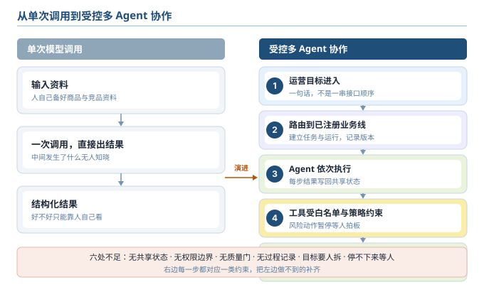

这张图左右对照，按下面的顺序读：

1. 看左半边。卖家自己备好商品和竞品资料，调一次模型，直接拿到结构化结果。中间发生了什么没人知道，结果好不好也只能自己看。坚果这套流程如果这么做，从诊断到主图方向全靠人一次次发起和复制。
2. 看中间那条箭头。它标着六处不足：没有共享状态、没有权限边界、没有质量门、没有过程记录。左边所有问题都出在这条箭头上。
3. 看右半边。卖家只输入一句目标，系统先路由到已注册的业务线，建立任务和运行结果，然后 Agent 依次执行、每步写回共享状态，工具调用走白名单和策略，碰到风险动作就停下来等人拍板。
4. 看右下角的落点。产出的是可审核草稿而不是终稿。坚果的主图方向先停在待审核，卖家点头后才往下走。

对卖家来说，变化就五条，都落在坚果这件事上：说一句话就能启动；诊断只产一次，创意直接用；主图方向先审后定；老的诊断服务创意服务原样复用不用重写；以后加库存运营、店铺巡检，走同一套机制。

### 1.4 对写代码的人意味着什么

卖家能感知的是流程顺不顺，维护这套代码的人关心的是改动成本高不高。后者同样有落点，用坚果说更具体：

| 设计收益 | 含义 | 在坚果流程里的体现 |
|---|---|---|
| 单一职责 | 一个 Agent 只负责一段输入输出 | 商品策略只管定位价格带，创意策略只管主图方向，互不掺和 |
| 可独立替换 | 换模型换规则不影响别的节点 | 诊断模型失败时走规则兜底，创意节点照常跑 |
| 可独立测试 | 每个节点能脱离流程单独验 | 质量节点拿一份固定诊断就能测，不用跑整条工作流 |
| 权限可收敛 | 谁能用什么工具在一处声明 | 创意策略的注册表白名单里有没有诊断草稿工具，一眼可查 |
| 版本可追溯 | 一次运行记下当时用的版本 | 两周后想复现这版主图方向，能查到当时的提示词版本 |
| 流程可复用 | 一套编排装配多条业务线 | 库存运营换一组 Agent 声明就能跑，编排代码不动 |

这里最值钱的是权限可收敛。能力只有接口形态时，权限判断只能问「这个人能不能调这个接口」；能力变成工具后，判断能细到「这个 Agent 能不能用诊断草稿工具、这个风险级别要不要审批」，而且判断依据集中在一处声明，不用散到几十个接口里翻。

## 二、工程中的多 Agent 设计全景

### 2.1 一次完整执行走一遍

先看整条链。坚果案例从卖家输入到落库，经过八步：

| 顺序 | 环节 | 坚果案例里做什么 | 调不调模型 |
|---|---|---|---|
| 1 | 意图识别 | 「分析定位，给主图方向，先审核」命中商品诊断与优化 | 不调，关键词规则 |
| 2 | 建立任务与运行 | 记下业务目标、范围、风险级别、版本清单 | 不调 |
| 3 | 加载上下文 | 读商品的售价成本人群卖点、已录入竞品 | 不调，读业务数据 |
| 4 | 商品策略节点 | 出定位、价格带、卖点和风险 | 调文本模型，失败有规则兜底 |
| 5 | 创意策略节点 | 基于诊断出几版主图方向和画面提示词 | 调文本模型，失败有规则兜底 |
| 6 | 质量合规节点 | 查数量、差异度、不当承诺 | 不调，规则检查 |
| 7 | 人工审核 | 停下来等卖家拍板 | 不调 |
| 8 | 收尾落库 | 按审核决定保存或驳回 | 不调 |

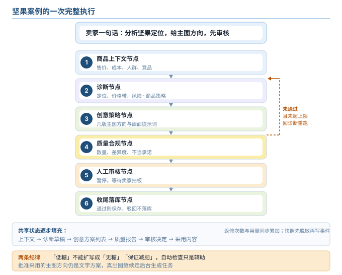

这张图把八步压成一条纵向数据流，顺着中间那列往下读，再看两侧：

1. 顶部是那句话目标「分析坚果定位，给主图方向，先审核」。
2. 中间一列六个节点依次往下：商品上下文、诊断、创意策略、质量合规、人工审核、收尾落库。每个节点右边标了它这步产出什么（售价成本人群竞品 → 定位价格带风险 → 主图方向提示词 → 数量差异度承诺 → 暂停 → 保存或驳回）。
3. 节点下方那条长条是共享状态，字段被逐步填进去：上下文 → 诊断草稿 → 创意方案列表 → 质量报告 → 审核决定 → 采用内容。每个 Agent 只能读自己需要的那部分。
4. 再看两条旁注。返修次数和已用额度同步累加；每步的输入输出快照先脱敏再写进运行事件。
5. 底部两条纪律要记牢：「低糖」不能扩写成「无糖」或「保证减肥」，自动检查只能兜底不能穷尽虚假宣传；审核通过的主图方向仍是文字方案，真出图另行走后台生成任务。

这条主线牵出 Agent、工具、业务线、上下文、质量和人审几组零件，下面逐个拆。

### 2.2 代码放在哪

多 Agent 相关代码集中在后端 `api/app/agents/`，另有五个服务、两个路由和一组 Worker 任务配合。四个分组分别是核心实现、运行服务、对外接口、后台执行：

```text
api/app/agents/           多 Agent 核心包
├─ contracts.py           数据合同：上下文、草稿、质量报告、事件、共享状态
├─ definitions.py         基础图的节点名、操作白名单与版本清单
├─ registry.py            平台注册表：9 个 Agent、16 项工具、7 条业务线
├─ policy.py              风险策略：谁能用什么工具、要不要审批
├─ harness.py             脱敏、预算与用量账本
├─ tool_gateway.py        工具网关：租约、身份复核、幂等、执行与记录
├─ specialists.py         专业节点执行单元：诊断、创意、质量，含规则兜底
├─ graph.py               基础工作流图：商品诊断与优化
├─ platform_graph.py      平台工作流图：注册表驱动的通用编排
├─ evaluation.py          固定评测用例与平台场景模板
└─ persistence.py         检查点连接管理

api/app/services/         运行与业务服务层
├─ agent_runs.py          基础图的运行、认领、状态同步、审批恢复、落库
├─ agent_workflows.py     平台图的运行、上下文加载、通用执行、质量与落库
├─ agent_tasks.py         任务创建、取消、审批决定、记忆管理
├─ agent_leases.py        租约创建、复核、续约与心跳
└─ agent_maintenance.py   到期运行回收与维护

api/app/api/routes/       接口层
├─ agent_platform.py      目录、会话、任务、运行、审批、记忆
└─ agent_runs.py          商品维度的基础图运行与人工审核

api/app/worker/           后台执行层
├─ celery_app.py          队列路由、可靠性开关、周期任务
└─ tasks.py               两个 Agent 运行任务与两个维护任务
```

### 2.3 五层怎么分工

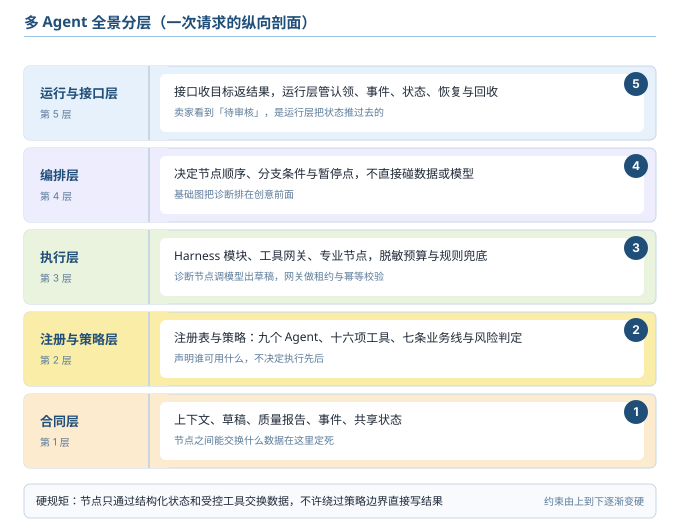

这张图是一次请求的纵向剖面，从上往下每层只管一件事，按层读：

1. 接口层收目标返结果。坚果那句话从这里进来，它不定义业务规则。
2. 运行层管认领、事件、状态同步、审批恢复、超时回收。卖家看到「待审核」，是这层把状态推过去的。
3. 编排层决定节点顺序和暂停点。基础图在这里把诊断排在创意前面。
4. 执行层真正干活。诊断节点调模型出草稿，工具网关在这层做租约和幂等检查。
5. 注册与策略层、合同层在最底下托着。九个 Agent、十六项工具、七条业务线的声明在这里，节点之间能交换什么数据结构也在这里定死。

从下往上约束逐渐变松，从上往下职责逐渐具体。有一条硬规矩贯穿所有层：节点只通过结构化状态和受控工具交换数据，不许绕过策略边界直接写结果。坚果的诊断节点不能直接把结果塞进创意节点，只能写回共享状态，由创意节点按需读。

### 2.4 九个平台 Agent 的职责

注册表里声明了九个 Agent。一个是协调者，其余是领域 Agent 和质量 Agent。

<table>
<colgroup><col style="width:14%"><col style="width:24%"><col style="width:32%"><col style="width:30%"></colgroup>
<thead><tr><th>Agent</th><th>注册键</th><th>职责</th><th>工具白名单与边界</th></tr></thead>
<tbody>
<tr><td><b>运营协调</b></td><td><code>ecommerce_operations_agent</code></td><td>接收目标、识别意图、选工作流、汇总结果</td><td>白名单为空，不持有业务工具</td></tr>
<tr><td>市场情报</td><td><code>market_intelligence_agent</code></td><td>竞品变化、市场机会、卖点趋势</td><td>商品读取、店铺读取、竞品读取、竞品监控执行</td></tr>
<tr><td>商品策略</td><td><code>product_strategy_agent</code></td><td>定位、价格带、人群、卖点与优化动作</td><td>商品读取、竞品读取、诊断草稿</td></tr>
<tr><td>创意策略</td><td><code>creative_strategy_agent</code></td><td>主图、视频脚本、标题与详情策略</td><td>商品读取、诊断草稿、创意方案草稿</td></tr>
<tr><td>内容生产</td><td><code>content_production_agent</code></td><td>候选素材生产与供应商任务编排</td><td>商品读取、图片生成、视频生成</td></tr>
<tr><td>增长实验</td><td><code>growth_experiment_agent</code></td><td>推广链接、投放建议、实验假设</td><td>商品读取、推广链接草稿、投放建议草稿、投放实验创建</td></tr>
<tr><td>经营复盘</td><td><code>performance_review_agent</code></td><td>经营数据、素材、实验的周期复盘</td><td>商品读取、店铺读取、复盘草稿</td></tr>
<tr><td>库存运营</td><td><code>inventory_operations_agent</code></td><td>缺货、积压、补货、调拨与盘点建议</td><td>库存读取、库存建议草稿，以及唯一一项 R3 写入（仅所有者可用）</td></tr>
<tr><td><b>质量合规</b></td><td><code>quality_compliance_agent</code></td><td>结构、事实依据、合规、风险与输出质量</td><td>白名单为空，纯规则审查</td></tr>
</tbody>
</table>


坚果这次只用到其中三个：商品策略出诊断、创意策略出主图方向、质量合规查问题。协调者负责把这句话路由进来，其余五个根本没参与。

这里有两处容易想错。第一，Agent 不等于模型。商品策略和创意策略可以共用同一个文本模型，区别在输入、提示词和输出结构；读上下文和查质量这两步压根不调模型。Agent 多也不代表更聪明，关键是每个有没有清楚的边界。第二，不是每次任务都过齐九个。库存运营线只声明库存运营和质量合规两个，竞品监控线只声明市场情报和质量合规，业务线声明的是「这条线需要谁」，不是「全体点名」。

### 2.5 十六项工具与四级风险

工具是工程允许某个 Agent 用的一项命名能力。它既不是一个接口，也不是模型本身。调用前网关会查身份、工作区、Agent 权限和审批条件，通过了才去调已有的业务服务。

十六项工具按**风险级别**分组，级别越高限制越死（`inventory.adjust` 为 R3 且仅所有者可用）：

**R0 只读**

| 工具（key） | 说明 |
|---|---|
| `product.read` | 读取商品与经营上下文（由工作流加载器统一读取） |
| `store.read` | 读取店铺组合与经营上下文 |
| `competitor.read` | 读取竞品与监控快照 |
| `inventory.read` | 读取 SKU 与库存状态 |

**R1 草稿类**

| 工具（key） | 说明 |
|---|---|
| `competitor.monitor.run` | 复用竞品监控服务生成快照，已有适配器 |
| `diagnosis.draft` | 复用商品诊断服务出诊断草稿，已有适配器，坚果这一步就用它 |
| `creative.plan.draft` | 生成主图与视频脚本草稿，已有适配器 |
| `content.image.generate` | 调用图片供应商生成候选素材，尚未接入适配器 |
| `content.video.generate` | 调用视频供应商生成候选素材，尚未接入适配器 |
| `promotion.link.draft` | 复用推广链接草稿逻辑，已有适配器 |
| `ad.recommendation.draft` | 复用投放建议服务，已有适配器 |
| `performance.review.draft` | 复用经营复盘服务，已有适配器 |
| `inventory.advice.draft` | 复用库存建议服务，已有适配器 |

**R2 执行类**

| 工具（key） | 说明 |
|---|---|
| `ad.experiment.create` | 创建正式投放实验，需审批，尚未接入适配器 |
| `artifact.persist` | 采用草稿并写入正式业务对象，需审批，由审批后的持久化流程处理 |

**R3 高危**

| 工具（key） | 说明 |
|---|---|
| `inventory.adjust` | 写入真实库存调整流水，仅所有者可用，尚未接入适配器 |

R0 到 R3 是项目内部的风险分类，跟模型能力强弱无关。级别越高，限制越死：

| 级别 | 含义 | 审批要求 | 谁能用 | 坚果例子 |
|---|---|---|---|---|
| R0 | 只读，不产生副作用 | 不需要 | 所有 Agent，含只读成员 | 读坚果的售价和竞品 |
| R1 | 出草稿，不写正式对象 | 不需要 | 非只读成员 | 出诊断草稿、主图方向草稿 |
| R2 | 建正式对象或采用草稿 | 需要 | 非只读成员 | 把审核通过的主图方向存成正式方案 |
| R3 | 写不可逆的真实流水 | 需要 | 仅工作区所有者 | 真正调整库存数量，卖家本人才能做 |

注册了工具不等于能直接执行。十六项里只有七项在网关里有适配器，其余的即使注册过，真去调用也会被拒，报「没有可执行适配器」。这是有意留的能力声明：先把边界画出来，用到哪个再接哪个。坚果流程用的诊断草稿、创意方案草稿都在已有适配器里，所以能跑通。

要把其中一项真正接进来，三步就够：网关里补一个适配器函数并复用已有业务服务；在注册表里声明它的风险级别和是否仅限所有者；在用它那个 Agent 的白名单里加上工具键。这三步都不用动编排图和运行服务，注册表驱动的扩展性就在这。

### 2.6 七条业务线怎么组织 Agent

工作流是完成一类业务目标的固定协作路线。注册了七条：

<table>
<colgroup><col style="width:26%"><col style="width:18%"><col style="width:32%"><col style="width:12%"><col style="width:12%"></colgroup>
<thead><tr><th>工作流键</th><th>业务目标</th><th>参与 Agent</th><th>默认风险</th><th>上下文要求</th></tr></thead>
<tbody>
<tr><td><code>product_diagnosis_optimization</code></td><td>商品诊断与优化</td><td>商品策略、创意策略、质量合规</td><td>R2</td><td>商品</td></tr>
<tr><td><code>creative_content_production</code></td><td>创意与素材生产</td><td>创意策略、内容生产、质量合规</td><td>R1</td><td>商品</td></tr>
<tr><td><code>competitor_continuous_monitoring</code></td><td>竞品持续监控</td><td>市场情报、质量合规</td><td>R1</td><td>商品或店铺</td></tr>
<tr><td><code>growth_ad_experiment_loop</code></td><td>投放实验闭环</td><td>增长实验、经营复盘、质量合规</td><td>R2</td><td>商品</td></tr>
<tr><td><code>periodic_performance_review</code></td><td>周期经营复盘</td><td>经营复盘、质量合规</td><td>R1</td><td>商品或店铺</td></tr>
<tr><td><code>inventory_operations</code></td><td>库存运营</td><td>库存运营、质量合规</td><td>R1</td><td>商品或店铺</td></tr>
<tr><td><code>store_portfolio_inspection</code></td><td>店铺组合巡检</td><td>市场情报、商品策略、经营复盘、库存运营、质量合规</td><td>R1</td><td>店铺</td></tr>
</tbody>
</table>

卖家那句话怎么落到商品诊断与优化这条线上？意图路由用一组关键词规则匹配：出现库存词走库存运营，竞品词走竞品监控，投放词走投放实验闭环，复盘词走周期复盘，巡检词走组合巡检，素材词走创意与素材生产，都不命中就兜底走商品诊断与优化。这里没有调模型判定，规则错了改词表就行。「分析定位、给主图方向」命中商品和创意相关词，落到上面第一条。

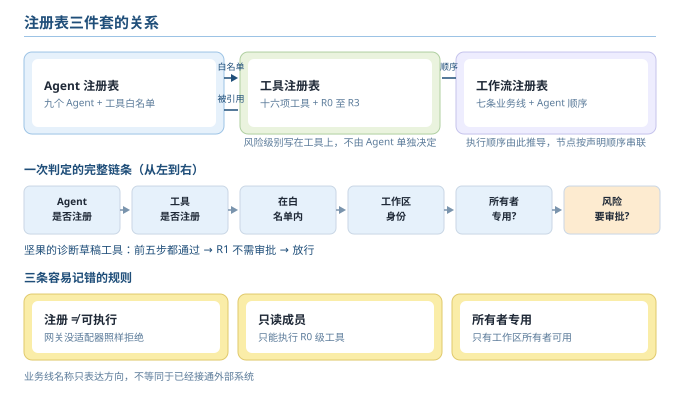

三张注册表各管一摊，按下面的顺序读这张图：

1. 左上角 Agent 注册表声明九个 Agent，每个带一份工具白名单。
2. 左下角工具注册表声明十六项工具，每项标 R0 到 R3。
3. 右上角工作流注册表声明七条业务线，每条列出参与 Agent 和顺序。
4. 看三条连线。白名单连线从 Agent 指向工具，表示某个 Agent 能用哪几项；执行顺序连线从工作流指向 Agent，表示节点按什么次序串；风险标注挂在工具上，不挂在 Agent 或业务线上。
5. 底部那条完整判定链要背下来：Agent 是否注册 → 工具是否注册 → 工具是否在该 Agent 白名单 → 这个 Agent 在工作区是什么身份 → 是不是所有者专用 → 风险级别要不要审批。坚果的诊断草稿工具走到「R1 不需审批」就放行了。

图中还列了三条容易记错的规则：注册了工具不等于能执行，网关没适配器照样拒；只读成员只能执行 R0，所有者专用工具只有所有者能用；业务线名字只表达方向，不等于已经接通外部系统。

### 2.7 运行时依赖与队列

多 Agent 不在接口进程里跑完。它有两类持久化、一组队列、一组后台任务。

<table>
<colgroup><col style="width:22%"><col style="width:38%"><col style="width:40%"></colgroup>
<thead><tr><th>依赖</th><th>作用</th><th>为什么必须有</th></tr></thead>
<tbody>
<tr><td>业务数据库</td><td>保存任务、运行、事件、操作、审批与产物</td><td>业务事实要能审计，不能只活在进程内存里</td></tr>
<tr><td>检查点数据库</td><td>保存图的中间状态，供中断后恢复</td><td>技术恢复和业务审计是两回事，不能互相顶替</td></tr>
<tr><td>消息中间件</td><td>承载运行消息与周期任务</td><td>运行耗时长，不能在请求里同步等</td></tr>
<tr><td>基础运行队列</td><td>消费商品诊断与优化这一类运行</td><td>和媒体生成队列分开，避免长任务互相堵</td></tr>
<tr><td>工作流队列</td><td>消费七条注册业务线的运行</td><td>业务线变多时不挤占同一条队列</td></tr>
<tr><td>维护队列与周期任务</td><td>周期投递待发消息，扫描到期与超时运行</td><td>崩溃和超时不会自己恢复，得有人定期巡检</td></tr>
</tbody>
</table>

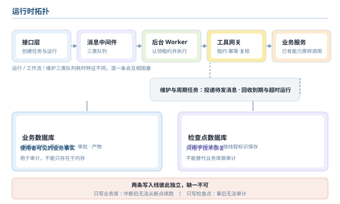

按数据流从上往下读：

1. 接口层创建任务和运行结果，消息进中间件。
2. 中间件分三类队列（运行、工作流、维护），各自的耗时特征不同，混一条会互相堵。
3. 后台 Worker 认领租约、执行节点，通过工具网关复核租约和幂等，再调已有业务服务。
4. 维护与周期任务在一旁做两件事：投递待发消息，回收到期和超时运行。
5. 最底下是两条独立的写入线。业务库写任务、运行、事件、审批、产物，是卖家看得见的事实；检查点库写图的中间状态，按线程标识保存，只用于技术恢复。

两条写入线缺一不可。只写业务库，坚果的流程在人审处中断后没法从断点续跑；只写检查点，事后查不到「谁在什么时候通过了这版主图」。

## 三、为什么需要 Harness 工程

### 3.1 Agent 变多后新增的四类失控

把一次调用换成一串节点，会冒出四类单次调用根本没有的风险。还是拿坚果这条线举例：

| 失控 | 坚果场景里怎么发生 | 和 1.2 的关系 | 单次调用时为什么没有 |
|---|---|---|---|
| 越界读取 | 商品策略节点读到了别家店铺的竞品数据 | 新增 | 单次调用的输入是人备好的，没得选 |
| 无限循环 | 质量门嫌主图方向不够好，返修重跑，一直不通过一直跑 | 新增 | 单次调用没有循环结构 |
| 重复副作用 | 队列重投一次，同一版主图方向被存了两遍 | 新增 | 单次调用失败就是失败，不会被自动重放 |
| 成本与不可追溯 | 诊断加创意调了十几轮没人统计，事后说不清用了哪版提示词 | 放大了 1.2 的「过程不留痕」 | 单次调用消耗和结果都是一次性的，容易归因 |

1.2 那六条和这四条是两件事。1.2 说的是还没有多 Agent 时缺什么，这四条说的是多 Agent 化之后新长出什么。前三条是全新的，最后一条是旧问题被放大。

这四类的共同点是都不是模型能力问题。模型不会主动越界，越界是因为没声明边界；不会主动死循环，循环是因为没设次数上限；不会主动重复写，重复是因为没有幂等键；成本失控是因为没有预算熔断，查不到是因为没有事件记录。要收口它们，得靠工程约束，这就是 Harness 要干的事。

### 3.2 Harness 到底是什么

Harness 原意是马具，套在马身上让力气能被驾驭。用试验台来比喻更贴切：模型是被试的发动机，试验台负责供油、限流、测温、记录曲线、异常时断电。发动机多强是模型的事，试验台多可靠是工程的事。

两个比喻指向同一个东西：`围绕 Agent 运行的一整套工程约束`。它不是某个框架、某个库、某段代码。

下面几种说法，哪些对哪些错，可以自己先判一下：

- Harness 是一个可以安装的框架。**错**，工程里没有引入任何叫 Harness 的第三方框架。
- Harness 是一层中间件。**部分对**，它确实以模块形式存在，但更多是贯穿各处的设计约定。
- Harness 是一组工程约束的集合。**对**，合同、注册表、策略、工具网关、预算、事件、租约、审批、检查点、维护合起来就是它。
- Harness 是 Agent 的一部分。**错**，Agent 管「做什么」，Harness 管「在什么范围内做」。

Agent 给的是智能，Harness 给的是可信。没有后者，多 Agent 只是把一处不可控摊成了多处。

### 3.3 Harness和编排框架怎么分工

工程里用了图编排框架来描述节点和状态流转。它和 Harness 是互补的，一个管流程怎么走，一个管走的时候守什么规矩。

| 维度 | 编排框架管什么 | Harness 管什么 |
|---|---|---|
| 节点 | 有哪些节点、节点返回什么增量 | 这个节点能调什么工具 |
| 状态 | 共享状态的读写与快照 | 状态里能出现什么字段、敏感值怎么脱敏 |
| 流转 | 下一步去哪个节点 | 循环次数上限，防止无限返修 |
| 暂停 | 中断与恢复机制 | 暂停时必须持久化什么、恢复时怎么验身份 |
| 执行 | 调用节点函数 | 执行前后插入租约、幂等、预算、记录 |
| 持久化 | 检查点读写 | 业务事实必须落业务库，不能只靠检查点 |

有一条边界特别要紧：检查点只负责技术恢复，替代不了业务审计。业务库存的是卖家看得见的事实（状态、事件、审批、产物），检查点存的是图恢复用的中间状态。坚果在人审处暂停，检查点让流程能续跑，业务库让卖家能看到「待审核」并留下降级记录，两者缺一边的设计在某类故障下一定会出事。

### 3.4 工程里 Harness 散落在十个地方

Harness 不是集中在一个文件里，按下面的清单能找到它的十个落点。每行的「防住什么」都对应 3.1 的一类风险：

<table>
<colgroup><col style="width:20%"><col style="width:24%"><col style="width:30%"><col style="width:26%"></colgroup>
<thead><tr><th>落点</th><th>承载模块</th><th>关键函数或定义</th><th>防住什么</th></tr></thead>
<tbody>
<tr><td>结构化合同</td><td>合同模块</td><td>上下文、草稿、质量报告、事件、共享状态</td><td>节点传递未定义字段</td></tr>
<tr><td>节点与操作声明</td><td>节点定义模块</td><td>节点名常量、操作白名单、<code>require_tool_permission</code></td><td>节点用了没声明的操作</td></tr>
<tr><td>版本化注册表</td><td>注册表模块</td><td>Agent 表、工具表、业务线表、<code>get_workflow</code>、<code>route_intent</code></td><td>跑了没注册或停用的业务线</td></tr>
<tr><td>风险策略</td><td>策略模块</td><td><code>authorize_tool</code></td><td>越权调用和无审批的高风险动作</td></tr>
<tr><td>脱敏与预算</td><td>Harness 模块</td><td><code>redact_snapshot</code>、<code>remaining_model_tokens</code>、<code>merge_model_usage</code></td><td>密钥泄漏和成本失控</td></tr>
<tr><td>工具网关</td><td>工具网关模块</td><td><code>ToolGateway.execute</code>、失败记录与身份复核</td><td>重复副作用和执行期权限失效</td></tr>
<tr><td>租约</td><td>租约模块</td><td><code>require_active_lease</code>、续约与心跳</td><td>两个 Worker 同时跑同一条运行</td></tr>
<tr><td>可观测事件</td><td>运行服务</td><td>事件记录函数与运行事件表</td><td>事后答不上「当时发生了什么」</td></tr>
<tr><td>审批</td><td>任务服务</td><td>审批决定、审批记录与状态</td><td>高风险动作没经人确认就落库</td></tr>
<tr><td>检查点与维护</td><td>持久化与维护模块</td><td>检查点连接、<code>maintain_agent_runtime</code></td><td>中断后无法恢复、超时运行永久占资源</td></tr>
</tbody>
</table>

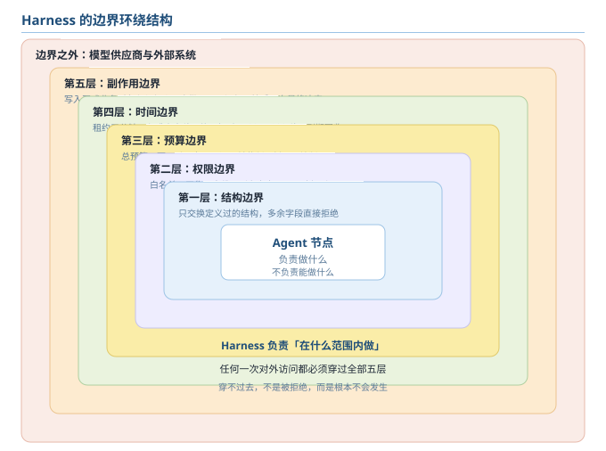

这张图是同心方框，从外面往中心读：

1. 最外层是边界之外，模型供应商和外部系统。它们永远在约束之外，只能通过受控通道被访问。
2. 往里第五层副作用边界，写入正式业务对象必须经人工审批。坚果的主图方向存档这一步就卡在这。
3. 第四层时间边界，租约五分钟、心跳六十秒、软硬超时 1700 和 1800 秒，到期由维护回收。
4. 第三层预算边界，总预算一万二千 Token，调用前截断，耗尽即熔断。
5. 第二层权限边界，白名单、工作区身份、所有者专用、风险级别。
6. 第一层结构边界，只交换定义过的结构，多余字段直接拒绝。
7. 最中心是 Agent 节点，它负责「做什么」，不负责「能做什么」。Harness 负责「在什么范围内做」。

结论是：任何一次对外访问都得穿过全部五层，穿不过去不是被拒一下，而是那个动作根本不会发生。

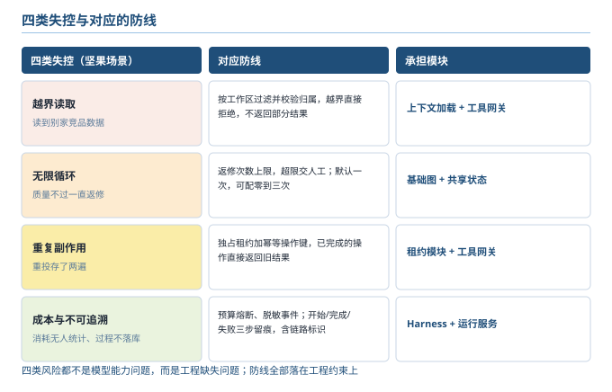

这张图是三列对照，逐行读：

1. 左列是四类失控，各带一句坚果场景：读别家数据、返修死循环、重投存两遍、消耗无人统计。
2. 中列是对应防线：上下文加载加工具网关、基础图返修上限、租约加幂等键、预算熔断加脱敏事件。
3. 右列是承担模块：上下文加载和工具网关挡越界，基础图共享状态挡死循环，租约模块和工具网关挡重复，Harness 和运行服务挡成本与追溯。
4. 每行还要看防线下面的细节，比如越界那条写的是「按工作区过滤并校验归属，越界直接拒绝，不返回部分结果」。坚果的竞品数据只从本工作区加载，别家的连一半都拿不到。

## 四、Harness 工程思想的核心

### 4.1 五条基本原则

十条落点往后退一步看，是五条原则。每条都用坚果对一遍：

| 原则 | 含义 | 坚果里的体现 |
|---|---|---|
| 结构化优先 | 节点间只交换定义过的数据，多余字段直接拒 | 诊断草稿有固定结构，创意节点读不到没定义的字段 |
| 最小权限 | Agent 默认什么都不能用，只显式授予需要的工具 | 创意策略的白名单里没有库存调整工具 |
| 确定性优先于智能 | 能靠规则判断的不用模型 | 意图路由用关键词，质量检查用规则，模型失败用规则兜底 |
| 可回放 | 输入输出、事件、版本都能事后重现 | 两周后能查到这版主图方向当时的提示词版本 |
| 失败可控 | 要么能重试，要么停在明确状态等人，绝不静默丢失 | 诊断超时后运行落到失败态，不会假装成功 |

确定性优先于智能这条多说一句。规则的结果稳定：关键词路由错了能立刻改词表，质量检查不通过能指出是哪一条没过。模型适合做生成，不适合做判定。「低糖是否被扩写成无糖」这种事用规则扫，比再问一次模型可靠。

### 4.2 五类边界与具体阈值

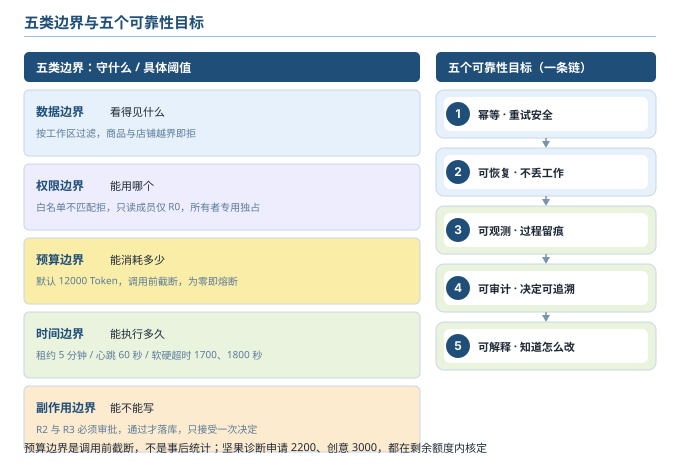

图上两栏，左栏五类边界，右栏五个可靠性目标，先读左栏：

1. 数据边界守「看得见什么」：按工作区过滤，商品和店铺作用域越界就拒。坚果的范围是这一个商品。
2. 权限边界守「能用哪个」：白名单不匹配拒，只读成员只能 R0，所有者专用工具只有所有者能用。
3. 预算边界守「能消耗多少」：默认一万二千 Token，调用前截断，额度为零直接熔断，不是事后统计。
4. 时间边界守「能执行多久」：租约五分钟、心跳六十秒、软硬超时 1700 和 1800 秒，到期回收。
5. 副作用边界守「能不能写」：R2 和 R3 必须审批，通过才落库，同一运行只接受一次最终决定。

右栏五个目标连成一条链：幂等保证重试安全 → 可恢复保证不丢工作 → 可观测与可审计保证事后能查 → 可解释保证查出问题知道怎么改。缺中间任何一环，前后的价值都打折。

预算边界值得单独看它的机制。它不是事后算账，而是调用前截断：节点申请输出额度时先算剩余，申请量和剩余取小的那个；剩余已经为零就直接抛错终止。这样任何一次调用都绕不过上限。坚果的诊断申请 2200、创意申请 3000，都在剩余额度内核定，超了就按剩余给。

### 4.3 四个可靠性目标

Harness（具柄/ harness）本意是「套在马身上用以驾驭的挽具」。在 AI 工程里，它就是**驾驭多个 Agent 的工程框架**，目标可归纳为四个维度：

| 维度                   | 要回答的问题                 | 不做会怎样           |
| ---------------------- | ---------------------------- | -------------------- |
| **可控 Controllable**  | Agent 能调什么工具、谁来批准 | 越权、误改业务数据   |
| **可恢复 Recoverable** | 中途断了能从哪续上           | 长流程重跑、资源浪费 |
| **可验证 Verifiable**  | 产出对不对、该不该进库       | 错误结论直接生效     |
| **可观测 Observable**  | 跑到哪了、花了多少、谁决策   | 黑盒、无法排障       |

### 4.4 应用步骤七步法

给一个新能力装配约束，顺序是固定的七步。这是设计态的顺序，和 5.5 那六道闸门是同一套约束的两个视角：这里讲装配时先做什么，那里讲运行时实际查哪些点。

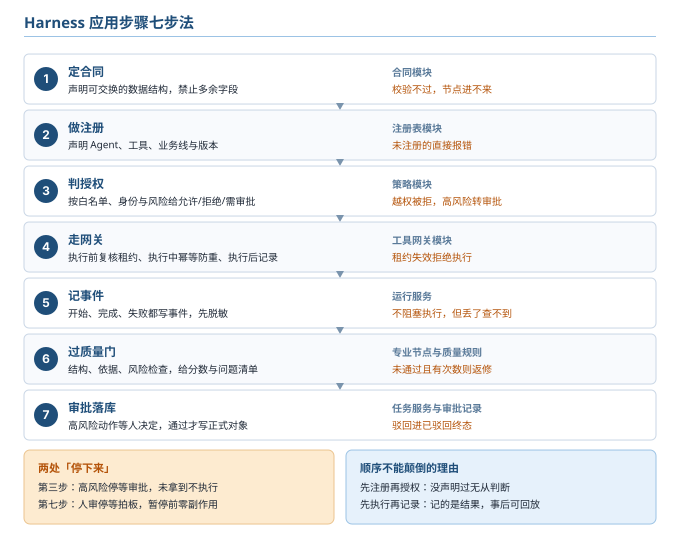

七步按图上的编号从上往下读，每步都标了失败会怎样：

1. 定合同，声明节点间交换的数据结构并禁止多余字段，由合同模块承担，校验不过节点进不来。
2. 做注册，声明 Agent、工具白名单、业务线和版本，由注册表承担，没注册的直接报错。
3. 判授权，按白名单、身份和风险给允许、拒绝或需审批，由策略模块承担，越权被拒、高风险转入审批。
4. 走网关，执行前复核租约和身份、执行中按幂等键防重、执行后记录结果，由工具网关承担，租约失效就拒。
5. 记事件，开始、完成、失败都写事件、输入输出先脱敏，由运行服务承担，不阻塞执行但丢了就查不到。
6. 过质量门，对产物做结构、依据、风险检查并给分数和问题清单，由专业节点和质量规则承担，未通过且有返修次数就受控返修。
7. 审批落库，高风险动作等人决定，通过才写正式对象，由任务服务和审批记录承担，驳回就进已驳回终态。

图里还标了两处「停下来」。第三步高风险动作停下等审批，没拿到审批不会执行；第七步人审停下等拍板，暂停前不产生任何副作用。两处都得先把状态持久化，再用同一个线程标识恢复。坚果在人审那步停的就是第七处：草稿和风险快照先写进检查点，卖家点头后原线程续跑。

顺序不能颠倒的两个理由也写在了图上：先注册再授权，没声明过的 Agent 和工具授权无从判断；先执行再记录，记的是执行结果而非意图，事后才能回放。

### 4.5 预算、脱敏与用量账本

Harness 模块本身只做三件事，各自挡一种风险：

<table>
<colgroup><col style="width:30%"><col style="width:34%"><col style="width:36%"></colgroup>
<thead><tr><th>函数</th><th>做什么</th><th>挡什么</th></tr></thead>
<tbody>
<tr><td><code>redact_snapshot</code></td><td>递归遍历输入，命中敏感键名或 token 字段就替换成脱敏占位；字符串超长截断、嵌套超八层截断、列表或字典超二百项截断</td><td>密钥、凭证、超长响应进事件和日志</td></tr>
<tr><td><code>remaining_model_tokens</code></td><td>总预算减已累计消耗得剩余；小于等于零抛错熔断，否则返回申请量与剩余的较小值</td><td>多轮调用累计超预算</td></tr>
<tr><td><code>merge_model_usage</code></td><td>把本次调用用量在输入、输出、总计、调用次数四个维度累加回账本</td><td>用量散在各节点没法统计</td></tr>
</tbody>
</table>

脱敏有三重上界：深度八层、单项二百条、字符串两千字符，再加「命中敏感键名就整体替换」。这保证事件和快照体积有硬上限，结构还能回放，但密钥不会漏，一个巨大响应也撑不爆存储。坚果流程里诊断和创意各记一次快照，里面的商品描述会保留，模型密钥字段被替换掉。

还有个不起眼但关键的适配器：不同供应商返回的用量字段名不一样，有的叫输入输出，有的叫提示补全，归一化函数把它们收敛成同一份账本结构，预算和事件就不用管供应商差异。

## 五、两张编排图

工程里有两条编排图。一条为具体业务线写死，一条由注册表动态装配。它们共用同一套 Harness 约束，只是约束插入的方式不同。

### 5.1 两张编排图的分工

| 对比项 | 基础工作流图 | 平台工作流图 |
|---|---|---|
| 承载模块 | 基础图模块 | 平台图模块 |
| 服务对象 | 商品诊断与优化这一条线 | 注册表里的全部七条线 |
| 节点来源 | 写死在代码里，七个节点 | 按业务线声明的 Agent 动态生成 |
| 白名单 | 节点定义模块里的细粒度操作白名单 | 注册表里的 Agent 白名单加工具网关 |
| 执行入口 | 运行服务的执行函数 | 工作流服务的执行函数 |
| 队列 | 基础 Agent 队列 | 工作流 Agent 队列 |
| 典型用途 | 把一条线讲透跑透 | 一套代码覆盖所有业务线 |

两条并存是为了两个不同目的。基础图用来把「一次受控运行到底经历什么」讲清楚，节点和顺序都固定，白名单细到操作级，适合当理解入口。平台图用来让新业务线零编排成本，加一条线只要在注册表声明参与 Agent 和默认风险，不用再写一张图。坚果这条线两个图都能跑，基础图是它的精细版。

### 5.2 基础图

> 七个节点，涉及四个Agent的调用

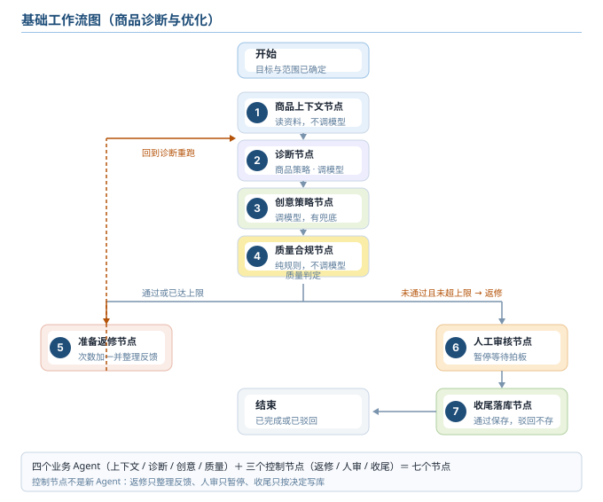

这张图有主链和一条回路，按编号读主链，再看回路：

1. 开始，目标与范围已确定。
2. 商品上下文节点，读商品、人群、卖点、已录入竞品，不编造数据。坚果的售价成本人群从这里进。
3. 诊断节点，对应商品策略 Agent，出定位、价格带、卖点、风险，调模型且失败有规则兜底。
4. 创意策略节点，基于诊断出几版主图方向和提示词，同样调模型有兜底。
5. 质量合规节点，纯规则查数量、差异度、不当承诺、结构完整性。
6. 分叉：通过或已达上限就往右去人工审核节点；未通过且未超上限就走左边那条虚线回路到准备返修节点。
7. 准备返修节点把问题清单写进状态、次数加一，再回到第 3 步诊断重跑。默认最多返修一次，可配零到三次。
8. 人工审核节点暂停等拍板，之后到收尾落库节点，通过保存、驳回不落库。
9. 结束，落已完成或已驳回。

四个业务 Agent（上下文、诊断、创意、质量）加三个控制节点（返修、人审、收尾）等于七个节点。控制节点不是新 Agent：返修只是整理反馈，人审只是暂停，收尾只是按决定写库。节点数不等于 Agent 数。

### 5.3 返修循环与人审中断

基础图有两处不线性的结构，恰好对上 3.1 里的无限循环和重复副作用两类失控。

返修循环。质量节点后有条件边：未通过且返修次数小于上限，走到准备返修节点把问题清单写进状态，再回诊断重跑；未通过但次数用尽，直接进人工审核。这里三个细节都写在图上：返修次数同步到运行记录，界面能看到已经返修几次；返修时把上一轮问题清单注入提示词，让重跑有方向；到上限就不再自动循环，交人工。坚果如果第一版主图方向被判「差异度不够」，返修时会把这句话带进提示词重出一次，第二次还不过就停下来给卖家看。

人审中断。人工审核节点在暂停前不能产生任何副作用，因为恢复时节点会从头执行，之前的写入会重复一遍。工程做法是把草稿、质量报告、返修次数一起放进中断载荷持久化到检查点，人工决定到达后用同一个线程标识恢复。

| 审核决定 | 含义 | 后续 |
|---|---|---|
| 通过 | 原样采用草稿 | 收尾节点写入正式业务对象 |
| 编辑并通过 | 采用人工改后的内容 | 先对改后内容再跑一次质量检查，不通过标记质量失败 |
| 驳回 | 不采用 | 收尾把运行置为已驳回，不落库 |

「编辑并通过」这条要留神：人工改过的内容不再是模型原始输出，必须再过一次质量门。卖家手动把「低糖」改成「无糖」，质量检查照样会拦下来，人工也不能绕规则。

### 5.4 平台图

> 根据workflow动态装配编排成一个graph

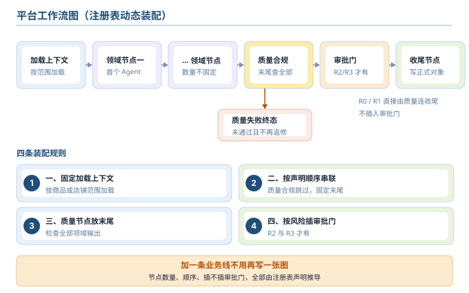

平台图的节点由业务线声明生成，按图上的装配顺序读：

1. 固定一个加载上下文节点，按业务线要求加载商品或店铺数据并重置输出集合。
2. 按业务线声明的 Agent 顺序，逐个生成领域节点依次串联。质量合规跳过，它固定在末尾。
3. 所有领域节点后接质量合规节点，检查全部输出。质量节点之后分两条边：通过去收尾，不通过去质量失败终态。
4. 看业务线默认风险。R0 和 R1 的质量节点直接连收尾；R2 和 R3 在质量与收尾之间插一个审批门。
5. 收尾节点写正式业务对象。

这四条规则解释了「加一条业务线不用写图」：节点数量、顺序、插不插审批门，全从注册表声明里出来。审批门的载荷里有动作键、风险级别、业务线键、草稿输出和质量报告，审批人看到的是「这条线、这个风险、这些内容」，不是一个抽象的批准按钮。

坚果若走创意与素材生产这条 R1 线，装配出来就是加载上下文 → 创意策略 → 内容生产 → 质量合规 → 收尾，没有审批门；若走商品诊断与优化这条 R2 线，质量与收尾之间会插审批门。

### 5.5 一次运行经过的六道闸门

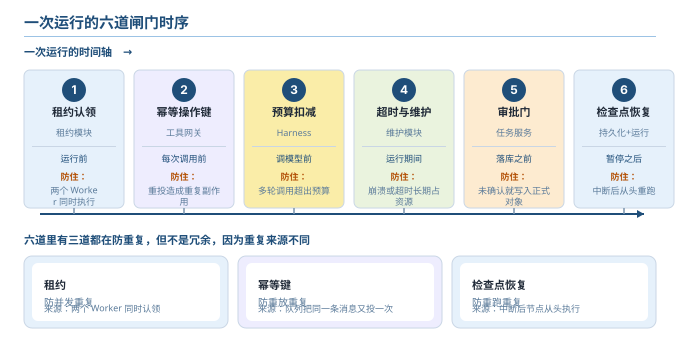

这张图是一条从左到右的时间轴，六道闸门依次排开，任一关不过就停在明确状态：

1. 第一道租约认领，运行开始前由租约模块管，挡两个 Worker 同时跑一条运行。拿不到租约的不执行，等下次调度。
2. 第二道幂等操作键，每次工具调用前由工具网关管，挡重试或重投造成的重复副作用。已完成的操作直接返回上次结果。
3. 第三道预算扣减，每次调模型前由 Harness 管，挡多轮累计超预算。额度为零就熔断。
4. 第四道超时与维护，运行期间由维护模块周期扫描，挡崩溃或超时长期占资源。租约到期被回收，运行进失败或待重试。
5. 第五道审批门，落库前由任务服务管，挡未经确认就写正式对象。运行停在待审批等人决定。
6. 第六道检查点恢复，暂停后由持久化模块和运行服务管，挡中断后从头重跑。用同一个线程标识从断点续。

六道里有三道都在防重复，但不是冗余，因为重复来源不同：租约防的是并发重复，两个 Worker 同时认领；幂等键防的是重放重复，队列把同一条消息又投一次；检查点恢复防的是重跑重复，中断后节点从头执行。三道合起来才撑得住「任意时刻崩溃都能安全恢复」。

### 5.6 任务与运行的分层

任务和运行是两个层次的概念，坚果这条线正好说明为什么要分开。

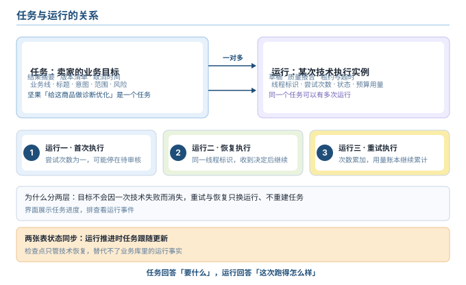

按图上的分组读：

1. 左上任务框表达卖家的业务目标，记业务线、标题、意图、范围、风险、结果摘要、版本清单。坚果「给这商品做诊断优化」是一个任务。
2. 右上运行框表达某个版本某次尝试的技术执行，记线程标识、尝试次数、状态、预算用量、草稿、质量报告、租约超时。
3. 中间一对多连线：一个任务可以有多次运行。图中列了三种：首次执行尝试次数为一、可能停在待审核；恢复执行同一线程标识、收到人工决定后继续；重试执行尝试次数累加、用量账本继续累计。
4. 右下角解释为什么要分两层：目标不会因为一次技术失败而消失，重试和恢复只换运行不重建任务；界面展示任务进度，排查看运行事件。
5. 底部两条补充：两张表状态会同步，运行推进时任务跟随更新为执行中、待审批或已完成；检查点只管技术恢复，替代不了业务库里的运行事实。

一句话记：任务回答「要什么」，运行回答「这次跑得怎么样」。

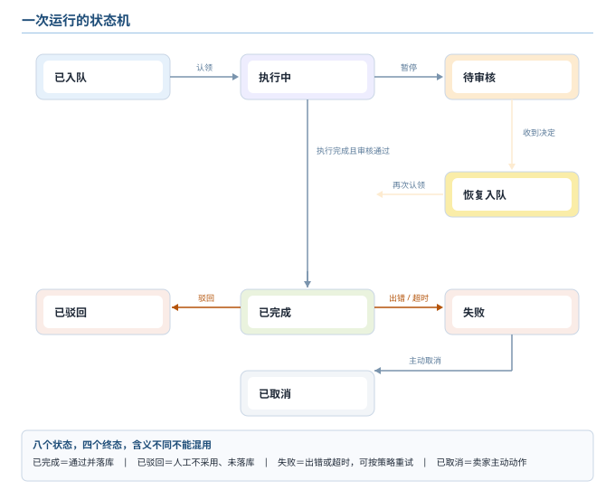

状态图按流转顺序读：

1. 已入队。运行刚创建，等被认领。
2. 认领后进执行中。拿到租约，开始跑节点。
3. 执行中分三路：跑到人审就暂停进待审核；出错进失败；超时被维护回收也进失败。
4. 待审核收到人工决定后进恢复入队，再次被认领回到执行中。
5. 执行中顺利完成且审核通过进已完成；被人工驳回进已驳回；卖家主动取消进已取消。

八个状态里有四个终态，含义不同不能混用：已完成是审核通过并落库；已驳回是人工不采用且未落库；失败是执行出错或超时回收，可按策略重新入队跑一次新运行；已取消是卖家主动动作，同样进终态不再被调度。

任务状态和运行状态是两套，但彼此同步。坚果的运行进待审核时，卖家在界面上看到任务变成待审批；排查看的是运行事件，看到的是哪一步写了什么。

### 5.7 和后台生成任务的同构对照

工程里已有一套给媒体生成用的可靠执行机制：任务记录、事件流、执行者锁、到期重投。多 Agent 运行面对的是同一类问题，两套解法在结构上几乎一样：

| 可靠性手段 | 后台生成任务 | 多 Agent 运行 |
|---|---|---|
| 状态机 | 入队、执行中、成功、失败、已取消 | 八种状态，四种终态 |
| 过程记录 | 任务事件表记每次状态变化 | 运行事件表记开始、完成、失败和脱敏快照 |
| 独占锁 | 任务记录的执行者字段与到期时间 | 租约五分钟、心跳续约、fencing 挡旧写入 |
| 幂等 | 重试复用同一任务编号 | 网关按「Agent + 工具」生成操作键 |
| 消息重投 | 状态吸收重投，终态不重复执行 | 幂等键和租约共同吸收 |
| 到期超时 | 调度器扫描并重投到期任务 | 维护任务扫描超时、回收租约并收尾 |
| 中断恢复 | 不支持中途暂停，失败整条重来 | 检查点保存中间状态，人工决定后按线程恢复 |

差别只有两处，都由任务性质决定。生成任务是一次外部调用加重试，调用本身没有中间状态，失败就整条重来；多 Agent 运行是一串内部节点加暂停，中途有要保留的中间结论，也要停下来等人拍板，所以多了检查点和人审。

租约、幂等、事件、到期回收不是为多 Agent 新发明的，是同一套可靠执行手法换到另一类任务上用。两套状态机结构相同，运行状态机只多了待审核和恢复入队两个中间态。

### 5.8 一次请求的完整路径

把坚果那句话从头到尾走一遍，十个阶段和对应的闸门：

| 阶段 | 发生什么 | 过哪道闸门 |
|---|---|---|
| 一、提出目标 | 卖家提交目标与范围，落到会话和任务AgentTask | 业务线必须已注册且启用 |
| 二、建立  AgentRun | 生成线程标识、记版本清单和预算、写入队事件 | 并发上限与范围校验 |
| 三、投递/分发 | 通过消息队列投到对应队列 | 消息可靠投递，重复靠幂等吸收 |
| 四、认领 | Worker 认领并持租约、开心跳 | 闸门一 |
| 五、加载上下文 | 按范围读商品数据 | 数据边界，越界拒 |
| 六、执行节点 | Agent 调工具出草稿，调模型前先算额度 | 闸门二、闸门三 |
| 七、质量检查 | 规则检查给分数和问题清单 | 未通过走返修或质量失败 |
| 八、暂停等待 | 人审或审批门暂停，状态入检查点 | 闸门五、闸门六 |
| 九、恢复落库 | 收到决定后恢复，通过写正式对象 | 闸门六 |
| 十、收尾 | 更新任务结果摘要，运行进终态 | 终态不可再改 |

## 六、Harness 多 Agent 实现落地

在讲清约束是什么、为什么要有，以及两张编排图怎么把它们串起来之后，这一章换一个视角——从代码看四个可靠性维度各自落在哪里。四个维度不是四套独立代码，而是同一条执行链上不同位置的检查点。坚果那条线每往前走一步，都会撞上其中一两个。

### 6.0 Agent任务全链路解析

笔记内容参考：[Agent任务全链路解析](10_Agent任务全链路解析/00_Agent任务全链路解析.html)

### 6.1 可控维度的落地

可控回答的是「谁能用什么」。工程里这件事分四道关卡，从静态声明一直管到执行那一刻。

1. **能力先注册**。注册表 `app/agents/registry.py` 里有三张表：`AGENT_REGISTRY`、`TOOL_REGISTRY`、`WORKFLOW_REGISTRY`，分别声明 Agent、工具和业务线。每个 Agent 的工具白名单用不可变集合表示，协调 Agent 和质量合规 Agent 的白名单为空，它们不持有业务工具。
2. **调用先授权**。`app/agents/policy.py` 的 `authorize_tool()` 做三道判定：工具不在白名单直接拒；`VIEWER` 只能执行 R0；R3 的 `inventory.adjust` 仅 `OWNER` 可用。
3. **执行走网关**。`app/agents/tool_gateway.py` 的 `execute()` 先复核租约与工作区，再判策略，按 `tool:{agent}:{tool}` 这个操作键查幂等，最后找适配器执行；没有适配器的工具直接拒，不会假装成功。
4. **高风险先停**。`app/agents/graph.py` 的 `human_review_node()` 和 `app/agents/platform_graph.py` 的 `approval_gate` 用 `interrupt()` 把流程挂起，草稿先落检查点；恢复时按同一个 `thread_id` 传 `Command(resume=...)` 接着跑。

四道关卡的先后不能反：注册表先声明有什么，策略才知道该不该放行，网关在执行前再复核一次，最后才轮到审批门拦住高风险动作。跳过任何一步，权限判断都会落空。

坚果的诊断节点白名单里只有它该用的工具，`inventory.adjust` 根本不在其中。真到调工具那步，网关先复核租约、再按操作键查重，重复投递直接返回上次结果。走到人审，`interrupt()` 把流程挂住，草稿和快照先写进检查点，卖家点头才续跑。

### 6.2 可恢复维度的落地

可恢复回答的是「断了从哪接着跑」。工程用发件箱、租约、重试和检查点四样东西兜底，再加一道巡检清理残留。

1. **状态按节点存**。`app/agents/persistence.py` 的 `open_postgres_checkpointer()` 用 `PostgresSaver` 连 Postgres，每执行一个节点就写一次检查点，恢复时按 `thread_id` 取回。
2. **任务先落库再派发**。`app/services/outbox.py` 的 `dispatch_pending_outbox_events()` 把业务数据与 `outbox_events` 写进同一事务，用 `FOR UPDATE SKIP LOCKED` 扫描待投递事件；失败按 `min(2^attempts, 300)` 秒退避，超过十次置 `FAILED`。
3. **执行有租约**。`app/services/agent_leases.py` 的 `require_active_lease()` 和 `agent_lease_heartbeat()` 设租约五分钟、心跳六十秒；fencing 校验 `lease_owner`，一旦被换主或收到取消请求就拒。
4. **失败能重试**。`app/worker/celery_app.py` 和 `app/worker/tasks.py` 开 `task_acks_late`、预取数设一、分四条队列；`self.retry` 按 `2^n` 秒退避，最多两次。
5. **卡死能回收**。`app/services/agent_maintenance.py` 的 `maintain_agent_runtime()` 由 beat 每三十秒巡检，回收卡死的 RUNNING，租约过期的任务重排回队。

这里有两层恢复要分清。一层是任务级：消息没投递成功，靠 outbox 重投；Worker 拿到任务后断了，靠租约过期和巡检重排。另一层是运行级：流程跑到第几步、每步产出了什么，靠检查点保存；人工审核暂停后，靠同一个 `thread_id` 传恢复载荷续跑。两层配合，才做到消息不丢、进度不丢。

卖家提交后，任务和 Run 写库的同时落一条 outbox 事件；beat 每五秒扫出来投到工作流队列；Worker 领到租约执行，每过一个节点写一次检查点。假设在第六步宕机，租约过期后巡检把任务重排，新 Worker 按同一个 `thread_id` 从第六步的检查点续跑，前面五步不重算。

### 6.3 可验证维度的落地

可验证回答的是「产出对不对、该不该进库」。工程把这件事拆成五道检查，从结构校验一直管到正式落库。

1. **产出符合合同**。`app/agents/contracts.py` 的 `StrictModel` 设了 `extra="forbid"`，多余字段直接拒；`AgentDraftOutput` 要求创意方案三到六条，少一条或多一条都过不了。
2. **规则独立审查**。`app/agents/specialists.py` 的 `QualityReviewAgent.run()` 不调模型，纯规则查建议数、角度重复、违禁词，按 `100 - error*20 - warning*5` 打分。
3. **平台图质量门**。`app/services/agent_workflows.py` 的 `_evaluate_quality()` 查非空、禁语、业务上下文和人机边界，是平台图那条线上的检查点。
4. **不合格可返修**。`app/agents/graph.py` 的 `_quality_route()` 在质量不过且未到返修上限时回到诊断节点；上限由 `AGENT_MAX_REVISIONS` 控制，默认一，可配零到三。
5. **落库是显式动作**。`app/services/agent_runs.py` 的 `_finalize_agent_run()` 只有审批通过才写正式业务对象，用 `finalize-v1` 幂等键和 `AgentRunOperation` 唯一约束防重复落库。

最关键的是最后一条：草稿和正式数据是两回事。Agent 生成的诊断、创意始终停在草稿层，改不动商品主表；只有人审批准、finalize 执行，才写成正式对象。这一步还带幂等键，同一 Run 重复触发也只落一次。审查节点不持有工具、不参与生成，正因为它独立于产出者，判断才有意义。

诊断草稿里价格字段类型不对，合同校验当场挡住；文案带「全网第一」这类词，质量节点给 error 判不通过，还有返修次数就回诊断重做；即便通过也不直接进商品表，要等人审批准，finalize 用幂等键保证同一 Run 只落一次正式方案。

### 6.4 可观测维度的落地

可观测回答的是「跑到哪、花了多少、谁做的决定」。工程用事件、脱敏、用量、状态机和巡检五样东西，把一次运行变成可回放的记录。

1. **每步留事件**。`app/models.py` 的 `AgentRunEvent` 对应 `agent_run_events` 表，记下事件类型、Agent 名、输入输出快照和指标，并带 `trace_id`、`span_id` 便于串起链路。
2. **快照先脱敏**。`app/agents/harness.py` 的 `redact_snapshot()` 设了深度八层、单项两百条、字符串两千字符三重上界，命中敏感键的值替换成占位。
3. **用量与预算**。`app/agents/harness.py` 的 `remaining_model_tokens()` 在调用前算剩余、归零即熔断；`merge_model_usage()` 在调用后把输入、输出、总计、次数累加回 `AgentRun.usage`。
4. **状态可追溯**。`app/models.py` 的 `AgentRunStatus` 和 `AgentTaskStatus` 定义状态流转：Run 有 QUEUED、RUNNING、AWAITING_REVIEW、RESUME_QUEUED 四个中间态，以及完成、驳回、失败、取消四个终态。
5. **后台可巡检**。`app/services/agent_maintenance.py` 由 beat 每三十秒维护，过期审批置 `EXPIRED`。

事件不是顺手记的日志，而是先脱敏再写：商品描述保留，模型密钥被替换，一个超长响应也会被截断到固定上界。这样记录既能用来回放，又不会把敏感信息或超大对象带进库。预算和事件共用同一份归一化账本，不同供应商返回的用量字段名不一样，也收敛成同一结构。

诊断和创意各记一条事件，输入快照里的模型密钥被替换成占位，商品描述保留；两次调用的 token 累加进同一份账本，超过总预算就熔断不再调模型；卖家在任务中心看到 Run 从 RUNNING 变成 AWAITING_REVIEW，正是人审那道门在起作用。

### 6.5 一次运行串起四个维度

把四个维度分开看是四个视角，合到一次坚果运行里，就是一条时间线上的连续动作。按下面的顺序读，每一步标出它撞上哪道约束。

1. **提交目标**。卖家输入一句话，前端写到任务表和 Run 表，同时落一条 outbox 事件，这是可恢复的第一道。此时 Run 是 QUEUED，是可观测的状态起点。
2. **路由与领任务**。意图路由匹配到「商品诊断与优化」业务线，beat 扫出 outbox 事件投递，Worker 领租约开始跑，可控的注册与可恢复的租约同时生效，Run 转 RUNNING。
3. **执行诊断节点**。节点按 `thread_id` 从检查点载入状态，调模型前先算 token 余量，是可恢复的检查点加可观测的预算。诊断产出按合同校验，多一个字段都进不来，是可验证的第一道。
4. **调用工具**。网关复核租约、工作区、白名单和风险级别，再按操作键查幂等，可控的三道关卡在这一步集中执行。
5. **过质量门**。质量节点纯规则打分，不过且有返修次数就回诊断重做，是可验证的审查与返修。
6. **人审暂停**。`interrupt()` 把草稿和风险快照写进检查点，Run 转 AWAITING_REVIEW，是可控的审批门加可恢复的进度保存。这一步之前不产生任何副作用。
7. **批准续跑**。卖家提交决定，恢复载荷写进 outbox，Worker 用同一个 `thread_id` 续跑，是可恢复的运行级恢复。
8. **落库收尾**。finalize 用幂等键写正式方案，更新任务结果，Run 进终态，是可验证的落库闸门加可观测的状态收尾。

八步走完，四个维度各出现不止一次。它们不是按顺序登场的四个阶段，而是叠在同一条链上的四层约束：入口管住能不能做，过程管住错了能不能回，出口管住对不对，全程管住能不能查。

### 6.6 回到开头的三个问题

第一个，为什么要拆成多个 Agent。卖家表达的是目标不是调用顺序，已有服务只是能力不是流程。多 Agent 把「读资料、出结论、产创意、查质量、等拍板」串成一条可管理的路，同时让老服务以工具形式被复用而不是重写。坚果那句话能一步启动，靠的就是这个。

第二个，为什么需要 Harness。Agent 变多后越界、循环、重复、成本、不可追溯四类风险被放大。Harness 不是框架，是一组工程约束：合同、注册表、策略、网关、预算、事件、租约、审批、检查点、维护，把不可控的生成关进可检查的边界。

第三个，约束怎么落到编排图上。两张编排图共用一套约束：基础图把一条线讲透，节点固定到操作级白名单，质量不过会返修；平台图用一套代码装配七条线，插不插审批门由注册表的风险声明决定。六道闸门在每个阶段插入检查，八种状态让任何一次运行都能说清现在在哪、为什么在这。

再看 1.2 那六处不足是不是都被填上了：

| 1.2 的不足 | 由什么解决 | 详见 |
|---|---|---|
| 目标要人自己拆 | 意图路由把一句话映射到已注册业务线 | 2.6 |
| 上一步结果靠人搬 | 共享状态贯穿各节点，中断时由检查点保存 | 2.1、5.5 |
| 权限散在各接口 | Agent 白名单、风险策略、网关调用前复核 | 2.4、2.5 |
| 生成得不好没人拦 | 质量节点规则检查，不过走返修，超限交人工 | 5.2、5.3 |
| 过程不留痕 | 运行事件表、脱敏快照、用量账本 | 3.4、4.5 |
| 停不下来等人 | 中断载荷持久化、租约保护、同线程恢复 | 5.3、5.5 |

六条缺口各有落点，提出的问题和给出的约束一一对应。

最后给一套判断标准：评价多 Agent 设计好不好，不看它能生成多漂亮的文案，看它在越界、失败、重投、中断、超预算这五种情况下，行为是不是仍然确定、可解释、可恢复。这套设计里所有约束，都是为了让这五种情况的答案不是碰运气。
