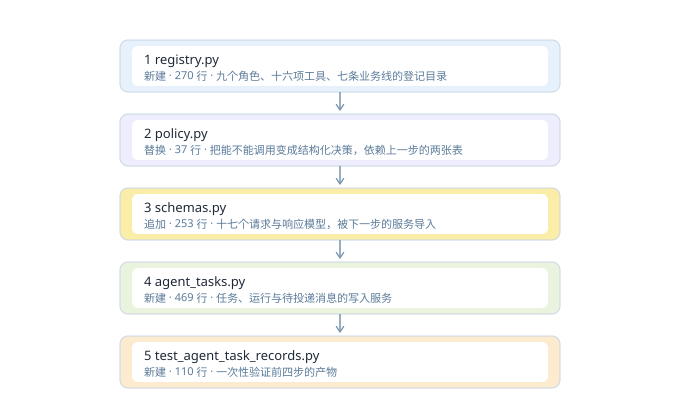
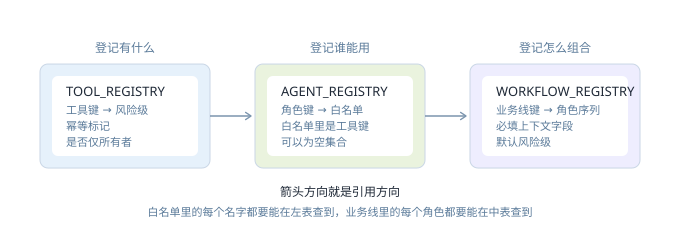
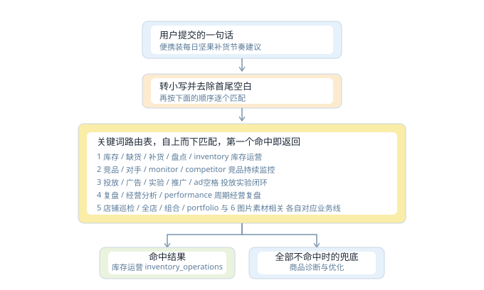
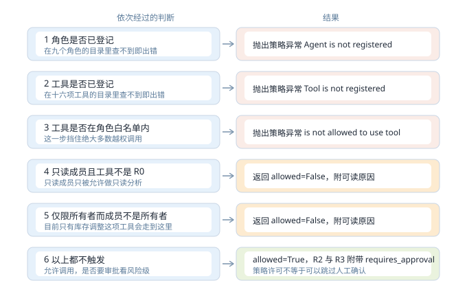
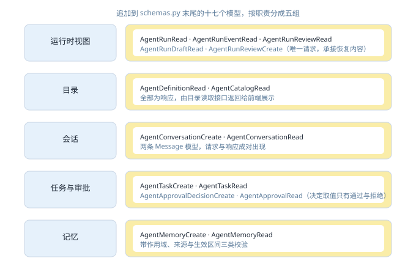
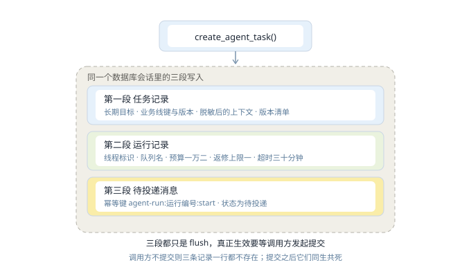
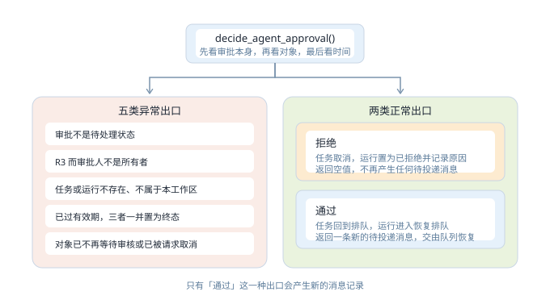
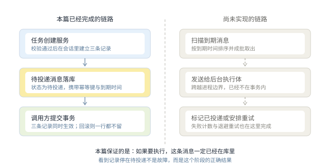

# 12 《电商运营助手》Agent 任务记录与可靠投递

> 约束建好之后，剩下的问题是「一次运行到底留下了什么」。用户提的是运营目标，程序真正执行的是某一次运行，而「需要执行」这件事本身还得先落成一条消息。这三样东西如果分开写库，就会出现两种半套记录：运行时被告知了一个还没提交的目标，或者目标已经建好、消息却丢了。
>
> 本篇交付的是平台的登记能力与记录能力。登记能力把「能选哪些工作流、每个角色能调用哪些工具」固化成一份带版本号的目录；记录能力把目标、执行实例与待投递消息放进同一个事务。图怎么编排、消息由谁投递，都不在本篇范围内。

本篇继续沿用同一个贯穿案例。

| 项目 | 贯穿案例取值 |
|---|---|
| 商品 | 便携装每日坚果 25g×30 袋 |
| 平台与类目 | 某电商平台 / 坚果炒货 |
| 售价与成本 | 39.9 元 / 22.5 元 |
| 本篇登记的业务线 | 库存运营 `inventory_operations` |
| 本篇要写入的记录 | 一条任务、一条运行、一条待投递消息 |
| 本篇结束时的形态 | 数据库里的 `queued` 与 `pending`，不是已经执行完的结果 |

## 一、开发目标

排查看一遍交付物，再动手改代码。本篇五个文件的职责都不一样，先分清哪个是新建、哪个是替换、哪个是追加。

### 1.1 交付的五个文件

| 文件 | 本篇职责 | 动作 |
|---|---|---|
| `api/app/agents/registry.py` | 登记九个角色、十六项工具与七条工作流，提供工作流解析与意图路由 | 新建 |
| `api/app/agents/policy.py` | 把「能不能调用」变成可返回的结构化决策接入口 | 替换该文件原有内容 |
| `api/app/schemas.py` | 补齐十七个 Agent 请求与响应模型 | 追加，保留原有业务模型 |
| `api/app/services/agent_tasks.py` | 创建任务、取消任务、处理审批决定、维护记忆，并写入待投递消息 | 新建 |
| `api/tests/test_agent_task_records.py` | 验证登记条目、事务提交与回滚、跨工作区拒绝 | 新建 |

五个文件职责各不相同，链条上任何一环缺失都会在导入期报错，所以顺序不能打乱。

**图 1-1：本篇五个交付件的调用顺序**



登记先行，表结构其次，最后是依赖它们的任务服务；测试放在最后，验证前四步的产物。

### 1.2 任务、运行与待投递消息各管什么

三张表看起来相似，实际管的是三件不同的事。

| 记录 | 管的是什么 | 生命周期 | 一条目标对应几条 |
|---|---|---|---|
| `AgentTask` | 用户提出的长期业务目标，以及目标的当前状态 | 排队 → 运行中 → 等待审批 / 已完成 / 已取消 / 已失败 | 一条目标一条记录，可以被多次运行 |
| `AgentRun` | 某一次具体执行，持有自己的线程标识、预算、返修次数与版本清单 | 排队 → 运行中 → 待审核 → 恢复排队 → 已完成 / 已拒绝 / 已失败 / 已取消 | 一次执行一条；审批通过后恢复，仍用同一条 |
| `OutboxEvent` | 「这条消息还需要发送」这个事实，不等于已经发送 | 待投递 → 已投递 / 已失败 | 一条运行在不同阶段可以有多条，用幂等键区分 |

把它们拆开的原因很简单：目标是给人看的，运行是给机器看的，消息是给另一个进程看的。三者混在一起，就没有办法回答「这个目标跑过几次」「这条消息发出去没有」。

### 1.3 本篇任务边界

本篇结束时，工程里会有 QUEUED 的任务记录和 PENDING 的待投递消息，但没有一点东西被真正执行起来。这是刻意的阶段划分。

| 不做的事 | 原因 |
|---|---|
| 不编写 Outbox 的扫描与投递服务 | 投递需要 Worker 侧的任务作为接收方，现在还没有 |
| 不调用任何 Celery 任务 | 同上，本篇连队列客户端都不引入 |
| 不编写任何 API 路由 | 路由需要导入尚不存在的执行服务，会导致应用无法启动 |
| 不新增或修改数据表 | 七张 Agent 相关表已经建好，本篇只是写入它们的记录 |
| 不执行任何图节点 | 编排图属于下一个阶段的内容 |

碰到「为什么状态一直是排队」这种疑问时，先回到这张表对照——它不是故障，是本篇的正确结果。

### 1.4 依赖顺序与为什么不能调换

编写顺序是登记的目录，然后是依赖目录的策略，接着是被服务导入的表结构，最后才是任务服务与测试。

| 顺序 | 文件 | 为什么必须在这个位置 |
|---|---|---|
| 1 | `registry.py` | 不依赖本篇任何其它文件，是链条的起点 |
| 2 | `policy.py` | 需要从目录里取角色白名单与工具风险级 |
| 3 | `schemas.py` | 任务服务要导入其中的 `AgentTaskCreate` 与 `AgentMemoryCreate` |
| 4 | `agent_tasks.py` | 同时依赖目录、脱敏工具与上面两个算子 |
| 5 | 测试文件 | 一次性导入前四步的产物，缺任何一个都跑不起来 |

顺序里唯一值得留意的是第二步：策略模块既依赖目录，又保留了上一版定义的基础图白名单入口。它处在两条链路的交汇点上，所以一定要等目录写完再动。

## 二、开发准备

动手前有三件事要确认：表是不是已经存在、配置项取值是多少、上一层的哪些成员会被复用。

### 2.1 相关的数据模型

本章节用到的七张表在数据模型设计阶段已经创建完毕：

| 模型 | 对应表 | 如何使用 |
|---|---|---|
| `AgentTask` | `agent_tasks` | 创建时写入目标、业务线键、版本清单与上下文快照 |
| `AgentRun` | `agent_runs` | 创建时写入线程标识、队列名、预算、返修上限与超时时间 |
| `AgentRunEvent` | `agent_run_events` | 排队、请求取消、审批通过与拒绝各写一条事件 |
| `AgentApproval` | `agent_approvals` | 审批决定时更新状态与决定载荷，取消任务时同步关闭待处理审批 |
| `AgentMemory` | `agent_memories` | 写入时校验作用域与来源任务，撤销时改为已撤销 |
| `AgentConversation` | `agent_conversations` | 只做归属校验，不作为本篇的写入对象 |
| `OutboxEvent` | `outbox_events` | 创建时写入待投递消息，携带幂等键 |

所以本节的容器假设是：数据卷里已经有这些表，不需要执行任何迁移命令。

### 2.2 三个配置项

任务服务会读取应用配置，其中三个键与本篇有关。

| 配置键 | 默认值 | 本篇用到的方式 |
|---|---|---|
| `CELERY_AGENT_WORKFLOW_QUEUE` | `agent.workflow` | 写入运行记录的 `queue_name`，指明将来由哪个队列消费 |
| `AGENT_MAX_TOTAL_TOKENS` | `12000` | 配置项已存在，但当前版本的运行预算仍写成字面值 `12000` |
| `AGENT_MAX_REVISIONS` | `1` | 同上，返修上限仍写成字面值 `1` |

后两个键需要先解释一句，否则容易以为代码写错了：它们确实已经在配置类里声明了默认值，但创建运行记录那一处的代码还没有改成读取配置，而是直接写了字面值。本篇的目标代码就是如此，取值恰好与默认值一致，运行时不会有差异。把字面值替换成读取配置属于后续调整的范围。

### 2.3 复用的三个既有成员

本篇不是从零开始，下面三个成员在数据合同与工具边界那一部分已经完成，这里直接复用。

| 复用成员 | 定义位置 | 本篇用在哪 |
|---|---|---|
| `redact_snapshot()` | `api/app/agents/harness.py` | 上下文作用域、输入负载、审批决定载荷、记忆内容与来源引用落库前统一脱敏 |
| `AgentPolicyError` | `api/app/agents/definitions.py` | 策略模块沿用同一个异常类型，调用方只需要一个捕获点 |
| `ReviewResumePayload` | `api/app/agents/contracts.py` | 作为 `AgentRunReviewCreate` 的基类，复用已经在用的双分支校验 |

这也解释了为什么追加表结构这一步要排在编写任务服务之前：十七个模型里有一个直接继承自合同层定义的数据形状，结构要先用起来，就得先有合同。

## 三、平台登记表 `registry.py`

> 「能选哪些业务线、每个角色能用哪些工具」是一件必须写死的事，不能交给模型临时决定。这个文件把答案集中到一处：三张不可变的注册表，加上三个查表的入口函数。后面所有的值都是查表得到的，任何地方都不出现散落的字符串常量。

在 `api/app/agents/` 目录下新建 `registry.py`

### 3.1 文件成员清单

动手之前先看清楚 `registry.py` 要提供哪些成员，下表按它们在文件中的出现顺序排列。

<table>
<colgroup><col style="width:26%"><col style="width:18%"><col style="width:56%"></colgroup>
<thead><tr><th>成员</th><th>类型</th><th>说明</th></tr></thead>
<tbody>
<tr><td><code>COORDINATOR_AGENT</code></td><td>常量</td><td>协调者角色键 <code>ecommerce_operations_agent</code></td></tr>
<tr><td><code>MARKET_INTELLIGENCE_AGENT</code></td><td>常量</td><td>市场情报角色键 <code>market_intelligence_agent</code></td></tr>
<tr><td><code>PRODUCT_STRATEGY_AGENT</code></td><td>常量</td><td>商品策略角色键 <code>product_strategy_agent</code></td></tr>
<tr><td><code>CREATIVE_STRATEGY_AGENT</code></td><td>常量</td><td>创意策略角色键 <code>creative_strategy_agent</code></td></tr>
<tr><td><code>CONTENT_PRODUCTION_AGENT</code></td><td>常量</td><td>内容生产角色键 <code>content_production_agent</code></td></tr>
<tr><td><code>GROWTH_EXPERIMENT_AGENT</code></td><td>常量</td><td>增长实验角色键 <code>growth_experiment_agent</code></td></tr>
<tr><td><code>PERFORMANCE_REVIEW_AGENT</code></td><td>常量</td><td>经营复盘角色键 <code>performance_review_agent</code></td></tr>
<tr><td><code>INVENTORY_OPERATIONS_AGENT</code></td><td>常量</td><td>库存运营角色键 <code>inventory_operations_agent</code></td></tr>
<tr><td><code>QUALITY_COMPLIANCE_AGENT</code></td><td>常量</td><td>质量合规角色键 <code>quality_compliance_agent</code></td></tr>
<tr><td><code>AgentDefinition</code></td><td>数据类</td><td>角色定义：键、版本、职责说明与工具白名单</td></tr>
<tr><td><code>ToolDefinition</code></td><td>数据类</td><td>工具定义：键、风险级、说明、是否幂等、是否仅所有者</td></tr>
<tr><td><code>WorkflowDefinition</code></td><td>数据类</td><td>工作流定义：键、版本、标题、说明、参与角色、必填上下文、默认风险级</td></tr>
<tr><td><code>WorkflowDefinition.version_manifest</code></td><td>只读属性</td><td>把业务线、参与角色与策略的版本打包成字典</td></tr>
<tr><td><code>TOOL_REGISTRY</code></td><td>注册表</td><td>十六项工具的目录</td></tr>
<tr><td><code>AGENT_REGISTRY</code></td><td>注册表</td><td>九个角色的目录</td></tr>
<tr><td><code>WORKFLOW_REGISTRY</code></td><td>注册表</td><td>七条工作流的目录</td></tr>
<tr><td><code>WORKFLOW_ALIASES</code></td><td>注册表</td><td>业务线别名，目前只有一条对应关系</td></tr>
<tr><td><code>get_workflow()</code></td><td>函数</td><td>解析别名后取业务线，未登记或未启用则抛错</td></tr>
<tr><td><code>route_intent()</code></td><td>函数</td><td>按关键词把一句话映射到已登记业务线</td></tr>
<tr><td><code>is_workflow_enabled()</code></td><td>函数</td><td>按工作区设置判断某条业务线是否可用</td></tr>
</tbody>
</table>

三张注册表不是彼此孤立的：角色引用工具键，工作流引用角色键。串起来的关系如下。

**图 3-1：三张注册表怎么串起来**



左边的表回答「有什么」，右边的表回答「谁能用」。同一个工具可以出现在多个角色的白名单里，能不能真正调用还要看工作区成员的角色与工具的风险级——那一步由策略模块判定。

### 3.2 增量接入步骤

文件路径：`api/app/agents/registry.py`——在 `api/app/agents/` 目录下新建该文件，与 `contracts.py` 同级。

下面每一步只给出这一步新增的内容，按顺序从 3.2.1 追加到 3.2.6，`registry.py` 就与 3.3 的完整代码一致。

#### 3.2.1 导入依赖与九个角色常量

新建文件，写入以下内容：

```python
from dataclasses import dataclass
from typing import Final

from app.models import AgentRiskLevel


COORDINATOR_AGENT: Final = "ecommerce_operations_agent"
MARKET_INTELLIGENCE_AGENT: Final = "market_intelligence_agent"
PRODUCT_STRATEGY_AGENT: Final = "product_strategy_agent"
CREATIVE_STRATEGY_AGENT: Final = "creative_strategy_agent"
CONTENT_PRODUCTION_AGENT: Final = "content_production_agent"
GROWTH_EXPERIMENT_AGENT: Final = "growth_experiment_agent"
PERFORMANCE_REVIEW_AGENT: Final = "performance_review_agent"
INVENTORY_OPERATIONS_AGENT: Final = "inventory_operations_agent"
QUALITY_COMPLIANCE_AGENT: Final = "quality_compliance_agent"
```

角色键统一定义成模块级常量，而不是在各处在引号里写字面量。这样做的收益很直接：写错角色名时，解释器会立刻报名字不存在，而不是在运行时查表得到一个空结果。

#### 3.2.2 定义三个不可变数据结构

在 `registry.py` 末尾留出两个空行，追加下面这段：

```python
@dataclass(frozen=True)
class AgentDefinition:
    key: str
    version: str
    description: str
    tool_allowlist: frozenset[str]


@dataclass(frozen=True)
class ToolDefinition:
    key: str
    risk_level: AgentRiskLevel
    description: str
    idempotent: bool = True
    owner_only: bool = False


@dataclass(frozen=True)
class WorkflowDefinition:
    key: str
    version: str
    title: str
    description: str
    agents: tuple[str, ...]
    required_context_any: tuple[str, ...]
    default_risk_level: AgentRiskLevel
    enabled: bool = True

    @property
    def version_manifest(self) -> dict:
        """version清单，只从版本化注册表解析职责、工具白名单和工作流定义。"""
        return {
            "workflow": {"key": self.key, "version": self.version},
            "agents": {agent: AGENT_REGISTRY[agent].version for agent in self.agents},
            "policies": {"risk_policy": "1.0.0", "tool_gateway": "1.0.0"},
        }
```

三个数据类都用 `frozen=True`，构造之后不能再改；白名单用 `frozenset` 而不是 `set`，避免有人在某处顺手 `add()` 一个工具。角色白名单里的成员顺序没有意义，集合语义正好表达这一点。

`version_manifest` 是一个只读属性，它把「这次运行用到哪些版本」打包成一个字典：业务线自身的版本号、参与角色的版本号，以及两组策略版本。它被写进运行记录，用于事后判断当时用的是哪一套规则。

#### 3.2.3 登记十六项工具

在 `registry.py` 末尾留出两个空行，追加下面这段：

```python
TOOL_REGISTRY: Final[dict[str, ToolDefinition]] = {
    "product.read": ToolDefinition("product.read", AgentRiskLevel.R0, "读取商品与经营上下文"),
    "store.read": ToolDefinition("store.read", AgentRiskLevel.R0, "读取店铺组合与经营上下文"),
    "competitor.read": ToolDefinition("competitor.read", AgentRiskLevel.R0, "读取竞品与监控快照"),
    "competitor.monitor.run": ToolDefinition(
        "competitor.monitor.run", AgentRiskLevel.R1, "生成竞品监控快照"
    ),
    "diagnosis.draft": ToolDefinition("diagnosis.draft", AgentRiskLevel.R1, "生成商品诊断草稿"),
    "creative.plan.draft": ToolDefinition(
        "creative.plan.draft", AgentRiskLevel.R1, "生成可编辑创意方案"
    ),
    "content.image.generate": ToolDefinition(
        "content.image.generate", AgentRiskLevel.R1, "调用图片供应商生成候选素材"
    ),
    "content.video.generate": ToolDefinition(
        "content.video.generate", AgentRiskLevel.R1, "调用视频供应商生成候选素材"
    ),
    "promotion.link.draft": ToolDefinition(
        "promotion.link.draft", AgentRiskLevel.R1, "生成推广链接配置草稿"
    ),
    "ad.recommendation.draft": ToolDefinition(
        "ad.recommendation.draft", AgentRiskLevel.R1, "生成投放建议草稿"
    ),
    "ad.experiment.create": ToolDefinition(
        "ad.experiment.create", AgentRiskLevel.R2, "创建正式投放实验"
    ),
    "performance.review.draft": ToolDefinition(
        "performance.review.draft", AgentRiskLevel.R1, "生成周期经营复盘草稿"
    ),
    "inventory.read": ToolDefinition("inventory.read", AgentRiskLevel.R0, "读取 SKU 与库存状态"),
    "inventory.advice.draft": ToolDefinition(
        "inventory.advice.draft", AgentRiskLevel.R1, "生成库存建议草稿"
    ),
    "inventory.adjust": ToolDefinition(
        "inventory.adjust",
        AgentRiskLevel.R3,
        "写入真实库存调整流水",
        owner_only=True,
    ),
    "artifact.persist": ToolDefinition(
        "artifact.persist", AgentRiskLevel.R2, "采用草稿并写入正式业务对象"
    ),
}
```

每一项工具登记四件事：键名、风险级别、说明，以及两个布尔开关。`idempotent` 表示重复调用是否安全，`owner_only` 表示是否仅限工作区所有者。表中只有 `inventory.adjust` 把 `owner_only` 打开，其余十六项保持默认。

登记一条工具只是声明「有这个能力」，并不等于已经有可用的适配实现。这个差别很重要，后面还会再提一次。

#### 3.2.4 登记九个角色与工具白名单

在 `registry.py` 末尾留出两个空行，追加下面这段：

```python
AGENT_REGISTRY: Final[dict[str, AgentDefinition]] = {
    COORDINATOR_AGENT: AgentDefinition(
        COORDINATOR_AGENT,
        "1.0.0",
        "只负责意图识别、受控工作流路由和结果汇总",
        frozenset(),
    ),
    MARKET_INTELLIGENCE_AGENT: AgentDefinition(
        MARKET_INTELLIGENCE_AGENT,
        "1.0.0",
        "竞品变化、市场机会和卖点趋势",
        frozenset({"product.read", "store.read", "competitor.read", "competitor.monitor.run"}),
    ),
    PRODUCT_STRATEGY_AGENT: AgentDefinition(
        PRODUCT_STRATEGY_AGENT,
        "1.0.0",
        "商品定位、价格带、人群、卖点和优化动作",
        frozenset({"product.read", "competitor.read", "diagnosis.draft"}),
    ),
    CREATIVE_STRATEGY_AGENT: AgentDefinition(
        CREATIVE_STRATEGY_AGENT,
        "1.0.0",
        "主图、视频脚本、标题与详情策略",
        frozenset({"product.read", "diagnosis.draft", "creative.plan.draft"}),
    ),
    CONTENT_PRODUCTION_AGENT: AgentDefinition(
        CONTENT_PRODUCTION_AGENT,
        "1.0.0",
        "候选素材生产、版本和供应商任务编排",
        frozenset({"product.read", "content.image.generate", "content.video.generate"}),
    ),
    GROWTH_EXPERIMENT_AGENT: AgentDefinition(
        GROWTH_EXPERIMENT_AGENT,
        "1.0.0",
        "推广链接、投放建议和实验假设",
        frozenset(
            {"product.read", "promotion.link.draft", "ad.recommendation.draft", "ad.experiment.create"}
        ),
    ),
    PERFORMANCE_REVIEW_AGENT: AgentDefinition(
        PERFORMANCE_REVIEW_AGENT,
        "1.0.0",
        "经营数据、素材、实验和周期复盘",
        frozenset({"product.read", "store.read", "performance.review.draft"}),
    ),
    INVENTORY_OPERATIONS_AGENT: AgentDefinition(
        INVENTORY_OPERATIONS_AGENT,
        "1.0.0",
        "库存风险、补货、调拨和盘点建议",
        frozenset({"product.read", "store.read", "inventory.read", "inventory.advice.draft", "inventory.adjust"}),
    ),
    QUALITY_COMPLIANCE_AGENT: AgentDefinition(
        QUALITY_COMPLIANCE_AGENT,
        "1.0.0",
        "结构、事实依据、合规、风险和输出质量",
        frozenset(),
    ),
}
```

每个角色给出一句话职责和一张白名单。协调者与质量合规的白名单是空集合——它们分别只做路由汇总和规则审查，不需要任何工具。

#### 3.2.5 登记七条工作流

在 `registry.py` 末尾留出两个空行，追加下面这段：

```python
WORKFLOW_REGISTRY: Final[dict[str, WorkflowDefinition]] = {
    "product_diagnosis_optimization": WorkflowDefinition(
        "product_diagnosis_optimization",
        "1.0.0",
        "商品诊断与优化",
        "结合商品与竞品上下文生成诊断和可测试创意策略",
        (PRODUCT_STRATEGY_AGENT, CREATIVE_STRATEGY_AGENT, QUALITY_COMPLIANCE_AGENT),
        ("product_id",),
        AgentRiskLevel.R2,
    ),
    "creative_content_production": WorkflowDefinition(
        "creative_content_production",
        "1.0.0",
        "创意与素材生产",
        "从创意策略生成图片、视频和内容候选版本",
        (CREATIVE_STRATEGY_AGENT, CONTENT_PRODUCTION_AGENT, QUALITY_COMPLIANCE_AGENT),
        ("product_id",),
        AgentRiskLevel.R1,
    ),
    "competitor_continuous_monitoring": WorkflowDefinition(
        "competitor_continuous_monitoring",
        "1.0.0",
        "竞品持续监控",
        "采集授权竞品快照并形成结构化变化建议",
        (MARKET_INTELLIGENCE_AGENT, QUALITY_COMPLIANCE_AGENT),
        ("product_id", "store_id"),
        AgentRiskLevel.R1,
    ),
    "growth_ad_experiment_loop": WorkflowDefinition(
        "growth_ad_experiment_loop",
        "1.0.0",
        "投放实验闭环",
        "形成推广链接、投放建议、实验假设和复盘证据链",
        (GROWTH_EXPERIMENT_AGENT, PERFORMANCE_REVIEW_AGENT, QUALITY_COMPLIANCE_AGENT),
        ("product_id",),
        AgentRiskLevel.R2,
    ),
    "periodic_performance_review": WorkflowDefinition(
        "periodic_performance_review",
        "1.0.0",
        "周期经营复盘",
        "汇总周期经营数据并生成可编辑复盘和行动建议",
        (PERFORMANCE_REVIEW_AGENT, QUALITY_COMPLIANCE_AGENT),
        ("product_id", "store_id"),
        AgentRiskLevel.R1,
    ),
    "inventory_operations": WorkflowDefinition(
        "inventory_operations",
        "1.0.0",
        "库存运营",
        "识别缺货和积压风险并生成补货、调拨或盘点建议",
        (INVENTORY_OPERATIONS_AGENT, QUALITY_COMPLIANCE_AGENT),
        ("product_id", "store_id"),
        AgentRiskLevel.R1,
    ),
    "store_portfolio_inspection": WorkflowDefinition(
        "store_portfolio_inspection",
        "1.0.0",
        "店铺组合巡检",
        "跨商品发现市场、经营、素材和库存异常并分派建议任务",
        (
            MARKET_INTELLIGENCE_AGENT,
            PRODUCT_STRATEGY_AGENT,
            PERFORMANCE_REVIEW_AGENT,
            INVENTORY_OPERATIONS_AGENT,
            QUALITY_COMPLIANCE_AGENT,
        ),
        ("store_id",),
        AgentRiskLevel.R1,
    ),
}
```

一条工作流把参与角色按顺序串起来，声明至少要提供哪一个上下文字段，并给出默认风险级。注意各个角色的顺序即执行顺序，质量合规放在末尾是统一的做法。

#### 3.2.6 补齐别名与三个查询入口

在 `registry.py` 末尾留出两个空行，追加下面这段：

```python
WORKFLOW_ALIASES: Final = {"product_operation": "product_diagnosis_optimization"}


def get_workflow(workflow_key: str) -> WorkflowDefinition:
    """获取工作流，只从版本化注册表解析职责、工具白名单和工作流定义。"""
    canonical_key = WORKFLOW_ALIASES.get(workflow_key, workflow_key)
    workflow = WORKFLOW_REGISTRY.get(canonical_key)
    if workflow is None or not workflow.enabled:
        raise KeyError(f"Workflow is not registered or enabled: {workflow_key}")
    return workflow


def route_intent(intent: str) -> WorkflowDefinition:
    """路由intent，依据结构化状态选择下一个已注册节点，避免隐式或无界跳转。"""
    # 节点只通过结构化状态和受控工具交换数据，禁止绕过策略边界写入结果。
    normalized = intent.strip().lower()
    keyword_routes = (
        (("库存", "缺货", "补货", "盘点", "inventory"), "inventory_operations"),
        (("竞品", "对手", "monitor", "competitor"), "competitor_continuous_monitoring"),
        (("投放", "广告", "实验", "推广", "ad "), "growth_ad_experiment_loop"),
        (("复盘", "经营分析", "performance"), "periodic_performance_review"),
        (("店铺巡检", "全店", "组合", "portfolio"), "store_portfolio_inspection"),
        (("图片", "视频", "素材", "脚本", "content"), "creative_content_production"),
    )
    for keywords, workflow_key in keyword_routes:
        if any(keyword in normalized for keyword in keywords):
            return WORKFLOW_REGISTRY[workflow_key]
    return WORKFLOW_REGISTRY["product_diagnosis_optimization"]


def is_workflow_enabled(workspace_settings: dict, workflow_key: str) -> bool:
    """判断工作流enabled，只从版本化注册表解析职责、工具白名单和工作流定义。"""
    if workspace_settings.get("agent_platform_enabled", True) is False:
        return False
    canonical_key = WORKFLOW_ALIASES.get(workflow_key, workflow_key)
    workflow_flags = workspace_settings.get("agent_workflow_flags", {})
    return workflow_flags.get(canonical_key, True) is not False
```

最后一个片段给出别名表和三个函数：`get_workflow()` 负责解析别名并把未启用业务线当成不存在，`route_intent()` 把一句话变成一条已登记的工作流，`is_workflow_enabled()` 决定是否允许在当前工作区使用。

到这里文件已经完整，`registry.py` 拼出来的内容与 3.3 的完整代码逐行一致。

### 3.3 完整代码

下面是 3.2 的六个步骤全部追加完成后 `registry.py` 应有的完整内容，用于核对最终结果。

```python
from dataclasses import dataclass
from typing import Final

from app.models import AgentRiskLevel


COORDINATOR_AGENT: Final = "ecommerce_operations_agent"
MARKET_INTELLIGENCE_AGENT: Final = "market_intelligence_agent"
PRODUCT_STRATEGY_AGENT: Final = "product_strategy_agent"
CREATIVE_STRATEGY_AGENT: Final = "creative_strategy_agent"
CONTENT_PRODUCTION_AGENT: Final = "content_production_agent"
GROWTH_EXPERIMENT_AGENT: Final = "growth_experiment_agent"
PERFORMANCE_REVIEW_AGENT: Final = "performance_review_agent"
INVENTORY_OPERATIONS_AGENT: Final = "inventory_operations_agent"
QUALITY_COMPLIANCE_AGENT: Final = "quality_compliance_agent"


@dataclass(frozen=True)
class AgentDefinition:
    key: str
    version: str
    description: str
    tool_allowlist: frozenset[str]


@dataclass(frozen=True)
class ToolDefinition:
    key: str
    risk_level: AgentRiskLevel
    description: str
    idempotent: bool = True
    owner_only: bool = False


@dataclass(frozen=True)
class WorkflowDefinition:
    key: str
    version: str
    title: str
    description: str
    agents: tuple[str, ...]
    required_context_any: tuple[str, ...]
    default_risk_level: AgentRiskLevel
    enabled: bool = True

    @property
    def version_manifest(self) -> dict:
        """version清单，只从版本化注册表解析职责、工具白名单和工作流定义。"""
        return {
            "workflow": {"key": self.key, "version": self.version},
            "agents": {agent: AGENT_REGISTRY[agent].version for agent in self.agents},
            "policies": {"risk_policy": "1.0.0", "tool_gateway": "1.0.0"},
        }


TOOL_REGISTRY: Final[dict[str, ToolDefinition]] = {
    "product.read": ToolDefinition("product.read", AgentRiskLevel.R0, "读取商品与经营上下文"),
    "store.read": ToolDefinition("store.read", AgentRiskLevel.R0, "读取店铺组合与经营上下文"),
    "competitor.read": ToolDefinition("competitor.read", AgentRiskLevel.R0, "读取竞品与监控快照"),
    "competitor.monitor.run": ToolDefinition(
        "competitor.monitor.run", AgentRiskLevel.R1, "生成竞品监控快照"
    ),
    "diagnosis.draft": ToolDefinition("diagnosis.draft", AgentRiskLevel.R1, "生成商品诊断草稿"),
    "creative.plan.draft": ToolDefinition(
        "creative.plan.draft", AgentRiskLevel.R1, "生成可编辑创意方案"
    ),
    "content.image.generate": ToolDefinition(
        "content.image.generate", AgentRiskLevel.R1, "调用图片供应商生成候选素材"
    ),
    "content.video.generate": ToolDefinition(
        "content.video.generate", AgentRiskLevel.R1, "调用视频供应商生成候选素材"
    ),
    "promotion.link.draft": ToolDefinition(
        "promotion.link.draft", AgentRiskLevel.R1, "生成推广链接配置草稿"
    ),
    "ad.recommendation.draft": ToolDefinition(
        "ad.recommendation.draft", AgentRiskLevel.R1, "生成投放建议草稿"
    ),
    "ad.experiment.create": ToolDefinition(
        "ad.experiment.create", AgentRiskLevel.R2, "创建正式投放实验"
    ),
    "performance.review.draft": ToolDefinition(
        "performance.review.draft", AgentRiskLevel.R1, "生成周期经营复盘草稿"
    ),
    "inventory.read": ToolDefinition("inventory.read", AgentRiskLevel.R0, "读取 SKU 与库存状态"),
    "inventory.advice.draft": ToolDefinition(
        "inventory.advice.draft", AgentRiskLevel.R1, "生成库存建议草稿"
    ),
    "inventory.adjust": ToolDefinition(
        "inventory.adjust",
        AgentRiskLevel.R3,
        "写入真实库存调整流水",
        owner_only=True,
    ),
    "artifact.persist": ToolDefinition(
        "artifact.persist", AgentRiskLevel.R2, "采用草稿并写入正式业务对象"
    ),
}


AGENT_REGISTRY: Final[dict[str, AgentDefinition]] = {
    COORDINATOR_AGENT: AgentDefinition(
        COORDINATOR_AGENT,
        "1.0.0",
        "只负责意图识别、受控工作流路由和结果汇总",
        frozenset(),
    ),
    MARKET_INTELLIGENCE_AGENT: AgentDefinition(
        MARKET_INTELLIGENCE_AGENT,
        "1.0.0",
        "竞品变化、市场机会和卖点趋势",
        frozenset({"product.read", "store.read", "competitor.read", "competitor.monitor.run"}),
    ),
    PRODUCT_STRATEGY_AGENT: AgentDefinition(
        PRODUCT_STRATEGY_AGENT,
        "1.0.0",
        "商品定位、价格带、人群、卖点和优化动作",
        frozenset({"product.read", "competitor.read", "diagnosis.draft"}),
    ),
    CREATIVE_STRATEGY_AGENT: AgentDefinition(
        CREATIVE_STRATEGY_AGENT,
        "1.0.0",
        "主图、视频脚本、标题与详情策略",
        frozenset({"product.read", "diagnosis.draft", "creative.plan.draft"}),
    ),
    CONTENT_PRODUCTION_AGENT: AgentDefinition(
        CONTENT_PRODUCTION_AGENT,
        "1.0.0",
        "候选素材生产、版本和供应商任务编排",
        frozenset({"product.read", "content.image.generate", "content.video.generate"}),
    ),
    GROWTH_EXPERIMENT_AGENT: AgentDefinition(
        GROWTH_EXPERIMENT_AGENT,
        "1.0.0",
        "推广链接、投放建议和实验假设",
        frozenset(
            {"product.read", "promotion.link.draft", "ad.recommendation.draft", "ad.experiment.create"}
        ),
    ),
    PERFORMANCE_REVIEW_AGENT: AgentDefinition(
        PERFORMANCE_REVIEW_AGENT,
        "1.0.0",
        "经营数据、素材、实验和周期复盘",
        frozenset({"product.read", "store.read", "performance.review.draft"}),
    ),
    INVENTORY_OPERATIONS_AGENT: AgentDefinition(
        INVENTORY_OPERATIONS_AGENT,
        "1.0.0",
        "库存风险、补货、调拨和盘点建议",
        frozenset({"product.read", "store.read", "inventory.read", "inventory.advice.draft", "inventory.adjust"}),
    ),
    QUALITY_COMPLIANCE_AGENT: AgentDefinition(
        QUALITY_COMPLIANCE_AGENT,
        "1.0.0",
        "结构、事实依据、合规、风险和输出质量",
        frozenset(),
    ),
}


WORKFLOW_REGISTRY: Final[dict[str, WorkflowDefinition]] = {
    "product_diagnosis_optimization": WorkflowDefinition(
        "product_diagnosis_optimization",
        "1.0.0",
        "商品诊断与优化",
        "结合商品与竞品上下文生成诊断和可测试创意策略",
        (PRODUCT_STRATEGY_AGENT, CREATIVE_STRATEGY_AGENT, QUALITY_COMPLIANCE_AGENT),
        ("product_id",),
        AgentRiskLevel.R2,
    ),
    "creative_content_production": WorkflowDefinition(
        "creative_content_production",
        "1.0.0",
        "创意与素材生产",
        "从创意策略生成图片、视频和内容候选版本",
        (CREATIVE_STRATEGY_AGENT, CONTENT_PRODUCTION_AGENT, QUALITY_COMPLIANCE_AGENT),
        ("product_id",),
        AgentRiskLevel.R1,
    ),
    "competitor_continuous_monitoring": WorkflowDefinition(
        "competitor_continuous_monitoring",
        "1.0.0",
        "竞品持续监控",
        "采集授权竞品快照并形成结构化变化建议",
        (MARKET_INTELLIGENCE_AGENT, QUALITY_COMPLIANCE_AGENT),
        ("product_id", "store_id"),
        AgentRiskLevel.R1,
    ),
    "growth_ad_experiment_loop": WorkflowDefinition(
        "growth_ad_experiment_loop",
        "1.0.0",
        "投放实验闭环",
        "形成推广链接、投放建议、实验假设和复盘证据链",
        (GROWTH_EXPERIMENT_AGENT, PERFORMANCE_REVIEW_AGENT, QUALITY_COMPLIANCE_AGENT),
        ("product_id",),
        AgentRiskLevel.R2,
    ),
    "periodic_performance_review": WorkflowDefinition(
        "periodic_performance_review",
        "1.0.0",
        "周期经营复盘",
        "汇总周期经营数据并生成可编辑复盘和行动建议",
        (PERFORMANCE_REVIEW_AGENT, QUALITY_COMPLIANCE_AGENT),
        ("product_id", "store_id"),
        AgentRiskLevel.R1,
    ),
    "inventory_operations": WorkflowDefinition(
        "inventory_operations",
        "1.0.0",
        "库存运营",
        "识别缺货和积压风险并生成补货、调拨或盘点建议",
        (INVENTORY_OPERATIONS_AGENT, QUALITY_COMPLIANCE_AGENT),
        ("product_id", "store_id"),
        AgentRiskLevel.R1,
    ),
    "store_portfolio_inspection": WorkflowDefinition(
        "store_portfolio_inspection",
        "1.0.0",
        "店铺组合巡检",
        "跨商品发现市场、经营、素材和库存异常并分派建议任务",
        (
            MARKET_INTELLIGENCE_AGENT,
            PRODUCT_STRATEGY_AGENT,
            PERFORMANCE_REVIEW_AGENT,
            INVENTORY_OPERATIONS_AGENT,
            QUALITY_COMPLIANCE_AGENT,
        ),
        ("store_id",),
        AgentRiskLevel.R1,
    ),
}


WORKFLOW_ALIASES: Final = {"product_operation": "product_diagnosis_optimization"}


def get_workflow(workflow_key: str) -> WorkflowDefinition:
    """获取工作流，只从版本化注册表解析职责、工具白名单和工作流定义。"""
    canonical_key = WORKFLOW_ALIASES.get(workflow_key, workflow_key)
    workflow = WORKFLOW_REGISTRY.get(canonical_key)
    if workflow is None or not workflow.enabled:
        raise KeyError(f"Workflow is not registered or enabled: {workflow_key}")
    return workflow


def route_intent(intent: str) -> WorkflowDefinition:
    """路由intent，依据结构化状态选择下一个已注册节点，避免隐式或无界跳转。"""
    # 节点只通过结构化状态和受控工具交换数据，禁止绕过策略边界写入结果。
    normalized = intent.strip().lower()
    keyword_routes = (
        (("库存", "缺货", "补货", "盘点", "inventory"), "inventory_operations"),
        (("竞品", "对手", "monitor", "competitor"), "competitor_continuous_monitoring"),
        (("投放", "广告", "实验", "推广", "ad "), "growth_ad_experiment_loop"),
        (("复盘", "经营分析", "performance"), "periodic_performance_review"),
        (("店铺巡检", "全店", "组合", "portfolio"), "store_portfolio_inspection"),
        (("图片", "视频", "素材", "脚本", "content"), "creative_content_production"),
    )
    for keywords, workflow_key in keyword_routes:
        if any(keyword in normalized for keyword in keywords):
            return WORKFLOW_REGISTRY[workflow_key]
    return WORKFLOW_REGISTRY["product_diagnosis_optimization"]


def is_workflow_enabled(workspace_settings: dict, workflow_key: str) -> bool:
    """判断工作流enabled，只从版本化注册表解析职责、工具白名单和工作流定义。"""
    if workspace_settings.get("agent_platform_enabled", True) is False:
        return False
    canonical_key = WORKFLOW_ALIASES.get(workflow_key, workflow_key)
    workflow_flags = workspace_settings.get("agent_workflow_flags", {})
    return workflow_flags.get(canonical_key, True) is not False
```

### 3.4 十六项工具与风险分级

风险级别是整套约束的分水岭。分级越低，能自动完成的步骤越多；分级越高，越需要留痕与人参与。

<table>
<colgroup><col style="width:28%"><col style="width:14%"><col style="width:20%"><col style="width:38%"></colgroup>
<thead><tr><th>工具键</th><th>风险级</th><th>是否仅限所有者</th><th>作用</th></tr></thead>
<tbody>
<tr><td><code>product.read</code></td><td>R0</td><td>否</td><td>读取商品与经营上下文</td></tr>
<tr><td><code>store.read</code></td><td>R0</td><td>否</td><td>读取店铺组合与经营上下文</td></tr>
<tr><td><code>competitor.read</code></td><td>R0</td><td>否</td><td>读取竞品与监控快照</td></tr>
<tr><td><code>inventory.read</code></td><td>R0</td><td>否</td><td>读取 SKU 与库存状态</td></tr>
<tr><td><code>competitor.monitor.run</code></td><td>R1</td><td>否</td><td>生成竞品监控快照</td></tr>
<tr><td><code>diagnosis.draft</code></td><td>R1</td><td>否</td><td>生成商品诊断草稿</td></tr>
<tr><td><code>creative.plan.draft</code></td><td>R1</td><td>否</td><td>生成可编辑创意方案</td></tr>
<tr><td><code>content.image.generate</code></td><td>R1</td><td>否</td><td>调用图片供应商生成候选素材</td></tr>
<tr><td><code>content.video.generate</code></td><td>R1</td><td>否</td><td>调用视频供应商生成候选素材</td></tr>
<tr><td><code>promotion.link.draft</code></td><td>R1</td><td>否</td><td>生成推广链接配置草稿</td></tr>
<tr><td><code>ad.recommendation.draft</code></td><td>R1</td><td>否</td><td>生成投放建议草稿</td></tr>
<tr><td><code>performance.review.draft</code></td><td>R1</td><td>否</td><td>生成周期经营复盘草稿</td></tr>
<tr><td><code>inventory.advice.draft</code></td><td>R1</td><td>否</td><td>生成库存建议草稿</td></tr>
<tr><td><code>ad.experiment.create</code></td><td>R2</td><td>否</td><td>创建正式投放实验</td></tr>
<tr><td><code>artifact.persist</code></td><td>R2</td><td>否</td><td>采用草稿并写入正式业务对象</td></tr>
<tr><td><code>inventory.adjust</code></td><td>R3</td><td>是</td><td>写入真实库存调整流水</td></tr>
</tbody>
</table>

十六项里 R0 四项、R1 九项、R2 两项、R3 一项。所有工具的 `idempotent` 都保持默认取值，也就是都可以重复调用。

还有一点必须区分清楚：本文件登记了工具，但没有提供任何可执行实现。除了工具网关里已经存在的那几项适配之外，其余各项只有定义。登记表示能力已被声明并有明确的边界，接入实现是另一件事——接入一项只需要三步：写一个适配器函数、在本文件里登记它的风险级别、把它加进需要用它的角色白名单。

### 3.5 九个角色的白名单为什么这样划分

<table>
<colgroup><col style="width:22%"><col style="width:40%"><col style="width:38%"></colgroup>
<thead><tr><th>角色</th><th>白名单</th><th>这样划分的理由</th></tr></thead>
<tbody>
<tr><td>协调者</td><td>空集合</td><td>只做意图识别、路由与汇总，任何工具权限都是多余的</td></tr>
<tr><td>市场情报</td><td>商品读、店铺读、竞品读、竞品监控运行</td><td>需要外部对比数据，产出的是只读结论</td></tr>
<tr><td>商品策略</td><td>商品读、竞品读、诊断草稿</td><td>诊断需要竞品作为参照，但不负责产出素材</td></tr>
<tr><td>创意策略</td><td>商品读、诊断草稿、创意方案草稿</td><td>可以读取前一环的产出，再加自己的草稿工具</td></tr>
<tr><td>内容生产</td><td>商品读、生成图片、生成视频</td><td>负责与外部供应商打交道，不参与文案策略</td></tr>
<tr><td>增长实验</td><td>商品读、推广链接草稿、投放建议草稿、投放实验创建</td><td>唯一持有 R2 实验创建权限的角色</td></tr>
<tr><td>经营复盘</td><td>商品读、店铺读、复盘草稿</td><td>需要跨店铺的经营数据，只读加自己的草稿</td></tr>
<tr><td>库存运营</td><td>商品读、店铺读、库存读、库存建议草稿、库存调整</td><td>唯一持有 R3 库存调整权限的角色</td></tr>
<tr><td>质量合规</td><td>空集合</td><td>纯规则审查，一旦持有写工具就失去了独立性</td></tr>
</tbody>
</table>

划白名单有一条判断标准：**这个角色是否需要这个工具来完成它被分配的那件事**。需要就给，不需要就不给。给多了，越权的窗口就出现了；给少了，环节会在运行时被拒——但后者是明确的失败，前者是隐蔽的风险，两者之间永远优先选择后者。

### 3.6 七条工作流

<table>
<colgroup><col style="width:26%"><col style="width:18%"><col style="width:30%"><col style="width:26%"></colgroup>
<thead><tr><th>业务线键</th><th>名称</th><th>参与角色</th><th>必填上下文与默认风险级</th></tr></thead>
<tbody>
<tr><td><code>product_diagnosis_optimization</code></td><td>商品诊断与优化</td><td>商品策略 → 创意策略 → 质量合规</td><td><code>product_id</code>，R2</td></tr>
<tr><td><code>creative_content_production</code></td><td>创意与素材生产</td><td>创意策略 → 内容生产 → 质量合规</td><td><code>product_id</code>，R1</td></tr>
<tr><td><code>competitor_continuous_monitoring</code></td><td>竞品持续监控</td><td>市场情报 → 质量合规</td><td><code>product_id</code> 或 <code>store_id</code>，R1</td></tr>
<tr><td><code>growth_ad_experiment_loop</code></td><td>投放实验闭环</td><td>增长实验 → 经营复盘 → 质量合规</td><td><code>product_id</code>，R2</td></tr>
<tr><td><code>periodic_performance_review</code></td><td>周期经营复盘</td><td>经营复盘 → 质量合规</td><td><code>product_id</code> 或 <code>store_id</code>，R1</td></tr>
<tr><td><code>inventory_operations</code></td><td>库存运营</td><td>库存运营 → 质量合规</td><td><code>product_id</code> 或 <code>store_id</code>，R1</td></tr>
<tr><td><code>store_portfolio_inspection</code></td><td>店铺组合巡检</td><td>市场情报 → 商品策略 → 经营复盘 → 库存运营 → 质量合规</td><td><code>store_id</code>，R1</td></tr>
</tbody>
</table>

七条业务线覆盖了当前支持的全部场景，`required_context_any` 表示至少提供其中一个字段即可——填写多个也可以，但会做一致性校验。

### 3.7 意图路由的规则

`route_intent()` 是一条关键词规则，不是让模型自由规划。它的意义是：**把开放式的自然语言输入收敛到一个已登记的范围内**，命中不了就回落到默认业务线。

| 匹配顺序 | 关键词 | 命中的业务线 |
|---|---|---|
| 1 | 库存、缺货、补货、盘点、inventory | 库存运营 |
| 2 | 竞品、对手、monitor、competitor | 竞品持续监控 |
| 3 | 投放、广告、实验、推广、ad（含空格） | 投放实验闭环 |
| 4 | 复盘、经营分析、performance | 周期经营复盘 |
| 5 | 店铺巡检、全店、组合、portfolio | 店铺组合巡检 |
| 6 | 图片、视频、素材、脚本、content | 创意与素材生产 |
| 兜底 | 以上都不命中 | 商品诊断与优化 |

这组规则有三个地方需要注意。

第一，**顺序是有意义的**。匹配从上往下进行，第一个命中的即返回，所以一句话里同时出现「库存」和「竞品」时，落到库存运营。

第二，**匹配前先转小写并去除首尾空白**，`ad` 后面刻意带了一个空格——这样可以匹配「ad 计划」这类写法，又不会把「load」「read」这些含 ad 的单词误判成投放需求。

第三，**兜底永远存在**。任何输入都会得到一条已登记的业务线，不存在「路由失败」这种状态。用贯穿案例验证一下：给「便携装每日坚果补货节奏建议」做意图路由，含「补货」二字，命中最靠前的库存运营业务线。

**图 3-2：一句话怎么落到一条业务线**



## 四、风险策略 `policy.py`

> 目录回答「有什么」，策略回答「这次能不能用」。这个模块内容不多，但它是唯一把「角色、工具、工作区成员身份」三件事放到一起做判断的地方。它的输出是一个结构化决策，而不是一个布尔值——因为很多工具是「策略允许，但需要人确认」。

替换 `api/app/agents/policy.py` 的原有内容。原文件只有两条重导出语句，现在换成真正决策逻辑；下面的版本依然是从同一个位置导入 `AgentPolicyError`，所以用 `except AgentPolicyError` 捕获异常的代码不需要任何调整。

### 4.1 完整代码

```python
from dataclasses import dataclass

from app.agents.definitions import AgentPolicyError, require_tool_permission
from app.agents.registry import AGENT_REGISTRY, TOOL_REGISTRY
from app.models import AgentRiskLevel, UserRole


@dataclass(frozen=True)
class PolicyDecision:
    allowed: bool
    requires_approval: bool
    risk_level: AgentRiskLevel
    reason: str


def authorize_tool(
    *,
    agent_key: str,
    tool_key: str,
    workspace_role: UserRole,
) -> PolicyDecision:
    """授权校验工具，依据 Agent 白名单、Workspace 角色与 R0–R3 风险返回确定性决策。"""
    # 节点只通过结构化状态和受控工具交换数据，禁止绕过策略边界写入结果。
    agent = AGENT_REGISTRY.get(agent_key)
    tool = TOOL_REGISTRY.get(tool_key)
    if agent is None:
        raise AgentPolicyError(f"Agent is not registered: {agent_key}")
    if tool is None:
        raise AgentPolicyError(f"Tool is not registered: {tool_key}")
    if tool_key not in agent.tool_allowlist:
        raise AgentPolicyError(f"Agent {agent_key} is not allowed to use tool {tool_key}")
    if workspace_role == UserRole.VIEWER and tool.risk_level != AgentRiskLevel.R0:
        return PolicyDecision(False, False, tool.risk_level, "Viewer 只能执行只读分析")
    if tool.owner_only and workspace_role != UserRole.OWNER:
        return PolicyDecision(False, False, tool.risk_level, "该高风险动作仅 Workspace Owner 可执行")
    requires_approval = tool.risk_level in {AgentRiskLevel.R2, AgentRiskLevel.R3}
    return PolicyDecision(True, requires_approval, tool.risk_level, "策略校验通过")
```

### 4.2 决策对象的四个字段

`PolicyDecision` 是一个不可变数据类，四个字段回答四个不同的问题。

| 字段 | 回答的问题 | 取值来源 |
|---|---|---|
| `allowed` | 这次调用是否被策略允许 | 由角色、工具与成员身份共同决定 |
| `requires_approval` | 即使允许，是否还需要人工确认 | 仅看工具的风险级是否属于 R2 或 R3 |
| `risk_level` | 这个工具的风险级是多少 | 直接来自工具登记项 |
| `reason` | 为什么是这个结论 | 拒绝时给出可读原因，通过时给出统一说明 |

把它设计成对象而不是返回布尔值，好处是可以扩展：将来增加「需要二次确认」「仅在营业时段可用」之类的规则，只需要多一个字段，调用方的判断逻辑不用重写。

**图 4-1：一次授权判断经过的门槛**



前四道门槛翻转失败就抛异常，「允许通过」与「允许但需审批」是在最后一道门槛分开的。

### 4.3 五道判断与其结果

| 顺序 | 判断内容 | 不满足时发生什么 | 返回值或异常 |
|---|---|---|---|
| 1 | 角色是否已登记 | 抛出策略异常 | `Agent is not registered: 角色键` |
| 2 | 工具是否已登记 | 抛出策略异常 | `Tool is not registered: 工具键` |
| 3 | 工具是否在角色白名单内 | 抛出策略异常 | `Agent 角色键 is not allowed to use tool 工具键` |
| 4 | 成员是否为只读角色且工具不是 R0 | 返回不允许的决策 | `allowed=False`，原因是「只读成员只能执行只读分析」 |
| 5 | 工具是否仅限所有者而成员不是所有者 | 返回不允许的决策 | `allowed=False`，原因是「该高风险动作仅工作区所有者可执行」 |
| 通过 | 以上都不触发 | 返回允许的决策 | `allowed=True`，`requires_approval` 由风险级决定 |

前三道用异常，后两道用返回值，这不是随意的：前三道属于**调用方的配置错误**——写了不存在的角色或工具、给了不该给的权限，应当立刻暴露而不是被当成一次普通的拒绝；后两道属于**正常业务结果**——成员权限不足是常见情况，需要由上层展示给用户，而不是中断流程。

### 4.4 策略许可以及审批是两件事

这是最容易混淆的一点。走到最后一步时：

| 风险级 | `allowed` | `requires_approval` | 含义 |
|---|---|---|---|
| R0 | `True` | `False` | 可以直接执行 |
| R1 | `True` | `False` | 可以直接执行 |
| R2 | `True` | `True` | 策略许可，但写入正式对象前必须有人确认 |
| R3 | `True` | `True` | 策略许可，且仅限所有者，仍需确认 |

用贯穿案例确认一下：便携装每日坚果触发库存运营业务线，库存运营角色要调用 `inventory.adjust`（R3，仅限所有者）。所有者调用得到「允许 + 需审批」，运营成员调用得到「不允许」——因为它在第四道之前的第五道被拦下。也就是说，`allowed=True` 只表示「没有被策略否决」，不等于「可以跳过人工确认直接写业务数据」。

### 4.5 与当前工程文件的差别

以下几点只涉及工程里的同名文件，本篇的代码不用为此改动。

**差别一：工程文件比本篇多一段。** 工程里的 `policy.py` 在判断 `owner_only` 之后、计算 `requires_approval` 之前，多出这样一段：

```text
if tool.risk_level in {AgentRiskLevel.R2, AgentRiskLevel.R3}:
    return PolicyDecision(False, False, tool.risk_level, "该高风险动作仅 Workspace Owner 可执行")
```

这一段的效果是：任何 R2 或 R3 工具都会返回 `allowed=False`，连所有者也不例外。它会让 4.4 那张表的最后两行失效，也会让第八章第二个用例的最后一句断言失败。判断这一点很简单——直接调用一次看返回值：

| 调用 | 本篇版本的返回 | 工程当前版本的返回 |
|---|---|---|
| 所有者调用 `inventory.adjust`（R3） | `allowed=True`、`requires_approval=True` | `allowed=False` |
| 运营成员调用 `inventory.adjust`（R3） | `allowed=False` | `allowed=False` |

如果工程文件已经存在并且有内容，**不要把本节内容整文件覆盖上去**，先比对该段是否存在。判断依据也很直接：看 `requires_approval = ` 这一行的上面是否还有一句带 R2、R3 的判断；有就说明已经多出来了。

**差别二：工程文件额外带了一批中文注释。** 注释不影响执行，看的时候忽略即可。

**差别三：替换之后，较早写的那个测试文件需要调整一行导入。** 这个文件此前是从 `policy` 导入 `require_tool_permission` 的，而本节替换后的 `policy.py` 不再导出它。把该文件中的这一行：

```python
from app.agents.policy import AgentPolicyError, require_tool_permission
```

改成下面两行即可：

```python
from app.agents.definitions import require_tool_permission
from app.agents.policy import AgentPolicyError
```

改完之后，第八章合并运行的九个用例可以全部通过。如果不动这一行，那四个用例会在导入阶段报错。

## 五、补齐请求与响应结构 `schemas.py`

> 目录与策略都不直接面向外部调用。要让调用方能体面地传入意图、上下文和审批决定，还需要一组请求模型；要让前端能展示运行结果，还需要一组响应模型。这就是本组十七个模型的职责。

### 5.1 追加位置与前置条件

本组模型**追加到 `api/app/schemas.py` 文件末尾**，不要把整文件覆盖——文件里现有的商品、店铺、库存、素材等业务模型都在被使用，覆盖会让业务接口全部失效。

追加之前，先确认文件里已经存在下面这些成员，缺任何一个都要先补到位，否则追加之后会在导入阶段报错。

| 依赖成员 | 类别 | 用途 |
|---|---|---|
| `_bounded_agent_json()` | 私有函数 | 按序列化后的字节数给结构化载荷设上界 |
| `WorkflowDefinitionRead` | 响应模型 | 目录接口返回业务线条目时使用 |
| `AgentReviewDecision` | 枚举导入 | 运行结果审批结论的取值 |
| `AgentRunStatus` / `AgentTaskStatus` | 枚举导入 | 运行与任务状态的取值 |
| `AgentApprovalStatus` / `AgentMemoryStatus` | 枚举导入 | 审批与记忆状态的取值 |
| `AgentRiskLevel` | 枚举导入 | 任务与审批记录上的风险级 |

追加块的第一行是一条新的导入语句，它从合同层取两个已定义的形状：

```python
from app.agents.contracts import AgentDraftOutput, ReviewResumePayload
```

这一行也必须放在整组模型之前。

### 5.2 十七个模型清单

<table>
<colgroup><col style="width:30%"><col style="width:14%"><col style="width:56%"></colgroup>
<thead><tr><th>模型</th><th>方向</th><th>用途</th></tr></thead>
<tbody>
<tr><td><code>AgentRunReviewCreate</code></td><td>请求</td><td>审核后恢复流水线时提交的内容，继承合同层的双分支形状</td></tr>
<tr><td><code>AgentRunEventRead</code></td><td>响应</td><td>单条运行事件，含输入输出快照、指标与链路标识</td></tr>
<tr><td><code>AgentRunReviewRead</code></td><td>响应</td><td>一次人工审核的结论，含审批人与修改后的输出</td></tr>
<tr><td><code>AgentRunRead</code></td><td>响应</td><td>一条运行的完整视图，含预算、用量、版本清单与关联事件</td></tr>
<tr><td><code>AgentRunDraftRead</code></td><td>响应</td><td>只返回一个草稿输出，用于中途查看</td></tr>
<tr><td><code>AgentDefinitionRead</code></td><td>响应</td><td>单个角色的目录条目：键、版本、说明与工具列表</td></tr>
<tr><td><code>AgentCatalogRead</code></td><td>响应</td><td>整份目录：协调者、角色列表与可用业务线列表</td></tr>
<tr><td><code>AgentConversationCreate</code></td><td>请求</td><td>新建会话，带标题与上下文作用域</td></tr>
<tr><td><code>AgentConversationRead</code></td><td>响应</td><td>会话详情</td></tr>
<tr><td><code>AgentConversationMessageCreate</code></td><td>请求</td><td>发一条会话消息，正文与结构化内容二选一</td></tr>
<tr><td><code>AgentConversationMessageRead</code></td><td>响应</td><td>会话消息详情</td></tr>
<tr><td><code>AgentTaskCreate</code></td><td>请求</td><td>创建任务的主入口，本篇最重要的一个请求模型</td></tr>
<tr><td><code>AgentTaskRead</code></td><td>响应</td><td>任务详情，含状态、风险级、结果摘要与版本清单</td></tr>
<tr><td><code>AgentApprovalDecisionCreate</code></td><td>请求</td><td>审批决定，取值只有通过与拒绝两种</td></tr>
<tr><td><code>AgentApprovalRead</code></td><td>响应</td><td>审批记录详情，含请求载荷、决定载荷与有效期</td></tr>
<tr><td><code>AgentMemoryCreate</code></td><td>请求</td><td>写入一条长期记忆，含作用域、来源与生效区间</td></tr>
<tr><td><code>AgentMemoryRead</code></td><td>响应</td><td>记忆详情，含状态与撤销时间</td></tr>
</tbody>
</table>

**图 5-1：十七个模型的分组与方向**



五组各自成团，其中只有会话、记忆与任务三组的请求模型会在本篇里被服务层直接使用；目录与审批两组的请求模型要等接口层出现后才用得上。

### 5.3 完整追加代码

下面是要追加到文件末尾的全部内容。

```python
from app.agents.contracts import AgentDraftOutput, ReviewResumePayload


class AgentRunReviewCreate(ReviewResumePayload):
    pass


class AgentRunEventRead(BaseModel):
    model_config = ConfigDict(from_attributes=True)

    id: int
    event_type: str
    agent_name: str | None = None
    operation_name: str | None = None
    status: str | None = None
    message: str | None = None
    input_snapshot: dict[str, Any] = Field(default_factory=dict)
    output_snapshot: dict[str, Any] = Field(default_factory=dict)
    metrics: dict[str, Any] = Field(default_factory=dict)
    trace_id: str | None = None
    span_id: str | None = None
    created_at: datetime
    updated_at: datetime


class AgentRunReviewRead(BaseModel):
    model_config = ConfigDict(from_attributes=True)

    id: int
    reviewed_by_user_id: int
    decision: AgentReviewDecision
    edited_output: dict[str, Any] = Field(default_factory=dict)
    note: str | None = None
    created_at: datetime
    updated_at: datetime


class AgentRunRead(BaseModel):
    model_config = ConfigDict(from_attributes=True)

    id: int
    thread_id: str
    workspace_id: int | None = None
    task_id: int | None = None
    product_id: int | None = None
    requested_by_user_id: int
    workflow_key: str
    workflow_version: str
    attempt: int = 1
    queue_name: str | None = None
    status: AgentRunStatus
    current_agent: str | None = None
    revision_count: int
    max_revisions: int
    budget: dict[str, Any] = Field(default_factory=dict)
    usage: dict[str, Any] = Field(default_factory=dict)
    version_manifest: dict[str, Any] = Field(default_factory=dict)
    context_snapshot: dict[str, Any] = Field(default_factory=dict)
    draft_output: dict[str, Any] = Field(default_factory=dict)
    quality_report: dict[str, Any] = Field(default_factory=dict)
    final_output: dict[str, Any] = Field(default_factory=dict)
    error: str | None = None
    lease_owner: str | None = None
    lease_expires_at: datetime | None = None
    timeout_at: datetime | None = None
    cancel_requested_at: datetime | None = None
    started_at: datetime | None = None
    finished_at: datetime | None = None
    created_at: datetime
    updated_at: datetime
    events: list[AgentRunEventRead] = Field(default_factory=list)
    reviews: list[AgentRunReviewRead] = Field(default_factory=list)


class AgentRunDraftRead(BaseModel):
    draft_output: AgentDraftOutput


class AgentDefinitionRead(BaseModel):
    key: str
    version: str
    description: str
    tools: list[str] = Field(default_factory=list)


class AgentCatalogRead(BaseModel):
    coordinator: AgentDefinitionRead
    agents: list[AgentDefinitionRead]
    workflows: list[WorkflowDefinitionRead]


class AgentConversationCreate(BaseModel):
    title: str = Field(min_length=1, max_length=255)
    context_scope: dict[str, Any] = Field(default_factory=dict)


class AgentConversationRead(BaseModel):
    model_config = ConfigDict(from_attributes=True)

    id: int
    workspace_id: int
    created_by_user_id: int
    title: str
    status: str
    context_scope: dict[str, Any] = Field(default_factory=dict)
    created_at: datetime
    updated_at: datetime


class AgentConversationMessageCreate(BaseModel):
    content: str = Field(min_length=1, max_length=12000)
    structured_content: dict[str, Any] = Field(default_factory=dict)


class AgentConversationMessageRead(BaseModel):
    model_config = ConfigDict(from_attributes=True)

    id: int
    conversation_id: int
    workspace_id: int
    author_user_id: int | None = None
    role: str
    content: str
    structured_content: dict[str, Any] = Field(default_factory=dict)
    created_at: datetime
    updated_at: datetime


class AgentTaskCreate(BaseModel):
    workflow_key: str | None = Field(default=None, max_length=100)
    intent: str | None = Field(default=None, max_length=4000)
    title: str | None = Field(default=None, max_length=255)
    conversation_id: int | None = Field(default=None, gt=0)
    context_scope: dict[str, Any] = Field(default_factory=dict)
    input_payload: dict[str, Any] = Field(default_factory=dict)

    @field_validator("context_scope", "input_payload")
    @classmethod
    def validate_payload_size(cls, value: dict[str, Any]) -> dict[str, Any]:
        """校验载荷size，把配置或输入约束收敛为下游可直接使用的稳定数据。"""
        return _bounded_agent_json(value)

    @model_validator(mode="after")
    def validate_workflow_or_intent(self) -> "AgentTaskCreate":
        """校验工作流orintent，把配置或输入约束收敛为下游可直接使用的稳定数据。"""
        if not self.workflow_key and not (self.intent and self.intent.strip()):
            raise ValueError("workflow_key or intent is required")
        return self


class AgentTaskRead(BaseModel):
    model_config = ConfigDict(from_attributes=True)

    id: int
    workspace_id: int
    conversation_id: int | None = None
    requested_by_user_id: int
    workflow_key: str
    workflow_version: str
    title: str
    intent: str | None = None
    status: AgentTaskStatus
    risk_level: AgentRiskLevel
    context_scope: dict[str, Any] = Field(default_factory=dict)
    input_payload: dict[str, Any] = Field(default_factory=dict)
    result_summary: dict[str, Any] = Field(default_factory=dict)
    version_manifest: dict[str, Any] = Field(default_factory=dict)
    error: str | None = None
    cancelled_at: datetime | None = None
    finished_at: datetime | None = None
    created_at: datetime
    updated_at: datetime


class AgentApprovalDecisionCreate(BaseModel):
    decision: Literal["approve", "reject"]
    note: str | None = Field(default=None, max_length=1000)
    decision_payload: dict[str, Any] = Field(default_factory=dict)

    @field_validator("decision_payload")
    @classmethod
    def validate_payload_size(cls, value: dict[str, Any]) -> dict[str, Any]:
        """校验载荷size，把配置或输入约束收敛为下游可直接使用的稳定数据。"""
        return _bounded_agent_json(value, max_bytes=256 * 1024)


class AgentApprovalRead(BaseModel):
    model_config = ConfigDict(from_attributes=True)

    id: int
    workspace_id: int
    task_id: int
    run_id: int
    requested_by_user_id: int
    decided_by_user_id: int | None = None
    action_key: str
    risk_level: AgentRiskLevel
    status: AgentApprovalStatus
    request_payload: dict[str, Any] = Field(default_factory=dict)
    decision_payload: dict[str, Any] = Field(default_factory=dict)
    note: str | None = None
    expires_at: datetime | None = None
    decided_at: datetime | None = None
    created_at: datetime
    updated_at: datetime


class AgentMemoryCreate(BaseModel):
    scope_type: Literal["workspace", "store", "product", "user"]
    scope_id: str | None = Field(default=None, max_length=120)
    memory_key: str = Field(min_length=1, max_length=120)
    schema_version: str = Field(default="1.0", min_length=1, max_length=30)
    content: dict[str, Any]
    source_type: Literal["user_confirmed", "approved_task", "import"]
    source_reference: dict[str, Any] = Field(default_factory=dict)
    effective_at: datetime | None = None
    expires_at: datetime | None = None

    @field_validator("content", "source_reference")
    @classmethod
    def validate_payload_size(cls, value: dict[str, Any]) -> dict[str, Any]:
        """校验载荷size，把配置或输入约束收敛为下游可直接使用的稳定数据。"""
        return _bounded_agent_json(value)

    @model_validator(mode="after")
    def validate_effective_window(self) -> "AgentMemoryCreate":
        """校验生效window，把配置或输入约束收敛为下游可直接使用的稳定数据。"""
        # 先处理输入与边界条件，再执行核心逻辑，最后返回稳定且可验证的结果。
        if self.expires_at is not None and self.effective_at is not None:
            if self.expires_at <= self.effective_at:
                raise ValueError("expires_at must be later than effective_at")
        return self


class AgentMemoryRead(BaseModel):
    model_config = ConfigDict(from_attributes=True)

    id: int
    workspace_id: int
    created_by_user_id: int
    scope_type: str
    scope_id: str | None = None
    memory_key: str
    schema_version: str
    content: dict[str, Any]
    source_type: str
    source_reference: dict[str, Any] = Field(default_factory=dict)
    status: AgentMemoryStatus
    effective_at: datetime | None = None
    expires_at: datetime | None = None
    revoked_at: datetime | None = None
    created_at: datetime
    updated_at: datetime
```

### 5.4 四组关键设计

**读取方向统一打开 `from_attributes`。** 所有 `Read` 结尾的模型都配置了 `from_attributes=True`，这样可以直接把数据库记录对象丢进去生成响应，不需要逐个字段搬运。反过来，所有请求模型都不开这个开关——请求来自外部，只接受明确列出的字段，多出来的字段应当被拒绝。

**两个请求模型带自校验。** `AgentTaskCreate` 要求 `workflow_key` 与 `intent` 至少有一个有内容，否则拒绝；它的 `context_scope` 与 `input_payload` 两个字典要走一遍字节数上界校验。`AgentMemoryCreate` 则要求生效期必须早于失效期。这两处都在模型层完成，服务层不需要重复判断。

**载荷上界的取值不同。** 上下文、输入输出、记忆内容走默认上界；审批决定载荷单独放宽到更大的阈值，因为它可能携带编辑后的完整输出。同一个校验函数，不同参数，意图是分级的：普通字段从严，人工确认过的产物从宽。

**审批决定的取值被收窄了。** `AgentApprovalDecisionCreate.decision` 只允许 `approve` 与 `reject` 两个字面值，不存在第三种。这是有意的设计——任何一侧的决定都必须是明确的，「我再看看」这类状态由数据库里的「待处理」承载，而不是由前端传一个中间值。

## 六、任务创建与记录 `agent_tasks.py`

> 到这里才有真正写库的动作。这个模块是本篇的核心：它负责把一次用户请求拆成「一条任务、一条运行、一条待投递消息」，并保证三样东西在同一个事务里出现或消失。它也承担取消、审批决定与记忆维护，但那些都是状态写入，没有一处调用模型。

在 `api/app/services/` 目录下新建 `agent_tasks.py`。先看清 6.1 的成员清单，再按 6.2 的八步依次追加，最后用 6.3 的完整代码核对。

### 6.1 文件成员清单

动手之前先看清楚 `agent_tasks.py` 要提供哪些成员，下表按它们在文件中的出现顺序排列。

<table>
<colgroup><col style="width:30%"><col style="width:16%"><col style="width:54%"></colgroup>
<thead><tr><th>成员</th><th>公共或私有</th><th>说明</th></tr></thead>
<tbody>
<tr><td><code>ACTIVE_RUN_STATUSES</code></td><td>常量</td><td>四种尚未结束的运行状态，用于计数与取消判定</td></tr>
<tr><td><code>AgentTaskConflictError</code></td><td>异常</td><td>并发数量达到上限时抛出</td></tr>
<tr><td><code>AgentTaskStateError</code></td><td>异常</td><td>状态不允许当前操作时抛出</td></tr>
<tr><td><code>AgentApprovalExpiredError</code></td><td>异常</td><td>审批已过期时抛出，是状态错误的子类</td></tr>
<tr><td><code>create_agent_task()</code></td><td>公共</td><td>校验通过后创建任务、运行与待投递消息，不提交事务</td></tr>
<tr><td><code>cancel_agent_task()</code></td><td>公共</td><td>取消任务并同步关闭活跃运行与待处理审批</td></tr>
<tr><td><code>decide_agent_approval()</code></td><td>公共</td><td>处理审批通过与拒绝，通过时返回新消息记录</td></tr>
<tr><td><code>create_agent_memory()</code></td><td>公共</td><td>校验作用域与来源后写入一条记忆</td></tr>
<tr><td><code>revoke_agent_memory()</code></td><td>公共</td><td>把一条生效中的记忆改为已撤销</td></tr>
<tr><td><code>_resolve_workflow()</code></td><td>私有</td><td>按指定键或意图确定业务线，并检查工作区是否允许</td></tr>
<tr><td><code>_validate_context_scope()</code></td><td>私有</td><td>校验上下文必填字段、商品与店铺归属及一致性</td></tr>
<tr><td><code>_validate_conversation()</code></td><td>私有</td><td>校验会话是否属于当前工作区</td></tr>
<tr><td><code>_validate_memory_scope()</code></td><td>私有</td><td>按作用域类型校验记忆指向的对象是否可见</td></tr>
<tr><td><code>_validate_memory_source()</code></td><td>私有</td><td>校验记忆来源任务存在且已完成</td></tr>
<tr><td><code>_enforce_workspace_concurrency()</code></td><td>私有</td><td>行锁加计数，限制单个工作区同时存在的运行数量</td></tr>
<tr><td><code>_enqueue_run_event()</code></td><td>私有</td><td>写入一条待投递消息，幂等键由运行编号与后缀组成</td></tr>
<tr><td><code>_optional_int()</code></td><td>私有</td><td>把上下文里的编号转成整数，空值与空字符串视为未提供</td></tr>
<tr><td><code>_is_due()</code></td><td>私有</td><td>判断时间是否已到期，兼容有无时区信息两种写法</td></tr>
</tbody>
</table>

对外被使用的是五个公共函数与三个异常类；九个私有函数各自只在这个文件内部被调用。

### 6.2 增量接入步骤

文件路径：`api/app/services/agent_tasks.py`——在 `api/app/services/` 目录下新建该文件，与同目录下的其它服务模块同级。

下面每一步只给出这一步新增的内容，按顺序从 6.2.1 追加到 6.2.8，`agent_tasks.py` 就与 6.3 的完整代码一致。

#### 6.2.1 导入依赖、活跃状态集合与三类异常

新建文件，写入以下内容：

```python
from datetime import UTC, datetime, timedelta
from typing import Any
from uuid import uuid4

from sqlalchemy import func, select
from sqlalchemy.orm import Session

from app.agents.harness import redact_snapshot
from app.agents.registry import WorkflowDefinition, get_workflow, is_workflow_enabled, route_intent
from app.core.config import get_settings
from app.models import (
    AgentApproval,
    AgentApprovalStatus,
    AgentConversation,
    AgentMemory,
    AgentMemoryStatus,
    AgentRiskLevel,
    AgentRun,
    AgentRunEvent,
    AgentRunStatus,
    AgentTask,
    AgentTaskStatus,
    OutboxEvent,
    Product,
    Store,
    User,
    UserRole,
    Workspace,
)
from app.schemas import AgentMemoryCreate, AgentTaskCreate


ACTIVE_RUN_STATUSES = {
    AgentRunStatus.QUEUED,
    AgentRunStatus.RUNNING,
    AgentRunStatus.AWAITING_REVIEW,
    AgentRunStatus.RESUME_QUEUED,
}


class AgentTaskConflictError(RuntimeError):
    pass


class AgentTaskStateError(RuntimeError):
    pass


class AgentApprovalExpiredError(AgentTaskStateError):
    pass
```

`ACTIVE_RUN_STATUSES` 是本篇反复用到的一个集合，它回答「哪些状态还算没结束」。三个异常类继承了同一条链：审批过期是状态错误的一种，所以只捕获 `AgentTaskStateError` 也能兜住它；冲突错误是单独一支，表示资源占用到了上限。

#### 6.2.2 实现任务创建主入口

在 `agent_tasks.py` 末尾留出两个空行，追加下面这段：

```python
def create_agent_task(
    db: Session,
    *,
    workspace_id: int,
    requested_by: User,
    payload: AgentTaskCreate,
) -> tuple[AgentTask, AgentRun, OutboxEvent]:
    """创建Agent任务；只交换结构化 Agent 状态或受控工具结果，支持 checkpoint、审计与恢复。"""
    # 节点只通过结构化状态和受控工具交换数据，禁止绕过策略边界写入结果。
    # 1.获取工作流
    workflow = _resolve_workflow(db, workspace_id=workspace_id, payload=payload)
    # 2.读取设置
    settings = get_settings()
    # 3.保留负载中可回放信息
    context_scope = redact_snapshot(payload.context_scope)
    _validate_context_scope(db, workspace_id=workspace_id, workflow=workflow, context=context_scope)
    _validate_conversation(db, workspace_id=workspace_id, conversation_id=payload.conversation_id)
    _enforce_workspace_concurrency(db, workspace_id=workspace_id)

    title = payload.title or workflow.title
    task = AgentTask(
        workspace_id=workspace_id,
        conversation_id=payload.conversation_id,
        requested_by_user_id=requested_by.id,
        workflow_key=workflow.key,
        workflow_version=workflow.version,
        title=title,
        intent=payload.intent,
        status=AgentTaskStatus.QUEUED,
        risk_level=workflow.default_risk_level,
        context_scope=context_scope,
        input_payload=redact_snapshot(payload.input_payload),
        result_summary={},
        version_manifest=workflow.version_manifest,
    )
    db.add(task)
    db.flush()

    product_id = _optional_int(context_scope.get("product_id"))
    run = AgentRun(
        thread_id=str(uuid4()),
        workspace_id=workspace_id,
        task_id=task.id,
        product_id=product_id,
        requested_by_user_id=requested_by.id,
        workflow_key=workflow.key,
        workflow_version=workflow.version,
        attempt=1,
        queue_name=settings.celery_agent_workflow_queue,
        status=AgentRunStatus.QUEUED,
        revision_count=0,
        max_revisions=1,
        budget={"max_total_tokens": 12000},
        usage={},
        version_manifest=workflow.version_manifest,
        context_snapshot={},
        draft_output={},
        quality_report={},
        final_output={},
        timeout_at=datetime.now(UTC) + timedelta(minutes=30),
    )
    db.add(run)
    db.flush()
    db.add(
        AgentRunEvent(
            run_id=run.id,
            event_type="queued",
            status=AgentRunStatus.QUEUED.value,
            message=f"{workflow.title}已进入受控工作流队列。",
            output_snapshot={"workflow": workflow.key, "version": workflow.version},
        )
    )
    event = _enqueue_run_event(db, run=run, resume_payload=None, suffix="start")
    return task, run, event
```

这是本篇最长的函数，但结构很直：先做六件前置检查，再按顺序建三条记录。它**不提交事务**，把提交与否留给调用方决定——这样调用方可以在校验全部通过之后才落库，失败时也只回滚，不留半套记录。

注意第三步把 `context_scope` 先脱敏再用于校验与保存：脱敏后的内容才是被留存的，原始输入不进数据库。

#### 6.2.3 实现取消任务

在 `agent_tasks.py` 末尾留出两个空行，追加下面这段：

```python
def cancel_agent_task(db: Session, *, task: AgentTask) -> None:
    """取消Agent任务；只交换结构化 Agent 状态或受控工具结果，支持 checkpoint、审计与恢复。"""
    # 节点只通过结构化状态和受控工具交换数据，禁止绕过策略边界写入结果。
    if task.status in {AgentTaskStatus.COMPLETED, AgentTaskStatus.FAILED, AgentTaskStatus.CANCELLED}:
        raise AgentTaskStateError("Agent task is already terminal")
    now = datetime.now(UTC)
    task.status = AgentTaskStatus.CANCELLED
    task.cancelled_at = now
    task.finished_at = now
    runs = db.scalars(select(AgentRun).where(AgentRun.task_id == task.id)).all()
    for run in runs:
        if run.status in ACTIVE_RUN_STATUSES:
            run.cancel_requested_at = now
            if run.status != AgentRunStatus.RUNNING:
                run.status = AgentRunStatus.CANCELLED
                run.finished_at = now
            db.add(
                AgentRunEvent(
                    run_id=run.id,
                    event_type="cancel_requested",
                    status=run.status.value,
                    message="用户请求取消 Agent Task。",
                )
            )
    approvals = db.scalars(
        select(AgentApproval).where(
            AgentApproval.task_id == task.id,
            AgentApproval.status == AgentApprovalStatus.PENDING,
        )
    ).all()
    for approval in approvals:
        approval.status = AgentApprovalStatus.CANCELLED
        approval.decided_at = now
        approval.note = "任务已取消，待处理审批同步关闭。"
```

取消是分情况处理的，因为正在运行的实例不能被直接改状态——它正被另一个进程持有，只能给它一个标记，由它自己检查后停下来。

#### 6.2.4 实现审批决定

在 `agent_tasks.py` 末尾留出两个空行，追加下面这段：

```python
def decide_agent_approval(
    db: Session,
    *,
    approval: AgentApproval,
    reviewer: User,
    reviewer_role: UserRole,
    decision: str,
    note: str | None,
    decision_payload: dict[str, Any],
) -> OutboxEvent | None:
    """处理决策Agent审批；只交换结构化 Agent 状态或受控工具结果，支持 checkpoint、审计与恢复。"""
    # 节点只通过结构化状态和受控工具交换数据，禁止绕过策略边界写入结果。
    if approval.status != AgentApprovalStatus.PENDING:
        raise AgentTaskStateError("Approval is not pending")
    if approval.risk_level == AgentRiskLevel.R3 and reviewer_role != UserRole.OWNER:
        raise AgentTaskStateError("R3 approval requires Workspace Owner")

    now = datetime.now(UTC)
    task = db.get(AgentTask, approval.task_id)
    run = db.get(AgentRun, approval.run_id)
    if task is None or run is None:
        raise AgentTaskStateError("Approval target does not exist")
    if (
        task.workspace_id != approval.workspace_id
        or run.workspace_id != approval.workspace_id
        or run.task_id != task.id
    ):
        raise AgentTaskStateError("Approval target is outside current Workspace")
    if approval.expires_at is not None and _is_due(approval.expires_at, now):
        approval.status = AgentApprovalStatus.EXPIRED
        approval.decided_at = now
        approval.note = "审批已超过有效期，未执行受控动作。"
        task.status = AgentTaskStatus.CANCELLED
        task.finished_at = now
        run.status = AgentRunStatus.CANCELLED
        run.finished_at = now
        run.lease_owner = None
        run.lease_expires_at = None
        raise AgentApprovalExpiredError("Approval has expired")
    if (
        task.status != AgentTaskStatus.AWAITING_APPROVAL
        or run.status != AgentRunStatus.AWAITING_REVIEW
        or run.cancel_requested_at is not None
    ):
        raise AgentTaskStateError("Approval target is no longer awaiting review")

    approval.status = (
        AgentApprovalStatus.APPROVED if decision == "approve" else AgentApprovalStatus.REJECTED
    )
    approval.decided_by_user_id = reviewer.id
    approval.decision_payload = redact_snapshot(decision_payload)
    approval.note = note
    approval.decided_at = now

    if decision == "reject":
        task.status = AgentTaskStatus.CANCELLED
        task.finished_at = now
        run.status = AgentRunStatus.REJECTED
        run.finished_at = now
        run.final_output = {"decision": "reject", "note": note}
        db.add(
            AgentRunEvent(
                run_id=run.id,
                event_type="approval_rejected",
                status=AgentRunStatus.REJECTED.value,
                message=note or "审批已拒绝。",
            )
        )
        return None

    task.status = AgentTaskStatus.QUEUED
    run.status = AgentRunStatus.RESUME_QUEUED
    db.add(
        AgentRunEvent(
            run_id=run.id,
            event_type="approval_accepted",
            status=AgentRunStatus.RESUME_QUEUED.value,
            message="审批已通过，等待恢复工作流。",
        )
    )
    # resume_payload = {"decision": "approve", **redact_snapshot(decision_payload)}
    resume_decision = "edit_and_approve" if decision_payload.get("edited_output") else decision
    resume_payload = {"decision": resume_decision, **redact_snapshot(decision_payload)}
    return _enqueue_run_event(db, run=run, resume_payload=resume_payload, suffix=f"approval-{approval.id}")
```

这一段是本篇最容易看漏的地方：它有四条异常出口和两条正常出口。拒绝时返回 `None`（不产生消息），通过时返回一条新的消息记录。所有前置检查都通过之后，才允许修改状态。

#### 6.2.5 实现记忆写入与撤销

在 `agent_tasks.py` 末尾留出两个空行，追加下面这段：

```python
def create_agent_memory(
    db: Session,
    *,
    workspace_id: int,
    created_by: User,
    payload: AgentMemoryCreate,
) -> AgentMemory:
    """创建Agent记忆；只交换结构化 Agent 状态或受控工具结果，支持 checkpoint、审计与恢复。"""
    # 节点只通过结构化状态和受控工具交换数据，禁止绕过策略边界写入结果。
    effective_at = payload.effective_at or datetime.now(UTC)
    if payload.expires_at is not None and _is_due(payload.expires_at, effective_at):
        raise AgentTaskStateError("Memory expires_at must be later than effective_at")
    _validate_memory_scope(
        db,
        workspace_id=workspace_id,
        scope_type=payload.scope_type,
        scope_id=payload.scope_id,
        user_id=created_by.id,
    )
    _validate_memory_source(
        db,
        workspace_id=workspace_id,
        source_type=payload.source_type,
        source_reference=payload.source_reference,
    )
    memory = AgentMemory(
        workspace_id=workspace_id,
        created_by_user_id=created_by.id,
        scope_type=payload.scope_type,
        scope_id=payload.scope_id,
        memory_key=payload.memory_key,
        schema_version=payload.schema_version,
        content=redact_snapshot(payload.content),
        source_type=payload.source_type,
        source_reference=redact_snapshot(payload.source_reference),
        status=AgentMemoryStatus.ACTIVE,
        effective_at=effective_at,
        expires_at=payload.expires_at,
    )
    db.add(memory)
    db.flush()
    return memory


def revoke_agent_memory(memory: AgentMemory) -> None:
    """撤销Agent记忆；只交换结构化 Agent 状态或受控工具结果，支持 checkpoint、审计与恢复。"""
    if memory.status != AgentMemoryStatus.ACTIVE:
        raise AgentTaskStateError("Agent memory is not active")
    memory.status = AgentMemoryStatus.REVOKED
    memory.revoked_at = datetime.now(UTC)
```

记忆是跨任务保留的长期信息，所以入库前要做两层校验（`_validate_memory_scope` 与 `_validate_memory_source` 在下一步给出），内容与来源引用同样走脱敏。撤销只是把状态改成已撤销，不删除记录。

#### 6.2.6 实现工作流解析与上下文校验

在 `agent_tasks.py` 末尾留出两个空行，追加下面这段：

```python
def _resolve_workflow(
    db: Session,
    *,
    workspace_id: int,
    payload: AgentTaskCreate,
) -> WorkflowDefinition:
    """解析工作流；只交换结构化 Agent 状态或受控工具结果，支持 checkpoint、审计与恢复。"""
    # 节点只通过结构化状态和受控工具交换数据，禁止绕过策略边界写入结果。
    if payload.workflow_key:
        try:
            workflow = get_workflow(payload.workflow_key)
        except KeyError as exc:
            raise AgentTaskStateError(str(exc)) from exc
    else:
        workflow = route_intent(payload.intent or "")
    workspace = db.get(Workspace, workspace_id)
    if workspace is None or not is_workflow_enabled(workspace.settings, workflow.key):
        raise AgentTaskStateError(f"Workflow is disabled for current Workspace: {workflow.key}")
    return workflow


def _validate_context_scope(
    db: Session,
    *,
    workspace_id: int,
    workflow: WorkflowDefinition,
    context: dict[str, Any],
) -> None:
    """校验上下文作用域；只交换结构化 Agent 状态或受控工具结果，支持 checkpoint、审计与恢复。"""
    # 节点只通过结构化状态和受控工具交换数据，禁止绕过策略边界写入结果。
    if not any(context.get(key) is not None for key in workflow.required_context_any):
        joined = ", ".join(workflow.required_context_any)
        raise AgentTaskStateError(f"Workflow requires one context field: {joined}")
    product = None
    product_id = _optional_int(context.get("product_id"))
    if product_id is not None:
        product = db.get(Product, product_id)
        if product is None or product.workspace_id != workspace_id:
            raise AgentTaskStateError(f"Product {product_id} does not exist in workspace {workspace_id}")
    store = None
    store_id = _optional_int(context.get("store_id"))
    if store_id is not None:
        store = db.get(Store, store_id)
        if store is None or store.workspace_id != workspace_id:
            raise AgentTaskStateError("Store does not belong to current Workspace")
    if product is not None and store is not None and product.store_id != store.id:
        raise AgentTaskStateError("Product does not belong to selected Store")


def _validate_conversation(db: Session, *, workspace_id: int, conversation_id: int | None) -> None:
    """校验会话；只交换结构化 Agent 状态或受控工具结果，支持 checkpoint、审计与恢复。"""
    # 节点只通过结构化状态和受控工具交换数据，禁止绕过策略边界写入结果。
    if conversation_id is None:
        return
    conversation = db.get(AgentConversation, conversation_id)
    if conversation is None or conversation.workspace_id != workspace_id:
        raise AgentTaskStateError("Conversation does not belong to current Workspace")
```

`_resolve_workflow()` 决定到底走哪条业务线：给了键就查表，没给就用意图路由；查到之后还要确认当前工作区允许使用。`_validate_context_scope()` 是本篇最重要的数据边界检查——必填字段至少给一个、商品与店铺必须属于当前工作区、商品必须属于所选店铺。

#### 6.2.7 实现记忆校验与并发上限

在 `agent_tasks.py` 末尾留出两个空行，追加下面这段：

```python
def _validate_memory_scope(
    db: Session,
    *,
    workspace_id: int,
    scope_type: str,
    scope_id: str | None,
    user_id: int | None = None,
) -> None:
    """校验记忆作用域；只交换结构化 Agent 状态或受控工具结果，支持 checkpoint、审计与恢复。"""
    # 节点只通过结构化状态和受控工具交换数据，禁止绕过策略边界写入结果。
    if scope_type == "workspace":
        if scope_id not in {None, str(workspace_id)}:
            raise AgentTaskStateError("Workspace memory scope does not match current Workspace")
        return
    if scope_id is None:
        raise AgentTaskStateError(f"{scope_type} memory requires scope_id")
    if scope_type == "product":
        product = db.get(Product, int(scope_id))
        if product is None or product.workspace_id != workspace_id:
            raise AgentTaskStateError("Product memory scope is outside current Workspace")
    elif scope_type == "store":
        store = db.get(Store, int(scope_id))
        if store is None or store.workspace_id != workspace_id:
            raise AgentTaskStateError("Store memory scope is outside current Workspace")
    elif scope_type == "user":
        if user_id is None or scope_id != str(user_id):
            raise AgentTaskStateError("User memory can only target the current user")


def _validate_memory_source(
    db: Session,
    *,
    workspace_id: int,
    source_type: str,
    source_reference: dict[str, Any],
) -> None:
    """校验记忆source；只交换结构化 Agent 状态或受控工具结果，支持 checkpoint、审计与恢复。"""
    # 节点只通过结构化状态和受控工具交换数据，禁止绕过策略边界写入结果。
    if source_type != "approved_task":
        return
    task_id = _optional_int(source_reference.get("task_id"))
    if task_id is None:
        raise AgentTaskStateError("approved_task memory requires source_reference.task_id")
    task = db.get(AgentTask, task_id)
    if (
        task is None
        or task.workspace_id != workspace_id
        or task.status != AgentTaskStatus.COMPLETED
    ):
        raise AgentTaskStateError("Memory source task is not an approved completed task")


def _enforce_workspace_concurrency(db: Session, *, workspace_id: int) -> None:
    # 锁定 Workspace 行，把“计数 + 新建 Run”串行化，防止并发请求穿透十任务上限。
    """强制检查Workspaceconcurrency；只交换结构化 Agent 状态或受控工具结果，支持 checkpoint、审计与恢复。"""
    # 节点只通过结构化状态和受控工具交换数据，禁止绕过策略边界写入结果。
    workspace = db.scalar(select(Workspace).where(Workspace.id == workspace_id).with_for_update())
    if workspace is None:
        raise AgentTaskStateError("Workspace does not exist")
    active_count = db.scalar(
        select(func.count(AgentRun.id)).where(
            AgentRun.workspace_id == workspace_id,
            AgentRun.status.in_(ACTIVE_RUN_STATUSES),
        )
    )
    if int(active_count or 0) >= 10:
        raise AgentTaskConflictError("Workspace has reached the 10-run concurrency limit")
```

`_enforce_workspace_concurrency()` 用行锁把「计数 + 新建运行」串行化，防止并发请求一起穿透上限。它的超限错误是 `AgentTaskConflictError`，与前面的状态错误不是一支。

#### 6.2.8 实现待投递消息与两个工具函数

在 `agent_tasks.py` 末尾留出两个空行，追加下面这段：

```python
def _enqueue_run_event(
    db: Session,
    *,
    run: AgentRun,
    resume_payload: dict[str, Any] | None,
    suffix: str,
) -> OutboxEvent:
    """enqueue执行事件；只交换结构化 Agent 状态或受控工具结果，支持 checkpoint、审计与恢复。"""
    # 节点只通过结构化状态和受控工具交换数据，禁止绕过策略边界写入结果。
    event = OutboxEvent(
        workspace_id=run.workspace_id,
        aggregate_type="agent_run",
        aggregate_id=str(run.id),
        event_type="workflow.run.requested",
        payload={"run_id": run.id, "resume_payload": resume_payload},
        idempotency_key=f"agent-run:{run.id}:{suffix}",
        status="pending",
        attempts=0,
        available_at=datetime.now(UTC),
    )
    db.add(event)
    db.flush()
    return event


def _optional_int(value: Any) -> int | None:
    """可选int；只交换结构化 Agent 状态或受控工具结果，支持 checkpoint、审计与恢复。"""
    # 节点只通过结构化状态和受控工具交换数据，禁止绕过策略边界写入结果。
    if value is None or value == "":
        return None
    try:
        return int(value)
    except (TypeError, ValueError) as exc:
        raise AgentTaskStateError("Context identifiers must be integers") from exc


def _is_due(value: datetime, now: datetime) -> bool:
    """判断到期；只交换结构化 Agent 状态或受控工具结果，支持 checkpoint、审计与恢复。"""
    if value.tzinfo is None:
        return value <= now.replace(tzinfo=None)
    return value <= now
```

最后一个片段给出本篇提到的三条记录里的最后一条。`_enqueue_run_event()` 的消息幂等键由运行编号与后缀拼成，后缀不同才代表不同阶段的消息。到这里文件已经完整，`agent_tasks.py` 拼出来的内容与 6.3 的完整代码逐行一致。

### 6.3 完整代码

下面是 6.2 的八个步骤全部追加完成后 `agent_tasks.py` 应有的完整内容，用于核对最终结果。

```python
from datetime import UTC, datetime, timedelta
from typing import Any
from uuid import uuid4

from sqlalchemy import func, select
from sqlalchemy.orm import Session

from app.agents.harness import redact_snapshot
from app.agents.registry import WorkflowDefinition, get_workflow, is_workflow_enabled, route_intent
from app.core.config import get_settings
from app.models import (
    AgentApproval,
    AgentApprovalStatus,
    AgentConversation,
    AgentMemory,
    AgentMemoryStatus,
    AgentRiskLevel,
    AgentRun,
    AgentRunEvent,
    AgentRunStatus,
    AgentTask,
    AgentTaskStatus,
    OutboxEvent,
    Product,
    Store,
    User,
    UserRole,
    Workspace,
)
from app.schemas import AgentMemoryCreate, AgentTaskCreate


ACTIVE_RUN_STATUSES = {
    AgentRunStatus.QUEUED,
    AgentRunStatus.RUNNING,
    AgentRunStatus.AWAITING_REVIEW,
    AgentRunStatus.RESUME_QUEUED,
}


class AgentTaskConflictError(RuntimeError):
    pass


class AgentTaskStateError(RuntimeError):
    pass


class AgentApprovalExpiredError(AgentTaskStateError):
    pass


def create_agent_task(
    db: Session,
    *,
    workspace_id: int,
    requested_by: User,
    payload: AgentTaskCreate,
) -> tuple[AgentTask, AgentRun, OutboxEvent]:
    """创建Agent任务；只交换结构化 Agent 状态或受控工具结果，支持 checkpoint、审计与恢复。"""
    # 节点只通过结构化状态和受控工具交换数据，禁止绕过策略边界写入结果。
    # 1.获取工作流
    workflow = _resolve_workflow(db, workspace_id=workspace_id, payload=payload)
    # 2.读取设置
    settings = get_settings()
    # 3.保留负载中可回放信息
    context_scope = redact_snapshot(payload.context_scope)
    _validate_context_scope(db, workspace_id=workspace_id, workflow=workflow, context=context_scope)
    _validate_conversation(db, workspace_id=workspace_id, conversation_id=payload.conversation_id)
    _enforce_workspace_concurrency(db, workspace_id=workspace_id)

    title = payload.title or workflow.title
    task = AgentTask(
        workspace_id=workspace_id,
        conversation_id=payload.conversation_id,
        requested_by_user_id=requested_by.id,
        workflow_key=workflow.key,
        workflow_version=workflow.version,
        title=title,
        intent=payload.intent,
        status=AgentTaskStatus.QUEUED,
        risk_level=workflow.default_risk_level,
        context_scope=context_scope,
        input_payload=redact_snapshot(payload.input_payload),
        result_summary={},
        version_manifest=workflow.version_manifest,
    )
    db.add(task)
    db.flush()

    product_id = _optional_int(context_scope.get("product_id"))
    run = AgentRun(
        thread_id=str(uuid4()),
        workspace_id=workspace_id,
        task_id=task.id,
        product_id=product_id,
        requested_by_user_id=requested_by.id,
        workflow_key=workflow.key,
        workflow_version=workflow.version,
        attempt=1,
        queue_name=settings.celery_agent_workflow_queue,
        status=AgentRunStatus.QUEUED,
        revision_count=0,
        max_revisions=1,
        budget={"max_total_tokens": 12000},
        usage={},
        version_manifest=workflow.version_manifest,
        context_snapshot={},
        draft_output={},
        quality_report={},
        final_output={},
        timeout_at=datetime.now(UTC) + timedelta(minutes=30),
    )
    db.add(run)
    db.flush()
    db.add(
        AgentRunEvent(
            run_id=run.id,
            event_type="queued",
            status=AgentRunStatus.QUEUED.value,
            message=f"{workflow.title}已进入受控工作流队列。",
            output_snapshot={"workflow": workflow.key, "version": workflow.version},
        )
    )
    event = _enqueue_run_event(db, run=run, resume_payload=None, suffix="start")
    return task, run, event


def cancel_agent_task(db: Session, *, task: AgentTask) -> None:
    """取消Agent任务；只交换结构化 Agent 状态或受控工具结果，支持 checkpoint、审计与恢复。"""
    # 节点只通过结构化状态和受控工具交换数据，禁止绕过策略边界写入结果。
    if task.status in {AgentTaskStatus.COMPLETED, AgentTaskStatus.FAILED, AgentTaskStatus.CANCELLED}:
        raise AgentTaskStateError("Agent task is already terminal")
    now = datetime.now(UTC)
    task.status = AgentTaskStatus.CANCELLED
    task.cancelled_at = now
    task.finished_at = now
    runs = db.scalars(select(AgentRun).where(AgentRun.task_id == task.id)).all()
    for run in runs:
        if run.status in ACTIVE_RUN_STATUSES:
            run.cancel_requested_at = now
            if run.status != AgentRunStatus.RUNNING:
                run.status = AgentRunStatus.CANCELLED
                run.finished_at = now
            db.add(
                AgentRunEvent(
                    run_id=run.id,
                    event_type="cancel_requested",
                    status=run.status.value,
                    message="用户请求取消 Agent Task。",
                )
            )
    approvals = db.scalars(
        select(AgentApproval).where(
            AgentApproval.task_id == task.id,
            AgentApproval.status == AgentApprovalStatus.PENDING,
        )
    ).all()
    for approval in approvals:
        approval.status = AgentApprovalStatus.CANCELLED
        approval.decided_at = now
        approval.note = "任务已取消，待处理审批同步关闭。"


def decide_agent_approval(
    db: Session,
    *,
    approval: AgentApproval,
    reviewer: User,
    reviewer_role: UserRole,
    decision: str,
    note: str | None,
    decision_payload: dict[str, Any],
) -> OutboxEvent | None:
    """处理决策Agent审批；只交换结构化 Agent 状态或受控工具结果，支持 checkpoint、审计与恢复。"""
    # 节点只通过结构化状态和受控工具交换数据，禁止绕过策略边界写入结果。
    if approval.status != AgentApprovalStatus.PENDING:
        raise AgentTaskStateError("Approval is not pending")
    if approval.risk_level == AgentRiskLevel.R3 and reviewer_role != UserRole.OWNER:
        raise AgentTaskStateError("R3 approval requires Workspace Owner")

    now = datetime.now(UTC)
    task = db.get(AgentTask, approval.task_id)
    run = db.get(AgentRun, approval.run_id)
    if task is None or run is None:
        raise AgentTaskStateError("Approval target does not exist")
    if (
        task.workspace_id != approval.workspace_id
        or run.workspace_id != approval.workspace_id
        or run.task_id != task.id
    ):
        raise AgentTaskStateError("Approval target is outside current Workspace")
    if approval.expires_at is not None and _is_due(approval.expires_at, now):
        approval.status = AgentApprovalStatus.EXPIRED
        approval.decided_at = now
        approval.note = "审批已超过有效期，未执行受控动作。"
        task.status = AgentTaskStatus.CANCELLED
        task.finished_at = now
        run.status = AgentRunStatus.CANCELLED
        run.finished_at = now
        run.lease_owner = None
        run.lease_expires_at = None
        raise AgentApprovalExpiredError("Approval has expired")
    if (
        task.status != AgentTaskStatus.AWAITING_APPROVAL
        or run.status != AgentRunStatus.AWAITING_REVIEW
        or run.cancel_requested_at is not None
    ):
        raise AgentTaskStateError("Approval target is no longer awaiting review")

    approval.status = (
        AgentApprovalStatus.APPROVED if decision == "approve" else AgentApprovalStatus.REJECTED
    )
    approval.decided_by_user_id = reviewer.id
    approval.decision_payload = redact_snapshot(decision_payload)
    approval.note = note
    approval.decided_at = now

    if decision == "reject":
        task.status = AgentTaskStatus.CANCELLED
        task.finished_at = now
        run.status = AgentRunStatus.REJECTED
        run.finished_at = now
        run.final_output = {"decision": "reject", "note": note}
        db.add(
            AgentRunEvent(
                run_id=run.id,
                event_type="approval_rejected",
                status=AgentRunStatus.REJECTED.value,
                message=note or "审批已拒绝。",
            )
        )
        return None

    task.status = AgentTaskStatus.QUEUED
    run.status = AgentRunStatus.RESUME_QUEUED
    db.add(
        AgentRunEvent(
            run_id=run.id,
            event_type="approval_accepted",
            status=AgentRunStatus.RESUME_QUEUED.value,
            message="审批已通过，等待恢复工作流。",
        )
    )
    # resume_payload = {"decision": "approve", **redact_snapshot(decision_payload)}
    resume_decision = "edit_and_approve" if decision_payload.get("edited_output") else decision
    resume_payload = {"decision": resume_decision, **redact_snapshot(decision_payload)}
    return _enqueue_run_event(db, run=run, resume_payload=resume_payload, suffix=f"approval-{approval.id}")


def create_agent_memory(
    db: Session,
    *,
    workspace_id: int,
    created_by: User,
    payload: AgentMemoryCreate,
) -> AgentMemory:
    """创建Agent记忆；只交换结构化 Agent 状态或受控工具结果，支持 checkpoint、审计与恢复。"""
    # 节点只通过结构化状态和受控工具交换数据，禁止绕过策略边界写入结果。
    effective_at = payload.effective_at or datetime.now(UTC)
    if payload.expires_at is not None and _is_due(payload.expires_at, effective_at):
        raise AgentTaskStateError("Memory expires_at must be later than effective_at")
    _validate_memory_scope(
        db,
        workspace_id=workspace_id,
        scope_type=payload.scope_type,
        scope_id=payload.scope_id,
        user_id=created_by.id,
    )
    _validate_memory_source(
        db,
        workspace_id=workspace_id,
        source_type=payload.source_type,
        source_reference=payload.source_reference,
    )
    memory = AgentMemory(
        workspace_id=workspace_id,
        created_by_user_id=created_by.id,
        scope_type=payload.scope_type,
        scope_id=payload.scope_id,
        memory_key=payload.memory_key,
        schema_version=payload.schema_version,
        content=redact_snapshot(payload.content),
        source_type=payload.source_type,
        source_reference=redact_snapshot(payload.source_reference),
        status=AgentMemoryStatus.ACTIVE,
        effective_at=effective_at,
        expires_at=payload.expires_at,
    )
    db.add(memory)
    db.flush()
    return memory


def revoke_agent_memory(memory: AgentMemory) -> None:
    """撤销Agent记忆；只交换结构化 Agent 状态或受控工具结果，支持 checkpoint、审计与恢复。"""
    if memory.status != AgentMemoryStatus.ACTIVE:
        raise AgentTaskStateError("Agent memory is not active")
    memory.status = AgentMemoryStatus.REVOKED
    memory.revoked_at = datetime.now(UTC)


def _resolve_workflow(
    db: Session,
    *,
    workspace_id: int,
    payload: AgentTaskCreate,
) -> WorkflowDefinition:
    """解析工作流；只交换结构化 Agent 状态或受控工具结果，支持 checkpoint、审计与恢复。"""
    # 节点只通过结构化状态和受控工具交换数据，禁止绕过策略边界写入结果。
    if payload.workflow_key:
        try:
            workflow = get_workflow(payload.workflow_key)
        except KeyError as exc:
            raise AgentTaskStateError(str(exc)) from exc
    else:
        workflow = route_intent(payload.intent or "")
    workspace = db.get(Workspace, workspace_id)
    if workspace is None or not is_workflow_enabled(workspace.settings, workflow.key):
        raise AgentTaskStateError(f"Workflow is disabled for current Workspace: {workflow.key}")
    return workflow


def _validate_context_scope(
    db: Session,
    *,
    workspace_id: int,
    workflow: WorkflowDefinition,
    context: dict[str, Any],
) -> None:
    """校验上下文作用域；只交换结构化 Agent 状态或受控工具结果，支持 checkpoint、审计与恢复。"""
    # 节点只通过结构化状态和受控工具交换数据，禁止绕过策略边界写入结果。
    if not any(context.get(key) is not None for key in workflow.required_context_any):
        joined = ", ".join(workflow.required_context_any)
        raise AgentTaskStateError(f"Workflow requires one context field: {joined}")
    product = None
    product_id = _optional_int(context.get("product_id"))
    if product_id is not None:
        product = db.get(Product, product_id)
        if product is None or product.workspace_id != workspace_id:
            raise AgentTaskStateError(f"Product {product_id} does not exist in workspace {workspace_id}")
    store = None
    store_id = _optional_int(context.get("store_id"))
    if store_id is not None:
        store = db.get(Store, store_id)
        if store is None or store.workspace_id != workspace_id:
            raise AgentTaskStateError("Store does not belong to current Workspace")
    if product is not None and store is not None and product.store_id != store.id:
        raise AgentTaskStateError("Product does not belong to selected Store")


def _validate_conversation(db: Session, *, workspace_id: int, conversation_id: int | None) -> None:
    """校验会话；只交换结构化 Agent 状态或受控工具结果，支持 checkpoint、审计与恢复。"""
    # 节点只通过结构化状态和受控工具交换数据，禁止绕过策略边界写入结果。
    if conversation_id is None:
        return
    conversation = db.get(AgentConversation, conversation_id)
    if conversation is None or conversation.workspace_id != workspace_id:
        raise AgentTaskStateError("Conversation does not belong to current Workspace")


def _validate_memory_scope(
    db: Session,
    *,
    workspace_id: int,
    scope_type: str,
    scope_id: str | None,
    user_id: int | None = None,
) -> None:
    """校验记忆作用域；只交换结构化 Agent 状态或受控工具结果，支持 checkpoint、审计与恢复。"""
    # 节点只通过结构化状态和受控工具交换数据，禁止绕过策略边界写入结果。
    if scope_type == "workspace":
        if scope_id not in {None, str(workspace_id)}:
            raise AgentTaskStateError("Workspace memory scope does not match current Workspace")
        return
    if scope_id is None:
        raise AgentTaskStateError(f"{scope_type} memory requires scope_id")
    if scope_type == "product":
        product = db.get(Product, int(scope_id))
        if product is None or product.workspace_id != workspace_id:
            raise AgentTaskStateError("Product memory scope is outside current Workspace")
    elif scope_type == "store":
        store = db.get(Store, int(scope_id))
        if store is None or store.workspace_id != workspace_id:
            raise AgentTaskStateError("Store memory scope is outside current Workspace")
    elif scope_type == "user":
        if user_id is None or scope_id != str(user_id):
            raise AgentTaskStateError("User memory can only target the current user")


def _validate_memory_source(
    db: Session,
    *,
    workspace_id: int,
    source_type: str,
    source_reference: dict[str, Any],
) -> None:
    """校验记忆source；只交换结构化 Agent 状态或受控工具结果，支持 checkpoint、审计与恢复。"""
    # 节点只通过结构化状态和受控工具交换数据，禁止绕过策略边界写入结果。
    if source_type != "approved_task":
        return
    task_id = _optional_int(source_reference.get("task_id"))
    if task_id is None:
        raise AgentTaskStateError("approved_task memory requires source_reference.task_id")
    task = db.get(AgentTask, task_id)
    if (
        task is None
        or task.workspace_id != workspace_id
        or task.status != AgentTaskStatus.COMPLETED
    ):
        raise AgentTaskStateError("Memory source task is not an approved completed task")


def _enforce_workspace_concurrency(db: Session, *, workspace_id: int) -> None:
    # 锁定 Workspace 行，把“计数 + 新建 Run”串行化，防止并发请求穿透十任务上限。
    """强制检查Workspaceconcurrency；只交换结构化 Agent 状态或受控工具结果，支持 checkpoint、审计与恢复。"""
    # 节点只通过结构化状态和受控工具交换数据，禁止绕过策略边界写入结果。
    workspace = db.scalar(select(Workspace).where(Workspace.id == workspace_id).with_for_update())
    if workspace is None:
        raise AgentTaskStateError("Workspace does not exist")
    active_count = db.scalar(
        select(func.count(AgentRun.id)).where(
            AgentRun.workspace_id == workspace_id,
            AgentRun.status.in_(ACTIVE_RUN_STATUSES),
        )
    )
    if int(active_count or 0) >= 10:
        raise AgentTaskConflictError("Workspace has reached the 10-run concurrency limit")


def _enqueue_run_event(
    db: Session,
    *,
    run: AgentRun,
    resume_payload: dict[str, Any] | None,
    suffix: str,
) -> OutboxEvent:
    """enqueue执行事件；只交换结构化 Agent 状态或受控工具结果，支持 checkpoint、审计与恢复。"""
    # 节点只通过结构化状态和受控工具交换数据，禁止绕过策略边界写入结果。
    event = OutboxEvent(
        workspace_id=run.workspace_id,
        aggregate_type="agent_run",
        aggregate_id=str(run.id),
        event_type="workflow.run.requested",
        payload={"run_id": run.id, "resume_payload": resume_payload},
        idempotency_key=f"agent-run:{run.id}:{suffix}",
        status="pending",
        attempts=0,
        available_at=datetime.now(UTC),
    )
    db.add(event)
    db.flush()
    return event


def _optional_int(value: Any) -> int | None:
    """可选int；只交换结构化 Agent 状态或受控工具结果，支持 checkpoint、审计与恢复。"""
    # 节点只通过结构化状态和受控工具交换数据，禁止绕过策略边界写入结果。
    if value is None or value == "":
        return None
    try:
        return int(value)
    except (TypeError, ValueError) as exc:
        raise AgentTaskStateError("Context identifiers must be integers") from exc


def _is_due(value: datetime, now: datetime) -> bool:
    """判断到期；只交换结构化 Agent 状态或受控工具结果，支持 checkpoint、审计与恢复。"""
    if value.tzinfo is None:
        return value <= now.replace(tzinfo=None)
    return value <= now
```

### 6.4 一次创建做了哪十件事

`create_agent_task()` 是最值得逐行读一遍的函数。它在同一个会话里按顺序做完十件事，然后返回三元组。

| 顺序 | 动作 | 失败时的后果 |
|---|---|---|
| 1 | 解析业务线：给了键就查表，没给就走意图路由 | 未登记或未启用则抛状态错误 |
| 2 | 读取应用配置，取队列名 | 无 |
| 3 | 对上下文作用域脱敏 | 无 |
| 4 | 校验上下文：必填字段、商品归属、店铺归属、商品与店铺一致 | 任一不满足则抛状态错误 |
| 5 | 校验会话归属 | 属于别的工作区则抛状态错误 |
| 6 | 行数加锁后统计活跃运行数量，达到上限则拒绝 | 抛冲突错误 |
| 7 | 建立任务记录并 `flush`，拿到主键 | 无 |
| 8 | 建立运行记录并 `flush`，写入线程标识、队列名、预算、返修上限与超时时间 | 无 |
| 9 | 写入一条 `queued` 运行事件 | 无 |
| 10 | 建立待投递消息并 `flush`，返回三元组 | 无 |

**图 6-1：一次创建调用写了哪三段记录**



三次写库都在同一个会话里完成，提交动作留给调用方。这带来一条重要性质：**调用方不提交，这三条记录一行都不存在**。第八章第二个用例正是靠这个性质验证回滚的。

运行记录里有两个初值值得留意：`attempt` 从 1 开始，`max_revisions` 为 1，也就是说累计返修一次之后就必须交给人工；超时时间是当前时间加三十分钟，这是一个宽松的上界，真正的秒级控制由别的机制负责。

### 6.5 取消的三种差别

| 任务的当前状态 | 处理结果 |
|---|---|
| 已完成、已失败、已取消 | 直接抛出状态错误，理由是「任务已经处于终态」 |
| 非终态，关联运行正在执行 | 运行记录只写入取消请求时间，改由执行方检查后自行停止 |
| 非终态，关联运行处于其它活跃状态 | 运行记录直接置为已取消并记录结束时间 |

除此之外，取消还会顺手做两件事：给每个被处理过的运行写一条取消请求事件，以及把所有待处理的审批记录改成已取消并写上说明。

为什么要分「正在执行」与「其它活跃状态」？因为处于排队或等待恢复的运行还没有进程持有它，直接改状态是安全的；正在执行的运行有人在用，强行改状态会出现两个写入方。

### 6.6 审批决定的出口

这个函数在本篇里分支最多，一共六类出口。

| 出口 | 触发条件 | 结果 |
|---|---|---|
| 已处理 | 审批状态不是待处理 | 抛出状态错误 |
| 权限不足 | 风险级是 R3 而审批人不是所有者 | 抛出状态错误 |
| 目标异常 | 任务或运行不存在，或不属于当前工作区，或运行与任务不匹配 | 抛出状态错误 |
| 已过期 | 有效期早于当前时间 | 审批、任务、运行一并置为终态，清空运行上的租约，抛出过期错误 |
| 拒绝 | 决定为 `reject` | 审批置为已拒绝，任务取消、运行置为已拒绝并记录原因，返回 `None` |
| 通过 | 决定为 `approve` | 审批置为已通过，任务回到排队、运行进入恢复排队，返回一条新消息 |

**图 6-2：审批决定的六类出口**



只有最后一行会产生新的待投递消息，这也是「通过后才恢复流水线」在代码上落的样子。所有决定的载荷都要先脱敏再写库，决定者编号与说明一并记录，以便事后回复「这条写入是谁同意的」。

用贯穿案例走一遍：库存运营业务线默认风险级是 R1，所以正常情况不会插入审批门；只有当用到 `inventory.adjust`（R3）时才需要所有者对着一条审批记录拍板。拒绝则运行直接终止，通过则回到消息队列等待下一次执行——注意此处只是把运行重新排进队列，**图本身怎么从暂停点恢复不属于本篇**。

### 6.7 记忆的两层校验

记忆能跨任务复用，写错作用域的后果比写错一次任务严重得多，所以入库前要走两层校验。

| 校验 | 检查内容 | 典型拒绝场景 |
|---|---|---|
| 作用域校验 | 工作区作用域必须等于当前工作区；商品与店铺作用域必须存在且属于当前工作区；用户作用域只能指向调用者自己 | 把商品编号写成另一个工作区的编号 |
| 来源校验 | 来源类型为「已通过任务」时，必须给出任务编号，且该任务存在、属于同一工作区、状态为已完成 | 引用一条还在排队或已经失败的任务作为依据 |

除了这两层，还有一条时间校验：`expires_at` 必须晚于 `effective_at`，而且是在填补默认值之后再比对的。所有内容与来源引用写入前走脱敏，失效开始时间在两者都没有时取当前时间。

写好的记忆不会因为任务失败而消失，只能由 `revoke_agent_memory()` 显式撤销；重复撤销会被拒绝，因为它要求当前状态必须是生效中。

## 七、待投递消息的边界

> 前面的代码里已经建好了第三条记录，这一节专门说明它为什么存在、以及它现在还不能做什么。跳过这一节，很容易把整套设计的意图理解错。

### 7.1 它解决什么问题

假设不要这张表，创建任务时直接在函数里把消息发出去，会发生什么：

| 阶段 | 没有待投递表 | 有待投递表 |
|---|---|---|
| 三个动作都在一个事务里 | 发消息是外部副作用，事务回滚时消息已经出去了 | 只写一行记录，回滚时一起消失 |
| 提交成功但发送失败 | 目标可能根本不知道有这件事 | 记录仍在，可以被再次捞出来发送 |
| 进程在提交后立刻崩溃 | 消息可能已经发出但状态没记清楚 | 记录与状态一致，重启后重新扫描即可 |

核心结论只有一句：**跨进程的通知必须延迟到事务提交之后，并且要以「还有事项待办」的形式留在库里**。写库是把不确定性变成确定性，发送才是消掉这条记录。

### 7.2 三条记录为什么必须在同一个事务里

同一个会话、同一个提交动作，这三条记录要么都在，要么都不在。

| 组合 | 如果发生了 | 后果 |
|---|---|---|
| 有任务、无运行 | 看不到任何执行载体 | 界面上一个永远不会有进度的目标 |
| 有运行、无待投递消息 | 什么都不会执行 | 执行实例存在但没有任何进程知道它 |
| 有待投递消息、无运行 | 无意义的通知 | 接收方拿到一个不存在的编号 |

第八章第二个用例正是验证这一点的：只调用创建函数然后回滚，三张表的数据都必须是零行。

### 7.3 幂等键的两个来源

同一个运行在不同阶段会产生不同的消息，靠后缀区分。

| 后缀 | 产生位置 | 幂等键形态 |
|---|---|---|
| `start` | 创建任务时 | `agent-run:运行编号:start` |
| `approval-审批编号` | 审批通过时 | `agent-run:运行编号:approval-审批编号` |

消息排队出现重复投递的场景很容易想象：队列升级、工作者崩溃后重放、多人同时点发布。有了幂等键，接收方只需要查一次「这个键处理过没有」就能拒绝重复消息，不需要靠运气。

### 7.4 现在还缺什么

本篇结束时，这些记录的状态是**待投递**，不是已投递。下面三件事都不在本篇范围内：

| 尚未实现 | 归属 |
|---|---|
| 扫描待投递表并按到期时间排序 | 投递服务 |
| 发送给工作者，成功后标记为已投递 | 投递服务与消息队列 |
| 失败计数、退避重试与最终失败的处理 | 投递服务与消息队列 |

所以看到任务一直停在排队状态不必惊慌，那是这个阶段的正确结果。要把它跑起来，需要接收消息的一方存在——也就是后台执行体与相应的任务入口。

**图 7-1：本篇的边界到哪儿为止**



虚线右侧不属于本篇。本篇保证的是「如果要执行，这条消息一定已经在库里」这一事实。

## 八、本地验证与小结

> 这一章不启动服务，也不用接口访问工具，只跑一次测试命令。五个用例覆盖了登记、策略、同事务提交、回滚与数据隔离，最后一项是整套设计中最重要的一道防线。

### 8.1 五个用例各自验证什么

| 用例 | 验证内容 | 关键断言 |
|---|---|---|
| 登记条目数量 | 九个角色、十六项工具、七条业务的登记都完整 | 三个字典的长度 |
| 策略拒绝与所有者要求 | 白名单之外的工具会被拒绝；R3 工具只有所有者才能用且需要审批 | 抛异常、运营成员不允许、所有者允许且需审批 |
| 同事务持久化 | 提交后任务、运行与待投递消息都存在且互相关联 | 工作区一致、关联编号一致、状态为待投递 |
| 回滚无残留 | 创建后回滚，三张表都必须是零行 | 三个计数都为零 |
| 跨工作区写入前拒绝 | 上下文里填别人的商品编号时，在创建之前就被拒绝 | 抛出状态错误且任务表为零行 |

第五个用例是这一组里的重点：它验证的不是「写进去之后校验不对」，而是**根本不允许写进去**。校验发生在写库之前，这是数据边界能成立的前提。

### 8.2 完整测试代码

在 `api/tests/` 目录下新建 `test_agent_task_records.py`，内容如下。

```python
"""验收范围：登记条目、记录事务边界与数据隔离，不引入尚未编写的执行器。"""

import pytest
from sqlalchemy import create_engine, func, select
from sqlalchemy.orm import Session
from sqlalchemy.pool import StaticPool

from app.agents.policy import AgentPolicyError, authorize_tool
from app.agents.registry import (
    AGENT_REGISTRY,
    INVENTORY_OPERATIONS_AGENT,
    TOOL_REGISTRY,
    WORKFLOW_REGISTRY,
)
from app.models import (
    AgentRun,
    AgentRunStatus,
    AgentTask,
    Base,
    OutboxEvent,
    OutboxEventStatus,
    Platform,
    Product,
    User,
    UserRole,
    Workspace,
)
from app.schemas import AgentTaskCreate
from app.services.agent_tasks import AgentTaskStateError, create_agent_task


@pytest.fixture
def database():
    engine = create_engine(
        "sqlite://", connect_args={"check_same_thread": False}, poolclass=StaticPool,
    )
    Base.metadata.create_all(engine)
    with Session(engine) as db:
        workspace = Workspace(slug="example-store", name="示例食品店")
        other = Workspace(slug="other", name="其他团队")
        user = User(email="operator@example.com", display_name="示例运营者", role=UserRole.OWNER)
        db.add_all([workspace, other, user])
        db.flush()
        product = Product(workspace_id=workspace.id, name="便携装每日坚果 25g×30 袋", platform=Platform.DOUYIN)
        other_product = Product(workspace_id=other.id, name="其他团队商品", platform=Platform.DOUYIN)
        db.add_all([product, other_product])
        db.commit()
        ids = workspace.id, user.id, product.id, other_product.id
    yield engine, ids
    engine.dispose()


def _create(db, ids, *, product_id=None):
    workspace_id, user_id, own_product_id, _ = ids
    return create_agent_task(
        db, workspace_id=workspace_id, requested_by=db.get(User, user_id),
        payload=AgentTaskCreate(
            workflow_key="inventory_operations",
            context_scope={"product_id": own_product_id if product_id is None else product_id},
        ),
    )


def test_registry_has_nine_agents_sixteen_tools_and_seven_workflows():
    assert len(AGENT_REGISTRY) == 9
    assert len(TOOL_REGISTRY) == 16
    assert len(WORKFLOW_REGISTRY) == 7


def test_policy_denies_unlisted_tool_and_requires_owner_approval():
    with pytest.raises(AgentPolicyError, match="not allowed"):
        authorize_tool(agent_key=INVENTORY_OPERATIONS_AGENT,
                       tool_key="content.image.generate", workspace_role=UserRole.OWNER)
    operator = authorize_tool(agent_key=INVENTORY_OPERATIONS_AGENT,
                              tool_key="inventory.adjust", workspace_role=UserRole.OPERATOR)
    owner = authorize_tool(agent_key=INVENTORY_OPERATIONS_AGENT,
                           tool_key="inventory.adjust", workspace_role=UserRole.OWNER)
    assert not operator.allowed
    assert owner.allowed and owner.requires_approval


def test_create_persists_task_run_and_outbox_in_one_transaction(database):
    engine, ids = database
    with Session(engine) as db:
        task, run, event = _create(db, ids)
        db.commit()
        assert task.workspace_id == run.workspace_id == ids[0]
        assert run.task_id == task.id
        assert run.status == AgentRunStatus.QUEUED
        assert event.aggregate_id == str(run.id)
        assert event.payload["run_id"] == run.id
        assert event.status == OutboxEventStatus.PENDING


def test_rollback_leaves_no_partial_task_run_or_outbox(database):
    engine, ids = database
    with Session(engine) as db:
        _create(db, ids)
        db.rollback()
    with Session(engine) as db:
        for model in (AgentTask, AgentRun, OutboxEvent):
            assert db.scalar(select(func.count()).select_from(model)) == 0


def test_cross_workspace_product_is_rejected_before_writing(database):
    engine, ids = database
    with Session(engine) as db:
        with pytest.raises(AgentTaskStateError, match=r"Product \d+ does not exist in workspace \d+"):
            _create(db, ids, product_id=ids[3])
        assert db.scalar(select(func.count()).select_from(AgentTask)) == 0
```

几处与前文呼应的地方：

- 数据库用的是临时 SQLite，测试进程结束即销毁，不连接业务库；用静态连接池保证同一个连接被复用，否则内存库会看不到前一张表的数据。
- 准备数据里建了两个工作区，分别放商品，用来验证跨界访问。
- 创建走的是真实服务函数，没有用替身，因为本篇验证的就是这个函数本身。

第四章提到过一处需要一并调整的地方：如果已经按本篇替换了 `policy.py`，那么此前的 `test_agent_foundation.py` 里那行从 `policy` 导入 `require_tool_permission` 的语句要改成从 `definitions` 导入，否则那四个用例会在导入阶段失败。

### 8.3 执行与预期输出

在 `api` 目录下执行：

```powershell
uv run pytest tests/test_agent_foundation.py tests/test_agent_task_records.py -q
```

预期结果是九项全部通过。需要注意的是这两个文件加起来才是九项：前一个文件四项，本篇五项。单独运行本篇文件则只有五项。

此时的重点是核对三件事：任务、运行与待投递消息是否同生共死、跨工作区的商品是否被拦在写库之前、以及 R3 工具的策略结论是否符合第四章那张表。本篇不需要拿起浏览器做任何验证——接口层与执行体都还不完整。

### 8.4 失败排查

| 现象 | 常见原因 | 处理方向 |
|---|---|---|
| 八个或更少的项目通过，报导入失败 | `policy` 导入语句没有按第四章末尾调整 | 改为从 `definitions` 导入 `require_tool_permission` |
| 所有者调用 R3 工具时断言失败 | 工程里的 `policy.py` 多了禁止 R2 与 R3 的那一段 | 按第四章第五节比对并去掉多余判断 |
| 同事务用例失败，找不到运行记录 | 创建函数被调用后没有提交 | 提交动作在调用方，测试里要显式调用 `commit()` |
| 回滚用例失败，仍有残留记录 | 回滚发生在提交之后 | 调整顺序，先创建后回滚，中间不能有提交 |
| 跨工作区用例没有抛错 | 上下文里传的商品编号被取成了整数 None | 检查 `_optional_int()` 是否把空字符串当成了未提供 |
| 内存库报表不存在 | 连接池被换成非静态实现 | 保持 `StaticPool`，让所有会话共用同一个连接 |
| 报模型成员找不到 | `schemas.py` 是整文件覆盖而不是追加 | 恢复业务模型后按第五组重新追加 |

### 8.5 本篇小结

到这里可以做一次清点。

| 能力 | 落地情况 |
|---|---|
| 平台的业务线、角色与工具目录 | 已落地，九个角色、十六项工具、七条业务线 |
| 「能不能调用」的结构化判断 | 已落地，包含白名单、成员角色与所有者限制 |
| 长期目标与执行实例的分离 | 已落地，一次创建先建任务再建运行 |
| 三条记录在同一事务 | 已落地，回滚不留下半套记录 |
| 跨工作区数据隔离 | 已落地，写入前拒绝并验证无残留 |
| 单工作区并发上限 | 已落地，行锁加计数，上限十次活跃运行 |
| 审批状态的持久化处理 | 已落地，通过与拒绝各有明确出口 |
| 消息的扫描、发送与失败重试 | 尚未涉及，待投递记录停留在待处理状态 |
| 接口层与执行体 | 尚未涉及，本篇不引入路由与工作者 |

一句话收尾：本篇把「一次运营目标」变成了一组**可信的记录**——它清楚记下了要做哪件事、由谁批准、以及将来要发给谁。至于真正跑起来的时候发生了什么，那是记录之外的另一件事。