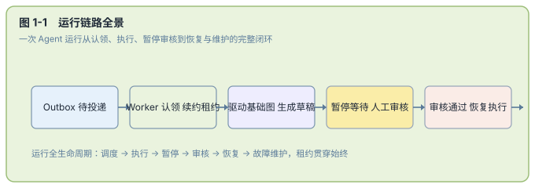
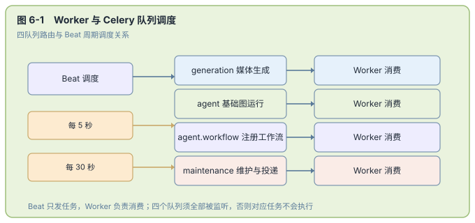
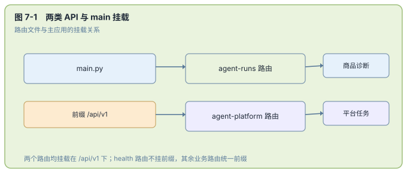
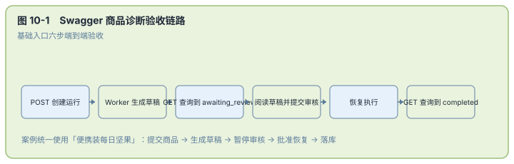

# 14 《电商运营助手》运行维护、租约与可靠恢复

本章把前面已经独立验证的组件接到 API、Celery 与真实检查点：不是重新实现一套 Agent，而是补齐运行的入口、数据库状态同步与故障恢复。

工作流、租约、工具网关、基础图与平台图此前已经就绪，本章让它们真正跑起来——可以被 HTTP 接口创建、被 Worker 认领执行、在人工审核后恢复，并且在进程崩溃或租约过期时能被自动维护。

案例统一使用「便携装每日坚果」这一示例商品，所有接口演示都围绕它展开。

本课件配套代码位于 `14_《电商运营助手》运行维护、租约与可靠恢复_配套代码/`，按原工程路径存放；正文只给出增量步骤与关键讲解，完整代码见配套目录。案例统一使用「便携装每日坚果」这一示例商品。


## 一、运行链路全景与目标

### 1.1 运行认领与维护的必要性

Worker 拿到消息并不代表永远拥有执行资格。运行记录用 `lease_owner` 与 `lease_expires_at` 表示当前执行者与到期时间；运行期间通过心跳续约，写入前核验租约，失效的执行者不能覆盖后来认领者。审批暂停则保存检查点，合法审核后恢复同一个运行上下文。

### 1.2 本章文件落地顺序

`services/agent_runs.py` → `services/agent_workflows.py` → `services/outbox.py` → `services/agent_maintenance.py` → `worker/tasks.py` 与 `celery_app.py` → 两个 Agent 路由 → `main.py` → 完整测试 → 真实环境验收。租约服务 `agent_leases.py` 已在前面就绪，本章直接复用，不再次复制覆盖。

### 1.3 运行链路全景

一次运行从认领、执行、暂停审核到恢复与维护的完整闭环如下：

**图：运行链路全景**




## 二、基础运行服务 agent_runs.py

### 2.1 模块成员清单

动手之前先看清楚本模块要提供哪些成员，下表按它们在文件中的出现顺序排列；其中标记为函数或类的成员是模块对外入口。

<table>
<colgroup><col style="width:34%"><col style="width:14%"><col style="width:52%"></colgroup>
<thead><tr><th>成员</th><th>类型</th><th>说明</th></tr></thead><tbody>
<tr><td><code>ACTIVE_AGENT_RUN_STATUSES</code></td><td>常量</td><td>仍可继续推进的运行状态集合（用于冲突判断）</td></tr>
<tr><td><code>CheckpointerFactory</code></td><td>常量</td><td>检查点工厂类型别名，返回上下文管理器</td></tr>
<tr><td><code>AgentRunConflictError</code></td><td>异常类</td><td>同一商品已有活动运行时的冲突异常</td></tr>
<tr><td><code>AgentRunStateError</code></td><td>异常类</td><td>运行状态不允许当前操作时的异常</td></tr>
<tr><td><code>create_agent_run_record</code></td><td>函数</td><td>创建Agent执行记录</td></tr>
<tr><td><code>dispatch_agent_run</code></td><td>函数</td><td>调度Agent执行</td></tr>
<tr><td><code>submit_agent_review</code></td><td>函数</td><td>提交Agent审核</td></tr>
<tr><td><code>_is_due</code></td><td>函数</td><td>判断到期时间是否已过（兼容无时区值）</td></tr>
<tr><td><code>run_agent_workflow</code></td><td>函数</td><td>执行Agent工作流</td></tr>
<tr><td><code>mark_agent_run_task_error</code></td><td>函数</td><td>标记Agent执行任务错误</td></tr>
<tr><td><code>mark_agent_run_dispatch_failed</code></td><td>函数</td><td>标记Agent执行调度失败</td></tr>
<tr><td><code>_claim_agent_run</code></td><td>函数</td><td>认领Agent执行</td></tr>
<tr><td><code>_load_product_context</code></td><td>函数</td><td>加载商品上下文</td></tr>
<tr><td><code>_record_harness_event</code></td><td>函数</td><td>记录harness事件</td></tr>
<tr><td><code>_sync_agent_run_state</code></td><td>函数</td><td>同步Agent执行状态</td></tr>
<tr><td><code>_finalize_agent_run</code></td><td>函数</td><td>完成落库Agent执行</td></tr>
<tr><td><code>_task_requester_has_active_access</code></td><td>函数</td><td>校验任务发起人是否仍拥有工作区有效访问</td></tr>
</tbody></table>

### 2.2 增量编写步骤

文件路径：<code>api/app/services/agent_runs.py</code>——在工程的 <code>api/app/services</code> 目录下新建该文件，与 <code>__init__.py</code> 同级。下面每一步只给出这一步新增的内容，按顺序追加到上一步的末尾即可；各步做完，文件就是完整的。

新建文件，写入以下内容：

#### 2.2.1 导入依赖、运行状态常量与租约异常

```python
from collections.abc import Callable
from contextlib import AbstractContextManager
from datetime import UTC, datetime, timedelta
from typing import Any
from uuid import uuid4

from langgraph.types import Command
from sqlalchemy import select
from sqlalchemy.orm import Session, selectinload

from app.agents.contracts import (
    AgentDraftOutput,
    HarnessEvent,
    ProductContext,
    ReviewResumePayload,
)
from app.agents.definitions import (
    HUMAN_REVIEW_GATE,
    VERSION_MANIFEST,
    WORKFLOW_KEY,
    WORKFLOW_VERSION,
)
from app.agents.graph import AgentWorkflowDependencies, build_product_operation_graph
from app.agents.harness import redact_snapshot
from app.agents.persistence import open_postgres_checkpointer
from app.agents.registry import get_workflow, is_workflow_enabled
from app.agents.specialists import default_completion_client
from app.core.config import get_settings
from app.db.session import SessionLocal
from app.models import (
    AgentReviewDecision,
    AgentApproval,
    AgentApprovalStatus,
    AgentRiskLevel,
    AgentRun,
    AgentRunEvent,
    AgentRunOperation,
    AgentRunReview,
    AgentRunStatus,
    AgentTask,
    AgentTaskStatus,
    CreativePlan,
    CreativePlanType,
    MembershipStatus,
    Product,
    ProductDiagnosis,
    OutboxEvent,
    User,
    UserStatus,
    Workspace,
    WorkspaceMembership,
    WorkspaceStatus,
)
from app.services.agent_leases import (
    AgentLeaseLostError,
    agent_lease_heartbeat,
    create_lease_owner,
    renew_active_lease,
    require_active_lease,
)


ACTIVE_AGENT_RUN_STATUSES = {
    AgentRunStatus.QUEUED,
    AgentRunStatus.RUNNING,
    AgentRunStatus.AWAITING_REVIEW,
    AgentRunStatus.RESUME_QUEUED,
}
CheckpointerFactory = Callable[[], AbstractContextManager[Any]]


class AgentRunConflictError(RuntimeError):
    pass


class AgentRunStateError(RuntimeError):
    pass


```

在 <code>agent_runs.py</code> 末尾追加下面这段：

#### 2.2.2 创建运行记录并登记 Outbox 事件

```python
def create_agent_run_record(db: Session, *, product: Product, requested_by: User) -> AgentRun:
    """创建Agent执行记录；只交换结构化 Agent 状态或受控工具结果，支持 checkpoint、审计与恢复。"""
    # 节点只通过结构化状态和受控工具交换数据，禁止绕过策略边界写入结果。
    active_run = db.scalar(
        select(AgentRun)
        .where(
            AgentRun.product_id == product.id,
            AgentRun.status.in_(ACTIVE_AGENT_RUN_STATUSES),
        )
        .order_by(AgentRun.id.desc())
        .with_for_update()
    )
    if active_run is not None:
        raise AgentRunConflictError(f"Product already has active agent run {active_run.id}")

    settings = get_settings()
    task = None
    workspace = db.get(Workspace, product.workspace_id) if product.workspace_id is not None else None
    if workspace is not None and is_workflow_enabled(
        workspace.settings,
        "product_diagnosis_optimization",
    ):
        workflow = get_workflow("product_diagnosis_optimization")
        task = AgentTask(
            workspace_id=product.workspace_id,
            requested_by_user_id=requested_by.id,
            workflow_key=workflow.key,
            workflow_version=workflow.version,
            title=workflow.title,
            intent="从商品工作台发起诊断与优化",
            status=AgentTaskStatus.QUEUED,
            risk_level=AgentRiskLevel.R2,
            context_scope={"product_id": product.id, "store_id": product.store_id},
            input_payload={},
            result_summary={},
            version_manifest=workflow.version_manifest,
        )
        db.add(task)
        db.flush()
    run = AgentRun(
        thread_id=str(uuid4()),
        workspace_id=product.workspace_id,
        task_id=task.id if task is not None else None,
        product_id=product.id,
        requested_by_user_id=requested_by.id,
        workflow_key=task.workflow_key if task is not None else WORKFLOW_KEY,
        workflow_version=task.workflow_version if task is not None else WORKFLOW_VERSION,
        attempt=1,
        queue_name=settings.celery_agent_queue,
        status=AgentRunStatus.QUEUED,
        revision_count=0,
        max_revisions=settings.agent_max_revisions,
        budget={"max_total_tokens": settings.agent_max_total_tokens},
        usage={},
        version_manifest=task.version_manifest if task is not None else VERSION_MANIFEST,
        context_snapshot={},
        draft_output={},
        quality_report={},
        final_output={},
        timeout_at=datetime.now(UTC) + timedelta(minutes=30),
    )
    db.add(run)
    db.flush()
    db.add(
        AgentRunEvent(
            run_id=run.id,
            event_type="queued",
            status=AgentRunStatus.QUEUED.value,
            message="商品运营 Agent 已进入 Celery 队列。",
            output_snapshot={"workflow": WORKFLOW_KEY, "version": WORKFLOW_VERSION},
        )
    )
    if task is not None:
        db.add(
            OutboxEvent(
                workspace_id=product.workspace_id,
                aggregate_type="agent_run",
                aggregate_id=str(run.id),
                event_type="workflow.run.requested",
                payload={"run_id": run.id, "resume_payload": None},
                idempotency_key=f"agent-run:{run.id}:start",
                status="pending",
                attempts=0,
                available_at=datetime.now(UTC),
            )
        )
    return run


```

在 <code>agent_runs.py</code> 末尾追加下面这段：

#### 2.2.3 调度运行：直投 Worker 或触发 Outbox

```python
def dispatch_agent_run(run_id: int, resume_payload: dict[str, Any] | None = None) -> None:
    """调度Agent执行；只交换结构化 Agent 状态或受控工具结果，支持 checkpoint、审计与恢复。"""
    # 节点只通过结构化状态和受控工具交换数据，禁止绕过策略边界写入结果。
    with SessionLocal() as db:
        run = db.get(AgentRun, run_id)
        if run is not None and run.task_id is not None:
            if resume_payload is not None:
                event = OutboxEvent(
                    workspace_id=run.workspace_id,
                    aggregate_type="agent_run",
                    aggregate_id=str(run.id),
                    event_type="workflow.run.requested",
                    payload={"run_id": run.id, "resume_payload": resume_payload},
                    idempotency_key=f"agent-run:{run.id}:legacy-review",
                    status="pending",
                    attempts=0,
                    available_at=datetime.now(UTC),
                )
                db.add(event)
                db.commit()
            from app.services.outbox import kick_outbox_dispatcher

            try:
                kick_outbox_dispatcher()
            except Exception:
                # Outbox 已持久化，瞬时 Redis 故障不能把可恢复运行误标记为失败。
                pass
            return
    from app.worker.tasks import run_agent_workflow_task

    settings = get_settings()
    run_agent_workflow_task.apply_async(
        args=[run_id, resume_payload],
        queue=settings.celery_agent_queue,
    )


```

在 <code>agent_runs.py</code> 末尾追加下面这段：

#### 2.2.4 提交人工审核并同步审批状态

```python
def submit_agent_review(
    db: Session,
    *,
    run: AgentRun,
    reviewer: User,
    payload: ReviewResumePayload,
) -> AgentRunReview:
    """提交Agent审核；只交换结构化 Agent 状态或受控工具结果，支持 checkpoint、审计与恢复。"""
    # 节点只通过结构化状态和受控工具交换数据，禁止绕过策略边界写入结果。
    run = db.scalar(
        select(AgentRun)
        .where(AgentRun.id == run.id)
        .with_for_update()
        .execution_options(populate_existing=True)
    )
    if run is None:
        raise AgentRunStateError("Agent run does not exist")
    if run.status != AgentRunStatus.AWAITING_REVIEW:
        raise AgentRunStateError("Agent run is not awaiting review")
    if run.cancel_requested_at is not None:
        raise AgentRunStateError("Agent run cancellation was requested")
    existing_review = db.scalar(select(AgentRunReview.id).where(AgentRunReview.run_id == run.id))
    if existing_review is not None:
        raise AgentRunStateError("Agent run already has a review decision")

    review = AgentRunReview(
        run_id=run.id,
        reviewed_by_user_id=reviewer.id,
        decision=AgentReviewDecision(payload.decision),
        edited_output=(
            payload.edited_output.model_dump(mode="json")
            if payload.edited_output is not None
            else {}
        ),
        note=payload.note,
    )
    run.status = AgentRunStatus.RESUME_QUEUED
    run.current_agent = HUMAN_REVIEW_GATE
    if run.task_id is not None:
        task = db.get(AgentTask, run.task_id)
        if task is not None:
            task.status = AgentTaskStatus.QUEUED
        approval = db.scalar(
            select(AgentApproval)
            .where(
                AgentApproval.run_id == run.id,
                AgentApproval.action_key == "workflow.accept_result",
            )
            .with_for_update()
        )
        if approval is not None and approval.status == AgentApprovalStatus.PENDING:
            now = datetime.now(UTC)
            if approval.expires_at is not None and _is_due(approval.expires_at, now):
                raise AgentRunStateError("Agent approval has expired")
            approval.status = (
                AgentApprovalStatus.REJECTED
                if payload.decision == "reject"
                else AgentApprovalStatus.APPROVED
            )
            approval.decided_by_user_id = reviewer.id
            approval.decision_payload = payload.model_dump(mode="json")
            approval.note = payload.note
            approval.decided_at = datetime.now(UTC)
    db.add(review)
    db.add(
        AgentRunEvent(
            run_id=run.id,
            event_type="resume_queued",
            agent_name=HUMAN_REVIEW_GATE,
            operation_name="interrupt.resume",
            status=AgentRunStatus.RESUME_QUEUED.value,
            message="人工审核决定已提交，等待 Celery 恢复工作流。",
            input_snapshot=redact_snapshot(payload.model_dump(mode="json")),
        )
    )
    db.flush()
    return review


def _is_due(value: datetime, now: datetime) -> bool:
    """判断到期；只交换结构化 Agent 状态或受控工具结果，支持 checkpoint、审计与恢复。"""
    if value.tzinfo is None:
        return value <= now.replace(tzinfo=None)
    return value <= now


```

在 <code>agent_runs.py</code> 末尾追加下面这段：

#### 2.2.5 执行工作流：装配依赖并驱动基础图

```python
def run_agent_workflow(
    run_id: int,
    resume_payload: dict[str, Any] | None = None,
    *,
    checkpointer_factory: CheckpointerFactory = open_postgres_checkpointer,
    workflow_dependencies: AgentWorkflowDependencies | None = None,
    lease_owner: str | None = None,
) -> None:
    """执行Agent工作流；只交换结构化 Agent 状态或受控工具结果，支持 checkpoint、审计与恢复。"""
    # 节点只通过结构化状态和受控工具交换数据，禁止绕过策略边界写入结果。
    lease_owner = lease_owner or create_lease_owner("product-workflow", run_id)
    run_snapshot = _claim_agent_run(
        run_id,
        is_resume=resume_payload is not None,
        lease_owner=lease_owner,
    )
    if run_snapshot is None:
        return

    dependencies = workflow_dependencies or AgentWorkflowDependencies(
        load_product_context=_load_product_context,
        completion_client=default_completion_client,
        record_event=lambda target_run_id, event: _record_harness_event(
            target_run_id,
            event,
            lease_owner=lease_owner,
        ),
        finalize_run=lambda target_run_id, review, output: _finalize_agent_run(
            target_run_id,
            review,
            output,
            lease_owner=lease_owner,
        ),
    )
    config = {
        "configurable": {"thread_id": run_snapshot["thread_id"]},
        "recursion_limit": 24,
    }
    with agent_lease_heartbeat(run_id, lease_owner), checkpointer_factory() as checkpointer:
        graph = build_product_operation_graph(checkpointer=checkpointer, deps=dependencies)
        if resume_payload is None:
            graph.invoke(
                {
                    "run_id": run_id,
                    "product_id": run_snapshot["product_id"],
                    "revision_count": run_snapshot["revision_count"],
                    "max_revisions": run_snapshot["max_revisions"],
                    "budget": run_snapshot["budget"],
                    "usage": run_snapshot["usage"],
                },
                config=config,
            )
        else:
            graph.invoke(Command(resume=resume_payload), config=config)
        graph_state = graph.get_state(config)
        _sync_agent_run_state(
            run_id,
            graph_state.values,
            interrupted=bool(graph_state.next),
            lease_owner=lease_owner,
        )


```

在 <code>agent_runs.py</code> 末尾追加下面这段：

#### 2.2.6 标记任务错误与调度失败

```python
def mark_agent_run_task_error(
    run_id: int,
    error: Exception,
    *,
    will_retry: bool,
    is_resume: bool,
    lease_owner: str | None = None,
) -> bool:
    """标记Agent执行任务错误；只交换结构化 Agent 状态或受控工具结果，支持 checkpoint、审计与恢复。"""
    # 节点只通过结构化状态和受控工具交换数据，禁止绕过策略边界写入结果。
    with SessionLocal() as db:
        run = db.get(AgentRun, run_id)
        if run is None or run.status in {
            AgentRunStatus.COMPLETED,
            AgentRunStatus.REJECTED,
            AgentRunStatus.CANCELLED,
        }:
            return False
        if lease_owner is not None and run.lease_owner != lease_owner:
            return False
        task = db.get(AgentTask, run.task_id) if run.task_id else None
        if run.cancel_requested_at is not None:
            now = datetime.now(UTC)
            run.status = AgentRunStatus.CANCELLED
            run.finished_at = now
            run.lease_owner = None
            run.lease_expires_at = None
            if task is not None:
                task.status = AgentTaskStatus.CANCELLED
                task.finished_at = now
            db.commit()
            return False
        run.status = (
            AgentRunStatus.RESUME_QUEUED
            if will_retry and is_resume
            else AgentRunStatus.QUEUED
            if will_retry
            else AgentRunStatus.FAILED
        )
        run.error = str(error)[:2000]
        run.lease_owner = None
        run.lease_expires_at = None
        if task is not None:
            task.status = AgentTaskStatus.QUEUED if will_retry else AgentTaskStatus.FAILED
            task.error = run.error
        if not will_retry:
            run.finished_at = datetime.now(UTC)
            if task is not None:
                task.finished_at = run.finished_at
        db.add(
            AgentRunEvent(
                run_id=run.id,
                event_type="task_retry" if will_retry else "task_failed",
                status=run.status.value,
                message=str(error)[:1000],
            )
        )
        db.commit()
        return will_retry


def mark_agent_run_dispatch_failed(run_id: int, error: Exception) -> None:
    """标记Agent执行调度失败；只交换结构化 Agent 状态或受控工具结果，支持 checkpoint、审计与恢复。"""
    # 节点只通过结构化状态和受控工具交换数据，禁止绕过策略边界写入结果。
    with SessionLocal() as db:
        run = db.get(AgentRun, run_id)
        if run is None:
            return
        run.status = AgentRunStatus.FAILED
        run.error = str(error)[:2000]
        run.finished_at = datetime.now(UTC)
        db.add(
            AgentRunEvent(
                run_id=run_id,
                event_type="dispatch_failed",
                status=AgentRunStatus.FAILED.value,
                message=str(error)[:1000],
            )
        )
        db.commit()


```

在 <code>agent_runs.py</code> 末尾追加下面这段：

#### 2.2.7 认领运行、加载上下文与记录事件

```python
def _claim_agent_run(
    run_id: int,
    *,
    is_resume: bool,
    lease_owner: str,
) -> dict[str, Any] | None:
    """认领Agent执行；只交换结构化 Agent 状态或受控工具结果，支持 checkpoint、审计与恢复。"""
    # 节点只通过结构化状态和受控工具交换数据，禁止绕过策略边界写入结果。
    allowed_statuses = (
        {AgentRunStatus.RESUME_QUEUED}
        if is_resume
        else {AgentRunStatus.QUEUED}
    )
    with SessionLocal() as db:
        run = db.scalar(select(AgentRun).where(AgentRun.id == run_id).with_for_update())
        if (
            run is None
            or run.status not in allowed_statuses
            or run.cancel_requested_at is not None
        ):
            return None
        run.status = AgentRunStatus.RUNNING
        run.error = None
        run.started_at = run.started_at or datetime.now(UTC)
        run.lease_owner = lease_owner
        run.lease_expires_at = datetime.now(UTC) + timedelta(minutes=5)
        if run.task_id is not None:
            task = db.get(AgentTask, run.task_id)
            if task is not None:
                if not _task_requester_has_active_access(db, task):
                    now = datetime.now(UTC)
                    run.status = AgentRunStatus.CANCELLED
                    run.error = "Task requester no longer has active Workspace access"
                    run.finished_at = now
                    run.lease_owner = None
                    run.lease_expires_at = None
                    task.status = AgentTaskStatus.CANCELLED
                    task.error = run.error
                    task.finished_at = now
                    db.commit()
                    return None
                task.status = AgentTaskStatus.RUNNING
                task.error = None
        db.add(
            AgentRunEvent(
                run_id=run.id,
                event_type="workflow_resumed" if is_resume else "workflow_started",
                status=AgentRunStatus.RUNNING.value,
                message="Celery worker 开始执行商品运营 Agent。",
            )
        )
        snapshot = {
            "thread_id": run.thread_id,
            "product_id": run.product_id,
            "revision_count": run.revision_count,
            "max_revisions": run.max_revisions,
            "budget": run.budget,
            "usage": run.usage,
        }
        db.commit()
        return snapshot


def _load_product_context(product_id: int) -> ProductContext:
    """加载商品上下文；只交换结构化 Agent 状态或受控工具结果，支持 checkpoint、审计与恢复。"""
    # 节点只通过结构化状态和受控工具交换数据，禁止绕过策略边界写入结果。
    with SessionLocal() as db:
        product = db.scalar(
            select(Product)
            .where(Product.id == product_id)
            .options(selectinload(Product.competitors))
        )
        if product is None:
            raise AgentRunStateError("Product not found while building agent context")
        return ProductContext(
            product_id=product.id,
            name=product.name,
            platform=product.platform.value,
            category=product.category,
            price=str(product.price) if product.price is not None else None,
            cost=str(product.cost) if product.cost is not None else None,
            target_audience=product.target_audience,
            selling_points=product.selling_points,
            product_url=product.product_url,
            images=product.images,
            competitors=[
                {
                    "name": competitor.name,
                    "platform": competitor.platform.value if competitor.platform else None,
                    "price": str(competitor.price) if competitor.price is not None else None,
                    "sales_hint": competitor.sales_hint,
                    "title": competitor.title,
                    "selling_points": competitor.selling_points,
                    "review_keywords": competitor.review_keywords,
                }
                for competitor in product.competitors
            ],
        )


def _record_harness_event(
    run_id: int,
    event: HarnessEvent,
    *,
    lease_owner: str | None = None,
) -> None:
    """记录harness事件；只交换结构化 Agent 状态或受控工具结果，支持 checkpoint、审计与恢复。"""
    # 节点只通过结构化状态和受控工具交换数据，禁止绕过策略边界写入结果。
    with SessionLocal() as db:
        run = require_active_lease(db, run_id=run_id, lease_owner=lease_owner, for_update=True)
        renew_active_lease(db, run=run)
        if event.agent_name:
            run.current_agent = event.agent_name
        db.add(
            AgentRunEvent(
                run_id=run_id,
                event_type=event.event_type,
                agent_name=event.agent_name,
                operation_name=event.operation_name,
                status=event.status,
                message=event.message,
                input_snapshot=redact_snapshot(event.input_snapshot),
                output_snapshot=redact_snapshot(event.output_snapshot),
                metrics=redact_snapshot(event.metrics),
                trace_id=event.trace_id,
                span_id=event.span_id,
            )
        )
        db.commit()


```

在 <code>agent_runs.py</code> 末尾追加下面这段：

#### 2.2.8 同步图状态到数据库

```python
def _sync_agent_run_state(
    run_id: int,
    values: dict[str, Any],
    *,
    interrupted: bool,
    lease_owner: str | None = None,
) -> None:
    """同步Agent执行状态；只交换结构化 Agent 状态或受控工具结果，支持 checkpoint、审计与恢复。"""
    # 节点只通过结构化状态和受控工具交换数据，禁止绕过策略边界写入结果。
    with SessionLocal() as db:
        run = db.scalar(select(AgentRun).where(AgentRun.id == run_id).with_for_update())
        if run is None:
            raise AgentRunStateError("Agent run not found while syncing state")
        if interrupted:
            run = require_active_lease(
                db,
                run_id=run_id,
                lease_owner=lease_owner,
                for_update=True,
            )
            run.status = AgentRunStatus.AWAITING_REVIEW
            run.lease_owner = None
            run.lease_expires_at = None
            run.current_agent = HUMAN_REVIEW_GATE
            if run.task_id is not None and run.workspace_id is not None:
                task = db.get(AgentTask, run.task_id)
                if task is not None:
                    task.status = AgentTaskStatus.AWAITING_APPROVAL
                approval = db.scalar(
                    select(AgentApproval).where(
                        AgentApproval.run_id == run.id,
                        AgentApproval.action_key == "workflow.accept_result",
                    )
                )
                if approval is None:
                    db.add(
                        AgentApproval(
                            workspace_id=run.workspace_id,
                            task_id=run.task_id,
                            run_id=run.id,
                            requested_by_user_id=run.requested_by_user_id,
                            action_key="workflow.accept_result",
                            risk_level=AgentRiskLevel.R2,
                            status=AgentApprovalStatus.PENDING,
                            request_payload={
                                "draft_output": run.draft_output,
                                "quality_report": run.quality_report,
                            },
                            decision_payload={},
                            expires_at=datetime.now(UTC) + timedelta(hours=24),
                        )
                    )
            db.add(
                AgentRunEvent(
                    run_id=run.id,
                    event_type="human_review_requested",
                    agent_name=HUMAN_REVIEW_GATE,
                    operation_name="interrupt.wait",
                    status=AgentRunStatus.AWAITING_REVIEW.value,
                    message="草稿已生成，等待人工确认、编辑或驳回。",
                    output_snapshot={
                        "quality_report": run.quality_report,
                        "revision_count": run.revision_count,
                    },
                )
            )
        elif values.get("final_status") == "rejected":
            if run.status != AgentRunStatus.REJECTED:
                raise AgentLeaseLostError("Workflow rejection was not committed by fenced finalize")
            run.current_agent = None
            if run.task_id is not None:
                task = db.get(AgentTask, run.task_id)
                if task is not None:
                    task.status = AgentTaskStatus.CANCELLED
                    task.finished_at = run.finished_at
        elif values.get("final_status") == "completed":
            if run.status != AgentRunStatus.COMPLETED:
                raise AgentLeaseLostError("Workflow completion was not committed by fenced finalize")
            run.current_agent = None
            run.final_output = redact_snapshot(values.get("final_output", run.final_output))
            if run.task_id is not None:
                task = db.get(AgentTask, run.task_id)
                if task is not None:
                    task.status = AgentTaskStatus.COMPLETED
                    task.result_summary = run.final_output
                    task.finished_at = run.finished_at
        else:
            require_active_lease(
                db,
                run_id=run_id,
                lease_owner=lease_owner,
                for_update=True,
            )
        run.revision_count = values.get("revision_count", run.revision_count)
        run.usage = redact_snapshot(values.get("usage", {}))
        run.context_snapshot = redact_snapshot(values.get("context", {}))
        if values.get("diagnosis") and values.get("creative_plans"):
            run.draft_output = redact_snapshot(
                {
                    "diagnosis": values["diagnosis"],
                    "creative_plans": values["creative_plans"],
                }
            )
        run.quality_report = redact_snapshot(values.get("quality_report", {}))
        db.commit()


```

在 <code>agent_runs.py</code> 末尾追加下面这段：

#### 2.2.9 幂等采用结果并落库业务成果

```python
def _finalize_agent_run(
    run_id: int,
    review: ReviewResumePayload,
    approved_output: AgentDraftOutput | None,
    *,
    lease_owner: str | None = None,
) -> dict[str, Any]:
    """完成落库Agent执行；只交换结构化 Agent 状态或受控工具结果，支持 checkpoint、审计与恢复。"""
    # 节点只通过结构化状态和受控工具交换数据，禁止绕过策略边界写入结果。
    operation_key = "finalize-v1"
    with SessionLocal() as db:
        run = db.scalar(select(AgentRun).where(AgentRun.id == run_id).with_for_update())
        if run is None:
            raise AgentRunStateError("Agent run not found while finalizing")
        operation = db.scalar(
            select(AgentRunOperation).where(
                AgentRunOperation.run_id == run_id,
                AgentRunOperation.operation_key == operation_key,
            )
        )
        if operation is not None and operation.status == "completed":
            return operation.result
        run = require_active_lease(
            db,
            run_id=run_id,
            lease_owner=lease_owner,
            for_update=True,
        )
        if run.task_id is not None:
            task = db.get(AgentTask, run.task_id)
            if task is None or not _task_requester_has_active_access(db, task):
                raise AgentRunStateError("Task requester no longer has active Workspace access")
        if operation is None:
            operation = AgentRunOperation(
                run_id=run_id,
                operation_key=operation_key,
                status="running",
                result={},
            )
            db.add(operation)
            db.flush()

        if review.decision == "reject":
            result = {"decision": "reject", "note": review.note}
            run.status = AgentRunStatus.REJECTED
        else:
            if approved_output is None:
                raise AgentRunStateError("Approved output is required for finalization")
            diagnosis_payload = approved_output.diagnosis
            diagnosis = ProductDiagnosis(
                product_id=run.product_id,
                agent_run_id=run.id,
                source=diagnosis_payload.source,
                positioning=diagnosis_payload.positioning,
                price_band=diagnosis_payload.price_band,
                audience_insights=diagnosis_payload.audience_insights,
                pain_points=diagnosis_payload.pain_points,
                selling_point_analysis=diagnosis_payload.selling_point_analysis,
                risks=diagnosis_payload.risks,
                recommendations=diagnosis_payload.recommendations,
                raw_output={
                    "agent_run_id": run.id,
                    "workflow_version": run.workflow_version,
                    "provenance": redact_snapshot(diagnosis_payload.provenance),
                },
            )
            db.add(diagnosis)
            creative_rows = []
            for plan in approved_output.creative_plans:
                content = plan.model_dump(mode="json", exclude={"title", "source", "provenance"})
                creative_row = CreativePlan(
                    product_id=run.product_id,
                    agent_run_id=run.id,
                    type=CreativePlanType.MAIN_IMAGE,
                    title=plan.title,
                    content=content,
                    rationale=plan.angle,
                )
                db.add(creative_row)
                creative_rows.append(creative_row)
            db.flush()
            result = {
                **approved_output.model_dump(mode="json"),
                "artifacts": {
                    "diagnosis_id": diagnosis.id,
                    "creative_plan_ids": [row.id for row in creative_rows],
                },
            }
            run.status = AgentRunStatus.COMPLETED

        if run.task_id is not None:
            task = db.get(AgentTask, run.task_id)
            if task is not None:
                task.status = (
                    AgentTaskStatus.CANCELLED
                    if review.decision == "reject"
                    else AgentTaskStatus.COMPLETED
                )
                task.result_summary = redact_snapshot(result)
                task.finished_at = datetime.now(UTC)

        run.final_output = redact_snapshot(result)
        run.current_agent = None
        run.finished_at = datetime.now(UTC)
        run.lease_owner = None
        run.lease_expires_at = None
        operation.status = "completed"
        operation.result = run.final_output
        operation.completed_at = datetime.now(UTC)
        db.commit()
        return result


def _task_requester_has_active_access(db: Session, task: AgentTask) -> bool:
    """任务requesterhas有效访问；只交换结构化 Agent 状态或受控工具结果，支持 checkpoint、审计与恢复。"""
    # 节点只通过结构化状态和受控工具交换数据，禁止绕过策略边界写入结果。
    membership_id = db.scalar(
        select(WorkspaceMembership.id)
        .join(Workspace, Workspace.id == WorkspaceMembership.workspace_id)
        .join(User, User.id == WorkspaceMembership.user_id)
        .where(
            WorkspaceMembership.workspace_id == task.workspace_id,
            WorkspaceMembership.user_id == task.requested_by_user_id,
            WorkspaceMembership.status == MembershipStatus.ACTIVE,
            Workspace.status == WorkspaceStatus.ACTIVE,
            User.status == UserStatus.ACTIVE,
        )
    )
    return membership_id is not None

```

### 2.3 完整实现代码

下面是 <code>api/app/services/agent_runs.py</code> 的完整内容，与上面各步增量拼接后的结果一致：

```python
from collections.abc import Callable
from contextlib import AbstractContextManager
from datetime import UTC, datetime, timedelta
from typing import Any
from uuid import uuid4

from langgraph.types import Command
from sqlalchemy import select
from sqlalchemy.orm import Session, selectinload

from app.agents.contracts import (
    AgentDraftOutput,
    HarnessEvent,
    ProductContext,
    ReviewResumePayload,
)
from app.agents.definitions import (
    HUMAN_REVIEW_GATE,
    VERSION_MANIFEST,
    WORKFLOW_KEY,
    WORKFLOW_VERSION,
)
from app.agents.graph import AgentWorkflowDependencies, build_product_operation_graph
from app.agents.harness import redact_snapshot
from app.agents.persistence import open_postgres_checkpointer
from app.agents.registry import get_workflow, is_workflow_enabled
from app.agents.specialists import default_completion_client
from app.core.config import get_settings
from app.db.session import SessionLocal
from app.models import (
    AgentReviewDecision,
    AgentApproval,
    AgentApprovalStatus,
    AgentRiskLevel,
    AgentRun,
    AgentRunEvent,
    AgentRunOperation,
    AgentRunReview,
    AgentRunStatus,
    AgentTask,
    AgentTaskStatus,
    CreativePlan,
    CreativePlanType,
    MembershipStatus,
    Product,
    ProductDiagnosis,
    OutboxEvent,
    User,
    UserStatus,
    Workspace,
    WorkspaceMembership,
    WorkspaceStatus,
)
from app.services.agent_leases import (
    AgentLeaseLostError,
    agent_lease_heartbeat,
    create_lease_owner,
    renew_active_lease,
    require_active_lease,
)


ACTIVE_AGENT_RUN_STATUSES = {
    AgentRunStatus.QUEUED,
    AgentRunStatus.RUNNING,
    AgentRunStatus.AWAITING_REVIEW,
    AgentRunStatus.RESUME_QUEUED,
}
CheckpointerFactory = Callable[[], AbstractContextManager[Any]]


class AgentRunConflictError(RuntimeError):
    pass


class AgentRunStateError(RuntimeError):
    pass


def create_agent_run_record(db: Session, *, product: Product, requested_by: User) -> AgentRun:
    """创建Agent执行记录；只交换结构化 Agent 状态或受控工具结果，支持 checkpoint、审计与恢复。"""
    # 节点只通过结构化状态和受控工具交换数据，禁止绕过策略边界写入结果。
    active_run = db.scalar(
        select(AgentRun)
        .where(
            AgentRun.product_id == product.id,
            AgentRun.status.in_(ACTIVE_AGENT_RUN_STATUSES),
        )
        .order_by(AgentRun.id.desc())
        .with_for_update()
    )
    if active_run is not None:
        raise AgentRunConflictError(f"Product already has active agent run {active_run.id}")

    settings = get_settings()
    task = None
    workspace = db.get(Workspace, product.workspace_id) if product.workspace_id is not None else None
    if workspace is not None and is_workflow_enabled(
        workspace.settings,
        "product_diagnosis_optimization",
    ):
        workflow = get_workflow("product_diagnosis_optimization")
        task = AgentTask(
            workspace_id=product.workspace_id,
            requested_by_user_id=requested_by.id,
            workflow_key=workflow.key,
            workflow_version=workflow.version,
            title=workflow.title,
            intent="从商品工作台发起诊断与优化",
            status=AgentTaskStatus.QUEUED,
            risk_level=AgentRiskLevel.R2,
            context_scope={"product_id": product.id, "store_id": product.store_id},
            input_payload={},
            result_summary={},
            version_manifest=workflow.version_manifest,
        )
        db.add(task)
        db.flush()
    run = AgentRun(
        thread_id=str(uuid4()),
        workspace_id=product.workspace_id,
        task_id=task.id if task is not None else None,
        product_id=product.id,
        requested_by_user_id=requested_by.id,
        workflow_key=task.workflow_key if task is not None else WORKFLOW_KEY,
        workflow_version=task.workflow_version if task is not None else WORKFLOW_VERSION,
        attempt=1,
        queue_name=settings.celery_agent_queue,
        status=AgentRunStatus.QUEUED,
        revision_count=0,
        max_revisions=settings.agent_max_revisions,
        budget={"max_total_tokens": settings.agent_max_total_tokens},
        usage={},
        version_manifest=task.version_manifest if task is not None else VERSION_MANIFEST,
        context_snapshot={},
        draft_output={},
        quality_report={},
        final_output={},
        timeout_at=datetime.now(UTC) + timedelta(minutes=30),
    )
    db.add(run)
    db.flush()
    db.add(
        AgentRunEvent(
            run_id=run.id,
            event_type="queued",
            status=AgentRunStatus.QUEUED.value,
            message="商品运营 Agent 已进入 Celery 队列。",
            output_snapshot={"workflow": WORKFLOW_KEY, "version": WORKFLOW_VERSION},
        )
    )
    if task is not None:
        db.add(
            OutboxEvent(
                workspace_id=product.workspace_id,
                aggregate_type="agent_run",
                aggregate_id=str(run.id),
                event_type="workflow.run.requested",
                payload={"run_id": run.id, "resume_payload": None},
                idempotency_key=f"agent-run:{run.id}:start",
                status="pending",
                attempts=0,
                available_at=datetime.now(UTC),
            )
        )
    return run


def dispatch_agent_run(run_id: int, resume_payload: dict[str, Any] | None = None) -> None:
    """调度Agent执行；只交换结构化 Agent 状态或受控工具结果，支持 checkpoint、审计与恢复。"""
    # 节点只通过结构化状态和受控工具交换数据，禁止绕过策略边界写入结果。
    with SessionLocal() as db:
        run = db.get(AgentRun, run_id)
        if run is not None and run.task_id is not None:
            if resume_payload is not None:
                event = OutboxEvent(
                    workspace_id=run.workspace_id,
                    aggregate_type="agent_run",
                    aggregate_id=str(run.id),
                    event_type="workflow.run.requested",
                    payload={"run_id": run.id, "resume_payload": resume_payload},
                    idempotency_key=f"agent-run:{run.id}:legacy-review",
                    status="pending",
                    attempts=0,
                    available_at=datetime.now(UTC),
                )
                db.add(event)
                db.commit()
            from app.services.outbox import kick_outbox_dispatcher

            try:
                kick_outbox_dispatcher()
            except Exception:
                # Outbox 已持久化，瞬时 Redis 故障不能把可恢复运行误标记为失败。
                pass
            return
    from app.worker.tasks import run_agent_workflow_task

    settings = get_settings()
    run_agent_workflow_task.apply_async(
        args=[run_id, resume_payload],
        queue=settings.celery_agent_queue,
    )


def submit_agent_review(
    db: Session,
    *,
    run: AgentRun,
    reviewer: User,
    payload: ReviewResumePayload,
) -> AgentRunReview:
    """提交Agent审核；只交换结构化 Agent 状态或受控工具结果，支持 checkpoint、审计与恢复。"""
    # 节点只通过结构化状态和受控工具交换数据，禁止绕过策略边界写入结果。
    run = db.scalar(
        select(AgentRun)
        .where(AgentRun.id == run.id)
        .with_for_update()
        .execution_options(populate_existing=True)
    )
    if run is None:
        raise AgentRunStateError("Agent run does not exist")
    if run.status != AgentRunStatus.AWAITING_REVIEW:
        raise AgentRunStateError("Agent run is not awaiting review")
    if run.cancel_requested_at is not None:
        raise AgentRunStateError("Agent run cancellation was requested")
    existing_review = db.scalar(select(AgentRunReview.id).where(AgentRunReview.run_id == run.id))
    if existing_review is not None:
        raise AgentRunStateError("Agent run already has a review decision")

    review = AgentRunReview(
        run_id=run.id,
        reviewed_by_user_id=reviewer.id,
        decision=AgentReviewDecision(payload.decision),
        edited_output=(
            payload.edited_output.model_dump(mode="json")
            if payload.edited_output is not None
            else {}
        ),
        note=payload.note,
    )
    run.status = AgentRunStatus.RESUME_QUEUED
    run.current_agent = HUMAN_REVIEW_GATE
    if run.task_id is not None:
        task = db.get(AgentTask, run.task_id)
        if task is not None:
            task.status = AgentTaskStatus.QUEUED
        approval = db.scalar(
            select(AgentApproval)
            .where(
                AgentApproval.run_id == run.id,
                AgentApproval.action_key == "workflow.accept_result",
            )
            .with_for_update()
        )
        if approval is not None and approval.status == AgentApprovalStatus.PENDING:
            now = datetime.now(UTC)
            if approval.expires_at is not None and _is_due(approval.expires_at, now):
                raise AgentRunStateError("Agent approval has expired")
            approval.status = (
                AgentApprovalStatus.REJECTED
                if payload.decision == "reject"
                else AgentApprovalStatus.APPROVED
            )
            approval.decided_by_user_id = reviewer.id
            approval.decision_payload = payload.model_dump(mode="json")
            approval.note = payload.note
            approval.decided_at = datetime.now(UTC)
    db.add(review)
    db.add(
        AgentRunEvent(
            run_id=run.id,
            event_type="resume_queued",
            agent_name=HUMAN_REVIEW_GATE,
            operation_name="interrupt.resume",
            status=AgentRunStatus.RESUME_QUEUED.value,
            message="人工审核决定已提交，等待 Celery 恢复工作流。",
            input_snapshot=redact_snapshot(payload.model_dump(mode="json")),
        )
    )
    db.flush()
    return review


def _is_due(value: datetime, now: datetime) -> bool:
    """判断到期；只交换结构化 Agent 状态或受控工具结果，支持 checkpoint、审计与恢复。"""
    if value.tzinfo is None:
        return value <= now.replace(tzinfo=None)
    return value <= now


def run_agent_workflow(
    run_id: int,
    resume_payload: dict[str, Any] | None = None,
    *,
    checkpointer_factory: CheckpointerFactory = open_postgres_checkpointer,
    workflow_dependencies: AgentWorkflowDependencies | None = None,
    lease_owner: str | None = None,
) -> None:
    """执行Agent工作流；只交换结构化 Agent 状态或受控工具结果，支持 checkpoint、审计与恢复。"""
    # 节点只通过结构化状态和受控工具交换数据，禁止绕过策略边界写入结果。
    lease_owner = lease_owner or create_lease_owner("product-workflow", run_id)
    run_snapshot = _claim_agent_run(
        run_id,
        is_resume=resume_payload is not None,
        lease_owner=lease_owner,
    )
    if run_snapshot is None:
        return

    dependencies = workflow_dependencies or AgentWorkflowDependencies(
        load_product_context=_load_product_context,
        completion_client=default_completion_client,
        record_event=lambda target_run_id, event: _record_harness_event(
            target_run_id,
            event,
            lease_owner=lease_owner,
        ),
        finalize_run=lambda target_run_id, review, output: _finalize_agent_run(
            target_run_id,
            review,
            output,
            lease_owner=lease_owner,
        ),
    )
    config = {
        "configurable": {"thread_id": run_snapshot["thread_id"]},
        "recursion_limit": 24,
    }
    with agent_lease_heartbeat(run_id, lease_owner), checkpointer_factory() as checkpointer:
        graph = build_product_operation_graph(checkpointer=checkpointer, deps=dependencies)
        if resume_payload is None:
            graph.invoke(
                {
                    "run_id": run_id,
                    "product_id": run_snapshot["product_id"],
                    "revision_count": run_snapshot["revision_count"],
                    "max_revisions": run_snapshot["max_revisions"],
                    "budget": run_snapshot["budget"],
                    "usage": run_snapshot["usage"],
                },
                config=config,
            )
        else:
            graph.invoke(Command(resume=resume_payload), config=config)
        graph_state = graph.get_state(config)
        _sync_agent_run_state(
            run_id,
            graph_state.values,
            interrupted=bool(graph_state.next),
            lease_owner=lease_owner,
        )


def mark_agent_run_task_error(
    run_id: int,
    error: Exception,
    *,
    will_retry: bool,
    is_resume: bool,
    lease_owner: str | None = None,
) -> bool:
    """标记Agent执行任务错误；只交换结构化 Agent 状态或受控工具结果，支持 checkpoint、审计与恢复。"""
    # 节点只通过结构化状态和受控工具交换数据，禁止绕过策略边界写入结果。
    with SessionLocal() as db:
        run = db.get(AgentRun, run_id)
        if run is None or run.status in {
            AgentRunStatus.COMPLETED,
            AgentRunStatus.REJECTED,
            AgentRunStatus.CANCELLED,
        }:
            return False
        if lease_owner is not None and run.lease_owner != lease_owner:
            return False
        task = db.get(AgentTask, run.task_id) if run.task_id else None
        if run.cancel_requested_at is not None:
            now = datetime.now(UTC)
            run.status = AgentRunStatus.CANCELLED
            run.finished_at = now
            run.lease_owner = None
            run.lease_expires_at = None
            if task is not None:
                task.status = AgentTaskStatus.CANCELLED
                task.finished_at = now
            db.commit()
            return False
        run.status = (
            AgentRunStatus.RESUME_QUEUED
            if will_retry and is_resume
            else AgentRunStatus.QUEUED
            if will_retry
            else AgentRunStatus.FAILED
        )
        run.error = str(error)[:2000]
        run.lease_owner = None
        run.lease_expires_at = None
        if task is not None:
            task.status = AgentTaskStatus.QUEUED if will_retry else AgentTaskStatus.FAILED
            task.error = run.error
        if not will_retry:
            run.finished_at = datetime.now(UTC)
            if task is not None:
                task.finished_at = run.finished_at
        db.add(
            AgentRunEvent(
                run_id=run.id,
                event_type="task_retry" if will_retry else "task_failed",
                status=run.status.value,
                message=str(error)[:1000],
            )
        )
        db.commit()
        return will_retry


def mark_agent_run_dispatch_failed(run_id: int, error: Exception) -> None:
    """标记Agent执行调度失败；只交换结构化 Agent 状态或受控工具结果，支持 checkpoint、审计与恢复。"""
    # 节点只通过结构化状态和受控工具交换数据，禁止绕过策略边界写入结果。
    with SessionLocal() as db:
        run = db.get(AgentRun, run_id)
        if run is None:
            return
        run.status = AgentRunStatus.FAILED
        run.error = str(error)[:2000]
        run.finished_at = datetime.now(UTC)
        db.add(
            AgentRunEvent(
                run_id=run_id,
                event_type="dispatch_failed",
                status=AgentRunStatus.FAILED.value,
                message=str(error)[:1000],
            )
        )
        db.commit()


def _claim_agent_run(
    run_id: int,
    *,
    is_resume: bool,
    lease_owner: str,
) -> dict[str, Any] | None:
    """认领Agent执行；只交换结构化 Agent 状态或受控工具结果，支持 checkpoint、审计与恢复。"""
    # 节点只通过结构化状态和受控工具交换数据，禁止绕过策略边界写入结果。
    allowed_statuses = (
        {AgentRunStatus.RESUME_QUEUED}
        if is_resume
        else {AgentRunStatus.QUEUED}
    )
    with SessionLocal() as db:
        run = db.scalar(select(AgentRun).where(AgentRun.id == run_id).with_for_update())
        if (
            run is None
            or run.status not in allowed_statuses
            or run.cancel_requested_at is not None
        ):
            return None
        run.status = AgentRunStatus.RUNNING
        run.error = None
        run.started_at = run.started_at or datetime.now(UTC)
        run.lease_owner = lease_owner
        run.lease_expires_at = datetime.now(UTC) + timedelta(minutes=5)
        if run.task_id is not None:
            task = db.get(AgentTask, run.task_id)
            if task is not None:
                if not _task_requester_has_active_access(db, task):
                    now = datetime.now(UTC)
                    run.status = AgentRunStatus.CANCELLED
                    run.error = "Task requester no longer has active Workspace access"
                    run.finished_at = now
                    run.lease_owner = None
                    run.lease_expires_at = None
                    task.status = AgentTaskStatus.CANCELLED
                    task.error = run.error
                    task.finished_at = now
                    db.commit()
                    return None
                task.status = AgentTaskStatus.RUNNING
                task.error = None
        db.add(
            AgentRunEvent(
                run_id=run.id,
                event_type="workflow_resumed" if is_resume else "workflow_started",
                status=AgentRunStatus.RUNNING.value,
                message="Celery worker 开始执行商品运营 Agent。",
            )
        )
        snapshot = {
            "thread_id": run.thread_id,
            "product_id": run.product_id,
            "revision_count": run.revision_count,
            "max_revisions": run.max_revisions,
            "budget": run.budget,
            "usage": run.usage,
        }
        db.commit()
        return snapshot


def _load_product_context(product_id: int) -> ProductContext:
    """加载商品上下文；只交换结构化 Agent 状态或受控工具结果，支持 checkpoint、审计与恢复。"""
    # 节点只通过结构化状态和受控工具交换数据，禁止绕过策略边界写入结果。
    with SessionLocal() as db:
        product = db.scalar(
            select(Product)
            .where(Product.id == product_id)
            .options(selectinload(Product.competitors))
        )
        if product is None:
            raise AgentRunStateError("Product not found while building agent context")
        return ProductContext(
            product_id=product.id,
            name=product.name,
            platform=product.platform.value,
            category=product.category,
            price=str(product.price) if product.price is not None else None,
            cost=str(product.cost) if product.cost is not None else None,
            target_audience=product.target_audience,
            selling_points=product.selling_points,
            product_url=product.product_url,
            images=product.images,
            competitors=[
                {
                    "name": competitor.name,
                    "platform": competitor.platform.value if competitor.platform else None,
                    "price": str(competitor.price) if competitor.price is not None else None,
                    "sales_hint": competitor.sales_hint,
                    "title": competitor.title,
                    "selling_points": competitor.selling_points,
                    "review_keywords": competitor.review_keywords,
                }
                for competitor in product.competitors
            ],
        )


def _record_harness_event(
    run_id: int,
    event: HarnessEvent,
    *,
    lease_owner: str | None = None,
) -> None:
    """记录harness事件；只交换结构化 Agent 状态或受控工具结果，支持 checkpoint、审计与恢复。"""
    # 节点只通过结构化状态和受控工具交换数据，禁止绕过策略边界写入结果。
    with SessionLocal() as db:
        run = require_active_lease(db, run_id=run_id, lease_owner=lease_owner, for_update=True)
        renew_active_lease(db, run=run)
        if event.agent_name:
            run.current_agent = event.agent_name
        db.add(
            AgentRunEvent(
                run_id=run_id,
                event_type=event.event_type,
                agent_name=event.agent_name,
                operation_name=event.operation_name,
                status=event.status,
                message=event.message,
                input_snapshot=redact_snapshot(event.input_snapshot),
                output_snapshot=redact_snapshot(event.output_snapshot),
                metrics=redact_snapshot(event.metrics),
                trace_id=event.trace_id,
                span_id=event.span_id,
            )
        )
        db.commit()


def _sync_agent_run_state(
    run_id: int,
    values: dict[str, Any],
    *,
    interrupted: bool,
    lease_owner: str | None = None,
) -> None:
    """同步Agent执行状态；只交换结构化 Agent 状态或受控工具结果，支持 checkpoint、审计与恢复。"""
    # 节点只通过结构化状态和受控工具交换数据，禁止绕过策略边界写入结果。
    with SessionLocal() as db:
        run = db.scalar(select(AgentRun).where(AgentRun.id == run_id).with_for_update())
        if run is None:
            raise AgentRunStateError("Agent run not found while syncing state")
        if interrupted:
            run = require_active_lease(
                db,
                run_id=run_id,
                lease_owner=lease_owner,
                for_update=True,
            )
            run.status = AgentRunStatus.AWAITING_REVIEW
            run.lease_owner = None
            run.lease_expires_at = None
            run.current_agent = HUMAN_REVIEW_GATE
            if run.task_id is not None and run.workspace_id is not None:
                task = db.get(AgentTask, run.task_id)
                if task is not None:
                    task.status = AgentTaskStatus.AWAITING_APPROVAL
                approval = db.scalar(
                    select(AgentApproval).where(
                        AgentApproval.run_id == run.id,
                        AgentApproval.action_key == "workflow.accept_result",
                    )
                )
                if approval is None:
                    db.add(
                        AgentApproval(
                            workspace_id=run.workspace_id,
                            task_id=run.task_id,
                            run_id=run.id,
                            requested_by_user_id=run.requested_by_user_id,
                            action_key="workflow.accept_result",
                            risk_level=AgentRiskLevel.R2,
                            status=AgentApprovalStatus.PENDING,
                            request_payload={
                                "draft_output": redact_snapshot(
                                    {
                                        "diagnosis": values["diagnosis"],
                                        "creative_plans": values["creative_plans"],
                                    }
                                    if values.get("diagnosis") and values.get("creative_plans")
                                    else {}
                                ),
                                "quality_report": redact_snapshot(values.get("quality_report", {})),
                            },
                            decision_payload={},
                            expires_at=datetime.now(UTC) + timedelta(hours=24),
                        )
                    )
            db.add(
                AgentRunEvent(
                    run_id=run.id,
                    event_type="human_review_requested",
                    agent_name=HUMAN_REVIEW_GATE,
                    operation_name="interrupt.wait",
                    status=AgentRunStatus.AWAITING_REVIEW.value,
                    message="草稿已生成，等待人工确认、编辑或驳回。",
                    output_snapshot={
                        "quality_report": run.quality_report,
                        "revision_count": run.revision_count,
                    },
                )
            )
        elif values.get("final_status") == "rejected":
            if run.status != AgentRunStatus.REJECTED:
                raise AgentLeaseLostError("Workflow rejection was not committed by fenced finalize")
            run.current_agent = None
            if run.task_id is not None:
                task = db.get(AgentTask, run.task_id)
                if task is not None:
                    task.status = AgentTaskStatus.CANCELLED
                    task.finished_at = run.finished_at
        elif values.get("final_status") == "completed":
            if run.status != AgentRunStatus.COMPLETED:
                raise AgentLeaseLostError("Workflow completion was not committed by fenced finalize")
            run.current_agent = None
            run.final_output = redact_snapshot(values.get("final_output", run.final_output))
            if run.task_id is not None:
                task = db.get(AgentTask, run.task_id)
                if task is not None:
                    task.status = AgentTaskStatus.COMPLETED
                    task.result_summary = run.final_output
                    task.finished_at = run.finished_at
        else:
            require_active_lease(
                db,
                run_id=run_id,
                lease_owner=lease_owner,
                for_update=True,
            )
        run.revision_count = values.get("revision_count", run.revision_count)
        run.usage = redact_snapshot(values.get("usage", {}))
        run.context_snapshot = redact_snapshot(values.get("context", {}))
        if values.get("diagnosis") and values.get("creative_plans"):
            run.draft_output = redact_snapshot(
                {
                    "diagnosis": values["diagnosis"],
                    "creative_plans": values["creative_plans"],
                }
            )
        run.quality_report = redact_snapshot(values.get("quality_report", {}))
        db.commit()


def _finalize_agent_run(
    run_id: int,
    review: ReviewResumePayload,
    approved_output: AgentDraftOutput | None,
    *,
    lease_owner: str | None = None,
) -> dict[str, Any]:
    """完成落库Agent执行；只交换结构化 Agent 状态或受控工具结果，支持 checkpoint、审计与恢复。"""
    # 节点只通过结构化状态和受控工具交换数据，禁止绕过策略边界写入结果。
    operation_key = "finalize-v1"
    with SessionLocal() as db:
        run = db.scalar(select(AgentRun).where(AgentRun.id == run_id).with_for_update())
        if run is None:
            raise AgentRunStateError("Agent run not found while finalizing")
        operation = db.scalar(
            select(AgentRunOperation).where(
                AgentRunOperation.run_id == run_id,
                AgentRunOperation.operation_key == operation_key,
            )
        )
        if operation is not None and operation.status == "completed":
            return operation.result
        run = require_active_lease(
            db,
            run_id=run_id,
            lease_owner=lease_owner,
            for_update=True,
        )
        if run.task_id is not None:
            task = db.get(AgentTask, run.task_id)
            if task is None or not _task_requester_has_active_access(db, task):
                raise AgentRunStateError("Task requester no longer has active Workspace access")
        if operation is None:
            operation = AgentRunOperation(
                run_id=run_id,
                operation_key=operation_key,
                status="running",
                result={},
            )
            db.add(operation)
            db.flush()

        if review.decision == "reject":
            result = {"decision": "reject", "note": review.note}
            run.status = AgentRunStatus.REJECTED
        else:
            if approved_output is None:
                raise AgentRunStateError("Approved output is required for finalization")
            diagnosis_payload = approved_output.diagnosis
            diagnosis = ProductDiagnosis(
                product_id=run.product_id,
                agent_run_id=run.id,
                source=diagnosis_payload.source,
                positioning=diagnosis_payload.positioning,
                price_band=diagnosis_payload.price_band,
                audience_insights=diagnosis_payload.audience_insights,
                pain_points=diagnosis_payload.pain_points,
                selling_point_analysis=diagnosis_payload.selling_point_analysis,
                risks=diagnosis_payload.risks,
                recommendations=diagnosis_payload.recommendations,
                raw_output={
                    "agent_run_id": run.id,
                    "workflow_version": run.workflow_version,
                    "provenance": redact_snapshot(diagnosis_payload.provenance),
                },
            )
            db.add(diagnosis)
            creative_rows = []
            for plan in approved_output.creative_plans:
                content = plan.model_dump(mode="json", exclude={"title", "source", "provenance"})
                creative_row = CreativePlan(
                    product_id=run.product_id,
                    agent_run_id=run.id,
                    type=CreativePlanType.MAIN_IMAGE,
                    title=plan.title,
                    content=content,
                    rationale=plan.angle,
                )
                db.add(creative_row)
                creative_rows.append(creative_row)
            db.flush()
            result = {
                **approved_output.model_dump(mode="json"),
                "artifacts": {
                    "diagnosis_id": diagnosis.id,
                    "creative_plan_ids": [row.id for row in creative_rows],
                },
            }
            run.status = AgentRunStatus.COMPLETED

        if run.task_id is not None:
            task = db.get(AgentTask, run.task_id)
            if task is not None:
                task.status = (
                    AgentTaskStatus.CANCELLED
                    if review.decision == "reject"
                    else AgentTaskStatus.COMPLETED
                )
                task.result_summary = redact_snapshot(result)
                task.finished_at = datetime.now(UTC)

        run.final_output = redact_snapshot(result)
        run.current_agent = None
        run.finished_at = datetime.now(UTC)
        run.lease_owner = None
        run.lease_expires_at = None
        operation.status = "completed"
        operation.result = run.final_output
        operation.completed_at = datetime.now(UTC)
        db.commit()
        return result


def _task_requester_has_active_access(db: Session, task: AgentTask) -> bool:
    """任务requesterhas有效访问；只交换结构化 Agent 状态或受控工具结果，支持 checkpoint、审计与恢复。"""
    # 节点只通过结构化状态和受控工具交换数据，禁止绕过策略边界写入结果。
    membership_id = db.scalar(
        select(WorkspaceMembership.id)
        .join(Workspace, Workspace.id == WorkspaceMembership.workspace_id)
        .join(User, User.id == WorkspaceMembership.user_id)
        .where(
            WorkspaceMembership.workspace_id == task.workspace_id,
            WorkspaceMembership.user_id == task.requested_by_user_id,
            WorkspaceMembership.status == MembershipStatus.ACTIVE,
            Workspace.status == WorkspaceStatus.ACTIVE,
            User.status == UserStatus.ACTIVE,
        )
    )
    return membership_id is not None

```

### 2.4 说明

`agent_runs.py` 位于 `services` 目录，负责把合同、图和检查点接到业务数据库：创建运行记录、调度执行、认领运行、记录事件、暂停、恢复并采用结果。它对应的是商品诊断与创意优化的基础图执行路径。

**认领、租约与状态同步机制**：运行记录用 `lease_owner` 与 `lease_expires_at` 表示当前执行者与到期时间；运行期间通过心跳续约，写入前核验租约，失效的执行者不能覆盖后来认领者。审批暂停会保存检查点，合法审核后恢复同一个运行上下文。每一步状态变化都与当前租约对应，保证并发与故障下状态不串。

## 三、注册工作流服务 agent_workflows.py

### 3.1 模块成员清单

动手之前先看清楚本模块要提供哪些成员，下表按它们在文件中的出现顺序排列；其中标记为函数或类的成员是模块对外入口。

<table>
<colgroup><col style="width:34%"><col style="width:14%"><col style="width:52%"></colgroup>
<thead><tr><th>成员</th><th>类型</th><th>说明</th></tr></thead><tbody>
<tr><td><code>RegisteredWorkflowStateError</code></td><td>异常类</td><td>注册工作流状态异常</td></tr>
<tr><td><code>run_registered_agent_workflow</code></td><td>函数</td><td>执行已注册Agent工作流</td></tr>
<tr><td><code>mark_registered_workflow_error</code></td><td>函数</td><td>标记已注册工作流错误</td></tr>
<tr><td><code>_claim_run</code></td><td>函数</td><td>认领执行</td></tr>
<tr><td><code>_load_task_context</code></td><td>函数</td><td>加载任务上下文</td></tr>
<tr><td><code>_task_requester_has_active_access</code></td><td>函数</td><td>校验任务发起人是否仍拥有工作区有效访问</td></tr>
<tr><td><code>_product_context</code></td><td>函数</td><td>商品上下文</td></tr>
<tr><td><code>_store_context</code></td><td>函数</td><td>装配店铺级上下文，查询限定在当前工作区</td></tr>
<tr><td><code>_memory_context</code></td><td>函数</td><td>记忆上下文</td></tr>
<tr><td><code>_run_specialist</code></td><td>函数</td><td>执行领域 Agent</td></tr>
<tr><td><code>_evaluate_quality</code></td><td>函数</td><td>评估质量</td></tr>
<tr><td><code>_finalize_generic_run</code></td><td>函数</td><td>完成落库generic执行</td></tr>
<tr><td><code>_persist_generic_artifacts</code></td><td>函数</td><td>持久化genericartifacts</td></tr>
<tr><td><code>_sync_generic_state</code></td><td>函数</td><td>同步generic状态</td></tr>
<tr><td><code>_record_event</code></td><td>函数</td><td>记录事件</td></tr>
<tr><td><code>_price_band</code></td><td>函数</td><td>价格band</td></tr>
<tr><td><code>_product_risks</code></td><td>函数</td><td>商品risks</td></tr>
<tr><td><code>_performance_insights</code></td><td>函数</td><td>经营数据洞察</td></tr>
<tr><td><code>_inventory_risks</code></td><td>函数</td><td>库存risks</td></tr>
<tr><td><code>_decimal_text</code></td><td>函数</td><td>将 Decimal 转为字符串，空值返回 None</td></tr>
<tr><td><code>_decimal</code></td><td>函数</td><td>将任意值安全转为 Decimal，失败返回 None</td></tr>
<tr><td><code>_optional_int</code></td><td>函数</td><td>将任意值安全转为 int，空值返回 None</td></tr>
</tbody></table>

### 3.2 增量编写步骤

文件路径：<code>api/app/services/agent_workflows.py</code>——在工程的 <code>api/app/services</code> 目录下新建该文件，与 <code>__init__.py</code> 同级。下面每一步只给出这一步新增的内容，按顺序追加到上一步的末尾即可；各步做完，文件就是完整的。

新建文件，写入以下内容：

#### 3.2.1 导入依赖与注册工作流状态异常

```python
from datetime import UTC, datetime, timedelta
from decimal import Decimal
from typing import Any

from langgraph.types import Command
from sqlalchemy import and_, or_, select

from app.agents.harness import redact_snapshot
from app.agents.persistence import open_postgres_checkpointer
from app.agents.platform_graph import PlatformWorkflowDependencies, build_platform_workflow_graph
from app.agents.registry import (
    CONTENT_PRODUCTION_AGENT,
    CREATIVE_STRATEGY_AGENT,
    GROWTH_EXPERIMENT_AGENT,
    INVENTORY_OPERATIONS_AGENT,
    MARKET_INTELLIGENCE_AGENT,
    PERFORMANCE_REVIEW_AGENT,
    PRODUCT_STRATEGY_AGENT,
    get_workflow,
)
from app.agents.tool_gateway import ToolExecutionContext, ToolGateway
from app.db.session import SessionLocal
from app.models import (
    AdExperiment,
    AdRecommendation,
    AgentApproval,
    AgentApprovalStatus,
    AgentMemory,
    AgentMemoryStatus,
    AgentRiskLevel,
    AgentRun,
    AgentRunEvent,
    AgentRunOperation,
    AgentRunStatus,
    AgentTask,
    AgentTaskStatus,
    Competitor,
    CreativePlan,
    CreativePlanType,
    InventoryItem,
    MembershipStatus,
    PerformanceRecord,
    Product,
    ProductSku,
    ReviewReport,
    Store,
    User,
    UserRole,
    UserStatus,
    Workspace,
    WorkspaceMembership,
    WorkspaceStatus,
)
from app.services.agent_leases import (
    AgentLeaseLostError,
    agent_lease_heartbeat,
    create_lease_owner,
    renew_active_lease,
    require_active_lease,
)


class RegisteredWorkflowStateError(RuntimeError):
    pass


```

在 <code>agent_workflows.py</code> 末尾追加下面这段：

#### 3.2.2 注册工作流入口与错误标记

```python
def run_registered_agent_workflow(
    run_id: int,
    resume_payload: dict[str, Any] | None = None,
    *,
    lease_owner: str | None = None,
) -> None:
    """执行已注册Agent工作流；只交换结构化 Agent 状态或受控工具结果，支持 checkpoint、审计与恢复。"""
    # 节点只通过结构化状态和受控工具交换数据，禁止绕过策略边界写入结果。
    lease_owner = lease_owner or create_lease_owner("registered-workflow", run_id)
    with SessionLocal() as db:
        workflow_key = db.scalar(select(AgentRun.workflow_key).where(AgentRun.id == run_id))
    if workflow_key == "product_diagnosis_optimization":
        from app.services.agent_runs import run_agent_workflow

        run_agent_workflow(run_id, resume_payload, lease_owner=lease_owner)
        return

    run_snapshot = _claim_run(
        run_id,
        is_resume=resume_payload is not None,
        lease_owner=lease_owner,
    )
    if run_snapshot is None:
        return

    workflow = get_workflow(run_snapshot["workflow_key"])
    deps = PlatformWorkflowDependencies(
        load_context=_load_task_context,
        run_specialist=lambda agent_key, context, outputs: _run_specialist(
            agent_key,
            context,
            outputs,
            lease_owner=lease_owner,
        ),
        evaluate_quality=_evaluate_quality,
        finalize=lambda target_run_id, outputs: _finalize_generic_run(
            target_run_id,
            outputs,
            lease_owner=lease_owner,
        ),
        record_event=lambda target_run_id, event_type, agent_key, payload: _record_event(
            target_run_id,
            event_type,
            agent_key,
            payload,
            lease_owner=lease_owner,
        ),
    )
    config = {
        "configurable": {"thread_id": run_snapshot["thread_id"]},
        "recursion_limit": 32,
    }
    with agent_lease_heartbeat(run_id, lease_owner), open_postgres_checkpointer() as checkpointer:
        graph = build_platform_workflow_graph(workflow=workflow, checkpointer=checkpointer, deps=deps)
        if resume_payload is None:
            graph.invoke(
                {
                    "run_id": run_id,
                    "task_id": run_snapshot["task_id"],
                    "workspace_id": run_snapshot["workspace_id"],
                    "context_scope": run_snapshot["context_scope"],
                },
                config=config,
            )
        else:
            graph.invoke(Command(resume=resume_payload), config=config)
        state = graph.get_state(config)
        _sync_generic_state(
            run_id,
            state.values,
            interrupted=bool(state.next),
            lease_owner=lease_owner,
        )


def mark_registered_workflow_error(
    run_id: int,
    error: Exception,
    *,
    will_retry: bool,
    lease_owner: str | None = None,
) -> bool:
    """标记已注册工作流错误；只交换结构化 Agent 状态或受控工具结果，支持 checkpoint、审计与恢复。"""
    # 节点只通过结构化状态和受控工具交换数据，禁止绕过策略边界写入结果。
    with SessionLocal() as db:
        run = db.get(AgentRun, run_id)
        if run is None or run.status in {
            AgentRunStatus.COMPLETED,
            AgentRunStatus.REJECTED,
            AgentRunStatus.CANCELLED,
        }:
            return False
        if lease_owner is not None and run.lease_owner != lease_owner:
            return False
        task = db.get(AgentTask, run.task_id) if run.task_id else None
        if run.cancel_requested_at is not None:
            now = datetime.now(UTC)
            run.status = AgentRunStatus.CANCELLED
            run.finished_at = now
            run.lease_owner = None
            run.lease_expires_at = None
            if task is not None:
                task.status = AgentTaskStatus.CANCELLED
                task.finished_at = now
            db.commit()
            return False
        if task is not None and not _task_requester_has_active_access(db, task):
            now = datetime.now(UTC)
            run.status = AgentRunStatus.CANCELLED
            run.error = "Task requester no longer has active Workspace access"
            run.finished_at = now
            run.lease_owner = None
            run.lease_expires_at = None
            task.status = AgentTaskStatus.CANCELLED
            task.error = run.error
            task.finished_at = now
            db.commit()
            return False
        run.status = AgentRunStatus.QUEUED if will_retry else AgentRunStatus.FAILED
        run.lease_owner = None
        run.lease_expires_at = None
        run.error = str(error)[:2000]
        if task is not None:
            task.status = AgentTaskStatus.QUEUED if will_retry else AgentTaskStatus.FAILED
            task.error = run.error
            if not will_retry:
                task.finished_at = datetime.now(UTC)
        if not will_retry:
            run.finished_at = datetime.now(UTC)
        db.add(
            AgentRunEvent(
                run_id=run.id,
                event_type="task_retry" if will_retry else "task_failed",
                status=run.status.value,
                message=run.error,
            )
        )
        db.commit()
        return will_retry


```

在 <code>agent_workflows.py</code> 末尾追加下面这段：

#### 3.2.3 认领运行并校验工作区归属

```python
def _claim_run(
    run_id: int,
    *,
    is_resume: bool,
    lease_owner: str,
) -> dict[str, Any] | None:
    """认领执行；只交换结构化 Agent 状态或受控工具结果，支持 checkpoint、审计与恢复。"""
    # 节点只通过结构化状态和受控工具交换数据，禁止绕过策略边界写入结果。
    allowed = (
        {AgentRunStatus.RESUME_QUEUED}
        if is_resume
        else {AgentRunStatus.QUEUED}
    )
    with SessionLocal() as db:
        run = db.scalar(select(AgentRun).where(AgentRun.id == run_id).with_for_update())
        if run is None or run.status not in allowed or run.cancel_requested_at is not None:
            return None
        if run.task_id is None or run.workspace_id is None:
            raise RegisteredWorkflowStateError("Registered workflow requires Task and Workspace")
        task = db.get(AgentTask, run.task_id)
        if task is None or task.workspace_id != run.workspace_id:
            raise RegisteredWorkflowStateError("Run Task does not match Workspace")
        if not _task_requester_has_active_access(db, task):
            now = datetime.now(UTC)
            run.status = AgentRunStatus.CANCELLED
            run.error = "Task requester no longer has active Workspace access"
            run.finished_at = now
            run.lease_owner = None
            run.lease_expires_at = None
            task.status = AgentTaskStatus.CANCELLED
            task.error = run.error
            task.finished_at = now
            db.commit()
            return None
        run.status = AgentRunStatus.RUNNING
        run.started_at = run.started_at or datetime.now(UTC)
        run.lease_owner = lease_owner
        run.lease_expires_at = datetime.now(UTC) + timedelta(minutes=5)
        run.error = None
        task.status = AgentTaskStatus.RUNNING
        task.error = None
        db.add(
            AgentRunEvent(
                run_id=run.id,
                event_type="workflow_resumed" if is_resume else "workflow_started",
                status=AgentRunStatus.RUNNING.value,
                message="Celery worker 开始执行版本化 Agent 工作流。",
            )
        )
        snapshot = {
            "thread_id": run.thread_id,
            "task_id": task.id,
            "workspace_id": run.workspace_id,
            "workflow_key": run.workflow_key,
            "context_scope": task.context_scope,
            "lease_owner": lease_owner,
        }
        db.commit()
        return snapshot


```

在 <code>agent_workflows.py</code> 末尾追加下面这段：

#### 3.2.4 加载任务上下文与访问校验

```python
def _load_task_context(task_id: int) -> dict[str, Any]:
    """加载任务上下文；只交换结构化 Agent 状态或受控工具结果，支持 checkpoint、审计与恢复。"""
    # 节点只通过结构化状态和受控工具交换数据，禁止绕过策略边界写入结果。
    with SessionLocal() as db:
        task = db.get(AgentTask, task_id)
        if task is None:
            raise RegisteredWorkflowStateError("Agent Task not found")
        context: dict[str, Any] = {
            "workspace_id": task.workspace_id,
            "run_id": db.scalar(
                select(AgentRun.id)
                .where(AgentRun.task_id == task.id)
                .order_by(AgentRun.id.desc())
                .limit(1)
            ),
            "requested_by_user_id": task.requested_by_user_id,
            "workflow_key": task.workflow_key,
            "scope": task.context_scope,
            "input": task.input_payload,
        }
        membership = db.scalar(
            select(WorkspaceMembership)
            .join(Workspace, Workspace.id == WorkspaceMembership.workspace_id)
            .join(User, User.id == WorkspaceMembership.user_id)
            .where(
                WorkspaceMembership.workspace_id == task.workspace_id,
                WorkspaceMembership.user_id == task.requested_by_user_id,
                WorkspaceMembership.status == MembershipStatus.ACTIVE,
                Workspace.status == WorkspaceStatus.ACTIVE,
                User.status == UserStatus.ACTIVE,
            )
        )
        if membership is None:
            raise RegisteredWorkflowStateError("Task requester no longer has active Workspace access")
        context["workspace_role"] = membership.role.value
        product_id = _optional_int(task.context_scope.get("product_id"))
        store_id = _optional_int(task.context_scope.get("store_id"))
        if product_id is not None:
            product = db.get(Product, product_id)
            if product is None or product.workspace_id != task.workspace_id:
                raise RegisteredWorkflowStateError("Product context is outside Workspace")
            context["product"] = _product_context(db, product)
        if store_id is not None:
            store = db.get(Store, store_id)
            if store is None or store.workspace_id != task.workspace_id:
                raise RegisteredWorkflowStateError("Store context is outside Workspace")
            context["store"] = _store_context(db, store)
        context["memories"] = _memory_context(db, task)
        return redact_snapshot(context)


def _task_requester_has_active_access(db, task: AgentTask) -> bool:
    """任务requesterhas有效访问；只交换结构化 Agent 状态或受控工具结果，支持 checkpoint、审计与恢复。"""
    # 节点只通过结构化状态和受控工具交换数据，禁止绕过策略边界写入结果。
    membership_id = db.scalar(
        select(WorkspaceMembership.id)
        .join(Workspace, Workspace.id == WorkspaceMembership.workspace_id)
        .join(User, User.id == WorkspaceMembership.user_id)
        .where(
            WorkspaceMembership.workspace_id == task.workspace_id,
            WorkspaceMembership.user_id == task.requested_by_user_id,
            WorkspaceMembership.status == MembershipStatus.ACTIVE,
            Workspace.status == WorkspaceStatus.ACTIVE,
            User.status == UserStatus.ACTIVE,
        )
    )
    return membership_id is not None


```

在 <code>agent_workflows.py</code> 末尾追加下面这段：

#### 3.2.5 商品、店铺与记忆上下文装配

```python
def _product_context(db, product: Product) -> dict[str, Any]:
    """商品上下文；只交换结构化 Agent 状态或受控工具结果，支持 checkpoint、审计与恢复。"""
    # 节点只通过结构化状态和受控工具交换数据，禁止绕过策略边界写入结果。
    competitors = db.scalars(select(Competitor).where(Competitor.product_id == product.id)).all()
    records = db.scalars(
        select(PerformanceRecord)
        .where(PerformanceRecord.product_id == product.id)
        .order_by(PerformanceRecord.period_end.desc())
        .limit(12)
    ).all()
    skus = db.scalars(select(ProductSku).where(ProductSku.product_id == product.id)).all()
    inventory_rows = []
    for sku in skus:
        item = db.scalar(select(InventoryItem).where(InventoryItem.sku_id == sku.id))
        inventory_rows.append(
            {
                "sku_id": sku.id,
                "sku_code": sku.sku_code,
                "name": sku.name,
                "quantity": item.quantity if item else 0,
                "locked_quantity": item.locked_quantity if item else 0,
                "warning_threshold": item.warning_threshold if item else 0,
            }
        )
    return {
        "id": product.id,
        "store_id": product.store_id,
        "name": product.name,
        "platform": product.platform.value,
        "category": product.category,
        "price": _decimal_text(product.price),
        "cost": _decimal_text(product.cost),
        "target_audience": product.target_audience,
        "selling_points": product.selling_points,
        "images": product.images,
        "competitors": [
            {
                "id": row.id,
                "name": row.name,
                "platform": row.platform.value,
                "price": _decimal_text(row.price),
                "selling_points": row.selling_points,
                "review_keywords": row.review_keywords,
            }
            for row in competitors
        ],
        "performance": [
            {
                "period_start": row.period_start.isoformat(),
                "period_end": row.period_end.isoformat(),
                "impressions": row.impressions,
                "clicks": row.clicks,
                "ctr": _decimal_text(row.ctr),
                "conversions": row.conversions,
                "conversion_rate": _decimal_text(row.conversion_rate),
                "spend": _decimal_text(row.spend),
                "revenue": _decimal_text(row.revenue),
                "roi": _decimal_text(row.roi),
            }
            for row in records
        ],
        "inventory": inventory_rows,
        "creative_plan_count": db.scalar(
            select(CreativePlan.id).where(CreativePlan.product_id == product.id).limit(1)
        )
        is not None,
        "ad_recommendation_count": len(
            db.scalars(select(AdRecommendation).where(AdRecommendation.product_id == product.id)).all()
        ),
        "ad_experiment_count": len(
            db.scalars(select(AdExperiment).where(AdExperiment.product_id == product.id)).all()
        ),
    }


def _store_context(db, store: Store) -> dict[str, Any]:
    """装配店铺级工作流上下文，限定商品查询只能落在当前 Workspace 和店铺。"""
    # 显式叠加 Workspace 条件，防止只凭 store_id 查询时把其他租户商品带入 Agent 上下文。
    products = db.scalars(
        select(Product).where(Product.store_id == store.id, Product.workspace_id == store.workspace_id)
    ).all()
    return {
        "id": store.id,
        "name": store.name,
        "platform": store.platform.value,
        "status": store.status.value,
        "products": [_product_context(db, product) for product in products],
    }


def _memory_context(db, task: AgentTask) -> list[dict[str, Any]]:
    """记忆上下文；只交换结构化 Agent 状态或受控工具结果，支持 checkpoint、审计与恢复。"""
    # 节点只通过结构化状态和受控工具交换数据，禁止绕过策略边界写入结果。
    now = datetime.now(UTC)
    product_id = _optional_int(task.context_scope.get("product_id"))
    store_id = _optional_int(task.context_scope.get("store_id"))
    if store_id is None and product_id is not None:
        store_id = db.scalar(select(Product.store_id).where(Product.id == product_id))
    scope_filters = [
        and_(
            AgentMemory.scope_type == "workspace",
            or_(AgentMemory.scope_id.is_(None), AgentMemory.scope_id == str(task.workspace_id)),
        ),
        and_(
            AgentMemory.scope_type == "user",
            AgentMemory.scope_id == str(task.requested_by_user_id),
        ),
    ]
    if product_id is not None:
        scope_filters.append(
            and_(AgentMemory.scope_type == "product", AgentMemory.scope_id == str(product_id))
        )
    if store_id is not None:
        scope_filters.append(
            and_(AgentMemory.scope_type == "store", AgentMemory.scope_id == str(store_id))
        )
    rows = db.scalars(
        select(AgentMemory)
        .where(
            AgentMemory.workspace_id == task.workspace_id,
            AgentMemory.status == AgentMemoryStatus.ACTIVE,
            or_(AgentMemory.effective_at.is_(None), AgentMemory.effective_at <= now),
            or_(AgentMemory.expires_at.is_(None), AgentMemory.expires_at > now),
            or_(*scope_filters),
        )
        .order_by(AgentMemory.id.desc())
        .limit(50)
    ).all()
    return [
        {
            "scope_type": row.scope_type,
            "scope_id": row.scope_id,
            "memory_key": row.memory_key,
            "schema_version": row.schema_version,
            "content": row.content,
        }
        for row in rows
    ]


```

在 <code>agent_workflows.py</code> 末尾追加下面这段：

#### 3.2.6 专业 Agent 路由与质量门禁

```python
def _run_specialist(
    agent_key: str,
    context: dict[str, Any],
    previous_outputs: dict[str, Any],
    *,
    lease_owner: str | None = None,
) -> dict[str, Any]:
    """执行领域 Agent；只交换结构化 Agent 状态或受控工具结果，支持 checkpoint、审计与恢复。"""
    # 节点只通过结构化状态和受控工具交换数据，禁止绕过策略边界写入结果。
    product = context.get("product") or {}
    store = context.get("store") or {}
    gateway = ToolGateway(
        ToolExecutionContext(
            workspace_id=int(context["workspace_id"]),
            user_id=int(context["requested_by_user_id"]),
            workspace_role=UserRole(context["workspace_role"]),
            run_id=int(context["run_id"]),
            lease_owner=lease_owner,
        )
    )
    if agent_key == MARKET_INTELLIGENCE_AGENT:
        competitors = product.get("competitors", [])
        if not competitors and store:
            competitors = [
                competitor
                for store_product in store.get("products", [])
                for competitor in store_product.get("competitors", [])
            ]
        result = {
            "summary": f"当前纳入 {len(competitors)} 个竞品样本。",
            "signals": [
                f"{row['name']}：价格 {row.get('price') or '未录入'}，卖点 {', '.join(row.get('selling_points') or ['未录入'])}"
                for row in competitors[:8]
            ],
            "actions": ["补充竞品最新价格和主图快照", "按卖点与价格带建立可验证对照"],
            "evidence": {"competitor_ids": [row["id"] for row in competitors]},
        }
        if context.get("workflow_key") == "competitor_continuous_monitoring":
            result["monitor_snapshots"] = gateway.execute(
                agent_key=agent_key,
                tool_key="competitor.monitor.run",
                input_payload={
                    "product_id": product.get("id"),
                    "store_id": store.get("id"),
                },
            )
        return result
    if agent_key == PRODUCT_STRATEGY_AGENT:
        if not product:
            store_products = store.get("products", [])
            return {
                "summary": f"本次巡检 {len(store_products)} 个商品。",
                "priorities": [
                    {
                        "product_id": item.get("id"),
                        "product_name": item.get("name"),
                        "risks": _product_risks(item),
                    }
                    for item in store_products[:20]
                ],
                "actions": ["优先处理资料、库存或经营数据缺口最大的商品"],
            }
        return gateway.execute(
            agent_key=agent_key,
            tool_key="diagnosis.draft",
            input_payload={"product_id": product["id"]},
        )
    if agent_key == CREATIVE_STRATEGY_AGENT:
        return gateway.execute(
            agent_key=agent_key,
            tool_key="creative.plan.draft",
            input_payload={"product_id": product["id"]},
        )
    if agent_key == CONTENT_PRODUCTION_AGENT:
        creative = previous_outputs.get(CREATIVE_STRATEGY_AGENT, {})
        plans = [
            *[("main_image", plan) for plan in creative.get("main_image_plans", [])],
            *[("video_script", plan) for plan in creative.get("video_script_plans", [])],
        ]
        return {
            "asset_requests": [
                {
                    "kind": kind,
                    "status": "draft",
                    "prompt": (
                        f"{product.get('name', '商品')}，"
                        f"{plan.get('rationale') or plan.get('title') or '创意方向'}，移动端电商内容"
                    ),
                }
                for kind, plan in plans
            ],
            "requires_human_selection": True,
        }
    if agent_key == GROWTH_EXPERIMENT_AGENT:
        recommendation = gateway.execute(
            agent_key=agent_key,
            tool_key="ad.recommendation.draft",
            input_payload={"product_id": product["id"]},
        )
        links = gateway.execute(
            agent_key=agent_key,
            tool_key="promotion.link.draft",
            input_payload={"product_id": product["id"]},
        )
        return {
            "recommendation": recommendation,
            "promotion_link_drafts": links,
            "guardrails": ["只生成实验草稿", "不调用广告平台", "不执行资金操作"],
        }
    if agent_key == PERFORMANCE_REVIEW_AGENT:
        if product.get("id"):
            return gateway.execute(
                agent_key=agent_key,
                tool_key="performance.review.draft",
                input_payload={"product_id": product["id"]},
            )
        records = product.get("performance", [])
        if not records and store:
            records = [item for row in store.get("products", []) for item in row.get("performance", [])]
        return {
            "summary": f"本次纳入 {len(records)} 条经营记录。",
            "insights": _performance_insights(records),
            "next_actions": ["补齐缺失归因字段", "对高低表现素材做结构化对照"],
            "evidence_count": len(records),
        }
    if agent_key == INVENTORY_OPERATIONS_AGENT:
        target_store_id = store.get("id") or product.get("store_id")
        if target_store_id:
            return gateway.execute(
                agent_key=agent_key,
                tool_key="inventory.advice.draft",
                input_payload={"store_id": target_store_id},
            )
        inventory = product.get("inventory", [])
        if not inventory and store:
            inventory = [item for row in store.get("products", []) for item in row.get("inventory", [])]
        return {
            "risks": _inventory_risks(inventory),
            "actions": ["先核对库存快照与在途数据", "任何真实调整必须单独走 R3 审批"],
            "inventory_rows": inventory,
            "writes_inventory": False,
        }
    raise RegisteredWorkflowStateError(f"No specialist implementation for {agent_key}")


def _evaluate_quality(context: dict[str, Any], outputs: dict[str, Any]) -> dict[str, Any]:
    """评估质量；只交换结构化 Agent 状态或受控工具结果，支持 checkpoint、审计与恢复。"""
    # 节点只通过结构化状态和受控工具交换数据，禁止绕过策略边界写入结果。
    issues = []
    if not outputs:
        issues.append({"code": "output.empty", "severity": "error", "message": "没有专业 Agent 输出"})
    serialized = str(outputs)
    for phrase in ("百分百", "保证治愈", "自动扣费", "绕过登录"):
        if phrase in serialized:
            issues.append(
                {"code": "claim.prohibited", "severity": "error", "message": f"包含禁止表达：{phrase}"}
            )
    if not context.get("product") and not context.get("store"):
        issues.append({"code": "context.missing", "severity": "error", "message": "缺少业务上下文"})
    error_count = sum(issue["severity"] == "error" for issue in issues)
    return {
        "passed": error_count == 0,
        "score": max(0, 100 - error_count * 25),
        "issues": issues,
        "checked_rules": ["non_empty", "prohibited_claims", "business_context", "human_boundary"],
    }


```

在 <code>agent_workflows.py</code> 末尾追加下面这段：

#### 3.2.7 通用运行落库、产物持久化与状态同步

```python
def _finalize_generic_run(
    run_id: int,
    outputs: dict[str, Any],
    *,
    lease_owner: str | None = None,
) -> dict[str, Any]:
    """完成落库generic执行；只交换结构化 Agent 状态或受控工具结果，支持 checkpoint、审计与恢复。"""
    # 节点只通过结构化状态和受控工具交换数据，禁止绕过策略边界写入结果。
    with SessionLocal() as db:
        run = db.scalar(select(AgentRun).where(AgentRun.id == run_id).with_for_update())
        if run is None or run.task_id is None:
            raise RegisteredWorkflowStateError("Run not found while finalizing")
        task = db.get(AgentTask, run.task_id)
        if task is None:
            raise RegisteredWorkflowStateError("Task not found while finalizing")
        operation = db.scalar(
            select(AgentRunOperation).where(
                AgentRunOperation.run_id == run.id,
                AgentRunOperation.operation_key == "platform-finalize-v1",
            )
        )
        if operation is not None and operation.status == "completed":
            return operation.result
        run = require_active_lease(
            db,
            run_id=run_id,
            lease_owner=lease_owner,
            for_update=True,
        )
        if operation is None:
            operation = AgentRunOperation(
                run_id=run.id,
                operation_key="platform-finalize-v1",
                status="running",
                result={},
            )
            db.add(operation)
            db.flush()
        artifacts = _persist_generic_artifacts(db, run=run, task=task, outputs=outputs)
        result = {
            "workflow_key": run.workflow_key,
            "outputs": redact_snapshot(outputs),
            "artifacts": artifacts,
        }
        run.final_output = result
        run.status = AgentRunStatus.COMPLETED
        run.current_agent = None
        run.finished_at = datetime.now(UTC)
        run.lease_owner = None
        run.lease_expires_at = None
        task.result_summary = result
        task.status = AgentTaskStatus.COMPLETED
        task.finished_at = run.finished_at
        operation.status = "completed"
        operation.result = result
        operation.completed_at = run.finished_at
        db.commit()
        return result


def _persist_generic_artifacts(
    db,
    *,
    run: AgentRun,
    task: AgentTask,
    outputs: dict[str, Any],
) -> dict[str, list[int]]:
    """持久化genericartifacts；只交换结构化 Agent 状态或受控工具结果，支持 checkpoint、审计与恢复。"""
    # 节点只通过结构化状态和受控工具交换数据，禁止绕过策略边界写入结果。
    product_id = _optional_int(task.context_scope.get("product_id"))
    artifacts: dict[str, list[int]] = {}
    if product_id is None:
        return artifacts
    if run.workflow_key == "creative_content_production":
        creative = outputs.get(CREATIVE_STRATEGY_AGENT, {})
        rows = []
        for plan_type, key in (
            (CreativePlanType.MAIN_IMAGE, "main_image_plans"),
            (CreativePlanType.VIDEO_SCRIPT, "video_script_plans"),
        ):
            for payload in creative.get(key, []):
                row = CreativePlan(
                    product_id=product_id,
                    agent_run_id=run.id,
                    type=plan_type,
                    title=payload["title"],
                    content=payload,
                    rationale=payload.get("angle"),
                )
                db.add(row)
                rows.append(row)
        db.flush()
        artifacts["creative_plan_ids"] = [row.id for row in rows]
    elif run.workflow_key == "growth_ad_experiment_loop":
        growth = outputs.get(GROWTH_EXPERIMENT_AGENT, {})
        payload = growth.get("recommendation")
        if payload:
            row = AdRecommendation(product_id=product_id, **payload)
            db.add(row)
            db.flush()
            artifacts["ad_recommendation_ids"] = [row.id]
    elif run.workflow_key == "periodic_performance_review":
        payload = outputs.get(PERFORMANCE_REVIEW_AGENT)
        if payload and payload.get("period_start") and payload.get("period_end"):
            row = ReviewReport(product_id=product_id, **payload)
            db.add(row)
            db.flush()
            artifacts["review_report_ids"] = [row.id]
    return artifacts


def _sync_generic_state(
    run_id: int,
    values: dict[str, Any],
    *,
    interrupted: bool,
    lease_owner: str | None = None,
) -> None:
    """同步generic状态；只交换结构化 Agent 状态或受控工具结果，支持 checkpoint、审计与恢复。"""
    # 节点只通过结构化状态和受控工具交换数据，禁止绕过策略边界写入结果。
    with SessionLocal() as db:
        run = db.scalar(select(AgentRun).where(AgentRun.id == run_id).with_for_update())
        if run is None or run.task_id is None or run.workspace_id is None:
            raise RegisteredWorkflowStateError("Run not found while syncing")
        task = db.get(AgentTask, run.task_id)
        if task is None:
            raise RegisteredWorkflowStateError("Task not found while syncing")
        if interrupted:
            run = require_active_lease(
                db,
                run_id=run_id,
                lease_owner=lease_owner,
                for_update=True,
            )
            run.status = AgentRunStatus.AWAITING_REVIEW
            run.lease_owner = None
            run.lease_expires_at = None
            task.status = AgentTaskStatus.AWAITING_APPROVAL
            approval = db.scalar(
                select(AgentApproval).where(
                    AgentApproval.run_id == run.id,
                    AgentApproval.action_key == "workflow.accept_result",
                )
            )
            if approval is None:
                approval = AgentApproval(
                    workspace_id=run.workspace_id,
                    task_id=task.id,
                    run_id=run.id,
                    requested_by_user_id=run.requested_by_user_id,
                    action_key="workflow.accept_result",
                    risk_level=AgentRiskLevel(task.risk_level),
                    status=AgentApprovalStatus.PENDING,
                    request_payload={
                        "draft_output": run.draft_output,
                        "quality_report": run.quality_report,
                    },
                    decision_payload={},
                    expires_at=datetime.now(UTC) + timedelta(hours=24),
                )
                db.add(approval)
            db.add(
                AgentRunEvent(
                    run_id=run.id,
                    event_type="approval_requested",
                    status=AgentRunStatus.AWAITING_REVIEW.value,
                    message="工作流结果需要人工审批后才能采用。",
                )
            )
        elif values.get("final_status") == "quality_failed":
            run = require_active_lease(
                db,
                run_id=run_id,
                lease_owner=lease_owner,
                for_update=True,
            )
            run.status = AgentRunStatus.FAILED
            run.error = "QualityCompliance gate rejected workflow output"
            run.finished_at = datetime.now(UTC)
            run.lease_owner = None
            run.lease_expires_at = None
            task.status = AgentTaskStatus.FAILED
            task.error = run.error
            task.finished_at = run.finished_at
            db.add(
                AgentRunEvent(
                    run_id=run.id,
                    event_type="quality_gate_rejected",
                    agent_name="quality_compliance_agent",
                    status=AgentRunStatus.FAILED.value,
                    message="质量与合规门禁未通过，未持久化业务成果。",
                    output_snapshot=redact_snapshot(values.get("quality_report", {})),
                )
            )
        elif values.get("final_status") == "completed":
            if run.status != AgentRunStatus.COMPLETED:
                raise AgentLeaseLostError("Workflow reported completion without a fenced finalize")
        else:
            require_active_lease(
                db,
                run_id=run_id,
                lease_owner=lease_owner,
                for_update=True,
            )
        run.context_snapshot = redact_snapshot(values.get("context", {}))
        run.draft_output = redact_snapshot(values.get("agent_outputs", {}))
        run.quality_report = redact_snapshot(values.get("quality_report", {}))
        db.commit()


```

在 <code>agent_workflows.py</code> 末尾追加下面这段：

#### 3.2.8 事件记录与上下文辅助函数

```python
def _record_event(
    run_id: int,
    event_type: str,
    agent_key: str | None,
    payload: dict[str, Any],
    *,
    lease_owner: str | None = None,
) -> None:
    """记录事件；只交换结构化 Agent 状态或受控工具结果，支持 checkpoint、审计与恢复。"""
    # 节点只通过结构化状态和受控工具交换数据，禁止绕过策略边界写入结果。
    with SessionLocal() as db:
        run = require_active_lease(db, run_id=run_id, lease_owner=lease_owner, for_update=True)
        renew_active_lease(db, run=run)
        run.current_agent = agent_key
        db.add(
            AgentRunEvent(
                run_id=run_id,
                event_type=event_type,
                agent_name=agent_key,
                status="completed",
                output_snapshot=redact_snapshot(payload),
            )
        )
        db.commit()


def _price_band(product: dict[str, Any]) -> str:
    """价格band；只交换结构化 Agent 状态或受控工具结果，支持 checkpoint、审计与恢复。"""
    # 节点只通过结构化状态和受控工具交换数据，禁止绕过策略边界写入结果。
    price = _decimal(product.get("price"))
    competitor_prices = [_decimal(row.get("price")) for row in product.get("competitors", [])]
    competitor_prices = [item for item in competitor_prices if item is not None]
    if price is None:
        return "商品售价未录入"
    if not competitor_prices:
        return f"当前售价 {price}，暂无可比较竞品价格"
    return f"当前售价 {price}，竞品区间 {min(competitor_prices)}-{max(competitor_prices)}"


def _product_risks(product: dict[str, Any]) -> list[str]:
    """商品risks；只交换结构化 Agent 状态或受控工具结果，支持 checkpoint、审计与恢复。"""
    # 节点只通过结构化状态和受控工具交换数据，禁止绕过策略边界写入结果。
    risks = []
    if not product.get("images"):
        risks.append("缺少商品图片，创意建议需要人工补充素材")
    if not product.get("competitors"):
        risks.append("缺少竞品样本，价格带和差异结论证据有限")
    if not product.get("performance"):
        risks.append("缺少经营表现数据，无法验证历史策略效果")
    return risks or ["当前基础资料较完整，仍需人工核对平台实时数据"]


def _performance_insights(records: list[dict[str, Any]]) -> list[str]:
    """经营数据洞察；只交换结构化 Agent 状态或受控工具结果，支持 checkpoint、审计与恢复。"""
    if not records:
        return ["暂无可复盘经营数据，应先导入曝光、点击、转化和收入记录"]
    latest = records[0]
    return [
        f"最近周期曝光 {latest.get('impressions') or 0}、点击 {latest.get('clicks') or 0}",
        f"最近周期转化 {latest.get('conversions') or 0}、ROI {latest.get('roi') or '未录入'}",
    ]


def _inventory_risks(rows: list[dict[str, Any]]) -> list[dict[str, Any]]:
    """库存risks；只交换结构化 Agent 状态或受控工具结果，支持 checkpoint、审计与恢复。"""
    # 节点只通过结构化状态和受控工具交换数据，禁止绕过策略边界写入结果。
    risks = []
    for row in rows:
        available = row.get("quantity", 0) - row.get("locked_quantity", 0)
        threshold = row.get("warning_threshold", 0)
        if available <= threshold:
            risks.append(
                {
                    "sku_id": row.get("sku_id"),
                    "sku_code": row.get("sku_code"),
                    "available": available,
                    "warning_threshold": threshold,
                    "level": "high" if available <= 0 else "warning",
                }
            )
    return risks


def _decimal_text(value: Decimal | None) -> str | None:
    """小数文本；只交换结构化 Agent 状态或受控工具结果，支持 checkpoint、审计与恢复。"""
    return str(value) if value is not None else None


def _decimal(value: Any) -> Decimal | None:
    """小数；只交换结构化 Agent 状态或受控工具结果，支持 checkpoint、审计与恢复。"""
    try:
        return Decimal(str(value)) if value is not None else None
    except Exception:
        return None


def _optional_int(value: Any) -> int | None:
    """可选int；只交换结构化 Agent 状态或受控工具结果，支持 checkpoint、审计与恢复。"""
    return int(value) if value not in {None, ""} else None

```

### 3.3 完整实现代码

下面是 <code>api/app/services/agent_workflows.py</code> 的完整内容，与上面各步增量拼接后的结果一致：

```python
from datetime import UTC, datetime, timedelta
from decimal import Decimal
from typing import Any

from langgraph.types import Command
from sqlalchemy import and_, or_, select

from app.agents.harness import redact_snapshot
from app.agents.persistence import open_postgres_checkpointer
from app.agents.platform_graph import PlatformWorkflowDependencies, build_platform_workflow_graph
from app.agents.registry import (
    CONTENT_PRODUCTION_AGENT,
    CREATIVE_STRATEGY_AGENT,
    GROWTH_EXPERIMENT_AGENT,
    INVENTORY_OPERATIONS_AGENT,
    MARKET_INTELLIGENCE_AGENT,
    PERFORMANCE_REVIEW_AGENT,
    PRODUCT_STRATEGY_AGENT,
    get_workflow,
)
from app.agents.tool_gateway import ToolExecutionContext, ToolGateway
from app.db.session import SessionLocal
from app.models import (
    AdExperiment,
    AdRecommendation,
    AgentApproval,
    AgentApprovalStatus,
    AgentMemory,
    AgentMemoryStatus,
    AgentRiskLevel,
    AgentRun,
    AgentRunEvent,
    AgentRunOperation,
    AgentRunStatus,
    AgentTask,
    AgentTaskStatus,
    Competitor,
    CreativePlan,
    CreativePlanType,
    InventoryItem,
    MembershipStatus,
    PerformanceRecord,
    Product,
    ProductSku,
    ReviewReport,
    Store,
    User,
    UserRole,
    UserStatus,
    Workspace,
    WorkspaceMembership,
    WorkspaceStatus,
)
from app.services.agent_leases import (
    AgentLeaseLostError,
    agent_lease_heartbeat,
    create_lease_owner,
    renew_active_lease,
    require_active_lease,
)


class RegisteredWorkflowStateError(RuntimeError):
    pass


def run_registered_agent_workflow(
    run_id: int,
    resume_payload: dict[str, Any] | None = None,
    *,
    lease_owner: str | None = None,
) -> None:
    """执行已注册Agent工作流；只交换结构化 Agent 状态或受控工具结果，支持 checkpoint、审计与恢复。"""
    # 节点只通过结构化状态和受控工具交换数据，禁止绕过策略边界写入结果。
    lease_owner = lease_owner or create_lease_owner("registered-workflow", run_id)
    with SessionLocal() as db:
        workflow_key = db.scalar(select(AgentRun.workflow_key).where(AgentRun.id == run_id))
    if workflow_key == "product_diagnosis_optimization":
        from app.services.agent_runs import run_agent_workflow

        run_agent_workflow(run_id, resume_payload, lease_owner=lease_owner)
        return

    run_snapshot = _claim_run(
        run_id,
        is_resume=resume_payload is not None,
        lease_owner=lease_owner,
    )
    if run_snapshot is None:
        return

    workflow = get_workflow(run_snapshot["workflow_key"])
    deps = PlatformWorkflowDependencies(
        load_context=_load_task_context,
        run_specialist=lambda agent_key, context, outputs: _run_specialist(
            agent_key,
            context,
            outputs,
            lease_owner=lease_owner,
        ),
        evaluate_quality=_evaluate_quality,
        finalize=lambda target_run_id, outputs: _finalize_generic_run(
            target_run_id,
            outputs,
            lease_owner=lease_owner,
        ),
        record_event=lambda target_run_id, event_type, agent_key, payload: _record_event(
            target_run_id,
            event_type,
            agent_key,
            payload,
            lease_owner=lease_owner,
        ),
    )
    config = {
        "configurable": {"thread_id": run_snapshot["thread_id"]},
        "recursion_limit": 32,
    }
    with agent_lease_heartbeat(run_id, lease_owner), open_postgres_checkpointer() as checkpointer:
        graph = build_platform_workflow_graph(workflow=workflow, checkpointer=checkpointer, deps=deps)
        if resume_payload is None:
            graph.invoke(
                {
                    "run_id": run_id,
                    "task_id": run_snapshot["task_id"],
                    "workspace_id": run_snapshot["workspace_id"],
                    "context_scope": run_snapshot["context_scope"],
                },
                config=config,
            )
        else:
            graph.invoke(Command(resume=resume_payload), config=config)
        state = graph.get_state(config)
        _sync_generic_state(
            run_id,
            state.values,
            interrupted=bool(state.next),
            lease_owner=lease_owner,
        )


def mark_registered_workflow_error(
    run_id: int,
    error: Exception,
    *,
    will_retry: bool,
    lease_owner: str | None = None,
) -> bool:
    """标记已注册工作流错误；只交换结构化 Agent 状态或受控工具结果，支持 checkpoint、审计与恢复。"""
    # 节点只通过结构化状态和受控工具交换数据，禁止绕过策略边界写入结果。
    with SessionLocal() as db:
        run = db.get(AgentRun, run_id)
        if run is None or run.status in {
            AgentRunStatus.COMPLETED,
            AgentRunStatus.REJECTED,
            AgentRunStatus.CANCELLED,
        }:
            return False
        if lease_owner is not None and run.lease_owner != lease_owner:
            return False
        task = db.get(AgentTask, run.task_id) if run.task_id else None
        if run.cancel_requested_at is not None:
            now = datetime.now(UTC)
            run.status = AgentRunStatus.CANCELLED
            run.finished_at = now
            run.lease_owner = None
            run.lease_expires_at = None
            if task is not None:
                task.status = AgentTaskStatus.CANCELLED
                task.finished_at = now
            db.commit()
            return False
        if task is not None and not _task_requester_has_active_access(db, task):
            now = datetime.now(UTC)
            run.status = AgentRunStatus.CANCELLED
            run.error = "Task requester no longer has active Workspace access"
            run.finished_at = now
            run.lease_owner = None
            run.lease_expires_at = None
            task.status = AgentTaskStatus.CANCELLED
            task.error = run.error
            task.finished_at = now
            db.commit()
            return False
        run.status = AgentRunStatus.QUEUED if will_retry else AgentRunStatus.FAILED
        run.lease_owner = None
        run.lease_expires_at = None
        run.error = str(error)[:2000]
        if task is not None:
            task.status = AgentTaskStatus.QUEUED if will_retry else AgentTaskStatus.FAILED
            task.error = run.error
            if not will_retry:
                task.finished_at = datetime.now(UTC)
        if not will_retry:
            run.finished_at = datetime.now(UTC)
        db.add(
            AgentRunEvent(
                run_id=run.id,
                event_type="task_retry" if will_retry else "task_failed",
                status=run.status.value,
                message=run.error,
            )
        )
        db.commit()
        return will_retry


def _claim_run(
    run_id: int,
    *,
    is_resume: bool,
    lease_owner: str,
) -> dict[str, Any] | None:
    """认领执行；只交换结构化 Agent 状态或受控工具结果，支持 checkpoint、审计与恢复。"""
    # 节点只通过结构化状态和受控工具交换数据，禁止绕过策略边界写入结果。
    allowed = (
        {AgentRunStatus.RESUME_QUEUED}
        if is_resume
        else {AgentRunStatus.QUEUED}
    )
    with SessionLocal() as db:
        run = db.scalar(select(AgentRun).where(AgentRun.id == run_id).with_for_update())
        if run is None or run.status not in allowed or run.cancel_requested_at is not None:
            return None
        if run.task_id is None or run.workspace_id is None:
            raise RegisteredWorkflowStateError("Registered workflow requires Task and Workspace")
        task = db.get(AgentTask, run.task_id)
        if task is None or task.workspace_id != run.workspace_id:
            raise RegisteredWorkflowStateError("Run Task does not match Workspace")
        if not _task_requester_has_active_access(db, task):
            now = datetime.now(UTC)
            run.status = AgentRunStatus.CANCELLED
            run.error = "Task requester no longer has active Workspace access"
            run.finished_at = now
            run.lease_owner = None
            run.lease_expires_at = None
            task.status = AgentTaskStatus.CANCELLED
            task.error = run.error
            task.finished_at = now
            db.commit()
            return None
        run.status = AgentRunStatus.RUNNING
        run.started_at = run.started_at or datetime.now(UTC)
        run.lease_owner = lease_owner
        run.lease_expires_at = datetime.now(UTC) + timedelta(minutes=5)
        run.error = None
        task.status = AgentTaskStatus.RUNNING
        task.error = None
        db.add(
            AgentRunEvent(
                run_id=run.id,
                event_type="workflow_resumed" if is_resume else "workflow_started",
                status=AgentRunStatus.RUNNING.value,
                message="Celery worker 开始执行版本化 Agent 工作流。",
            )
        )
        snapshot = {
            "thread_id": run.thread_id,
            "task_id": task.id,
            "workspace_id": run.workspace_id,
            "workflow_key": run.workflow_key,
            "context_scope": task.context_scope,
            "lease_owner": lease_owner,
        }
        db.commit()
        return snapshot


def _load_task_context(task_id: int) -> dict[str, Any]:
    """加载任务上下文；只交换结构化 Agent 状态或受控工具结果，支持 checkpoint、审计与恢复。"""
    # 节点只通过结构化状态和受控工具交换数据，禁止绕过策略边界写入结果。
    with SessionLocal() as db:
        task = db.get(AgentTask, task_id)
        if task is None:
            raise RegisteredWorkflowStateError("Agent Task not found")
        context: dict[str, Any] = {
            "workspace_id": task.workspace_id,
            "run_id": db.scalar(
                select(AgentRun.id)
                .where(AgentRun.task_id == task.id)
                .order_by(AgentRun.id.desc())
                .limit(1)
            ),
            "requested_by_user_id": task.requested_by_user_id,
            "workflow_key": task.workflow_key,
            "scope": task.context_scope,
            "input": task.input_payload,
        }
        membership = db.scalar(
            select(WorkspaceMembership)
            .join(Workspace, Workspace.id == WorkspaceMembership.workspace_id)
            .join(User, User.id == WorkspaceMembership.user_id)
            .where(
                WorkspaceMembership.workspace_id == task.workspace_id,
                WorkspaceMembership.user_id == task.requested_by_user_id,
                WorkspaceMembership.status == MembershipStatus.ACTIVE,
                Workspace.status == WorkspaceStatus.ACTIVE,
                User.status == UserStatus.ACTIVE,
            )
        )
        if membership is None:
            raise RegisteredWorkflowStateError("Task requester no longer has active Workspace access")
        context["workspace_role"] = membership.role.value
        product_id = _optional_int(task.context_scope.get("product_id"))
        store_id = _optional_int(task.context_scope.get("store_id"))
        if product_id is not None:
            product = db.get(Product, product_id)
            if product is None or product.workspace_id != task.workspace_id:
                raise RegisteredWorkflowStateError("Product context is outside Workspace")
            context["product"] = _product_context(db, product)
        if store_id is not None:
            store = db.get(Store, store_id)
            if store is None or store.workspace_id != task.workspace_id:
                raise RegisteredWorkflowStateError("Store context is outside Workspace")
            context["store"] = _store_context(db, store)
        context["memories"] = _memory_context(db, task)
        return redact_snapshot(context)


def _task_requester_has_active_access(db, task: AgentTask) -> bool:
    """任务requesterhas有效访问；只交换结构化 Agent 状态或受控工具结果，支持 checkpoint、审计与恢复。"""
    # 节点只通过结构化状态和受控工具交换数据，禁止绕过策略边界写入结果。
    membership_id = db.scalar(
        select(WorkspaceMembership.id)
        .join(Workspace, Workspace.id == WorkspaceMembership.workspace_id)
        .join(User, User.id == WorkspaceMembership.user_id)
        .where(
            WorkspaceMembership.workspace_id == task.workspace_id,
            WorkspaceMembership.user_id == task.requested_by_user_id,
            WorkspaceMembership.status == MembershipStatus.ACTIVE,
            Workspace.status == WorkspaceStatus.ACTIVE,
            User.status == UserStatus.ACTIVE,
        )
    )
    return membership_id is not None


def _product_context(db, product: Product) -> dict[str, Any]:
    """商品上下文；只交换结构化 Agent 状态或受控工具结果，支持 checkpoint、审计与恢复。"""
    # 节点只通过结构化状态和受控工具交换数据，禁止绕过策略边界写入结果。
    competitors = db.scalars(select(Competitor).where(Competitor.product_id == product.id)).all()
    records = db.scalars(
        select(PerformanceRecord)
        .where(PerformanceRecord.product_id == product.id)
        .order_by(PerformanceRecord.period_end.desc())
        .limit(12)
    ).all()
    skus = db.scalars(select(ProductSku).where(ProductSku.product_id == product.id)).all()
    inventory_rows = []
    for sku in skus:
        item = db.scalar(select(InventoryItem).where(InventoryItem.sku_id == sku.id))
        inventory_rows.append(
            {
                "sku_id": sku.id,
                "sku_code": sku.sku_code,
                "name": sku.name,
                "quantity": item.quantity if item else 0,
                "locked_quantity": item.locked_quantity if item else 0,
                "warning_threshold": item.warning_threshold if item else 0,
            }
        )
    return {
        "id": product.id,
        "store_id": product.store_id,
        "name": product.name,
        "platform": product.platform.value,
        "category": product.category,
        "price": _decimal_text(product.price),
        "cost": _decimal_text(product.cost),
        "target_audience": product.target_audience,
        "selling_points": product.selling_points,
        "images": product.images,
        "competitors": [
            {
                "id": row.id,
                "name": row.name,
                "platform": row.platform.value,
                "price": _decimal_text(row.price),
                "selling_points": row.selling_points,
                "review_keywords": row.review_keywords,
            }
            for row in competitors
        ],
        "performance": [
            {
                "period_start": row.period_start.isoformat(),
                "period_end": row.period_end.isoformat(),
                "impressions": row.impressions,
                "clicks": row.clicks,
                "ctr": _decimal_text(row.ctr),
                "conversions": row.conversions,
                "conversion_rate": _decimal_text(row.conversion_rate),
                "spend": _decimal_text(row.spend),
                "revenue": _decimal_text(row.revenue),
                "roi": _decimal_text(row.roi),
            }
            for row in records
        ],
        "inventory": inventory_rows,
        "creative_plan_count": db.scalar(
            select(CreativePlan.id).where(CreativePlan.product_id == product.id).limit(1)
        )
        is not None,
        "ad_recommendation_count": len(
            db.scalars(select(AdRecommendation).where(AdRecommendation.product_id == product.id)).all()
        ),
        "ad_experiment_count": len(
            db.scalars(select(AdExperiment).where(AdExperiment.product_id == product.id)).all()
        ),
    }


def _store_context(db, store: Store) -> dict[str, Any]:
    """装配店铺级工作流上下文，限定商品查询只能落在当前 Workspace 和店铺。"""
    # 显式叠加 Workspace 条件，防止只凭 store_id 查询时把其他租户商品带入 Agent 上下文。
    products = db.scalars(
        select(Product).where(Product.store_id == store.id, Product.workspace_id == store.workspace_id)
    ).all()
    return {
        "id": store.id,
        "name": store.name,
        "platform": store.platform.value,
        "status": store.status.value,
        "products": [_product_context(db, product) for product in products],
    }


def _memory_context(db, task: AgentTask) -> list[dict[str, Any]]:
    """记忆上下文；只交换结构化 Agent 状态或受控工具结果，支持 checkpoint、审计与恢复。"""
    # 节点只通过结构化状态和受控工具交换数据，禁止绕过策略边界写入结果。
    now = datetime.now(UTC)
    product_id = _optional_int(task.context_scope.get("product_id"))
    store_id = _optional_int(task.context_scope.get("store_id"))
    if store_id is None and product_id is not None:
        store_id = db.scalar(select(Product.store_id).where(Product.id == product_id))
    scope_filters = [
        and_(
            AgentMemory.scope_type == "workspace",
            or_(AgentMemory.scope_id.is_(None), AgentMemory.scope_id == str(task.workspace_id)),
        ),
        and_(
            AgentMemory.scope_type == "user",
            AgentMemory.scope_id == str(task.requested_by_user_id),
        ),
    ]
    if product_id is not None:
        scope_filters.append(
            and_(AgentMemory.scope_type == "product", AgentMemory.scope_id == str(product_id))
        )
    if store_id is not None:
        scope_filters.append(
            and_(AgentMemory.scope_type == "store", AgentMemory.scope_id == str(store_id))
        )
    rows = db.scalars(
        select(AgentMemory)
        .where(
            AgentMemory.workspace_id == task.workspace_id,
            AgentMemory.status == AgentMemoryStatus.ACTIVE,
            or_(AgentMemory.effective_at.is_(None), AgentMemory.effective_at <= now),
            or_(AgentMemory.expires_at.is_(None), AgentMemory.expires_at > now),
            or_(*scope_filters),
        )
        .order_by(AgentMemory.id.desc())
        .limit(50)
    ).all()
    return [
        {
            "scope_type": row.scope_type,
            "scope_id": row.scope_id,
            "memory_key": row.memory_key,
            "schema_version": row.schema_version,
            "content": row.content,
        }
        for row in rows
    ]


def _run_specialist(
    agent_key: str,
    context: dict[str, Any],
    previous_outputs: dict[str, Any],
    *,
    lease_owner: str | None = None,
) -> dict[str, Any]:
    """执行领域 Agent；只交换结构化 Agent 状态或受控工具结果，支持 checkpoint、审计与恢复。"""
    # 节点只通过结构化状态和受控工具交换数据，禁止绕过策略边界写入结果。
    product = context.get("product") or {}
    store = context.get("store") or {}
    gateway = ToolGateway(
        ToolExecutionContext(
            workspace_id=int(context["workspace_id"]),
            user_id=int(context["requested_by_user_id"]),
            workspace_role=UserRole(context["workspace_role"]),
            run_id=int(context["run_id"]),
            lease_owner=lease_owner,
        )
    )
    if agent_key == MARKET_INTELLIGENCE_AGENT:
        competitors = product.get("competitors", [])
        if not competitors and store:
            competitors = [
                competitor
                for store_product in store.get("products", [])
                for competitor in store_product.get("competitors", [])
            ]
        result = {
            "summary": f"当前纳入 {len(competitors)} 个竞品样本。",
            "signals": [
                f"{row['name']}：价格 {row.get('price') or '未录入'}，卖点 {', '.join(row.get('selling_points') or ['未录入'])}"
                for row in competitors[:8]
            ],
            "actions": ["补充竞品最新价格和主图快照", "按卖点与价格带建立可验证对照"],
            "evidence": {"competitor_ids": [row["id"] for row in competitors]},
        }
        if context.get("workflow_key") == "competitor_continuous_monitoring":
            result["monitor_snapshots"] = gateway.execute(
                agent_key=agent_key,
                tool_key="competitor.monitor.run",
                input_payload={
                    "product_id": product.get("id"),
                    "store_id": store.get("id"),
                },
            )
        return result
    if agent_key == PRODUCT_STRATEGY_AGENT:
        if not product:
            store_products = store.get("products", [])
            return {
                "summary": f"本次巡检 {len(store_products)} 个商品。",
                "priorities": [
                    {
                        "product_id": item.get("id"),
                        "product_name": item.get("name"),
                        "risks": _product_risks(item),
                    }
                    for item in store_products[:20]
                ],
                "actions": ["优先处理资料、库存或经营数据缺口最大的商品"],
            }
        return gateway.execute(
            agent_key=agent_key,
            tool_key="diagnosis.draft",
            input_payload={"product_id": product["id"]},
        )
    if agent_key == CREATIVE_STRATEGY_AGENT:
        return gateway.execute(
            agent_key=agent_key,
            tool_key="creative.plan.draft",
            input_payload={"product_id": product["id"]},
        )
    if agent_key == CONTENT_PRODUCTION_AGENT:
        creative = previous_outputs.get(CREATIVE_STRATEGY_AGENT, {})
        plans = [
            *[("main_image", plan) for plan in creative.get("main_image_plans", [])],
            *[("video_script", plan) for plan in creative.get("video_script_plans", [])],
        ]
        return {
            "asset_requests": [
                {
                    "kind": kind,
                    "status": "draft",
                    "prompt": (
                        f"{product.get('name', '商品')}，"
                        f"{plan.get('rationale') or plan.get('title') or '创意方向'}，移动端电商内容"
                    ),
                }
                for kind, plan in plans
            ],
            "requires_human_selection": True,
        }
    if agent_key == GROWTH_EXPERIMENT_AGENT:
        recommendation = gateway.execute(
            agent_key=agent_key,
            tool_key="ad.recommendation.draft",
            input_payload={"product_id": product["id"]},
        )
        links = gateway.execute(
            agent_key=agent_key,
            tool_key="promotion.link.draft",
            input_payload={"product_id": product["id"]},
        )
        return {
            "recommendation": recommendation,
            "promotion_link_drafts": links,
            "guardrails": ["只生成实验草稿", "不调用广告平台", "不执行资金操作"],
        }
    if agent_key == PERFORMANCE_REVIEW_AGENT:
        if product.get("id"):
            return gateway.execute(
                agent_key=agent_key,
                tool_key="performance.review.draft",
                input_payload={"product_id": product["id"]},
            )
        records = product.get("performance", [])
        if not records and store:
            records = [item for row in store.get("products", []) for item in row.get("performance", [])]
        return {
            "summary": f"本次纳入 {len(records)} 条经营记录。",
            "insights": _performance_insights(records),
            "next_actions": ["补齐缺失归因字段", "对高低表现素材做结构化对照"],
            "evidence_count": len(records),
        }
    if agent_key == INVENTORY_OPERATIONS_AGENT:
        target_store_id = store.get("id") or product.get("store_id")
        if target_store_id:
            return gateway.execute(
                agent_key=agent_key,
                tool_key="inventory.advice.draft",
                input_payload={"store_id": target_store_id},
            )
        inventory = product.get("inventory", [])
        if not inventory and store:
            inventory = [item for row in store.get("products", []) for item in row.get("inventory", [])]
        return {
            "risks": _inventory_risks(inventory),
            "actions": ["先核对库存快照与在途数据", "任何真实调整必须单独走 R3 审批"],
            "inventory_rows": inventory,
            "writes_inventory": False,
        }
    raise RegisteredWorkflowStateError(f"No specialist implementation for {agent_key}")


def _evaluate_quality(context: dict[str, Any], outputs: dict[str, Any]) -> dict[str, Any]:
    """评估质量；只交换结构化 Agent 状态或受控工具结果，支持 checkpoint、审计与恢复。"""
    # 节点只通过结构化状态和受控工具交换数据，禁止绕过策略边界写入结果。
    issues = []
    if not outputs:
        issues.append({"code": "output.empty", "severity": "error", "message": "没有专业 Agent 输出"})
    serialized = str(outputs)
    for phrase in ("百分百", "保证治愈", "自动扣费", "绕过登录"):
        if phrase in serialized:
            issues.append(
                {"code": "claim.prohibited", "severity": "error", "message": f"包含禁止表达：{phrase}"}
            )
    if not context.get("product") and not context.get("store"):
        issues.append({"code": "context.missing", "severity": "error", "message": "缺少业务上下文"})
    error_count = sum(issue["severity"] == "error" for issue in issues)
    return {
        "passed": error_count == 0,
        "score": max(0, 100 - error_count * 25),
        "issues": issues,
        "checked_rules": ["non_empty", "prohibited_claims", "business_context", "human_boundary"],
    }


def _finalize_generic_run(
    run_id: int,
    outputs: dict[str, Any],
    *,
    lease_owner: str | None = None,
) -> dict[str, Any]:
    """完成落库generic执行；只交换结构化 Agent 状态或受控工具结果，支持 checkpoint、审计与恢复。"""
    # 节点只通过结构化状态和受控工具交换数据，禁止绕过策略边界写入结果。
    with SessionLocal() as db:
        run = db.scalar(select(AgentRun).where(AgentRun.id == run_id).with_for_update())
        if run is None or run.task_id is None:
            raise RegisteredWorkflowStateError("Run not found while finalizing")
        task = db.get(AgentTask, run.task_id)
        if task is None:
            raise RegisteredWorkflowStateError("Task not found while finalizing")
        operation = db.scalar(
            select(AgentRunOperation).where(
                AgentRunOperation.run_id == run.id,
                AgentRunOperation.operation_key == "platform-finalize-v1",
            )
        )
        if operation is not None and operation.status == "completed":
            return operation.result
        run = require_active_lease(
            db,
            run_id=run_id,
            lease_owner=lease_owner,
            for_update=True,
        )
        if operation is None:
            operation = AgentRunOperation(
                run_id=run.id,
                operation_key="platform-finalize-v1",
                status="running",
                result={},
            )
            db.add(operation)
            db.flush()
        artifacts = _persist_generic_artifacts(db, run=run, task=task, outputs=outputs)
        result = {
            "workflow_key": run.workflow_key,
            "outputs": redact_snapshot(outputs),
            "artifacts": artifacts,
        }
        run.final_output = result
        run.status = AgentRunStatus.COMPLETED
        run.current_agent = None
        run.finished_at = datetime.now(UTC)
        run.lease_owner = None
        run.lease_expires_at = None
        task.result_summary = result
        task.status = AgentTaskStatus.COMPLETED
        task.finished_at = run.finished_at
        operation.status = "completed"
        operation.result = result
        operation.completed_at = run.finished_at
        db.commit()
        return result


def _persist_generic_artifacts(
    db,
    *,
    run: AgentRun,
    task: AgentTask,
    outputs: dict[str, Any],
) -> dict[str, list[int]]:
    """持久化genericartifacts；只交换结构化 Agent 状态或受控工具结果，支持 checkpoint、审计与恢复。"""
    # 节点只通过结构化状态和受控工具交换数据，禁止绕过策略边界写入结果。
    product_id = _optional_int(task.context_scope.get("product_id"))
    artifacts: dict[str, list[int]] = {}
    if product_id is None:
        return artifacts
    if run.workflow_key == "creative_content_production":
        creative = outputs.get(CREATIVE_STRATEGY_AGENT, {})
        rows = []
        for plan_type, key in (
            (CreativePlanType.MAIN_IMAGE, "main_image_plans"),
            (CreativePlanType.VIDEO_SCRIPT, "video_script_plans"),
        ):
            for payload in creative.get(key, []):
                row = CreativePlan(
                    product_id=product_id,
                    agent_run_id=run.id,
                    type=plan_type,
                    title=payload["title"],
                    content=payload,
                    rationale=payload.get("angle"),
                )
                db.add(row)
                rows.append(row)
        db.flush()
        artifacts["creative_plan_ids"] = [row.id for row in rows]
    elif run.workflow_key == "growth_ad_experiment_loop":
        growth = outputs.get(GROWTH_EXPERIMENT_AGENT, {})
        payload = growth.get("recommendation")
        if payload:
            row = AdRecommendation(product_id=product_id, **payload)
            db.add(row)
            db.flush()
            artifacts["ad_recommendation_ids"] = [row.id]
    elif run.workflow_key == "periodic_performance_review":
        payload = outputs.get(PERFORMANCE_REVIEW_AGENT)
        if payload and payload.get("period_start") and payload.get("period_end"):
            row = ReviewReport(product_id=product_id, **payload)
            db.add(row)
            db.flush()
            artifacts["review_report_ids"] = [row.id]
    return artifacts


def _sync_generic_state(
    run_id: int,
    values: dict[str, Any],
    *,
    interrupted: bool,
    lease_owner: str | None = None,
) -> None:
    """同步generic状态；只交换结构化 Agent 状态或受控工具结果，支持 checkpoint、审计与恢复。"""
    # 节点只通过结构化状态和受控工具交换数据，禁止绕过策略边界写入结果。
    with SessionLocal() as db:
        run = db.scalar(select(AgentRun).where(AgentRun.id == run_id).with_for_update())
        if run is None or run.task_id is None or run.workspace_id is None:
            raise RegisteredWorkflowStateError("Run not found while syncing")
        task = db.get(AgentTask, run.task_id)
        if task is None:
            raise RegisteredWorkflowStateError("Task not found while syncing")
        if interrupted:
            run = require_active_lease(
                db,
                run_id=run_id,
                lease_owner=lease_owner,
                for_update=True,
            )
            run.status = AgentRunStatus.AWAITING_REVIEW
            run.lease_owner = None
            run.lease_expires_at = None
            task.status = AgentTaskStatus.AWAITING_APPROVAL
            approval = db.scalar(
                select(AgentApproval).where(
                    AgentApproval.run_id == run.id,
                    AgentApproval.action_key == "workflow.accept_result",
                )
            )
            if approval is None:
                approval = AgentApproval(
                    workspace_id=run.workspace_id,
                    task_id=task.id,
                    run_id=run.id,
                    requested_by_user_id=run.requested_by_user_id,
                    action_key="workflow.accept_result",
                    risk_level=AgentRiskLevel(task.risk_level),
                    status=AgentApprovalStatus.PENDING,
                    request_payload={
                        "draft_output": run.draft_output,
                        "quality_report": run.quality_report,
                    },
                    decision_payload={},
                    expires_at=datetime.now(UTC) + timedelta(hours=24),
                )
                db.add(approval)
            db.add(
                AgentRunEvent(
                    run_id=run.id,
                    event_type="approval_requested",
                    status=AgentRunStatus.AWAITING_REVIEW.value,
                    message="工作流结果需要人工审批后才能采用。",
                )
            )
        elif values.get("final_status") == "quality_failed":
            run = require_active_lease(
                db,
                run_id=run_id,
                lease_owner=lease_owner,
                for_update=True,
            )
            run.status = AgentRunStatus.FAILED
            run.error = "QualityCompliance gate rejected workflow output"
            run.finished_at = datetime.now(UTC)
            run.lease_owner = None
            run.lease_expires_at = None
            task.status = AgentTaskStatus.FAILED
            task.error = run.error
            task.finished_at = run.finished_at
            db.add(
                AgentRunEvent(
                    run_id=run.id,
                    event_type="quality_gate_rejected",
                    agent_name="quality_compliance_agent",
                    status=AgentRunStatus.FAILED.value,
                    message="质量与合规门禁未通过，未持久化业务成果。",
                    output_snapshot=redact_snapshot(values.get("quality_report", {})),
                )
            )
        elif values.get("final_status") == "completed":
            if run.status != AgentRunStatus.COMPLETED:
                raise AgentLeaseLostError("Workflow reported completion without a fenced finalize")
        else:
            require_active_lease(
                db,
                run_id=run_id,
                lease_owner=lease_owner,
                for_update=True,
            )
        run.context_snapshot = redact_snapshot(values.get("context", {}))
        run.draft_output = redact_snapshot(values.get("agent_outputs", {}))
        run.quality_report = redact_snapshot(values.get("quality_report", {}))
        db.commit()


def _record_event(
    run_id: int,
    event_type: str,
    agent_key: str | None,
    payload: dict[str, Any],
    *,
    lease_owner: str | None = None,
) -> None:
    """记录事件；只交换结构化 Agent 状态或受控工具结果，支持 checkpoint、审计与恢复。"""
    # 节点只通过结构化状态和受控工具交换数据，禁止绕过策略边界写入结果。
    with SessionLocal() as db:
        run = require_active_lease(db, run_id=run_id, lease_owner=lease_owner, for_update=True)
        renew_active_lease(db, run=run)
        run.current_agent = agent_key
        db.add(
            AgentRunEvent(
                run_id=run_id,
                event_type=event_type,
                agent_name=agent_key,
                status="completed",
                output_snapshot=redact_snapshot(payload),
            )
        )
        db.commit()


def _price_band(product: dict[str, Any]) -> str:
    """价格band；只交换结构化 Agent 状态或受控工具结果，支持 checkpoint、审计与恢复。"""
    # 节点只通过结构化状态和受控工具交换数据，禁止绕过策略边界写入结果。
    price = _decimal(product.get("price"))
    competitor_prices = [_decimal(row.get("price")) for row in product.get("competitors", [])]
    competitor_prices = [item for item in competitor_prices if item is not None]
    if price is None:
        return "商品售价未录入"
    if not competitor_prices:
        return f"当前售价 {price}，暂无可比较竞品价格"
    return f"当前售价 {price}，竞品区间 {min(competitor_prices)}-{max(competitor_prices)}"


def _product_risks(product: dict[str, Any]) -> list[str]:
    """商品risks；只交换结构化 Agent 状态或受控工具结果，支持 checkpoint、审计与恢复。"""
    # 节点只通过结构化状态和受控工具交换数据，禁止绕过策略边界写入结果。
    risks = []
    if not product.get("images"):
        risks.append("缺少商品图片，创意建议需要人工补充素材")
    if not product.get("competitors"):
        risks.append("缺少竞品样本，价格带和差异结论证据有限")
    if not product.get("performance"):
        risks.append("缺少经营表现数据，无法验证历史策略效果")
    return risks or ["当前基础资料较完整，仍需人工核对平台实时数据"]


def _performance_insights(records: list[dict[str, Any]]) -> list[str]:
    """经营数据洞察；只交换结构化 Agent 状态或受控工具结果，支持 checkpoint、审计与恢复。"""
    if not records:
        return ["暂无可复盘经营数据，应先导入曝光、点击、转化和收入记录"]
    latest = records[0]
    return [
        f"最近周期曝光 {latest.get('impressions') or 0}、点击 {latest.get('clicks') or 0}",
        f"最近周期转化 {latest.get('conversions') or 0}、ROI {latest.get('roi') or '未录入'}",
    ]


def _inventory_risks(rows: list[dict[str, Any]]) -> list[dict[str, Any]]:
    """库存risks；只交换结构化 Agent 状态或受控工具结果，支持 checkpoint、审计与恢复。"""
    # 节点只通过结构化状态和受控工具交换数据，禁止绕过策略边界写入结果。
    risks = []
    for row in rows:
        available = row.get("quantity", 0) - row.get("locked_quantity", 0)
        threshold = row.get("warning_threshold", 0)
        if available <= threshold:
            risks.append(
                {
                    "sku_id": row.get("sku_id"),
                    "sku_code": row.get("sku_code"),
                    "available": available,
                    "warning_threshold": threshold,
                    "level": "high" if available <= 0 else "warning",
                }
            )
    return risks


def _decimal_text(value: Decimal | None) -> str | None:
    """小数文本；只交换结构化 Agent 状态或受控工具结果，支持 checkpoint、审计与恢复。"""
    return str(value) if value is not None else None


def _decimal(value: Any) -> Decimal | None:
    """小数；只交换结构化 Agent 状态或受控工具结果，支持 checkpoint、审计与恢复。"""
    try:
        return Decimal(str(value)) if value is not None else None
    except Exception:
        return None


def _optional_int(value: Any) -> int | None:
    """可选int；只交换结构化 Agent 状态或受控工具结果，支持 checkpoint、审计与恢复。"""
    return int(value) if value not in {None, ""} else None

```

### 3.4 说明

`agent_workflows.py` 是注册工作流的通用执行器，接收平台注册的 `workflow_key`。商品诊断与优化转交基础图运行器，其余工作流使用平台图以及这里的领域处理函数。

**专业节点路由与质量门禁**：`_run_specialist` 复用前面的业务服务或规则处理，不应把每个分支理解成独立大模型；内容生产分支只生成待选请求草稿，不自动执行真实媒体生成。质量门禁在图执行后检查禁止表达、业务上下文与人工边界，未通过则进入失败态而非落库。

## 四、Outbox 投递服务 outbox.py

### 4.1 模块成员清单

动手之前先看清楚本模块要提供哪些成员，下表按它们在文件中的出现顺序排列；其中标记为函数或类的成员是模块对外入口。

<table>
<colgroup><col style="width:34%"><col style="width:14%"><col style="width:52%"></colgroup>
<thead><tr><th>成员</th><th>类型</th><th>说明</th></tr></thead><tbody>
<tr><td><code>dispatch_pending_outbox_events</code></td><td>函数</td><td>扫描待投递事件，成功标记已发布、失败退避重试</td></tr>
<tr><td><code>kick_outbox_dispatcher</code></td><td>函数</td><td>触发一次 Outbox 投递任务</td></tr>
<tr><td><code>_publish_event</code></td><td>函数</td><td>按事件类型发布到对应 Worker 队列</td></tr>
</tbody></table>

### 4.2 增量编写步骤

文件路径：<code>api/app/services/outbox.py</code>——在工程的 <code>api/app/services</code> 目录下新建该文件，与 <code>__init__.py</code> 同级。下面每一步只给出这一步新增的内容，按顺序追加到上一步的末尾即可；各步做完，文件就是完整的。

新建文件，写入以下内容：

#### 4.2.1 导入依赖与事件扫描准备

```python
from datetime import UTC, datetime, timedelta

from sqlalchemy import or_, select

from app.db.session import SessionLocal
from app.core.config import get_settings
from app.models import OutboxEvent, OutboxEventStatus


```

在 <code>outbox.py</code> 末尾追加下面这段：

#### 4.2.2 扫描并投递待处理事件

```python
def dispatch_pending_outbox_events(*, limit: int = 50) -> int:
    """调度pendingOutboxevents；集中执行业务校验、状态变更与持久化，并返回可验证结果。"""
    # 按“输入归一化 → 业务校验 → 状态或持久化”推进，异常不得留下半完成结果。
    now = datetime.now(UTC)
    with SessionLocal() as db:
        events = list(
            db.scalars(
                select(OutboxEvent)
                .where(
                    OutboxEvent.status == OutboxEventStatus.PENDING,
                    or_(OutboxEvent.available_at.is_(None), OutboxEvent.available_at <= now),
                )
                .order_by(OutboxEvent.id.asc())
                .limit(limit)
                .with_for_update(skip_locked=True)
            ).all()
        )
        published = 0
        for event in events:
            try:
                _publish_event(event)
            except Exception as exc:
                event.attempts += 1
                event.error = str(exc)[:2000]
                if event.attempts >= 10:
                    event.status = OutboxEventStatus.FAILED
                else:
                    event.available_at = now + timedelta(seconds=min(2**event.attempts, 300))
            else:
                event.attempts += 1
                event.status = OutboxEventStatus.PUBLISHED
                event.published_at = now
                event.error = None
                published += 1
        db.commit()
        return published


```

在 <code>outbox.py</code> 末尾追加下面这段：

#### 4.2.3 触发 Outbox 投递任务

```python
def kick_outbox_dispatcher() -> None:
    """kickOutboxdispatcher；集中执行业务校验、状态变更与持久化，并返回可验证结果。"""
    from app.worker.tasks import dispatch_outbox_events_task
    dispatch_outbox_events_task.apply_async(
        queue=get_settings().celery_maintenance_queue)


```

在 <code>outbox.py</code> 末尾追加下面这段：

#### 4.2.4 发布单条事件到对应队列

```python
def _publish_event(event: OutboxEvent) -> None:
    """publish事件，统一主流程中的格式、默认值和异常边界。"""
    if event.event_type != "workflow.run.requested":
        raise RuntimeError(f"Unsupported outbox event type: {event.event_type}")
    from app.worker.tasks import run_registered_agent_workflow_task

    run_registered_agent_workflow_task.apply_async(
        args=[event.payload["run_id"], event.payload.get("resume_payload")],
        queue=get_settings().celery_agent_workflow_queue,
    )

```

### 4.3 完整实现代码

下面是 <code>api/app/services/outbox.py</code> 的完整内容，与上面各步增量拼接后的结果一致：

```python
from datetime import UTC, datetime, timedelta

from sqlalchemy import or_, select

from app.db.session import SessionLocal
from app.core.config import get_settings
from app.models import OutboxEvent, OutboxEventStatus


def dispatch_pending_outbox_events(*, limit: int = 50) -> int:
    """调度pendingOutboxevents；集中执行业务校验、状态变更与持久化，并返回可验证结果。"""
    # 按“输入归一化 → 业务校验 → 状态或持久化”推进，异常不得留下半完成结果。
    now = datetime.now(UTC)
    with SessionLocal() as db:
        events = list(
            db.scalars(
                select(OutboxEvent)
                .where(
                    OutboxEvent.status == OutboxEventStatus.PENDING,
                    or_(OutboxEvent.available_at.is_(None), OutboxEvent.available_at <= now),
                )
                .order_by(OutboxEvent.id.asc())
                .limit(limit)
                .with_for_update(skip_locked=True)
            ).all()
        )
        published = 0
        for event in events:
            try:
                _publish_event(event)
            except Exception as exc:
                event.attempts += 1
                event.error = str(exc)[:2000]
                if event.attempts >= 10:
                    event.status = OutboxEventStatus.FAILED
                else:
                    event.available_at = now + timedelta(seconds=min(2**event.attempts, 300))
            else:
                event.attempts += 1
                event.status = OutboxEventStatus.PUBLISHED
                event.published_at = now
                event.error = None
                published += 1
        db.commit()
        return published


def kick_outbox_dispatcher() -> None:
    """kickOutboxdispatcher；集中执行业务校验、状态变更与持久化，并返回可验证结果。"""
    from app.worker.tasks import dispatch_outbox_events_task
    dispatch_outbox_events_task.apply_async(
        queue=get_settings().celery_maintenance_queue)


def _publish_event(event: OutboxEvent) -> None:
    """publish事件，统一主流程中的格式、默认值和异常边界。"""
    if event.event_type != "workflow.run.requested":
        raise RuntimeError(f"Unsupported outbox event type: {event.event_type}")
    from app.worker.tasks import run_registered_agent_workflow_task

    run_registered_agent_workflow_task.apply_async(
        args=[event.payload["run_id"], event.payload.get("resume_payload")],
        queue=get_settings().celery_agent_workflow_queue,
    )

```

### 4.4 说明

`outbox.py` 实现真正的待投递事件扫描与发送。前面章节已经在业务库保存了待投递消息，本章开始消费它们。

**投递确认与失败退避策略**：`dispatch_pending_outbox_events` 集中管理成功标记与失败退避，失败按指数退避（封顶 300 秒）重试，超过 10 次标记为失败。`kick_outbox_dispatcher` 与 `_publish_event` 引用的两个任务在 Worker 章节定义；函数内导入用于避免服务与任务入口互相导入时形成模块加载循环。

## 五、运行维护服务 agent_maintenance.py

### 5.1 模块成员清单

动手之前先看清楚本模块要提供哪些成员，下表按它们在文件中的出现顺序排列；其中标记为函数或类的成员是模块对外入口。

<table>
<colgroup><col style="width:34%"><col style="width:14%"><col style="width:52%"></colgroup>
<thead><tr><th>成员</th><th>类型</th><th>说明</th></tr></thead><tbody>
<tr><td><code>maintain_agent_runtime</code></td><td>函数</td><td>周期性维护：租约到期/取消/审批过期/记忆过期</td></tr>
<tr><td><code>_finish_run</code></td><td>函数</td><td>统一收尾运行与关联任务状态</td></tr>
<tr><td><code>_is_due</code></td><td>函数</td><td>判断到期时间是否已过（兼容空值与无时区）</td></tr>
</tbody></table>

### 5.2 增量编写步骤

文件路径：<code>api/app/services/agent_maintenance.py</code>——在工程的 <code>api/app/services</code> 目录下新建该文件，与 <code>__init__.py</code> 同级。下面每一步只给出这一步新增的内容，按顺序追加到上一步的末尾即可；各步做完，文件就是完整的。

新建文件，写入以下内容：

#### 5.2.1 导入依赖与维护入口

```python
from datetime import UTC, datetime

from sqlalchemy import or_, select

from app.db.session import SessionLocal
from app.models import (
    AgentApproval,
    AgentApprovalStatus,
    AgentMemory,
    AgentMemoryStatus,
    AgentRun,
    AgentRunEvent,
    AgentRunStatus,
    AgentTask,
    AgentTaskStatus,
    OutboxEvent,
)


```

在 <code>agent_maintenance.py</code> 末尾追加下面这段：

#### 5.2.2 维护入口：处理运行、审批与记忆过期

```python
def maintain_agent_runtime() -> dict[str, int]:
    """维护Agentruntime；只交换结构化 Agent 状态或受控工具结果，支持 checkpoint、审计与恢复。"""
    # 节点只通过结构化状态和受控工具交换数据，禁止绕过策略边界写入结果。
    now = datetime.now(UTC)
    counters = {
        "timed_out": 0,
        "cancelled": 0,
        "recovered": 0,
        "approvals_expired": 0,
        "memories_expired": 0,
    }
    with SessionLocal() as db:
        running = db.scalars(
            select(AgentRun)
            .where(
                AgentRun.status == AgentRunStatus.RUNNING,
                or_(
                    AgentRun.cancel_requested_at.is_not(None),
                    AgentRun.timeout_at <= now,
                    AgentRun.lease_expires_at <= now,
                ),
            )
            .with_for_update(skip_locked=True)
        ).all()
        for run in running:
            task = db.get(AgentTask, run.task_id) if run.task_id else None
            if run.cancel_requested_at is not None:
                _finish_run(run, task, AgentRunStatus.CANCELLED, AgentTaskStatus.CANCELLED, now)
                counters["cancelled"] += 1
                event_type = "cancelled"
                message = "运行响应取消请求并停止恢复。"
            elif _is_due(run.timeout_at, now):
                _finish_run(run, task, AgentRunStatus.FAILED, AgentTaskStatus.FAILED, now)
                run.error = "Agent run exceeded timeout"
                if task is not None:
                    task.error = run.error
                counters["timed_out"] += 1
                event_type = "timed_out"
                message = "运行超过超时边界，已停止自动重试。"
            else:
                run.attempt += 1
                run.status = AgentRunStatus.QUEUED
                run.lease_owner = None
                run.lease_expires_at = None
                if task is not None:
                    task.status = AgentTaskStatus.QUEUED
                db.add(
                    OutboxEvent(
                        workspace_id=run.workspace_id,
                        aggregate_type="agent_run",
                        aggregate_id=str(run.id),
                        event_type="workflow.run.requested",
                        payload={"run_id": run.id, "resume_payload": None},
                        idempotency_key=f"agent-run:{run.id}:recovery:{run.attempt}",
                        status="pending",
                        attempts=0,
                        available_at=now,
                    )
                )
                counters["recovered"] += 1
                event_type = "lease_recovered"
                message = "Worker lease 已过期，运行重新进入幂等队列。"
            db.add(
                AgentRunEvent(
                    run_id=run.id,
                    event_type=event_type,
                    status=run.status.value,
                    message=message,
                )
            )

        approvals = db.scalars(
            select(AgentApproval)
            .where(
                AgentApproval.status == AgentApprovalStatus.PENDING,
                AgentApproval.expires_at.is_not(None),
                AgentApproval.expires_at <= now,
            )
            .with_for_update(skip_locked=True)
        ).all()
        for approval in approvals:
            approval.status = AgentApprovalStatus.EXPIRED
            approval.decided_at = now
            approval.note = "审批超过有效期，未执行受控动作。"
            run = db.get(AgentRun, approval.run_id)
            task = db.get(AgentTask, approval.task_id)
            if run is not None:
                _finish_run(run, task, AgentRunStatus.CANCELLED, AgentTaskStatus.CANCELLED, now)
                db.add(
                    AgentRunEvent(
                        run_id=run.id,
                        event_type="approval_expired",
                        status=AgentRunStatus.CANCELLED.value,
                        message=approval.note,
                    )
                )
            counters["approvals_expired"] += 1

        memories = db.scalars(
            select(AgentMemory)
            .where(
                AgentMemory.status == AgentMemoryStatus.ACTIVE,
                AgentMemory.expires_at.is_not(None),
                AgentMemory.expires_at <= now,
            )
            .with_for_update(skip_locked=True)
        ).all()
        for memory in memories:
            memory.status = AgentMemoryStatus.EXPIRED
            counters["memories_expired"] += 1
        db.commit()
    return counters


```

在 <code>agent_maintenance.py</code> 末尾追加下面这段：

#### 5.2.3 统一收尾运行与任务状态

```python
def _finish_run(
    run: AgentRun,
    task: AgentTask | None,
    run_status: AgentRunStatus,
    task_status: AgentTaskStatus,
    now: datetime,
) -> None:
    """结束执行；只交换结构化 Agent 状态或受控工具结果，支持 checkpoint、审计与恢复。"""
    # 节点只通过结构化状态和受控工具交换数据，禁止绕过策略边界写入结果。
    run.status = run_status
    run.finished_at = now
    run.lease_owner = None
    run.lease_expires_at = None
    if task is not None:
        task.status = task_status
        task.finished_at = now


```

在 <code>agent_maintenance.py</code> 末尾追加下面这段：

#### 5.2.4 到期判断辅助函数

```python
def _is_due(value: datetime | None, now: datetime) -> bool:
    """判断到期；只交换结构化 Agent 状态或受控工具结果，支持 checkpoint、审计与恢复。"""
    # 节点只通过结构化状态和受控工具交换数据，禁止绕过策略边界写入结果。
    if value is None:
        return False
    if value.tzinfo is None:
        return value <= now.replace(tzinfo=None)
    return value <= now

```

### 5.3 完整实现代码

下面是 <code>api/app/services/agent_maintenance.py</code> 的完整内容，与上面各步增量拼接后的结果一致：

```python
from datetime import UTC, datetime

from sqlalchemy import or_, select

from app.db.session import SessionLocal
from app.models import (
    AgentApproval,
    AgentApprovalStatus,
    AgentMemory,
    AgentMemoryStatus,
    AgentRun,
    AgentRunEvent,
    AgentRunStatus,
    AgentTask,
    AgentTaskStatus,
    OutboxEvent,
)


def maintain_agent_runtime() -> dict[str, int]:
    """维护Agentruntime；只交换结构化 Agent 状态或受控工具结果，支持 checkpoint、审计与恢复。"""
    # 节点只通过结构化状态和受控工具交换数据，禁止绕过策略边界写入结果。
    now = datetime.now(UTC)
    counters = {
        "timed_out": 0,
        "cancelled": 0,
        "recovered": 0,
        "approvals_expired": 0,
        "memories_expired": 0,
    }
    with SessionLocal() as db:
        running = db.scalars(
            select(AgentRun)
            .where(
                AgentRun.status == AgentRunStatus.RUNNING,
                or_(
                    AgentRun.cancel_requested_at.is_not(None),
                    AgentRun.timeout_at <= now,
                    AgentRun.lease_expires_at <= now,
                ),
            )
            .with_for_update(skip_locked=True)
        ).all()
        for run in running:
            task = db.get(AgentTask, run.task_id) if run.task_id else None
            if run.cancel_requested_at is not None:
                _finish_run(run, task, AgentRunStatus.CANCELLED, AgentTaskStatus.CANCELLED, now)
                counters["cancelled"] += 1
                event_type = "cancelled"
                message = "运行响应取消请求并停止恢复。"
            elif _is_due(run.timeout_at, now):
                _finish_run(run, task, AgentRunStatus.FAILED, AgentTaskStatus.FAILED, now)
                run.error = "Agent run exceeded timeout"
                if task is not None:
                    task.error = run.error
                counters["timed_out"] += 1
                event_type = "timed_out"
                message = "运行超过超时边界，已停止自动重试。"
            else:
                run.attempt += 1
                run.status = AgentRunStatus.QUEUED
                run.lease_owner = None
                run.lease_expires_at = None
                if task is not None:
                    task.status = AgentTaskStatus.QUEUED
                db.add(
                    OutboxEvent(
                        workspace_id=run.workspace_id,
                        aggregate_type="agent_run",
                        aggregate_id=str(run.id),
                        event_type="workflow.run.requested",
                        payload={"run_id": run.id, "resume_payload": None},
                        idempotency_key=f"agent-run:{run.id}:recovery:{run.attempt}",
                        status="pending",
                        attempts=0,
                        available_at=now,
                    )
                )
                counters["recovered"] += 1
                event_type = "lease_recovered"
                message = "Worker lease 已过期，运行重新进入幂等队列。"
            db.add(
                AgentRunEvent(
                    run_id=run.id,
                    event_type=event_type,
                    status=run.status.value,
                    message=message,
                )
            )

        approvals = db.scalars(
            select(AgentApproval)
            .where(
                AgentApproval.status == AgentApprovalStatus.PENDING,
                AgentApproval.expires_at.is_not(None),
                AgentApproval.expires_at <= now,
            )
            .with_for_update(skip_locked=True)
        ).all()
        for approval in approvals:
            approval.status = AgentApprovalStatus.EXPIRED
            approval.decided_at = now
            approval.note = "审批超过有效期，未执行受控动作。"
            run = db.get(AgentRun, approval.run_id)
            task = db.get(AgentTask, approval.task_id)
            if run is not None:
                _finish_run(run, task, AgentRunStatus.CANCELLED, AgentTaskStatus.CANCELLED, now)
                db.add(
                    AgentRunEvent(
                        run_id=run.id,
                        event_type="approval_expired",
                        status=AgentRunStatus.CANCELLED.value,
                        message=approval.note,
                    )
                )
            counters["approvals_expired"] += 1

        memories = db.scalars(
            select(AgentMemory)
            .where(
                AgentMemory.status == AgentMemoryStatus.ACTIVE,
                AgentMemory.expires_at.is_not(None),
                AgentMemory.expires_at <= now,
            )
            .with_for_update(skip_locked=True)
        ).all()
        for memory in memories:
            memory.status = AgentMemoryStatus.EXPIRED
            counters["memories_expired"] += 1
        db.commit()
    return counters


def _finish_run(
    run: AgentRun,
    task: AgentTask | None,
    run_status: AgentRunStatus,
    task_status: AgentTaskStatus,
    now: datetime,
) -> None:
    """结束执行；只交换结构化 Agent 状态或受控工具结果，支持 checkpoint、审计与恢复。"""
    # 节点只通过结构化状态和受控工具交换数据，禁止绕过策略边界写入结果。
    run.status = run_status
    run.finished_at = now
    run.lease_owner = None
    run.lease_expires_at = None
    if task is not None:
        task.status = task_status
        task.finished_at = now


def _is_due(value: datetime | None, now: datetime) -> bool:
    """判断到期；只交换结构化 Agent 状态或受控工具结果，支持 checkpoint、审计与恢复。"""
    # 节点只通过结构化状态和受控工具交换数据，禁止绕过策略边界写入结果。
    if value is None:
        return False
    if value.tzinfo is None:
        return value <= now.replace(tzinfo=None)
    return value <= now

```

### 5.4 说明

`agent_maintenance.py` 解决「运行可能卡住」的问题：Worker 可能退出，审批可能过期，Outbox 可能积压。

**维护决策与租约恢复**：维护服务定期检查这些状态，释放或接续失效运行。决策依据租约、到期时间与状态，不等于无条件重跑所有任务——取消请求要停止恢复，超时要标记失败，审批过期要关闭待审并取消运行，记忆过期要失效。恢复过程还要遵守幂等与审批权限。

## 六、Worker 任务与 Celery 配置

### 6.1 `worker/tasks.py` 模块成员清单

下表按成员在文件中的出现顺序列出；其中任务入口函数是模块对外依赖。

<table>
<colgroup><col style="width:34%"><col style="width:14%"><col style="width:52%"></colgroup>
<thead><tr><th>成员</th><th>类型</th><th>说明</th></tr></thead><tbody>
<tr><td><code>run_generation_job_task</code></td><td>函数</td><td>媒体生成任务入口（保留前面章节的媒体生成能力）</td></tr>
<tr><td><code>run_agent_workflow_task</code></td><td>函数</td><td>基础图 Agent 运行任务入口，含重试与错误标记</td></tr>
<tr><td><code>run_registered_agent_workflow_task</code></td><td>函数</td><td>注册工作流任务入口，含重试与错误标记</td></tr>
<tr><td><code>dispatch_outbox_events_task</code></td><td>函数</td><td>Outbox 投递任务入口</td></tr>
<tr><td><code>maintain_agent_runtime_task</code></td><td>函数</td><td>运行维护任务入口</td></tr>
</tbody></table>

### 6.2 `worker/tasks.py` 增量编写步骤

文件路径：<code>api/app/worker/tasks.py</code>——在工程的 <code>api/app/worker/</code> 目录下新建该文件，与 <code>__init__.py</code> 同级。下面每一步只给出这一步新增的内容，按顺序追加到上一步的末尾即可；各步做完，文件就是完整的。

新建文件，写入以下内容：

#### 6.2.1 导入任务依赖

```python
from app.services.generation_jobs import run_generation_job
from app.services.agent_runs import mark_agent_run_task_error, run_agent_workflow
from app.services.agent_workflows import mark_registered_workflow_error, run_registered_agent_workflow
from app.services.agent_maintenance import maintain_agent_runtime
from app.services.outbox import dispatch_pending_outbox_events
from app.worker.celery_app import celery_app


```

#### 6.2.2 媒体生成任务入口

```python
@celery_app.task(name="generation.run_generation_job")
def run_generation_job_task(job_id: int) -> None:
    # Celery 任务保持很薄，只把调度来源标记为 worker，业务状态转换统一放在 service 层。
    """执行生成任务任务任务，把队列消息转换为可重试、可记录状态的后台任务执行。"""
    run_generation_job(job_id, worker_id="celery-worker")


```

#### 6.2.3 基础图运行任务入口

```python
@celery_app.task(bind=True, name="agent.run_product_operation", max_retries=2)
def run_agent_workflow_task(
    self,
    run_id: int,
    resume_payload: dict | None = None,
) -> None:
    """执行Agent工作流任务，把队列消息转换为可重试、可记录状态的后台任务执行。"""
    # 先处理输入与边界条件，再执行核心逻辑，最后返回稳定且可验证的结果。
    lease_owner = f"celery:{self.request.id}"
    try:
        run_agent_workflow(run_id, resume_payload, lease_owner=lease_owner)
    except Exception as exc:
        will_retry = self.request.retries < self.max_retries
        should_retry = mark_agent_run_task_error(
            run_id,
            exc,
            will_retry=will_retry,
            is_resume=resume_payload is not None,
            lease_owner=lease_owner,
        )
        if should_retry:
            raise self.retry(exc=exc, countdown=2 ** (self.request.retries + 1))
        raise


```

#### 6.2.4 注册工作流任务入口

```python
@celery_app.task(bind=True, name="agent.run_registered_workflow", max_retries=2)
def run_registered_agent_workflow_task(
    self,
    run_id: int,
    resume_payload: dict | None = None,
) -> None:
    """执行已注册Agent工作流任务，把队列消息转换为可重试、可记录状态的后台任务执行。"""
    # 先处理输入与边界条件，再执行核心逻辑，最后返回稳定且可验证的结果。
    lease_owner = f"celery:{self.request.id}"
    try:
        run_registered_agent_workflow(run_id, resume_payload, lease_owner=lease_owner)
    except Exception as exc:
        will_retry = self.request.retries < self.max_retries
        should_retry = mark_registered_workflow_error(
            run_id,
            exc,
            will_retry=will_retry,
            lease_owner=lease_owner,
        )
        if should_retry:
            raise self.retry(exc=exc, countdown=2 ** (self.request.retries + 1))
        raise


```

#### 6.2.5 Outbox 投递任务入口

```python
@celery_app.task(name="maintenance.dispatch_outbox")
def dispatch_outbox_events_task() -> int:
    """调度Outboxevents任务，把队列消息转换为可重试、可记录状态的后台任务执行。"""
    return dispatch_pending_outbox_events()


```

#### 6.2.6 运行维护任务入口

```python
@celery_app.task(name="maintenance.agent_runtime")
def maintain_agent_runtime_task() -> dict[str, int]:
    """维护Agentruntime任务，把队列消息转换为可重试、可记录状态的后台任务执行。"""
    return maintain_agent_runtime()

```

### 6.3 `worker/celery_app.py` 模块成员清单

下表按出现顺序列出成员：

<table>
<colgroup><col style="width:34%"><col style="width:14%"><col style="width:52%"></colgroup>
<thead><tr><th>成员</th><th>类型</th><th>说明</th></tr></thead><tbody>
<tr><td><code>settings</code></td><td>类型别名</td><td>全局配置实例</td></tr>
<tr><td><code>celery_app</code></td><td>类型别名</td><td>Celery 应用，含队列路由与 Beat 调度</td></tr>
</tbody></table>

### 6.4 `worker/celery_app.py` 增量编写步骤

文件路径：<code>api/app/worker/celery_app.py</code>。

#### 6.4.1 导入 Celery 与配置

```python
from celery import Celery

from app.core.config import get_settings


settings = get_settings()

```

#### 6.4.2 创建 Celery 应用实例

```python
celery_app = Celery(
    "ecommerce_operation",
    broker=settings.redis_url,
    backend=settings.redis_url,
    include=["app.worker.tasks"],
)

celery_app.conf.update(
    task_default_queue=settings.celery_task_default_queue,
    task_routes={
        "generation.*": {"queue": settings.celery_task_default_queue},
        "agent.run_product_operation": {"queue": settings.celery_agent_queue},
        "agent.run_registered_workflow": {"queue": settings.celery_agent_workflow_queue},
        "maintenance.*": {"queue": settings.celery_maintenance_queue},
    },
    task_track_started=True,
    # 任务执行成功后再确认消息，worker 崩溃时由队列重投，配合数据库状态避免生成任务无声丢失。
    task_acks_late=True,
    # Worker 子进程异常退出时重新投递；数据库幂等与 lease fencing 负责吸收重复消息。
    task_reject_on_worker_lost=True,
    # 每个 worker 进程一次只预取一个任务，防止耗时素材生成把后续任务长期占住。
    worker_prefetch_multiplier=1,
    task_annotations={
        "agent.run_product_operation": {"soft_time_limit": 1700, "time_limit": 1800},
        "agent.run_registered_workflow": {"soft_time_limit": 1700, "time_limit": 1800},
    },
    beat_schedule={
        "dispatch-agent-outbox": {
            "task": "maintenance.dispatch_outbox",
            "schedule": 5.0,
            "options": {"queue": settings.celery_maintenance_queue},
        },
        "maintain-agent-runtime": {
            "task": "maintenance.agent_runtime",
            "schedule": 30.0,
            "options": {"queue": settings.celery_maintenance_queue},
        },
    },
)

```

### 6.5 完整实现代码

下面是 <code>tasks.py</code> 与 <code>celery_app.py</code> 的完整内容，与上面各步增量拼接后的结果一致：

**`api/app/worker/tasks.py`**

```python
from app.services.generation_jobs import run_generation_job
from app.services.agent_runs import mark_agent_run_task_error, run_agent_workflow
from app.services.agent_workflows import mark_registered_workflow_error, run_registered_agent_workflow
from app.services.agent_maintenance import maintain_agent_runtime
from app.services.outbox import dispatch_pending_outbox_events
from app.worker.celery_app import celery_app


@celery_app.task(name="generation.run_generation_job")
def run_generation_job_task(job_id: int) -> None:
    # Celery 任务保持很薄，只把调度来源标记为 worker，业务状态转换统一放在 service 层。
    """执行生成任务任务任务，把队列消息转换为可重试、可记录状态的后台任务执行。"""
    run_generation_job(job_id, worker_id="celery-worker")


@celery_app.task(bind=True, name="agent.run_product_operation", max_retries=2)
def run_agent_workflow_task(
    self,
    run_id: int,
    resume_payload: dict | None = None,
) -> None:
    """执行Agent工作流任务，把队列消息转换为可重试、可记录状态的后台任务执行。"""
    # 先处理输入与边界条件，再执行核心逻辑，最后返回稳定且可验证的结果。
    lease_owner = f"celery:{self.request.id}"
    try:
        run_agent_workflow(run_id, resume_payload, lease_owner=lease_owner)
    except Exception as exc:
        will_retry = self.request.retries < self.max_retries
        should_retry = mark_agent_run_task_error(
            run_id,
            exc,
            will_retry=will_retry,
            is_resume=resume_payload is not None,
            lease_owner=lease_owner,
        )
        if should_retry:
            raise self.retry(exc=exc, countdown=2 ** (self.request.retries + 1))
        raise


@celery_app.task(bind=True, name="agent.run_registered_workflow", max_retries=2)
def run_registered_agent_workflow_task(
    self,
    run_id: int,
    resume_payload: dict | None = None,
) -> None:
    """执行已注册Agent工作流任务，把队列消息转换为可重试、可记录状态的后台任务执行。"""
    # 先处理输入与边界条件，再执行核心逻辑，最后返回稳定且可验证的结果。
    lease_owner = f"celery:{self.request.id}"
    try:
        run_registered_agent_workflow(run_id, resume_payload, lease_owner=lease_owner)
    except Exception as exc:
        will_retry = self.request.retries < self.max_retries
        should_retry = mark_registered_workflow_error(
            run_id,
            exc,
            will_retry=will_retry,
            lease_owner=lease_owner,
        )
        if should_retry:
            raise self.retry(exc=exc, countdown=2 ** (self.request.retries + 1))
        raise


@celery_app.task(name="maintenance.dispatch_outbox")
def dispatch_outbox_events_task() -> int:
    """调度Outboxevents任务，把队列消息转换为可重试、可记录状态的后台任务执行。"""
    return dispatch_pending_outbox_events()


@celery_app.task(name="maintenance.agent_runtime")
def maintain_agent_runtime_task() -> dict[str, int]:
    """维护Agentruntime任务，把队列消息转换为可重试、可记录状态的后台任务执行。"""
    return maintain_agent_runtime()

```

**`api/app/worker/celery_app.py`**

```python
from celery import Celery

from app.core.config import get_settings


settings = get_settings()

celery_app = Celery(
    "ecommerce_operation",
    broker=settings.redis_url,
    backend=settings.redis_url,
    include=["app.worker.tasks"],
)

celery_app.conf.update(
    task_default_queue=settings.celery_task_default_queue,
    task_routes={
        "generation.*": {"queue": settings.celery_task_default_queue},
        "agent.run_product_operation": {"queue": settings.celery_agent_queue},
        "agent.run_registered_workflow": {"queue": settings.celery_agent_workflow_queue},
        "maintenance.*": {"queue": settings.celery_maintenance_queue},
    },
    task_track_started=True,
    # 任务执行成功后再确认消息，worker 崩溃时由队列重投，配合数据库状态避免生成任务无声丢失。
    task_acks_late=True,
    # Worker 子进程异常退出时重新投递；数据库幂等与 lease fencing 负责吸收重复消息。
    task_reject_on_worker_lost=True,
    # 每个 worker 进程一次只预取一个任务，防止耗时素材生成把后续任务长期占住。
    worker_prefetch_multiplier=1,
    task_annotations={
        "agent.run_product_operation": {"soft_time_limit": 1700, "time_limit": 1800},
        "agent.run_registered_workflow": {"soft_time_limit": 1700, "time_limit": 1800},
    },
    beat_schedule={
        "dispatch-agent-outbox": {
            "task": "maintenance.dispatch_outbox",
            "schedule": 5.0,
            "options": {"queue": settings.celery_maintenance_queue},
        },
        "maintain-agent-runtime": {
            "task": "maintenance.agent_runtime",
            "schedule": 30.0,
            "options": {"queue": settings.celery_maintenance_queue},
        },
    },
)

```

### 6.6 队列路由与 Beat 周期调度

Worker 必须监听 `generation`、`agent`、`agent.workflow` 与 `maintenance` 四个队列，不能只监听媒体队列。Beat 每 5 秒触发 Outbox 投递、每 30 秒触发 Agent 维护；Beat 只发任务，Worker 负责消费。四个队列与 Beat 调度关系如下：

**图：队列路由与 Beat 周期调度**




## 七、基础运行 API 路由 agent_runs.py

### 7.1 介绍和说明
`api/app/api/routes/agent_runs.py` 提供按商品操作的基础 Agent 运行接口。文件名同样是 `agent_runs.py`，但它放在 `api/routes`，负责 HTTP 参数、权限、状态码与响应，而不是直接实现图节点。

**权限校验与状态码约定**：创建与审核路由只做受控入口，耗时执行走后台；写操作要求编辑权限，读操作要求查看权限。冲突返回 409，调度失败返回 503，商品不属于当前工作区返回 404。


`agent-runs` 与 `agent-platform` 两个路由均挂载在 `/api/v1` 下，由 `main.py` 统一导入；二者与基础商品诊断入口的调用关系如下：

**图：两类 API 与 main 挂载关系**




### 7.2 接口设计

下面对本路由的四个接口逐一展开。

#### 7.2.1 创建商品诊断运行

**接口描述**

为指定商品创建一次诊断与创意优化运行，受理后立即入队，由后台 Worker 驱动基础图执行。

**请求信息**

<table>
<colgroup><col style="width:22%"><col style="width:78%"></colgroup>
<tbody>
<tr><td>请求方式</td><td><code>POST</code></td></tr>
<tr><td>请求 URL</td><td><code>/products/{product_id}/agent-runs</code></td></tr>
<tr><td>Content-Type</td><td><code>application/json</code>（无请求体时无需）</td></tr>
<tr><td>鉴权要求</td><td>require_edit_permission（编辑权限）</td></tr>
</tbody></table>

**请求参数**

<table>
<colgroup><col style="width:16%"><col style="width:14%"><col style="width:12%"><col style="width:14%"><col style="width:44%"></colgroup>
<thead><tr><th>参数</th><th>位置</th><th>类型</th><th>必填</th><th>约束 / 说明</th></tr></thead><tbody>
<tr><td><code>product_id</code></td><td>路径</td><td>int</td><td>是</td><td>目标商品 ID，须属于当前工作区</td></tr>
<tr><td><code>当前用户</code></td><td>依赖</td><td>User</td><td>是</td><td>由编辑权限依赖解析，作为运行发起人</td></tr>
</tbody></table>

**返回示例**

```json
{
  "id": 23,
  "product_id": 8,
  "workflow_key": "product_diagnosis_optimization",
  "status": "queued",
  "revision_count": 0,
  "created_at": "2026-11-01T10:00:00Z"
}
```

**返回字段说明**

返回 `AgentRunRead`：包含运行 `id`、`product_id`、`workflow_key`、`status`、`revision_count` 等字段；创建瞬间 `draft_output` 与 `final_output` 均为空。

**状态码说明**

<table>
<colgroup><col style="width:18%"><col style="width:42%"><col style="width:40%"></colgroup>
<thead><tr><th>状态码</th><th>含义</th><th>排查方向</th></tr></thead><tbody>
<tr><td><code>202</code></td><td>任务已受理并进入队列</td><td>核对返回的 `id`，继续轮询查询接口</td></tr>
<tr><td><code>404</code></td><td>商品不存在或不属于当前工作区</td><td>确认 `product_id` 与工作区上下文</td></tr>
<tr><td><code>409</code></td><td>该商品已有尚未结束的活动运行</td><td>先查询已有运行，处理完毕后再创建</td></tr>
<tr><td><code>503</code></td><td>任务无法入队（Redis/Worker 异常）</td><td>检查 Celery broker 与 Worker 状态</td></tr>
</tbody></table>

**错误响应体示例**

```json
{
  "detail": "Product already has active agent run 12"
}
```

#### 7.2.2 查询商品运行列表

**接口描述**

列出某个商品的运行记录，按 ID 倒序返回。

**请求信息**

<table>
<colgroup><col style="width:22%"><col style="width:78%"></colgroup>
<tbody>
<tr><td>请求方式</td><td><code>GET</code></td></tr>
<tr><td>请求 URL</td><td><code>/products/{product_id}/agent-runs</code></td></tr>
<tr><td>Content-Type</td><td><code>application/json</code>（无请求体时无需）</td></tr>
<tr><td>鉴权要求</td><td>require_view_permission（查看权限）</td></tr>
</tbody></table>

**请求参数**

<table>
<colgroup><col style="width:16%"><col style="width:14%"><col style="width:12%"><col style="width:14%"><col style="width:44%"></colgroup>
<thead><tr><th>参数</th><th>位置</th><th>类型</th><th>必填</th><th>约束 / 说明</th></tr></thead><tbody>
<tr><td><code>product_id</code></td><td>路径</td><td>int</td><td>是</td><td>目标商品 ID</td></tr>
<tr><td><code>limit</code></td><td>查询</td><td>int</td><td>否</td><td>1–50，默认 10</td></tr>
</tbody></table>

**返回示例**

```json
[
  {
    "id": 23,
    "product_id": 8,
    "status": "awaiting_review",
    "revision_count": 1,
    "created_at": "2026-11-01T10:00:00Z"
  }
]
```

**返回字段说明**

返回 `AgentRunRead` 数组，含 `events` 与 `reviews` 关联。用于观察某商品历次运行的状态演进。

**状态码说明**

<table>
<colgroup><col style="width:18%"><col style="width:42%"><col style="width:40%"></colgroup>
<thead><tr><th>状态码</th><th>含义</th><th>排查方向</th></tr></thead><tbody>
<tr><td><code>200</code></td><td>查询成功</td><td>直接读取数组</td></tr>
<tr><td><code>404</code></td><td>商品不存在或不属于当前工作区</td><td>确认 `product_id`</td></tr>
</tbody></table>

**错误响应体示例**

```json
{
  "detail": "Product not found"
}
```

#### 7.2.3 查询单个运行详情

**接口描述**

按运行 ID 获取完整运行详情，包括草稿、质量报告、事件与审核记录。

**请求信息**

<table>
<colgroup><col style="width:22%"><col style="width:78%"></colgroup>
<tbody>
<tr><td>请求方式</td><td><code>GET</code></td></tr>
<tr><td>请求 URL</td><td><code>/agent-runs/{run_id}</code></td></tr>
<tr><td>Content-Type</td><td><code>application/json</code>（无请求体时无需）</td></tr>
<tr><td>鉴权要求</td><td>require_view_permission（查看权限）</td></tr>
</tbody></table>

**请求参数**

<table>
<colgroup><col style="width:16%"><col style="width:14%"><col style="width:12%"><col style="width:14%"><col style="width:44%"></colgroup>
<thead><tr><th>参数</th><th>位置</th><th>类型</th><th>必填</th><th>约束 / 说明</th></tr></thead><tbody>
<tr><td><code>run_id</code></td><td>路径</td><td>int</td><td>是</td><td>运行 ID</td></tr>
</tbody></table>

**返回示例**

```json
{
  "id": 23,
  "product_id": 8,
  "status": "awaiting_review",
  "draft_output": {
    "diagnosis": { "source": "llm", "positioning": "..." },
    "creative_plans": [ { "title": "...", "source": "llm" } ]
  },
  "quality_report": { "passed": true, "issues": [] },
  "events": [ { "event_type": "human_review_requested", "status": "awaiting_review" } ]
}
```

**返回字段说明**

返回 `AgentRunRead` 单体。审核阶段重点查看 `draft_output`、`quality_report`、`events`、`usage`；`final_output` 在采用前通常为空。

**状态码说明**

<table>
<colgroup><col style="width:18%"><col style="width:42%"><col style="width:40%"></colgroup>
<thead><tr><th>状态码</th><th>含义</th><th>排查方向</th></tr></thead><tbody>
<tr><td><code>200</code></td><td>查询成功</td><td>读取 `status` 与 `draft_output`</td></tr>
<tr><td><code>404</code></td><td>运行不存在或不属当前工作区</td><td>确认 `run_id`</td></tr>
</tbody></table>

**错误响应体示例**

```json
{
  "detail": "Agent run not found"
}
```

#### 7.2.4 提交人工审核

**接口描述**

对处于 `awaiting_review` 的运行提交审核决定，批准则安排恢复执行，驳回则结束运行。

**请求信息**

<table>
<colgroup><col style="width:22%"><col style="width:78%"></colgroup>
<tbody>
<tr><td>请求方式</td><td><code>POST</code></td></tr>
<tr><td>请求 URL</td><td><code>/agent-runs/{run_id}/review</code></td></tr>
<tr><td>Content-Type</td><td><code>application/json</code>（无请求体时无需）</td></tr>
<tr><td>鉴权要求</td><td>require_edit_permission（编辑权限）</td></tr>
</tbody></table>

**请求参数**

<table>
<colgroup><col style="width:16%"><col style="width:14%"><col style="width:12%"><col style="width:14%"><col style="width:44%"></colgroup>
<thead><tr><th>参数</th><th>位置</th><th>类型</th><th>必填</th><th>约束 / 说明</th></tr></thead><tbody>
<tr><td><code>run_id</code></td><td>路径</td><td>int</td><td>是</td><td>运行 ID</td></tr>
<tr><td><code>decision</code></td><td>请求体</td><td>string</td><td>是</td><td>`approve` 或 `reject`</td></tr>
<tr><td><code>note</code></td><td>请求体</td><td>string</td><td>否</td><td>审核备注</td></tr>
<tr><td><code>edited_output</code></td><td>请求体</td><td>object</td><td>否</td><td>`edit_and_approve` 时的完整编辑结果</td></tr>
</tbody></table>

**返回示例**

```json
{
  "id": 23,
  "product_id": 8,
  "status": "resume_queued",
  "revision_count": 1,
  "created_at": "2026-11-01T10:00:00Z"
}
```

**返回字段说明**

返回 `AgentRunRead`。`approve` 表示采用当前完整草稿；`resume_queued` 表示已安排 Celery 恢复，不等于结果已落库。

**状态码说明**

<table>
<colgroup><col style="width:18%"><col style="width:42%"><col style="width:40%"></colgroup>
<thead><tr><th>状态码</th><th>含义</th><th>排查方向</th></tr></thead><tbody>
<tr><td><code>202</code></td><td>审核已提交并安排恢复</td><td>继续轮询原 `run_id` 直至 `completed`</td></tr>
<tr><td><code>404</code></td><td>运行不存在或不属当前工作区</td><td>确认 `run_id`</td></tr>
<tr><td><code>409</code></td><td>状态不允许或审批已过期</td><td>不要无限重试，先查询最新状态</td></tr>
<tr><td><code>503</code></td><td>恢复任务无法入队</td><td>检查 Celery broker 与 Worker</td></tr>
</tbody></table>

**错误响应体示例**

```json
{
  "detail": "Agent run is not awaiting review"
}
```


### 7.3 模块成员清单

本模块是一个完整的 FastAPI 路由文件，下表按出现顺序列出路由对象、依赖与辅助函数；路由函数即对外入口。

<table>
<colgroup><col style="width:34%"><col style="width:14%"><col style="width:52%"></colgroup>
<thead><tr><th>成员</th><th>类型</th><th>说明</th></tr></thead><tbody>
<tr><td><code>router</code></td><td>类型别名</td><td>agent-runs 路由对象</td></tr>
<tr><td><code>SessionDep</code></td><td>常量</td><td>数据库会话依赖</td></tr>
<tr><td><code>create_agent_run</code></td><td>函数</td><td>处理创建Agent执行接口</td></tr>
<tr><td><code>list_product_agent_runs</code></td><td>函数</td><td>处理查询商品Agentruns接口</td></tr>
<tr><td><code>get_agent_run</code></td><td>函数</td><td>处理获取Agent执行接口</td></tr>
<tr><td><code>review_agent_run</code></td><td>函数</td><td>处理审核Agent执行接口</td></tr>
<tr><td><code>_get_run_or_404</code></td><td>函数</td><td>按 ID 与可选工作区作用域取运行，缺失则 404</td></tr>
</tbody></table>


### 7.4 分步增量实现
文件路径：<code>api/app/api/routes/agent_runs.py</code>——在工程的 <code>api/app/api/routes</code> 目录下新建该文件，与 <code>__init__.py</code> 同级。下面每一步只给出这一步新增的内容，按顺序追加到上一步的末尾即可；各步做完，文件就是完整的。
#### 7.4.1 导入依赖
新建文件，写入以下内容：
```python
from typing import Annotated

from fastapi import APIRouter, Depends, HTTPException, Query, status
from sqlalchemy import select
from sqlalchemy.orm import Session, selectinload

from app.agents.contracts import ReviewResumePayload
from app.api.routes.auth import require_edit_permission, require_view_permission
from app.db.session import get_db
from app.models import AgentRun, Product, User
from app.schemas import AgentRunRead, AgentRunReviewCreate
from app.services.agent_runs import (
    AgentRunConflictError,
    AgentRunStateError,
    create_agent_run_record,
    dispatch_agent_run,
    mark_agent_run_dispatch_failed,
    submit_agent_review,
)


```

#### 7.4.2 路由对象与会话依赖声明
在 <code>agent_runs.py</code> 末尾留出两个空行，追加下面这段：
```python
router = APIRouter(tags=["agent-runs"])
SessionDep = Annotated[Session, Depends(get_db)]


```

#### 7.4.3 创建商品诊断运行路由
在 <code>agent_runs.py</code> 末尾留出两个空行，追加下面这段：
```python
@router.post(
    "/products/{product_id}/agent-runs",
    response_model=AgentRunRead,
    status_code=status.HTTP_202_ACCEPTED,
)
def create_agent_run(
    product_id: int,
    db: SessionDep,
    current_user: Annotated[User, Depends(require_edit_permission)],
) -> AgentRun:
    """处理创建Agent执行接口；完成身份、Workspace、资源归属和输入校验后返回结构化结果。"""
    # 先完成认证、Workspace 与资源归属校验，再进入会产生副作用的服务调用。
    product = db.get(Product, product_id)
    workspace_id = db.info.get("workspace_id")
    if product is None or (workspace_id is not None and product.workspace_id != workspace_id):
        raise HTTPException(status_code=status.HTTP_404_NOT_FOUND, detail="Product not found")
    run_id: int | None = None
    try:
        run = create_agent_run_record(db, product=product, requested_by=current_user)
        db.commit()
        run_id = run.id
        dispatch_agent_run(run_id)
    except AgentRunConflictError as exc:
        db.rollback()
        raise HTTPException(status_code=status.HTTP_409_CONFLICT, detail=str(exc)) from exc
    except Exception as exc:
        db.rollback()
        if run_id is not None:
            mark_agent_run_dispatch_failed(run_id, exc)
        raise HTTPException(
            status_code=status.HTTP_503_SERVICE_UNAVAILABLE,
            detail=f"Agent task could not be queued: {exc}",
        ) from exc
    return _get_run_or_404(db, run_id)


```

#### 7.4.4 查询商品运行列表路由
在 <code>agent_runs.py</code> 末尾留出两个空行，追加下面这段：
```python
@router.get("/products/{product_id}/agent-runs", response_model=list[AgentRunRead])
def list_product_agent_runs(
    product_id: int,
    db: SessionDep,
    _current_user: Annotated[User, Depends(require_view_permission)],
    limit: Annotated[int, Query(ge=1, le=50)] = 10,
) -> list[AgentRun]:
    """处理查询商品Agentruns接口；完成身份、Workspace、资源归属和输入校验后返回结构化结果。"""
    # 先完成认证、Workspace 与资源归属校验，再进入会产生副作用的服务调用。
    product = db.get(Product, product_id)
    workspace_id = db.info.get("workspace_id")
    if product is None or (workspace_id is not None and product.workspace_id != workspace_id):
        raise HTTPException(status_code=status.HTTP_404_NOT_FOUND, detail="Product not found")
    statement = (
        select(AgentRun)
        .where(AgentRun.product_id == product_id)
        .options(selectinload(AgentRun.events), selectinload(AgentRun.reviews))
        .order_by(AgentRun.id.desc())
        .limit(limit)
    )
    return list(db.scalars(statement).all())


```

#### 7.4.5 查询单个运行详情路由
在 <code>agent_runs.py</code> 末尾留出两个空行，追加下面这段：
```python
@router.get("/agent-runs/{run_id}", response_model=AgentRunRead)
def get_agent_run(
    run_id: int,
    db: SessionDep,
    _current_user: Annotated[User, Depends(require_view_permission)],
) -> AgentRun:
    """处理获取Agent执行接口；完成身份、Workspace、资源归属和输入校验后返回结构化结果。"""
    return _get_run_or_404(db, run_id)


```

#### 7.4.6 提交人工审核路由
在 <code>agent_runs.py</code> 末尾留出两个空行，追加下面这段：
```python
@router.post(
    "/agent-runs/{run_id}/review",
    response_model=AgentRunRead,
    status_code=status.HTTP_202_ACCEPTED,
)
def review_agent_run(
    run_id: int,
    payload: AgentRunReviewCreate,
    db: SessionDep,
    current_user: Annotated[User, Depends(require_edit_permission)],
) -> AgentRun:
    """处理审核Agent执行接口；完成身份、Workspace、资源归属和输入校验后返回结构化结果。"""
    # 先完成认证、Workspace 与资源归属校验，再进入会产生副作用的服务调用。
    run = _get_run_or_404(db, run_id)
    resume_payload = ReviewResumePayload.model_validate(payload.model_dump(mode="json"))
    try:
        submit_agent_review(db, run=run, reviewer=current_user, payload=resume_payload)
        db.commit()
        dispatch_agent_run(run_id, resume_payload.model_dump(mode="json"))
    except AgentRunStateError as exc:
        db.rollback()
        raise HTTPException(status_code=status.HTTP_409_CONFLICT, detail=str(exc)) from exc
    except Exception as exc:
        db.rollback()
        mark_agent_run_dispatch_failed(run_id, exc)
        raise HTTPException(
            status_code=status.HTTP_503_SERVICE_UNAVAILABLE,
            detail=f"Agent resume task could not be queued: {exc}",
        ) from exc
    return _get_run_or_404(db, run_id)


```

#### 7.4.7 运行查询 404 辅助函数
在 <code>agent_runs.py</code> 末尾留出两个空行，追加下面这段：
```python
def _get_run_or_404(db: Session, run_id: int) -> AgentRun:
    """处理获取执行or404接口；完成身份、Workspace、资源归属和输入校验后返回结构化结果。"""
    # 先完成认证、Workspace 与资源归属校验，再进入会产生副作用的服务调用。
    statement = (
        select(AgentRun)
        .where(AgentRun.id == run_id)
        .options(selectinload(AgentRun.events), selectinload(AgentRun.reviews))
    )
    workspace_id = db.info.get("workspace_id")
    if workspace_id is not None:
        statement = statement.where(AgentRun.workspace_id == workspace_id)
    run = db.scalar(statement)
    if run is None:
        raise HTTPException(status_code=status.HTTP_404_NOT_FOUND, detail="Agent run not found")
    return run

```


### 7.5 完整实现代码

文件路径：<code>api/app/api/routes/agent_runs.py</code>。下面是完整内容：

```python
from typing import Annotated

from fastapi import APIRouter, Depends, HTTPException, Query, status
from sqlalchemy import select
from sqlalchemy.orm import Session, selectinload

from app.agents.contracts import ReviewResumePayload
from app.api.routes.auth import require_edit_permission, require_view_permission
from app.db.session import get_db
from app.models import AgentRun, Product, User
from app.schemas import AgentRunRead, AgentRunReviewCreate
from app.services.agent_runs import (
    AgentRunConflictError,
    AgentRunStateError,
    create_agent_run_record,
    dispatch_agent_run,
    mark_agent_run_dispatch_failed,
    submit_agent_review,
)


router = APIRouter(tags=["agent-runs"])
SessionDep = Annotated[Session, Depends(get_db)]


@router.post(
    "/products/{product_id}/agent-runs",
    response_model=AgentRunRead,
    status_code=status.HTTP_202_ACCEPTED,
)
def create_agent_run(
    product_id: int,
    db: SessionDep,
    current_user: Annotated[User, Depends(require_edit_permission)],
) -> AgentRun:
    """处理创建Agent执行接口；完成身份、Workspace、资源归属和输入校验后返回结构化结果。"""
    # 先完成认证、Workspace 与资源归属校验，再进入会产生副作用的服务调用。
    product = db.get(Product, product_id)
    workspace_id = db.info.get("workspace_id")
    if product is None or (workspace_id is not None and product.workspace_id != workspace_id):
        raise HTTPException(status_code=status.HTTP_404_NOT_FOUND, detail="Product not found")
    run_id: int | None = None
    try:
        run = create_agent_run_record(db, product=product, requested_by=current_user)
        db.commit()
        run_id = run.id
        dispatch_agent_run(run_id)
    except AgentRunConflictError as exc:
        db.rollback()
        raise HTTPException(status_code=status.HTTP_409_CONFLICT, detail=str(exc)) from exc
    except Exception as exc:
        db.rollback()
        if run_id is not None:
            mark_agent_run_dispatch_failed(run_id, exc)
        raise HTTPException(
            status_code=status.HTTP_503_SERVICE_UNAVAILABLE,
            detail=f"Agent task could not be queued: {exc}",
        ) from exc
    return _get_run_or_404(db, run_id)


@router.get("/products/{product_id}/agent-runs", response_model=list[AgentRunRead])
def list_product_agent_runs(
    product_id: int,
    db: SessionDep,
    _current_user: Annotated[User, Depends(require_view_permission)],
    limit: Annotated[int, Query(ge=1, le=50)] = 10,
) -> list[AgentRun]:
    """处理查询商品Agentruns接口；完成身份、Workspace、资源归属和输入校验后返回结构化结果。"""
    # 先完成认证、Workspace 与资源归属校验，再进入会产生副作用的服务调用。
    product = db.get(Product, product_id)
    workspace_id = db.info.get("workspace_id")
    if product is None or (workspace_id is not None and product.workspace_id != workspace_id):
        raise HTTPException(status_code=status.HTTP_404_NOT_FOUND, detail="Product not found")
    statement = (
        select(AgentRun)
        .where(AgentRun.product_id == product_id)
        .options(selectinload(AgentRun.events), selectinload(AgentRun.reviews))
        .order_by(AgentRun.id.desc())
        .limit(limit)
    )
    return list(db.scalars(statement).all())


@router.get("/agent-runs/{run_id}", response_model=AgentRunRead)
def get_agent_run(
    run_id: int,
    db: SessionDep,
    _current_user: Annotated[User, Depends(require_view_permission)],
) -> AgentRun:
    """处理获取Agent执行接口；完成身份、Workspace、资源归属和输入校验后返回结构化结果。"""
    return _get_run_or_404(db, run_id)


@router.post(
    "/agent-runs/{run_id}/review",
    response_model=AgentRunRead,
    status_code=status.HTTP_202_ACCEPTED,
)
def review_agent_run(
    run_id: int,
    payload: AgentRunReviewCreate,
    db: SessionDep,
    current_user: Annotated[User, Depends(require_edit_permission)],
) -> AgentRun:
    """处理审核Agent执行接口；完成身份、Workspace、资源归属和输入校验后返回结构化结果。"""
    # 先完成认证、Workspace 与资源归属校验，再进入会产生副作用的服务调用。
    run = _get_run_or_404(db, run_id)
    resume_payload = ReviewResumePayload.model_validate(payload.model_dump(mode="json"))
    try:
        submit_agent_review(db, run=run, reviewer=current_user, payload=resume_payload)
        db.commit()
        dispatch_agent_run(run_id, resume_payload.model_dump(mode="json"))
    except AgentRunStateError as exc:
        db.rollback()
        raise HTTPException(status_code=status.HTTP_409_CONFLICT, detail=str(exc)) from exc
    except Exception as exc:
        db.rollback()
        mark_agent_run_dispatch_failed(run_id, exc)
        raise HTTPException(
            status_code=status.HTTP_503_SERVICE_UNAVAILABLE,
            detail=f"Agent resume task could not be queued: {exc}",
        ) from exc
    return _get_run_or_404(db, run_id)


def _get_run_or_404(db: Session, run_id: int) -> AgentRun:
    """处理获取执行or404接口；完成身份、Workspace、资源归属和输入校验后返回结构化结果。"""
    # 先完成认证、Workspace 与资源归属校验，再进入会产生副作用的服务调用。
    statement = (
        select(AgentRun)
        .where(AgentRun.id == run_id)
        .options(selectinload(AgentRun.events), selectinload(AgentRun.reviews))
    )
    workspace_id = db.info.get("workspace_id")
    if workspace_id is not None:
        statement = statement.where(AgentRun.workspace_id == workspace_id)
    run = db.scalar(statement)
    if run is None:
        raise HTTPException(status_code=status.HTTP_404_NOT_FOUND, detail="Agent run not found")
    return run

```

## 八、平台 API 路由 agent_platform.py

### 8.1 介绍和说明

`api/app/api/routes/agent_platform.py` 提供平台注册目录、任务、审批、记忆与工作区入口。

**工作区作用域与审批控制**：操作必须携带正确工作区上下文，不能拿其他店铺的商品 ID 跨工作区执行；路径工作区必须与认证依赖解析出的工作区一致。平台任务会先写入 Outbox 再触发投递，不把未提交的任务直接发给 Worker；若后台即时触发失败，周期 Outbox 投递仍提供恢复入口。审批决策接口在过期时持久化终态并返回 409，不随响应回滚。


### 8.2 接口设计

下面对本路由的十五个接口逐一展开。

#### 8.2.1 查询可访问工作区

**接口描述**

列出当前用户可访问的工作区及其成员关系。

**请求信息**

<table>
<colgroup><col style="width:22%"><col style="width:78%"></colgroup>
<tbody>
<tr><td>请求方式</td><td><code>GET</code></td></tr>
<tr><td>请求 URL</td><td><code>/workspaces</code></td></tr>
<tr><td>Content-Type</td><td><code>application/json</code>（无请求体时无需）</td></tr>
<tr><td>鉴权要求</td><td>get_current_user</td></tr>
</tbody></table>

**请求参数**

<table>
<colgroup><col style="width:16%"><col style="width:14%"><col style="width:12%"><col style="width:14%"><col style="width:44%"></colgroup>
<thead><tr><th>参数</th><th>位置</th><th>类型</th><th>必填</th><th>约束 / 说明</th></tr></thead><tbody>
<tr><td><code>当前用户</code></td><td>依赖</td><td>User</td><td>是</td><td>由认证依赖解析</td></tr>
</tbody></table>

**返回示例**

```json
[
  { "workspace": { "id": 1, "name": "示例食品店" }, "membership": { "role": "owner", "status": "active" } }
]
```

**返回字段说明**

返回 `WorkspaceAccessRead` 数组，每项含 `workspace` 与 `membership`。

**状态码说明**

<table>
<colgroup><col style="width:18%"><col style="width:42%"><col style="width:40%"></colgroup>
<thead><tr><th>状态码</th><th>含义</th><th>排查方向</th></tr></thead><tbody>
<tr><td><code>200</code></td><td>查询成功</td><td>读取需要的 `workspace_id`</td></tr>
</tbody></table>

**错误响应体示例**

```json
{ "detail": "Unauthorized" }
```

#### 8.2.2 获取 Agent 能力目录

**接口描述**

返回协调者、专业 Agent 与已启用工作流的目录描述。

**请求信息**

<table>
<colgroup><col style="width:22%"><col style="width:78%"></colgroup>
<tbody>
<tr><td>请求方式</td><td><code>GET</code></td></tr>
<tr><td>请求 URL</td><td><code>/workspaces/{workspace_id}/agent/catalog</code></td></tr>
<tr><td>Content-Type</td><td><code>application/json</code>（无请求体时无需）</td></tr>
<tr><td>鉴权要求</td><td>WorkspaceDep（只读）</td></tr>
</tbody></table>

**请求参数**

<table>
<colgroup><col style="width:16%"><col style="width:14%"><col style="width:12%"><col style="width:14%"><col style="width:44%"></colgroup>
<thead><tr><th>参数</th><th>位置</th><th>类型</th><th>必填</th><th>约束 / 说明</th></tr></thead><tbody>
<tr><td><code>workspace_id</code></td><td>路径</td><td>int</td><td>是</td><td>工作区 ID，须与认证工作区一致</td></tr>
</tbody></table>

**返回示例**

```json
{
  "coordinator": { "key": "coordinator", "version": "1.0.0", "tools": ["agent.plan"] },
  "agents": [ { "key": "product_strategy", "version": "1.0.0", "tools": ["diagnosis.draft"] } ],
  "workflows": [ { "key": "product_diagnosis_optimization", "title": "商品诊断与优化", "agents": ["product_strategy","creative_strategy"] } ]
}
```

**返回字段说明**

返回 `AgentCatalogRead`：协调者、专业 Agent 列表与按工作区启用的 `workflows` 列表。

**状态码说明**

<table>
<colgroup><col style="width:18%"><col style="width:42%"><col style="width:40%"></colgroup>
<thead><tr><th>状态码</th><th>含义</th><th>排查方向</th></tr></thead><tbody>
<tr><td><code>200</code></td><td>查询成功</td><td>读取可用 `workflow_key`</td></tr>
<tr><td><code>403</code></td><td>路径工作区与认证工作区不一致</td><td>确认 `workspace_id` 与登录工作区相同</td></tr>
</tbody></table>

**错误响应体示例**

```json
{ "detail": "Workspace path does not match membership" }
```

#### 8.2.3 创建会话

**接口描述**

在当前工作区创建一条 Agent 会话。

**请求信息**

<table>
<colgroup><col style="width:22%"><col style="width:78%"></colgroup>
<tbody>
<tr><td>请求方式</td><td><code>POST</code></td></tr>
<tr><td>请求 URL</td><td><code>/workspaces/{workspace_id}/agent/conversations</code></td></tr>
<tr><td>Content-Type</td><td><code>application/json</code>（无请求体时无需）</td></tr>
<tr><td>鉴权要求</td><td>WorkspaceEditDep（编辑）</td></tr>
</tbody></table>

**请求参数**

<table>
<colgroup><col style="width:16%"><col style="width:14%"><col style="width:12%"><col style="width:14%"><col style="width:44%"></colgroup>
<thead><tr><th>参数</th><th>位置</th><th>类型</th><th>必填</th><th>约束 / 说明</th></tr></thead><tbody>
<tr><td><code>workspace_id</code></td><td>路径</td><td>int</td><td>是</td><td>工作区 ID</td></tr>
<tr><td><code>title</code></td><td>请求体</td><td>string</td><td>是</td><td>会话标题</td></tr>
<tr><td><code>context_scope</code></td><td>请求体</td><td>object</td><td>否</td><td>会话上下文范围</td></tr>
</tbody></table>

**返回示例**

```json
{ "id": 5, "workspace_id": 1, "title": "便携装每日坚果诊断", "created_by_user_id": 2 }
```

**返回字段说明**

返回 `AgentConversationRead`，含 `id`、`workspace_id`、`title`。

**状态码说明**

<table>
<colgroup><col style="width:18%"><col style="width:42%"><col style="width:40%"></colgroup>
<thead><tr><th>状态码</th><th>含义</th><th>排查方向</th></tr></thead><tbody>
<tr><td><code>201</code></td><td>创建成功</td><td>读取返回的会话 `id`</td></tr>
<tr><td><code>403</code></td><td>工作区不匹配</td><td>确认路径与认证一致</td></tr>
</tbody></table>

**错误响应体示例**

```json
{ "detail": "Workspace path does not match membership" }
```

#### 8.2.4 查询会话列表

**接口描述**

列出当前工作区的会话。

**请求信息**

<table>
<colgroup><col style="width:22%"><col style="width:78%"></colgroup>
<tbody>
<tr><td>请求方式</td><td><code>GET</code></td></tr>
<tr><td>请求 URL</td><td><code>/workspaces/{workspace_id}/agent/conversations</code></td></tr>
<tr><td>Content-Type</td><td><code>application/json</code>（无请求体时无需）</td></tr>
<tr><td>鉴权要求</td><td>WorkspaceDep（只读）</td></tr>
</tbody></table>

**请求参数**

<table>
<colgroup><col style="width:16%"><col style="width:14%"><col style="width:12%"><col style="width:14%"><col style="width:44%"></colgroup>
<thead><tr><th>参数</th><th>位置</th><th>类型</th><th>必填</th><th>约束 / 说明</th></tr></thead><tbody>
<tr><td><code>workspace_id</code></td><td>路径</td><td>int</td><td>是</td><td>工作区 ID</td></tr>
<tr><td><code>limit</code></td><td>查询</td><td>int</td><td>否</td><td>1–100，默认 50</td></tr>
</tbody></table>

**返回示例**

```json
[ { "id": 5, "workspace_id": 1, "title": "便携装每日坚果诊断" } ]
```

**返回字段说明**

返回 `AgentConversationRead` 数组。

**状态码说明**

<table>
<colgroup><col style="width:18%"><col style="width:42%"><col style="width:40%"></colgroup>
<thead><tr><th>状态码</th><th>含义</th><th>排查方向</th></tr></thead><tbody>
<tr><td><code>200</code></td><td>查询成功</td><td>读取会话 `id`</td></tr>
</tbody></table>

**错误响应体示例**

```json
{ "detail": "Workspace path does not match membership" }
```

#### 8.2.5 创建会话消息

**接口描述**

向指定会话追加一条用户消息。

**请求信息**

<table>
<colgroup><col style="width:22%"><col style="width:78%"></colgroup>
<tbody>
<tr><td>请求方式</td><td><code>POST</code></td></tr>
<tr><td>请求 URL</td><td><code>/workspaces/{workspace_id}/agent/conversations/{conversation_id}/messages</code></td></tr>
<tr><td>Content-Type</td><td><code>application/json</code>（无请求体时无需）</td></tr>
<tr><td>鉴权要求</td><td>WorkspaceEditDep（编辑）</td></tr>
</tbody></table>

**请求参数**

<table>
<colgroup><col style="width:16%"><col style="width:14%"><col style="width:12%"><col style="width:14%"><col style="width:44%"></colgroup>
<thead><tr><th>参数</th><th>位置</th><th>类型</th><th>必填</th><th>约束 / 说明</th></tr></thead><tbody>
<tr><td><code>workspace_id</code></td><td>路径</td><td>int</td><td>是</td><td>工作区 ID</td></tr>
<tr><td><code>conversation_id</code></td><td>路径</td><td>int</td><td>是</td><td>会话 ID</td></tr>
<tr><td><code>content</code></td><td>请求体</td><td>string</td><td>是</td><td>消息内容</td></tr>
<tr><td><code>structured_content</code></td><td>请求体</td><td>object</td><td>否</td><td>结构化内容</td></tr>
</tbody></table>

**返回示例**

```json
{ "id": 12, "conversation_id": 5, "role": "user", "content": "分析便携装每日坚果的卖点" }
```

**返回字段说明**

返回 `AgentConversationMessageRead`，含 `id`、`role`、`content`。

**状态码说明**

<table>
<colgroup><col style="width:18%"><col style="width:42%"><col style="width:40%"></colgroup>
<thead><tr><th>状态码</th><th>含义</th><th>排查方向</th></tr></thead><tbody>
<tr><td><code>201</code></td><td>创建成功</td><td>读取消息 `id`</td></tr>
<tr><td><code>404</code></td><td>会话不存在或不属工作区</td><td>确认 `conversation_id`</td></tr>
<tr><td><code>403</code></td><td>工作区不匹配</td><td>确认路径与认证一致</td></tr>
</tbody></table>

**错误响应体示例**

```json
{ "detail": "Conversation not found" }
```

#### 8.2.6 创建平台任务

**接口描述**

按 `workflow_key` 在当前工作区创建任务，写入 Outbox 并触发投递。

**请求信息**

<table>
<colgroup><col style="width:22%"><col style="width:78%"></colgroup>
<tbody>
<tr><td>请求方式</td><td><code>POST</code></td></tr>
<tr><td>请求 URL</td><td><code>/workspaces/{workspace_id}/agent/tasks</code></td></tr>
<tr><td>Content-Type</td><td><code>application/json</code>（无请求体时无需）</td></tr>
<tr><td>鉴权要求</td><td>WorkspaceEditDep（编辑）</td></tr>
</tbody></table>

**请求参数**

<table>
<colgroup><col style="width:16%"><col style="width:14%"><col style="width:12%"><col style="width:14%"><col style="width:44%"></colgroup>
<thead><tr><th>参数</th><th>位置</th><th>类型</th><th>必填</th><th>约束 / 说明</th></tr></thead><tbody>
<tr><td><code>workspace_id</code></td><td>路径</td><td>int</td><td>是</td><td>工作区 ID</td></tr>
<tr><td><code>workflow_key</code></td><td>请求体</td><td>string</td><td>是</td><td>目标工作流键</td></tr>
<tr><td><code>input_payload</code></td><td>请求体</td><td>object</td><td>否</td><td>任务输入</td></tr>
<tr><td><code>context_scope</code></td><td>请求体</td><td>object</td><td>否</td><td>上下文范围（商品/店铺 ID）</td></tr>
</tbody></table>

**返回示例**

```json
{ "id": 9, "workspace_id": 1, "workflow_key": "product_diagnosis_optimization", "status": "queued" }
```

**返回字段说明**

返回 `AgentTaskRead`。创建后同事务写入 Outbox，再触发投递；瞬时队列故障由维护任务后续重投。

**状态码说明**

<table>
<colgroup><col style="width:18%"><col style="width:42%"><col style="width:40%"></colgroup>
<thead><tr><th>状态码</th><th>含义</th><th>排查方向</th></tr></thead><tbody>
<tr><td><code>202</code></td><td>任务已受理</td><td>读取 `id` 并查询其关联运行</td></tr>
<tr><td><code>409</code></td><td>存在冲突（如未禁用的工作流状态）</td><td>按返回信息处理</td></tr>
<tr><td><code>422</code></td><td>任务状态不合法（如工作流未启用）</td><td>确认 `workflow_key` 已在工作区启用</td></tr>
</tbody></table>

**错误响应体示例**

```json
{ "detail": "Workflow product_diagnosis_optimization is disabled" }
```

#### 8.2.7 查询任务列表

**接口描述**

列出当前工作区的任务，可按状态过滤。

**请求信息**

<table>
<colgroup><col style="width:22%"><col style="width:78%"></colgroup>
<tbody>
<tr><td>请求方式</td><td><code>GET</code></td></tr>
<tr><td>请求 URL</td><td><code>/workspaces/{workspace_id}/agent/tasks</code></td></tr>
<tr><td>Content-Type</td><td><code>application/json</code>（无请求体时无需）</td></tr>
<tr><td>鉴权要求</td><td>WorkspaceDep（只读）</td></tr>
</tbody></table>

**请求参数**

<table>
<colgroup><col style="width:16%"><col style="width:14%"><col style="width:12%"><col style="width:14%"><col style="width:44%"></colgroup>
<thead><tr><th>参数</th><th>位置</th><th>类型</th><th>必填</th><th>约束 / 说明</th></tr></thead><tbody>
<tr><td><code>workspace_id</code></td><td>路径</td><td>int</td><td>是</td><td>工作区 ID</td></tr>
<tr><td><code>task_status</code></td><td>查询</td><td>string</td><td>否</td><td>任务状态过滤</td></tr>
<tr><td><code>limit</code></td><td>查询</td><td>int</td><td>否</td><td>1–100，默认 50</td></tr>
</tbody></table>

**返回示例**

```json
[ { "id": 9, "workspace_id": 1, "workflow_key": "product_diagnosis_optimization", "status": "queued" } ]
```

**返回字段说明**

返回 `AgentTaskRead` 数组。

**状态码说明**

<table>
<colgroup><col style="width:18%"><col style="width:42%"><col style="width:40%"></colgroup>
<thead><tr><th>状态码</th><th>含义</th><th>排查方向</th></tr></thead><tbody>
<tr><td><code>200</code></td><td>查询成功</td><td>读取任务 `id`</td></tr>
</tbody></table>

**错误响应体示例**

```json
{ "detail": "Workspace path does not match membership" }
```

#### 8.2.8 获取单个任务

**接口描述**

按 ID 获取任务详情。

**请求信息**

<table>
<colgroup><col style="width:22%"><col style="width:78%"></colgroup>
<tbody>
<tr><td>请求方式</td><td><code>GET</code></td></tr>
<tr><td>请求 URL</td><td><code>/workspaces/{workspace_id}/agent/tasks/{task_id}</code></td></tr>
<tr><td>Content-Type</td><td><code>application/json</code>（无请求体时无需）</td></tr>
<tr><td>鉴权要求</td><td>WorkspaceDep（只读）</td></tr>
</tbody></table>

**请求参数**

<table>
<colgroup><col style="width:16%"><col style="width:14%"><col style="width:12%"><col style="width:14%"><col style="width:44%"></colgroup>
<thead><tr><th>参数</th><th>位置</th><th>类型</th><th>必填</th><th>约束 / 说明</th></tr></thead><tbody>
<tr><td><code>workspace_id</code></td><td>路径</td><td>int</td><td>是</td><td>工作区 ID</td></tr>
<tr><td><code>task_id</code></td><td>路径</td><td>int</td><td>是</td><td>任务 ID</td></tr>
</tbody></table>

**返回示例**

```json
{ "id": 9, "workspace_id": 1, "workflow_key": "product_diagnosis_optimization", "status": "queued", "result_summary": {} }
```

**返回字段说明**

返回 `AgentTaskRead` 单体，含 `status` 与 `result_summary`。

**状态码说明**

<table>
<colgroup><col style="width:18%"><col style="width:42%"><col style="width:40%"></colgroup>
<thead><tr><th>状态码</th><th>含义</th><th>排查方向</th></tr></thead><tbody>
<tr><td><code>200</code></td><td>查询成功</td><td>读取 `status`</td></tr>
<tr><td><code>404</code></td><td>任务不存在或不属工作区</td><td>确认 `task_id`</td></tr>
</tbody></table>

**错误响应体示例**

```json
{ "detail": "Agent task not found" }
```

#### 8.2.9 查询任务关联运行

**接口描述**

列出某任务下产生的所有运行。

**请求信息**

<table>
<colgroup><col style="width:22%"><col style="width:78%"></colgroup>
<tbody>
<tr><td>请求方式</td><td><code>GET</code></td></tr>
<tr><td>请求 URL</td><td><code>/workspaces/{workspace_id}/agent/tasks/{task_id}/runs</code></td></tr>
<tr><td>Content-Type</td><td><code>application/json</code>（无请求体时无需）</td></tr>
<tr><td>鉴权要求</td><td>WorkspaceDep（只读）</td></tr>
</tbody></table>

**请求参数**

<table>
<colgroup><col style="width:16%"><col style="width:14%"><col style="width:12%"><col style="width:14%"><col style="width:44%"></colgroup>
<thead><tr><th>参数</th><th>位置</th><th>类型</th><th>必填</th><th>约束 / 说明</th></tr></thead><tbody>
<tr><td><code>workspace_id</code></td><td>路径</td><td>int</td><td>是</td><td>工作区 ID</td></tr>
<tr><td><code>task_id</code></td><td>路径</td><td>int</td><td>是</td><td>任务 ID</td></tr>
</tbody></table>

**返回示例**

```json
[ { "id": 23, "task_id": 9, "product_id": 8, "status": "awaiting_review" } ]
```

**返回字段说明**

返回 `AgentRunRead` 数组，用于从任务定位到具体运行。

**状态码说明**

<table>
<colgroup><col style="width:18%"><col style="width:42%"><col style="width:40%"></colgroup>
<thead><tr><th>状态码</th><th>含义</th><th>排查方向</th></tr></thead><tbody>
<tr><td><code>200</code></td><td>查询成功</td><td>读取 `run_id`</td></tr>
<tr><td><code>404</code></td><td>任务不存在或不属工作区</td><td>确认 `task_id`</td></tr>
</tbody></table>

**错误响应体示例**

```json
{ "detail": "Agent task not found" }
```

#### 8.2.10 取消任务

**接口描述**

请求取消运行中的任务，已结束的运行不可取消。

**请求信息**

<table>
<colgroup><col style="width:22%"><col style="width:78%"></colgroup>
<tbody>
<tr><td>请求方式</td><td><code>POST</code></td></tr>
<tr><td>请求 URL</td><td><code>/workspaces/{workspace_id}/agent/tasks/{task_id}/cancel</code></td></tr>
<tr><td>Content-Type</td><td><code>application/json</code>（无请求体时无需）</td></tr>
<tr><td>鉴权要求</td><td>WorkspaceEditDep（编辑）</td></tr>
</tbody></table>

**请求参数**

<table>
<colgroup><col style="width:16%"><col style="width:14%"><col style="width:12%"><col style="width:14%"><col style="width:44%"></colgroup>
<thead><tr><th>参数</th><th>位置</th><th>类型</th><th>必填</th><th>约束 / 说明</th></tr></thead><tbody>
<tr><td><code>workspace_id</code></td><td>路径</td><td>int</td><td>是</td><td>工作区 ID</td></tr>
<tr><td><code>task_id</code></td><td>路径</td><td>int</td><td>是</td><td>任务 ID</td></tr>
</tbody></table>

**返回示例**

```json
{ "id": 9, "workspace_id": 1, "status": "cancelled", "finished_at": "2026-11-01T11:00:00Z" }
```

**返回字段说明**

返回 `AgentTaskRead`，取消后运行进入 `cancelled` 并不再恢复。

**状态码说明**

<table>
<colgroup><col style="width:18%"><col style="width:42%"><col style="width:40%"></colgroup>
<thead><tr><th>状态码</th><th>含义</th><th>排查方向</th></tr></thead><tbody>
<tr><td><code>200</code></td><td>取消成功</td><td>无需 further 操作</td></tr>
<tr><td><code>409</code></td><td>状态不允许取消（如已完成）</td><td>先查询最新状态</td></tr>
<tr><td><code>404</code></td><td>任务不存在</td><td>确认 `task_id`</td></tr>
</tbody></table>

**错误响应体示例**

```json
{ "detail": "Task cannot be cancelled in current state" }
```

#### 8.2.11 查询审批列表

**接口描述**

列出当前工作区的审批，可按状态过滤（默认 PENDING）。

**请求信息**

<table>
<colgroup><col style="width:22%"><col style="width:78%"></colgroup>
<tbody>
<tr><td>请求方式</td><td><code>GET</code></td></tr>
<tr><td>请求 URL</td><td><code>/workspaces/{workspace_id}/agent/approvals</code></td></tr>
<tr><td>Content-Type</td><td><code>application/json</code>（无请求体时无需）</td></tr>
<tr><td>鉴权要求</td><td>WorkspaceDep（只读）</td></tr>
</tbody></table>

**请求参数**

<table>
<colgroup><col style="width:16%"><col style="width:14%"><col style="width:12%"><col style="width:14%"><col style="width:44%"></colgroup>
<thead><tr><th>参数</th><th>位置</th><th>类型</th><th>必填</th><th>约束 / 说明</th></tr></thead><tbody>
<tr><td><code>workspace_id</code></td><td>路径</td><td>int</td><td>是</td><td>工作区 ID</td></tr>
<tr><td><code>approval_status</code></td><td>查询</td><td>string</td><td>否</td><td>审批状态，默认 pending</td></tr>
</tbody></table>

**返回示例**

```json
[ { "id": 4, "run_id": 23, "action_key": "workflow.accept_result", "status": "pending", "expires_at": "2026-11-02T10:00:00Z" } ]
```

**返回字段说明**

返回 `AgentApprovalRead` 数组；从数组中按 `run_id` 找到本轮 pending 审批并记下 `approval_id`。

**状态码说明**

<table>
<colgroup><col style="width:18%"><col style="width:42%"><col style="width:40%"></colgroup>
<thead><tr><th>状态码</th><th>含义</th><th>排查方向</th></tr></thead><tbody>
<tr><td><code>200</code></td><td>查询成功</td><td>读取 `approval_id`</td></tr>
<tr><td><code>403</code></td><td>工作区不匹配</td><td>确认路径与认证一致</td></tr>
</tbody></table>

**错误响应体示例**

```json
{ "detail": "Workspace path does not match membership" }
```

#### 8.2.12 处理审批决策

**接口描述**

对指定审批提交批准或驳回，触发运行恢复或关闭。

**请求信息**

<table>
<colgroup><col style="width:22%"><col style="width:78%"></colgroup>
<tbody>
<tr><td>请求方式</td><td><code>POST</code></td></tr>
<tr><td>请求 URL</td><td><code>/workspaces/{workspace_id}/agent/approvals/{approval_id}/decision</code></td></tr>
<tr><td>Content-Type</td><td><code>application/json</code>（无请求体时无需）</td></tr>
<tr><td>鉴权要求</td><td>WorkspaceEditDep（编辑）</td></tr>
</tbody></table>

**请求参数**

<table>
<colgroup><col style="width:16%"><col style="width:14%"><col style="width:12%"><col style="width:14%"><col style="width:44%"></colgroup>
<thead><tr><th>参数</th><th>位置</th><th>类型</th><th>必填</th><th>约束 / 说明</th></tr></thead><tbody>
<tr><td><code>workspace_id</code></td><td>路径</td><td>int</td><td>是</td><td>工作区 ID</td></tr>
<tr><td><code>approval_id</code></td><td>路径</td><td>int</td><td>是</td><td>审批 ID</td></tr>
<tr><td><code>decision</code></td><td>请求体</td><td>string</td><td>是</td><td>`approve` 或 `reject`</td></tr>
<tr><td><code>note</code></td><td>请求体</td><td>string</td><td>否</td><td>审批备注</td></tr>
<tr><td><code>decision_payload</code></td><td>请求体</td><td>object</td><td>否</td><td>采用结果载荷</td></tr>
</tbody></table>

**返回示例**

```json
{ "id": 4, "run_id": 23, "status": "approved", "decided_at": "2026-11-01T10:30:00Z" }
```

**返回字段说明**

返回 `AgentApprovalRead`。审批通过不是运行完成的保证，需继续查 Task 与 Run 观察终态。

**状态码说明**

<table>
<colgroup><col style="width:18%"><col style="width:42%"><col style="width:40%"></colgroup>
<thead><tr><th>状态码</th><th>含义</th><th>排查方向</th></tr></thead><tbody>
<tr><td><code>200</code></td><td>决策已记录</td><td>继续查询关联运行</td></tr>
<tr><td><code>404</code></td><td>审批不存在或不属工作区</td><td>确认 `approval_id`</td></tr>
<tr><td><code>409</code></td><td>审批已过期或状态不允许</td><td>不要重复提交，先查询</td></tr>
</tbody></table>

**错误响应体示例**

```json
{ "detail": "Agent approval has expired" }
```

#### 8.2.13 查询记忆列表

**接口描述**

列出当前工作区的记忆，可按作用域过滤，默认只看有效记忆。

**请求信息**

<table>
<colgroup><col style="width:22%"><col style="width:78%"></colgroup>
<tbody>
<tr><td>请求方式</td><td><code>GET</code></td></tr>
<tr><td>请求 URL</td><td><code>/workspaces/{workspace_id}/agent/memories</code></td></tr>
<tr><td>Content-Type</td><td><code>application/json</code>（无请求体时无需）</td></tr>
<tr><td>鉴权要求</td><td>WorkspaceDep（只读）</td></tr>
</tbody></table>

**请求参数**

<table>
<colgroup><col style="width:16%"><col style="width:14%"><col style="width:12%"><col style="width:14%"><col style="width:44%"></colgroup>
<thead><tr><th>参数</th><th>位置</th><th>类型</th><th>必填</th><th>约束 / 说明</th></tr></thead><tbody>
<tr><td><code>workspace_id</code></td><td>路径</td><td>int</td><td>是</td><td>工作区 ID</td></tr>
<tr><td><code>include_inactive</code></td><td>查询</td><td>bool</td><td>否</td><td>是否包含失效记忆，默认 false</td></tr>
</tbody></table>

**返回示例**

```json
[ { "id": 3, "scope_type": "product", "scope_id": "8", "memory_key": "diag_pref", "status": "active" } ]
```

**返回字段说明**

返回 `AgentMemoryRead` 数组；非 owner 角色仅能看到自己的 user 作用域记忆。

**状态码说明**

<table>
<colgroup><col style="width:18%"><col style="width:42%"><col style="width:40%"></colgroup>
<thead><tr><th>状态码</th><th>含义</th><th>排查方向</th></tr></thead><tbody>
<tr><td><code>200</code></td><td>查询成功</td><td>读取记忆 `id`</td></tr>
<tr><td><code>403</code></td><td>工作区不匹配</td><td>确认路径与认证一致</td></tr>
</tbody></table>

**错误响应体示例**

```json
{ "detail": "Workspace path does not match membership" }
```

#### 8.2.14 创建记忆

**接口描述**

在当前工作区写入一条记忆。

**请求信息**

<table>
<colgroup><col style="width:22%"><col style="width:78%"></colgroup>
<tbody>
<tr><td>请求方式</td><td><code>POST</code></td></tr>
<tr><td>请求 URL</td><td><code>/workspaces/{workspace_id}/agent/memories</code></td></tr>
<tr><td>Content-Type</td><td><code>application/json</code>（无请求体时无需）</td></tr>
<tr><td>鉴权要求</td><td>WorkspaceEditDep（编辑）</td></tr>
</tbody></table>

**请求参数**

<table>
<colgroup><col style="width:16%"><col style="width:14%"><col style="width:12%"><col style="width:14%"><col style="width:44%"></colgroup>
<thead><tr><th>参数</th><th>位置</th><th>类型</th><th>必填</th><th>约束 / 说明</th></tr></thead><tbody>
<tr><td><code>workspace_id</code></td><td>路径</td><td>int</td><td>是</td><td>工作区 ID</td></tr>
<tr><td><code>memory_key</code></td><td>请求体</td><td>string</td><td>是</td><td>记忆键</td></tr>
<tr><td><code>scope_type</code></td><td>请求体</td><td>string</td><td>是</td><td>作用域类型</td></tr>
<tr><td><code>content</code></td><td>请求体</td><td>object</td><td>是</td><td>记忆内容</td></tr>
<tr><td><code>effective_at</code></td><td>请求体</td><td>string</td><td>否</td><td>生效时间</td></tr>
</tbody></table>

**返回示例**

```json
{ "id": 3, "workspace_id": 1, "memory_key": "diag_pref", "scope_type": "product", "status": "active" }
```

**返回字段说明**

返回 `AgentMemoryRead`。作用域与有效期决定该记忆在哪些运行中可见。

**状态码说明**

<table>
<colgroup><col style="width:18%"><col style="width:42%"><col style="width:40%"></colgroup>
<thead><tr><th>状态码</th><th>含义</th><th>排查方向</th></tr></thead><tbody>
<tr><td><code>201</code></td><td>创建成功</td><td>读取 `id`</td></tr>
<tr><td><code>422</code></td><td>参数不合法（如作用域越界）</td><td>检查 `scope_type` 与关联 ID</td></tr>
<tr><td><code>403</code></td><td>工作区不匹配</td><td>确认路径与认证一致</td></tr>
</tbody></table>

**错误响应体示例**

```json
{ "detail": "Invalid memory scope" }
```

#### 8.2.15 撤销记忆

**接口描述**

撤销一条记忆，失效后不再被运行读取。

**请求信息**

<table>
<colgroup><col style="width:22%"><col style="width:78%"></colgroup>
<tbody>
<tr><td>请求方式</td><td><code>POST</code></td></tr>
<tr><td>请求 URL</td><td><code>/workspaces/{workspace_id}/agent/memories/{memory_id}/revoke</code></td></tr>
<tr><td>Content-Type</td><td><code>application/json</code>（无请求体时无需）</td></tr>
<tr><td>鉴权要求</td><td>WorkspaceEditDep（编辑）</td></tr>
</tbody></table>

**请求参数**

<table>
<colgroup><col style="width:16%"><col style="width:14%"><col style="width:12%"><col style="width:14%"><col style="width:44%"></colgroup>
<thead><tr><th>参数</th><th>位置</th><th>类型</th><th>必填</th><th>约束 / 说明</th></tr></thead><tbody>
<tr><td><code>workspace_id</code></td><td>路径</td><td>int</td><td>是</td><td>工作区 ID</td></tr>
<tr><td><code>memory_id</code></td><td>路径</td><td>int</td><td>是</td><td>记忆 ID</td></tr>
</tbody></table>

**返回示例**

```json
{ "id": 3, "workspace_id": 1, "status": "revoked", "revoked_at": "2026-11-01T12:00:00Z" }
```

**返回字段说明**

返回 `AgentMemoryRead`。撤销仅本人或 owner 可执行，且不能撤销他人的 user 作用域记忆。

**状态码说明**

<table>
<colgroup><col style="width:18%"><col style="width:42%"><col style="width:40%"></colgroup>
<thead><tr><th>状态码</th><th>含义</th><th>排查方向</th></tr></thead><tbody>
<tr><td><code>200</code></td><td>撤销成功</td><td>无需 further 操作</td></tr>
<tr><td><code>404</code></td><td>记忆不存在或不属工作区</td><td>确认 `memory_id`</td></tr>
<tr><td><code>403</code></td><td>不能撤销他人记忆</td><td>确认操作者与作用域</td></tr>
<tr><td><code>409</code></td><td>状态不允许撤销</td><td>先查询最新状态</td></tr>
</tbody></table>

**错误响应体示例**

```json
{ "detail": "Cannot revoke another user's memory" }
```


### 8.3 模块成员清单

本模块是一个完整的 FastAPI 路由文件，下表按出现顺序列出路由对象、依赖与辅助函数；路由函数即对外入口。

<table>
<colgroup><col style="width:34%"><col style="width:14%"><col style="width:52%"></colgroup>
<thead><tr><th>成员</th><th>类型</th><th>说明</th></tr></thead><tbody>
<tr><td><code>router</code></td><td>类型别名</td><td>agent-platform 路由对象</td></tr>
<tr><td><code>SessionDep</code></td><td>常量</td><td>数据库会话依赖</td></tr>
<tr><td><code>WorkspaceDep</code></td><td>常量</td><td>工作区只读访问依赖</td></tr>
<tr><td><code>WorkspaceEditDep</code></td><td>常量</td><td>工作区编辑权限依赖</td></tr>
<tr><td><code>list_workspaces</code></td><td>函数</td><td>处理查询workspaces接口</td></tr>
<tr><td><code>get_agent_catalog</code></td><td>函数</td><td>处理获取Agentcatalog接口</td></tr>
<tr><td><code>create_conversation</code></td><td>函数</td><td>处理创建会话接口</td></tr>
<tr><td><code>list_conversations</code></td><td>函数</td><td>处理查询conversations接口</td></tr>
<tr><td><code>create_conversation_message</code></td><td>函数</td><td>处理创建会话消息接口</td></tr>
<tr><td><code>create_task</code></td><td>函数</td><td>处理创建任务接口</td></tr>
<tr><td><code>list_tasks</code></td><td>函数</td><td>处理查询tasks接口</td></tr>
<tr><td><code>get_task</code></td><td>函数</td><td>处理获取任务接口</td></tr>
<tr><td><code>list_task_runs</code></td><td>函数</td><td>处理查询任务runs接口</td></tr>
<tr><td><code>cancel_task</code></td><td>函数</td><td>处理取消任务接口</td></tr>
<tr><td><code>list_approvals</code></td><td>函数</td><td>查询当前 Workspace 的审批列表，并可按审批状态过滤。</td></tr>
<tr><td><code>decide_approval</code></td><td>函数</td><td>处理处理决策审批接口</td></tr>
<tr><td><code>list_memories</code></td><td>函数</td><td>处理查询memories接口</td></tr>
<tr><td><code>create_memory</code></td><td>函数</td><td>处理创建记忆接口</td></tr>
<tr><td><code>revoke_memory</code></td><td>函数</td><td>处理撤销记忆接口</td></tr>
<tr><td><code>_require_path_workspace</code></td><td>函数</td><td>校验路径工作区与认证工作区一致</td></tr>
<tr><td><code>_task_or_404</code></td><td>函数</td><td>按工作区作用域取任务，缺失则 404</td></tr>
<tr><td><code>_agent_read</code></td><td>函数</td><td>将 Agent 定义转为目录读取结构</td></tr>
</tbody></table>


### 8.4 分步增量实现
文件路径：<code>api/app/api/routes/agent_platform.py</code>——在工程的 <code>api/app/api/routes</code> 目录下新建该文件，与 <code>__init__.py</code> 同级。下面每一步只给出这一步新增的内容，按顺序追加到上一步的末尾即可；各步做完，文件就是完整的。
#### 8.4.1 导入依赖
新建文件，写入以下内容：
```python
from typing import Annotated

from fastapi import APIRouter, Depends, HTTPException, Query, status
from sqlalchemy import or_, select
from sqlalchemy.orm import Session

from app.agents.registry import (
    AGENT_REGISTRY,
    COORDINATOR_AGENT,
    WORKFLOW_REGISTRY,
    is_workflow_enabled,
)
from app.api.routes.auth import (
    get_current_user,
    get_current_workspace,
    require_workspace_edit_permission,
)
from app.db.session import get_db
from app.models import (
    AgentApproval,
    AgentApprovalStatus,
    AgentConversation,
    AgentConversationMessage,
    AgentMemory,
    AgentMemoryStatus,
    AgentRun,
    AgentTask,
    AgentTaskStatus,
    User,
)
from app.schemas import (
    AgentApprovalDecisionCreate,
    AgentApprovalRead,
    AgentCatalogRead,
    AgentConversationCreate,
    AgentConversationMessageCreate,
    AgentConversationMessageRead,
    AgentConversationRead,
    AgentDefinitionRead,
    AgentMemoryCreate,
    AgentMemoryRead,
    AgentRunRead,
    AgentTaskCreate,
    AgentTaskRead,
    WorkflowDefinitionRead,
    WorkspaceAccessRead,
)
from app.services.agent_tasks import (
    AgentApprovalExpiredError,
    AgentTaskConflictError,
    AgentTaskStateError,
    cancel_agent_task,
    create_agent_memory,
    create_agent_task,
    decide_agent_approval,
    revoke_agent_memory,
)
from app.services.outbox import kick_outbox_dispatcher
from app.services.workspaces import WorkspaceAccess, list_user_workspaces


```

#### 8.4.2 路由对象与三类工作区依赖
在 <code>agent_platform.py</code> 末尾留出两个空行，追加下面这段：
```python
router = APIRouter(tags=["agent-platform"])
SessionDep = Annotated[Session, Depends(get_db)]
WorkspaceDep = Annotated[WorkspaceAccess, Depends(get_current_workspace)]
WorkspaceEditDep = Annotated[WorkspaceAccess, Depends(require_workspace_edit_permission)]


```

#### 8.4.3 工作区与能力目录路由
在 <code>agent_platform.py</code> 末尾留出两个空行，追加下面这段：
```python
@router.get("/workspaces", response_model=list[WorkspaceAccessRead])
def list_workspaces(
    db: SessionDep,
    current_user: Annotated[User, Depends(get_current_user)],
) -> list[dict]:
    """处理查询workspaces接口；完成身份、Workspace、资源归属和输入校验后返回结构化结果。"""
    return [
        {"workspace": workspace, "membership": membership}
        for workspace, membership in list_user_workspaces(db, user=current_user)
    ]


@router.get("/workspaces/{workspace_id}/agent/catalog", response_model=AgentCatalogRead)
def get_agent_catalog(workspace_id: int, access: WorkspaceDep) -> AgentCatalogRead:
    """处理获取Agentcatalog接口；完成身份、Workspace、资源归属和输入校验后返回结构化结果。"""
    # 先完成认证、Workspace 与资源归属校验，再进入会产生副作用的服务调用。
    _require_path_workspace(workspace_id, access)
    coordinator = AGENT_REGISTRY[COORDINATOR_AGENT]
    return AgentCatalogRead(
        coordinator=_agent_read(coordinator),
        agents=[
            _agent_read(definition)
            for key, definition in AGENT_REGISTRY.items()
            if key != COORDINATOR_AGENT
        ],
        workflows=[
            WorkflowDefinitionRead(
                key=workflow.key,
                version=workflow.version,
                title=workflow.title,
                description=workflow.description,
                agents=list(workflow.agents),
                required_context_any=list(workflow.required_context_any),
                default_risk_level=workflow.default_risk_level,
            )
            for workflow in WORKFLOW_REGISTRY.values()
            if is_workflow_enabled(access.workspace.settings, workflow.key)
        ],
    )


```

#### 8.4.4 会话相关路由
在 <code>agent_platform.py</code> 末尾留出两个空行，追加下面这段：
```python
@router.post(
    "/workspaces/{workspace_id}/agent/conversations",
    response_model=AgentConversationRead,
    status_code=status.HTTP_201_CREATED,
)
def create_conversation(
    workspace_id: int,
    payload: AgentConversationCreate,
    db: SessionDep,
    access: WorkspaceEditDep,
) -> AgentConversation:
    """处理创建会话接口；完成身份、Workspace、资源归属和输入校验后返回结构化结果。"""
    # 先完成认证、Workspace 与资源归属校验，再进入会产生副作用的服务调用。
    _require_path_workspace(workspace_id, access)
    conversation = AgentConversation(
        workspace_id=workspace_id,
        created_by_user_id=access.user.id,
        title=payload.title,
        context_scope=payload.context_scope,
    )
    db.add(conversation)
    db.commit()
    db.refresh(conversation)
    return conversation


@router.get(
    "/workspaces/{workspace_id}/agent/conversations",
    response_model=list[AgentConversationRead],
)
def list_conversations(
    workspace_id: int,
    db: SessionDep,
    access: WorkspaceDep,
    limit: Annotated[int, Query(ge=1, le=100)] = 50,
) -> list[AgentConversation]:
    """处理查询conversations接口；完成身份、Workspace、资源归属和输入校验后返回结构化结果。"""
    # 先完成认证、Workspace 与资源归属校验，再进入会产生副作用的服务调用。
    _require_path_workspace(workspace_id, access)
    return list(
        db.scalars(
            select(AgentConversation)
            .where(AgentConversation.workspace_id == workspace_id)
            .order_by(AgentConversation.id.desc())
            .limit(limit)
        ).all()
    )


@router.post(
    "/workspaces/{workspace_id}/agent/conversations/{conversation_id}/messages",
    response_model=AgentConversationMessageRead,
    status_code=status.HTTP_201_CREATED,
)
def create_conversation_message(
    workspace_id: int,
    conversation_id: int,
    payload: AgentConversationMessageCreate,
    db: SessionDep,
    access: WorkspaceEditDep,
) -> AgentConversationMessage:
    """处理创建会话消息接口；完成身份、Workspace、资源归属和输入校验后返回结构化结果。"""
    # 先完成认证、Workspace 与资源归属校验，再进入会产生副作用的服务调用。
    _require_path_workspace(workspace_id, access)
    conversation = db.get(AgentConversation, conversation_id)
    if conversation is None or conversation.workspace_id != workspace_id:
        raise HTTPException(status_code=status.HTTP_404_NOT_FOUND, detail="Conversation not found")
    message = AgentConversationMessage(
        conversation_id=conversation_id,
        workspace_id=workspace_id,
        author_user_id=access.user.id,
        role="user",
        content=payload.content,
        structured_content=payload.structured_content,
    )
    db.add(message)
    db.commit()
    db.refresh(message)
    return message


```

#### 8.4.5 任务相关路由
在 <code>agent_platform.py</code> 末尾留出两个空行，追加下面这段：
```python
@router.post(
    "/workspaces/{workspace_id}/agent/tasks",
    response_model=AgentTaskRead,
    status_code=status.HTTP_202_ACCEPTED,
)
def create_task(
    workspace_id: int,
    payload: AgentTaskCreate,
    db: SessionDep,
    access: WorkspaceEditDep,
) -> AgentTask:
    """处理创建任务接口；完成身份、Workspace、资源归属和输入校验后返回结构化结果。"""
    # 先完成认证、Workspace 与资源归属校验，再进入会产生副作用的服务调用。
    _require_path_workspace(workspace_id, access)
    try:
        task, _run, _event = create_agent_task(
            db,
            workspace_id=workspace_id,
            requested_by=access.user,
            payload=payload,
        )
        db.commit()
    except AgentTaskConflictError as exc:
        db.rollback()
        raise HTTPException(status_code=status.HTTP_409_CONFLICT, detail=str(exc)) from exc
    except AgentTaskStateError as exc:
        db.rollback()
        raise HTTPException(status_code=status.HTTP_422_UNPROCESSABLE_CONTENT, detail=str(exc)) from exc
    try:
        kick_outbox_dispatcher()
    except Exception:
        # Outbox 已与 Task 同事务提交，瞬时队列故障由 maintenance worker 后续重投。
        pass
    db.refresh(task)
    return task


@router.get("/workspaces/{workspace_id}/agent/tasks", response_model=list[AgentTaskRead])
def list_tasks(
    workspace_id: int,
    db: SessionDep,
    access: WorkspaceDep,
    task_status: AgentTaskStatus | None = None,
    limit: Annotated[int, Query(ge=1, le=100)] = 50,
) -> list[AgentTask]:
    """处理查询tasks接口；完成身份、Workspace、资源归属和输入校验后返回结构化结果。"""
    # 先完成认证、Workspace 与资源归属校验，再进入会产生副作用的服务调用。
    _require_path_workspace(workspace_id, access)
    statement = select(AgentTask).where(AgentTask.workspace_id == workspace_id)
    if task_status is not None:
        statement = statement.where(AgentTask.status == task_status)
    return list(db.scalars(statement.order_by(AgentTask.id.desc()).limit(limit)).all())


@router.get("/workspaces/{workspace_id}/agent/tasks/{task_id}", response_model=AgentTaskRead)
def get_task(workspace_id: int, task_id: int, db: SessionDep, access: WorkspaceDep) -> AgentTask:
    """处理获取任务接口；完成身份、Workspace、资源归属和输入校验后返回结构化结果。"""
    _require_path_workspace(workspace_id, access)
    return _task_or_404(db, workspace_id=workspace_id, task_id=task_id)


@router.get(
    "/workspaces/{workspace_id}/agent/tasks/{task_id}/runs",
    response_model=list[AgentRunRead],
)
def list_task_runs(
    workspace_id: int,
    task_id: int,
    db: SessionDep,
    access: WorkspaceDep,
) -> list[AgentRun]:
    """处理查询任务runs接口；完成身份、Workspace、资源归属和输入校验后返回结构化结果。"""
    # 先完成认证、Workspace 与资源归属校验，再进入会产生副作用的服务调用。
    _require_path_workspace(workspace_id, access)
    _task_or_404(db, workspace_id=workspace_id, task_id=task_id)
    return list(
        db.scalars(
            select(AgentRun)
            .where(AgentRun.workspace_id == workspace_id, AgentRun.task_id == task_id)
            .order_by(AgentRun.id.desc())
        ).all()
    )


@router.post(
    "/workspaces/{workspace_id}/agent/tasks/{task_id}/cancel",
    response_model=AgentTaskRead,
)
def cancel_task(
    workspace_id: int,
    task_id: int,
    db: SessionDep,
    access: WorkspaceEditDep,
) -> AgentTask:
    """处理取消任务接口；完成身份、Workspace、资源归属和输入校验后返回结构化结果。"""
    # 先完成认证、Workspace 与资源归属校验，再进入会产生副作用的服务调用。
    _require_path_workspace(workspace_id, access)
    task = _task_or_404(db, workspace_id=workspace_id, task_id=task_id, for_update=True)
    try:
        cancel_agent_task(db, task=task)
        db.commit()
    except AgentTaskStateError as exc:
        db.rollback()
        raise HTTPException(status_code=status.HTTP_409_CONFLICT, detail=str(exc)) from exc
    db.refresh(task)
    return task


```

#### 8.4.6 审批相关路由
在 <code>agent_platform.py</code> 末尾留出两个空行，追加下面这段：
```python
@router.get("/workspaces/{workspace_id}/agent/approvals", response_model=list[AgentApprovalRead])
def list_approvals(
    workspace_id: int,
    db: SessionDep,
    access: WorkspaceDep,
    approval_status: AgentApprovalStatus | None = AgentApprovalStatus.PENDING,
) -> list[AgentApproval]:
    """查询当前 Workspace 的审批列表，并可按审批状态过滤。"""
    # 路径 Workspace 必须与认证依赖解析结果一致，避免通过修改 URL 查看其他租户审批。
    _require_path_workspace(workspace_id, access)
    statement = select(AgentApproval).where(AgentApproval.workspace_id == workspace_id)
    if approval_status is not None:
        statement = statement.where(AgentApproval.status == approval_status)
    return list(db.scalars(statement.order_by(AgentApproval.id.desc())).all())


@router.post(
    "/workspaces/{workspace_id}/agent/approvals/{approval_id}/decision",
    response_model=AgentApprovalRead,
)
def decide_approval(
    workspace_id: int,
    approval_id: int,
    payload: AgentApprovalDecisionCreate,
    db: SessionDep,
    access: WorkspaceEditDep,
) -> AgentApproval:
    """处理处理决策审批接口；完成身份、Workspace、资源归属和输入校验后返回结构化结果。"""
    # 先完成认证、Workspace 与资源归属校验，再进入会产生副作用的服务调用。
    _require_path_workspace(workspace_id, access)
    approval = db.scalar(
        select(AgentApproval)
        .where(AgentApproval.id == approval_id, AgentApproval.workspace_id == workspace_id)
        .with_for_update()
        .execution_options(populate_existing=True)
    )
    if approval is None:
        raise HTTPException(status_code=status.HTTP_404_NOT_FOUND, detail="Approval not found")
    try:
        event = decide_agent_approval(
            db,
            approval=approval,
            reviewer=access.user,
            reviewer_role=access.role,
            decision=payload.decision,
            note=payload.note,
            decision_payload=payload.decision_payload,
        )
        db.commit()
    except AgentApprovalExpiredError as exc:
        # 过期本身是需要持久化的终态，不能随 409 响应一起回滚。
        db.commit()
        raise HTTPException(status_code=status.HTTP_409_CONFLICT, detail=str(exc)) from exc
    except AgentTaskStateError as exc:
        db.rollback()
        raise HTTPException(status_code=status.HTTP_409_CONFLICT, detail=str(exc)) from exc
    if event is not None:
        try:
            kick_outbox_dispatcher()
        except Exception:
            pass
    db.refresh(approval)
    return approval


```

#### 8.4.7 记忆相关路由
在 <code>agent_platform.py</code> 末尾留出两个空行，追加下面这段：
```python
@router.get("/workspaces/{workspace_id}/agent/memories", response_model=list[AgentMemoryRead])
def list_memories(
    workspace_id: int,
    db: SessionDep,
    access: WorkspaceDep,
    include_inactive: bool = False,
) -> list[AgentMemory]:
    """处理查询memories接口；完成身份、Workspace、资源归属和输入校验后返回结构化结果。"""
    # 先完成认证、Workspace 与资源归属校验，再进入会产生副作用的服务调用。
    _require_path_workspace(workspace_id, access)
    statement = select(AgentMemory).where(AgentMemory.workspace_id == workspace_id)
    if access.role != "owner":
        statement = statement.where(
            or_(
                AgentMemory.scope_type != "user",
                AgentMemory.scope_id == str(access.user.id),
            )
        )
    if not include_inactive:
        statement = statement.where(AgentMemory.status == AgentMemoryStatus.ACTIVE)
    return list(db.scalars(statement.order_by(AgentMemory.id.desc())).all())


@router.post(
    "/workspaces/{workspace_id}/agent/memories",
    response_model=AgentMemoryRead,
    status_code=status.HTTP_201_CREATED,
)
def create_memory(
    workspace_id: int,
    payload: AgentMemoryCreate,
    db: SessionDep,
    access: WorkspaceEditDep,
) -> AgentMemory:
    """处理创建记忆接口；完成身份、Workspace、资源归属和输入校验后返回结构化结果。"""
    # 先完成认证、Workspace 与资源归属校验，再进入会产生副作用的服务调用。
    _require_path_workspace(workspace_id, access)
    try:
        memory = create_agent_memory(
            db,
            workspace_id=workspace_id,
            created_by=access.user,
            payload=payload,
        )
        db.commit()
    except (AgentTaskStateError, ValueError) as exc:
        db.rollback()
        raise HTTPException(status_code=status.HTTP_422_UNPROCESSABLE_CONTENT, detail=str(exc)) from exc
    db.refresh(memory)
    return memory


@router.post(
    "/workspaces/{workspace_id}/agent/memories/{memory_id}/revoke",
    response_model=AgentMemoryRead,
)
def revoke_memory(
    workspace_id: int,
    memory_id: int,
    db: SessionDep,
    access: WorkspaceEditDep,
) -> AgentMemory:
    """处理撤销记忆接口；完成身份、Workspace、资源归属和输入校验后返回结构化结果。"""
    # 先完成认证、Workspace 与资源归属校验，再进入会产生副作用的服务调用。
    _require_path_workspace(workspace_id, access)
    memory = db.get(AgentMemory, memory_id)
    if memory is None or memory.workspace_id != workspace_id:
        raise HTTPException(status_code=status.HTTP_404_NOT_FOUND, detail="Memory not found")
    if (
        memory.scope_type == "user"
        and access.role != "owner"
        and memory.scope_id != str(access.user.id)
    ):
        raise HTTPException(status_code=status.HTTP_403_FORBIDDEN, detail="Cannot revoke another user's memory")
    try:
        revoke_agent_memory(memory)
        db.commit()
    except AgentTaskStateError as exc:
        db.rollback()
        raise HTTPException(status_code=status.HTTP_409_CONFLICT, detail=str(exc)) from exc
    db.refresh(memory)
    return memory


```

#### 8.4.8 辅助函数
在 <code>agent_platform.py</code> 末尾留出两个空行，追加下面这段：
```python
def _require_path_workspace(workspace_id: int, access: WorkspaceAccess) -> None:
    """处理校验并获取pathWorkspace接口；完成身份、Workspace、资源归属和输入校验后返回结构化结果。"""
    if access.workspace.id != workspace_id:
        raise HTTPException(status_code=status.HTTP_403_FORBIDDEN, detail="Workspace path does not match membership")


def _task_or_404(
    db: Session,
    *,
    workspace_id: int,
    task_id: int,
    for_update: bool = False,
) -> AgentTask:
    """处理任务or404接口；完成身份、Workspace、资源归属和输入校验后返回结构化结果。"""
    # 先完成认证、Workspace 与资源归属校验，再进入会产生副作用的服务调用。
    statement = select(AgentTask).where(
        AgentTask.id == task_id,
        AgentTask.workspace_id == workspace_id,
    )
    if for_update:
        statement = statement.with_for_update().execution_options(populate_existing=True)
    task = db.scalar(statement)
    if task is None or task.workspace_id != workspace_id:
        raise HTTPException(status_code=status.HTTP_404_NOT_FOUND, detail="Agent task not found")
    return task


def _agent_read(definition) -> AgentDefinitionRead:
    """处理Agent读取接口；完成身份、Workspace、资源归属和输入校验后返回结构化结果。"""
    return AgentDefinitionRead(
        key=definition.key,
        version=definition.version,
        description=definition.description,
        tools=sorted(definition.tool_allowlist),
    )

```


### 8.5 完整实现代码

文件路径：<code>api/app/api/routes/agent_platform.py</code>。下面是完整内容：

```python
from typing import Annotated

from fastapi import APIRouter, Depends, HTTPException, Query, status
from sqlalchemy import or_, select
from sqlalchemy.orm import Session

from app.agents.registry import (
    AGENT_REGISTRY,
    COORDINATOR_AGENT,
    WORKFLOW_REGISTRY,
    is_workflow_enabled,
)
from app.api.routes.auth import (
    get_current_user,
    get_current_workspace,
    require_workspace_edit_permission,
)
from app.db.session import get_db
from app.models import (
    AgentApproval,
    AgentApprovalStatus,
    AgentConversation,
    AgentConversationMessage,
    AgentMemory,
    AgentMemoryStatus,
    AgentRun,
    AgentTask,
    AgentTaskStatus,
    User,
)
from app.schemas import (
    AgentApprovalDecisionCreate,
    AgentApprovalRead,
    AgentCatalogRead,
    AgentConversationCreate,
    AgentConversationMessageCreate,
    AgentConversationMessageRead,
    AgentConversationRead,
    AgentDefinitionRead,
    AgentMemoryCreate,
    AgentMemoryRead,
    AgentRunRead,
    AgentTaskCreate,
    AgentTaskRead,
    WorkflowDefinitionRead,
    WorkspaceAccessRead,
)
from app.services.agent_tasks import (
    AgentApprovalExpiredError,
    AgentTaskConflictError,
    AgentTaskStateError,
    cancel_agent_task,
    create_agent_memory,
    create_agent_task,
    decide_agent_approval,
    revoke_agent_memory,
)
from app.services.outbox import kick_outbox_dispatcher
from app.services.workspaces import WorkspaceAccess, list_user_workspaces


router = APIRouter(tags=["agent-platform"])
SessionDep = Annotated[Session, Depends(get_db)]
WorkspaceDep = Annotated[WorkspaceAccess, Depends(get_current_workspace)]
WorkspaceEditDep = Annotated[WorkspaceAccess, Depends(require_workspace_edit_permission)]


@router.get("/workspaces", response_model=list[WorkspaceAccessRead])
def list_workspaces(
    db: SessionDep,
    current_user: Annotated[User, Depends(get_current_user)],
) -> list[dict]:
    """处理查询workspaces接口；完成身份、Workspace、资源归属和输入校验后返回结构化结果。"""
    return [
        {"workspace": workspace, "membership": membership}
        for workspace, membership in list_user_workspaces(db, user=current_user)
    ]


@router.get("/workspaces/{workspace_id}/agent/catalog", response_model=AgentCatalogRead)
def get_agent_catalog(workspace_id: int, access: WorkspaceDep) -> AgentCatalogRead:
    """处理获取Agentcatalog接口；完成身份、Workspace、资源归属和输入校验后返回结构化结果。"""
    # 先完成认证、Workspace 与资源归属校验，再进入会产生副作用的服务调用。
    _require_path_workspace(workspace_id, access)
    coordinator = AGENT_REGISTRY[COORDINATOR_AGENT]
    return AgentCatalogRead(
        coordinator=_agent_read(coordinator),
        agents=[
            _agent_read(definition)
            for key, definition in AGENT_REGISTRY.items()
            if key != COORDINATOR_AGENT
        ],
        workflows=[
            WorkflowDefinitionRead(
                key=workflow.key,
                version=workflow.version,
                title=workflow.title,
                description=workflow.description,
                agents=list(workflow.agents),
                required_context_any=list(workflow.required_context_any),
                default_risk_level=workflow.default_risk_level,
            )
            for workflow in WORKFLOW_REGISTRY.values()
            if is_workflow_enabled(access.workspace.settings, workflow.key)
        ],
    )


@router.post(
    "/workspaces/{workspace_id}/agent/conversations",
    response_model=AgentConversationRead,
    status_code=status.HTTP_201_CREATED,
)
def create_conversation(
    workspace_id: int,
    payload: AgentConversationCreate,
    db: SessionDep,
    access: WorkspaceEditDep,
) -> AgentConversation:
    """处理创建会话接口；完成身份、Workspace、资源归属和输入校验后返回结构化结果。"""
    # 先完成认证、Workspace 与资源归属校验，再进入会产生副作用的服务调用。
    _require_path_workspace(workspace_id, access)
    conversation = AgentConversation(
        workspace_id=workspace_id,
        created_by_user_id=access.user.id,
        title=payload.title,
        context_scope=payload.context_scope,
    )
    db.add(conversation)
    db.commit()
    db.refresh(conversation)
    return conversation


@router.get(
    "/workspaces/{workspace_id}/agent/conversations",
    response_model=list[AgentConversationRead],
)
def list_conversations(
    workspace_id: int,
    db: SessionDep,
    access: WorkspaceDep,
    limit: Annotated[int, Query(ge=1, le=100)] = 50,
) -> list[AgentConversation]:
    """处理查询conversations接口；完成身份、Workspace、资源归属和输入校验后返回结构化结果。"""
    # 先完成认证、Workspace 与资源归属校验，再进入会产生副作用的服务调用。
    _require_path_workspace(workspace_id, access)
    return list(
        db.scalars(
            select(AgentConversation)
            .where(AgentConversation.workspace_id == workspace_id)
            .order_by(AgentConversation.id.desc())
            .limit(limit)
        ).all()
    )


@router.post(
    "/workspaces/{workspace_id}/agent/conversations/{conversation_id}/messages",
    response_model=AgentConversationMessageRead,
    status_code=status.HTTP_201_CREATED,
)
def create_conversation_message(
    workspace_id: int,
    conversation_id: int,
    payload: AgentConversationMessageCreate,
    db: SessionDep,
    access: WorkspaceEditDep,
) -> AgentConversationMessage:
    """处理创建会话消息接口；完成身份、Workspace、资源归属和输入校验后返回结构化结果。"""
    # 先完成认证、Workspace 与资源归属校验，再进入会产生副作用的服务调用。
    _require_path_workspace(workspace_id, access)
    conversation = db.get(AgentConversation, conversation_id)
    if conversation is None or conversation.workspace_id != workspace_id:
        raise HTTPException(status_code=status.HTTP_404_NOT_FOUND, detail="Conversation not found")
    message = AgentConversationMessage(
        conversation_id=conversation_id,
        workspace_id=workspace_id,
        author_user_id=access.user.id,
        role="user",
        content=payload.content,
        structured_content=payload.structured_content,
    )
    db.add(message)
    db.commit()
    db.refresh(message)
    return message


@router.post(
    "/workspaces/{workspace_id}/agent/tasks",
    response_model=AgentTaskRead,
    status_code=status.HTTP_202_ACCEPTED,
)
def create_task(
    workspace_id: int,
    payload: AgentTaskCreate,
    db: SessionDep,
    access: WorkspaceEditDep,
) -> AgentTask:
    """处理创建任务接口；完成身份、Workspace、资源归属和输入校验后返回结构化结果。"""
    # 先完成认证、Workspace 与资源归属校验，再进入会产生副作用的服务调用。
    _require_path_workspace(workspace_id, access)
    try:
        task, _run, _event = create_agent_task(
            db,
            workspace_id=workspace_id,
            requested_by=access.user,
            payload=payload,
        )
        db.commit()
    except AgentTaskConflictError as exc:
        db.rollback()
        raise HTTPException(status_code=status.HTTP_409_CONFLICT, detail=str(exc)) from exc
    except AgentTaskStateError as exc:
        db.rollback()
        raise HTTPException(status_code=status.HTTP_422_UNPROCESSABLE_CONTENT, detail=str(exc)) from exc
    try:
        kick_outbox_dispatcher()
    except Exception:
        # Outbox 已与 Task 同事务提交，瞬时队列故障由 maintenance worker 后续重投。
        pass
    db.refresh(task)
    return task


@router.get("/workspaces/{workspace_id}/agent/tasks", response_model=list[AgentTaskRead])
def list_tasks(
    workspace_id: int,
    db: SessionDep,
    access: WorkspaceDep,
    task_status: AgentTaskStatus | None = None,
    limit: Annotated[int, Query(ge=1, le=100)] = 50,
) -> list[AgentTask]:
    """处理查询tasks接口；完成身份、Workspace、资源归属和输入校验后返回结构化结果。"""
    # 先完成认证、Workspace 与资源归属校验，再进入会产生副作用的服务调用。
    _require_path_workspace(workspace_id, access)
    statement = select(AgentTask).where(AgentTask.workspace_id == workspace_id)
    if task_status is not None:
        statement = statement.where(AgentTask.status == task_status)
    return list(db.scalars(statement.order_by(AgentTask.id.desc()).limit(limit)).all())


@router.get("/workspaces/{workspace_id}/agent/tasks/{task_id}", response_model=AgentTaskRead)
def get_task(workspace_id: int, task_id: int, db: SessionDep, access: WorkspaceDep) -> AgentTask:
    """处理获取任务接口；完成身份、Workspace、资源归属和输入校验后返回结构化结果。"""
    _require_path_workspace(workspace_id, access)
    return _task_or_404(db, workspace_id=workspace_id, task_id=task_id)


@router.get(
    "/workspaces/{workspace_id}/agent/tasks/{task_id}/runs",
    response_model=list[AgentRunRead],
)
def list_task_runs(
    workspace_id: int,
    task_id: int,
    db: SessionDep,
    access: WorkspaceDep,
) -> list[AgentRun]:
    """处理查询任务runs接口；完成身份、Workspace、资源归属和输入校验后返回结构化结果。"""
    # 先完成认证、Workspace 与资源归属校验，再进入会产生副作用的服务调用。
    _require_path_workspace(workspace_id, access)
    _task_or_404(db, workspace_id=workspace_id, task_id=task_id)
    return list(
        db.scalars(
            select(AgentRun)
            .where(AgentRun.workspace_id == workspace_id, AgentRun.task_id == task_id)
            .order_by(AgentRun.id.desc())
        ).all()
    )


@router.post(
    "/workspaces/{workspace_id}/agent/tasks/{task_id}/cancel",
    response_model=AgentTaskRead,
)
def cancel_task(
    workspace_id: int,
    task_id: int,
    db: SessionDep,
    access: WorkspaceEditDep,
) -> AgentTask:
    """处理取消任务接口；完成身份、Workspace、资源归属和输入校验后返回结构化结果。"""
    # 先完成认证、Workspace 与资源归属校验，再进入会产生副作用的服务调用。
    _require_path_workspace(workspace_id, access)
    task = _task_or_404(db, workspace_id=workspace_id, task_id=task_id, for_update=True)
    try:
        cancel_agent_task(db, task=task)
        db.commit()
    except AgentTaskStateError as exc:
        db.rollback()
        raise HTTPException(status_code=status.HTTP_409_CONFLICT, detail=str(exc)) from exc
    db.refresh(task)
    return task


@router.get("/workspaces/{workspace_id}/agent/approvals", response_model=list[AgentApprovalRead])
def list_approvals(
    workspace_id: int,
    db: SessionDep,
    access: WorkspaceDep,
    approval_status: AgentApprovalStatus | None = AgentApprovalStatus.PENDING,
) -> list[AgentApproval]:
    """查询当前 Workspace 的审批列表，并可按审批状态过滤。"""
    # 路径 Workspace 必须与认证依赖解析结果一致，避免通过修改 URL 查看其他租户审批。
    _require_path_workspace(workspace_id, access)
    statement = select(AgentApproval).where(AgentApproval.workspace_id == workspace_id)
    if approval_status is not None:
        statement = statement.where(AgentApproval.status == approval_status)
    return list(db.scalars(statement.order_by(AgentApproval.id.desc())).all())


@router.post(
    "/workspaces/{workspace_id}/agent/approvals/{approval_id}/decision",
    response_model=AgentApprovalRead,
)
def decide_approval(
    workspace_id: int,
    approval_id: int,
    payload: AgentApprovalDecisionCreate,
    db: SessionDep,
    access: WorkspaceEditDep,
) -> AgentApproval:
    """处理处理决策审批接口；完成身份、Workspace、资源归属和输入校验后返回结构化结果。"""
    # 先完成认证、Workspace 与资源归属校验，再进入会产生副作用的服务调用。
    _require_path_workspace(workspace_id, access)
    approval = db.scalar(
        select(AgentApproval)
        .where(AgentApproval.id == approval_id, AgentApproval.workspace_id == workspace_id)
        .with_for_update()
        .execution_options(populate_existing=True)
    )
    if approval is None:
        raise HTTPException(status_code=status.HTTP_404_NOT_FOUND, detail="Approval not found")
    try:
        event = decide_agent_approval(
            db,
            approval=approval,
            reviewer=access.user,
            reviewer_role=access.role,
            decision=payload.decision,
            note=payload.note,
            decision_payload=payload.decision_payload,
        )
        db.commit()
    except AgentApprovalExpiredError as exc:
        # 过期本身是需要持久化的终态，不能随 409 响应一起回滚。
        db.commit()
        raise HTTPException(status_code=status.HTTP_409_CONFLICT, detail=str(exc)) from exc
    except AgentTaskStateError as exc:
        db.rollback()
        raise HTTPException(status_code=status.HTTP_409_CONFLICT, detail=str(exc)) from exc
    if event is not None:
        try:
            kick_outbox_dispatcher()
        except Exception:
            pass
    db.refresh(approval)
    return approval


@router.get("/workspaces/{workspace_id}/agent/memories", response_model=list[AgentMemoryRead])
def list_memories(
    workspace_id: int,
    db: SessionDep,
    access: WorkspaceDep,
    include_inactive: bool = False,
) -> list[AgentMemory]:
    """处理查询memories接口；完成身份、Workspace、资源归属和输入校验后返回结构化结果。"""
    # 先完成认证、Workspace 与资源归属校验，再进入会产生副作用的服务调用。
    _require_path_workspace(workspace_id, access)
    statement = select(AgentMemory).where(AgentMemory.workspace_id == workspace_id)
    if access.role != "owner":
        statement = statement.where(
            or_(
                AgentMemory.scope_type != "user",
                AgentMemory.scope_id == str(access.user.id),
            )
        )
    if not include_inactive:
        statement = statement.where(AgentMemory.status == AgentMemoryStatus.ACTIVE)
    return list(db.scalars(statement.order_by(AgentMemory.id.desc())).all())


@router.post(
    "/workspaces/{workspace_id}/agent/memories",
    response_model=AgentMemoryRead,
    status_code=status.HTTP_201_CREATED,
)
def create_memory(
    workspace_id: int,
    payload: AgentMemoryCreate,
    db: SessionDep,
    access: WorkspaceEditDep,
) -> AgentMemory:
    """处理创建记忆接口；完成身份、Workspace、资源归属和输入校验后返回结构化结果。"""
    # 先完成认证、Workspace 与资源归属校验，再进入会产生副作用的服务调用。
    _require_path_workspace(workspace_id, access)
    try:
        memory = create_agent_memory(
            db,
            workspace_id=workspace_id,
            created_by=access.user,
            payload=payload,
        )
        db.commit()
    except (AgentTaskStateError, ValueError) as exc:
        db.rollback()
        raise HTTPException(status_code=status.HTTP_422_UNPROCESSABLE_CONTENT, detail=str(exc)) from exc
    db.refresh(memory)
    return memory


@router.post(
    "/workspaces/{workspace_id}/agent/memories/{memory_id}/revoke",
    response_model=AgentMemoryRead,
)
def revoke_memory(
    workspace_id: int,
    memory_id: int,
    db: SessionDep,
    access: WorkspaceEditDep,
) -> AgentMemory:
    """处理撤销记忆接口；完成身份、Workspace、资源归属和输入校验后返回结构化结果。"""
    # 先完成认证、Workspace 与资源归属校验，再进入会产生副作用的服务调用。
    _require_path_workspace(workspace_id, access)
    memory = db.get(AgentMemory, memory_id)
    if memory is None or memory.workspace_id != workspace_id:
        raise HTTPException(status_code=status.HTTP_404_NOT_FOUND, detail="Memory not found")
    if (
        memory.scope_type == "user"
        and access.role != "owner"
        and memory.scope_id != str(access.user.id)
    ):
        raise HTTPException(status_code=status.HTTP_403_FORBIDDEN, detail="Cannot revoke another user's memory")
    try:
        revoke_agent_memory(memory)
        db.commit()
    except AgentTaskStateError as exc:
        db.rollback()
        raise HTTPException(status_code=status.HTTP_409_CONFLICT, detail=str(exc)) from exc
    db.refresh(memory)
    return memory


def _require_path_workspace(workspace_id: int, access: WorkspaceAccess) -> None:
    """处理校验并获取pathWorkspace接口；完成身份、Workspace、资源归属和输入校验后返回结构化结果。"""
    if access.workspace.id != workspace_id:
        raise HTTPException(status_code=status.HTTP_403_FORBIDDEN, detail="Workspace path does not match membership")


def _task_or_404(
    db: Session,
    *,
    workspace_id: int,
    task_id: int,
    for_update: bool = False,
) -> AgentTask:
    """处理任务or404接口；完成身份、Workspace、资源归属和输入校验后返回结构化结果。"""
    # 先完成认证、Workspace 与资源归属校验，再进入会产生副作用的服务调用。
    statement = select(AgentTask).where(
        AgentTask.id == task_id,
        AgentTask.workspace_id == workspace_id,
    )
    if for_update:
        statement = statement.with_for_update().execution_options(populate_existing=True)
    task = db.scalar(statement)
    if task is None or task.workspace_id != workspace_id:
        raise HTTPException(status_code=status.HTTP_404_NOT_FOUND, detail="Agent task not found")
    return task


def _agent_read(definition) -> AgentDefinitionRead:
    """处理Agent读取接口；完成身份、Workspace、资源归属和输入校验后返回结构化结果。"""
    return AgentDefinitionRead(
        key=definition.key,
        version=definition.version,
        description=definition.description,
        tools=sorted(definition.tool_allowlist),
    )

```

## 九、主应用挂载 main.py

### 9.1 模块成员清单

动手之前先看清楚本模块要提供哪些成员，下表按它们在文件中的出现顺序排列；其中标记为函数或类的成员是模块对外入口。

<table>
<colgroup><col style="width:34%"><col style="width:14%"><col style="width:52%"></colgroup>
<thead><tr><th>成员</th><th>类型</th><th>说明</th></tr></thead><tbody>
<tr><td><code>settings</code></td><td>类型别名</td><td>全局配置实例</td></tr>
<tr><td><code>app</code></td><td>类型别名</td><td>FastAPI 应用实例</td></tr>
<tr><td><code>uploads_dir</code></td><td>常量</td><td>静态素材上传目录</td></tr>
</tbody></table>

### 9.2 增量编写步骤

文件路径：<code>api/app/main.py</code>——在工程的 <code>api/app</code> 目录下新建该文件，与 <code>__init__.py</code> 同级。下面每一步只给出这一步新增的内容，按顺序追加到上一步的末尾即可；各步做完，文件就是完整的。

新建文件，写入以下内容：

#### 9.2.1 导入依赖与配置

```python
from fastapi import FastAPI
from fastapi.middleware.cors import CORSMiddleware
from fastapi.staticfiles import StaticFiles
from app.api.routes import agent_platform, agent_runs, model_settings, auth, health, products, promotion_links, stores, users, workspace
from app.core.config import API_DIR, get_settings

settings = get_settings()
```

在 <code>main.py</code> 末尾追加下面这段：

#### 9.2.2 创建 FastAPI 应用并挂载中间件

```python
app = FastAPI(title=settings.app_name + ' — 第05篇 Agent运营助手')
app.add_middleware(CORSMiddleware, allow_origins=settings.cors_origins,
                   allow_credentials=True, allow_methods=['*'], allow_headers=['*'])
app.include_router(health.router)
for route in [agent_platform, agent_runs, model_settings, auth, products, promotion_links, stores, users, workspace]:
    app.include_router(route.router, prefix='/api/v1')
```

在 <code>main.py</code> 末尾追加下面这段：

#### 9.2.3 导入并挂载业务路由

```python
uploads_dir = API_DIR / 'uploads'
uploads_dir.mkdir(parents=True, exist_ok=True)
app.mount('/uploads', StaticFiles(directory=uploads_dir), name='uploads')

```

### 9.3 完整实现代码

下面是 <code>api/app/main.py</code> 的完整内容，与上面各步增量拼接后的结果一致：

```python
from fastapi import FastAPI
from fastapi.middleware.cors import CORSMiddleware
from fastapi.staticfiles import StaticFiles
from app.api.routes import agent_platform, agent_runs, model_settings, auth, health, products, promotion_links, stores, users, workspace
from app.core.config import API_DIR, get_settings

settings = get_settings()
app = FastAPI(title=settings.app_name + ' — 第05篇 Agent运营助手')
app.add_middleware(CORSMiddleware, allow_origins=settings.cors_origins,
                   allow_credentials=True, allow_methods=['*'], allow_headers=['*'])
app.include_router(health.router)
for route in [agent_platform, agent_runs, model_settings, auth, products, promotion_links, stores, users, workspace]:
    app.include_router(route.router, prefix='/api/v1')
uploads_dir = API_DIR / 'uploads'
uploads_dir.mkdir(parents=True, exist_ok=True)
app.mount('/uploads', StaticFiles(directory=uploads_dir), name='uploads')

```

### 9.4 说明

两个路由文件写完还不够，必须在主应用中导入并挂载。

**接口注册自检**：路径前缀仍是 `/api/v1`。完成后重新启动 API 并打开 `/docs`，确认 `agent-platform` 与 `agent-runs` 相关接口出现；不要用旧进程的 Swagger 页面判断新路由不存在。

## 十、测试与人工验收

### 10.1 test_agent_run_api.py

运行接口测试覆盖创建、冲突拦截、恢复、只读拒绝与幂等落库：用替身模型与内存数据库验证 `agent-runs` 路由的行为，不消费真实额度。

下面是 <code>api/tests/test_agent_run_api.py</code> 的完整内容（已存入本课件配套代码目录）：

```python
from typing import Any

from fastapi.testclient import TestClient
from sqlalchemy import create_engine
from sqlalchemy.orm import Session, sessionmaker
from sqlalchemy.pool import StaticPool

from app.api.routes import agent_runs
from app.agents.contracts import AgentDraftOutput, ReviewResumePayload
from app.api.routes.auth import get_current_user
from app.db.session import get_db
from app.main import app
from app.models import AgentRun, AgentRunStatus, Base, Platform, Product, User, UserRole
from app.models import AgentRunOperation, CreativePlan, ProductDiagnosis
from app.services import agent_runs as agent_run_service


def test_operator_can_queue_agent_run(monkeypatch) -> None:
    """验证“operatorcan队列Agent执行”场景，确保重构后仍满足预期业务与安全边界。"""
    # 按 Arrange、Act、Assert 组织场景，重点检查可观察状态和副作用。
    engine = _engine()
    Base.metadata.create_all(engine)
    product_id, user_id = _seed_product_and_user(engine)
    dispatched: list[tuple[int, dict[str, Any] | None]] = []
    monkeypatch.setattr(
        agent_runs,
        "dispatch_agent_run",
        lambda run_id, payload=None: dispatched.append((run_id, payload)),
    )

    app.dependency_overrides[get_db] = _override_db(engine)
    app.dependency_overrides[get_current_user] = lambda: _user(user_id, UserRole.OPERATOR)
    try:
        response = TestClient(app).post(
            f"/api/v1/products/{product_id}/agent-runs",
            headers={"Authorization": "Bearer test"},
        )
    finally:
        app.dependency_overrides.clear()

    assert response.status_code == 202
    assert response.json()["status"] == "queued"
    assert response.json()["events"][0]["event_type"] == "queued"
    assert dispatched == [(response.json()["id"], None)]


def test_product_rejects_second_active_agent_run(monkeypatch) -> None:
    """验证“商品rejectssecond有效Agent执行”场景，确保重构后仍满足预期业务与安全边界。"""
    # 按 Arrange、Act、Assert 组织场景，重点检查可观察状态和副作用。
    engine = _engine()
    Base.metadata.create_all(engine)
    product_id, user_id = _seed_product_and_user(engine)
    monkeypatch.setattr(agent_runs, "dispatch_agent_run", lambda *args, **kwargs: None)

    app.dependency_overrides[get_db] = _override_db(engine)
    app.dependency_overrides[get_current_user] = lambda: _user(user_id, UserRole.OPERATOR)
    try:
        client = TestClient(app)
        first = client.post(
            f"/api/v1/products/{product_id}/agent-runs",
            headers={"Authorization": "Bearer test"},
        )
        second = client.post(
            f"/api/v1/products/{product_id}/agent-runs",
            headers={"Authorization": "Bearer test"},
        )
    finally:
        app.dependency_overrides.clear()

    assert first.status_code == 202
    assert second.status_code == 409


def test_operator_can_resume_awaiting_review(monkeypatch) -> None:
    """验证“operatorcanresumeawaiting审核”场景，确保重构后仍满足预期业务与安全边界。"""
    # 按 Arrange、Act、Assert 组织场景，重点检查可观察状态和副作用。
    engine = _engine()
    Base.metadata.create_all(engine)
    product_id, user_id = _seed_product_and_user(engine)
    run_id = _seed_awaiting_review_run(engine, product_id, user_id)
    dispatched: list[tuple[int, dict[str, Any] | None]] = []
    monkeypatch.setattr(
        agent_runs,
        "dispatch_agent_run",
        lambda current_run_id, payload=None: dispatched.append((current_run_id, payload)),
    )

    app.dependency_overrides[get_db] = _override_db(engine)
    app.dependency_overrides[get_current_user] = lambda: _user(user_id, UserRole.OPERATOR)
    try:
        response = TestClient(app).post(
            f"/api/v1/agent-runs/{run_id}/review",
            json={"decision": "approve", "note": "确认采用"},
            headers={"Authorization": "Bearer test"},
        )
    finally:
        app.dependency_overrides.clear()

    assert response.status_code == 202
    assert response.json()["status"] == "resume_queued"
    assert response.json()["reviews"][0]["decision"] == "approve"
    assert dispatched[0][0] == run_id
    assert dispatched[0][1]["decision"] == "approve"


def test_viewer_cannot_start_or_review_agent_run(monkeypatch) -> None:
    """验证“viewercannot启动or审核Agent执行”场景，确保重构后仍满足预期业务与安全边界。"""
    # 按 Arrange、Act、Assert 组织场景，重点检查可观察状态和副作用。
    engine = _engine()
    Base.metadata.create_all(engine)
    product_id, user_id = _seed_product_and_user(engine)
    run_id = _seed_awaiting_review_run(engine, product_id, user_id)
    monkeypatch.setattr(agent_runs, "dispatch_agent_run", lambda *args, **kwargs: None)

    app.dependency_overrides[get_db] = _override_db(engine)
    app.dependency_overrides[get_current_user] = lambda: _user(user_id, UserRole.VIEWER)
    try:
        client = TestClient(app)
        create_response = client.post(
            f"/api/v1/products/{product_id}/agent-runs",
            headers={"Authorization": "Bearer test"},
        )
        review_response = client.post(
            f"/api/v1/agent-runs/{run_id}/review",
            json={"decision": "reject"},
            headers={"Authorization": "Bearer test"},
        )
    finally:
        app.dependency_overrides.clear()

    assert create_response.status_code == 403
    assert review_response.status_code == 403


def test_finalize_operation_is_idempotent(monkeypatch) -> None:
    """验证“完成落库操作判断idempotent”场景，确保重构后仍满足预期业务与安全边界。"""
    # 按 Arrange、Act、Assert 组织场景，重点检查可观察状态和副作用。
    engine = _engine()
    Base.metadata.create_all(engine)
    product_id, user_id = _seed_product_and_user(engine)
    run_id = _seed_awaiting_review_run(engine, product_id, user_id)
    lease_owner = "test-finalizer-lease"
    with Session(engine) as db:
        run = db.get(AgentRun, run_id)
        run.status = AgentRunStatus.RUNNING
        run.lease_owner = lease_owner
        db.commit()
    monkeypatch.setattr(agent_run_service, "SessionLocal", sessionmaker(bind=engine))
    approved_output = AgentDraftOutput.model_validate(_approved_output())
    review = ReviewResumePayload(decision="approve")

    first = agent_run_service._finalize_agent_run(
        run_id,
        review,
        approved_output,
        lease_owner=lease_owner,
    )
    second = agent_run_service._finalize_agent_run(
        run_id,
        review,
        approved_output,
        lease_owner=lease_owner,
    )

    assert first == second
    with Session(engine) as db:
        assert db.query(ProductDiagnosis).filter_by(agent_run_id=run_id).count() == 1
        assert db.query(CreativePlan).filter_by(agent_run_id=run_id).count() == 3
        assert db.query(AgentRunOperation).filter_by(run_id=run_id).count() == 1


def _seed_product_and_user(engine) -> tuple[int, int]:
    """创建 Agent Run 接口测试所需的商品和运营用户，并返回稳定主键。"""
    # 商品与用户在同一事务提交，确保后续接口测试使用真实数据库关系而不是伪造 ID。
    with Session(engine) as db:
        product = Product(name="控油气垫", platform=Platform.DOUYIN)
        user = User(
            email="operator@example.com",
            display_name="Operator",
            role=UserRole.OPERATOR,
        )
        db.add_all([product, user])
        db.commit()
        return product.id, user.id


def _seed_awaiting_review_run(engine, product_id: int, user_id: int) -> int:
    """构造或执行测试所需的测试数据awaiting审核执行，让测试数据、依赖替身与断言保持集中。"""
    # 按 Arrange、Act、Assert 组织场景，重点检查可观察状态和副作用。
    with Session(engine) as db:
        run = AgentRun(
            thread_id=f"00000000-0000-0000-0000-{product_id:012d}",
            product_id=product_id,
            requested_by_user_id=user_id,
            workflow_key="product_operation",
            workflow_version="1.0.0",
            status=AgentRunStatus.AWAITING_REVIEW,
            revision_count=0,
            max_revisions=1,
            budget={"max_total_tokens": 5000},
            usage={},
            version_manifest={},
            context_snapshot={},
            draft_output={},
            quality_report={},
            final_output={},
        )
        db.add(run)
        db.commit()
        return run.id


def _override_db(engine):
    """构造或执行测试所需的覆盖db，让测试数据、依赖替身与断言保持集中。"""
    def override_db():
        """构造或执行测试所需的覆盖db，让测试数据、依赖替身与断言保持集中。"""
        with Session(engine) as db:
            yield db

    return override_db


def _user(user_id: int, role: UserRole) -> User:
    """构造或执行测试所需的用户，让测试数据、依赖替身与断言保持集中。"""
    return User(
        id=user_id,
        email=f"{role.value}@example.com",
        display_name=role.value,
        role=role,
    )


def _engine():
    """构造或执行测试所需的engine，让测试数据、依赖替身与断言保持集中。"""
    return create_engine(
        "sqlite://",
        connect_args={"check_same_thread": False},
        poolclass=StaticPool,
    )


def _approved_output() -> dict[str, Any]:
    """构造或执行测试所需的approved输出，让测试数据、依赖替身与断言保持集中。"""
    # 按 Arrange、Act、Assert 组织场景，重点检查可观察状态和副作用。
    return {
        "diagnosis": {
            "source": "rules",
            "positioning": "通勤控油底妆",
            "price_band": "中位价格带",
            "audience_insights": ["通勤时间长", "关注持妆"],
            "pain_points": ["易出油", "补妆麻烦"],
            "selling_point_analysis": ["控油对应核心痛点"],
            "risks": ["需要真实素材证明"],
            "recommendations": ["测试场景主图", "测试对比主图"],
            "provenance": {},
        },
        "creative_plans": [
            {
                "title": f"方案 {index}",
                "angle": f"角度 {index}",
                "layout": "商品居中，文案置顶",
                "headline": f"通勤控油 {index}",
                "sub_headline": "实际效果以使用为准",
                "visual_focus": "商品与通勤场景",
                "proof_points": ["产品参数"],
                "suitable_audience": "通勤人群",
                "image_prompt": "电商主图，干净背景",
                "source": "rules",
                "provenance": {},
            }
            for index in range(1, 4)
        ],
    }

```

### 10.2 test_agent_platform.py

平台接口测试覆盖目录、工作流固定评估样例、工具网关作用域、质量门禁、租约恢复与跨工作区拒绝等：用替身模型与内存数据库验证 `agent-platform` 路由与运行恢复。

下面是 <code>api/tests/test_agent_platform.py</code> 的完整内容（已存入本课件配套代码目录）：

```python
from datetime import UTC, datetime, timedelta
from typing import Any

import pytest
from fastapi.testclient import TestClient
from langgraph.checkpoint.memory import InMemorySaver
from langgraph.types import Command
from sqlalchemy import create_engine
from sqlalchemy.orm import Session, sessionmaker
from sqlalchemy.pool import StaticPool

from app.agents.platform_graph import PlatformWorkflowDependencies, build_platform_workflow_graph
from app.agents.evaluation import load_platform_eval_cases
from app.agents.policy import AgentPolicyError, authorize_tool
from app.agents.registry import (
    AGENT_REGISTRY,
    COORDINATOR_AGENT,
    INVENTORY_OPERATIONS_AGENT,
    WORKFLOW_REGISTRY,
)
from app.agents import tool_gateway
from app.agents.tool_gateway import ToolExecutionContext, ToolGateway
from app.api.routes import agent_platform
from app.api.routes.auth import get_current_user
from app.db.session import get_db
from app.main import app
from app.models import (
    AgentRun,
    AgentApproval,
    AgentApprovalStatus,
    AgentMemory,
    AgentMemoryStatus,
    AgentRiskLevel,
    AgentTask,
    AgentTaskStatus,
    AgentRunStatus,
    Base,
    OutboxEvent,
    Platform,
    Product,
    User,
    UserRole,
    Workspace,
    WorkspaceMembership,
    AgentRunOperation,
    CreativePlan,
)
from app.services import agent_maintenance
from app.services import agent_workflows
from app.services.agent_tasks import (
    AgentTaskStateError,
    cancel_agent_task,
    decide_agent_approval,
)


def test_catalog_exposes_one_coordinator_eight_specialists_and_seven_workflows() -> None:
    """验证“catalogexposesonecoordinatoreightspecialistsandsevenworkflows”场景，确保重构后仍满足预期业务与安全边界。"""
    assert COORDINATOR_AGENT in AGENT_REGISTRY
    assert len(AGENT_REGISTRY) == 9
    assert len(WORKFLOW_REGISTRY) == 7


def test_each_platform_workflow_has_six_fixed_eval_cases() -> None:
    """验证“each平台工作流hassix固定评测用例”场景，确保重构后仍满足预期业务与安全边界。"""
    # 按 Arrange、Act、Assert 组织场景，重点检查可观察状态和副作用。
    cases = load_platform_eval_cases()
    assert len(cases) == 42
    for workflow_key in WORKFLOW_REGISTRY:
        workflow_cases = [case for case in cases if case.workflow_key == workflow_key]
        assert {case.category for case in workflow_cases} == {
            "routing",
            "context",
            "policy",
            "quality",
            "resilience",
            "approval",
        }


def test_policy_blocks_tool_outside_allowlist_and_requires_r3_owner() -> None:
    """验证“policyblocks工具outside白名单andrequiresr3owner”场景，确保重构后仍满足预期业务与安全边界。"""
    # 按 Arrange、Act、Assert 组织场景，重点检查可观察状态和副作用。
    with pytest.raises(AgentPolicyError):
        authorize_tool(
            agent_key=INVENTORY_OPERATIONS_AGENT,
            tool_key="content.image.generate",
            workspace_role=UserRole.OWNER,
        )

    operator_decision = authorize_tool(
        agent_key=INVENTORY_OPERATIONS_AGENT,
        tool_key="inventory.adjust",
        workspace_role=UserRole.OPERATOR,
    )
    owner_decision = authorize_tool(
        agent_key=INVENTORY_OPERATIONS_AGENT,
        tool_key="inventory.adjust",
        workspace_role=UserRole.OWNER,
    )

    assert operator_decision.allowed is False
    assert owner_decision.allowed is True
    assert owner_decision.requires_approval is True


def test_workspace_task_api_writes_task_run_and_outbox_atomically(monkeypatch) -> None:
    """验证“Workspace任务apiwrites任务执行andOutboxatomically”场景，确保重构后仍满足预期业务与安全边界。"""
    # 按 Arrange、Act、Assert 组织场景，重点检查可观察状态和副作用。
    engine = _engine()
    Base.metadata.create_all(engine)
    workspace_id, user_id, product_id, _other_product_id = _seed(engine)
    monkeypatch.setattr(agent_platform, "kick_outbox_dispatcher", lambda: None)

    app.dependency_overrides[get_db] = _override_db(engine)
    app.dependency_overrides[get_current_user] = lambda: _user(user_id, UserRole.OPERATOR)
    try:
        response = TestClient(app).post(
            f"/api/v1/workspaces/{workspace_id}/agent/tasks",
            headers={"Authorization": "Bearer test", "X-Workspace-ID": str(workspace_id)},
            json={
                "workflow_key": "inventory_operations",
                "context_scope": {"product_id": product_id},
            },
        )
    finally:
        app.dependency_overrides.clear()

    assert response.status_code == 202
    assert response.json()["workflow_key"] == "inventory_operations"
    with Session(engine) as db:
        task = db.get(AgentTask, response.json()["id"])
        run = db.query(AgentRun).filter_by(task_id=task.id).one()
        outbox = db.query(OutboxEvent).filter_by(aggregate_id=str(run.id)).one()
        assert task.workspace_id == workspace_id
        assert run.workspace_id == workspace_id
        assert outbox.event_type == "workflow.run.requested"


def test_workspace_task_api_rejects_cross_workspace_context(monkeypatch) -> None:
    """验证“Workspace任务apirejectscrossWorkspace上下文”场景，确保重构后仍满足预期业务与安全边界。"""
    # 按 Arrange、Act、Assert 组织场景，重点检查可观察状态和副作用。
    engine = _engine()
    Base.metadata.create_all(engine)
    workspace_id, user_id, _product_id, other_product_id = _seed(engine)
    monkeypatch.setattr(agent_platform, "kick_outbox_dispatcher", lambda: None)

    app.dependency_overrides[get_db] = _override_db(engine)
    app.dependency_overrides[get_current_user] = lambda: _user(user_id, UserRole.OPERATOR)
    try:
        response = TestClient(app).post(
            f"/api/v1/workspaces/{workspace_id}/agent/tasks",
            headers={"Authorization": "Bearer test", "X-Workspace-ID": str(workspace_id)},
            json={
                "workflow_key": "product_diagnosis_optimization",
                "context_scope": {"product_id": other_product_id},
            },
        )
    finally:
        app.dependency_overrides.clear()

    assert response.status_code == 422


def test_workspace_can_disable_single_workflow(monkeypatch) -> None:
    """验证“Workspacecandisablesingle工作流”场景，确保重构后仍满足预期业务与安全边界。"""
    # 按 Arrange、Act、Assert 组织场景，重点检查可观察状态和副作用。
    engine = _engine()
    Base.metadata.create_all(engine)
    workspace_id, user_id, product_id, _other_product_id = _seed(engine)
    with Session(engine) as db:
        workspace = db.get(Workspace, workspace_id)
        workspace.settings = {"agent_workflow_flags": {"inventory_operations": False}}
        db.commit()
    monkeypatch.setattr(agent_platform, "kick_outbox_dispatcher", lambda: None)
    app.dependency_overrides[get_db] = _override_db(engine)
    app.dependency_overrides[get_current_user] = lambda: _user(user_id, UserRole.OPERATOR)
    try:
        response = TestClient(app).post(
            f"/api/v1/workspaces/{workspace_id}/agent/tasks",
            headers={"Authorization": "Bearer test", "X-Workspace-ID": str(workspace_id)},
            json={
                "workflow_key": "inventory_operations",
                "context_scope": {"product_id": product_id},
            },
        )
    finally:
        app.dependency_overrides.clear()

    assert response.status_code == 422


def test_maintenance_recovers_expired_worker_lease(monkeypatch) -> None:
    """验证“maintenancerecovers过期worker租约”场景，确保重构后仍满足预期业务与安全边界。"""
    # 按 Arrange、Act、Assert 组织场景，重点检查可观察状态和副作用。
    engine = _engine()
    Base.metadata.create_all(engine)
    workspace_id, user_id, product_id, _other_product_id = _seed(engine)
    with Session(engine) as db:
        task = AgentTask(
            workspace_id=workspace_id,
            requested_by_user_id=user_id,
            workflow_key="inventory_operations",
            workflow_version="1.0.0",
            title="库存运营",
            status=AgentTaskStatus.RUNNING,
            risk_level="R1",
            context_scope={"product_id": product_id},
            input_payload={},
            result_summary={},
            version_manifest={},
        )
        db.add(task)
        db.flush()
        run = AgentRun(
            thread_id="00000000-0000-0000-0000-000000000099",
            workspace_id=workspace_id,
            task_id=task.id,
            product_id=product_id,
            requested_by_user_id=user_id,
            workflow_key="inventory_operations",
            workflow_version="1.0.0",
            status=AgentRunStatus.RUNNING,
            attempt=1,
            revision_count=0,
            max_revisions=1,
            budget={},
            usage={},
            version_manifest={},
            context_snapshot={},
            draft_output={},
            quality_report={},
            final_output={},
            lease_owner="dead-worker",
            lease_expires_at=datetime.now(UTC) - timedelta(minutes=1),
            timeout_at=datetime.now(UTC) + timedelta(minutes=10),
        )
        db.add(run)
        db.commit()
        run_id = run.id
    monkeypatch.setattr(agent_maintenance, "SessionLocal", sessionmaker(bind=engine))

    result = agent_maintenance.maintain_agent_runtime()

    assert result["recovered"] == 1
    with Session(engine) as db:
        run = db.get(AgentRun, run_id)
        assert run.status == AgentRunStatus.QUEUED
        assert run.attempt == 2
        assert db.query(OutboxEvent).filter_by(aggregate_id=str(run_id)).count() == 1


def test_tool_gateway_is_workspace_scoped_and_idempotent(monkeypatch) -> None:
    """验证“工具gateway判断Workspacescopedandidempotent”场景，确保重构后仍满足预期业务与安全边界。"""
    # 按 Arrange、Act、Assert 组织场景，重点检查可观察状态和副作用。
    engine = _engine()
    Base.metadata.create_all(engine)
    workspace_id, user_id, product_id, _other_product_id = _seed(engine)
    with Session(engine) as db:
        run = AgentRun(
            thread_id="00000000-0000-0000-0000-000000000100",
            workspace_id=workspace_id,
            product_id=product_id,
            requested_by_user_id=user_id,
            workflow_key="product_diagnosis_optimization",
            workflow_version="1.0.0",
            status=AgentRunStatus.RUNNING,
            revision_count=0,
            max_revisions=1,
            budget={},
            usage={},
            version_manifest={},
            context_snapshot={},
            draft_output={},
            quality_report={},
            final_output={},
        )
        db.add(run)
        db.commit()
        run_id = run.id
    calls = []
    monkeypatch.setattr(tool_gateway, "SessionLocal", sessionmaker(bind=engine))
    monkeypatch.setattr(
        tool_gateway,
        "generate_product_diagnosis",
        lambda product: calls.append(product.id) or {"positioning": "测试定位"},
    )
    gateway = ToolGateway(
        ToolExecutionContext(
            workspace_id=workspace_id,
            user_id=user_id,
            workspace_role=UserRole.OPERATOR,
            run_id=run_id,
        )
    )

    first = gateway.execute(
        agent_key="product_strategy_agent",
        tool_key="diagnosis.draft",
        input_payload={"product_id": product_id},
    )
    second = gateway.execute(
        agent_key="product_strategy_agent",
        tool_key="diagnosis.draft",
        input_payload={"product_id": product_id},
    )

    assert first == second == {"positioning": "测试定位"}
    assert calls == [product_id]
    with Session(engine) as db:
        assert db.query(AgentRunOperation).filter_by(run_id=run_id).count() == 1


def test_creative_workflow_persists_editable_business_artifacts_once(monkeypatch) -> None:
    """验证“创意工作流persistseditablebusinessartifactsonce”场景，确保重构后仍满足预期业务与安全边界。"""
    # 按 Arrange、Act、Assert 组织场景，重点检查可观察状态和副作用。
    engine = _engine()
    Base.metadata.create_all(engine)
    workspace_id, user_id, product_id, _other_product_id = _seed(engine)
    with Session(engine) as db:
        task = AgentTask(
            workspace_id=workspace_id,
            requested_by_user_id=user_id,
            workflow_key="creative_content_production",
            workflow_version="1.0.0",
            title="创意与素材生产",
            status=AgentTaskStatus.RUNNING,
            risk_level="R1",
            context_scope={"product_id": product_id},
            input_payload={},
            result_summary={},
            version_manifest={},
        )
        db.add(task)
        db.flush()
        run = AgentRun(
            thread_id="00000000-0000-0000-0000-000000000101",
            workspace_id=workspace_id,
            task_id=task.id,
            product_id=product_id,
            requested_by_user_id=user_id,
            workflow_key="creative_content_production",
            workflow_version="1.0.0",
            status=AgentRunStatus.RUNNING,
            revision_count=0,
            max_revisions=1,
            budget={},
            usage={},
            version_manifest={},
            context_snapshot={},
            draft_output={},
            quality_report={},
            final_output={},
        )
        db.add(run)
        db.commit()
        run_id = run.id
    monkeypatch.setattr(agent_workflows, "SessionLocal", sessionmaker(bind=engine))
    outputs = {
        "creative_strategy_agent": {
            "main_image_plans": [{"title": "场景主图", "angle": "场景"}],
            "video_script_plans": [{"title": "痛点脚本", "angle": "痛点"}],
        }
    }

    first = agent_workflows._finalize_generic_run(run_id, outputs)
    second = agent_workflows._finalize_generic_run(run_id, outputs)

    assert first == second
    assert len(first["artifacts"]["creative_plan_ids"]) == 2
    with Session(engine) as db:
        assert db.query(CreativePlan).filter_by(agent_run_id=run_id).count() == 2


def test_r1_platform_graph_completes_without_approval() -> None:
    """验证“r1平台工作流图completeswithout审批”场景，确保重构后仍满足预期业务与安全边界。"""
    # 按 Arrange、Act、Assert 组织场景，重点检查可观察状态和副作用。
    workflow = WORKFLOW_REGISTRY["inventory_operations"]
    finalized: list[dict[str, Any]] = []
    graph = build_platform_workflow_graph(
        workflow=workflow,
        checkpointer=InMemorySaver(),
        deps=_graph_dependencies(finalized),
    )
    config = {"configurable": {"thread_id": "inventory-workflow"}}

    graph.invoke({"run_id": 1, "task_id": 2, "workspace_id": 3}, config=config)
    state = graph.get_state(config)

    assert state.next == ()
    assert state.values["final_status"] == "completed"
    assert finalized


def test_r2_platform_graph_interrupts_then_resumes() -> None:
    """验证“r2平台工作流图interruptsthenresumes”场景，确保重构后仍满足预期业务与安全边界。"""
    # 按 Arrange、Act、Assert 组织场景，重点检查可观察状态和副作用。
    workflow = WORKFLOW_REGISTRY["growth_ad_experiment_loop"]
    finalized: list[dict[str, Any]] = []
    graph = build_platform_workflow_graph(
        workflow=workflow,
        checkpointer=InMemorySaver(),
        deps=_graph_dependencies(finalized),
    )
    config = {"configurable": {"thread_id": "growth-workflow"}}

    graph.invoke({"run_id": 1, "task_id": 2, "workspace_id": 3}, config=config)
    assert graph.get_state(config).next == ("approval_gate",)

    graph.invoke(Command(resume={"decision": "approve"}), config=config)
    state = graph.get_state(config)
    assert state.next == ()
    assert state.values["final_status"] == "completed"
    assert finalized


def test_quality_gate_blocks_finalize_when_report_fails() -> None:
    """验证“质量gateblocks完成落库whenreportfails”场景，确保重构后仍满足预期业务与安全边界。"""
    # 按 Arrange、Act、Assert 组织场景，重点检查可观察状态和副作用。
    workflow = WORKFLOW_REGISTRY["inventory_operations"]
    finalized: list[dict[str, Any]] = []
    dependencies = _graph_dependencies(finalized)
    dependencies = PlatformWorkflowDependencies(
        load_context=dependencies.load_context,
        run_specialist=dependencies.run_specialist,
        evaluate_quality=lambda _context, _outputs: {"passed": False, "score": 0},
        finalize=dependencies.finalize,
        record_event=dependencies.record_event,
    )
    graph = build_platform_workflow_graph(
        workflow=workflow,
        checkpointer=InMemorySaver(),
        deps=dependencies,
    )
    config = {"configurable": {"thread_id": "quality-failure"}}

    graph.invoke({"run_id": 1, "task_id": 2, "workspace_id": 3}, config=config)
    state = graph.get_state(config)

    assert state.values["final_status"] == "quality_failed"
    assert finalized == []


def test_duplicate_delivery_cannot_claim_running_run(monkeypatch) -> None:
    """验证“duplicatedeliverycannot认领running执行”场景，确保重构后仍满足预期业务与安全边界。"""
    # 按 Arrange、Act、Assert 组织场景，重点检查可观察状态和副作用。
    engine = _engine()
    Base.metadata.create_all(engine)
    workspace_id, user_id, product_id, _other_product_id = _seed(engine)
    with Session(engine) as db:
        task = _task(workspace_id, user_id, product_id, status=AgentTaskStatus.QUEUED)
        db.add(task)
        db.flush()
        run = _run(task, product_id, user_id, status=AgentRunStatus.QUEUED)
        db.add(run)
        db.commit()
        run_id = run.id
    monkeypatch.setattr(agent_workflows, "SessionLocal", sessionmaker(bind=engine))

    first = agent_workflows._claim_run(run_id, is_resume=False, lease_owner="worker-a")
    second = agent_workflows._claim_run(run_id, is_resume=False, lease_owner="worker-b")

    assert first is not None
    assert second is None


def test_cancelled_task_closes_pending_approval_and_cannot_resume() -> None:
    """验证“cancelled任务closespending审批andcannotresume”场景，确保重构后仍满足预期业务与安全边界。"""
    # 按 Arrange、Act、Assert 组织场景，重点检查可观察状态和副作用。
    engine = _engine()
    Base.metadata.create_all(engine)
    workspace_id, user_id, product_id, _other_product_id = _seed(engine)
    with Session(engine) as db:
        task = _task(
            workspace_id,
            user_id,
            product_id,
            status=AgentTaskStatus.AWAITING_APPROVAL,
            risk_level=AgentRiskLevel.R2,
        )
        db.add(task)
        db.flush()
        run = _run(task, product_id, user_id, status=AgentRunStatus.AWAITING_REVIEW)
        db.add(run)
        db.flush()
        approval = AgentApproval(
            workspace_id=workspace_id,
            task_id=task.id,
            run_id=run.id,
            requested_by_user_id=user_id,
            action_key="workflow.accept_result",
            risk_level=AgentRiskLevel.R2,
            status=AgentApprovalStatus.PENDING,
            request_payload={},
            decision_payload={},
        )
        db.add(approval)
        db.flush()

        cancel_agent_task(db, task=task)

        assert approval.status == AgentApprovalStatus.CANCELLED
        with pytest.raises(AgentTaskStateError):
            decide_agent_approval(
                db,
                approval=approval,
                reviewer=db.get(User, user_id),
                reviewer_role=UserRole.OPERATOR,
                decision="approve",
                note=None,
                decision_payload={},
            )


def test_expired_approval_cannot_resume_workflow() -> None:
    """验证“过期审批cannotresume工作流”场景，确保重构后仍满足预期业务与安全边界。"""
    # 按 Arrange、Act、Assert 组织场景，重点检查可观察状态和副作用。
    engine = _engine()
    Base.metadata.create_all(engine)
    workspace_id, user_id, product_id, _other_product_id = _seed(engine)
    with Session(engine) as db:
        task = _task(
            workspace_id,
            user_id,
            product_id,
            status=AgentTaskStatus.AWAITING_APPROVAL,
            risk_level=AgentRiskLevel.R2,
        )
        db.add(task)
        db.flush()
        run = _run(task, product_id, user_id, status=AgentRunStatus.AWAITING_REVIEW)
        db.add(run)
        db.flush()
        approval = AgentApproval(
            workspace_id=workspace_id,
            task_id=task.id,
            run_id=run.id,
            requested_by_user_id=user_id,
            action_key="workflow.accept_result",
            risk_level=AgentRiskLevel.R2,
            status=AgentApprovalStatus.PENDING,
            request_payload={},
            decision_payload={},
            expires_at=datetime.now(UTC) - timedelta(minutes=1),
        )
        db.add(approval)
        db.commit()
        approval_id = approval.id

    app.dependency_overrides[get_db] = _override_db(engine)
    app.dependency_overrides[get_current_user] = lambda: _user(user_id, UserRole.OPERATOR)
    try:
        response = TestClient(app).post(
            f"/api/v1/workspaces/{workspace_id}/agent/approvals/{approval_id}/decision",
            headers={"Authorization": "Bearer test", "X-Workspace-ID": str(workspace_id)},
            json={"decision": "approve", "decision_payload": {}},
        )
    finally:
        app.dependency_overrides.clear()

    assert response.status_code == 409
    with Session(engine) as db:
        approval = db.get(AgentApproval, approval_id)
        run = db.get(AgentRun, approval.run_id)
        task = db.get(AgentTask, approval.task_id)
        assert approval.status == AgentApprovalStatus.EXPIRED
        assert run.status == AgentRunStatus.CANCELLED
        assert task.status == AgentTaskStatus.CANCELLED


def test_memory_context_honors_scope_and_effective_window() -> None:
    """验证“记忆上下文honors作用域and生效window”场景，确保重构后仍满足预期业务与安全边界。"""
    # 按 Arrange、Act、Assert 组织场景，重点检查可观察状态和副作用。
    engine = _engine()
    Base.metadata.create_all(engine)
    workspace_id, user_id, product_id, other_product_id = _seed(engine)
    now = datetime.now(UTC)
    with Session(engine) as db:
        task = _task(workspace_id, user_id, product_id, status=AgentTaskStatus.RUNNING)
        db.add(task)
        db.flush()
        rows = [
            AgentMemory(workspace_id=workspace_id, created_by_user_id=user_id, scope_type="workspace", scope_id=None, memory_key="workspace", content={}, source_type="user_confirmed", source_reference={}, status=AgentMemoryStatus.ACTIVE, effective_at=now),
            AgentMemory(workspace_id=workspace_id, created_by_user_id=user_id, scope_type="product", scope_id=str(product_id), memory_key="current-product", content={}, source_type="user_confirmed", source_reference={}, status=AgentMemoryStatus.ACTIVE, effective_at=now),
            AgentMemory(workspace_id=workspace_id, created_by_user_id=user_id, scope_type="product", scope_id=str(other_product_id), memory_key="other-product", content={}, source_type="user_confirmed", source_reference={}, status=AgentMemoryStatus.ACTIVE, effective_at=now),
            AgentMemory(workspace_id=workspace_id, created_by_user_id=user_id, scope_type="user", scope_id=str(user_id), memory_key="current-user", content={}, source_type="user_confirmed", source_reference={}, status=AgentMemoryStatus.ACTIVE, effective_at=now),
            AgentMemory(workspace_id=workspace_id, created_by_user_id=user_id, scope_type="workspace", scope_id=None, memory_key="expired", content={}, source_type="user_confirmed", source_reference={}, status=AgentMemoryStatus.ACTIVE, effective_at=now - timedelta(days=2), expires_at=now - timedelta(days=1)),
        ]
        db.add_all(rows)
        db.flush()

        memories = agent_workflows._memory_context(db, task)

    assert {memory["memory_key"] for memory in memories} == {
        "workspace",
        "current-product",
        "current-user",
    }


def test_existing_workspace_rejects_user_without_membership() -> None:
    """验证“existingWorkspacerejects用户withoutmembership”场景，确保重构后仍满足预期业务与安全边界。"""
    # 按 Arrange、Act、Assert 组织场景，重点检查可观察状态和副作用。
    engine = _engine()
    Base.metadata.create_all(engine)
    with Session(engine) as db:
        workspace = Workspace(slug="private", name="私有团队")
        user = User(email="nomember@example.com", display_name="No Member", role=UserRole.OPERATOR)
        db.add_all([workspace, user])
        db.commit()
        user_id = user.id
    app.dependency_overrides[get_db] = _override_db(engine)
    app.dependency_overrides[get_current_user] = lambda: _user(user_id, UserRole.OPERATOR)
    try:
        response = TestClient(app).get(
            "/api/v1/products",
            headers={"Authorization": "Bearer test"},
        )
    finally:
        app.dependency_overrides.clear()

    assert response.status_code == 403


def test_workspace_viewer_cannot_use_legacy_edit_endpoint() -> None:
    """验证“Workspaceviewercannotuselegacyedit端点”场景，确保重构后仍满足预期业务与安全边界。"""
    # 按 Arrange、Act、Assert 组织场景，重点检查可观察状态和副作用。
    engine = _engine()
    Base.metadata.create_all(engine)
    workspace_id, user_id, product_id, _other_product_id = _seed(engine)
    with Session(engine) as db:
        membership = db.query(WorkspaceMembership).filter_by(
            workspace_id=workspace_id,
            user_id=user_id,
        ).one()
        membership.role = UserRole.VIEWER
        db.commit()
    app.dependency_overrides[get_db] = _override_db(engine)
    app.dependency_overrides[get_current_user] = lambda: _user(user_id, UserRole.OPERATOR)
    try:
        response = TestClient(app).patch(
            f"/api/v1/products/{product_id}",
            headers={"Authorization": "Bearer test", "X-Workspace-ID": str(workspace_id)},
            json={"name": "越权修改"},
        )
    finally:
        app.dependency_overrides.clear()

    assert response.status_code == 403


def _graph_dependencies(finalized: list[dict[str, Any]]) -> PlatformWorkflowDependencies:
    """构造或执行测试所需的工作流图dependencies，让测试数据、依赖替身与断言保持集中。"""
    # 按 Arrange、Act、Assert 组织场景，重点检查可观察状态和副作用。
    def finalize(_run_id: int, outputs: dict[str, Any]) -> dict[str, Any]:
        """构造或执行测试所需的完成落库，让测试数据、依赖替身与断言保持集中。"""
        finalized.append(outputs)
        return outputs

    return PlatformWorkflowDependencies(
        load_context=lambda _task_id: {"product": {"id": 1, "name": "测试商品"}},
        run_specialist=lambda agent, _context, _outputs: {"agent": agent, "result": "ok"},
        evaluate_quality=lambda _context, _outputs: {"passed": True, "score": 100},
        finalize=finalize,
        record_event=lambda *_args: None,
    )


def _task(
    workspace_id: int,
    user_id: int,
    product_id: int,
    *,
    status: AgentTaskStatus,
    risk_level: AgentRiskLevel = AgentRiskLevel.R1,
) -> AgentTask:
    """构造或执行测试所需的任务，让测试数据、依赖替身与断言保持集中。"""
    # 按 Arrange、Act、Assert 组织场景，重点检查可观察状态和副作用。
    return AgentTask(
        workspace_id=workspace_id,
        requested_by_user_id=user_id,
        workflow_key="inventory_operations",
        workflow_version="1.0.0",
        title="库存运营",
        status=status,
        risk_level=risk_level,
        context_scope={"product_id": product_id},
        input_payload={},
        result_summary={},
        version_manifest={},
    )


def _run(
    task: AgentTask,
    product_id: int,
    user_id: int,
    *,
    status: AgentRunStatus,
) -> AgentRun:
    """构造或执行测试所需的执行，让测试数据、依赖替身与断言保持集中。"""
    # 按 Arrange、Act、Assert 组织场景，重点检查可观察状态和副作用。
    return AgentRun(
        thread_id=f"00000000-0000-0000-0000-{task.id:012d}",
        workspace_id=task.workspace_id,
        task_id=task.id,
        product_id=product_id,
        requested_by_user_id=user_id,
        workflow_key=task.workflow_key,
        workflow_version=task.workflow_version,
        status=status,
        attempt=1,
        revision_count=0,
        max_revisions=1,
        budget={},
        usage={},
        version_manifest={},
        context_snapshot={},
        draft_output={},
        quality_report={},
        final_output={},
    )


def _seed(engine) -> tuple[int, int, int, int]:
    """构造或执行测试所需的测试数据，让测试数据、依赖替身与断言保持集中。"""
    # 按 Arrange、Act、Assert 组织场景，重点检查可观察状态和副作用。
    with Session(engine) as db:
        workspace = Workspace(slug="team-a", name="团队 A")
        other_workspace = Workspace(slug="team-b", name="团队 B")
        user = User(
            email="operator@example.com",
            display_name="Operator",
            role=UserRole.OPERATOR,
        )
        db.add_all([workspace, other_workspace, user])
        db.flush()
        db.add(
            WorkspaceMembership(
                workspace_id=workspace.id,
                user_id=user.id,
                role=UserRole.OPERATOR,
            )
        )
        product = Product(
            workspace_id=workspace.id,
            name="团队 A 商品",
            platform=Platform.DOUYIN,
        )
        other_product = Product(
            workspace_id=other_workspace.id,
            name="团队 B 商品",
            platform=Platform.TMALL,
        )
        db.add_all([product, other_product])
        db.commit()
        return workspace.id, user.id, product.id, other_product.id


def _override_db(engine):
    """构造或执行测试所需的覆盖db，让测试数据、依赖替身与断言保持集中。"""
    def override_db():
        """构造或执行测试所需的覆盖db，让测试数据、依赖替身与断言保持集中。"""
        with Session(engine) as db:
            yield db

    return override_db


def _user(user_id: int, role: UserRole) -> User:
    """构造或执行测试所需的用户，让测试数据、依赖替身与断言保持集中。"""
    return User(
        id=user_id,
        email=f"{role.value}@example.com",
        display_name=role.value,
        role=role,
    )


def _engine():
    """构造或执行测试所需的engine，让测试数据、依赖替身与断言保持集中。"""
    return create_engine(
        "sqlite://",
        connect_args={"check_same_thread": False},
        poolclass=StaticPool,
    )

```

### 10.3 test_agent_outbox_dispatch.py

Outbox 投递测试验证成功只投递一次、失败保留待重试记录：使用独立内存数据库与发布替身，确认投递幂等与退避策略。

下面是 <code>api/tests/test_agent_outbox_dispatch.py</code> 的完整内容（已存入本课件配套代码目录）：

```python
"""第21章Outbox投递验收：使用内存数据库与消息发布替身。"""
from datetime import UTC, datetime

import pytest
from sqlalchemy import create_engine, func, select
from sqlalchemy.orm import Session, sessionmaker
from sqlalchemy.pool import StaticPool

from app.agents.policy import AgentPolicyError, authorize_tool
from app.agents.registry import (
    AGENT_REGISTRY, TOOL_REGISTRY, WORKFLOW_REGISTRY, INVENTORY_OPERATIONS_AGENT,
)
from app.models import (
    AgentRun, AgentRunStatus, AgentTask, Base, OutboxEvent, OutboxEventStatus,
    Platform, Product, User, UserRole, Workspace,
)
from app.schemas import AgentTaskCreate
from app.services import outbox
from app.services.agent_tasks import AgentTaskStateError, create_agent_task


@pytest.fixture
def database():
    engine = create_engine(
        "sqlite://", connect_args={"check_same_thread": False}, poolclass=StaticPool,
    )
    Base.metadata.create_all(engine)
    with Session(engine) as db:
        workspace = Workspace(slug="demo19", name="示例食品店")
        other = Workspace(slug="other", name="其他团队")
        user = User(email="demo19@example.com", display_name="店长", role=UserRole.OWNER)
        db.add_all([workspace, other, user])
        db.flush()
        product = Product(workspace_id=workspace.id, name="便携装每日坚果", platform=Platform.DOUYIN)
        other_product = Product(workspace_id=other.id, name="其他团队商品", platform=Platform.DOUYIN)
        db.add_all([product, other_product])
        db.commit()
        ids = workspace.id, user.id, product.id, other_product.id
    yield engine, ids
    engine.dispose()


def _create(db, ids, *, product_id=None):
    workspace_id, user_id, own_product_id, _ = ids
    return create_agent_task(
        db, workspace_id=workspace_id, requested_by=db.get(User, user_id),
        payload=AgentTaskCreate(
            workflow_key="inventory_operations",
            context_scope={"product_id": own_product_id if product_id is None else product_id},
        ),
    )


def test_outbox_success_publishes_once_without_loading_worker(database, monkeypatch):
    engine, ids = database
    with Session(engine) as db:
        _, _, event = _create(db, ids)
        db.commit()
        event_id = event.id
    published = []
    monkeypatch.setattr(outbox, "SessionLocal", sessionmaker(bind=engine))
    monkeypatch.setattr(outbox, "_publish_event", lambda event: published.append(event.id))
    assert outbox.dispatch_pending_outbox_events() == 1
    assert outbox.dispatch_pending_outbox_events() == 0
    assert published == [event_id]
    with Session(engine) as db:
        event = db.get(OutboxEvent, event_id)
        assert event.status == OutboxEventStatus.PUBLISHED
        assert event.attempts == 1
        assert event.published_at is not None


def test_outbox_failure_keeps_record_for_later_retry(database, monkeypatch):
    engine, ids = database
    with Session(engine) as db:
        _, _, event = _create(db, ids)
        db.commit()
        event_id = event.id
    def fail_publish(event):
        raise RuntimeError("模拟消息队列暂时不可用")
    monkeypatch.setattr(outbox, "SessionLocal", sessionmaker(bind=engine))
    monkeypatch.setattr(outbox, "_publish_event", fail_publish)
    assert outbox.dispatch_pending_outbox_events() == 0
    with Session(engine) as db:
        event = db.get(OutboxEvent, event_id)
        assert event.status == OutboxEventStatus.PENDING
        assert event.attempts == 1
        assert "暂时不可用" in event.error
        assert event.available_at.replace(tzinfo=UTC) > datetime.now(UTC)

```


### 10.4 测试执行与结果核对

在 `api` 目录执行测试命令；预期全部用例通过。测试覆盖记录、策略、图、API 与运行恢复的已有场景，仍需下面的真实环境验收。若有依赖弃用警告但没有 FAILED，不要把警告当作业务测试失败。


### 10.5 运行环境与 Swagger 验收

自动化测试用内存数据库与模型替身；真实环境则连接你自己的 MySQL、Redis、PostgreSQL 与文本模型。四个进程（API、Worker、Beat、媒体扫描器）就绪后，在 `http://127.0.0.1:8000/docs` 中完成下列验收。服务启动步骤见下文。

#### 服务启动步骤

启动运行测试工程：

1. 设置容器环境变量：拷贝.env.example文件为.env，并修改其中的配置

2. 启动docker容器（工程目录下 docker-compose.yml）

3. 启动后端工程：

   - 修改环境变量：进入api后端工程目录，拷贝.env.example文件为.env，并修改其中的配置，容器连接信息和模型配置

   - 同步工程依赖：进入到api目录，终端执行

     ```
     uv sync
     ```

   - 终端一：启动API

     ```powershell
     uv run uvicorn app.main:app --host 127.0.0.1 --port 8000 --reload
     ```

   - 终端二：启动Worker。Windows课堂使用solo池，便于观察日志。

     ```powershell
     uv run celery -A app.worker.celery_app:celery_app worker --loglevel=info --pool=solo -Q generation,agent,agent.workflow,maintenance
     ```

   - 终端三：启动Beat。只启动一个Beat实例，避免重复的周期投递。

     ```powershell
     uv run celery -A app.worker.celery_app:celery_app beat --loglevel=info
     ```

   - 终端四：保留第17章媒体任务的到期扫描器；它与Beat不是同一个组件。

     ```powershell
     uv run python -m app.worker.generation_scheduler
     ```


4. 启动前端工程:

   - 下载前端依赖

     ```
     npm install
     ```

   - 运行前端工程

     ```
     npm run dev
     ```


四个进程就绪后，在 `http://127.0.0.1:8000/docs` 中完成下列验收：提交商品「便携装每日坚果」→ 后台生成诊断与创意草稿 → 暂停等待人工审核 → 审核通过后恢复执行 → 将采用的结果写入数据库。验收链路如下：

**图：Swagger 商品诊断验收链路**




验收完成后，应明确指出：哪个商品发起了任务、哪个 Run 生成了草稿、谁批准了草稿，以及本轮正式保存的诊断与创意 ID。
