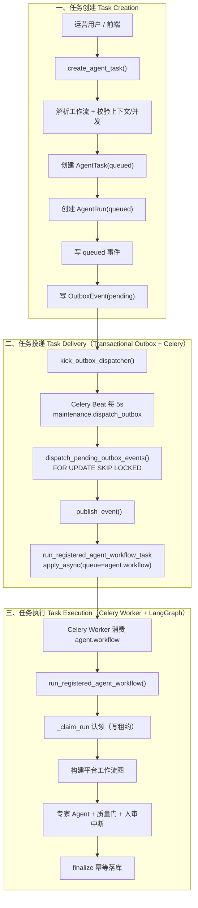
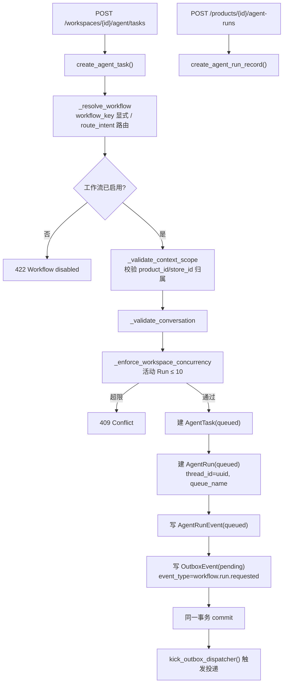
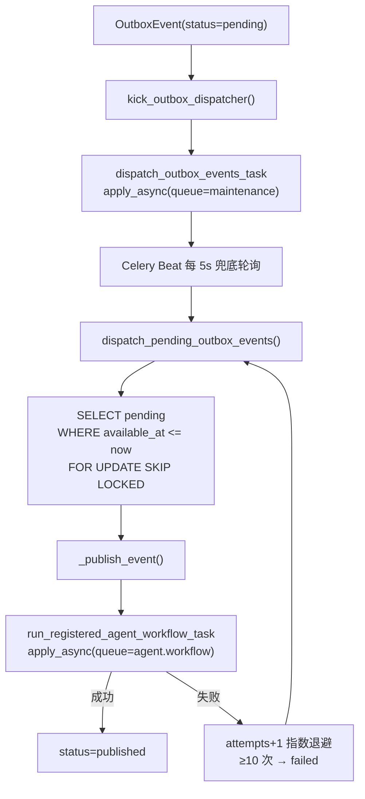
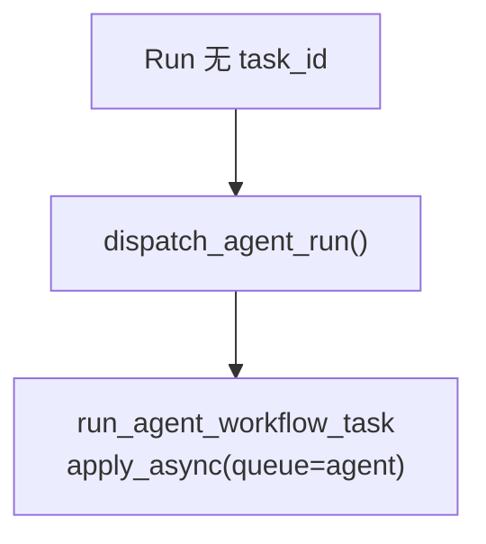
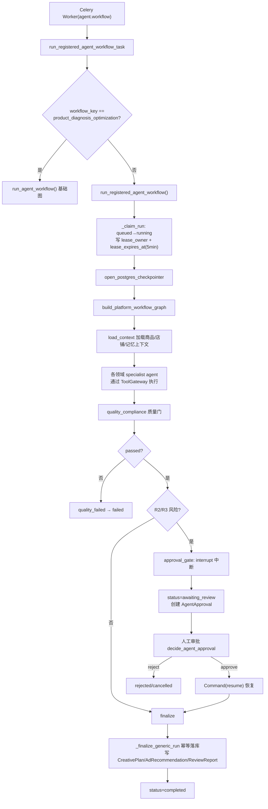

# 电商运营助手 - 任务流程拆解

本项目核心任务链路可分为三部分：**任务的创建 → 任务的投递 → 任务的执行**。

## 三部分划分（对应代码）

| 阶段 | 核心入口 | 关键产物 |
|------|---------|---------|
| 一、任务创建 | `POST /agent/tasks` → `create_agent_task()`；`POST /products/{id}/agent-runs` → `create_agent_run_record()` | `AgentTask`(queued) + `AgentRun`(queued) + `AgentRunEvent` + `OutboxEvent`(pending) |
| 二、任务投递 | `outbox.py::dispatch_pending_outbox_events()` + `_publish_event()` | 把 `OutboxEvent` 转为 Celery 消息投到 `agent.workflow` 队列 |
| 三、任务执行 | `agent_workflows.py::run_registered_agent_workflow()` → LangGraph 图 | 认领租约 → 专家 Agent → 质量门 → 审批 → 幂等落库 |

---

## 1. 总览流程图

---

## 2. 任务创建（详细）

> 代码位置：`services/agent_tasks.py` 的 `create_agent_task`（120-191 行）与 `services/agent_runs.py` 的 `create_agent_run_record`（80-171 行）。

---

## 3. 任务投递（详细）

直投旁路（无 `AgentTask` 关联时）：

> 代码位置：`services/outbox.py`（10-63 行）、`worker/celery_app.py` 的 `beat_schedule`（34-45 行）、`worker/tasks.py`（38-63 行）。

---

## 4. 任务执行（详细）

> 代码位置：`services/agent_workflows.py::run_registered_agent_workflow`（67-139 行）、`agents/platform_graph.py::build_platform_workflow_graph`（32-161 行）、`services/agent_workflows.py::_finalize_generic_run`（605-662 行）。

---

## 关键机制说明

1. **Transactional Outbox（投递可靠性）**：`AgentTask/Run` 和 `OutboxEvent` 在同一 MySQL 事务写入；投递失败时事件保留 `pending`，由 `Celery Beat` 每 5s 重扫，指数退避，保证「任务创建成功就一定会被投递」。
2. **租约机制（防重复执行）**：`_claim_run` 用行锁 + `lease_owner`/`lease_expires_at` 认领，配合 `task_acks_late` 和 `SKIP LOCKED`，吸收 Celery「至少一次」投递带来的重复消息。
3. **LangGraph 中断/恢复（人审）**：R2/R3 工作流在 `approval_gate` 通过 `interrupt()` 暂停并落 checkpoint；审批通过后 `Command(resume=...)` 从原 `thread_id` 恢复继续执行。

> 补充：另有一条独立的**媒体生成任务链路**（`GenerationJob`）——由 `generation_scheduler.py` 轮询 `pending` 的 `GenerationJob`，再经 Celery 的 `generation` 队列执行图片/视频生成，与上述 Agent 主链路并行，可视为「执行」阶段的一个下游分支。
