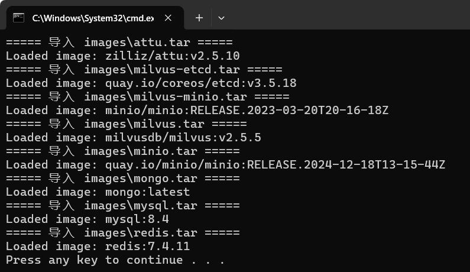

# 第1章 项目背景概述

## 1.1 项目背景

企业里的商品手册、维修资料、说明书和常见问题通常散落在很多文件中。资料虽然不少，但真正要用时往往找不到，客服和运营只能靠文件名、目录和记忆翻资料。这就需要一套知识库系统。

现有知识库系统（掌柜智库）已经能处理文档并回答问题，但它缺少一套适合管理员使用的管理后台。知识库智能体管理平台（智能体中台）补上了这一层：谁能登录、谁能维护知识、谁能查询哪些知识、查询效果如何，都由管理平台统一负责。

从 Java 后端角度看，平台主要解决三件事：

1. 登录、角色、菜单、按钮权限和操作日志。
2. 管理业务数据，例如知识组、知识单元、知识分片、问题簇等等。
3. 和掌柜智库提供的后端接口协作，由掌柜智库负责文档解析、向量化和答案生成的具体工作。

## 1.2 智能体中台与知识库之间的关系

| 系统                           | 功能                                                         |
| ------------------------------ | ------------------------------------------------------------ |
| 智能体中台（前端和Java后端）   | 知识组管理、知识上传、知识单元元数据管理、知识查询、问题管理 |
| 知识库（掌柜智库Python接口端） | 通过发布的接口接收智能体中台发送的文档处理任务：例如文件转换、图片处理、主体识别、保存切片、执行检索和答案生成 |

本课程我们开发智能体管理平台的后端接口部分

## 1.3 智能体中台功能需求

Java 后端需要提供以下能力：

| 模块 | 后端职责 |
|---|---|
| 系统基础 | 登录认证、用户、角色、部门、菜单、按钮权限、操作日志 |
| 知识组 | 分页查询、详情、新增、编辑、唯一默认组、逻辑删除 |
| 知识导入 | 登记导入任务，由后台任务同步处理状态 |
| 知识单元 | 保存文档元数据，维护所属知识组和逻辑删除状态 |
| 知识查询 | 提供管理平台侧的查询入口 |
| 问题管理 | 维护问题簇、发布状态和 FAQ 访问数据 |
| 知识缺失 | 记录没有找到有效知识的问题并跟踪处理状态 |

# 第2章 项目技术栈

知识库智能体管理平台是一个基于若依的前后端分离项目。

若依官网：[RuoYi](https://doc.ruoyi.vip/ruoyi-vue/)

| 类别           | 技术                           | 在项目中的作用                     |
| -------------- | ------------------------------ | ---------------------------------- |
| 语言           | Java 17                        | Java 后端开发语言                  |
| Web 框架       | Spring Boot 3.5.14、Spring MVC | 启动应用、提供 REST 接口           |
| 安全           | Spring Security、JWT           | 登录认证和接口权限校验             |
| 持久层         | MyBatis-Plus 3.5.17            | 单表 CRUD、条件构造和分页          |
| 原有持久层兼容 | MyBatis、PageHelper            | 保留若依旧模块的 Mapper 与分页方式 |
| 数据库         | MySQL 8、Druid 1.2.28          | 保存系统数据和业务数据，管理连接池 |
| 缓存           | Redis 6/7                      | 登录令牌、验证码和可重建缓存       |
| 调度           | Spring Scheduling、Quartz      | 后台轮询和可配置任务               |
| 参数校验       | Jakarta Validation             | 校验请求字段                       |
| 日志           | SLF4J、Logback、若依 `@Log`    | 业务日志和操作审计                 |
| 接口文档       | Springdoc 2.8.17               | 生成和查看接口文档                 |
| 构建           | Maven 3.9+                     | 依赖管理、编译和打包               |

# 第3章 创建容器运行环境

## 3.1 准备容器环境

### 3.1.1 还原镜像

找到资料中的`docker`目录，释放所有的镜像，如果网络好可以省略这一步

```bash
cd docker
# 删除容器和数据(如有参与数据需要删除)

# 加载本地镜像（如果网络不好）
# 批处理 docker load -i 将当前目录下所有 *.tar 一键导入
load_images.bat
```

成功导入的结果：



### 3.1.2 批量启动容器

将`docker`目录中的`docker-compose.yml`和`mysql`目录复制到  `d:/kmp/docker`中，执行以下命令

```bash
# 删除旧数据（如果需要，重建容器时有用）
# docker compose down -v

# 启动容器
docker compose up -d

# 注意：如果要删除容器的全部映射数据，除了删除数据卷，还要删除映射的数据目录
```

创建的所有服务如下

| 容器名称                    | 外部访问地址 (宿主机)                                        | 容器内部通信地址     | 用户名     | 密码       | 备注                                                       |
| --------------------------- | ------------------------------------------------------------ | -------------------- | ---------- | ---------- | ---------------------------------------------------------- |
| kmp‑mysql                   | `127.0.0.1:3307`                                             | `mysql:3306`         | root       | root       | 数据库名：kmp                                              |
| kmp‑redis                   | `127.0.0.1:6379`                                             | `redis:6379`         | 无         | 123123     | 开启 AOF 持久化，无用户名，仅密码认证                      |
| kmp‑elasticsearch           | `http://127.0.0.1:9200`<br>`tcp:127.0.0.1:9300`              | `elasticsearch:9200` | 无         | 无         | 关闭 xpack 安全；已内置 ik 分词插件                        |
| kmp‑kibana                  | `http://127.0.0.1:5601`                                      | `kibana:5601`        | 无         | 无         | UI界面<br/>对接 elasticsearch:9200                         |
| knowledge‑milvus‑etcd       | 未映射外部端口                                               | `etcd:2379`          | 无         | 无         | Milvus 依赖，**不对外暴露端口**                            |
| knowledge‑milvus‑minio      | `http://127.0.0.1:9002`(api)<br>`http://127.0.0.1:9003`(控制台) | `minio:9000`         | minioadmin | minioadmin | **专供 Milvus 向量库内部使用，不要业务直接连这个 minio**   |
| knowledge‑milvus‑standalone | `127.0.0.1:19530`<br/>健康检查：`http://127.0.0.1:9091/healthz` | `standalone:19530`   | 无         | 无         | Milvus 向量数据库，依赖 etcd+milvus‑minio                  |
| knowledge‑milvus‑attu       | `http://127.0.0.1:7000`                                      | `attu:7000`          | 无         | 无         | UI界面<br/>对接`standalone:19530`，无登录账号密码          |
| knowledge‑minio             | `http://127.0.0.1:9000`(api)<br/>`http://127.0.0.1:9001`(控制台) | `minio:9000`         | minioadmin | minioadmin | 业务应用使用的独立 minio 实例，和 milvus 的 minio 相互独立 |
| knowledge‑mongo             | `127.0.0.1:27017`                                            | `mongo:27017`        | 无         | 无         | 配置中未设置账号，默认无认证；生产务必开启权限             |

## 3.2 准备模型环境

将资料目录中的`ai_models`放在d盘根目录下，这是掌柜智库依赖的`bge-m3`向量模型

# 第4章 启动项目

将资料中的 `项目初始代码/kmp` 中的内容拷贝至 `d:/kmp`中

其中 `knowledge_base` 是已经开发好的掌柜智库；`front` 是已经开发好的智能体中台前端；`backend`是若依的初始后端代码，作为我们智能体中台的后端初始代码。我们需要在`backend`中做开发。

## 4.1 启动掌柜智库

### 4.1.1 配置 .env

复制 `knowledge_base`下的`.env.example` 到 `.env`，修改其中的配置信息

设置自己的 `MINERU_API_TOKEN`、`OPENAI_API_KEY`、`OPENAI_API_BASE`

### 4.1.2 启动掌柜智库

进入项目目录 knowledge_base，执行以下命令

```bash
cd knowledge_base
uv sync
uv run uvicorn atguigu.web.api.import_router:app --host 0.0.0.0 --port 8000 --reload
uv run uvicorn atguigu.web.api.query_router:app --host 0.0.0.0 --port 8001 --reload
```

访问接口：

http://127.0.0.1:8000/docs

http://127.0.0.1:8001/docs

注意：如果出现白页，又不报错，则先开启科学上网，因为Swagger 的 JS/CSS是从国外 CDN 加载的，国内网络拉不下来。

## 4.2 创建智能体中台项目

### 4.2.1 创建知识业务模块

知识库智能体管理平台后端是一个基于若依的 Maven 多模块单体工程：

将资料中的 `kmp/backend/` 放在合适的目录下，并用idea打开

```text
kmp/backend/
├─ pom.xml                 Maven 父工程，统一管理版本和模块
├─ ruoyi-admin/            启动模块，保存 application.yml 和启动类
├─ ruoyi-framework/        Spring Security、数据源、异常处理等框架能力
├─ ruoyi-system/           用户、角色、部门、菜单等系统功能
├─ ruoyi-common/           公共响应、注解、工具和基础对象
├─ ruoyi-quartz/           若依定时任务
├─ ruoyi-generator/        若依原生代码生成模块
└─ atguigu-kmp/            知识库平台业务模块（需要创建）
```

创建知识业务模块 `atguigu-kmp`，`GroupId: com.ruoyi`。

复制资料中的 `pom.xml` 文件

### 4.2.2 注册知识业务模块

父 `pom.xml` 需要聚合模块：

```xml
<module>atguigu-kmp</module>
```

`ruoyi-admin/pom.xml` 需要依赖知识业务模块：

```xml
<dependency>
    <groupId>com.ruoyi</groupId>
    <artifactId>atguigu-kmp</artifactId>
</dependency>
```

启动类还要扫描两个根包：

```java
@SpringBootApplication(
        exclude = { DataSourceAutoConfiguration.class },
        scanBasePackages = { "com.ruoyi", "com.atguigu.kmp" })
public class RuoYiApplication
{
    public static void main(String[] args)
    {
        SpringApplication.run(RuoYiApplication.class, args);
    }
}
```

### 4.2.3 配置数据库

数据源配置放在：

```text
ruoyi-admin/src/main/resources/application-druid.yml
```

只修改开发环境的 URL、用户名和密码。

### 4.2.4 配置 Redis

Redis 配置放在：

```text
ruoyi-admin/src/main/resources/application.yml
```

只修改开发环境的 URL和密码。

### 4.2.5 启动中台项目

启动：`ruoyi-admin`模块中的`RuoYiApplication`

验证是否启动成功：

- 访问地址 http://127.0.0.1:8080 
- 看到页面显示 `欢迎使用RuoYi后台管理框架，当前版本：v3.9.2，请通过前端地址访问。` 即说明若依后端启动成功，我们在这个基础上开发智能体中台的后端

## 4.3 启动智能体中台前端

智能体中台前端基于[RuoYi-Vue3](https://gitcode.com/yangzongzhuan/RuoYi-Vue3)已开发完成，直接启动即可

```bash
cd frontend
npm install
npm run dev
```

在浏览器打开：http://localhost

用户名密码： 管理员 admin/admin123   普通用户 ry/admin123

