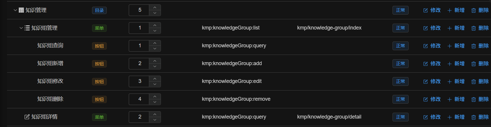
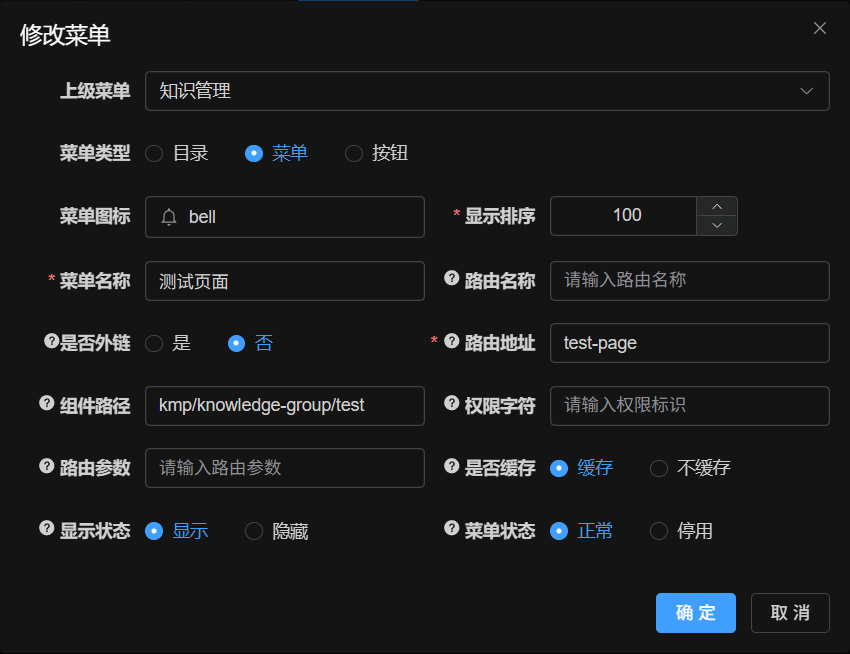
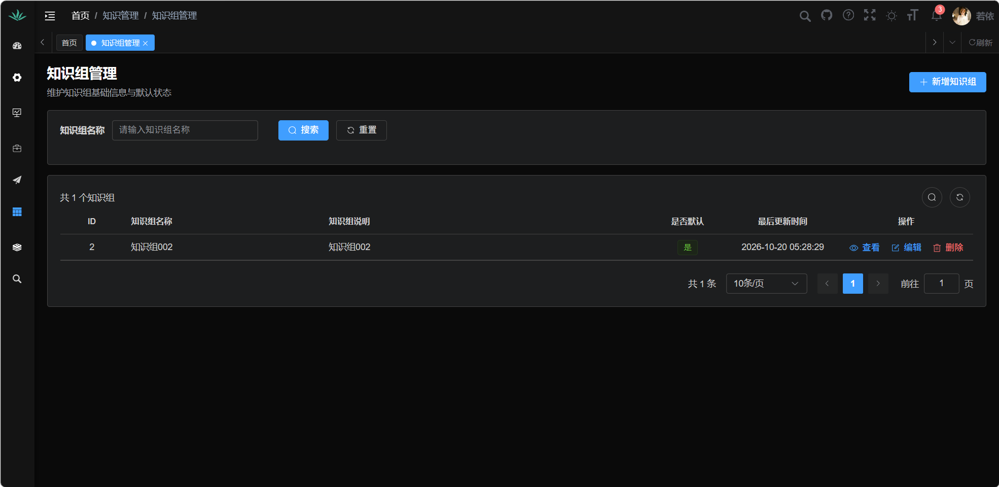
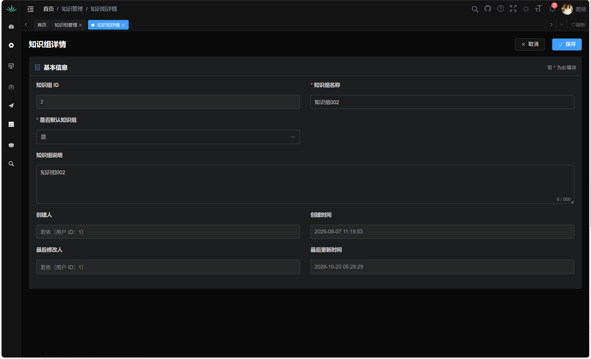
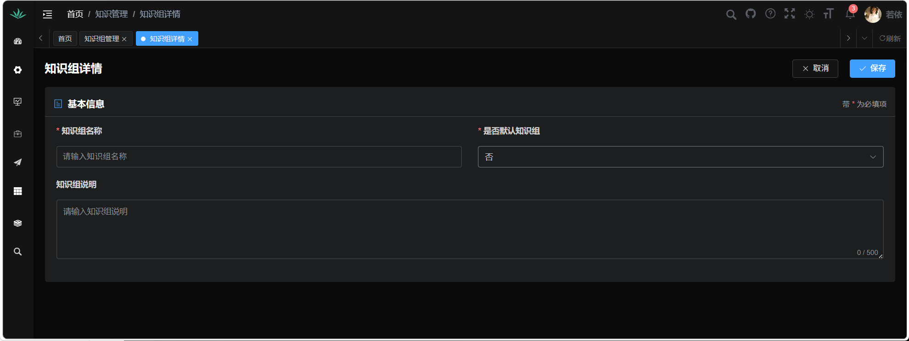

# 第1章 菜单树

参考`系统管理 - 菜单管理`中的菜单配置



## 1.1 创建菜单树

菜单树已经随着MySQL数据库的初始化创建好了，下面我们来看一下`知识组管理`的菜单树

```text
知识管理（目录 M）
├─ 知识组管理（菜单 C，可见，kmp:knowledgeGroup:list）
│  ├─ 知识组查询（按钮 F，kmp:knowledgeGroup:query）
│  ├─ 知识组新增（按钮 F，kmp:knowledgeGroup:add）
│  ├─ 知识组修改（按钮 F，kmp:knowledgeGroup:edit）
│  └─ 知识组删除（按钮 F，kmp:knowledgeGroup:remove）
└─ 知识组详情（菜单 C，隐藏，kmp:knowledgeGroup:query）
```

- 目录（知识管理，父级，只做左侧导航折叠菜单容器，没有页面）
- 菜单（知识组管理，子页面，可在左侧导航点击跳转的业务页面）
- 隐藏菜单（知识组详情，子页面，不显示在左侧导航，在其他地方点击跳转的业务页面）
- 按钮（业务页面上的`增删改查`按钮或链接）

## 1.2 选项说明

### 1.2.1 路由和组件

创建测试页面：`frontend\src\views\kmp\knowledge-group\test.vue`

```vue
<template>
  <div class="app-container">
    <el-card>
      <h2>✅ 我的测试页面</h2>
      <p>路由地址：test-page</p>
      <p>组件路径：kmp/knowledge-group/test</p>
      <p>完整路由地址：/knowlegde_security/test-page</p>
      <p>组件文件：src/views/kmp/knowledge-group/test.vue</p>
      <el-button type="primary">测试按钮</el-button>
    </el-card>
  </div>
</template>

<script setup>
// 最简页面，不需要写任何业务代码
console.log('测试页面加载成功！')
</script>
```

创建测试菜单：



### 1.2.2 是否缓存

#### 选择【缓存】

打开页面后，**离开这个路由，页面组件不会销毁**，存入前端内存缓存。

- 效果：
  - 你在列表页翻到第 5 页、搜索框填了筛选条件，切到别的菜单，再切回来，**页面保留原来的分页、搜索条件，不用重新请求后端接口、不用重新渲染**。
- 缺点：页面数据不会自动刷新；需要手动刷新页面才能看到最新数据。

#### 选择【不缓存】

每次进入页面，**组件都会销毁重建**

- 效果： 每次点开列表页，都会重新加载页面、重新调用后端 list 接口，分页、搜索框的条件全部重置，页面是全新状态。

- 适合：数据实时性要求高的列表，每次打开都要拿最新数据库数据。

# 第2章 代码生成

参考文档：[代码生成器 | MyBatis-Plus](https://baomidou.com/guides/new-code-generator/)

生成器位于`atguigu-kmp`模块的`test`目录中 ，代码如下：

```java
package com.atguigu.kmp.generator;

import com.baomidou.mybatisplus.annotation.IdType;
import com.baomidou.mybatisplus.generator.FastAutoGenerator;
import com.baomidou.mybatisplus.generator.config.OutputFile;
import com.ruoyi.common.core.controller.BaseController;

import java.util.Collections;

/**
 * 知识库模块 MyBatis-Plus 基础代码生成器。
 */
public final class KmpCodeGenerator
{
    public static void main(String[] args){

        // 数据库凭据只从环境变量读取，避免将密码提交到代码仓库
        String databaseUrl = System.getenv("KMP_GENERATOR_DB_URL");
        String databaseUsername = System.getenv("KMP_GENERATOR_DB_USERNAME");
        String databasePassword = System.getenv("KMP_GENERATOR_DB_PASSWORD");

        String moduleRoot = System.getProperty("user.dir") + "/atguigu-kmp";

        FastAutoGenerator.create(databaseUrl, databaseUsername, databasePassword)
                .globalConfig(builder -> builder
                        .author("atguigu")
                        .disableOpenDir()
                        .outputDir(moduleRoot + "/src/main/java"))
                .packageConfig(builder -> builder
                        .parent("com.atguigu.kmp")
                        .entity("entity")
                        .mapper("mapper")
                        .service("service")
                        .serviceImpl("service.impl")
                        .controller("controller")

                        // 配置Mapper XML文件生成路径
                        .pathInfo(Collections.singletonMap(
                                OutputFile.xml,
                                moduleRoot + "/src/main/resources/mapper/kmp")))

                .strategyConfig(builder -> builder
                        // 配置需要生成的所有表名
                        .addInclude(
                                "kmp_knowledge_group",
                                "kmp_knowledge_unit",
                                "kmp_knowledge_import_task",
                                "kmp_knowledge_query_session",
                                "kmp_knowledge_question_cluster",
                                "kmp_knowledge_question_cluster_check_task",
                                "kmp_knowledge_query_log",
                                "kmp_knowledge_faq_log")
                        .addTablePrefix("kmp_")

                        .entityBuilder()
                        .enableLombok()
                        .idType(IdType.AUTO)
                        .logicDeleteColumnName("is_deleted")

                        .serviceBuilder()
                        .formatServiceFileName("%sService")
                        .formatServiceImplFileName("%sServiceImpl")

                        .controllerBuilder()
                        .enableRestStyle()
                        .superClass(BaseController.class))
                .execute();
    }
}
```

三个数据库参数必须通过环境变量传入，环境变量可以在操作系统中配置，也可以在IDEA的`Edit Conifgurations`中配置：

```powershell
KMP_GENERATOR_DB_URL=jdbc:mysql://127.0.0.1:3307/kmp?useUnicode=true&characterEncoding=UTF-8&serverTimezone=Asia/Shanghai
KMP_GENERATOR_DB_USERNAME=root
KMP_GENERATOR_DB_PASSWORD=root
```

# 第3章 数据对象

数据表：`kmp_knowledge_group`

实体类：`com.atguigu.kmp.entity.KnowledgeGroup`

代码生成器生成的实体代码可以进行一些优化，我们先展示优化后的完整代码，再逐一说明：

```java
package com.atguigu.kmp.entity;

import com.baomidou.mybatisplus.annotation.*;
import com.fasterxml.jackson.annotation.JsonFormat;
import com.fasterxml.jackson.annotation.JsonInclude;
import com.ruoyi.common.xss.Xss;
import jakarta.validation.constraints.*;
import lombok.Data;

import java.io.Serializable;
import java.time.LocalDateTime;


/**
 * 知识组实体。
 */
@Data
@TableName("kmp_knowledge_group")
@JsonInclude(JsonInclude.Include.NON_NULL)
public class KnowledgeGroup implements Serializable {

    private static final long serialVersionUID = 1L;

    /**
     * 主键ID
     */
    @TableId(value = "id", type = IdType.AUTO)
    @Positive(message = "知识组 ID 不正确")
    private Long id;

    /**
     * 知识组名称
     */
    @NotBlank(message = "知识组名称不能为空")
    @Size(max = 100, message = "知识组名称不能超过100个字符")
    private String knowledgeGroupName;

    /**
     * 知识组说明
     */
    @Size(max = 500, message = "知识组说明不能超过500个字符")
    private String knowledgeGroupDesc;

    /**
     * 是否默认：0-否，1-是
     */
    @NotNull(message = "是否默认不能为空")
    @Min(value = 0, message = "是否默认值不正确")
    @Max(value = 1, message = "是否默认值不正确")
    private Integer isDefault;

    /**
     * 创建人用户ID，只允许后端赋值。
     * 
     */
    private Long createUserId;

    /**
     * 创建时间，只允许后端赋值。
     */
    @JsonFormat(pattern = "yyyy-MM-dd HH:mm:ss")
    private LocalDateTime createTime;

    /**
     * 最后修改人用户ID，只允许后端赋值。
     * 
     */
    private Long updateUserId;

    /**
     * 最后修改时间，只允许后端赋值。
     */
    @JsonFormat(pattern = "yyyy-MM-dd HH:mm:ss")
    private LocalDateTime updateTime;

    /**
     * 逻辑删除：0-未删除，1-已删除
     */
    @TableLogic
    private Integer isDeleted;

    /**
     * 创建人名称，仅用于接口展示。
     */
    @TableField(exist = false)
    private String createUserName;

    /**
     * 最后修改人名称，仅用于接口展示。
     */
    @TableField(exist = false)
    private String updateUserName;
}
```

## 3.1 Lombok

`@Data` 替代 `@Getter @Setter @ToString`

```java
// 优化前：三个注解
@Getter @Setter @ToString

// 优化后：一个注解
@Data
```

`@Data` = `@Getter` + `@Setter` + `@ToString` + `@EqualsAndHashCode` + `@RequiredArgsConstructor`，一个注解搞定，更简洁。

## 3.2 null 字段不出现在 JSON 中

```java
@JsonInclude(JsonInclude.Include.NON_NULL)
```

类级别注解。序列化响应体时自动**剔除值为 null 的字段**，减少报文体积，前端也不会收到一堆 `null`。

## 3.3 统一日期输出格式

```java
/**
 * 创建时间
 */
@JsonFormat(pattern = "yyyy-MM-dd HH:mm:ss")
private LocalDateTime createTime;

/**
 * 最后修改时间
 */
@JsonFormat(pattern = "yyyy-MM-dd HH:mm:ss")
private LocalDateTime updateTime;
```

不加此注解时，`LocalDateTime` 默认序列化为 `2026-10-13T10:00:00`（带 T，机器味重）；加上后直接输出前端友好的 `2026-10-13 10:00:00`。

## 3.4 参数校验注解：把校验交给框架

```java
/**
 * 主键ID
 */
@TableId(value = "id", type = IdType.AUTO)
@Positive(message = "知识组 ID 不正确")
private Long id;

/**
 * 知识组名称
 */
@NotBlank(message = "知识组名称不能为空")
@Size(max = 100, message = "知识组名称不能超过100个字符")
@Xss(message = "知识组名称不能包含脚本字符")
private String knowledgeGroupName;

/**
 * 知识组说明
 */
@Size(max = 500, message = "知识组说明不能超过500个字符")
@Xss(message = "知识组说明不能包含脚本字符")
private String knowledgeGroupDesc;

/**
 * 是否默认：0-否，1-是
 */
@NotNull(message = "是否默认不能为空")
@Min(value = 0, message = "是否默认值不正确")
@Max(value = 1, message = "是否默认值不正确")
private Byte isDefault;
```

配合 Controller 上的 `@Validated`，请求进方法前自动校验，**Service 里不用再手写一堆 if 判断**，且错误信息可直接返回给前端。

## 3.5 字段类型优化

`Byte` → `Integer`

```java
// 优化前
private Byte isDefault;
// 优化后
private Integer isDefault;
```

生成器按 MySQL `tinyint` 映射成 `Byte`，但 `Byte` 在 JSON 序列化、前后端交互、校验注解适配上都不顺手，统一改为 `Integer` 更通用。

## 3.6 非表字段

```java
/**
 * 创建人名称，仅用于接口展示。
 */
@TableField(exist = false)
private String createUserName;

/**
 * 最后修改人名称，仅用于接口展示。
 */
@TableField(exist = false)
private String updateUserName;
```

实体里加一个**表里不存在**的展示字段（创建人名称），用于联表查询后返回到给前端。标记 `exist = false` 后，MP 生成的 SQL 会忽略该字段，不会报 "Unknown column"。

## 3.7 注释语义化：标注字段的可写范围

```java
/** 创建人用户 ID，只允许后端赋值。 */
```

优化前只写"是什么"，优化后还写明"**谁能改**"——提示开发者这些字段禁止从前端传值（防止越权伪造 createUserId等），把约定固化在代码里。

# 第4章 功能一：知识组分页列表

## 4.1 接口定义

| 项目 | 内容 |
|---|---|
| 接口功能 | 分页查询未删除知识组，支持名称模糊查询 |
| 请求方 | 前端 |
| 接口路径 | `/kmp/knowledgeGroup/list` |
| 请求方式 | `GET` |
| 接口参数 | `pageNum`、`pageSize`、可选 `knowledgeGroupName` |
| 返回值 | `TableDataInfo`，包含 `rows`、`total`、`code`、`msg` |
| 权限 | `kmp:knowledgeGroup:list` |

请求示例：

```http
GET /kmp/knowledgeGroup/list?pageNum=1&pageSize=10&knowledgeGroupName=产品
```

知识组列表页：



## 4.2 功能实现

### 4.2.1 Controller

步骤：

1. 在`KnowledgeGroupController`原来的 `@RequestMapping` 中添加 `kmp` 前缀：

```java
@RequestMapping("/kmp/knowledgeGroup")
```

2. 添加`knowledgeGroupService`依赖注入：

```java
@Autowired
private KnowledgeGroupService knowledgeGroupService;
```

3. 添加`list`方法：

```java
/**
 * 分页查询知识组列表。
 *
 * @param query 查询条件
 * @return 若依分页响应
 */
@PreAuthorize("@ss.hasPermi('kmp:knowledgeGroup:list')") // 权限校验
@GetMapping("/list")
public TableDataInfo list(KnowledgeGroup query)
{
    // 获取分页参数
    PageDomain pageDomain = TableSupport.buildPageRequest();
    // 获取当前页码
    int pageNum = pageDomain.getPageNum();
    // 获取每页大小
    int pageSize = pageDomain.getPageSize();

    // 创建分页对象
    Page<KnowledgeGroup> page = new Page<>(pageNum, pageSize);

    // 调用服务层方法进行分页查询
    IPage<KnowledgeGroup> result = knowledgeGroupService.pageKnowledgeGroups(page, query);
    // 创建响应对象
    TableDataInfo response = new TableDataInfo(result.getRecords(), result.getTotal());

    // 设置响应数据
    response.setCode(HttpStatus.SUCCESS);
    response.setMsg("查询成功");
    return response;
}
```

### 4.2.2 Service

在 `KnowledgeGroupService`接口定义分页查询方法：

```java
/**
 * 分页查询未删除知识组。
 *
 * @param page MyBatis-Plus 分页参数
 * @param query 查询条件
 * @return 知识组分页数据
 */
IPage<KnowledgeGroup> pageKnowledgeGroups(Page<KnowledgeGroup> page, KnowledgeGroup query);
```

### 4.2.3 ServiceImpl

1. 在`KnowledgeGroupServiceImpl`类上添加日志注解：

```jaba
@Slf4j // 日志
```

2. 在 `KnowledgeGroupServiceImpl`中实现方法：

```java
/** {@inheritDoc} */
@Override
public IPage<KnowledgeGroup> pageKnowledgeGroups(Page<KnowledgeGroup> page, KnowledgeGroup query)
{
    log.info("分页查询知识组列表");
    
    // 获取知识组名称, 去除空格, 或将空字符串转为null
    String normalizedName = StringUtils.trimToNull(query.getKnowledgeGroupName());

    // 构建查询条件
    LambdaQueryWrapper<KnowledgeGroup> wrapper = new LambdaQueryWrapper<KnowledgeGroup>()
        
        	// like 的第一个参数就是开关，为空时不会拼接对应条件。
            .like(normalizedName != null, KnowledgeGroup::getKnowledgeGroupName, normalizedName)

            // 按照更新时间降序排序, 按照ID降序排序
            .orderByDesc(KnowledgeGroup::getUpdateTime)
            .orderByDesc(KnowledgeGroup::getId);

    // 执行查询并返回结果
    return this.page(page, wrapper);
}
```

`like` 的第一个参数是条件开关。名称为空时不拼接 `LIKE`，有值时才模糊查询。`is_deleted = 0` 不需要手写，`@TableLogic` 会让 MyBatis-Plus自动处理。

### 4.2.4 分页插件

在 `atguigu-kmp` 模块中添加分页插件：

```java
package com.atguigu.kmp.config;

import com.baomidou.mybatisplus.annotation.DbType;
import com.baomidou.mybatisplus.extension.plugins.MybatisPlusInterceptor;
import com.baomidou.mybatisplus.extension.plugins.inner.PaginationInnerInterceptor;
import org.mybatis.spring.annotation.MapperScan;
import org.springframework.context.annotation.Bean;
import org.springframework.context.annotation.Configuration;

@Configuration
@MapperScan("com.atguigu.kmp.mapper")
public class KmpConfig
{
    
    /**
     * 注册 MySQL 分页插件；分页插件应保持为内部插件链的最后一项。
     *
     * @return MyBatis-Plus 插件链
     */
    @Bean
    public MybatisPlusInterceptor mybatisPlusInterceptor()
    {
        MybatisPlusInterceptor interceptor = new MybatisPlusInterceptor();
        interceptor.addInnerInterceptor(new PaginationInnerInterceptor(DbType.MYSQL));
        return interceptor;
    }
}
```

# 第5章 功能二：查询知识组详情

## 5.1 接口定义

| 项目 | 内容 |
|---|---|
| 接口功能 | 根据 ID 查询知识组详情 |
| 请求方 | 前端 |
| 接口路径 | `/kmp/knowledgeGroup/{id}` |
| 请求方式 | `GET` |
| 接口参数 | 路径参数 `id`，正整数 |
| 返回值 | `KnowledgeGroup` |
| 权限 | `kmp:knowledgeGroup:query` |

详情页：



## 5.2 功能实现

### 5.2.1 Controller

负责接收 ID 和包装响应：

```java
/**
 * 查询知识组详情。
 *
 * @param id 知识组 ID
 * @return 知识组详情
 */
@PreAuthorize("@ss.hasPermi('kmp:knowledgeGroup:query')")
@GetMapping("/{id}")
public AjaxResult getInfo(@PathVariable Long id)
{
    // 调用服务层方法，获取知识组详情
    KnowledgeGroup knowledgeGroup = knowledgeGroupService.getKnowledgeGroupDetail(id);
    // 返回成功响应
    return AjaxResult.success(knowledgeGroup);
}
```

### 5.2.2 Service

在 `KnowledgeGroupService`接口定义分页查询方法：

```java
/**
 * 查询知识组详情。
 *
 * @param id 知识组 ID
 * @return 知识组详情
 */
KnowledgeGroup getKnowledgeGroupDetail(Long id);
```

### 5.2.3 ServiceImpl

`KnowledgeGroupServiceImpl`先查知识组，再补充用户昵称：

```java
@Autowired
private ISysUserService sysUserService;

/** {@inheritDoc} */
@Override
public KnowledgeGroup getKnowledgeGroupDetail(Long id)
{
    log.info("获取知识组详情，id={}", id);
    KnowledgeGroup knowledgeGroup = this.getById(id);
    if (knowledgeGroup == null)
    {
        throw new ServiceException("知识组不存在或已删除");
    }
    knowledgeGroup.setCreateUserName(this.findUserDisplayName(knowledgeGroup.getCreateUserId()));
    knowledgeGroup.setUpdateUserName(this.findUserDisplayName(knowledgeGroup.getUpdateUserId()));
    return knowledgeGroup;
}

/** 根据用户 ID 获取用于展示的昵称。 */
private String findUserDisplayName(Long userId)
{
    if (userId == null)
    {
        return null;
    }
    SysUser user = sysUserService.selectUserById(userId);
    return user.getNickName();
}
```


# 第6章 功能三：新增知识组

## 6.1 接口定义

| 项目 | 内容 |
|---|---|
| 接口功能 | 新增知识组，可同时设为默认组 |
| 请求方 | 前端 |
| 接口路径 | `/kmp/knowledgeGroup` |
| 请求方式 | `POST` |
| 接口参数 | JSON：`knowledgeGroupName`、`knowledgeGroupDesc`、`isDefault` |
| 返回值 | 自增 ID |
| 权限 | `kmp:knowledgeGroup:add` |

请求示例：

```json
{
  "knowledgeGroupName": "产品手册",
  "knowledgeGroupDesc": "商品说明和使用指南",
  "isDefault": 1
}
```

新增页复用详情表单，只开放知识组名称、默认状态和说明三个业务字段：



## 6.2 功能实现

### 6.2.1 Controller

添加`add`方法：

- `@Log` 记录若依增删改的操作日志，可以在若依平台的 `系统管理 -> 日志管理 -> 操作日志` 中查看
- @Validated 配合实体类中的数据校验

```java
/**
 * 新增知识组。
 *
 * @param knowledgeGroup 新增数据
 * @return 新增结果及数据库生成的 ID
 */
@PreAuthorize("@ss.hasPermi('kmp:knowledgeGroup:add')")
@Log(title = "知识组管理", businessType = BusinessType.INSERT)
@PostMapping
public AjaxResult add(@Validated @RequestBody KnowledgeGroup knowledgeGroup)
{
    // 即使客户端传入主键，新增接口也只执行 INSERT。
    knowledgeGroup.setId(null);
    Long id = knowledgeGroupService.saveKnowledgeGroup(knowledgeGroup, this.getUserId());
    return AjaxResult.success("新增知识组成功", id);
}
```

### 6.2.2 Service

在 `KnowledgeGroupService`接口定义保存方法：

```java
/**
 * 新增或编辑知识组，并维护唯一默认组。
 *
 * @param knowledgeGroup 待保存的知识组
 * @param userId 当前登录用户 ID
 * @return 保存后的知识组 ID
 */
Long saveKnowledgeGroup(KnowledgeGroup knowledgeGroup, Long userId);
```

### 6.2.3 ServiceImpl

`KnowledgeGroupServiceImpl`保存方法由新增和编辑共用。

`@Transactional` 负责划定事务边界。

新增分支的关键代码：

```java
/** {@inheritDoc} */
@Override
@Transactional(rollbackFor = Exception.class)
public Long saveKnowledgeGroup(KnowledgeGroup knowledgeGroup, Long userId)
{

    boolean editing = knowledgeGroup.getId() != null;
    log.info("开始{}知识组", editing ? "编辑" : "新增");

    LocalDateTime now = LocalDateTime.now();
    if (!editing)
    {
        // 新增接口必须忽略客户端伪造的主键和全部只允许后端赋值的字段。
        knowledgeGroup.setId(null);
        knowledgeGroup.setCreateUserId(userId);
        knowledgeGroup.setCreateTime(now);
        knowledgeGroup.setUpdateUserId(null);
        knowledgeGroup.setUpdateTime(null);
        knowledgeGroup.setIsDeleted(0);
    } 
    else 
    {
        // TODO 编辑
    }

    this.saveOrUpdate(knowledgeGroup);
    return knowledgeGroup.getId();
}
```

主键、审计字段和删除标志都由后端决定。即使请求体伪造这些值，也不会按客户端的值保存。


# 第7章 功能四：编辑知识组

## 7.1 接口定义

| 项目 | 内容 |
|---|---|
| 接口功能 | 修改名称、说明和默认标志 |
| 请求方 | 前端 |
| 接口路径 | `/kmp/knowledgeGroup` |
| 请求方式 | `PUT` |
| 接口参数 | JSON：`id`、`knowledgeGroupName`、`knowledgeGroupDesc`、`isDefault` |
| 返回值 | 成功消息 |
| 权限 | `kmp:knowledgeGroup:edit` |

## 7.2 功能实现

### 7.2.1 Controller

先检查 ID 是否存在或合法：

```java
/**
 * 编辑知识组。
 *
 * @param knowledgeGroup 编辑数据
 * @return 修改结果
 */
@PreAuthorize("@ss.hasPermi('kmp:knowledgeGroup:edit')")
@Log(title = "知识组管理", businessType = BusinessType.UPDATE)
@PutMapping
public AjaxResult edit(@Validated @RequestBody KnowledgeGroup knowledgeGroup)
{
    if (knowledgeGroup.getId() == null)
    {
        throw new ServiceException("知识组 ID 不正确");
    }
    knowledgeGroupService.saveKnowledgeGroup(knowledgeGroup, this.getUserId());
    return AjaxResult.success("修改知识组成功");
}
```

### 7.2.2 ServiceImpl

在 `KnowledgeGroupServiceImpl`接口修改保存方法，添加更新数据的分支：

```java
else
{
    if (this.getById(knowledgeGroup.getId()) == null)
    {
        throw new ServiceException("知识组不存在或已删除");
    }

    knowledgeGroup.setCreateUserId(null);
    knowledgeGroup.setCreateTime(null);
    knowledgeGroup.setUpdateUserId(userId);
    knowledgeGroup.setUpdateTime(now);
    knowledgeGroup.setIsDeleted(null);
}

// TODO 处理默认知识组
```

把创建字段设为 `null`，是为了不让编辑请求修改创建人和创建时间。MyBatis-Plus 默认不会把这些 `null` 更新进数据库。


# 第8章 功能五：维护默认知识组

## 8.1 接口定义

默认组不是独立接口，它属于新增和编辑的一部分：

| 项目 | 内容 |
|---|---|
| 接口功能 | 新增或编辑时将当前知识组设为唯一默认组 |
| 请求方 | 前端（本课不讲前端实现） |
| 接口路径 | 与新增、编辑接口相同 |
| 请求方式 | `POST` 或 `PUT` |
| 接口参数 | `isDefault=1` 表示设为默认 |
| 返回值 | 与新增、编辑接口相同 |
| 权限 | 新增使用 `add`，编辑使用 `edit` |

## 8.2 功能实现

在 `KnowledgeGroupServiceImpl`接口修改保存方法，添加处理默认知识组的功能： 添加在 `this.saveOrUpdate` 一句之前

```java
// 如果当前知识组被设置为默认知识组，则将其他知识组的默认设置取消
if (Integer.valueOf(1).equals(knowledgeGroup.getIsDefault()))
{
    Long currentId = knowledgeGroup.getId();
    this.lambdaUpdate()
            .eq(KnowledgeGroup::getIsDefault, 1)
            .ne(currentId != null, KnowledgeGroup::getId, currentId)
            .set(KnowledgeGroup::getIsDefault, 0)
            .set(KnowledgeGroup::getUpdateUserId, userId)
            .set(KnowledgeGroup::getUpdateTime, now)
            .update();
}

//现有代码
this.saveOrUpdate(knowledgeGroup);
return knowledgeGroup.getId();
```


# 第9章 功能六：删除知识组

## 9.1 接口定义

| 项目 | 内容 |
|---|---|
| 接口功能 | 校验删除条件、清理授权并逻辑删除知识组 |
| 请求方 | 前端 |
| 接口路径 | `/kmp/knowledgeGroup/{id}` |
| 请求方式 | `DELETE` |
| 接口参数 | 路径参数 `id` |
| 返回值 | 成功消息或明确的业务错误 |
| 权限 | `kmp:knowledgeGroup:remove` |

## 9.2 功能实现

### 9.2.1 Controller

```java
/**
 * 删除知识组。
 *
 * @param id 知识组 ID
 * @return 删除结果
 */
@PreAuthorize("@ss.hasPermi('kmp:knowledgeGroup:remove')")
@Log(title = "知识组管理", businessType = BusinessType.DELETE)
@DeleteMapping("/{id}")
public AjaxResult remove(@PathVariable Long id)
{
    knowledgeGroupService.removeKnowledgeGroup(id, this.getUserId());
    return AjaxResult.success("删除知识组成功");
}
```

### 9.2.2 Service

在 `KnowledgeGroupService`接口定义删除方法：

```java
/**
 * 校验默认组限制后逻辑删除知识组。
 *
 * @param id 知识组 ID
 * @param userId 当前登录用户 ID
 * @return 是否删除成功
 */
boolean removeKnowledgeGroup(Long id, Long userId);
```

### 9.2.3 ServiceImpl

```java
/** {@inheritDoc} */
@Override
@Transactional(rollbackFor = Exception.class)
public boolean removeKnowledgeGroup(Long id, Long userId)
{
    log.info("删除知识组，userId={}，knowledgeGroupId={}", userId, id);

    KnowledgeGroup knowledgeGroup = this.getById(id);
    if (knowledgeGroup == null)
    {
        throw new ServiceException("知识组不存在或已删除");
    }

    if (Integer.valueOf(1).equals(knowledgeGroup.getIsDefault()))
    {
        log.warn("知识组删除被阻止，userId={}，knowledgeGroupId={}，reason=default", userId, id);
        throw new ServiceException("默认知识组不能删除，请先取消默认设置");
    }

    return this.removeById(id);
}
```


# 第10章 功能七：查询知识组选项

## 10.1 接口功能

| 项目     | 内容                               |
| -------- | ---------------------------------- |
| 接口路径 | `/kmp/knowledgeGroup/groupOptions` |
| 请求方式 | `GET`                              |
| 返回值   | 未删除知识组的 ID、名称、默认标志  |
| 权限     | `kmp:knowledgeGroup:list`          |

## 10.2 功能实现

此方法获取所有未删除的知识组列表，负责将其展示在页面的下拉列表中。例如**“知识单元管理”**和**“知识导入”**的页面上方

### 10.2.1 Controller

在`KnowledgeGroupController`中添加 `groupOptions` 方法：

```java
/**
 * 查询未删除知识组，供其他位置的下拉列表选择。
 *
 * @return 知识组选项
 */
@PreAuthorize("@ss.hasPermi('kmp:knowledgeGroup:list')") // 权限校验
@GetMapping("/groupOptions")
public AjaxResult groupOptions()
{
    return AjaxResult.success(knowledgeGroupService.listKnowledgeGroupOptions());
}
```

### 10.2.2 Service

在 `KnowledgeGroupService`接口定义方法：

```java
/**
 * 查询知识组下拉选项。
 *
 * @return 仅包含 ID、名称和默认标志的知识组
 */
List<KnowledgeGroup> listKnowledgeGroupOptions();
```

### 4.2.3 ServiceImpl

在 `KnowledgeGroupServiceImpl`中实现方法：

```java
/** {@inheritDoc} */
@Override
public List<KnowledgeGroup> listKnowledgeGroupOptions()
{
    List<KnowledgeGroup> groupOptions = this.lambdaQuery()
            // 这里只查三列，够选择知识组即可。
            .select(
                KnowledgeGroup::getId,
                KnowledgeGroup::getKnowledgeGroupName,
                KnowledgeGroup::getIsDefault
            )
            // 先按 `isDefault` 倒序，默认组自然排到最前面
            .orderByDesc(KnowledgeGroup::getIsDefault)
            // 名称相同时再用 ID 保证顺序稳定。
            .orderByAsc(KnowledgeGroup::getKnowledgeGroupName)
            .orderByAsc(KnowledgeGroup::getId)
            .list();
    return groupOptions;
}
```


