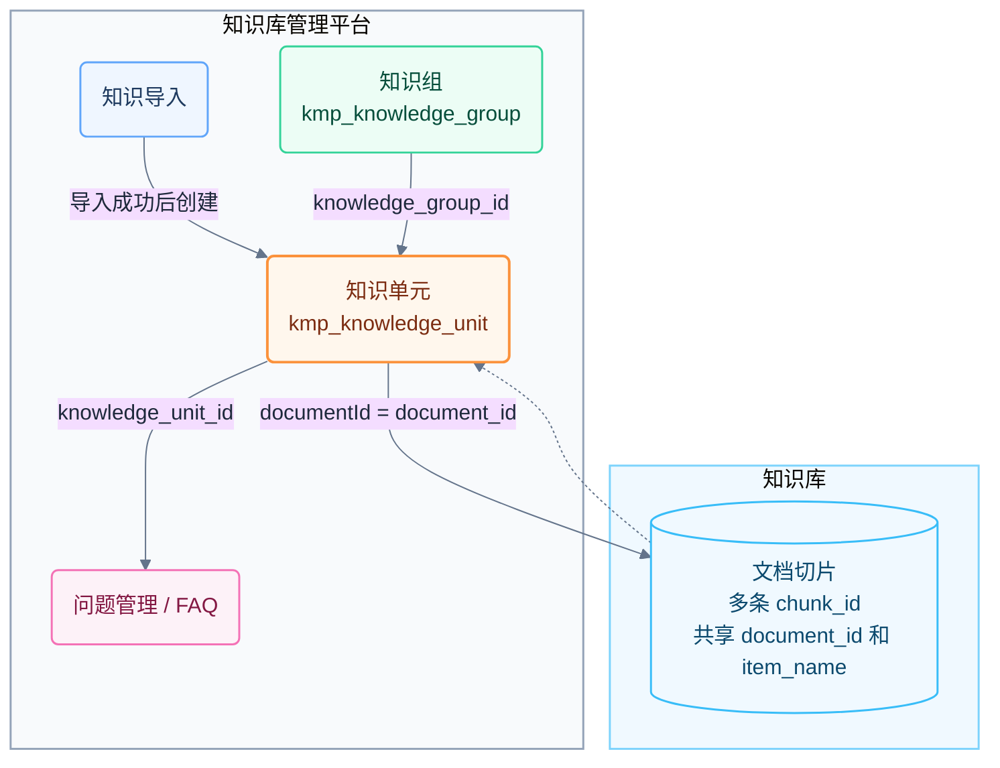
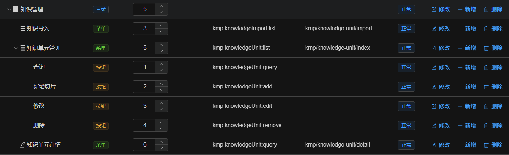
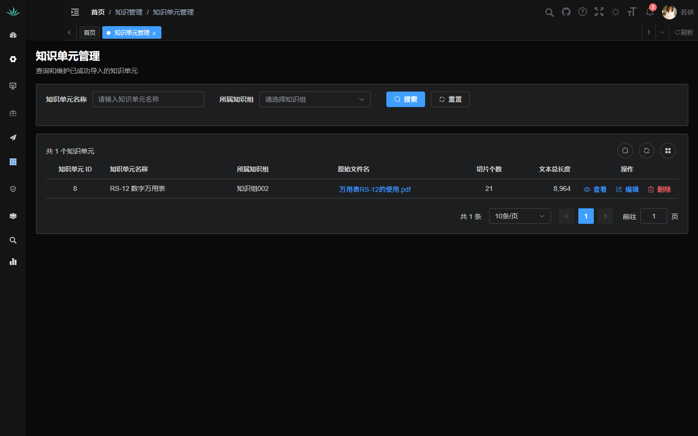
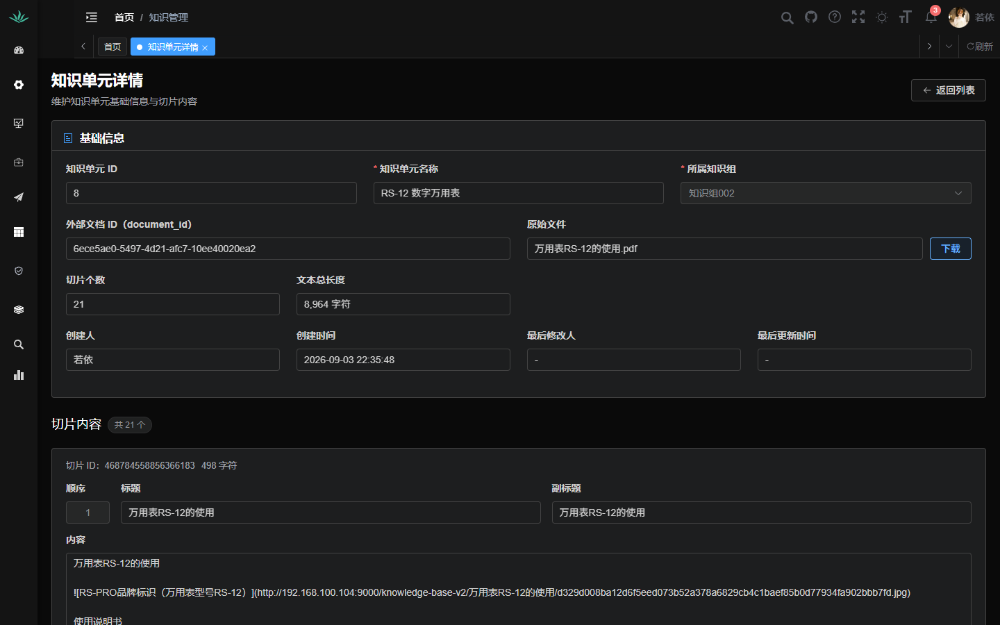

# 第1章 需求分析

知识单元可以理解为“已经导入成功的一份资料”。MySQL 不保存整篇正文，只保存平台管理需要的元数据。

`KnowledgeUnit.documentId` 对应知识库的 `document_id`。同一文档的所有切片共享这个值，平台查询、修改或删除切片时都用它定位文档。



# 第2章 菜单树



# 第3章 数据对象

数据表：`kmp_knowledge_unit`

实体类：`com.atguigu.kmp.entity.KnowledgeUnit`

将代码生成器生成的代码补充并优化如下：

```java
package com.atguigu.kmp.entity;

import com.baomidou.mybatisplus.annotation.*;
import com.fasterxml.jackson.annotation.JsonFormat;
import com.fasterxml.jackson.annotation.JsonInclude;
import jakarta.validation.constraints.*;
import lombok.Data;

import java.io.Serializable;
import java.time.LocalDateTime;

/**
 * 知识单元实体。
 */
@Data
@TableName("kmp_knowledge_unit")
@JsonInclude(JsonInclude.Include.NON_NULL)
public class KnowledgeUnit implements Serializable {

    private static final long serialVersionUID = 1L;

    /**
     * 平台知识单元主键
     */
    @TableId(value = "id", type = IdType.AUTO)
    @Positive(message = "知识单元 ID 不正确", groups = Edit.class)
    private Long id;

    /**
     * 外部知识库文档ID
     */
    @NotBlank(message = "外部文档 ID 不能为空")
    @Size(max = 64, message = "外部文档 ID 不能超过64个字符")
    private String documentId;

    /**
     * 所属知识组ID，建档后只读。
     */
    @NotNull(message = "所属知识组不能为空", groups = Edit.class)
    @Positive(message = "所属知识组 ID 不正确", groups = Edit.class)
    private Long knowledgeGroupId;

    /**
     * 知识单元名称，允许重名。
     */
    @NotBlank(message = "知识单元名称不能为空", groups = Edit.class)
    @Size(max = 128, message = "知识单元名称不能超过128个字符", groups = Edit.class)
    private String knowledgeUnitName;

    /**
     * 原始文件名，建档后只读。
     */
    @Size(max = 128, message = "原始文件名不能超过128个字符")
    private String originalFileName;

    /**
     * 原始文件SHA-256小写摘要，建档后只读。
     */
    private String fileSha256;

    /**
     * MinIO外部可读完整下载URL
     */
    @Size(max = 500, message = "原文件下载地址不能超过500个字符")
    private String originalFileDownloadUrl;

    /**
     * 全部切片文本总字符数
     */
    @PositiveOrZero(message = "文本总长度不能为负数")
    private Long totalTextLength;

    /**
     * 有效切片数量
     */
    @PositiveOrZero(message = "切片数量不能为负数")
    private Long chunkCount;

    /**
     * 创建人用户ID，只允许后端赋值。
     */
    private Long createUserId;

    /**
     * 创建时间
     */
    @JsonFormat(pattern = "yyyy-MM-dd HH:mm:ss")
    private LocalDateTime createTime;

    /**
     * 最后修改人用户ID，只允许后端赋值。
     */
    private Long updateUserId;

    /**
     * 最后修改时间
     */
    @JsonFormat(pattern = "yyyy-MM-dd HH:mm:ss")
    private LocalDateTime updateTime;

    /**
     * 逻辑删除：0-未删除，1-已删除
     */
    @TableLogic
    private Integer isDeleted;

    /** 所属知识组名称，仅用于接口展示。 */
    @TableField(exist = false)
    private String knowledgeGroupName;

    /** 创建人名称，仅用于详情展示。 */
    @TableField(exist = false)
    private String createUserName;

    /** 最后修改人名称，仅用于详情展示。 */
    @TableField(exist = false)
    private String updateUserName;

    /** 基础信息编辑校验组，避免要求页面提交只读的 documentId。 */
    public interface Edit
    {
    }
}

```

# 第4章 功能一：知识单元分页列表

## 4.1 接口定义

| 项目     | 内容                                                         |
| -------- | ------------------------------------------------------------ |
| 接口功能 | 按名称和知识组分页查询未删除知识单元                         |
| 接口路径 | `/kmp/knowledgeUnit/list`                                    |
| 请求方式 | `GET`                                                        |
| 接口参数 | `pageNum`、`pageSize`、可选 `knowledgeUnitName`、可选 `knowledgeGroupId` |
| 返回值   | `TableDataInfo`                                              |
| 权限     | `kmp:knowledgeUnit:list`                                     |

知识单元列表页支持按名称和所属知识组筛选，并展示原文件、切片数量、文本长度及维护入口：



## 4.2 功能实现

### 4.2.1 Controller

步骤：

1. 在`KnowledgeUnitController`原来的 `@RequestMapping` 中添加 `kmp` 前缀：

```java
@RequestMapping("/kmp/knowledgeUnit")
```

2. 添加`knowledgeUnitService`依赖注入：

```java
@Autowired
private KnowledgeUnitService knowledgeUnitService;
```

3. 添加`list`方法：

```java
/**
 * 分页查询知识单元。
 *
 * @param query 名称和所属组条件
 * @return 若依分页响应
 */
@PreAuthorize("@ss.hasPermi('kmp:knowledgeUnit:list')")
@GetMapping("/list")
public TableDataInfo list(KnowledgeUnit query)
{

    // 获取分页参数
    PageDomain pageDomain = TableSupport.buildPageRequest();
    // 获取当前页码
    int pageNum = pageDomain.getPageNum();
    // 获取每页大小
    int pageSize = pageDomain.getPageSize();

    // 创建分页对象
    Page<KnowledgeUnit> page = new Page<>(pageNum, pageSize);

    // 调用服务层方法进行分页查询
    IPage<KnowledgeUnit> result = knowledgeUnitService.pageKnowledgeUnits(page, query);

    // 创建响应对象
    TableDataInfo response = new TableDataInfo(result.getRecords(), result.getTotal());

    // 设置响应数据
    response.setCode(HttpStatus.SUCCESS);
    response.setMsg("查询成功");
    return response;
}
```

### 4.2.2 Service

在 `KnowledgeUnitService`接口定义分页查询方法：

```java
/**
 * 按名称和知识组分页查询知识单元。
 *
 * @param page 分页参数
 * @param query 查询条件
 * @return 知识单元分页
 */
IPage<KnowledgeUnit> pageKnowledgeUnits(Page<KnowledgeUnit> page, KnowledgeUnit query);
```

### 4.2.3 ServiceImpl

1. 在`KnowledgeUnitServiceImpl`类上添加日志注解：

```jaba
@Slf4j // 日志
```

2. 在 `KnowledgeUnitServiceImpl`中实现方法：

```java
/** {@inheritDoc} */
@Override
public IPage<KnowledgeUnit> pageKnowledgeUnits(Page<KnowledgeUnit> page, KnowledgeUnit query)
{
    log.info("开始分页查询知识单元，pageNum={}，pageSize={}", page.getCurrent(), page.getSize());
    // 获取知识单元名称, 去除空格, 或将空字符串转为null
    String knowledgeUnitName = StringUtils.trimToNull(query.getKnowledgeUnitName());

    LambdaQueryWrapper<KnowledgeUnit> wrapper = new LambdaQueryWrapper<KnowledgeUnit>()
        
        	// like 和 eq 的第一个参数就是开关，为空时不会拼接对应条件。
            .like(knowledgeUnitName != null, KnowledgeUnit::getKnowledgeUnitName, knowledgeUnitName)
            .eq(query.getKnowledgeGroupId() != null, KnowledgeUnit::getKnowledgeGroupId, query.getKnowledgeGroupId())
            .orderByDesc(KnowledgeUnit::getUpdateTime)
            .orderByDesc(KnowledgeUnit::getId);

    // 执行分页查询
    IPage<KnowledgeUnit> result = this.page(page, wrapper);
    
    // 补知识组名称
    this.fillKnowledgeGroupNames(result.getRecords());
    // 补充文档下载地址
    this.fillOriginalFileDownloadUrls(result.getRecords());

    return result;
}
```

### 4.2.4 补充知识组名称

代码没有逐条查询，而是先收集本页所有组 ID，再调用一次 `listByIds`：如果一页有 20 条记录，逐条查组名可能产生 20 次 SQL。现在的写法只有一次知识组批量查询。

```java
@Autowired
private KnowledgeGroupService knowledgeGroupService;

/** 批量补充当前页知识组名称，避免 N+1 查询。 */
private void fillKnowledgeGroupNames(List<KnowledgeUnit> knowledgeUnitList)
{
    // 获取所有知识组 ID
    List<Long> groupIds = knowledgeUnitList.stream()
            .map(KnowledgeUnit::getKnowledgeGroupId)
            .distinct()
            .toList();
    if (groupIds.isEmpty())
    {
        return;
    }

    // 创建知识组 id -> 名称 的映射
    Map<Long, String> groupNameMap = new HashMap<>();

    // 批量查询知识组名称
    List<KnowledgeGroup> knowledgeGroupList = knowledgeGroupService.listByIds(groupIds);

    // 填充知识组 id -> 名称 集合
    for (KnowledgeGroup knowledgeGroup : knowledgeGroupList)
    {
        groupNameMap.put(knowledgeGroup.getId(), knowledgeGroup.getKnowledgeGroupName());
    }

    // 填充知识单元所属的知识组名称
    for (KnowledgeUnit knowledgeUnit : knowledgeUnitList)
    {
        knowledgeUnit.setKnowledgeGroupName(groupNameMap.get(knowledgeUnit.getKnowledgeGroupId()));
    }
}
```

### 4.2.5 补充文档下载地址

知识单元相关配置统一放在 `KmpConfig`中：

1. 在类上添加 `@Data`注解：

```java
import lombok.Data;

@Data
```

2. 在类中添加如下成员：

```java
import org.springframework.beans.factory.annotation.Value;

/** MinIO 公网访问端点，不包对象路径。 */
@Value("${kmp.minio-public-endpoint}")
private String minioPublicEndpoint;
```

3. 完善Service中的方法：

```java
@Autowired
private KmpConfig kmpConfig;

/** 为对外返回的知识单元批量补充 MinIO 完整下载地址。 */
private void fillOriginalFileDownloadUrls(List<KnowledgeUnit> knowledgeUnitList)
{
    String endpoint = kmpConfig.getMinioPublicEndpoint();
    for (KnowledgeUnit knowledgeUnit : knowledgeUnitList)
    {
        String downloadUrl = endpoint + knowledgeUnit.getOriginalFileDownloadUrl();
        knowledgeUnit.setOriginalFileDownloadUrl(downloadUrl);
    }
}
```

# 第5章 功能二：查询知识单元详情

## 5.1 接口定义

| 项目     | 内容                      |
| -------- | ------------------------- |
| 接口功能 | 根据 ID 查询基础信息      |
| 接口路径 | `/kmp/knowledgeUnit/{id}` |
| 请求方式 | `GET`                     |
| 接口参数 | 路径参数 `id`             |
| 返回值   | `KnowledgeUnit`           |
| 权限     | `kmp:knowledgeUnit:query` |

知识单元详情页先展示平台保存的基础信息和统计快照，再按顺序加载外部知识库中的切片内容：



## 5.2 功能实现

### 5.2.1 Controller

Controller 很薄，负责接收 ID 和包装响应：

```java
/**
 * 查询知识单元基础详情。
 *
 * @param id 知识单元 ID
 * @return 不含切片正文的详情
 */
@PreAuthorize("@ss.hasPermi('kmp:knowledgeUnit:query')")
@GetMapping("/{id}")
public AjaxResult getInfo(@PathVariable Long id)
{
    return AjaxResult.success(knowledgeUnitService.getKnowledgeUnitDetail(id));
}
```

### 5.2.2 Service

在 `KnowledgeUnitService`接口定义分页查询方法：

```java
/**
 * 查询不加载切片正文的基础详情。
 *
 * @param id 知识单元 ID
 * @return 基础详情
 */
KnowledgeUnit getKnowledgeUnitDetail(Long id);
```

### 5.2.3 ServiceImpl

详情组装放在 `KnowledgeUnitServiceImpl` 中：

```java
@Autowired
private ISysUserService sysUserService;


/** {@inheritDoc} */
@Override
public KnowledgeUnit getKnowledgeUnitDetail(Long id)
{
    log.info("开始查询知识单元详情，knowledgeUnitId={}", id);

    KnowledgeUnit knowledgeUnit = this.getById(id);
    KnowledgeGroup knowledgeGroup = knowledgeGroupService.getById(knowledgeUnit.getKnowledgeGroupId());
    knowledgeUnit.setKnowledgeGroupName(knowledgeGroup == null ? null : knowledgeGroup.getKnowledgeGroupName());
    knowledgeUnit.setCreateUserName(this.findUserDisplayName(knowledgeUnit.getCreateUserId()));
    knowledgeUnit.setUpdateUserName(this.findUserDisplayName(knowledgeUnit.getUpdateUserId()));

    String endpoint = kmpConfig.getMinioPublicEndpoint();
    String downloadUrl = endpoint + knowledgeUnit.getOriginalFileDownloadUrl();
    knowledgeUnit.setOriginalFileDownloadUrl(downloadUrl);

    return knowledgeUnit;
}

/** 根据用户 ID 获取详情展示名称。 */
private String findUserDisplayName(Long userId)
{
    if (userId == null)
    {
        return null;
    }
    SysUser user = sysUserService.selectUserById(userId);
    return user == null ? null : user.getNickName();
}
```


# 第6章 功能三：修改知识单元基础信息

## 6.1 接口定义

| 项目     | 内容                                          |
| -------- | --------------------------------------------- |
| 接口功能 | 只修改名称和所属知识组                        |
| 接口路径 | `/kmp/knowledgeUnit`                          |
| 请求方式 | `PUT`                                         |
| 请求参数 | `id`、`knowledgeUnitName`、`knowledgeGroupId` |
| 返回值   | 修改成功提示                                  |
| 权限     | `kmp:knowledgeUnit:edit`                      |

请求示例：

```json
{
  "id": 12,
  "knowledgeUnitName": "RS-12 数字万用表使用手册",
  "knowledgeGroupId": 2
}
```

## 6.2 功能实现

### 6.2.1 Controller

1. 实体类 `KnowledgeUnit` 使用编辑校验组。这样编辑时只校验允许提交的字段，不会强迫调用方提交必填的 `documentId`：

```java
/**
 * 平台知识单元主键
 */
@TableId(value = "id", type = IdType.AUTO)
@Positive(message = "知识单元 ID 不正确", groups = Edit.class)
private Long id;

/**
 * 所属知识组ID，建档后只读。
 */
@NotNull(message = "所属知识组不能为空", groups = Edit.class)
@Positive(message = "所属知识组 ID 不正确", groups = Edit.class)
private Long knowledgeGroupId;

/**
 * 知识单元名称，允许重名。
 */
@NotBlank(message = "知识单元名称不能为空", groups = Edit.class)
@Size(max = 128, message = "知识单元名称不能超过128个字符", groups = Edit.class)
private String knowledgeUnitName;

/** 基础信息编辑校验组，避免要求页面提交只读的 documentId。 */
public interface Edit
{
}
```

2. Controller 指定 `Edit` 组：

```java
/**
 * 修改名称和所属知识组。
 *
 * @param knowledgeUnit 只使用 ID、名称和所属组字段
 * @return 修改结果
 */
@PreAuthorize("@ss.hasPermi('kmp:knowledgeUnit:edit')")
@Log(title = "知识单元管理", businessType = BusinessType.UPDATE)
@PutMapping
public AjaxResult edit(@Validated(KnowledgeUnit.Edit.class) @RequestBody KnowledgeUnit knowledgeUnit)
{
    knowledgeUnitService.saveKnowledgeUnitBaseInfo(knowledgeUnit, this.getUserId());
    return AjaxResult.success("修改知识单元成功");
}
```

### 6.2.2 Service

在 `KnowledgeUnitService`接口定义修改方法：

```java
/**
 * 只修改知识单元名称和所属组。
 *
 * @param knowledgeUnit 编辑对象
 * @param userId 当前用户 ID
 * @return 知识单元 ID
 */
Long saveKnowledgeUnitBaseInfo(KnowledgeUnit knowledgeUnit, Long userId);
```

### 6.2.3 ServiceImpl

为什么不直接 `updateById(knowledgeUnit)`？

因为请求体可能夹带不允许修改的数据。字段白名单只更新明确允许修改的四列，多传字段也不会落库。

```java
/** {@inheritDoc} */
@Override
@Transactional(rollbackFor = Exception.class)
public Long saveKnowledgeUnitBaseInfo(KnowledgeUnit knowledgeUnit, Long userId)
{
    Long knowledgeUnitId = knowledgeUnit.getId();
    log.info("开始修改知识单元基础信息，userId={}，knowledgeUnitId={}", userId, knowledgeUnitId);

    // 只构造可编辑字段的更新条件，防止页面篡改文档标识、文件和统计。
    this.lambdaUpdate()
            .eq(KnowledgeUnit::getId, knowledgeUnitId)
        	//只修改字段白名单
            .set(KnowledgeUnit::getKnowledgeUnitName, knowledgeUnit.getKnowledgeUnitName())
            .set(KnowledgeUnit::getKnowledgeGroupId, knowledgeUnit.getKnowledgeGroupId())
            .set(KnowledgeUnit::getUpdateUserId, userId)
            .set(KnowledgeUnit::getUpdateTime, LocalDateTime.now())
            .update();

    return knowledgeUnitId;
}
```


# 第7章 功能四：删除知识单元

## 7.1 接口功能

| 项目     | 内容                               |
| -------- | ---------------------------------- |
| 接口功能 | 清理文档切片后逻辑删除平台知识单元 |
| 接口路径 | `/kmp/knowledgeUnit/{id}`          |
| 请求方式 | `DELETE`                           |
| 接口参数 | 路径参数 `id`                      |
| 返回值   | 删除成功提示                       |
| 权限     | `kmp:knowledgeUnit:remove`         |

## 7.2 功能实现

### 7.2.1 Controller

```java
/**
 * 物理删除外部文档切片后逻辑删除知识单元平台元数据。
 *
 * @param id 知识单元 ID
 * @return 删除结果
 */
@PreAuthorize("@ss.hasPermi('kmp:knowledgeUnit:remove')")
@Log(title = "知识单元管理", businessType = BusinessType.DELETE)
@DeleteMapping("/{id}")
public AjaxResult remove(@PathVariable Long id)
{
    knowledgeUnitService.removeKnowledgeUnit(id);
    return AjaxResult.success("删除知识单元成功");
}
```

### 7.2.2 Service

```java
/**
 * 物理删除外部文档切片后逻辑删除平台元数据。
 *
 * @param id 知识单元 ID
 * @return 是否删除成功
 */
boolean removeKnowledgeUnit(Long id);
```

### 7.2.3 ServiceImpl

```java
@Override
@Transactional(rollbackFor = Exception.class)
public boolean removeKnowledgeUnit(Long id)
{
    log.info("开始逻辑删除知识单元，knowledgeUnitId={}", id);

    // TODO 删除知识单元下的全部切片信息
    return this.removeById(id);
}
```


