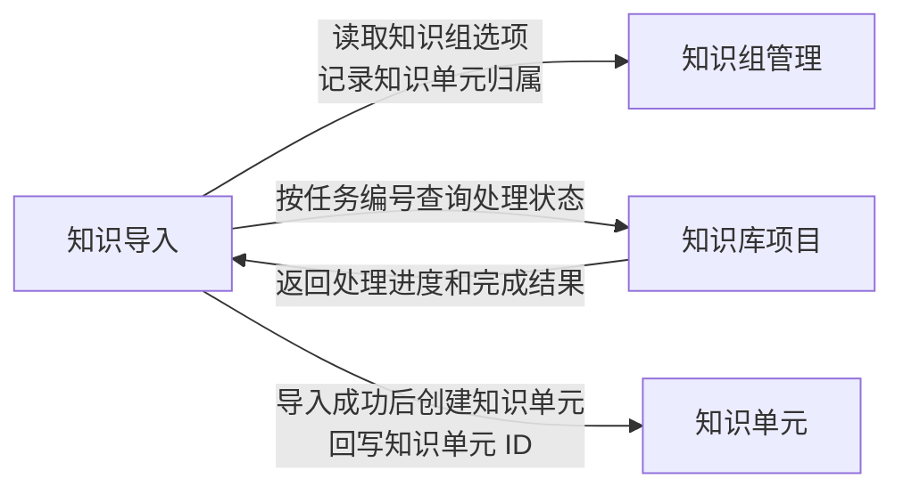
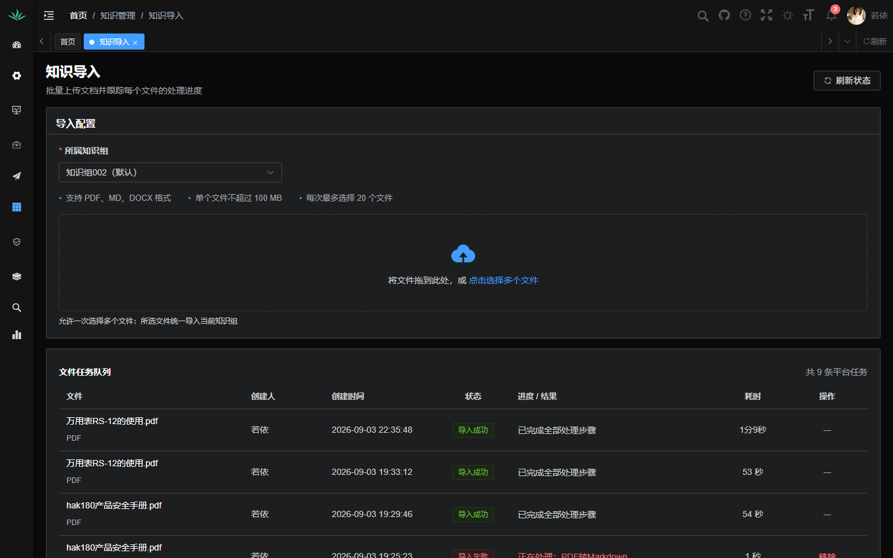
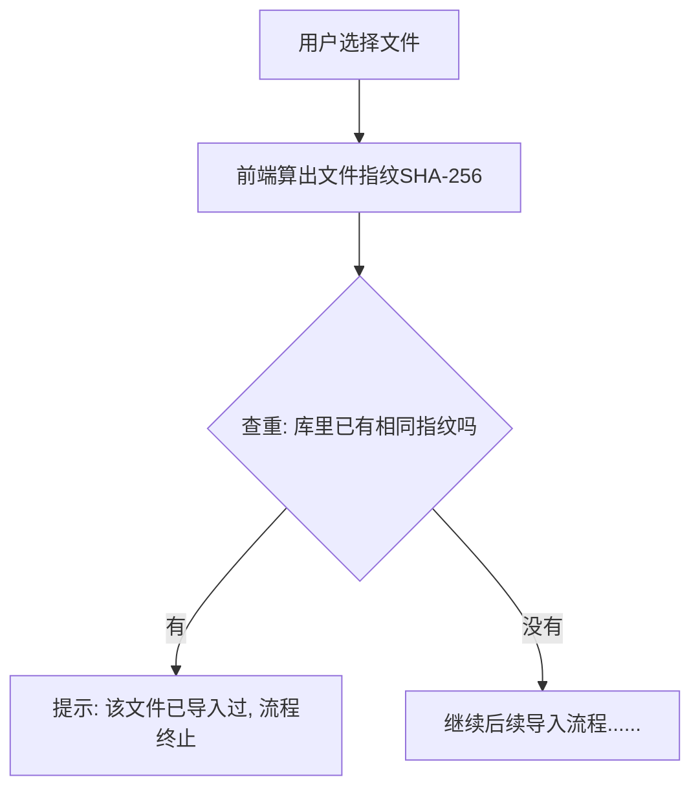
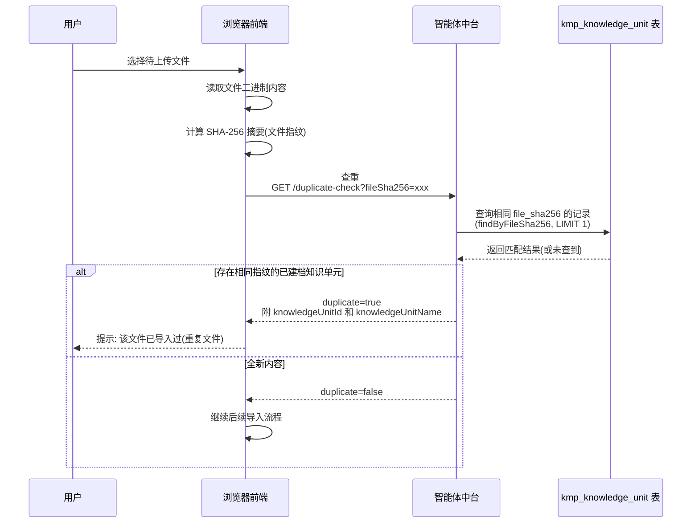
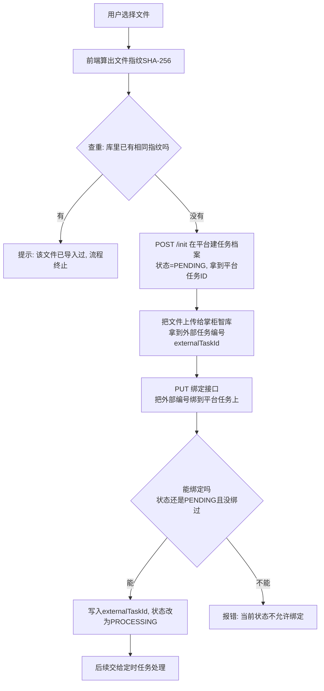
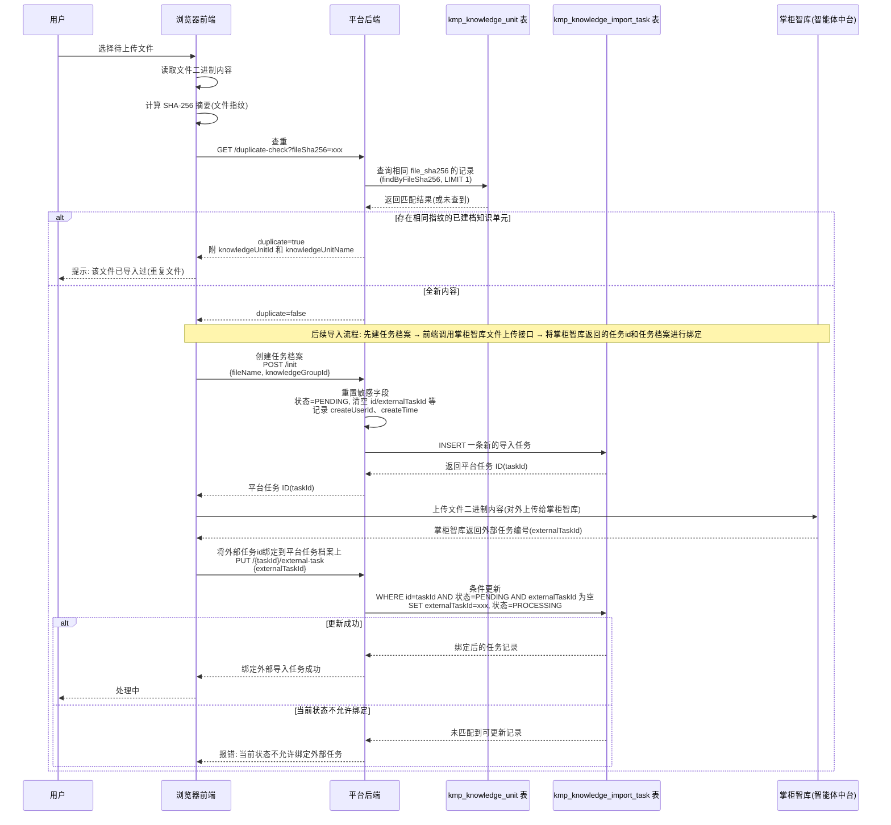
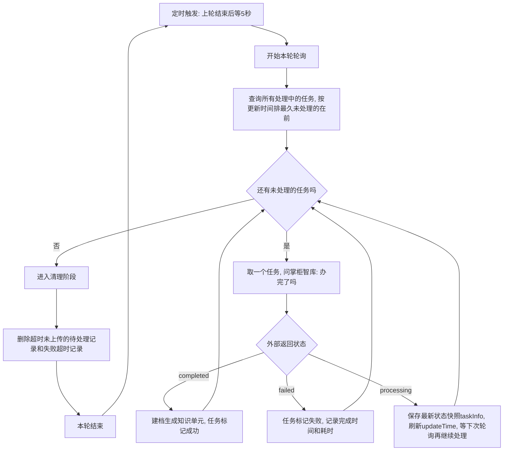

# 第1章 需求分析

## 1.1 与其他模块之间的关系

知识导入模块不保存文档正文。它更像一本任务流水账：先记下“谁准备导入哪个文件”，再持续更新处理状态，成功后交给知识单元模块建档。

下面只看知识导入与业务模块之间的直接关系：



模块之间的关系如下：

- **知识导入 → 知识组管理**：读取可选知识组。知识导入任务保存知识组 ID，确定资料最终属于哪个知识组。
- **知识导入 ↔ 知识库项目**：知识导入按任务编号查询状态；知识库项目返回处理进度和完成结果。
- **知识导入 → 知识单元**：任务成功后创建知识单元，并把新生成的知识单元 ID 回写到导入任务。

## 1.2 核心要点

知识导入页面把知识组选择、批量文件上传和任务状态列表放在一起，运营人员可以直接观察处理中、成功和失败终态：



# 第2章 数据对象

数据表： `kmp_knowledge_import_task`

实体类： `KnowledgeImportTask`

将代码生成器生成的代码补充并优化如下：

```java
package com.atguigu.kmp.entity;

import com.baomidou.mybatisplus.annotation.*;
import com.fasterxml.jackson.annotation.JsonFormat;
import com.fasterxml.jackson.annotation.JsonInclude;
import jakarta.validation.constraints.Max;
import jakarta.validation.constraints.Min;
import jakarta.validation.constraints.Positive;
import jakarta.validation.constraints.Size;
import lombok.Data;

import java.io.Serializable;
import java.time.LocalDateTime;

/**
 * 知识导入任务实体。
 */
@Data
@TableName("kmp_knowledge_import_task")
@JsonInclude(JsonInclude.Include.NON_NULL)
public class KnowledgeImportTask implements Serializable {

    private static final long serialVersionUID = 1L;

    /**
     * 平台导入任务主键
     */
    @TableId(value = "id", type = IdType.AUTO)
    @Positive(message = "知识导入任务 ID 不正确")
    private Long id;

    /**
     * 本次导入选择的知识组ID
     */
    private Long knowledgeGroupId;

    /**
     * 导入成功后创建的平台知识单元ID
     */
    private Long knowledgeUnitId;

    /**
     * 原始文件名
     */
    @Size(max = 128, message = "文件名不能超过128个字符")
    private String fileName;

    /**
     * 外部知识库任务编号
     */
    @Size(max = 128, message = "外部任务编号不能超过128个字符")
    private String externalTaskId;

    /**
     * 任务状态：0-待上传，1-上传中，2-处理中，3-导入成功，4-导入失败
     */
    @Min(value = 0, message = "任务状态不正确")
    @Max(value = 4, message = "任务状态不正确")
    private Integer taskStatus;

    /**
     * 外部任务完整信息JSON
     */
    @Size(max = 1000, message = "任务信息不能超过1000个字符")
    // 即使是NULL值，update时也要写进SQL语句中
    @TableField(updateStrategy = FieldStrategy.ALWAYS)
    private String taskInfo;

    /**
     * 失败原因
     */
    @Size(max = 1000, message = "失败原因不能超过1000个字符")
    // 即使是NULL值，update时也要写进SQL语句中
    @TableField(updateStrategy = FieldStrategy.ALWAYS)
    private String failureReason;

    /**
     * 平台首次同步到终态的时间
     */
    @JsonFormat(pattern = "yyyy-MM-dd HH:mm:ss")
    private LocalDateTime finishTime;

    /**
     * 平台可观测耗时，单位毫秒
     */
    private Long durationMs;

    /**
     * 创建人用户ID
     */
    private Long createUserId;

    /**
     * 创建时间
     */
    @JsonFormat(pattern = "yyyy-MM-dd HH:mm:ss")
    private LocalDateTime createTime;

    /**
     * 最后修改人用户ID
     */
    private Long updateUserId;

    /**
     * 最后修改时间
     */
    @JsonFormat(pattern = "yyyy-MM-dd HH:mm:ss")
    private LocalDateTime updateTime;

    /**
     * 逻辑删除：0-未删除，1-已删除
     */
    @TableLogic
    private Integer isDeleted;

    /**
     * 创建人名称，仅用于列表展示，不映射数据库字段。
     */
    @TableField(exist = false)
    private String createUserName;
}
```

# 第3章 功能一：导入任务分页列表

## 3.1 接口定义

| 项目     | 内容                            |
| -------- | ------------------------------- |
| 接口功能 | 分页查询未删除的导入任务        |
| 接口路径 | `/kmp/knowledgeImportTask/list` |
| 请求方式 | `GET`                           |
| 接口参数 | `pageNum`、`pageSize`           |
| 返回值   | `TableDataInfo`                 |
| 权限     | `kmp:knowledgeImport:list`      |

## 3.2 功能实现

### 3.2.1 Controller

步骤：

1. 在`KnowledgeImportTaskController`原来的 `@RequestMapping` 中添加 `kmp` 前缀：

```java
@RequestMapping("/kmp/knowledgeImportTask")
```

2. 添加`knowledgeImportTaskService`依赖注入：

```java
@Autowired
private KnowledgeImportTaskService knowledgeImportTaskService;
```

3. 添加`list`方法：

```java
/**
 * 分页查询平台知识导入任务。
 *
 * @return 若依分页响应
 */
@PreAuthorize("@ss.hasPermi('kmp:knowledgeImport:list')")
@GetMapping("/list")
public TableDataInfo list()
{
    // 获取分页参数
    PageDomain pageDomain = TableSupport.buildPageRequest();
    // 获取当前页码
    int pageNum = pageDomain.getPageNum();
    // 获取每页大小
    int pageSize = pageDomain.getPageSize();

    // 创建分页对象
    Page<KnowledgeImportTask> page = new Page<>(pageNum, pageSize);

    // 调用服务层方法进行分页查询
    IPage<KnowledgeImportTask> result = knowledgeImportTaskService.pageImportTasks(page);

    // 创建响应对象
    TableDataInfo response = new TableDataInfo(result.getRecords(), result.getTotal());

    // 设置响应数据
    response.setCode(HttpStatus.SUCCESS);
    response.setMsg("查询成功");
    return response;
}
```

分页参数也可以这样获取

```java
public TableDataInfo list(HttpServletRequest request)
{
    // 获取当前页码
    int pageNum = Integer.parseInt(request.getParameter("pageNum"));
    // 获取每页大小
    int pageSize = Integer.parseInt(request.getParameter("pageSize"));
    
    ...
}
```

### 3.2.2 Service

在 `KnowledgeImportTaskService`接口定义分页查询方法：

```java
/**
 * 分页查询未删除的导入任务并补充创建人名称。
 *
 * @param page MyBatis-Plus 分页参数
 * @return 导入任务分页数据
 */
IPage<KnowledgeImportTask> pageImportTasks(Page<KnowledgeImportTask> page);
```

### 3.2.3 ServiceImpl

1. 在`KnowledgeUnitServiceImpl`类上添加日志注解：

```jaba
@Slf4j // 日志
```

2. 在 `KnowledgeUnitServiceImpl`中实现方法：

```java
@Autowired
private ISysUserService sysUserService;

/**
 * {@inheritDoc}
 */
@Override
public IPage<KnowledgeImportTask> pageImportTasks(Page<KnowledgeImportTask> page) {
    log.info("开始查询知识导入任务");
    LambdaQueryWrapper<KnowledgeImportTask> wrapper = new LambdaQueryWrapper<KnowledgeImportTask>()
            .orderByDesc(KnowledgeImportTask::getCreateTime)
            .orderByDesc(KnowledgeImportTask::getId);

    //执行查询
    IPage<KnowledgeImportTask> result = this.page(page, wrapper);

    //补充用户昵称
    this.fillCreateUserNames(result.getRecords());
    return result;
}

/**
 * 批量补充当前页创建人名称，避免同一用户被重复查询。
 */
private void fillCreateUserNames(List<KnowledgeImportTask> taskList) {
    Map<Long, String> userNameMap = new HashMap<>();
    for (KnowledgeImportTask task : taskList) {
        Long createUserId = task.getCreateUserId();
        if (!userNameMap.containsKey(createUserId)) {
            SysUser user = sysUserService.selectUserById(createUserId);
            userNameMap.put(createUserId, user.getNickName());
        }
        task.setCreateUserName(userNameMap.get(createUserId));
    }
}
```

# 第4章 功能二：文件摘要重复检查

## 4.1 接口定义

重复检查属于导入入口：

| 项目     | 内容                                                         |
| -------- | ------------------------------------------------------------ |
| 接口路径 | `/kmp/knowledgeImportTask/duplicate-check`                   |
| 请求方式 | `GET`                                                        |
| 接口参数 | `fileSha256`                                                 |
| 返回值   | 布尔值`duplicate`，重复时同时返回已有单元 ID `knowledgeUnitId` 和名称 `knowledgeUnitName` |
| 权限     | `kmp:knowledgeImport:import`                                 |

**接口的作用：**

在平台里,每导入一个文件,就会创建一个对应的知识单元。所以上传前我们需要先问一句:这份内容的文件,是不是已经有人导入过了?如果重复导入,既浪费存储,也会产生重复的知识库。

**实现思路：**

怎么判断"内容相同"呢?靠 SHA-256 摘要。它相当于给文件提取"指纹":只要文件内容完全一样,不管文件名是什么、在哪个电脑上,算出来的摘要字符串一定相同;内容哪怕只改了一个字,摘要也会面目全非。反过来,拿两个不同的文件"提取"出同一个指纹,在现实中几乎不可能发生。

**处理步骤:**

1. 用户在浏览器中选择文件后,上传前,浏览器先针对每个文件的二进制内容计算出 SHA-256 摘要字符串;
2. 前端把摘要字符串作为参数(fileSha256),逐个文件调用当前接口,传给智能体中台;
3. 中台拿着这个"指纹"去知识单元表里查询:有没有已经建档的知识单元,记录的文件指纹和它一模一样;
4. 如果查到了,说明这个文件已经导入过,接口返回 duplicate = true,并附上已有知识单元的 ID 和名称,前端就可以提示用户"重复文件";如果没查到,只返回 duplicate = false,前端放行,继续走正常的上传导入流程。

总结:这个接口就是导入前的"查重门禁"——用文件指纹判断内容是否已建档,避免同一份文件被重复导入。

**核心流程：**




**时序图：**



## 4.2 功能实现

### 4.2.1 Controller

在`KnowledgeImportTaskController`中注入 `knowledgeUnitService`， 添加 `duplicate-check` 接口

```java
@Autowired
private KnowledgeUnitService knowledgeUnitService;

/**
 * 在初始化平台任务前检查文件摘要是否已建档。
 *
 * @param fileSha256 64位小写 SHA-256
 * @return 重复标志及已有知识单元摘要信息
 */
@PreAuthorize("@ss.hasPermi('kmp:knowledgeImport:import')")
@GetMapping("/duplicate-check")
public AjaxResult duplicateCheck(@RequestParam String fileSha256)
{
    // sha256相当于文件的指纹，比较指纹相同则说明 知识单元 重复
    KnowledgeUnit duplicateUnit = knowledgeUnitService.findByFileSha256(fileSha256);
    Map<String, Object> result = new HashMap<>();

    // != null 说明 知识单元 重复
    result.put("duplicate", duplicateUnit != null);
    if (duplicateUnit != null)
    {
        // 知识单元 重复，则返回 知识单元 ID 和 知识单元名称
        result.put("knowledgeUnitId", duplicateUnit.getId());
        result.put("knowledgeUnitName", duplicateUnit.getKnowledgeUnitName());
    }
    return AjaxResult.success(result);
}
```

### 4.2.2 Service

在 `KnowledgeUnitService`接口定义方法：

```java
/**
 * 查询文件摘要对应的已有知识单元。
 *
 * @param fileSha256 文件摘要
 * @return 只含 ID 和名称的知识单元，不重复时为 null
 */
KnowledgeUnit findByFileSha256(String fileSha256);
```

### 4.2.3 ServiceImpl

在 `KnowledgeUnitServiceImpl`中实现方法：

```java
/** {@inheritDoc} */
@Override
public KnowledgeUnit findByFileSha256(String fileSha256)
{
    return this.lambdaQuery()
            .select(KnowledgeUnit::getId, KnowledgeUnit::getKnowledgeUnitName)
            .eq(KnowledgeUnit::getFileSha256, fileSha256)
            .last("LIMIT 1")
            .one();
}
```

**"规范化"两步走：**

```java
String normalizedSha256 = fileSha256 == null ? null : fileSha256.trim().toLowerCase();
```

处理顺序是:

1. **`trim()`**:顺手掐掉首尾空格。前端从输入框、URL 参数取值时经常带着看不见的空格;
2. **`toLowerCase()`**:把大写 hex 字母自动转小写。`A3F5...` 先"统一笔迹"变成 `a3f5...`,再去过正则安检。

也就是:**"我要求小写,你要是不小心传了大写,我帮你改对"**。


**注意：**实体配置了逻辑删除，因此这里只会匹配未删除记录。已经删除的同内容文件允许重新导入。

# 第5章 功能三：初始化平台任务

## 5.1 接口定义

| 项目     | 内容                               |
| -------- | ---------------------------------- |
| 接口功能 | 在后续处理开始前创建一条待上传任务 |
| 接口路径 | `/kmp/knowledgeImportTask/init`    |
| 请求方式 | `POST`                             |
| 请求体   | `fileName`、`knowledgeGroupId`     |
| 返回值   | 新生成的平台任务 ID                |
| 权限     | `kmp:knowledgeImport:import`       |

请求示例：

```json
{
  "fileName": "产品使用手册.pdf",
  "knowledgeGroupId": 12
}
```

**接口的作用：**

当用户准备导入一个文件时(前端先调用 /duplicate-check 根据摘要确认没重复上传过),在真正上传文件之前,先在`知识导入任务表 - kmp_knowledge_import_task`里登记一条状态为 `PENDING - 待上传` 的任务记录,拿到一个平台任务 ID。因为导入是耗时长流程,平台采用 **"先建任务档案 → 前端调用掌柜智库文件上传接口 → 将掌柜智库返回的任务id和任务档案进行绑定 "** 的异步方式跟踪,而这个接口负责的就是**建档**。

## 5.2 功能实现

### 5.2.1 Controller

在`KnowledgeImportTaskController`中添加 `init` 方法：

```java
/**
 * 在文件对外上传前初始化平台任务。
 *
 * @param task 文件名和知识组 ID
 * @return 平台任务 ID
 */
@PreAuthorize("@ss.hasPermi('kmp:knowledgeImport:import')")
@Log(title = "知识导入", businessType = BusinessType.IMPORT)
@PostMapping("/init")
public AjaxResult init(@RequestBody KnowledgeImportTask task)
{
    Long taskId = knowledgeImportTaskService.initImportTask(task, this.getUserId());
    return AjaxResult.success("初始化知识导入任务成功", taskId);
}
```

### 5.2.2 Service

在 `KnowledgeImportTaskService`接口定义方法：

```java
/**
 * 在文件对外上传前初始化平台任务。
 *
 * @param task 文件名和知识组信息
 * @param userId 当前用户 ID
 * @return 平台任务 ID
 */
Long initImportTask(KnowledgeImportTask task, Long userId);
```

### 5.2.3 ServiceImpl

1. 复制资料中的常量包 `constant` 放在项目的 `com.atguigu.kmp` 包中

2. 在 `KnowledgeImportTaskServiceImpl`中实现方法：

```java
/** {@inheritDoc} */
@Override
public Long initImportTask(KnowledgeImportTask task, Long userId)
{
    log.info("开始初始化知识导入任务");

    // 初始化接口只接受文件名和知识组，其余字段全部由平台重置，防止客户端越权赋值。
    // 这样做是在划安全边界：调用方可以说明“文件叫什么、放进哪个组”，但不能伪造任务 ID、处理状态、创建人和完成时间。
    LocalDateTime now = LocalDateTime.now();
    task.setId(null);
    task.setKnowledgeUnitId(null);
    task.setExternalTaskId(null);
    task.setTaskStatus(KnowledgeImportConstants.TASK_STATUS_PENDING);
    task.setTaskInfo(null);
    task.setFailureReason(null);
    task.setFinishTime(null);
    task.setDurationMs(null);
    task.setCreateUserId(userId);
    task.setCreateTime(now);
    task.setUpdateUserId(null);
    task.setUpdateTime(null);
    task.setIsDeleted(0);
    task.setCreateUserName(null);
    this.save(task);
    return task.getId();

//        KnowledgeImportTask knowledgeImportTask = new KnowledgeImportTask();
//        knowledgeImportTask.setFileName(task.getFileName());
//        knowledgeImportTask.setKnowledgeGroupId(task.getKnowledgeGroupId());
//        knowledgeImportTask.setTaskStatus(KnowledgeImportConstants.TASK_STATUS_PENDING);
//        knowledgeImportTask.setCreateUserId(userId);
//        knowledgeImportTask.setCreateTime(now);
//        knowledgeImportTask.setIsDeleted(0);
//        this.save(knowledgeImportTask);
//        return knowledgeImportTask.getId();
}
```


# 第6章 功能四：绑定外部任务编号

## 6.1 接口定义

| 项目     | 内容                                          |
| -------- | --------------------------------------------- |
| 接口路径 | `/kmp/knowledgeImportTask/{id}/external-task` |
| 请求方式 | `PUT`                                         |
| 路径参数 | 平台任务 ID `id`                              |
| 请求体   | `externalTaskId`                              |
| 返回值   | 绑定后的平台任务                              |
| 权限     | `kmp:knowledgeImport:import`                  |

**核心流程：**



 **时序图：**



## 6.2 功能实现

###  6.2.1 Controller

在`KnowledgeImportTaskController`中添加绑定方法：

```java
/**
 * 将外部服务返回的任务编号绑定到原平台任务。
 *
 * @param id 平台任务 ID
 * @param task 外部任务编号
 * @return 绑定后的平台任务
 */
@PreAuthorize("@ss.hasPermi('kmp:knowledgeImport:import')")
@Log(title = "知识导入", businessType = BusinessType.UPDATE)
@PutMapping("/{id}/external-task")
public AjaxResult bindExternalTask(@PathVariable Long id,
                                   @RequestBody KnowledgeImportTask task)
{
    KnowledgeImportTask boundTask = knowledgeImportTaskService.bindExternalTask(
            id,
            task.getExternalTaskId(),
            this.getUserId()
    );
    return AjaxResult.success("绑定外部导入任务成功", boundTask);
}
```

### 6.2.2 Service

在 `KnowledgeImportTaskService`接口定义方法：

```java
/**
 * 将外部服务返回的任务编号绑定到原平台任务。
 *
 * @param id 平台任务 ID
 * @param externalTaskId 外部任务编号
 * @param userId 当前用户 ID
 * @return 绑定后的任务
 */
KnowledgeImportTask bindExternalTask(Long id, String externalTaskId, Long userId);
```

### 6.2.3 ServiceImpl

```java
/** {@inheritDoc} */
@Override
public KnowledgeImportTask bindExternalTask(Long id, String externalTaskId, Long userId)
{
    log.info("开始绑定外部知识导入任务，taskId={}，externalTaskId={}", id, externalTaskId);

    LocalDateTime now = LocalDateTime.now();
    boolean updated = lambdaUpdate()
            .eq(KnowledgeImportTask::getId, id)
            .eq(KnowledgeImportTask::getTaskStatus, KnowledgeImportConstants.TASK_STATUS_PENDING)
            .isNull(KnowledgeImportTask::getExternalTaskId)
            .set(KnowledgeImportTask::getExternalTaskId, externalTaskId)
            .set(KnowledgeImportTask::getTaskStatus, KnowledgeImportConstants.TASK_STATUS_PROCESSING)
            .set(KnowledgeImportTask::getUpdateUserId, userId)
            .set(KnowledgeImportTask::getUpdateTime, now)
            .update();
    if (!updated)
    {
        throw new ServiceException("当前状态不允许绑定外部任务");
    }
    return this.getById(id);
}
```

# 第7章 功能五：定时同步处理状态

## 7.1 核心流程

这个定时任务就像一个每 5 秒执行一次——先看一眼"掌柜智库中的文件上传成功了没有"（成功了就在服务中台创建知识单元，不成功就标记失败），再顺手"清理垃圾"（把那些创建了半天一直没上传的废弃记录删掉），然后休息 5 秒，开始下一轮任务的执行



## 7.2 功能实现

### 7.2.1 定义导入状态响应对象

创建 `ExternalKnowledgeTaskStatus` 类

```java
package com.atguigu.kmp.dto;

import com.fasterxml.jackson.annotation.JsonProperty;
import lombok.Data;

import java.io.Serializable;
import java.util.ArrayList;
import java.util.List;

/**
 * 外部知识库任务状态响应。
 *
 * <p>该对象只承载 Python 服务的接口契约，不映射平台数据库表。</p>
 */
@Data
public class ExternalKnowledgeTaskStatus implements Serializable
{
    private static final long serialVersionUID = 1L;

    /** 外部状态：processing、completed 或 failed。 */
    @JsonProperty("status")
    private String status;

    /** 已完成节点，保持外部服务返回顺序。 */
    @JsonProperty("done_list")
    private List<String> doneList = new ArrayList<>();

    /** 正在运行节点，保持外部服务返回顺序。 */
    @JsonProperty("running_list")
    private List<String> runningList = new ArrayList<>();

    /** 外部任务完成后用于平台建档。 */
    @JsonProperty("result")
    private Result result;

    /**
     * 外部导入完成态结果。
     */
    @Data
    public static class Result implements Serializable
    {
        private static final long serialVersionUID = 1L;

        /** 外部保存首批切片前生成的文档 ID。 */
        @JsonProperty("document_id")
        private String documentId;

        /** 外部知识库从文档内容识别出的知识单元名称。 */
        @JsonProperty("item_name")
        private String itemName;

        /** MinIO 对象路径，以斜杠开头且不包访问端点。 */
        @JsonProperty("original_file_download_url")
        private String originalFileDownloadUrl;

        /** 原始文件 SHA-256 小写摘要。 */
        @JsonProperty("file_sha256")
        private String fileSha256;

        /** 导入后有效切片数量。 */
        @JsonProperty("chunk_count")
        private Long chunkCount;

        /** 导入后全部切片文本总长度。 */
        @JsonProperty("total_text_length")
        private Long totalTextLength;
    }
}

```

### 7.2.2 相关配置

在配置类`KmpConfig`中增加定时任务相关配置与http客户端：

```java
@Value("${kmp.knowledge-import.poll-interval-ms:5000}")
private long knowledgeImportPollIntervalMs;

@Value("${kmp.knowledge-import.batch-size:100}")
private int knowledgeImportBatchSize;

@Value("${kmp.knowledge-import.pending-expire-minutes:30}")
private long knowledgeImportPendingExpireMinutes;


@Value("${kmp.knowledge-system.base-url}")
private String knowledgeSystemBaseUrl;

@Value("${kmp.knowledge-system.connect-timeout}")
private Duration knowledgeSystemConnectTimeout;

@Value("${kmp.knowledge-system.read-timeout}")
private Duration knowledgeSystemReadTimeout;

/**
 * RestClient客户端：调用知识库接口
 *
 * @return RestClient
 */
@Bean("knowledgeSystemRestClient")
public RestClient knowledgeSystemRestClient()
{
    SimpleClientHttpRequestFactory requestFactory = new SimpleClientHttpRequestFactory();
    requestFactory.setConnectTimeout(knowledgeSystemConnectTimeout);
    requestFactory.setReadTimeout(knowledgeSystemReadTimeout);

    return RestClient
            .builder()
            .requestFactory(requestFactory)
            .baseUrl(knowledgeSystemBaseUrl)
            .build();
}
```

### 7.2.3 开启定时任务

1. 开启调度，在类 `KmpConfig`中添加 `@EnableScheduling`注解：

```java
import org.springframework.scheduling.annotation.EnableScheduling;

//这是一个"全局开关"，它启用的是整个应用上下文的定时任务能力
@EnableScheduling
```

2. 创建Spring定时器

新增 Spring 定时入口 `KnowledgeImportPollingTask`：

```java
package com.atguigu.kmp.task;

import com.atguigu.kmp.service.KnowledgeImportTaskService;
import lombok.extern.slf4j.Slf4j;
import org.springframework.beans.factory.annotation.Autowired;
import org.springframework.scheduling.annotation.Scheduled;
import org.springframework.stereotype.Component;

/**
 * 知识导入后台轮询任务。
 */
@Slf4j
@Component
class KnowledgeImportPollingTask
{
    @Autowired
    private KnowledgeImportTaskService knowledgeImportTaskService;

    /**
     * 同步处理中任务，并清理长时间未绑定的待上传记录。
     *
     * |任务执行|---等待5秒---|任务执行|---等待5秒---|任务执行|
     * 表示“上一次执行结束后再等5 秒”。它不会机械地每 5 秒叠加一个新任务。
     */
    @Scheduled(fixedDelayString = "#{@kmpConfig.knowledgeImportPollIntervalMs}") //可以写表达式
    //@Scheduled(fixedDelay=5000) //直接写数值
    public void pollAndCleanImportTasks()
    {
        log.info("开始执行知识导入任务轮询");
        //查看常规值库端的任务额状态
        knowledgeImportTaskService.pollProcessingTasks();
        //清理无效的任务
        knowledgeImportTaskService.cleanInvalidTasks();
        log.info("知识导入任务轮询执行完毕");
    }
}

```

### 7.2.4 Service

在 `KnowledgeImportTaskService` 中定义两个方法

```java
/**
 * 扫描处理中任务并同步外部状态。
 */
void pollProcessingTasks();

/**
 * 扫描处理中任务并同步外部状态。
 */
boolean cleanInvalidTasks();
```

### 7.2.5 ServiceImpl 同步状态

1. 在`KnowledgeImportTaskServiceImpl`中添加如下依赖

```java
@Autowired
private KmpConfig kmpConfig;

@Autowired
@Qualifier("knowledgeSystemRestClient")
private RestClient restClient;

@Autowired
private KnowledgeUnitService knowledgeUnitService;

```

2. 在 `KnowledgeImportTaskServiceImpl`中添加`pollProcessingTasks`方法

只查询状态为处理中且有外部编号的任务。旧任务排在前面，避免它们一直被新任务压住。默认每轮最多处理 100 条，防止一次调度拖得太长。

```java
/** {@inheritDoc} */
@Override
public void pollProcessingTasks()
{
    List<KnowledgeImportTask> processingTaskList = this.lambdaQuery()
            // 查询 处理中 状态的任务
            .eq(KnowledgeImportTask::getTaskStatus, KnowledgeImportConstants.TASK_STATUS_PROCESSING)
            .isNotNull(KnowledgeImportTask::getExternalTaskId)
            .orderByAsc(KnowledgeImportTask::getUpdateTime)
            .orderByAsc(KnowledgeImportTask::getId)
            .last("LIMIT " + kmpConfig.getKnowledgeImportBatchSize())
            .list();
    log.info("开始轮询知识导入任务");
    for (KnowledgeImportTask processingTask : processingTaskList)
    {
        this.processingTask(processingTask);
    }
    log.info("完成轮询知识导入任务");
}
```

3. 定义 `processingTask` 方法

添加 `@Transactional`

```java
/**
 * 根据远程文件上传状态更新本地任务状态，并创建知识单元。
 * @param processingTask
 */
@Transactional(rollbackFor = Exception.class) // @Transactional 不能用于private方法上，因此设置为protected
protected void processProcessingTask(KnowledgeImportTask processingTask) {

    String externalTaskId = processingTask.getExternalTaskId();
    String externalStatusJson = null;
    try
    {
        log.info("开始查询外部知识库任务状态，externalTaskId={}", externalTaskId);
        // Java Client 只做一件事：按任务编号查询掌柜智库上传任务的执行状态。
        RestClient.ResponseSpec responseSpec = restClient.get()
                .uri("/status/{task_id}", externalTaskId)
                .retrieve();
        externalStatusJson = responseSpec.body(String.class);
        ExternalKnowledgeTaskStatus externalStatus = responseSpec.body(ExternalKnowledgeTaskStatus.class);
        log.info("statusResult:{}", externalStatusJson);

        // statusResult 转换成 ExternalKnowledgeTaskStatus

        // 将外部状态映射为平台状态。
        Integer targetStatus = switch (externalStatus.getStatus())
        {
            case "processing" -> KnowledgeImportConstants.TASK_STATUS_PROCESSING;
            case "completed" -> KnowledgeImportConstants.TASK_STATUS_SUCCESS;
            case "failed" -> KnowledgeImportConstants.TASK_STATUS_FAILED;
            // 未知状态按处理中兜底。
            default -> KnowledgeImportConstants.TASK_STATUS_PROCESSING;
        };

        LocalDateTime now = LocalDateTime.now();

        // 判断外部任务是否已完成
        if (KnowledgeImportConstants.TASK_STATUS_SUCCESS.equals(targetStatus))
        {

            // 创建知识单元
            Long knowledgeUnitId = knowledgeUnitService.createFromCompletedImport(processingTask, externalStatus);

            // 修改任务状态为成功。
            LambdaUpdateWrapper<KnowledgeImportTask> taskUpdate = new LambdaUpdateWrapper<KnowledgeImportTask>()
                    .eq(KnowledgeImportTask::getId, processingTask.getId())
                    .eq(KnowledgeImportTask::getTaskStatus, KnowledgeImportConstants.TASK_STATUS_PROCESSING)
                    .isNull(KnowledgeImportTask::getKnowledgeUnitId)
                    .set(KnowledgeImportTask::getKnowledgeUnitId, knowledgeUnitId)
                    .set(KnowledgeImportTask::getTaskStatus, KnowledgeImportConstants.TASK_STATUS_SUCCESS)
                    .set(KnowledgeImportTask::getTaskInfo, externalStatusJson)
                    .set(KnowledgeImportTask::getFailureReason, null)
                    .set(KnowledgeImportTask::getFinishTime, now)
                    .set(KnowledgeImportTask::getUpdateTime, now)
                    .set(KnowledgeImportTask::getDurationMs, Duration.between(processingTask.getCreateTime(), now).toMillis());

            this.update(taskUpdate);

        }
        else
        {
            // 修改任务状态
            LambdaUpdateWrapper<KnowledgeImportTask> updateWrapper = new LambdaUpdateWrapper<KnowledgeImportTask>()
                    .eq(KnowledgeImportTask::getId, processingTask.getId())
                    .eq(KnowledgeImportTask::getTaskStatus, KnowledgeImportConstants.TASK_STATUS_PROCESSING)
                    .set(KnowledgeImportTask::getTaskStatus, targetStatus)
                    .set(KnowledgeImportTask::getTaskInfo, externalStatusJson)
                    .set(KnowledgeImportTask::getFailureReason, null)
                    .set(KnowledgeImportTask::getUpdateTime, now);

            // 判断是否是失败状态（最终状态）
            if (KnowledgeImportConstants.TASK_STATUS_FAILED.equals(targetStatus))
            {
                updateWrapper
                        .set(KnowledgeImportTask::getFinishTime, now) //任务结束时间
                        .set(KnowledgeImportTask::getDurationMs, Duration.between(processingTask.getCreateTime(), now).toMillis()); //耗时
            }

            // 执行更新
            this.update(updateWrapper);
        }
    }
    catch (Exception e)
    {
        log.error("处理知识导入任务异常，externalTaskId={}", externalTaskId, e);
        this.markImportTaskFailed(processingTask, externalStatusJson, "处理知识导入任务异常");
    }
}
```

3. 定义`markImportTaskFailed`方法

```java
/**
 * 出现异常时修改任务状态为失败
 * @param task
 * @param externalStatusJson
 * @param failureReason
 */
private void markImportTaskFailed(KnowledgeImportTask task, String externalStatusJson, String failureReason)
{
    LocalDateTime now = LocalDateTime.now();
    LambdaUpdateWrapper<KnowledgeImportTask> updateWrapper =
            new LambdaUpdateWrapper<KnowledgeImportTask>()
                    .eq(KnowledgeImportTask::getId, task.getId())
                    .eq(KnowledgeImportTask::getTaskStatus, KnowledgeImportConstants.TASK_STATUS_PROCESSING)
                    .isNull(KnowledgeImportTask::getKnowledgeUnitId)
                    .set(KnowledgeImportTask::getTaskStatus, KnowledgeImportConstants.TASK_STATUS_FAILED)
                    .set(KnowledgeImportTask::getTaskInfo, externalStatusJson)
                    .set(KnowledgeImportTask::getFailureReason, failureReason)
                    .set(KnowledgeImportTask::getFinishTime, now)
                    .set(KnowledgeImportTask::getDurationMs, Duration.between(task.getCreateTime(), now).toMillis())
                    .set(KnowledgeImportTask::getUpdateTime, now);
    this.update(updateWrapper);
}
```

4. 在`KnowledgeUnitService`中添加方法定义

```java
/**
 * 创建知识单元。
 *
 * @param task 轮询时的导入任务
 * @param externalStatus 外部完成态
 * @return 知识单元 ID
 */
Long createFromCompletedImport(KnowledgeImportTask task, ExternalKnowledgeTaskStatus externalStatus);
```

5. 在`KnowledgeUnitServiceImpl`中实现方法

```java
/** {@inheritDoc} */
@Override
public Long createFromCompletedImport(KnowledgeImportTask task, ExternalKnowledgeTaskStatus externalStatus)
{
    ExternalKnowledgeTaskStatus.Result result = externalStatus.getResult();

    KnowledgeUnit knowledgeUnit = new KnowledgeUnit();
    knowledgeUnit.setDocumentId(result.getDocumentId());
    knowledgeUnit.setKnowledgeGroupId(task.getKnowledgeGroupId());
    knowledgeUnit.setKnowledgeUnitName(result.getItemName());
    knowledgeUnit.setOriginalFileName(task.getFileName());
    knowledgeUnit.setFileSha256(result.getFileSha256());
    knowledgeUnit.setOriginalFileDownloadUrl(result.getOriginalFileDownloadUrl());
    knowledgeUnit.setChunkCount(result.getChunkCount());
    knowledgeUnit.setTotalTextLength(result.getTotalTextLength());
    knowledgeUnit.setCreateUserId(task.getCreateUserId());
    knowledgeUnit.setCreateTime(LocalDateTime.now());
    knowledgeUnit.setIsDeleted(0);

    this.save(knowledgeUnit);
    return knowledgeUnit.getId();
}
```

### 7.2.6 ServiceImpl 清理任务

初始化成功后，如果一直没有绑定外部任务编号，会留下待上传记录。定时清理以下任务：

1. 状态仍为待上传。
2. `externalTaskId` 仍为空。
3. 创建时间早于过期时间。默认过期时间为 30 分钟。

或

状态为失败 且 创建时间早于过期时间

```java
/** {@inheritDoc} */
@Override
public boolean cleanInvalidTasks() {
    log.info("开始清理无用任务");

    LocalDateTime now = LocalDateTime.now();
    LocalDateTime expireTime = now.minusMinutes(kmpConfig.getKnowledgeImportExpireMinutes());

    LambdaQueryWrapper<KnowledgeImportTask> queryWrapper = new LambdaQueryWrapper<>();
    queryWrapper
            .and(wrapper -> wrapper
                    .eq(KnowledgeImportTask::getTaskStatus, KnowledgeImportConstants.TASK_STATUS_PENDING)
                    .isNull(KnowledgeImportTask::getExternalTaskId)
                    .lt(KnowledgeImportTask::getCreateTime, expireTime))
            .or(wrapper -> wrapper
                    .eq(KnowledgeImportTask::getTaskStatus, KnowledgeImportConstants.TASK_STATUS_FAILED)
                    .lt(KnowledgeImportTask::getCreateTime, expireTime));


    return this.remove(queryWrapper);
}
```

# 第8章 功能六：手工移除导入任务

## 8.1 接口定义

| 项目     | 内容                            |
| -------- | ------------------------------- |
| 接口功能 | 逻辑移除允许删除的导入任务      |
| 接口路径 | `/kmp/knowledgeImportTask/{id}` |
| 请求方式 | `DELETE`                        |
| 路径参数 | 平台任务 ID `id`                |
| 返回值   | 移除成功提示                    |
| 权限     | `kmp:knowledgeImport:remove`    |

能移除的只有：导入失败任务和待上传的任务（例如，掌柜智库没有启动）。

导入成功任务和处理中任务都不允许移除。

## 8.2 功能实现 

这段代码体现了最终业务口径。不要根据原型中的按钮位置推断删除范围，Java Service 的状态判断才是真正的后端规则。

### 8.2.1 Controller

```java
/**
 * 逻辑移除未绑定待上传任务或导入失败任务。
 *
 * @param id 平台任务 ID
 * @return 移除结果
 */
@PreAuthorize("@ss.hasPermi('kmp:knowledgeImport:remove')")
@Log(title = "知识导入", businessType = BusinessType.DELETE)
@DeleteMapping("/{id}")
public AjaxResult remove(@PathVariable Long id)
{
    knowledgeImportTaskService.removeImportTask(id);
    return AjaxResult.success("移除知识导入任务成功");
}
```

### 8.2.2 Service

```java
/**
 * 逻辑移除未绑定的待上传任务或导入失败任务。
 *
 * @param id 平台任务 ID
 * @return 是否移除成功
 */
boolean removeImportTask(Long id);
```

### 8.2.3 ServiceImpl

```java
/** {@inheritDoc} */
@Override
public boolean removeImportTask(Long id)
{
    log.info("开始移除知识导入任务");
    KnowledgeImportTask task = this.getById(id);

    boolean pendingAndUnbound = KnowledgeImportConstants.TASK_STATUS_PENDING.equals(task.getTaskStatus())
            && task.getExternalTaskId() == null;
    boolean failed = KnowledgeImportConstants.TASK_STATUS_FAILED.equals(task.getTaskStatus());
    if (!pendingAndUnbound && !failed)
    {
        throw new ServiceException("当前状态不允许移除");
    }

    
    LambdaQueryWrapper<KnowledgeImportTask> queryWrapper = new LambdaQueryWrapper<KnowledgeImportTask>()
            .eq(KnowledgeImportTask::getId, id);
    		// 防止定时任务已经把当前task对象的status属性改成SUCCES后，此处将数据删除
            .eq(KnowledgeImportTask::getTaskStatus, task.getTaskStatus());

    return this.remove(queryWrapper);
}
```
