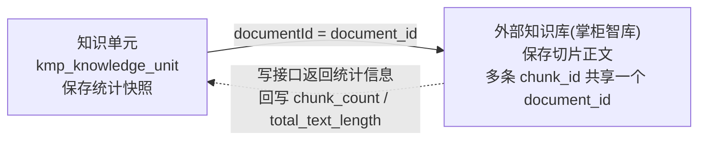
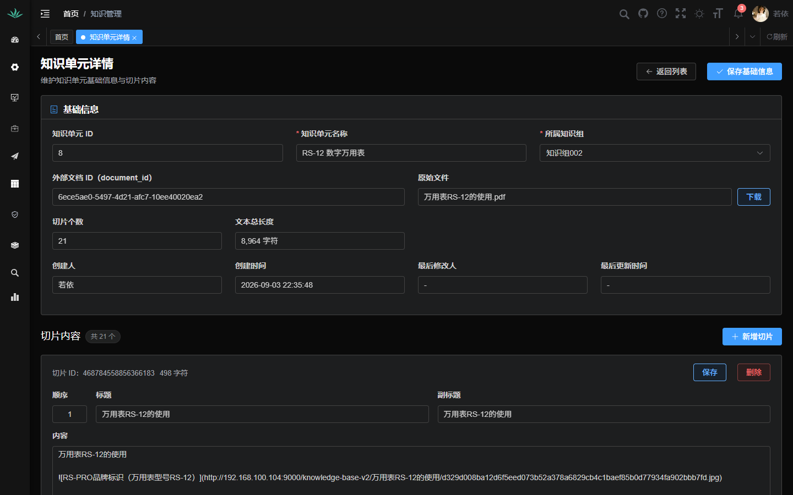
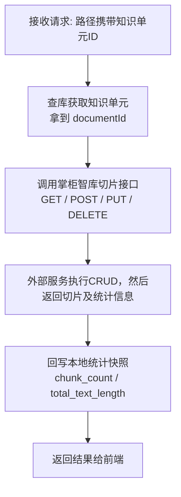
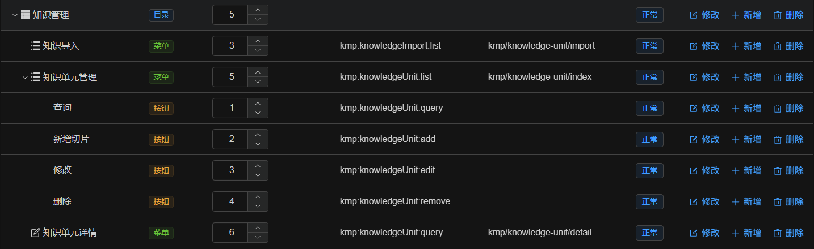

# 第1章 需求分析

知识切片可以理解为“一份文档拆出来的若干段落”。切片正文**不存在 MySQL**中，而是保存在外部知识库（掌柜智库）中；平台只在 `kmp_knowledge_unit` 表保存统计快照（切片数量 `chunkCount`、文本总长度 `totalTextLength`）。

平台对切片做查询、新增、修改、删除时，都不直接操作数据库表，而是凭 `KnowledgeUnit.documentId`（对应知识库的 `document_id`）通过 HTTP 调用掌柜智库接口，再由外部服务返回**统计信息**，回写本地快照。



页面提供列表、新增、保存和删除入口：编辑模式下，每个切片卡片可以提交自身的顺序、标题、副标题和正文。



五个接口共用的处理主线：



# 第2章 菜单树

切片维护的功能按钮的配置和知识单元使用同一套



# 第3章 数据对象

切片不落本地表，因此没有对应的实体类和 Mapper，只有三个 DTO（放在 `atguigu-kmp` 模块的 `dto` 包中）：

| 类 | 作用 |
| --- | --- |
| `com.atguigu.kmp.dto.KnowledgeChunk` | 单个切片的契约对象（请求体和响应体共用） |
| `com.atguigu.kmp.dto.KnowledgeChunkPageResponse` | 分页查询切片的响应对象（原文档缺失，此处补充） |
| `com.atguigu.kmp.dto.DeleteDocumentChunksResponse` | 批量删除文档全部切片的响应对象（第8章删除知识单元时使用） |

## 3.1 切片契约 KnowledgeChunk

掌柜智库的 JSON 字段是下划线风格（`chunk_id`、`document_id` 等），与 Java 驼峰属性对不上，所以每个对应字段都要用 `@JsonProperty` 声明外部名称。

```java
package com.atguigu.kmp.dto;

import com.fasterxml.jackson.annotation.JsonAlias;
import com.fasterxml.jackson.annotation.JsonInclude;
import com.fasterxml.jackson.annotation.JsonProperty;
import lombok.Data;

import java.io.Serializable;

/**
 * 外部知识库切片契约。
 *
 * <p>该对象不映射平台数据表</p>
 */
@Data
@JsonInclude(JsonInclude.Include.NON_NULL)
public class KnowledgeChunk implements Serializable
{
    private static final long serialVersionUID = 1L;

    /** 切片 ID。 */
    @JsonProperty("chunk_id")
    private String chunkId;

    /** 外部文档 ID，从知识单元读取。 */
    @JsonProperty("document_id")
    private String documentId;

    /**
     * 切片展示顺序。
     *
     * <p>@JsonProperty：定义该字段在 JSON 中的正式名称为下划线格式 chunk_order，
     * 同时作用于「序列化(输出)」和「反序列化(接收)」两个方向。
     * 之所以要指定，是因为后端对接的外部知识库使用下划线命名。</p>
     *
     * <p>@JsonAlias：仅在「反序列化(接收)」时额外接受的别名，这里允许前端用驼峰格式 chunkOrder 传值。
     * 注意：别名只影响入参，不影响输出——返回给前端时仍然是 chunk_order。</p>
     */
    @JsonProperty("chunk_order") // JSON 正式字段名（下划线），控制输入与输出两个方向
    @JsonAlias("chunkOrder")    // 接收时的兼容别名（驼峰），仅用于入参反序列化
    private Long chunkOrder;

    /** 切片标题。 */
    private String title;

    /** 切片父标题。 */
    @JsonProperty("parent_title") //输出时前端需要的是下划线格式
    @JsonAlias("parentTitle") //输出时前端需要的是驼峰格式
    private String parentTitle;

    /** 切片完整正文。 */
    private String content;

    /** 外部服务计算的正文长度。 */
    @JsonProperty("content_length")
    private Long contentLength;

    /** 变更后的文档切片数。 */
    @JsonProperty("chunk_count")
    private Long chunkCount;

    /** 变更后的文档文本总长度。 */
    @JsonProperty("total_text_length")
    private Long totalTextLength;
}

```

字段说明：

- chunkId` 用 `String` 而不是 `Long`，是因为 JavaScript 的 `Number` 类型只能精确表示 `2^53-1`（约 9000 万亿）以内的整数，超过这个数值的 Long 型 ID 传到浏览器后末尾会被四舍五入丢失精度，导致前端拿着“变过形”的 ID 回来找不到正确的切片。定义成 `String` 从源头上避开精度问题，平台对它也只做透传、不解析。` 
-  `JS 里整数"安全区"只到 `9007199254740991`（16 位）。后端发的`469819387630989186` 到前端可能变成 `469819387630989200`。用字符串传输就是"原样抄写"，一个字符都不会变。
- `@JsonProperty` 决定"叫什么"(收发都算),`@JsonAlias` 只是"接收时还认哪些别名"(只管进、不管出)。

## 3.2 分页响应 KnowledgeChunkPageResponse

分页查询切片的响应除切片列表外，还带外部服务的统计信息（`chunkCount`、`totalTextLength`），正好用于修复本地统计快照。

```java
package com.atguigu.kmp.dto;

import com.fasterxml.jackson.annotation.JsonInclude;
import com.fasterxml.jackson.annotation.JsonProperty;
import lombok.Data;

import java.io.Serializable;
import java.util.List;

/**
 * 外部知识库切片分页响应契约。
 *
 * <p>该对象不映射平台数据表</p>
 */
@Data
@JsonInclude(JsonInclude.Include.NON_NULL)
public class KnowledgeChunkPageResponse implements Serializable
{
    private static final long serialVersionUID = 1L;

    /** 外部文档 ID，从知识单元读取。 */
    @JsonProperty("document_id")
    private String documentId;

    /** 切片总数（分页总数）。 */
    @JsonProperty("total")
    private Long total;

    /** 文档有效切片数（权威统计）。 */
    @JsonProperty("chunk_count")
    private Long chunkCount;

    /** 文档切片总文本长度（权威统计）。 */
    @JsonProperty("total_text_length")
    private Long totalTextLength;

    /** 当前页切片。 */
    @JsonProperty("rows")
    private List<KnowledgeChunk> rows;
}
```

## 3.3 批量删除响应 DeleteDocumentChunksResponse

删除整个知识单元时，会一次性清空该文档下的全部切片（见第8章）。掌柜智库返回的是“删掉了多少条”这一批量结果，而不是单个切片对象，所以需要一个独立的响应契约：

```java
package com.atguigu.kmp.dto;

import com.fasterxml.jackson.annotation.JsonInclude;
import com.fasterxml.jackson.annotation.JsonProperty;
import lombok.Data;

/**
 * 外部知识库批量删除切片响应契约。
 *
 * <p>该对象不映射平台数据表</p>
 */
@Data
@JsonInclude(JsonInclude.Include.NON_NULL)
public class DeleteDocumentChunksResponse {

    /** 外部文档 ID，从知识单元读取。 */
    @JsonProperty("document_id")
    private String documentId;

    /** 本次删除的切片数量。 */
    @JsonProperty("deleted_count")
    private Long deletedCount;
}
```

# 第4章 功能一：分页查询切片

## 4.1 接口定义

中台端

| 项目     | 内容                                                        |
| -------- | ----------------------------------------------------------- |
| 接口功能 | 按知识单元分页查询外部知识库切片，并修复本地统计快照        |
| 接口路径 | `/kmp/knowledgeUnit/{id}/chunks`                            |
| 请求方式 | `GET`                                                       |
| 接口参数 | 路径参数 `id`，查询参数 `pageNum`（默认 1）、`pageSize`（默认 10） |
| 返回值   | `KnowledgeChunkPageResponse`                                |
| 权限     | `kmp:knowledgeUnit:query`                                   |

Python端

URL：`/knowledge-units/{document_id}/chunks`

Method：`GET`

## 4.2 功能实现

### 4.2.1 Controller

修改 `KnowledgeUnitController`，增加切片入口。四个入口的权限字符串与知识单元保持一致：

```java
/**
 * 分页查询外部切片。
 *
 * @param id 知识单元 ID
 * @param pageNum 页码
 * @param pageSize 每页数量
 * @return 切片和权威统计
 */
@PreAuthorize("@ss.hasPermi('kmp:knowledgeUnit:query')")
@GetMapping("/{id}/chunks")
public AjaxResult listChunks(@PathVariable Long id,
                             @RequestParam(defaultValue = "1") Long pageNum,
                             @RequestParam(defaultValue = "10") Long pageSize)
{
    KnowledgeChunkPageResponse result = knowledgeUnitService.pageChunks(id, pageNum, pageSize, this.getUserId());
    return AjaxResult.success(result);
}
```

### 4.2.2 Service

在 `KnowledgeUnitService` 接口定义切片业务方法：

```java
/**
 * 分页查询外部切片并修复本地统计快照。
 *
 * @param id 知识单元 ID
 * @param pageNum 页码
 * @param pageSize 每页数量
 * @param userId 当前用户 ID
 * @return 切片分页数据
 */
KnowledgeChunkPageResponse pageChunks(Long id, long pageNum, long pageSize, Long userId);
```

### 4.2.3 ServiceImpl

切片数据在外部知识库，`KnowledgeUnitServiceImpl` 通过 `restClient`调用掌柜智库：

```java
@Autowired
@Qualifier("knowledgeSystemRestClient")
private RestClient restClient;

/** {@inheritDoc} */
@Override
public KnowledgeChunkPageResponse pageChunks(Long id, long pageNum, long pageSize, Long userId)
{
    KnowledgeUnit knowledgeUnit = this.getById(id);
    String documentId = knowledgeUnit.getDocumentId();
    log.info("开始查询知识单元切片，knowledgeUnitId={}，documentId={}", id, documentId);
    KnowledgeChunkPageResponse result = restClient.get()
            .uri(uriBuilder -> uriBuilder
                    .path("/knowledge-units/{documentId}/chunks")
                    .queryParam("page_num", pageNum)
                    .queryParam("page_size", pageSize)
                    .build(documentId))
            .retrieve()
            .body(KnowledgeChunkPageResponse.class);

    // 同步统计数据
    this.updateStatistics(id, result.getChunkCount(), result.getTotalTextLength(), userId);

    return result;
}
```

### 4.2.4 同步统计快照

外部服务返回的统计是权威的：只要查询成功，就顺手把本地快照刷刷新。

```java
/** 刷新本地统计。 */
private void updateStatistics(Long knowledgeUnitId, Long chunkCount, Long totalTextLength, Long userId)
{

    LambdaUpdateWrapper<KnowledgeUnit> updateWrapper = new LambdaUpdateWrapper<KnowledgeUnit>()
            .eq(KnowledgeUnit::getId, knowledgeUnitId)
            .set(KnowledgeUnit::getChunkCount, chunkCount)
            .set(KnowledgeUnit::getTotalTextLength, totalTextLength)
            .set(KnowledgeUnit::getUpdateUserId, userId)
            .set(KnowledgeUnit::getUpdateTime, LocalDateTime.now());

    // 执行更新
    this.update(updateWrapper);
}
```

# 第5章 功能二：新增切片

## 5.1 接口定义

| 项目     | 内容                                  |
| -------- | ------------------------------------- |
| 接口功能 | 向外部文档新增单个切片并刷新本地统计  |
| 接口路径 | `/kmp/knowledgeUnit/{id}/chunks`      |
| 请求方式 | `POST`                                |
| 请求参数 | 路径参数 `id`，请求体 `KnowledgeChunk`（顺序、标题、父标题、正文） |
| 返回值   | 新切片及权威统计                      |
| 权限     | `kmp:knowledgeUnit:add`               |

请求示例：

```json
{
  "chunkOrder": 5,
  "title": "电池更换步骤",
  "parentTitle": "维护与保养",
  "content": "更换电池前请先断开电源……"
}
```

## 5.2 功能实现

### 5.2.1 Controller

新增和修改共用一个 Service 方法 `saveChunk`，用 `chunkId` 是否为 `null` 区分：

```java
/**
 * 新增单个外部切片。
 *
 * @param id 知识单元 ID
 * @param chunk 切片内容
 * @return 新切片及权威统计
 */
@PreAuthorize("@ss.hasPermi('kmp:knowledgeUnit:add')")
@Log(title = "知识单元切片", businessType = BusinessType.INSERT)
@PostMapping("/{id}/chunks")
public AjaxResult addChunk(@PathVariable Long id, @RequestBody KnowledgeChunk chunk)
{
    return AjaxResult.success("新增切片成功", knowledgeUnitService.saveChunk(id, null, chunk, this.getUserId()));
}
```

### 5.2.2 Service

```java
/**
 * 新增或完整替换单个外部切片的顺序和内容。
 *
 * @param id 知识单元 ID
 * @param chunkId 切片 ID，新增时为 null
 * @param chunk 切片请求
 * @param userId 当前用户 ID
 * @return 外部服务权威结果
 */
KnowledgeChunk saveChunk(Long id, String chunkId, KnowledgeChunk chunk, Long userId);
```

### 5.2.3 ServiceImpl

```java
/** {@inheritDoc} */
@Override
public KnowledgeChunk saveChunk(Long id, String chunkId, KnowledgeChunk chunk, Long userId)
{
    KnowledgeUnit knowledgeUnit = this.getById(id);
    String documentId = knowledgeUnit.getDocumentId();
    log.info("开始保存知识单元切片，knowledgeUnitId={}，documentId={}，chunkId={}", id, documentId, chunkId);

    KnowledgeChunk result;

    if (chunkId == null){

        result = restClient.post()
                .uri("/knowledge-units/{documentId}/chunks", documentId)
                .contentType(MediaType.APPLICATION_JSON)
                .body(buildChunkRequest(chunk)) // 设置提交的字段
                .retrieve()
                .body(KnowledgeChunk.class);
    }else{

        result = restClient.put()
                .uri("/knowledge-units/{documentId}/chunks/{chunkId}", documentId, chunkId)
                .contentType(MediaType.APPLICATION_JSON)
                .body(buildChunkRequest(chunk)) // 设置提交的字段
                .retrieve()
                .body(KnowledgeChunk.class);
    }

    // 同步统计数据
    this.updateStatistics(id, result.getChunkCount(), result.getTotalTextLength(), userId);

    return result;
}
```

### 5.2.4 构造外部请求体

外部服务只接受四个业务字段，用 `LinkedHashMap` 显式构造 JSON，天然形成字段白名单——统计字段、其他字段不提交：

```java
/** 构造外部服务要求的JSON */
private Map<String, Object> buildChunkRequest(KnowledgeChunk chunk)
{
    Map<String, Object> request = new LinkedHashMap<>();
    request.put("chunk_order", chunk.getChunkOrder());
    request.put("title", chunk.getTitle());
    request.put("parent_title", chunk.getParentTitle());
    request.put("content", chunk.getContent());
    return request;
}
```

# 第6章 功能三：修改切片

## 6.1 接口定义

| 项目     | 内容                                        |
| -------- | ------------------------------------------- |
| 接口功能 | 完整替换单个切片的顺序和内容并刷新本地统计  |
| 接口路径 | `/kmp/knowledgeUnit/{id}/chunks/{chunkId}`  |
| 请求方式 | `PUT`                                       |
| 请求参数 | 路径参数 `id`、`chunkId`，请求体 `KnowledgeChunk` |
| 返回值   | 修改后切片及权威统计                        |
| 权限     | `kmp:knowledgeUnit:edit`                    |

## 6.2 功能实现

### 6.2.1 Controller

 `PUT` 接口把路径上的 `chunkId` 传给同一个 `saveChunk`。

新增与修改的差异：`chunkId` 为 `null`业务层走 `restClient.post()`，不为 `null` 走 `restClient.put()`。

```java
/**
 * 完整替换单个外部切片的顺序和内容。
 *
 * @param id 知识单元 ID
 * @param chunkId 切片字符串 ID
 * @param chunk 切片内容
 * @return 修改后切片及权威统计
 */
@PreAuthorize("@ss.hasPermi('kmp:knowledgeUnit:edit')")
@Log(title = "知识单元切片", businessType = BusinessType.UPDATE)
@PutMapping("/{id}/chunks/{chunkId}")
public AjaxResult editChunk(@PathVariable Long id, @PathVariable String chunkId, @RequestBody KnowledgeChunk chunk)
{
    return AjaxResult.success("修改切片成功", knowledgeUnitService.saveChunk(id, chunkId, chunk, this.getUserId()));
}
```

# 第7章 功能四：删除切片

## 7.1 接口定义

| 项目     | 内容                                       |
| -------- | ------------------------------------------ |
| 接口功能 | 删除单个外部切片并刷新本地统计             |
| 接口路径 | `/kmp/knowledgeUnit/{id}/chunks/{chunkId}` |
| 请求方式 | `DELETE`                                   |
| 接口参数 | 路径参数 `id`、`chunkId`                   |
| 返回值   | 删除后的统计信息                           |
| 权限     | `kmp:knowledgeUnit:remove`                 |

## 7.2 功能实现

### 7.2.1 Controller

```java
/**
 * 删除单个外部切片。
 *
 * @param id 知识单元 ID
 * @param chunkId 切片字符串 ID
 * @return 删除后权威统计
 */
@PreAuthorize("@ss.hasPermi('kmp:knowledgeUnit:remove')")
@Log(title = "知识单元切片", businessType = BusinessType.DELETE)
@DeleteMapping("/{id}/chunks/{chunkId}")
public AjaxResult removeChunk(@PathVariable Long id, @PathVariable String chunkId)
{
    return AjaxResult.success("删除切片成功", knowledgeUnitService.removeChunk(id, chunkId, this.getUserId()));
}
```

### 7.2.2 Service

```java
/**
 * 删除单个外部切片。
 *
 * @param id 知识单元 ID
 * @param chunkId 切片 ID
 * @param userId 当前用户 ID
 * @return 删除后权威统计
 */
KnowledgeChunk removeChunk(Long id, String chunkId, Long userId);
```

### 7.2.3 ServiceImpl

删除是危险操作，前端每次点击生成一个 UUID 作为 `requestId`。网络超时重试时携带同一个 `requestId`，掌柜智库识别为同一次请求，**不会重复删除**：

```java
/** {@inheritDoc} */
@Override
public KnowledgeChunk removeChunk(Long id, String chunkId, Long userId)
{
    KnowledgeUnit knowledgeUnit = this.getById(id);
    String documentId = knowledgeUnit.getDocumentId();

    log.info("开始删除知识单元切片，userId={}，knowledgeUnitId={}，documentId={}，chunkId={}", userId, id, documentId, chunkId);

    KnowledgeChunk result =  restClient.delete()
            .uri(uriBuilder -> uriBuilder
                    .path("/knowledge-units/{documentId}/chunks/{chunkId}")
                    .build(documentId, chunkId))
            .retrieve()
            .body(KnowledgeChunk.class);

    // 同步统计数据
    this.updateStatistics(id, result.getChunkCount(), result.getTotalTextLength(), userId);

    return result;
}
```

# 第8章 功能五：删除知识单元时批量清空切片

在之前的“删除知识单元”一节中，切片清理当时还没讲到，`KnowledgeUnitServiceImpl`里只留下了：

```java
// TODO 删除知识单元下的全部切片信息
return this.removeById(id);
```

学完切片后，这里正是补上 TODO 的时候。

## 8.1 功能实现

### 8.1.1 ServiceImpl

补全后的 `removeKnowledgeUnit`：

顺序很关键：**先删外部切片，删成功了才逻辑删除平台元数据**。如果外部清空失败就抛异常，本地单元保留，避免出现“档案销了、仓库里的货物还在”的孤儿切片继续被检索命中。

```java
 /** {@inheritDoc} */
@Override
@Transactional(rollbackFor = Exception.class)
public boolean removeKnowledgeUnit(Long id)
{
    log.info("开始逻辑删除知识单元，knowledgeUnitId={}", id);

    // 删除知识单元下的全部切片信息
    String documentId = null;
    DeleteDocumentChunksResponse result = null;

    try {
        // 获取知识单元
        KnowledgeUnit knowledgeUnit = this.getById(id);
        // 获取文档 ID
        documentId = knowledgeUnit.getDocumentId();

        // 批量清空切片
        restClient.delete()
                .uri("/knowledge-units/{documentId}/chunks", documentId)
                .retrieve()
                .body(DeleteDocumentChunksResponse.class);

    } catch (Exception e) {
        log.error("清空切片响应异常，documentId={}，result={}", documentId, result, e);
        throw new ServiceException("删除失败");
    }

    return this.removeById(id);
}
```


