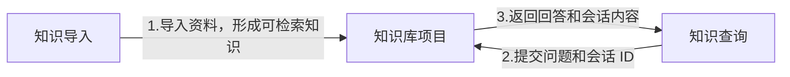
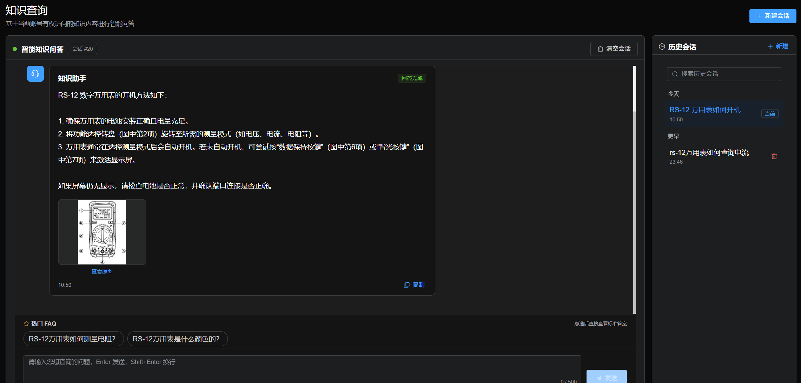
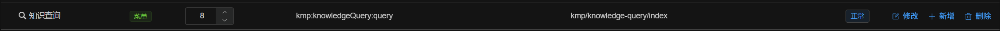

# 第1章 需求分析

## 1.1 与其他模块之间的关系



## 1.2 核心要点

平台表只做索引，完整问答由知识库项目负责。这样平台不用保存大段文本，也不会把两套存储职责搅在一起。

知识查询主页面左侧展示当前会话的问题输入区和反馈入口，右侧展示当前用户自己的会话列表：



# 第2章 菜单树



```text
知识查询
└─ 权限字符：kmp:knowledgeQuery:query
```

知识查询的所有功能：分页查询、创建会话、删除单条会话和清理本人全部会话都是知识查询的基本操作，不再拆成多个按钮权限。

# 第3章 数据对象

数据表：`kmp_knowledge_query_session`

实体类：`com.atguigu.kmp.entity.KnowledgeQuerySession`

这个对象没有问题列表、回答列表等扩展字段，因为平台只保存会话目录，不保存会话正文。

```java
package com.atguigu.kmp.entity;

import com.baomidou.mybatisplus.annotation.IdType;
import com.baomidou.mybatisplus.annotation.TableId;
import com.baomidou.mybatisplus.annotation.TableLogic;
import com.baomidou.mybatisplus.annotation.TableName;
import com.fasterxml.jackson.annotation.JsonFormat;
import com.fasterxml.jackson.annotation.JsonInclude;
import jakarta.validation.constraints.NotBlank;
import jakarta.validation.constraints.Positive;
import jakarta.validation.constraints.Size;
import lombok.Data;

import java.io.Serializable;
import java.time.LocalDateTime;

/**
 * 知识查询会话实体，对应真实数据表 kmp_knowledge_query_session。
 */
@Data
@TableName("kmp_knowledge_query_session")
@JsonInclude(JsonInclude.Include.NON_NULL)
public class KnowledgeQuerySession implements Serializable {

    private static final long serialVersionUID = 1L;

    /**
     * 会话主键，同时作为外部知识库会话ID
     */
    @TableId(value = "id", type = IdType.AUTO)
    @Positive(message = "会话 ID 不正确")
    private Long id;

    /**
     * 会话标题
     */
    @NotBlank(message = "会话标题不能为空")
    @Size(max = 255, message = "会话标题不能超过255个字符")
    private String sessionTitle;

    /**
     * 会话所属用户ID
     */
    private Long createUserId;

    /**
     * 创建时间
     */
    @JsonFormat(pattern = "yyyy-MM-dd HH:mm:ss")
    private LocalDateTime createTime;

    /**
     * 最后修改人用户ID
     */
    private Long updateUserId;

    /**
     * 最后修改时间
     */
    @JsonFormat(pattern = "yyyy-MM-dd HH:mm:ss")
    private LocalDateTime updateTime;

    /**
     * 逻辑删除：0-未删除，1-已删除
     */
    @TableLogic
    private Integer isDeleted;
}
```

# 第4章 功能一：分页查询本人会话

## 4.1 接口定义

| 项目     | 内容                                         |
| -------- | -------------------------------------------- |
| 接口功能 | 分页查询当前登录用户的会话索引               |
| 接口路径 | `/kmp/knowledgeQuerySession/list`            |
| 请求方式 | `GET`                                        |
| 查询参数 | `pageNum`、`pageSize`、可选的 `sessionTitle` |
| 返回值   | 若依 `TableDataInfo`                         |
| 权限     | `kmp:knowledgeQuery:query`                   |

## 4.2 功能实现

### 4.2.1 Controller

步骤：

1. 在`KnowledgeQuerySessionController`原来的 `@RequestMapping` 中添加 `kmp` 前缀：

```java
@RequestMapping("/kmp/knowledgeQuerySession")
```

2. 添加`knowledgeUnitService`依赖注入：

```java
@Autowired
private KnowledgeQuerySessionService knowledgeQuerySessionService;
```

3. 添加`list`方法：

Controller 不接收用户 ID，而是从登录上下文中读取：

`getUserId()` 比请求参数可信。调用方即使伪造 `createUserId`，也不会进入查询条件。

```java
/**
 * 分页查询当前用户的知识查询会话。
 *
 * @param query 会话标题查询条件
 * @return 若依分页响应
 */
@PreAuthorize("@ss.hasPermi('kmp:knowledgeQuery:query')")
@GetMapping("/list")
public TableDataInfo list(KnowledgeQuerySession query)
{

    // 获取分页参数
    PageDomain pageDomain = TableSupport.buildPageRequest();
    // 获取当前页码
    int pageNum = pageDomain.getPageNum();
    // 获取每页大小
    int pageSize = pageDomain.getPageSize();

    // 创建分页对象
    Page<KnowledgeQuerySession> page = new Page<>(pageNum, pageSize);

    // 调用服务层方法进行分页查询
    IPage<KnowledgeQuerySession> result = knowledgeQuerySessionService.pageSessions(
            page, query.getSessionTitle(), this.getUserId()
    );

    // 创建响应对象
    TableDataInfo response = new TableDataInfo(result.getRecords(), result.getTotal());

    // 设置响应数据
    response.setCode(HttpStatus.SUCCESS);
    response.setMsg("查询成功");
    return response;
}
```

### 4.2.2 Service

在 `KnowledgeQuerySessionService`接口定义分页查询方法：

```java
/**
 * 分页查询当前用户的未删除会话。
 *
 * @param page MyBatis-Plus 分页参数
 * @param sessionTitle 会话标题查询条件
 * @param userId 当前登录用户 ID
 * @return 当前用户的会话分页数据
 */
IPage<KnowledgeQuerySession> pageSessions(Page<KnowledgeQuerySession> page, String sessionTitle, Long userId);

```

### 4.2.3 ServiceImpl

在 `KnowledgeQuerySessionServiceImpl`实现方法：

```java
@Override
public IPage<KnowledgeQuerySession> pageSessions(
        Page<KnowledgeQuerySession> page, String sessionTitle, Long userId
)
{
    log.info("开始分页查询知识会话，userId={}，sessionTitle={}", userId, sessionTitle == null);

    LambdaQueryWrapper<KnowledgeQuerySession> wrapper =
            new LambdaQueryWrapper<KnowledgeQuerySession>()
                    .eq(KnowledgeQuerySession::getCreateUserId, userId)
                    .like(sessionTitle != null, KnowledgeQuerySession::getSessionTitle, sessionTitle)
                    .orderByDesc(KnowledgeQuerySession::getCreateTime)
                    .orderByDesc(KnowledgeQuerySession::getId);
    IPage<KnowledgeQuerySession> result = this.page(page, wrapper);
    return result;
}
```


# 第5章 功能二：创建会话

## 5.1 接口定义

| 项目     | 内容                         |
| -------- | ---------------------------- |
| 接口功能 | 为当前用户创建会话索引       |
| 接口路径 | `/kmp/knowledgeQuerySession` |
| 请求方式 | `POST`                       |
| 请求体   | 只使用 `sessionTitle`        |
| 返回值   | 数据库生成的会话 ID          |
| 权限     | `kmp:knowledgeQuery:query`   |

请求示例：

```json
{
  "sessionTitle": "商品拆封后还能退货吗？"
}
```

## 5.2 功能实现

### 5.2.1 Controller

```java
/**
 * 创建当前用户的知识查询会话。
 *
 * @param session 新会话标题
 * @return 创建结果及数据库生成的会话 ID
 */
@PreAuthorize("@ss.hasPermi('kmp:knowledgeQuery:query')")
@PostMapping
public AjaxResult create(@Validated @RequestBody KnowledgeQuerySession session)
{
    Long sessionId = knowledgeQuerySessionService.createSession(session, this.getUserId());
    return AjaxResult.success("创建会话成功", sessionId);
}
```

### 5.2.2 Service

在 `KnowledgeQuerySessionService`接口定义方法：

```java
/**
 * 创建当前用户的知识查询会话。
 *
 * @param session 待创建会话
 * @param userId 当前登录用户 ID
 * @return 数据库生成的会话 ID
 */
Long createSession(KnowledgeQuerySession session, Long userId);
```

### 5.2.3 ServiceImpl

在 `KnowledgeQuerySessionServiceImpl`实现方法：

```java
/** {@inheritDoc} */
@Override
@Transactional(rollbackFor = Exception.class)
public Long createSession(KnowledgeQuerySession session, Long userId)
{
    String sessionTitle = session.getSessionTitle();
    log.info("开始创建知识查询会话", userId, sessionTitle);

    // 所有主键和审计字段均以登录上下文及服务端时间为准。
    session.setId(null);
    session.setSessionTitle(sessionTitle);
    session.setCreateUserId(userId);
    session.setCreateTime(LocalDateTime.now());
    session.setUpdateUserId(null);
    session.setUpdateTime(null);
    session.setIsDeleted(0);
    save(session);

    return session.getId();
}
```


# 第6章 功能三：删除单条会话

## 6.1 接口定义

| 项目     | 内容                              |
| -------- | --------------------------------- |
| 接口功能 | 逻辑删除当前用户的一条会话索引    |
| 接口路径 | `/kmp/knowledgeQuerySession/{id}` |
| 请求方式 | `DELETE`                          |
| 路径参数 | 正整数会话 ID `id`                |
| 返回值   | 删除成功提示                      |
| 权限     | `kmp:knowledgeQuery:query`        |


## 6.2 功能实现

### 6.2.1 Controller

```java
/**
 * 删除当前用户的指定知识查询会话。
 *
 * @param id 会话 ID
 * @return 删除结果
 */
@PreAuthorize("@ss.hasPermi('kmp:knowledgeQuery:query')")
@Log(title = "知识查询会话", businessType = BusinessType.DELETE)
@DeleteMapping("/{id}")
public AjaxResult remove(@PathVariable @Positive(message = "会话 ID 不正确") Long id)
{
    knowledgeQuerySessionService.removeSession(id, this.getUserId());
    return AjaxResult.success("删除会话成功");
}
```

### 6.2.2 Service

```java
/**
 * 逻辑删除当前用户的指定会话。
 *
 * @param id 会话 ID
 * @param userId 当前登录用户 ID
 * @return 是否删除成功
 */
boolean removeSession(Long id, Long userId);
```

### 6.2.3 ServiceImpl

```java
/** {@inheritDoc} */
@Override
@Transactional(rollbackFor = Exception.class)
public boolean removeSession(Long id, Long userId)
{
    log.info("开始删除知识查询会话，userId={}，sessionId={}", userId, id);

    LocalDateTime now = LocalDateTime.now();

    // 如果想在逻辑删除时同时更新审计字段（更新用户、更新时间），可以使用以下代码显示做update操作
    LambdaUpdateWrapper<KnowledgeQuerySession> updateWrapper =
            new LambdaUpdateWrapper<KnowledgeQuerySession>()
                    .eq(KnowledgeQuerySession::getId, id)
                    .eq(KnowledgeQuerySession::getCreateUserId, userId)
                    .eq(KnowledgeQuerySession::getIsDeleted, 0)
                    .set(KnowledgeQuerySession::getIsDeleted, 1)
                    .set(KnowledgeQuerySession::getUpdateUserId, userId)
                    .set(KnowledgeQuerySession::getUpdateTime, now);
    return this.update(updateWrapper);
}
```


# 第7章 功能四：清理本人全部会话

## 7.1 接口定义

| 项目     | 内容                             |
| -------- | -------------------------------- |
| 接口功能 | 逻辑删除当前用户全部未删除会话   |
| 接口路径 | `/kmp/knowledgeQuerySession/all` |
| 请求方式 | `DELETE`                         |
| 请求参数 | 无                               |
| 返回值   | 是否清理到会话                   |
| 权限     | `kmp:knowledgeQuery:query`       |

## 7.2 功能实现


### 7.2.1 Controller

```java
/**
 * 清理当前用户的全部知识查询会话。
 *
 * @return 清理结果及实际删除数量
 */
@PreAuthorize("@ss.hasPermi('kmp:knowledgeQuery:query')")
@Log(title = "知识查询会话", businessType = BusinessType.DELETE)
@DeleteMapping("/all")
public AjaxResult clearAll()
{
    boolean removed = knowledgeQuerySessionService.clearSessions(this.getUserId());
    return AjaxResult.success("清理历史会话成功", removed);
}
```

### 7.2.2 Service

```java
/**
 * 逻辑清理当前用户的全部会话。
 *
 * @param userId 当前登录用户 ID
 * @return 是否清理到历史会话
 */
boolean clearSessions(Long userId);
```

### 7.2.3 ServiceImpl

```java
/** {@inheritDoc} */
@Override
@Transactional(rollbackFor = Exception.class)
public boolean clearSessions(Long userId)
{
    log.info("开始清理知识查询会话，userId={}", userId);
    LocalDateTime now = LocalDateTime.now();

    // 只清理当前用户的有效索引，并同步维护审计字段。
    LambdaUpdateWrapper<KnowledgeQuerySession> wrapper =
            new LambdaUpdateWrapper<KnowledgeQuerySession>()
                    .eq(KnowledgeQuerySession::getCreateUserId, userId)
                    .eq(KnowledgeQuerySession::getIsDeleted, 0)
                    .set(KnowledgeQuerySession::getIsDeleted, 1)
                    .set(KnowledgeQuerySession::getUpdateUserId, userId)
                    .set(KnowledgeQuerySession::getUpdateTime, now);
    return this.update(wrapper);
}
```

