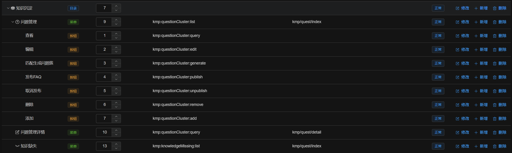
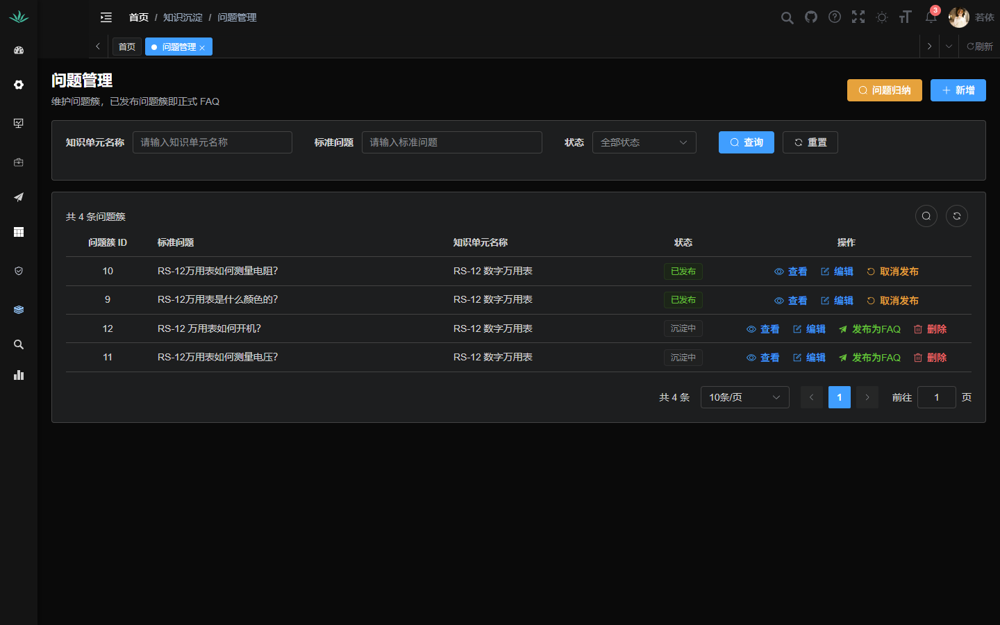
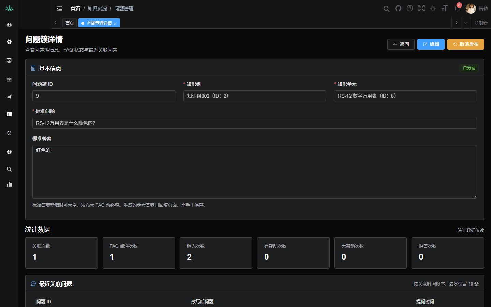
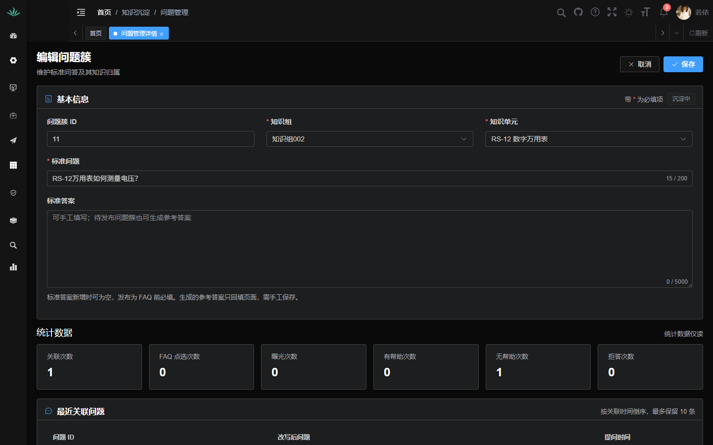

# 第1章 需求分析

问题管理中维护着问题簇，可以由管理员手工创建问题簇，填写答案、审核和发布。问题簇的来源也可以是真实问答中的相近问题归到同一个“问题簇”。一个已发布的问题簇，就是用户能看到并点选的 FAQ。未来常见问题就可以在FAQ中查询，无需调用模型生成答案。

# 第2章 菜单树



# 第3章 Milvus 配置

Milvus Collection 只放四个字段：`问题簇 ID、知识单元 ID、知识单元名称和问题向量`。问题正文存储在 MySQL 中。

定义好后重启服务即可，可以发现Milvus服务中成功创建了 `kmp_question_cluster` 集合

```java
package com.atguigu.kmp.client;

import io.milvus.client.MilvusServiceClient;
import io.milvus.grpc.DataType;
import io.milvus.param.ConnectParam;
import io.milvus.param.IndexType;
import io.milvus.param.MetricType;
import io.milvus.param.R;
import io.milvus.param.collection.CreateCollectionParam;
import io.milvus.param.collection.FieldType;
import io.milvus.param.collection.HasCollectionParam;
import io.milvus.param.collection.LoadCollectionParam;
import io.milvus.param.index.CreateIndexParam;
import lombok.extern.slf4j.Slf4j;
import org.springframework.beans.factory.annotation.Value;
import org.springframework.context.annotation.Bean;
import org.springframework.stereotype.Component;

/**
 * Milvus 向量库的接入配置类。
 *
 * <p>职责有两件事：一是按配置创建全局复用的 MilvusServiceClient，二是保证
 * 问题簇 Collection 在应用启动后处于“已建表、已建索引、已加载”的可用状态。</p>
 */
@Slf4j
@Component
public class KnowledgeMilvusClient {

    /** 向量维度，必须与百炼 embedding 返回的维度完全一致，否则写入会被 Milvus 拒绝。 */
    @Value("${kmp.milvus.embedding-dimension:1024}")
    private int embeddingDimension;

    /** Milvus 服务地址，默认本机部署。 */
    @Value("${kmp.milvus.host:127.0.0.1}")
    private String milvusHost;

    /** Milvus gRPC 端口，2.x 版本默认为 19530。 */
    @Value("${kmp.milvus.port:19530}")
    private int milvusPort;

    /** 目标数据库名；Milvus 2.x 支持多库，此处使用 default 库。 */
    @Value("${kmp.milvus.database-name:default}")
    private String milvusDatabaseName;

    /** 问题簇向量表名，同时也是建表、检索、删除时使用的唯一 Collection。 */
    @Value("${kmp.milvus.collection-name:kmp_question_cluster}")
    private String collectionName;

    /**
     * 创建 Milvus 2.4 Java 客户端，并在建表完成后交给业务层复用。
     *
     * <p>MilvusServiceClient 内部维护 gRPC 长连接，属于重量级对象，因此注册为单例 Bean，
     * 全应用共享一个连接；destroyMethod 保证容器关闭时释放底层通道。</p>
     *
     * @return 可复用客户端
     */
    @Bean(destroyMethod = "close")
    public MilvusServiceClient milvusServiceClient()
    {
        // 用配置的地址、端口、库名组装连接参数；未设置凭据，即按匿名方式连接（服务端未开启认证）。
        MilvusServiceClient client = new MilvusServiceClient(ConnectParam.newBuilder()
                .withHost(milvusHost).withPort(milvusPort)
                .withDatabaseName(milvusDatabaseName).build());
        // 启动阶段兜底建表，让上层 Service 可以假定 Collection 一定存在。
        initializeCollection(client);
        return client;
    }


    /**
     * 创建固定四字段 Collection、IVF_FLAT 索引并加载到内存。
     *
     * <p>整体是幂等的：表已存在时直接返回，不会重复建表，因此应用可以反复重启。</p>
     *
     * @param client 刚创建出来的 Milvus 客户端
     */
    private void initializeCollection(MilvusServiceClient client)
    {
        // 先问一次服务端这张表是否已存在，避免重复建表。
        R<Boolean> exists = client.hasCollection(HasCollectionParam.newBuilder()
                .withCollectionName(collectionName).build());

        // 已存在则视为初始化完成，直接返回。
        if (Boolean.TRUE.equals(exists.getData()))
        {
            return;
        }

        // 字段一：问题簇主键。使用 MySQL 侧的自增 ID 作为向量表主键（AutoID 关闭），
        // 保证 Milvus 与 MySQL 能通过同一个 ID 对应上同一条业务数据。
        FieldType clusterId = FieldType
                .newBuilder()
                .withName("question_cluster_id")
                .withDataType(DataType.Int64)
                .withPrimaryKey(true)
                .withAutoID(false)
                .build();

        // 字段二：知识单元 ID。作为标量过滤字段，检索时用它把召回范围限定在当前知识单元内。
        FieldType unitId = FieldType
                .newBuilder()
                .withName("knowledge_unit_id")
                .withDataType(DataType.Int64)
                .build();

        // 字段三：知识单元名称。
        FieldType itemName = FieldType
                .newBuilder()
                .withName("item_name")
                .withDataType(DataType.VarChar)
                .withMaxLength(200)
                .build();

        // 字段四：稠密向量。维度由配置注入。
        FieldType embedding = FieldType
                .newBuilder()
                .withName("embedding")
                .withDataType(DataType.FloatVector)
                .withDimension(embeddingDimension)
                .build();

        // 建表：四个字段一次性声明。
        client.createCollection(
                CreateCollectionParam
                        .newBuilder()
                        .withCollectionName(collectionName)
                        .withFieldTypes(java.util.List.of(clusterId, unitId, itemName, embedding))
                        .build()
        );

        // 建向量索引。这里建的是“稠密向量索引”。
        client.createIndex(
                CreateIndexParam
                        .newBuilder()
                        .withCollectionName(collectionName)
                        // 给表里哪个字段建索引；只能是向量字段，这里就是存放稠密向量的 embedding 列。
                        .withFieldName("embedding")
                        // 索引名字。
                        .withIndexName("question_cluster_embedding_idx")
                        // 索引算法：IVF_FLAT = “先分桶（IVF）+ 桶内拿原始向量精确比对（FLAT）”。
                        // 建索引时把全量向量聚类切成 nlist 个桶，检索时只扫其中 nprobe 个桶，
                        // nlist默认值（126），nprobe默认值（16）。
                        // 属于近似最近邻（ANN）：数据量大时快，但可能漏掉真正最相似的那条。
                        .withIndexType(IndexType.IVF_FLAT)
                        // 相似度度量：COSINE 即余弦相似度，只看两个向量的夹角、不看长短，分数越接近 1 越相似。
                        .withMetricType(MetricType.COSINE)
                        // 同步等待索引构建完成再返回，避开刚建完表就立刻检索、索引未就绪的情境；数据量越大此处阻塞越久。
                        .withSyncMode(true)
                        // 真正发起建索引请求。
                        .build()
        );

        // 加载到内存：Milvus 只有 load 之后数据才能被检索；SyncLoad 保证本方法返回时表已可用。
        client.loadCollection(
                LoadCollectionParam
                        .newBuilder()
                        .withCollectionName(collectionName)
                        .withSyncLoad(true)
                        .build()
        );

    }
}

```

# 第4章 向量转换

## 4.1 配置文件

kmpCnfig中添加如下内容

```java
@Value("${kmp.qwen.base-url}")
private String qwenBaseUrl;

/**
 * 百炼 REST 客户端统一使用五秒连接、二十秒读取超时。
 *
 * @return 独立 RestClient Builder
 */
@Bean("qwenRestClient")
public RestClient qwenRestClient()
{
    SimpleClientHttpRequestFactory requestFactory = new SimpleClientHttpRequestFactory();
    requestFactory.setConnectTimeout(Duration.ofSeconds(10));
    requestFactory.setReadTimeout(Duration.ofSeconds(30));

    return RestClient
            .builder()
            .requestFactory(requestFactory)
            .baseUrl(qwenBaseUrl)
            .build();
}
```

## 4.2 配置API_KAY

在环境变量中配置自己的 `DASHSCOPE_API_KEY`

## 4.3 创建向量转换客户端类

```java
package com.atguigu.kmp.client;

import com.alibaba.fastjson.JSONArray;
import com.alibaba.fastjson.JSONObject;
import com.atguigu.kmp.dto.KnowledgeQwenEmbeddingModels;
import com.ruoyi.common.exception.ServiceException;
import lombok.extern.slf4j.Slf4j;
import org.springframework.beans.factory.annotation.Autowired;
import org.springframework.beans.factory.annotation.Qualifier;
import org.springframework.beans.factory.annotation.Value;
import org.springframework.http.HttpHeaders;
import org.springframework.http.MediaType;
import org.springframework.stereotype.Component;
import org.springframework.web.client.RestClient;

import java.util.Collections;
import java.util.HashMap;
import java.util.List;
import java.util.Map;

@Slf4j
@Component
public class KnowledgeQwenEmbeddingClient {

    @Value("${kmp.milvus.embedding-dimension:1024}")
    private int embeddingDimension;

    @Value("${kmp.qwen.base-url}")
    private String qwenBaseUrl;

    @Value("${kmp.qwen.api-key}")
    private String qwenApiKey;

    @Value("${kmp.qwen.embedding-path}")
    private String qwenEmbeddingPath;

    @Value("${kmp.qwen.embedding-model:text-embedding-v4}")
    private String qwenEmbeddingModel;


    @Autowired
    @Qualifier("qwenRestClient")
    private RestClient restClient;
    
    /**
     * 为单段文本生成固定维度稠密向量。
     *
     * @param text 待向量化文本
     * @return 浮点向量
     */
    public float[] embed(String text)
    {
        JSONObject response = restClient
                .post()
                .uri(qwenBaseUrl + qwenEmbeddingPath)
                .contentType(MediaType.APPLICATION_JSON)
                .header("Authorization", "Bearer " + qwenApiKey)
                .body(buildEmbeddingRequest(text))
                .retrieve()
                .body(JSONObject.class);

        // 解析响应：output.embeddings[0].embedding 即为稠密向量
        JSONObject output = response == null ? null : response.getJSONObject("output");
        JSONArray embeddings = output == null ? null : output.getJSONArray("embeddings");
        if (embeddings == null || embeddings.isEmpty())
        {
            String code = response == null ? null : response.getString("code");
            String message = response == null ? null : response.getString("message");
            log.error("调用通义千问向量模型失败，code={}, message={}", code, message);
            throw new ServiceException("文本向量化失败");
        }

//        JSONObject output =  response.getJSONObject("output");
//        JSONArray embeddings = output.getJSONArray("embeddings");
        JSONArray embedding = embeddings.getJSONObject(0).getJSONArray("embedding");
        float[] vector = new float[embedding.size()];
        for (int i = 0; i < embedding.size(); i++)
        {
            vector[i] = embedding.getFloatValue(i);
        }
        return vector;
    }

    /**
     * 组装百炼 embedding 请求体
     *
     * @param text 待向量化文本
     * @return 待序列化的请求参数
     */
    private Map<String, Object> buildEmbeddingRequest(String text) {
        Map<String, Object> parameters = new HashMap<>();
        parameters.put("dimension", embeddingDimension);
        parameters.put("output_type", "dense");

        Map<String, Object> input = new HashMap<>();
        input.put("texts", List.of(text));

        Map<String, Object> request = new HashMap<>();
        request.put("model", qwenEmbeddingModel);
        request.put("input", input);
        request.put("parameters", parameters);
        return request;
    }
}

```

`embed`方法另一个更优雅的版本： 借助`KnowledgeQwenEmbeddingModels`的定义传递输入输出的数据

```java
/**
 * 调用通义千问向量模型，将文本转换为稠密向量。
 *
 * @param text 待向量化的文本
 * @return 稠密向量
 */
public float[] embed_v1(String text)
{
    KnowledgeQwenEmbeddingModels.Request request = new KnowledgeQwenEmbeddingModels.Request();
    request.setModel(qwenEmbeddingModel);

    KnowledgeQwenEmbeddingModels.Input input = new KnowledgeQwenEmbeddingModels.Input();
    input.setTexts(Collections.singletonList(text));
    request.setInput(input);

    KnowledgeQwenEmbeddingModels.Parameters parameters = new KnowledgeQwenEmbeddingModels.Parameters();
    parameters.setDimension(embeddingDimension);
    parameters.setOutputType("dense");
    request.setParameters(parameters);

    KnowledgeQwenEmbeddingModels.Response response = restClient
            .post()
            .uri(qwenBaseUrl + qwenEmbeddingPath)
            .contentType(MediaType.APPLICATION_JSON)
            .header(HttpHeaders.AUTHORIZATION, "Bearer " + qwenApiKey)
            .body(request)
            .retrieve()
            .body(KnowledgeQwenEmbeddingModels.Response.class);

    if (response == null || response.getOutput() == null
            || response.getOutput().getEmbeddings() == null
            || response.getOutput().getEmbeddings().isEmpty())
    {
        String code = response == null ? null : response.getCode();
        String message = response == null ? null : response.getMessage();
        log.error("调用通义千问向量模型失败，code={}, message={}", code, message);
        throw new ServiceException("文本向量化失败");
    }

    List<Float> embedding = response.getOutput().getEmbeddings().get(0).getEmbedding();
    float[] vector = new float[embedding.size()];
    for (int i = 0; i < embedding.size(); i++)
    {
        vector[i] = embedding.get(i);
    }
    return vector;
}
```

## 4.3 测试向量转换

`ruoyi-admin/pom.xml` 加 `spring-boot-starter-test（test scope）`

```xml
<dependency>
    <groupId>org.springframework.boot</groupId>
    <artifactId>spring-boot-starter-test</artifactId>
    <scope>test</scope>
</dependency>
```

`ruoyi-admin/src/test/java/` 中创建包 `com.ruoyi.kmp`，然后创建如下测试类

```java
package com.ruoyi.kmp;

import com.atguigu.kmp.client.KnowledgeQwenEmbeddingClient;

import org.junit.jupiter.api.Test;
import org.springframework.beans.factory.annotation.Autowired;
import org.springframework.boot.test.context.SpringBootTest;


@SpringBootTest
class KnowledgeQwenEmbeddingClientTest
{

    @Autowired
    private KnowledgeQwenEmbeddingClient client;

    @Test
    public void embedReturnsDenseVector()
    {
        float[] vector = client.embed("你好");
        System.out.println(vector.length);
    }
}

```

# 第5章 数据对象

## 5.1 问题簇实体类

数据表： `kmp_knowledge_question_cluster`

实体类：`KnowledgeQuestionCluster`

将代码生成器生成的代码补充并优化如下：

```java
package com.atguigu.kmp.entity;

import com.atguigu.kmp.dto.KnowledgeRecentQuestion;
import com.atguigu.kmp.typehandler.KnowledgeRecentQuestionListTypeHandler;
import com.baomidou.mybatisplus.annotation.*;
import com.fasterxml.jackson.annotation.JsonFormat;
import com.fasterxml.jackson.annotation.JsonInclude;
import jakarta.validation.constraints.*;
import lombok.Data;

import java.io.Serializable;
import java.math.BigDecimal;
import java.time.LocalDateTime;
import java.util.List;


/**
 * 问题簇实体，对应问题管理的 MySQL 事实表。
 */
@Data
@TableName(value = "kmp_knowledge_question_cluster", autoResultMap = true)
@JsonInclude(JsonInclude.Include.NON_NULL)
public class KnowledgeQuestionCluster implements Serializable {

    private static final long serialVersionUID = 1L;

    /**
     * 问题簇主键ID
     */
    @TableId(value = "id", type = IdType.AUTO)
    @Positive(message = "问题簇 ID 不正确")
    private Long id;

    /**
     * 标准问题
     */
    @NotBlank(message = "标准问题不能为空")
    @Size(max = 200, message = "标准问题不能超过200个字符")
    private String standardQuestion;

    /**
     * 标准答案
     */
    @Size(max = 5000, message = "标准答案不能超过5000个字符")
    private String standardAnswer;

    /**
     * 知识单元ID
     */
    @NotNull(message = "知识单元不能为空")
    @Positive(message = "知识单元 ID 不正确")
    private Long knowledgeUnitId;

    /**
     * 知识组ID
     */
    @NotNull(message = "知识组不能为空")
    @Positive(message = "知识组 ID 不正确")
    private Long knowledgeGroupId;

    /**
     * 状态：0-沉淀中，1-待发布，2-已发布
     */
    @Min(value = 0, message = "问题簇状态不正确")
    @Max(value = 2, message = "问题簇状态不正确")
    private Integer status;

    /**
     * 关联次数
     */
    private Long associationCount;

    /**
     * FAQ点选次数
     */
    private Long faqClickCount;

    /**
     * 曝光次数
     */
    private Long exposureCount;

    /**
     * 有帮助次数
     */
    private Long helpfulCount;

    /**
     * 无帮助次数
     */
    private Long unhelpfulCount;

    /**
     * 拒答次数
     */
    private Long refusalCount;

    /**
     * 最近关联问题集合，按关联时间倒序仅保留最新十条
     */
    @TableField(typeHandler = KnowledgeRecentQuestionListTypeHandler.class)
    private List<KnowledgeRecentQuestion> recentQuestions;
    //private String recentQuestions;

    /**
     * 创建人用户ID
     */
    private Long createUserId;

    /**
     * 创建时间
     */
    @JsonFormat(pattern = "yyyy-MM-dd HH:mm:ss")
    private LocalDateTime createTime;

    /**
     * 最后修改人用户ID
     */
    private Long updateUserId;

    /**
     * 最后修改时间
     */
    @JsonFormat(pattern = "yyyy-MM-dd HH:mm:ss")
    private LocalDateTime updateTime;

    /**
     * 逻辑删除：0-未删除，1-已删除
     */
    @TableLogic
    private Integer isDeleted;


    /** 知识单元名称，仅用于列表和详情展示。 */
    @TableField(exist = false)
    private String knowledgeUnitName;

    /** 知识组名称，仅用于列表和详情展示。 */
    @TableField(exist = false)
    private String knowledgeGroupName;

    /** 综合热度，仅用于后续 FAQ 展示，不落库。 */
    @TableField(exist = false)
    private BigDecimal hotScore;
}
```

## 5.2 最近问题实体类

最近问题只保存详情页真正需要的三个字段，不保存整条查询日志：

```java
package com.atguigu.kmp.dto;

import com.fasterxml.jackson.annotation.JsonFormat;
import lombok.Data;

import java.io.Serializable;
import java.time.LocalDateTime;

/**
 * 问题簇详情页的最近关联问题展示对象。
 *
 * <p>匹配成功时从查询日志生成快照，并持久化到问题簇的 JSON 字段。</p>
 */
@Data
public class KnowledgeRecentQuestion implements Serializable
{
    private static final long serialVersionUID = 1L;

    /** 查询日志 ID 字符串，用于来源追溯。 */
    private String questionId;

    /** 匹配时使用的改写后问题快照。 */
    private String rewrittenQuestion;

    /** 用户提问时间快照。 */
    @JsonFormat(pattern = "yyyy-MM-dd HH:mm:ss")
    private LocalDateTime questionTime;
}
```

## 5.3 类型转换

`recent_questions` 是 `kmp_knowledge_question_cluster` 中的JSON 字段。自定义 `TypeHandler` 把 Java 集合和 JSON 字符串互相转换。

在 `com.atguigu.kmp.typehandler`包中创建如下类：

```java
package com.atguigu.kmp.typehandler;

import com.atguigu.kmp.dto.KnowledgeRecentQuestion;
import com.baomidou.mybatisplus.extension.handlers.JacksonTypeHandler;
import com.fasterxml.jackson.core.JsonProcessingException;
import com.fasterxml.jackson.core.type.TypeReference;
import com.fasterxml.jackson.databind.ObjectMapper;
import com.fasterxml.jackson.datatype.jsr310.JavaTimeModule;

import java.lang.reflect.Field;
import java.util.List;

/**
 * 最近关联问题 JSON 列表类型处理器。
 */
public class KnowledgeRecentQuestionListTypeHandler extends JacksonTypeHandler
{
    private static final TypeReference<List<KnowledgeRecentQuestion>> TYPE_REFERENCE = new TypeReference<>() { };

    private static final ObjectMapper OBJECT_MAPPER = getObjectMapper().copy().registerModule(new JavaTimeModule());

    /** MyBatis XML ResultMap 使用的构造方法。 */
    public KnowledgeRecentQuestionListTypeHandler(Class<?> type)
    {
        
        super(type);
    }

    /** MyBatis-Plus 实体字段映射使用的构造方法。 */
    public KnowledgeRecentQuestionListTypeHandler(Class<?> type, Field field)
    {
        
        super(type, field);
    }

    /** 将 JSON 固定反序列化为最近关联问题对象列表。 */
    @Override
    public Object parse(String json)
    {
        try
        {
            return OBJECT_MAPPER.readValue(json, TYPE_REFERENCE);
        }
        catch (JsonProcessingException exception)
        {
            throw new IllegalArgumentException("最近关联问题快照解析失败", exception);
        }
    }

    /** 将最近关联问题对象列表序列化为 JSON。 */
    @Override
    public String toJson(Object value)
    {
        try
        {
            return OBJECT_MAPPER.writeValueAsString(value);
        }
        catch (JsonProcessingException exception)
        {
            throw new IllegalArgumentException("最近关联问题快照序列化失败", exception);
        }
    }
}
```

# 第6章 功能一：问题簇列表

问题管理列表同时展示标准问题、所属知识单元、发布状态和 FAQ 维护动作：



## 6.1 Controller

`KnowledgeQuestionClusterController`

```java
package com.atguigu.kmp.controller;

import com.atguigu.kmp.entity.KnowledgeQuestionCluster;
import com.atguigu.kmp.service.KnowledgeQuestionClusterService;
import com.baomidou.mybatisplus.core.metadata.IPage;
import com.baomidou.mybatisplus.extension.plugins.pagination.Page;
import com.ruoyi.common.constant.HttpStatus;
import com.ruoyi.common.core.controller.BaseController;
import com.ruoyi.common.core.page.TableDataInfo;
import lombok.extern.slf4j.Slf4j;
import org.springframework.beans.factory.annotation.Autowired;
import org.springframework.security.access.prepost.PreAuthorize;
import org.springframework.web.bind.annotation.GetMapping;
import org.springframework.web.bind.annotation.RequestMapping;
import org.springframework.web.bind.annotation.RequestParam;
import org.springframework.web.bind.annotation.RestController;


/**
 * 问题管理接口，提供手工问题簇维护、向量同步和 FAQ 发布能力。
 */
@Slf4j
@RestController
@RequestMapping("/kmp/questionCluster")
public class KnowledgeQuestionClusterController extends BaseController
{
    @Autowired
    private KnowledgeQuestionClusterService knowledgeQuestionClusterService;

    /**
     * GET /kmp/questionCluster/list：分页查询问题簇。
     * @param query 查询条件
     * @param pageNum 页码
      * @param pageSize 页大小
     * @return 若依分页响应
     */
    @PreAuthorize("@ss.hasPermi('kmp:questionCluster:list')")
    @GetMapping("/list")
    public TableDataInfo list(
            KnowledgeQuestionCluster query,
            @RequestParam Integer pageNum,
            @RequestParam Integer pageSize
    )
    {
        Page<KnowledgeQuestionCluster> page = new Page<>(pageNum, pageSize);
        IPage<KnowledgeQuestionCluster> result = knowledgeQuestionClusterService.pageQuestionClusters(page, query);
        TableDataInfo response = new TableDataInfo(result.getRecords(), result.getTotal());
        response.setCode(HttpStatus.SUCCESS);
        response.setMsg("查询成功");
        return response;
    }
}
```

## 6.2 Service

`KnowledgeQuestionClusterService`

```java
package com.atguigu.kmp.service;

import com.atguigu.kmp.entity.KnowledgeQuestionCluster;
import com.baomidou.mybatisplus.core.metadata.IPage;
import com.baomidou.mybatisplus.extension.plugins.pagination.Page;
import com.baomidou.mybatisplus.spring.service.IService;

/**
 * 问题簇业务服务。
 */
public interface KnowledgeQuestionClusterService extends IService<KnowledgeQuestionCluster>
{

    /** 分页查询问题簇。 */
    IPage<KnowledgeQuestionCluster> pageQuestionClusters(Page<KnowledgeQuestionCluster> page, KnowledgeQuestionCluster query);

}
```

## 6.3 ServiceImpl

`KnowledgeQuestionClusterServiceImpl`

```java
package com.atguigu.kmp.service.impl;

import com.atguigu.kmp.entity.KnowledgeQuestionCluster;
import com.atguigu.kmp.mapper.KnowledgeQuestionClusterMapper;
import com.atguigu.kmp.service.KnowledgeQuestionClusterService;
import com.baomidou.mybatisplus.core.metadata.IPage;
import com.baomidou.mybatisplus.extension.plugins.pagination.Page;
import com.baomidou.mybatisplus.spring.service.impl.ServiceImpl;
import org.springframework.stereotype.Service;
import lombok.extern.slf4j.Slf4j;

@Slf4j
@Service
public class KnowledgeQuestionClusterServiceImpl
        extends ServiceImpl<KnowledgeQuestionClusterMapper, KnowledgeQuestionCluster>
        implements KnowledgeQuestionClusterService
{

    /** {@inheritDoc} */
    @Override
    public IPage<KnowledgeQuestionCluster> pageQuestionClusters(Page<KnowledgeQuestionCluster> page,
                                                                KnowledgeQuestionCluster query)
    {
        IPage<KnowledgeQuestionCluster> result = baseMapper.selectQuestionClusterPage(page, query);
        return result;
    }

}
```

## 6.4 Mapper

`KnowledgeQuestionClusterMapper`

```java
package com.atguigu.kmp.mapper;

import com.atguigu.kmp.entity.KnowledgeQuestionCluster;
import com.baomidou.mybatisplus.core.mapper.BaseMapper;
import com.baomidou.mybatisplus.core.metadata.IPage;
import com.baomidou.mybatisplus.extension.plugins.pagination.Page;
import org.apache.ibatis.annotations.Param;

/**
 * 问题簇 Mapper；单表操作由 MyBatis-Plus 提供。
 */
public interface KnowledgeQuestionClusterMapper extends BaseMapper<KnowledgeQuestionCluster>
{
    /**
     * 关联知识单元和知识组分页查询问题簇。
     *
     * @param page 分页参数
     * @param query 查询条件
     * @return 问题簇分页
     */
    IPage<KnowledgeQuestionCluster> selectQuestionClusterPage(
            Page<KnowledgeQuestionCluster> page,
            @Param("query") KnowledgeQuestionCluster query);

}
```

## 6.5 Mapper XML

```xml
<?xml version="1.0" encoding="UTF-8"?>
<!DOCTYPE mapper PUBLIC "-//mybatis.org//DTD Mapper 3.0//EN" "http://mybatis.org/dtd/mybatis-3-mapper.dtd">
<mapper namespace="com.atguigu.kmp.mapper.KnowledgeQuestionClusterMapper">

    <resultMap id="KnowledgeQuestionClusterResult"
               type="com.atguigu.kmp.entity.KnowledgeQuestionCluster"
               autoMapping="true">
        <id property="id" column="id" />
        <result property="recentQuestions" column="recent_questions"
                javaType="java.util.List"
                typeHandler="com.atguigu.kmp.typehandler.KnowledgeRecentQuestionListTypeHandler" />
    </resultMap>

    <select id="selectQuestionClusterPage" resultMap="KnowledgeQuestionClusterResult">
        SELECT
        qc.*,
        ku.knowledge_unit_name
        FROM kmp_knowledge_question_cluster qc
        INNER JOIN kmp_knowledge_unit ku
        ON ku.id = qc.knowledge_unit_id
        AND ku.is_deleted = 0

        WHERE qc.is_deleted = 0
        <if test="query.knowledgeUnitName != null and query.knowledgeUnitName != ''">
            AND ku.knowledge_unit_name LIKE CONCAT('%', #{query.knowledgeUnitName}, '%')
        </if>
        <if test="query.standardQuestion != null and query.standardQuestion != ''">
            AND qc.standard_question LIKE CONCAT('%', #{query.standardQuestion}, '%')
        </if>
        <if test="query.status != null">
            AND qc.status = #{query.status}
        </if>
        ORDER BY qc.update_time DESC, qc.id DESC
    </select>
</mapper>

```

# 第7章 功能二：查询问题簇详情

进入详情后可以查看知识归属、标准问答、累计统计和最近关联问题：



## 7.1 Controller

`KnowledgeQuestionClusterController`

```java
/**
 * GET /kmp/questionCluster/{id}：查询问题簇详情。
 *
 * @param id 问题簇 ID
 * @return 问题簇详情
 */
@PreAuthorize("@ss.hasPermi('kmp:questionCluster:query')")
@GetMapping("/{id}")
public AjaxResult getInfo(@PathVariable @Positive(message = "问题簇 ID 不正确") Long id)
{
    return AjaxResult.success(knowledgeQuestionClusterService.getQuestionClusterDetail(id));
}
```

## 7.2 Service

`KnowledgeQuestionClusterService`

```java
/** 查询问题簇详情。 */
KnowledgeQuestionCluster getQuestionClusterDetail(Long id);
```

## 7.3 ServiceImpl

`KnowledgeQuestionClusterServiceImpl`

```java
@Autowired
private KnowledgeUnitService knowledgeUnitService;

@Autowired
private KnowledgeGroupService knowledgeGroupService;


/** {@inheritDoc} */
@Override
public KnowledgeQuestionCluster getQuestionClusterDetail(Long id)
{
    KnowledgeQuestionCluster cluster = this.getById(id);
    KnowledgeUnit knowledgeUnit = knowledgeUnitService.getById(cluster.getKnowledgeUnitId());
    KnowledgeGroup knowledgeGroup = knowledgeGroupService.getById(cluster.getKnowledgeGroupId());
    cluster.setKnowledgeUnitName(knowledgeUnit == null ? null : knowledgeUnit.getKnowledgeUnitName());
    cluster.setKnowledgeGroupName(knowledgeGroup == null ? null : knowledgeGroup.getKnowledgeGroupName());
    if (cluster.getRecentQuestions() == null)
    {
        cluster.setRecentQuestions(Collections.emptyList());
    }
    return cluster;
}
```

# 第8章 功能三：新增问题簇

新增和编辑页提供知识组与知识单元联动选择、标准问答维护、参考答案生成和 FAQ 发布入口：



## 8.1 Controller

`KnowledgeQuestionClusterController`

```java
/**
 * POST /kmp/questionCluster：手工新增问题簇。
 *
 * @param cluster 可编辑字段
 * @return 问题簇 ID 和向量同步结果
 */
@PreAuthorize("@ss.hasPermi('kmp:questionCluster:add')")
@Log(title = "问题簇", businessType = BusinessType.INSERT)
@PostMapping
public AjaxResult add(@Validated @RequestBody KnowledgeQuestionCluster cluster)
{
    Map<String, Object> result = knowledgeQuestionClusterService.createQuestionCluster(cluster, getUserId());
    return AjaxResult.success(result);
}
```

## 8.2 Service

`KnowledgeQuestionClusterService`

```java
/** 手工创建问题簇并尝试同步向量。 */
Map<String, Object> createQuestionCluster(KnowledgeQuestionCluster cluster, Long userId);
```

`KnowledgeQuestionClusterVectorService`

```java
package com.atguigu.kmp.service;

import com.atguigu.kmp.entity.KnowledgeQuestionCluster;

/**
 * 问题簇 Milvus 向量维护。
 */
public interface KnowledgeQuestionClusterVectorService
{
    /** 按问题簇主键写入向量。 */
    void saveQuestionClusterVector(KnowledgeQuestionCluster cluster);

    /** 按问题簇主键删除向量。 */
    void deleteQuestionClusterVector(Long questionClusterId);
}
```

## 8.3 ServiceImpl

`KnowledgeQuestionClusterServiceImpl`

新增时服务端重置 ID、状态、统计和审计字段，不能相信请求体。

```java
@Autowired
private KnowledgeQuestionClusterVectorService knowledgeQuestionClusterVectorService;


/** {@inheritDoc} */
@Override
public Map<String, Object> createQuestionCluster(KnowledgeQuestionCluster cluster, Long userId)
{
    LocalDateTime now = LocalDateTime.now();
    // 所有状态、统计和审计字段均由服务端初始化，忽略客户端伪造值。
    cluster.setId(null);
    cluster.setStatus(QuestionClusterConstants.STATUS_ACCUMULATING);
    cluster.setAssociationCount(0L);
    cluster.setFaqClickCount(0L);
    cluster.setExposureCount(0L);
    cluster.setHelpfulCount(0L);
    cluster.setUnhelpfulCount(0L);
    cluster.setRefusalCount(0L);
    cluster.setRecentQuestions(Collections.emptyList());
    cluster.setCreateUserId(userId);
    cluster.setCreateTime(now);
    cluster.setUpdateUserId(null);
    cluster.setUpdateTime(null);
    cluster.setIsDeleted(0);
    save(cluster);

    boolean vectorSynced = true;
    try
    {
        knowledgeQuestionClusterVectorService.saveQuestionClusterVector(cluster);
    }
    catch (RuntimeException exception)
    {
        vectorSynced = false;
        log.warn("问题簇已保存但向量同步失败");
    }
    Map<String, Object> result = new LinkedHashMap<>();
    result.put("id", cluster.getId());
    result.put("vectorSynced", vectorSynced);
    return result;
}
```

`KnowledgeQuestionClusterVectorServiceImpl`

```java
package com.atguigu.kmp.service.impl;

import com.alibaba.fastjson.JSONArray;
import com.alibaba.fastjson.JSONObject;
import com.atguigu.kmp.client.KnowledgeQwenEmbeddingClient;
import com.atguigu.kmp.entity.KnowledgeQuestionCluster;
import com.atguigu.kmp.entity.KnowledgeUnit;
import com.atguigu.kmp.service.KnowledgeQuestionClusterVectorService;
import com.atguigu.kmp.service.KnowledgeUnitService;
import io.milvus.client.MilvusServiceClient;
import io.milvus.param.dml.DeleteParam;
import io.milvus.param.dml.UpsertParam;
import lombok.extern.slf4j.Slf4j;
import org.springframework.beans.factory.annotation.Autowired;
import org.springframework.beans.factory.annotation.Value;
import org.springframework.stereotype.Service;

import java.util.Collections;

/**
 * 自定义 kmp_question_cluster Collection 的向量实现。
 */
@Slf4j
@Service
public class KnowledgeQuestionClusterVectorServiceImpl
        implements KnowledgeQuestionClusterVectorService
{

    @Autowired
    private KnowledgeQwenEmbeddingClient embeddingClient;

    @Autowired
    private MilvusServiceClient milvusServiceClient;

    @Autowired
    private KnowledgeUnitService knowledgeUnitService;

    @Value("${kmp.milvus.collection-name:kmp_question_cluster}")
    private String collectionName;

    /** {@inheritDoc} */
    @Override
    public void saveQuestionClusterVector(KnowledgeQuestionCluster cluster)
    {
        KnowledgeUnit unit = knowledgeUnitService.getById(cluster.getKnowledgeUnitId());
        String itemName = unit.getKnowledgeUnitName();
        float[] embedding = embeddingClient.embed(cluster.getStandardQuestion());

        // 构建向量数据
        JSONObject row = new JSONObject();
        // 设置问题簇id
        row.put("question_cluster_id", cluster.getId());
        // 设置知识单元id
        row.put("knowledge_unit_id", cluster.getKnowledgeUnitId());
        // 设置知识单元名称
        row.put("item_name", itemName);
        // 设置向量
        JSONArray vector = new JSONArray();
        for (float value : embedding)
        {
            vector.add(value);
        }
        row.put("embedding", vector);

        // 插入或更新向量数据
        milvusServiceClient.upsert(
                UpsertParam
                        .newBuilder()
                        .withCollectionName(collectionName)
                        .withRows(Collections.singletonList(row))
                        .build()
        );
    }

    /** {@inheritDoc} */
    @Override
    public void deleteQuestionClusterVector(Long questionClusterId)
    {
        milvusServiceClient.delete(
                DeleteParam.newBuilder()
                .withCollectionName(collectionName)
                .withExpr("question_cluster_id == " + questionClusterId)
                .build()
        );
    }
}
```

# 第9章 功能四：修改问题簇

## 9.1 Controller

`KnowledgeQuestionClusterController`

```java
/**
 * PUT /kmp/questionCluster：编辑问题簇字段。
 *
 * @param cluster 可编辑字段及 ID
 * @return 操作结果
 */
@PreAuthorize("@ss.hasPermi('kmp:questionCluster:edit')")
@Log(title = "问题簇", businessType = BusinessType.UPDATE)
@PutMapping
public AjaxResult edit(@Validated @RequestBody KnowledgeQuestionCluster cluster)
{
    knowledgeQuestionClusterService.updateQuestionCluster(cluster, getUserId());
    return AjaxResult.success();
}
```

## 9.2 Service

`KnowledgeQuestionClusterService`

```java
/** 编辑问题簇。 */
void updateQuestionCluster(KnowledgeQuestionCluster cluster, Long userId);
```

## 9.3 ServiceImpl

`KnowledgeQuestionClusterServiceImpl`

编辑时只更新白名单字段；匹配字段变更后先同步向量，已发布记录还要同步 FAQ 检索数据。

```java
/** {@inheritDoc} */
@Override
public void updateQuestionCluster(KnowledgeQuestionCluster input, Long userId)
{

    // 设置可信字段，防止客户端伪造
    KnowledgeQuestionCluster cluster = new KnowledgeQuestionCluster();
    cluster.setId(input.getId());
    cluster.setStandardQuestion(input.getStandardQuestion());
    cluster.setStandardAnswer(input.getStandardAnswer());
    cluster.setKnowledgeUnitId(input.getKnowledgeUnitId());
    cluster.setKnowledgeGroupId(input.getKnowledgeGroupId());
    
    // 更新向量
    knowledgeQuestionClusterVectorService.saveQuestionClusterVector(cluster);

    // 已发布问题变化时，更新ES。
    KnowledgeQuestionCluster current = this.getById(input.getId());
    if (Integer.valueOf(QuestionClusterConstants.STATUS_PUBLISHED).equals(current.getStatus()))
    {
        // TODO 更新ES
    }

    // 更新数据库
    lambdaUpdate()
            .eq(KnowledgeQuestionCluster::getId, current.getId())
            .eq(KnowledgeQuestionCluster::getStatus, current.getStatus())
            .set(KnowledgeQuestionCluster::getStandardQuestion, input.getStandardQuestion())
            .set(KnowledgeQuestionCluster::getStandardAnswer, input.getStandardAnswer())
            .set(KnowledgeQuestionCluster::getKnowledgeUnitId, input.getKnowledgeUnitId())
            .set(KnowledgeQuestionCluster::getKnowledgeGroupId, input.getKnowledgeGroupId())
            .set(KnowledgeQuestionCluster::getUpdateUserId, userId)
            .set(KnowledgeQuestionCluster::getUpdateTime, LocalDateTime.now())
            .update();

}
```

# 第10章 功能五：删除问题簇

## 10.1 Controller

`KnowledgeQuestionClusterController`

```java
/**
 * DELETE /kmp/questionCluster/{id}：删除未发布问题簇。
 *
 * @param id 问题簇 ID
 * @return 操作结果
 */
@PreAuthorize("@ss.hasPermi('kmp:questionCluster:remove')")
@Log(title = "问题簇", businessType = BusinessType.DELETE)
@DeleteMapping("/{id}")
public AjaxResult remove(@PathVariable @Positive(message = "问题簇 ID 不正确") Long id)
{
    knowledgeQuestionClusterService.removeQuestionCluster(id, getUserId());
    return AjaxResult.success();
}
```

## 10.2 Service

`KnowledgeQuestionClusterService`

```java
/** 删除未发布问题簇。 */
void removeQuestionCluster(Long id, Long userId);
```

## 10.3 ServiceImpl

`KnowledgeQuestionClusterServiceImpl`

删除时先删 Milvus 向量，再逻辑删除 MySQL。向量删除失败就保留 MySQL，重新执行整个删除操作即可

```java
/** {@inheritDoc} */
@Override
public void removeQuestionCluster(Long id, Long userId)
{
    // 删除向量
    knowledgeQuestionClusterVectorService.deleteQuestionClusterVector(id);
    // 删除MySQL（删除时维护审计字段）
    this.lambdaUpdate()
            .eq(KnowledgeQuestionCluster::getId, id)
            .set(KnowledgeQuestionCluster::getUpdateUserId, userId)
            .set(KnowledgeQuestionCluster::getUpdateTime, LocalDateTime.now())
            .set(KnowledgeQuestionCluster::getIsDeleted, 1)
            .update();
}
```


