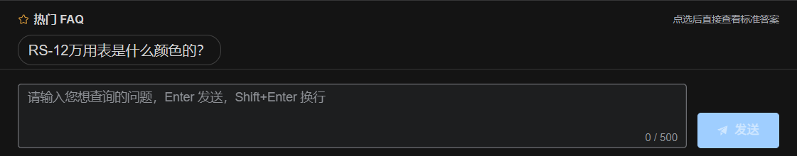
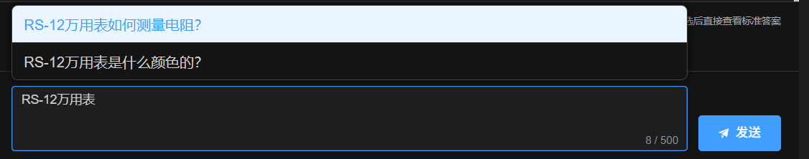

# 第1章 需求分析

已发布的问题簇就是用户能看到并点选的 FAQ。FAQ 面向知识查询页面提供四类能力：

1. **发布 FAQ**：管理员发布问题簇时，同步把标准问题写入 Elasticsearch（ES）联想索引，让用户能搜到它；
2. **取消 FAQ 发布**：取消发布时同步从 ES 索引删除文档，不再出现在联想结果里；
3. **查询热门 FAQ**：知识查询页面按“热度分”（关联次数、点击量、点击率、好评率加权计算）排序展示当前知识单元下最受欢迎的 FAQ，并累计曝光次数；
4. **FAQ 输入联想**：用户输入时（至少 5 个字符），在 ES 索引中按相关度分词匹配，返回最多 10 条、相关度不低于 0.60 的候选问题列表（不含答案）。

架构上，ES 是辅助全文索引，只存问题簇 ID 和标准问题两个字段；标准答案与曝光、点击、好评等计数都存在 MySQL。MySQL 是发布状态的事实来源：联想搜索拿到的 ES 候选 ID，还要经 MySQL 按“已发布”状态复核后才输出，防止已下架的 FAQ 因 ES 索引未及时同步而继续展示；用户点选 FAQ 后读取答案时，同样会复核发布状态与权限。

# 第2章 FAQ 的 Elasticsearch 客户端

## 2.1 相关配置

在配置类`KmpConfig`中增加ES客户端连接的相关配置：

```java
 /** FAQ Elasticsearch 基础地址。 */
@Value("${kmp.faq-search.base-url}")
private String faqSearchBaseUrl;

/** FAQ Elasticsearch 索引名称。 */
@Value("${kmp.faq-search.index-name}")
private String faqSearchIndexName;

/** FAQ Elasticsearch HTTP 连接超时。 */
@Value("${kmp.faq-search.connect-timeout}")
private Duration faqSearchConnectTimeout;

/** FAQ Elasticsearch HTTP 读取超时。 */
@Value("${kmp.faq-search.read-timeout}")
private Duration faqSearchReadTimeout;


/**
 * 创建 FAQ Elasticsearch 客户端。
 *
 * @return FAQ 搜索 RestClient
 */
@Bean("faqSearchRestClient")
public RestClient faqSearchRestClient()
{
    SimpleClientHttpRequestFactory requestFactory = new SimpleClientHttpRequestFactory();
    requestFactory.setConnectTimeout(faqSearchConnectTimeout);
    requestFactory.setReadTimeout(faqSearchReadTimeout);

    return RestClient
            .builder()
            .requestFactory(requestFactory)
            .baseUrl(faqSearchBaseUrl)
            .build();
}
```

## 2.2 FaqSearchClient

```java
package com.atguigu.kmp.client;

/**
 * FAQ Elasticsearch 文档客户端。
 */
@Slf4j
@Component
public class FaqSearchClient
{
    @Autowired
    @Qualifier("faqSearchRestClient")
    private RestClient restClient;

    @Autowired
    private KmpConfig kmpConfig;
}
```

# 第3章 功能一：发布FAQ

## 3.1 Controller

`KnowledgeQuestionClusterController`

```java
 /**
 * POST /kmp/questionCluster/{id}/publish：发布沉淀中或待发布问题簇。
 *
 * @param id 问题簇 ID
 * @return 操作结果
 */
@PreAuthorize("@ss.hasPermi('kmp:questionCluster:publish')")
@Log(title = "问题簇发布", businessType = BusinessType.UPDATE)
@PostMapping("/{id}/publish")
public AjaxResult publish(@PathVariable @Positive(message = "问题簇 ID 不正确") Long id)
{
    knowledgeQuestionClusterService.publishQuestionCluster(id, this.getUserId());
    return AjaxResult.success();
}
```

## 3.2 Service

`KnowledgeQuestionClusterService`

```java
/** 发布沉淀中或待发布问题簇。 */
void publishQuestionCluster(Long id, Long userId);
```

## 3.3 ServiceImpl

`KnowledgeQuestionClusterServiceImpl`

```java
@Autowired
private FaqSearchClient faqSearchClient;


/** {@inheritDoc} */
@Override
@Transactional(rollbackFor = Exception.class)
public void publishQuestionCluster(Long id, Long userId) {

    //获取当前问题簇数据记录
    KnowledgeQuestionCluster cluster = this.getById(id);

    Integer oldStatus = cluster.getStatus();

    // 引入es客户端
    // 防御性编程，如果oldStatus的状态是 QuestionClusterConstants.STATUS_PUBLISHED，则不执行更新操作
    if (!Integer.valueOf(QuestionClusterConstants.STATUS_PUBLISHED).equals(oldStatus))
    {
        //先更新MySQL
        this.updateStatus(id, oldStatus, QuestionClusterConstants.STATUS_PUBLISHED, userId);
        //再保存es，如果出错，MySQL可以回滚
        faqSearchClient.saveFaq(cluster);
    }
}


/** 发布状态转换。 */
private boolean updateStatus(Long id, int oldStatus, int newStatus, Long userId)
{
    return this.lambdaUpdate()
            .eq(KnowledgeQuestionCluster::getId, id)
            .eq(KnowledgeQuestionCluster::getStatus, oldStatus)
            .set(KnowledgeQuestionCluster::getStatus, newStatus)
            .set(KnowledgeQuestionCluster::getUpdateUserId, userId)
            .set(KnowledgeQuestionCluster::getUpdateTime, LocalDateTime.now())
            .update();
}
```

## 3.4 FaqSearchClient

添加方法：`saveFaq`

```java
/**
 * 创建或覆盖 FAQ 联想文档。
 *
 * @param cluster 已校验的问题簇
 */
public void saveFaq(KnowledgeQuestionCluster cluster)
{
    Map<String, Object> document = new HashMap<>();
    document.put("question_cluster_id", cluster.getId());
    document.put("standard_question", cluster.getStandardQuestion());

    ResponseEntity<Void> response = restClient.put()
            .uri(
                "/{indexName}/_doc/{questionClusterId}",
                    kmpConfig.getFaqSearchIndexName(),
                    cluster.getId()
            )
            .contentType(MediaType.APPLICATION_JSON)
            .body(document)
            .retrieve()
            .toBodilessEntity();

    int statusCode = response.getStatusCode().value();
    if (statusCode == 201)
    {
        log.debug("FAQ 文档新建成功，questionClusterId={}", cluster.getId());
    }
    else if (statusCode == 200)
    {
        log.debug("FAQ 文档覆盖更新成功，questionClusterId={}", cluster.getId());
    }
    else
    {
        log.warn("FAQ 文档写入返回非预期状态码，questionClusterId={}，status={}", cluster.getId(), statusCode);
        throw new ServiceException("FAQ 搜索服务暂时不可用");
    }
}
```

ES 的 PUT _doc/{id} 接口行为就像"存文件"：

- 目标不存在 → 创建新文件，返回 201
- 目标已存在 → 覆盖旧文件，返回 200

两者都是"写成功了"，但日志里区分开方便排查问题

## 3.5 已发布问题变化时

已发布问题变化时需要更新es：`updateQuestionCluster`方法

```java
 // 已发布问题变化时，更新ES。
KnowledgeQuestionCluster current = this.getById(input.getId());
if (Integer.valueOf(QuestionClusterConstants.STATUS_PUBLISHED).equals(current.getStatus()))
{
    faqSearchClient.saveFaq(current);
}
```

# 第4章 功能二：取消FAQ发布

## 4.1 Controller

`KnowledgeQuestionClusterController`

```java
/**
 * POST /kmp/questionCluster/{id}/unpublish：取消发布问题簇。
 *
 * @param id 问题簇 ID
 * @return 操作结果
 */
@PreAuthorize("@ss.hasPermi('kmp:questionCluster:unpublish')")
@Log(title = "问题簇取消发布", businessType = BusinessType.UPDATE)
@PostMapping("/{id}/unpublish")
public AjaxResult unpublish(@PathVariable @Positive(message = "问题簇 ID 不正确") Long id)
{
    knowledgeQuestionClusterService.unpublishQuestionCluster(id, getUserId());
    return AjaxResult.success();
}
```

## 4.2 Service

`KnowledgeQuestionClusterService`

```java
/** 取消发布已发布问题簇。 */
void unpublishQuestionCluster(Long id, Long userId);
```

## 4.3 ServiceImpl

`KnowledgeQuestionClusterServiceImpl`

```java
/** {@inheritDoc} */
@Override
@Transactional(rollbackFor = Exception.class)
public void unpublishQuestionCluster(Long id, Long userId) {

    //获取当前问题簇数据记录
    KnowledgeQuestionCluster cluster = this.getById(id);
    Integer oldStatus = cluster.getStatus();

    if (Integer.valueOf(QuestionClusterConstants.STATUS_PUBLISHED).equals(oldStatus))
    {
        // 更新sql状态
        this.updateStatus(
            id, QuestionClusterConstants.STATUS_PUBLISHED, QuestionClusterConstants.STATUS_PENDING, userId
        );
        // 删除es上的数据
        faqSearchClient.deleteFaq(id);
    }
}
```

## 4.4 FaqSearchClient

添加方法：`deleteFaq`

```java
/**
 * 幂等删除 FAQ 联想文档，404 表示目标已不存在。
 *
 * @param questionClusterId 问题簇 ID
 */
public void deleteFaq(Long questionClusterId)
{
    ResponseEntity<Void> response = restClient
            .delete()
            .uri(
                    "/{indexName}/_doc/{questionClusterId}",
                    kmpConfig.getFaqSearchIndexName(),
                    questionClusterId
            )
            .retrieve()
            .onStatus(status -> status.value() == 404, (request, res) -> { /* 幂等场景不抛异常 */ })
            .toBodilessEntity();

    int statusCode = response.getStatusCode().value();
    if (statusCode == 404)
    {
        // ES 删除不存在文档时返回404，按幂等成功处理。
        log.debug("FAQ 搜索文档已不存在，questionClusterId={}", questionClusterId);
        return;
    }
    if (statusCode == 200 || statusCode == 204)
    {
        log.debug("FAQ 搜索文档删除成功，questionClusterId={}，status={}", questionClusterId, statusCode);
        return;
    }
    // 其他非预期状态码，记录并抛出异常。
    log.warn("FAQ 搜索文档删除返回非预期状态码，questionClusterId={}，status={}", questionClusterId, statusCode);
    throw new ServiceException("FAQ 搜索服务暂时不可用");
}
```

`.toBodilessEntity()` 和 直接 `.body()` 的区别：

|                | `.toBodilessEntity()`                          | `.body(Xxx.class)`                     |
| -------------- | ---------------------------------------------- | -------------------------------------- |
| 返回值         | `ResponseEntity<Void>` — 只保留状态码 + 响应头 | 直接反序列化响应体为你指定的 Java 对象 |
| 响应体怎么处理 | 直接丢弃，不解析                               | 读取 JSON 并转为对象                   |
| 典型场景       | 只需要知道 "成功 / 失败"，不关心返回内容       | 需要拿到返回的数据做后续处理           |

要点：

- 捕获 `ResponseEntity<Void>` — 用变量接住 `.toBodilessEntity()` 的返回值，从中提取状态码进行分支判断。
- `.onStatus()` : Spring RestClient 默认对 `4xx/5xx` 直接抛异常，如果不加 `onStatus`，404 不会走到手动判断的代码里。加上后，404 不再抛异常，而是正常返回给程序自己处理。
- 按状态码分支明确处理：
  - 404 → 幂等成功，文档本来就不存在
  - 200 / 204 → 删除成功
  - 其他 → 记录告警 + 抛业务异常

# 第5章 功能三：查询热门FAQ

在知识查询页面，显示热门FAQ列表



## 5.1 数据对象

```java
package com.atguigu.kmp.dto;

import jakarta.validation.constraints.NotBlank;
import jakarta.validation.constraints.Size;
import lombok.Data;

/**
 * 知识查询 FAQ 请求与响应对象集合。
 */
public final class KnowledgeFaqModels
{
    private KnowledgeFaqModels()
    {
    }

    /** FAQ 推荐和联想项，不携带答案字段。 */
    @Data
    public static class KnowledgeFaqItem
    {
        private Long id;
        private String standardQuestion;
    }

    /** FAQ 点选请求；页面重试时必须复用同一请求 ID。 */
    @Data
    public static class KnowledgeFaqAnswerRequest
    {
        @NotBlank(message = "请求 ID 不能为空")
        @Size(max = 128, message = "请求 ID 不能超过128个字符")
        private String requestId;
    }

    /** FAQ 答案。 */
    @Data
    public static class KnowledgeFaqAnswer
    {
        private Long id;
        private String standardQuestion;
        private String standardAnswer;
    }
}
```

## 5.2 Controller

`KnowledgeQuestionClusterController`

```java
/**
 * GET /kmp/questionCluster/faq/recommendations：查询当前知识单元的热门 FAQ。
 *
 * @param itemName 外部知识库识别的知识单元名称
 * @return FAQ 列表（不包含答案）
 */
@PreAuthorize("@ss.hasPermi('kmp:knowledgeQuery:query')")
@GetMapping("/faq/recommendations")
public AjaxResult recommendFaqs(@RequestParam(required = false) String itemName)
{
    List<KnowledgeFaqModels.KnowledgeFaqItem> faqItems = knowledgeQuestionClusterService.listRecommendedFaqs(itemName);
    return AjaxResult.success(faqItems);
}
```

## 5.3 Service

`KnowledgeQuestionClusterService`

```java
/** 查询当前知识单元的热门 FAQ。 */
List<KnowledgeFaqModels.KnowledgeFaqItem> listRecommendedFaqs(String itemName);
```

## 5.4 ServiceImpl

`KnowledgeQuestionClusterServiceImpl`

```java
/** {@inheritDoc} */
@Override
public List<KnowledgeFaqModels.KnowledgeFaqItem> listRecommendedFaqs(String itemName)
{

    List<KnowledgeQuestionCluster> clusters = baseMapper.selectRecommendedFaqs(
            itemName, QuestionClusterConstants.FAQ_RECOMMENDATION_LIMIT
    );
    // 热门推荐成功返回一次就累计一次曝光。
    List<Long> clusterIds = clusters
            .stream()
            .map(KnowledgeQuestionCluster::getId)
            .toList();

    // 写入曝光次数
    increaseFaqExposureCounts(clusterIds);

    // 生成返回结果
    List<KnowledgeFaqModels.KnowledgeFaqItem> faqItems = clusters
            .stream()
            .map(this::toFaqItem)
            .toList();
    return faqItems;
}

/** 批量增加本次成功返回的热门 FAQ 曝光次数。 */
private void increaseFaqExposureCounts(List<Long> ids)
{
    // 没有推荐结果时无需执行空 IN 更新，按成功处理。
    if (StringUtils.isEmpty(ids))
    {
        return;
    }
    this.lambdaUpdate()
            .in(KnowledgeQuestionCluster::getId, ids)
            .eq(KnowledgeQuestionCluster::getStatus, QuestionClusterConstants.STATUS_PUBLISHED)
            // 取 exposure_count 的当前值，如果它是 NULL，就当它是 0，然后再 +1 写回去。
            .setSql("exposure_count = COALESCE(exposure_count, 0) + 1")
            .update();
}

/** 将内部问题簇转为不含答案字段的展示对象。 */
private KnowledgeFaqModels.KnowledgeFaqItem toFaqItem(KnowledgeQuestionCluster cluster)
{
    KnowledgeFaqModels.KnowledgeFaqItem item = new KnowledgeFaqModels.KnowledgeFaqItem();
    item.setId(cluster.getId());
    item.setStandardQuestion(cluster.getStandardQuestion());
    return item;
}
```

## 5.5 Mapper

`KnowledgeQuestionClusterMapper`

```java
/** 按知识单元名称查询热门已发布 FAQ。 */
List<KnowledgeQuestionCluster> selectRecommendedFaqs( @Param("itemName") String itemName, @Param("limit") int limit);
```

## 5.6 Mapper XML

```xml
<select id="selectRecommendedFaqs" resultType="com.atguigu.kmp.entity.KnowledgeQuestionCluster">
    SELECT qc.id,
           qc.standard_question,
           ROUND(100 * (
                     0.35 * LEAST(COALESCE(qc.association_count, 0) / 20.0, 1)
                   + 0.20 * LEAST(COALESCE(qc.faq_click_count, 0) / 10.0, 1)
                   + 0.25 * LEAST((COALESCE(qc.faq_click_count, 0) + 1) / (COALESCE(qc.exposure_count, 0) + 5.0), 1)
                   + 0.20 * ((COALESCE(qc.helpful_count, 0) + 1) / (COALESCE(qc.helpful_count, 0) + COALESCE(qc.unhelpful_count, 0) + 2.0))
               ), 2) AS hot_score

    FROM kmp_knowledge_question_cluster qc
             INNER JOIN kmp_knowledge_unit ku
                        ON ku.id = qc.knowledge_unit_id
                            AND ku.is_deleted = 0
    WHERE qc.is_deleted = 0
      AND qc.status = 2
      AND ku.knowledge_unit_name = #{itemName}
    ORDER BY hot_score DESC,
             qc.association_count DESC,
             qc.faq_click_count DESC,
             qc.id DESC

    LIMIT #{limit}
</select>
```

### FAQ 热度分（hot_score）公式说明

#### 整体含义

把 4 个反映人气的指标各自换算成 0~1 的分，按重要性加权求和，再乘 100 变成百分制，最后保留 2 位小数。

```
ROUND(100 *       (加权和) ,       2 )
       ↑             ↑                ↑
    变百分制   4个信号 × 权重    保留2位小数   
```

- `ROUND(x, 2)`：四舍五入保留两位小数，比如 `70.1234 → 70.12`
- `100 * (...)`：加权和最大是 1（四个权重 0.35 + 0.20 + 0.25 + 0.20 = 1.00），乘 100 后变成 0~100 分

完整 SQL 表达式：

```sql
 ROUND(100 * (
             0.35 * LEAST(COALESCE(qc.association_count, 0) / 20.0, 1)
           + 0.20 * LEAST(COALESCE(qc.faq_click_count, 0) / 10.0, 1)
           + 0.25 * LEAST((COALESCE(qc.faq_click_count, 0) + 1) / (COALESCE(qc.exposure_count, 0) + 5.0), 1)
           + 0.20 * ((COALESCE(qc.helpful_count, 0) + 1) / (COALESCE(qc.helpful_count, 0) + COALESCE(qc.unhelpful_count, 0) + 2.0))
       ), 2) AS hot_score
```

#### 四个信号分别是什么

| 项 | 权重 | 衡量什么 | 通俗理解 |
|---|---|---|---|
| ① `association_count` | 0.35 | 被关联了多少次 | 出镜率。这个问题簇里一共收进了多少个相似的问题。每来一个新问题被归到这个名字下，计数就 +1 |
| ② `faq_click_count` | 0.20 | 被点击了多少次 | 点阅量 |
| ③ `(点击+1) / (曝光+5)` | 0.25 | 点击率 CTR | 露脸 100 次只被点 1 次，不如露脸 3 次被点 2 次——**看质量不看数量** |
| ④ `(有用+1) / (有用+无用+2)` | 0.20 | 好评率 | 用户觉得答案"有用"的比例 |

#### 每个部分的作用

##### `COALESCE(x, 0)`：

 `x` 如果是 NULL 就当 0 算。

##### `LEAST(值, 1)`：

就是"取几个参数里最小的那个"，最简单的例子：

```sql
SELECT LEAST(0.8, 1);   -- 结果: 0.8   （0.8 比 1 小，取 0.8）
SELECT LEAST(2.5, 1);   -- 结果: 1     （1 比 2.5 小，取 1 → 这就是"封顶"效果）
```

`SELECT LEAST(association_count / 20.0, 1)`:  某 FAQ 被关联了 20 次，

- 则`20/20.0 = 1`, 算出 `SELECT LEAST(1, 1) = 1`, 也就是 点击次数 20 次就封顶了，如果点击次数大于20，结果也是1，防止"单项刷爆"。

##### 拉普拉斯平滑

③里的 `+1` 和 `+5`、④里的 `+1` 和 `+2`（平滑处理）

这是统计学里的**拉普拉斯平滑**，解决两个问题：

1. **除以零**：新 FAQ 曝光为 0，`点击/曝光` 会除零报错，`+5` 垫底就不会
2. **冷启动公平**：新 FAQ 没有任何数据时，不是 0 分也不是运气分——
   - ③项 = (0+1)/(0+5) = 0.2，④项 = (0+1)/(0+2) = 0.5（中性默认值）
   - 相当于默认"假设它有 5 次曝光、1 次点击；1 个赞、1 个踩"，先给个保底基础分，之后真实数据越多，这个假设的影响越小

#### 算两个例子

##### 新上线的 FAQ（全 0）

```
① LEAST(0/20, 1) = 0     × 0.35 = 0
② 0/10 = 0               × 0.20 = 0
③ (0+1)/(0+5) = 0.2      × 0.25 = 0.05
④ (0+1)/(0+0+2) = 0.5    × 0.20 = 0.1
合计 100 × (0 + 0 + 0.05 + 0.1) = 15.00 分
```

有 15 分保底，能出现在推荐里被看见，但排不到前面。

##### 老热门 FAQ（关联 30、点击 8、曝光 40、6 赞 2 踩）

```
① LEAST(30/20, 1) = 1    × 0.35 = 0.35
② 8/10 = 0.8             × 0.20 = 0.16
③ (8+1)/(40+5) = 0.2     × 0.25 = 0.05
④ (6+1)/(6+2+2) = 0.7    × 0.20 = 0.14
合计 0.70 → 70.00 分
```

有意思的是③：它点击了 8 次但曝光 40 次，点击率只有 20%，这项贡献就低——说明这个算法**不奖励"高频曝光但没人爱点"的条目**，更偏向"露脸少但大家愿意点"的精品。

##### 一个可以留意的小细节

③的封顶 `LEAST(..., 1)` 其实永远触发不了：点击数不可能超过曝光数（业务上点击是曝光的子集），`(clicks+1)/(exposure+5)` 恒小于 1。留着只是防御脏数据（比如曝光数被重置过），无害。

# 第6章 功能四：FAQ输入联想



## 6.1 Controller

`KnowledgeQuestionClusterController`

```java
/**
 * GET /kmp/questionCluster/faq/suggestions：查询 FAQ 输入联想。
 *
 * @param keyword 用户当前输入内容
 * @return 不包含答案的 FAQ 列表
 */
@PreAuthorize("@ss.hasPermi('kmp:knowledgeQuery:query')")
@GetMapping("/faq/suggestions")
public AjaxResult suggestFaqs(@RequestParam(required = false) String keyword)
{
    List<KnowledgeFaqModels.KnowledgeFaqItem> faqItems = knowledgeQuestionClusterService.listSuggestedFaqs(keyword);
    return AjaxResult.success(faqItems);
}
```

## 6.2 Service

`KnowledgeQuestionClusterService`

```java
/** 根据输入内容查询 FAQ 联想。 */
List<KnowledgeFaqModels.KnowledgeFaqItem> listSuggestedFaqs(String keyword);
```

## 6.3 ServiceImpl

`KnowledgeQuestionClusterServiceImpl`

```java
/**
 * FAQ 联想搜索，两段式流程：
 * <ol>
 *   <li>ES 只负责“找候选”：按相关度返回问题簇 ID 列表；</li>
 *   <li>MySQL 负责“验资格”：复核发布状态，过滤掉已下架/删除的候选，
 *       并按 ES 的相关度顺序输出。</li>
 * </ol>
 * ES 是辅助索引，MySQL 才是发布状态的事实来源。
 *
 * @param keyword 用户输入的联想关键词
 * @return 按 ES 相关度排序、且当前确实处于已发布状态的 FAQ 列表
 */
@Override
public List<KnowledgeFaqModels.KnowledgeFaqItem> listSuggestedFaqs(String keyword)
{

    // 字符串过短直接返回，避免意义不大的 ES 请求。
    if (keyword.length() < QuestionClusterConstants.FAQ_SUGGESTION_MIN_LENGTH)
    {
        return Collections.emptyList();
    }

    // 第一段：ES 全文匹配，返回按相关度排序的候选 ID。
    List<Long> candidateIds = faqSearchClient.searchFaqIds(
            keyword,
            QuestionClusterConstants.FAQ_SUGGESTION_LIMIT,
            QuestionClusterConstants.FAQ_SUGGESTION_MIN_SCORE
    );

    // 空候选直接返回。
    if (candidateIds.isEmpty())
    {
        return Collections.emptyList();
    }

    // 第二段：MySQL 复核发布状态（避免取消发布后 ES 索引可能尚未同步删除）。
    // 结果转成 id -> 实体 的 Map，供下一步按 ES 顺序重排使用。
    List<KnowledgeQuestionCluster> validClusters = this.lambdaQuery()
            .select(KnowledgeQuestionCluster::getId, KnowledgeQuestionCluster::getStandardQuestion)
            .in(KnowledgeQuestionCluster::getId, candidateIds)
            .eq(KnowledgeQuestionCluster::getStatus, QuestionClusterConstants.STATUS_PUBLISHED)
            .list();
    Map<Long, KnowledgeQuestionCluster> validClusterMap = new HashMap<>();
    for (KnowledgeQuestionCluster cluster : validClusters)
    {
        validClusterMap.put(cluster.getId(), cluster);
    }

    // MySQL 的 IN 查询不保证返回顺序，所以以 candidateIds 为基准遍历：
    // 状态复核不通过的（Map 中缺失）跳过，剩下的保持 ES 相关度顺序输出。
    List<KnowledgeFaqModels.KnowledgeFaqItem> faqItems = new ArrayList<>();
    for (Long candidateId : candidateIds)
    {
        KnowledgeQuestionCluster cluster = validClusterMap.get(candidateId);
        if (cluster == null)
        {
            continue;
        }
        faqItems.add(toFaqItem(cluster));
    }
    return faqItems;
}
```

## 6.4 FaqSearchClient

添加方法：`searchFaqIds`

```java
/**
 * 按标准问题搜索 FAQ 问题簇 ID，保留 Elasticsearch 相关度顺序。
 *
 * @param keyword 搜索关键词
 * @param limit 最大返回数
 * @param minScore 最低相关度
 * @return 按 ES 顺序去重的问题簇 ID
 */
public List<Long> searchFaqIds(String keyword, int limit, double minScore){

    // 组织es的请求对象
    Map<String, Object> matchOptions = new HashMap<>();
    matchOptions.put("query", keyword);
    Map<String, Object> match = new HashMap<>();
    match.put("standard_question", matchOptions);
    Map<String, Object> query = new HashMap<>();
    query.put("match", match);

    Map<String, Object> requestBody = new HashMap<>();
    requestBody.put("size", limit);
    requestBody.put("_source", List.of("question_cluster_id"));
    requestBody.put("min_score", minScore);
    requestBody.put("query", query);

    Map response = restClient
            .post()
            .uri("/{indexName}/_search", kmpConfig.getFaqSearchIndexName())
            .contentType(MediaType.APPLICATION_JSON)
            .body(requestBody)
            .retrieve()
            .body(Map.class);

    Map<String, Object> hitsContainer = (Map<String, Object>) response.get("hits");
    List<Map<String, Object>> hits = (List<Map<String, Object>>) hitsContainer.get("hits");

    List<Long> questionClusterIds = new ArrayList<>();
    for (Map<String, Object> hit : hits) {
        Map<String, Object> source = (Map<String, Object>) hit.get("_source");
        Number id = (Number) source.get("question_cluster_id");
        if (id == null) {
            continue;
        }
        long clusterId = id.longValue();
        if (!questionClusterIds.contains(clusterId)) {
            questionClusterIds.add(clusterId);
        }
    }

    return questionClusterIds;
//
//        Map<String, Object> hitsContainer = (Map<String, Object>) response.get("hits");
//        List<Map<String, Object>> hits = (List<Map<String, Object>>)hitsContainer.get("hits");
//        List<Long> questionClusterIds = hits
//                .stream()
//                .map(hit -> (Number)((Map<String, Object>) hit.get("_source")).get("question_cluster_id"))
//                .map(Number::longValue).distinct().toList();

//        return null;

}
```

`requestBody` 就是在手工拼装 ES 查询 DSL 的请求体。Map 的嵌套结构原样对应 JSON 层级。还原成"原始的 POST 请求"如下——

先看等价 JSON（把嵌套 Map 拍平）

```json
matchOptions ──────────► {"query": "怎么重置密码"}
match ─────────────────► {"standard_question": {"query": "..."}}
query ─────────────────► {"match": {"standard_question": {"query": "..."}}}
requestBody ───────────► 最终请求体
```

Kibana Dev Console 写法：

```json
POST kmp_faq_question/_search
{
  "size": 10,
  "_source": ["question_cluster_id"],
  "min_score": 0.60,
  "query": {
    "match": {
      "standard_question": {
        "query": "怎么重置密码"
      }
    }
  }
}
```


