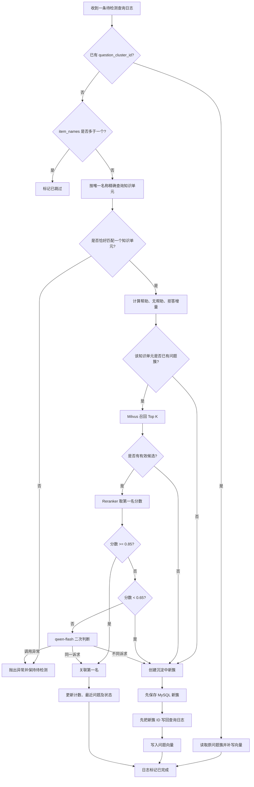

# 第1章 功能一：单题匹配

## 1.1 当前代码的完整流程



## 1.2 匹配 Service 接口与实现

`KnowledgeQuestionClusterMatchService`

```java
/**
 * 单条查询日志的问题簇匹配服务。
 */
public interface KnowledgeQuestionClusterMatchService
{
    /** 串行处理单题并返回关联、新建或跳过动作。 */
    int matchQuestion(Long taskId, KnowledgeQueryLog question, Long operatorUserId);
}
```

`KnowledgeQuestionClusterMatchServiceImpl`

```java
package com.atguigu.kmp.service.impl;

import com.atguigu.kmp.client.KnowledgeQwenRerankerClient;
import com.atguigu.kmp.constant.KnowledgeQueryConstants;
import com.atguigu.kmp.constant.KnowledgeQuestionClusterCheckConstants;
import com.atguigu.kmp.constant.QuestionClusterConstants;
import com.atguigu.kmp.dto.KnowledgeQwenRerankerModels;
import com.atguigu.kmp.dto.KnowledgeRecentQuestion;
import com.atguigu.kmp.entity.KnowledgeQueryLog;
import com.atguigu.kmp.entity.KnowledgeQuestionCluster;
import com.atguigu.kmp.entity.KnowledgeUnit;
import com.atguigu.kmp.service.*;
import com.baomidou.mybatisplus.core.conditions.query.LambdaQueryWrapper;
import com.ruoyi.common.exception.ServiceException;
import lombok.extern.slf4j.Slf4j;
import org.springframework.beans.factory.annotation.Autowired;
import org.springframework.beans.factory.annotation.Value;
import org.springframework.stereotype.Service;

import java.math.BigDecimal;
import java.time.LocalDateTime;
import java.util.ArrayList;
import java.util.List;

/**
 * 单题问题簇三层判断、关联和建簇实现。
 */
@Slf4j
@Service
public class KnowledgeQuestionClusterMatchServiceImpl
        implements KnowledgeQuestionClusterMatchService
{
    @Autowired
    private KnowledgeQueryLogService queryLogService;

    @Autowired
    private KnowledgeQuestionClusterService questionClusterService;

    @Autowired
    private KnowledgeUnitService knowledgeUnitService;

    @Autowired
    private KnowledgeQuestionClusterVectorService vectorService;

    @Autowired
    private KnowledgeQwenRerankerClient rerankerClient;

    @Autowired
    private KnowledgeQuestionClusterSemanticService semanticService;

    @Value("${kmp.question-cluster-check.candidate-top-k}")
    private int candidateTopK;

    @Value("${kmp.question-cluster-check.high-score}")
    private BigDecimal highScore;

    @Value("${kmp.question-cluster-check.medium-score}")
    private BigDecimal mediumScore;

    @Value("${kmp.question-cluster-check.pending-count}")
    private long pendingCount;

    /** {@inheritDoc} */
    @Override
    public int matchQuestion(Long taskId, KnowledgeQueryLog question, Long operatorUserId)
    {
        String rewrittenQuestion = question.getRewirttenQuery().trim();
        log.info("-------------------- [问题簇检测][单题开始] taskId={}，questionId={} --------------------", taskId, question.getId());


        // 幂等性
        // 已保存问题簇 ID 表示上次仅向量写入失败，本次直接补写，禁止重复建簇。
        if (question.getQuestionClusterId() != null)
        {

            // 读取原问题簇并补写向量

            KnowledgeQuestionCluster retryCluster = questionClusterService.getById(question.getQuestionClusterId());
            if (retryCluster == null)
            {
                throw new ServiceException("待补写向量的问题簇不存在");
            }

            log.info("[问题簇检测][恢复处理] 复用已创建问题簇并补写向量，questionId={}，questionClusterId={}", question.getId(), retryCluster.getId());
            vectorService.saveQuestionClusterVector(retryCluster);
            completeQuestion(question, retryCluster.getId());
            logSingleResult(taskId, question.getId(), "补写向量并完成", retryCluster.getId());
            return KnowledgeQuestionClusterCheckConstants.ACTION_CREATED;
        }

        List<String> itemNames = question.getItemNames();

        // 第一层：只接受唯一知识单元，多知识单元问题不适合自动归簇。
        // 问题簇在数据模型上只能挂一个知识单元
        if (itemNames.size() > 1)
        {
            question.setClusterCheckStatus(KnowledgeQuestionClusterCheckConstants.CHECK_SKIPPED);
            question.setUpdateTime(LocalDateTime.now());
            queryLogService.updateById(question);
            log.info("[问题簇检测][第一层：知识单元判断] 结果=跳过，questionId={}，有效知识单元数量={}",
                    question.getId(), itemNames.size());
            logSingleResult(taskId, question.getId(), "跳过多知识单元问题", null);
            return KnowledgeQuestionClusterCheckConstants.ACTION_SKIPPED;
        }

        String submittedItemName = itemNames.get(0).trim();
        List<KnowledgeUnit> units = knowledgeUnitService.list(
                new LambdaQueryWrapper<KnowledgeUnit>()
                        .eq(KnowledgeUnit::getKnowledgeUnitName, submittedItemName)
                        // LIMIT 2 是一个"唯一性探针"——只取 2 条就够区分"有没有重名",而且能顺带把要用的数据拿到。
                        .last("LIMIT 2")
        );
        if (units.size() != 1)
        {
            throw new ServiceException("知识单元名称无法唯一匹配");
        }
        KnowledgeUnit unit = units.get(0);
        log.info("[问题簇检测][第一层：知识单元判断] 结果=通过，questionId={}，knowledgeUnitId={}，itemName={}",
                question.getId(), unit.getId(), unit.getKnowledgeUnitName());

        // 计算问题的统计信息 指标增量
        QuestionMetricDeltas metricDeltas = this.resolveQuestionMetricDeltas(question);

        // 获取当前知识单元下的所有问题簇
        List<KnowledgeQuestionCluster> activeClusters = questionClusterService.list(
                new LambdaQueryWrapper<KnowledgeQuestionCluster>()
                        .eq(KnowledgeQuestionCluster::getKnowledgeUnitId, unit.getId())
                        .orderByAsc(KnowledgeQuestionCluster::getId));

        // 当前知识单元没有历史问题簇时，没有必要调用任何模型。
        if (activeClusters.isEmpty())
        {
            log.info("[问题簇检测][第二层：候选判断] 当前知识单元没有问题簇，直接新建，questionId={}",
                    question.getId());
            Long clusterId = this.createCluster(question, unit, operatorUserId, metricDeltas);
            logSingleResult(taskId, question.getId(), "新建问题簇", clusterId);
            return KnowledgeQuestionClusterCheckConstants.ACTION_CREATED;
        }

        // 获取候选对象
        List<KnowledgeQuestionCluster> candidates = vectorService.searchCandidates(
                rewrittenQuestion, unit.getKnowledgeUnitName().trim(), unit.getId(), candidateTopK
        );
        log.info("[问题簇检测][第二层：向量召回] questionId={}，有效候选数量={}，TopK={}",
                question.getId(), candidates.size(), candidateTopK);
        // 向量库无有效候选时按新问题处理，避免引入失败明细和人工重试。
        if (candidates.isEmpty())
        {
            Long clusterId = createCluster(question, unit, operatorUserId, metricDeltas);
            log.info("[问题簇检测][第二层：候选判断] 结果=无候选，新建问题簇，questionId={}，questionClusterId={}",
                    question.getId(), clusterId);
            logSingleResult(taskId, question.getId(), "新建问题簇", clusterId);
            return KnowledgeQuestionClusterCheckConstants.ACTION_CREATED;
        }

        List<KnowledgeQwenRerankerModels.RankedCandidate> ranked = rerankerClient
                .rerank(rewrittenQuestion, candidates);
        KnowledgeQwenRerankerModels.RankedCandidate first = ranked.get(0);
        BigDecimal firstScore = first.getScore();
        log.info("[问题簇检测][第二层：重排判断] questionId={}，第一候选ID={}，得分={}，高分阈值={}，中分阈值={}",
                question.getId(), first.getCandidate().getId(), firstScore, highScore, mediumScore);

        // 高分直接关联，低分直接建簇，只有中间灰区才进入第三层 LLM 判断。
        if (firstScore.compareTo(highScore) >= 0)
        {
            Long clusterId = associateCluster(first.getCandidate(), question, operatorUserId, metricDeltas);
            log.info("[问题簇检测][第二层：重排判断] 结果=高分直接关联，questionId={}，questionClusterId={}",
                    question.getId(), clusterId);
            logSingleResult(taskId, question.getId(), "关联已有问题簇", clusterId);
            return KnowledgeQuestionClusterCheckConstants.ACTION_MATCHED;
        }
        if (firstScore.compareTo(mediumScore) < 0)
        {
            Long clusterId = createCluster(question, unit, operatorUserId, metricDeltas);
            log.info("[问题簇检测][第二层：重排判断] 结果=低分新建，questionId={}，questionClusterId={}",
                    question.getId(), clusterId);
            logSingleResult(taskId, question.getId(), "新建问题簇", clusterId);
            return KnowledgeQuestionClusterCheckConstants.ACTION_CREATED;
        }

        // 让大模型当"终审裁判",判断这个新问题和重排第一名的候选簇到底是不是同一件事,以决定是关联旧簇还是新建簇。
        boolean matched = semanticService.shouldMatch(rewrittenQuestion, first.getCandidate());
        if (matched)
        {
            Long clusterId = associateCluster(first.getCandidate(), question, operatorUserId, metricDeltas);
            logSingleResult(taskId, question.getId(), "LLM 判断后关联", clusterId);
            return KnowledgeQuestionClusterCheckConstants.ACTION_MATCHED;
        }
        Long clusterId = createCluster(question, unit, operatorUserId, metricDeltas);
        logSingleResult(taskId, question.getId(), "LLM 判断后新建", clusterId);
        return KnowledgeQuestionClusterCheckConstants.ACTION_CREATED;
    }

    /** 新建问题簇，先保存 ID 再写入向量，失败后可在下个批次原位补写。 */
    private Long createCluster(KnowledgeQueryLog question, KnowledgeUnit unit,
                               Long operatorUserId, QuestionMetricDeltas metricDeltas)
    {
        String rewrittenQuestion = question.getRewirttenQuery().trim();
        if (rewrittenQuestion.length() > QuestionClusterConstants.MAX_QUESTION_LENGTH)
        {
            throw new ServiceException("新建问题簇的标准问题不能超过200个字符");
        }
        KnowledgeQuestionCluster cluster = new KnowledgeQuestionCluster();
        cluster.setStandardQuestion(rewrittenQuestion);
        cluster.setStandardAnswer(null);
        cluster.setKnowledgeUnitId(unit.getId());
        cluster.setKnowledgeGroupId(unit.getKnowledgeGroupId());
        cluster.setStatus(QuestionClusterConstants.STATUS_ACCUMULATING);
        cluster.setAssociationCount(1L);
        cluster.setFaqClickCount(0L);
        cluster.setExposureCount(0L);
        cluster.setHelpfulCount((long) metricDeltas.helpfulDelta());
        cluster.setUnhelpfulCount((long) metricDeltas.unhelpfulDelta());
        cluster.setRefusalCount((long) metricDeltas.refusalDelta());
        cluster.setRecentQuestions(List.of(this.toRecentQuestion(question)));
        cluster.setCreateUserId(operatorUserId);
        cluster.setCreateTime(LocalDateTime.now());
        cluster.setIsDeleted(0);
        questionClusterService.save(cluster);

        // 将问题和刚创建的问题簇的id关联，并存储
        question.setQuestionClusterId(cluster.getId());
        question.setUpdateTime(LocalDateTime.now());
        queryLogService.updateById(question);

        // 生成当前问题的向量
        vectorService.saveQuestionClusterVector(cluster);

        // 设置当前问题日志的检测状态为 “完成”
        completeQuestion(question, cluster.getId());
        return cluster.getId();
    }

    /** 串行累计已有问题簇，并把查询日志标记为已完成。 */
    private Long associateCluster(KnowledgeQuestionCluster candidate, KnowledgeQueryLog question,
                                  Long operatorUserId, QuestionMetricDeltas metricDeltas)
    {
        KnowledgeQuestionCluster current = questionClusterService.getById(candidate.getId());
        if (current == null)
        {
            throw new ServiceException("候选问题簇已失效");
        }
        List<KnowledgeRecentQuestion> recentQuestions = new ArrayList<>(current.getRecentQuestions() == null
                ? List.of() : current.getRecentQuestions());
        recentQuestions.removeIf(item -> question.getId().toString().equals(item.getQuestionId()));
        recentQuestions.add(0, toRecentQuestion(question));
        if (recentQuestions.size() > 10)
        {
            recentQuestions = new ArrayList<>(recentQuestions.subList(0, 10));
        }

        long newCount = valueOrZero(current.getAssociationCount()) + 1;
        current.setAssociationCount(newCount);
        current.setHelpfulCount(valueOrZero(current.getHelpfulCount()) + metricDeltas.helpfulDelta());
        current.setUnhelpfulCount(valueOrZero(current.getUnhelpfulCount()) + metricDeltas.unhelpfulDelta());
        current.setRefusalCount(valueOrZero(current.getRefusalCount()) + metricDeltas.refusalDelta());
        current.setRecentQuestions(recentQuestions);
        // 串行任务不再使用旧值 CAS，达到累计阈值时直接转为待发布。
        if (newCount >= pendingCount
                && Integer.valueOf(QuestionClusterConstants.STATUS_ACCUMULATING).equals(current.getStatus()))
        {
            current.setStatus(QuestionClusterConstants.STATUS_PENDING);
        }
        current.setUpdateUserId(operatorUserId);
        current.setUpdateTime(LocalDateTime.now());
        questionClusterService.updateById(current);
        completeQuestion(question, current.getId());
        return current.getId();
    }

    /** 将查询日志标记为已完成并保存问题簇 ID。 */
    private void completeQuestion(KnowledgeQueryLog question, Long clusterId)
    {
        question.setClusterCheckStatus(KnowledgeQuestionClusterCheckConstants.CHECK_COMPLETED);
        question.setQuestionClusterId(clusterId);
        question.setUpdateTime(LocalDateTime.now());
        queryLogService.updateById(question);
    }

    /** 将查询日志转换为最近关联问题快照。 */
    private KnowledgeRecentQuestion toRecentQuestion(KnowledgeQueryLog question)
    {
        KnowledgeRecentQuestion recentQuestion = new KnowledgeRecentQuestion();
        recentQuestion.setQuestionId(question.getId().toString());
        recentQuestion.setRewrittenQuestion(question.getRewirttenQuery().trim());
        recentQuestion.setQuestionTime(question.getRequestStartTime());
        return recentQuestion;
    }

    /** 根据反馈状态和回答类型计算三个累计增量。 */
    private QuestionMetricDeltas resolveQuestionMetricDeltas(KnowledgeQueryLog question)
    {
        // 有帮助
        int helpfulDelta = Integer.valueOf(KnowledgeQueryConstants.FEEDBACK_HELPFUL)
                .equals(question.getFeedbackStatus()) ? 1 : 0;

        // 没帮助
        int unhelpfulDelta = Integer.valueOf(KnowledgeQueryConstants.FEEDBACK_UNHELPFUL)
                .equals(question.getFeedbackStatus()) ? 1 : 0;

        // 拒绝回答（资料缺失）
        // 这个字段的真正用途,是帮运营回答一个问题:"哪些问题很多人在问,但我们的知识库答不上来?"——答案就是"该去补文档了"。
        int refusalDelta = Integer.valueOf(KnowledgeQueryConstants.ANSWER_TYPE_MISSING)
                .equals(question.getAnswerType()) ? 1 : 0;


        return new QuestionMetricDeltas(helpfulDelta, unhelpfulDelta, refusalDelta);
    }

    /** 将可能为空的累计值转换为零。 */
    private long valueOrZero(Long value)
    {
        return value == null ? 0L : value;
    }

    /** 显著打印单题最终动作。 */
    private void logSingleResult(Long taskId, Long questionId, String result, Long clusterId)
    {
        log.info("-------------------- [问题簇检测][单题完成] taskId={}，questionId={}，结果={}，questionClusterId={} --------------------",
                taskId, questionId, result, clusterId);
    }

    /** 单个问题对问题簇三个统计字段的增量。 */
    // 这是一个 Java 16+ 的 record(记录类)，用于封装三个统计字段的增量。
    private record QuestionMetricDeltas(int helpfulDelta, int unhelpfulDelta, int refusalDelta)
    {
        
    }
}
```

`createCluster` 有一个很实用的恢复设计：先保存新簇，再把新簇 ID 写回查询日志，最后写向量。若最后一步失败，下批看到已有 `questionClusterId`，只补写原簇向量，不会再建一个重复簇。

`associateCluster` 依赖任务串行执行：先读取当前累计值，在内存中加上本题增量，再 `updateById`。这不是数据库原子自增，所以不要把同一批问题改成并行处理。

## 1.3 记录类 QuestionMetricDeltas

这是一个 Java 16+ 的 record(记录类)，用于封装三个统计字段的增量。编译器会自动补出下面这一整套东西：

| 自动生成的内容                           | 等价于手写                                                   |
| ---------------------------------------- | ------------------------------------------------------------ |
| 3 个 `private final int` 字段            | `private final int helpfulDelta;` …                          |
| 全参构造器                               | `QuestionMetricDeltas(int a, int b, int c) { this.a = a; ... }` |
| 3 个访问方法                             | `helpfulDelta()`、`unhelpfulDelta()`、`refusalDelta()`       |
| `equals()` / `hashCode()` / `toString()` | 各十几行样板代码                                             |

# 第2章 功能二：问题向量召回

## 2.1 向量 Service

`KnowledgeQuestionClusterVectorService` 添加 `searchCandidates`

```java
/** 按知识单元 ID 和规范名称双重过滤召回候选。 */
List<KnowledgeQuestionCluster> searchCandidates(
        String rewrittenQuestion, String itemName, Long knowledgeUnitId, int topK);
```

## 2.2 Milvus 实现

`KnowledgeQuestionClusterVectorServiceImpl` 添加 `searchCandidates`

```java
@Autowired
@Lazy // 解决循环引用的问题
private KnowledgeQuestionClusterService knowledgeQuestionClusterService;

@Value("${kmp.milvus.embedding-dimension}")
private int embeddingDimension;

/** {@inheritDoc} */
@Override
public List<KnowledgeQuestionCluster> searchCandidates(
        String rewrittenQuestion,String itemName, Long knowledgeUnitId, int topK
)
{
    KnowledgeUnit unit = knowledgeUnitService.getById(knowledgeUnitId);
    if (unit == null || unit.getKnowledgeUnitName() == null
            || !unit.getKnowledgeUnitName().trim().equals(itemName == null ? null : itemName.trim()))
    {
        throw new ServiceException("知识单元名称与归属不一致");
    }

    float[] embedding = embeddingClient.embed(rewrittenQuestion);
    List<Float> vector = new ArrayList<>(embeddingDimension);

    // Milvus SDK 的搜索向量使用装箱 List，维度必须保持固定。
    for (float value : embedding)
    {
        // 自动装箱
        vector.add(value);
    }

    // id：必填的唯一条件
    // item_name： 它的真实身份是"复核断言"
    // 相当于:我不仅要求这些向量属于这个单元,还要求它们当初写入时记录的名字和现在我说的这个名字对得上。
    String expression = "knowledge_unit_id == " + knowledgeUnitId;
    R<SearchResults> response;
    try
    {
        response = milvusServiceClient.search(
                SearchParam
                        .newBuilder()
                        .withCollectionName(collectionName)
                        .withVectorFieldName("embedding")
                        .withMetricType(MetricType.COSINE)
                        .withTopK(topK)
                        .withExpr(expression)
                        // 只需要返回问题簇 ID
                        .withOutFields(Collections.singletonList("question_cluster_id"))
                        // 将 vector 交给milvus，做相似度比对
                        // "Milvus,拿这个向量(这个问题),去库里找出和它最像的前 topK 个问题簇。
                        .withVectors(Collections.singletonList(vector))
                        .build()
        );
    }
    catch (RuntimeException exception)
    {
        throw new ServiceException("问题簇向量召回失败");
    }

    // 从 Milvus 响应里取出查询向量的比对结果（ID+分数的榜单）
    List<SearchResultsWrapper.IDScore> idScores =
            new SearchResultsWrapper(response.getData().getResults()).getIDScore(0);
    // 一个候选都没召回，返回空列表
    if (idScores == null || idScores.isEmpty())
    {
        return Collections.emptyList();
    }

    // 和用户问题最相关的问题簇的前10名
    // 只留 ID，按相似度从高到低排好序
    List<Long> candidateIds = idScores.stream().map(SearchResultsWrapper.IDScore::getLongID).toList();
    // 拿这批 ID 去 MySQL 查回完整的问题簇记录
    List<KnowledgeQuestionCluster> clusters = knowledgeQuestionClusterService.listByIds(candidateIds);
    // 建 ID→问题簇 的查找表
    Map<Long, KnowledgeQuestionCluster> clusterMap = new HashMap<>();
    // MySQL 是归属与有效性的事实来源，Milvus 脏数据在此被忽略。
    for (KnowledgeQuestionCluster cluster : clusters)
    {
        // 归属对不上的（已被删/已改到别的单元）丢弃
        if (Objects.equals(knowledgeUnitId, cluster.getKnowledgeUnitId()))
        {
            // 只把校验通过的放进查找表
            clusterMap.put(cluster.getId(), cluster);
        }
    }
    // 按 Milvus 的相似度顺序回排有效结果，查不到的（null）跳过
    List<KnowledgeQuestionCluster> ordered = candidateIds.stream()
            .map(clusterMap::get).filter(Objects::nonNull).toList();
    // 记录召回数量与有效数量的对比，便于发现向量库脏数据
    log.debug("完成问题簇向量召回，knowledgeUnitId={}，milvusCount={}，validCount={}",
            knowledgeUnitId, candidateIds.size(), ordered.size());
    // 返回最终候选列表
    return ordered;
}
```

保存使用 upsert，同一个问题簇重试不会多出一条向量。召回后还会回查 MySQL，并再次核对知识单元 ID；Milvus 只负责找候选，不能取代 MySQL 的业务事实。

# 第3章 功能三：Reranker 与大模型二次判断

## 3.1 Reranker

请求和响应对象：

```java
/**
 * 百炼文本重排 REST 请求与响应契约。
 */
public final class KnowledgeQwenRerankerModels
{
    private KnowledgeQwenRerankerModels()
    {
    }

    @Data
    public static class Request
    {
        private String model;
        private Input input;
        private Parameters parameters;
    }

    @Data
    public static class Input
    {
        private String query;
        private List<String> documents;
    }

    @Data
    public static class Parameters
    {
        @JsonProperty("top_n")
        private Integer topN;
        private String instruct;
    }

    @Data
    public static class Response
    {
        private Output output;
        private String code;
        private String message;
        @JsonProperty("request_id")
        private String requestId;
    }

    @Data
    public static class Output
    {
        private List<Result> results;
    }

    @Data
    public static class Result
    {
        private Integer index;
        @JsonProperty("relevance_score")
        private BigDecimal relevanceScore;
    }

    @Data
    public static class RankedCandidate
    {
        private KnowledgeQuestionCluster candidate;
        private BigDecimal score;
    }
}
```

客户端把候选标准问题发给百炼，只接受合法索引和 0～1 分数，并按分数降序返回：

```java
package com.atguigu.kmp.client;

import com.atguigu.kmp.entity.KnowledgeQuestionCluster;
import com.atguigu.kmp.dto.KnowledgeQwenRerankerModels;
import com.ruoyi.common.exception.ServiceException;
import lombok.extern.slf4j.Slf4j;
import org.springframework.beans.factory.annotation.Autowired;
import org.springframework.beans.factory.annotation.Qualifier;
import org.springframework.beans.factory.annotation.Value;
import org.springframework.http.HttpHeaders;
import org.springframework.http.MediaType;
import org.springframework.stereotype.Component;
import org.springframework.web.client.RestClient;
import org.springframework.web.client.RestClientResponseException;

import java.math.BigDecimal;
import java.util.*;

/**
 * 百炼 qwen-reranker 客户端。
 */
@Slf4j
@Component
public class KnowledgeQwenRerankerClient
{

    @Value("${kmp.qwen.base-url}")
    private String qwenBaseUrl;

    @Value("${kmp.qwen.api-key}")
    private String qwenApiKey;

    @Value("${kmp.qwen.reranker-path}")
    private String qwenRerankerPath;

    @Value("${kmp.qwen.reranker-model:qwen3-rerank}")
    private String qwenRerankerModel;

    @Autowired
    @Qualifier("qwenRestClient")
    private RestClient restClient;

    /**
     * 对不超过二十个候选标准问题重排。
     *
     * @param query 改写后的用户问题
     * @param candidates MySQL 回查后的有效候选
     * @return 分数降序候选
     */
    public List<KnowledgeQwenRerankerModels.RankedCandidate> rerank(
            String query, List<KnowledgeQuestionCluster> candidates)
    {
        if (candidates == null || candidates.isEmpty() || candidates.size() > 20)
        {
            throw new ServiceException("重排候选数量不正确");
        }
        if (qwenApiKey == null || qwenApiKey.isBlank())
        {
            throw new ServiceException("未配置百炼 API Key");
        }
        KnowledgeQwenRerankerModels.Request request = new KnowledgeQwenRerankerModels.Request();
        request.setModel(qwenRerankerModel);
        KnowledgeQwenRerankerModels.Input input = new KnowledgeQwenRerankerModels.Input();
        input.setQuery(query);
        input.setDocuments(candidates.stream().map(KnowledgeQuestionCluster::getStandardQuestion).toList());
        request.setInput(input);
        KnowledgeQwenRerankerModels.Parameters parameters = new KnowledgeQwenRerankerModels.Parameters();
        parameters.setTopN(candidates.size());
        parameters.setInstruct("Retrieve semantically similar text.");
        request.setParameters(parameters);
        log.debug("开始问题候选重排，candidateCount={}，queryLength={}", candidates.size(), query.length());

        KnowledgeQwenRerankerModels.Response response;
        try
        {
            response = restClient
                    .post()
                    .uri(qwenBaseUrl + qwenRerankerPath)
                    .contentType(MediaType.APPLICATION_JSON)
                    .header(HttpHeaders.AUTHORIZATION, "Bearer " + qwenApiKey)
                    .body(request)
                    .retrieve()
                    .body(KnowledgeQwenRerankerModels.Response.class);
        }
        catch (RestClientResponseException exception)
        {
            throw translateResponseException(exception);
        }
        catch (RuntimeException exception)
        {
            log.warn("问题候选重排调用失败，reason={}", exception.getClass().getSimpleName());
            throw new ServiceException("问题候选重排失败");
        }
        if (response == null || response.getCode() != null || response.getOutput() == null
                || response.getOutput().getResults() == null || response.getOutput().getResults().isEmpty())
        {
            throw new ServiceException("问题候选重排结果无效");
        }
        List<KnowledgeQwenRerankerModels.RankedCandidate> rankedCandidates = new ArrayList<>();
        Set<Integer> indexes = new HashSet<>();
        // 返回下标必须唯一且可准确映射到原候选，避免关联错误的问题簇。
        for (KnowledgeQwenRerankerModels.Result result : response.getOutput().getResults())
        {
            Integer index = result.getIndex();
            BigDecimal score = result.getRelevanceScore();
            if (index == null || index < 0 || index >= candidates.size() || !indexes.add(index)
                    || score == null || score.compareTo(BigDecimal.ZERO) < 0
                    || score.compareTo(BigDecimal.ONE) > 0)
            {
                throw new ServiceException("问题候选重排结果无效");
            }
            KnowledgeQwenRerankerModels.RankedCandidate ranked =
                    new KnowledgeQwenRerankerModels.RankedCandidate();
            ranked.setCandidate(candidates.get(index));
            ranked.setScore(score);
            rankedCandidates.add(ranked);
        }
        rankedCandidates.sort(Comparator.comparing(
                KnowledgeQwenRerankerModels.RankedCandidate::getScore).reversed());
        log.debug("完成问题候选重排，resultCount={}", rankedCandidates.size());
        return rankedCandidates;
    }

    /** 将百炼 HTTP 错误转换为脱敏业务异常，并保留排障所需的请求标识。 */
    private ServiceException translateResponseException(RestClientResponseException exception)
    {
        String errorCode = null;
        String requestId = null;
        try
        {
            KnowledgeQwenRerankerModels.Response errorResponse =
                    exception.getResponseBodyAs(KnowledgeQwenRerankerModels.Response.class);
            // 百炼错误响应只提取稳定的错误码和请求 ID，避免把上游响应原文落入日志。
            if (errorResponse != null)
            {
                errorCode = errorResponse.getCode();
                requestId = errorResponse.getRequestId();
            }
        }
        catch (RuntimeException parseException)
        {
            log.debug("解析问题候选重排错误响应失败，reason={}",
                    parseException.getClass().getSimpleName());
        }
        log.warn("问题候选重排调用失败，httpStatus={}，errorCode={}，requestId={}",
                exception.getStatusCode().value(), errorCode, requestId);
        return new ServiceException("问题候选重排失败");
    }
}
```

## 3.2 中等分数再问一次大模型

让大模型当"终审裁判",判断这个新问题和重排第一名的候选簇到底是不是同一件事,以决定是关联旧簇还是新建簇。

大模型只返回一个布尔判断对象：

```java
/**
 * 千问二次语义判断结构化输出。
 */
@Data
public class KnowledgeQuestionClusterSemanticResult
{
    private Boolean match;
}
```

Service 接口： `KnowledgeQuestionClusterSemanticService`

```java
/**
 * 问题与候选问题簇的二次语义判断服务。
 */
public interface KnowledgeQuestionClusterSemanticService
{
    /** 判断改写问题是否应关联第一候选。 */
    boolean shouldMatch(String rewrittenQuestion, KnowledgeQuestionCluster candidate);
}
```

实现固定要求结构化输出。模型调用失败或输出为空时直接抛异常，让这道题留到下一批重试：`KnowledgeQuestionClusterSemanticServiceImpl`

```java
/**
 * 使用 qwen-flash 结构化输出完成边界分数二次判断。
 */
@Slf4j
@Service
public class KnowledgeQuestionClusterSemanticServiceImpl
        implements KnowledgeQuestionClusterSemanticService
{
    private static final String SYSTEM_PROMPT = "你是问题语义匹配器。判断用户问题与候选标准问题是否表达同一诉求。"
            + "只输出符合结构的 JSON：{\"match\":true} 或 {\"match\":false}。";

    @Autowired
    private ChatClient.Builder chatClientBuilder;

    /** {@inheritDoc} */
    @Override
    public boolean shouldMatch(String rewrittenQuestion, KnowledgeQuestionCluster candidate)
    {
        log.info("[问题簇检测][第三层：LLM 语义判断] 开始，候选问题簇ID={}", candidate.getId());
        try
        {
            KnowledgeQuestionClusterSemanticResult result = chatClientBuilder.build().prompt()
                    .system(SYSTEM_PROMPT)
                    .user("用户问题：" + rewrittenQuestion + "\n候选标准问题：" + candidate.getStandardQuestion())
                    .call().entity(KnowledgeQuestionClusterSemanticResult.class);
            if (result == null || result.getMatch() == null)
            {
                throw new ServiceException("二次语义判断返回结果无效");
            }
            log.info("[问题簇检测][第三层：LLM 语义判断] 完成，候选问题簇ID={}，是否关联={}",
                    candidate.getId(), result.getMatch());
            return result.getMatch();
        }
        catch (ServiceException exception)
        {
            throw exception;
        }
        catch (RuntimeException exception)
        {
            throw new ServiceException("二次语义判断调用失败");
        }
    }
}
```

## 3.3 chatClientBuilder 

`chatClientBuilder` 靠 Spring AI 的自动配置来创建工作。

**具体链路是：**
依赖引入：`atguigu-kmp/pom.xml` 引入了 `spring-ai-starter-model-openai`
自动配置：该 starter 里的 `OpenAiChatAutoConfiguration` 会在启动时自动注册一个 `prototype` 作用域 的 `ChatClient.Builder` Bean

**使用的是哪个模型？**
模型由 `ruoyi-admin/src/main/resources/application.yml` 的配置决定：

```yml
spring:
  ai:
    openai:
      api-key: sk-...             # 阿里云百炼的密钥
      base-url: https://dashscope.aliyuncs.com/compatible-mode
      chat:
        options:
          model: qwen-flash      # ← 对话模型：通义千问 flash
          temperature: 0         # ← 不做随机发散，回答稳定
```

