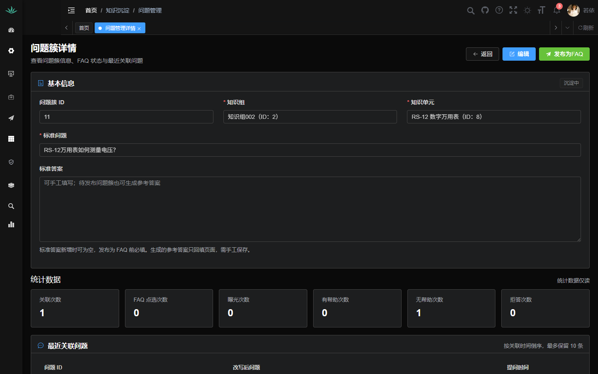
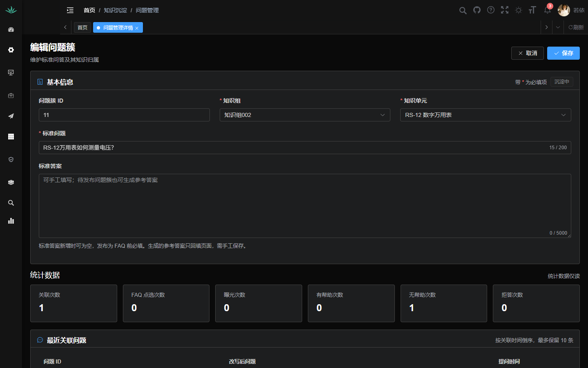
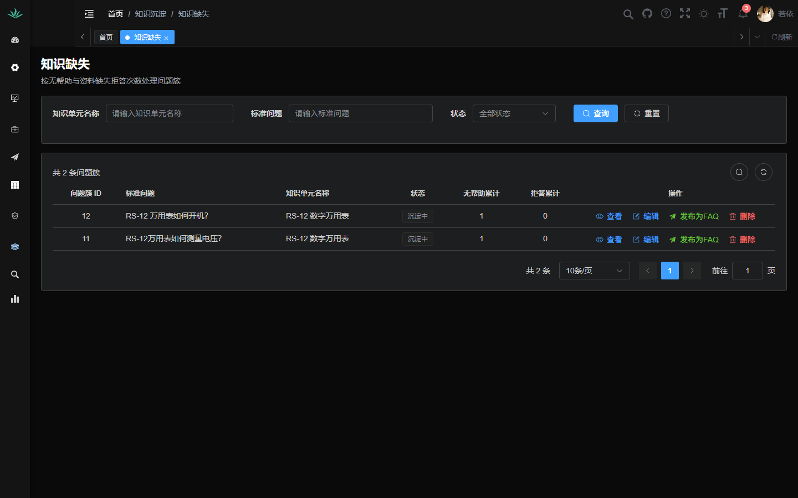

# 第1章 需求分析

知识缺失不是再建一套问题数据，而是从问题簇里挑出两类值得补资料的问题：

- 用户明确点了“无帮助”；
- 知识库因为资料不足而拒答。

运营人员可以查看缺失来源、累计次数和最近关联问题：



进入编辑模式后，可以补充标准答案并将处理完成的问题发布为 FAQ：



# 第2章 功能一：分页查询知识缺失

知识缺失列表只展示无帮助或资料缺失拒答累计大于零的问题簇，并把两个缺失计数显示在列表中：



## 2.1 Controller 

知识缺失复用问题簇实体、Mapper、Service 和 Controller。

`KnowledgeQuestionClusterController` 中添加接口定义

```java
/**
 * GET /kmp/questionCluster/missing/list：分页查询知识缺失问题簇。
 *
 * @param query 查询条件
 * @return 按缺失合计降序的若依分页响应
 */
@PreAuthorize("@ss.hasPermi('kmp:knowledgeMissing:list')")
@GetMapping("/missing/list")
public TableDataInfo missingList(KnowledgeQuestionCluster query)
{
    PageDomain pageDomain = TableSupport.buildPageRequest();
    IPage<KnowledgeQuestionCluster> result = knowledgeQuestionClusterService.pageKnowledgeMissing(
            new Page<>(pageDomain.getPageNum(), pageDomain.getPageSize()), query);
    TableDataInfo response = new TableDataInfo(result.getRecords(), result.getTotal());
    response.setCode(HttpStatus.SUCCESS);
    response.setMsg("查询成功");
    return response;
}
```

## 2.2 Service

`KnowledgeQuestionClusterService` 增加方法：

```java
/** 分页查询存在无帮助或资料缺失拒答的问题簇。 */
IPage<KnowledgeQuestionCluster> pageKnowledgeMissing(Page<KnowledgeQuestionCluster> page, KnowledgeQuestionCluster query);
```

实现层先复用问题管理的状态校验，再清理两个文本条件：

```java
/** {@inheritDoc} */
@Override
public IPage<KnowledgeQuestionCluster> pageKnowledgeMissing(Page<KnowledgeQuestionCluster> page, KnowledgeQuestionCluster query)
{
    query.setKnowledgeUnitName(query.getKnowledgeUnitName());
    query.setStandardQuestion(query.getStandardQuestion());

    IPage<KnowledgeQuestionCluster> result = baseMapper.selectKnowledgeMissingPage(page, query);
    return result;
}
```

## 2.3 Mapper 


```java
package com.atguigu.kmp.mapper;

public interface KnowledgeQueryLogMapper extends BaseMapper<KnowledgeQueryLog> {

    /** 分页查询知识缺失计数大于零的问题簇。 */
    IPage<KnowledgeQuestionCluster> selectKnowledgeMissingPage(Page<KnowledgeQuestionCluster> page, @Param("query") KnowledgeQuestionCluster query);
}
```

SQL 复用问题管理的三个筛选条件，只增加缺失条件和缺失优先排序。`COALESCE` 是为了兼容旧数据中的空值。

```xml
<!-- 知识缺失是问题簇运营视图，仅返回无帮助与资料缺失拒答合计大于零的记录。 -->
<select id="selectKnowledgeMissingPage" resultMap="KnowledgeQuestionClusterResult">
    SELECT
    qc.*,
    ku.knowledge_unit_name,
    kg.knowledge_group_name

    FROM kmp_knowledge_question_cluster qc
    INNER JOIN kmp_knowledge_unit ku
    ON ku.id = qc.knowledge_unit_id
    AND ku.is_deleted = 0

    INNER JOIN kmp_knowledge_group kg
    ON kg.id = qc.knowledge_group_id
    AND kg.is_deleted = 0

    WHERE qc.is_deleted = 0

    AND (COALESCE(qc.unhelpful_count, 0) + COALESCE(qc.refusal_count, 0)) &gt; 0

    <if test="query.knowledgeUnitName != null and query.knowledgeUnitName != ''">
        AND ku.knowledge_unit_name LIKE CONCAT('%', #{query.knowledgeUnitName}, '%')
    </if>
    <if test="query.standardQuestion != null and query.standardQuestion != ''">
        AND qc.standard_question LIKE CONCAT('%', #{query.standardQuestion}, '%')
    </if>
    <if test="query.status != null">
        AND qc.status = #{query.status}
    </if>
    ORDER BY (COALESCE(qc.unhelpful_count, 0) + COALESCE(qc.refusal_count, 0)) DESC,
    qc.id DESC
</select>
```

# 第3章 功能二：日志开放接口

## 3.1 定义开放接口请求与响应

外部系统提交的时间必须带时区。平台收到后统一换算成上海时间，再写入 Stream：

- `LocalDateTime`:只有"年月日时分秒",不带时区——像写在纸上的"下午 3 点开会",没说是哪个城市的 3 点;
- `OffsetDateTime`:日期时间 + 与格林尼治的时差(如 +08:00)——"15:00 +08:00",在全世界任何角落都能换算成唯一的真实时刻。

```java
/**
 * 外部知识查询服务与平台之间的日志契约模型。
 *
 * <p>跨系统字段需要明确时区且不能暴露日志表审计字段，因此不直接复用持久化实体。</p>
 */
public final class KnowledgeExternalQueryLogModels
{
    private KnowledgeExternalQueryLogModels()
    {
    }

    /** 外部服务提交的直接查询终态日志。 */
    @Data
    public static class KnowledgeQueryLogCollectRequest
    {
        /** 全局请求 ID。 */
        @NotBlank(message = "请求 ID 不能为空")
        @Size(max = 128, message = "请求 ID 不能超过128个字符")
        private String requestId;

        /** 当次查询使用的改写问题。 */
        private String rewirttenQuery;

        /** 平台用户 ID，缺失时不计入查询人数。 */
        private Long userId;

        /** 查询开始时间，必须携带时区。 */
        @NotNull(message = "请求开始时间不能为空")
        private OffsetDateTime requestStartTime;

        /** 首个 Token 产生时间。 */
        private OffsetDateTime firstTokenTime;

        /** 输入 Token 数。 */
        @PositiveOrZero(message = "输入 Token 数不能为负数")
        private Long inputTokenCount;

        /** 输出 Token 数。 */
        @PositiveOrZero(message = "输出 Token 数不能为负数")
        private Long outputTokenCount;

        /** 外部知识库匹配到的知识单元名称，用于后续问题簇匹配。 */
        @Size(max = 100, message = "匹配知识单元名称不能超过100个")
        private List<String> itemNames;

        /** 查询终态：1-成功，2-失败。 */
        @NotNull(message = "查询终态不能为空")
        private Integer queryStatus;

        /** 回答类型：0-正常回答，1-资料缺失拒答，2-权限拒答，3-澄清追问。 */
        @NotNull(message = "回答类型不能为空")
        @Min(value = 0, message = "回答类型不正确")
        @Max(value = 3, message = "回答类型不正确")
        private Integer answerType;
    }

    /** 日志进入 Redis Stream 后返回的接收结果。 */
    @Data
    public static class KnowledgeQueryLogCollectResult
    {
        /** 原请求 ID。 */
        private String requestId;

        /** 是否已进入异步缓冲。 */
        private boolean accepted;

        /** Redis Stream 记录 ID。 */
        private String streamRecordId;
    }
}
```

## 3.2 Controller 接收请求

```java
package com.atguigu.kmp.controller;

import org.springframework.beans.factory.annotation.Autowired;
import org.springframework.validation.annotation.Validated;
import org.springframework.web.bind.annotation.PostMapping;
import org.springframework.web.bind.annotation.RequestBody;
import org.springframework.web.bind.annotation.RequestMapping;
import org.springframework.web.bind.annotation.RestController;

import com.atguigu.kmp.dto.KnowledgeExternalQueryLogModels.KnowledgeQueryLogCollectRequest;
import com.atguigu.kmp.dto.KnowledgeExternalQueryLogModels.KnowledgeQueryLogCollectResult;
import com.atguigu.kmp.service.KnowledgeQueryLogService;
import com.ruoyi.common.annotation.Anonymous;
import com.ruoyi.common.core.domain.AjaxResult;

/**
 * 外部知识库直接查询日志接收接口。
 */
@Anonymous
@RestController
@RequestMapping("/openapi/kmp/knowledgeQueryLog")
public class KnowledgeQueryLogController
{
    @Autowired
    private KnowledgeQueryLogService knowledgeQueryLogService;

    /**
     * 接收查询终态并写入 Redis Stream。
     *
     * @param request 查询终态日志
     * @return 异步接收结果
     */
    @PostMapping
    public AjaxResult collect(@Validated @RequestBody KnowledgeQueryLogCollectRequest request)
    {
        KnowledgeQueryLogCollectResult result = knowledgeQueryLogService.saveQueryLog(request);
        return AjaxResult.success("查询日志已接收", result);
    }
}

```

## 3.3 Service

`KnowledgeQueryLogService` 增加方法：

```java
 /** 保存查询日志。 */
KnowledgeQueryLogCollectResult saveQueryLog(KnowledgeQueryLogCollectRequest request);
```

## 3.4 ServiceImpl

`KnowledgeQueryLogServiceImpl` 

```java

/** {@inheritDoc} */
@Override
public KnowledgeQueryLogCollectResult saveQueryLog(KnowledgeQueryLogCollectRequest request)
{                   // 复用现有校验
    String requestId = request.getRequestId().trim();
    List<String> itemNameList = request.getItemNames();

    KnowledgeQueryLog queryLog = new KnowledgeQueryLog();
    queryLog.setRequestId(requestId);
    queryLog.setRewirttenQuery(request.getRewirttenQuery());
    queryLog.setUserId(request.getUserId());
    queryLog.setRequestStartTime(request.getRequestStartTime().atZoneSameInstant(BUSINESS_ZONE).toLocalDateTime());
    queryLog.setFirstTokenTime(request.getFirstTokenTime().atZoneSameInstant(BUSINESS_ZONE).toLocalDateTime());
    queryLog.setInputTokenCount(request.getInputTokenCount());
    queryLog.setOutputTokenCount(request.getOutputTokenCount());
    queryLog.setItemNames(itemNameList);            // 实体有 JacksonTypeHandler，直接给 List 即可
    queryLog.setQueryStatus(request.getQueryStatus());
    queryLog.setAnswerType(request.getAnswerType());
    queryLog.setFeedbackStatus(KnowledgeQueryConstants.FEEDBACK_NONE);
    queryLog.setCreateTime(LocalDateTime.now());
    queryLog.setUpdateTime(LocalDateTime.now());
    queryLog.setIsDeleted(0);

    this.save(queryLog);

    KnowledgeQueryLogCollectResult result = new KnowledgeQueryLogCollectResult();
    result.setRequestId(requestId);
    result.setAccepted(true);
    return result;
}
```

# 第4章 功能三：提交有帮助或无帮助反馈

## 4.1 触发链路

### 4.1.1 按钮渲染

回答卡片 footer 里有两个按钮 `sse-answer/index.vue`

```html
<el-button link ... @click="submitFeedback(1)">有帮助</el-button>
<el-button link ... @click="submitFeedback(2)">无帮助</el-button>
```

### 4.1.2 显示条件

只有同时满足才显示这两个按钮：

- `source === 'ai'`（AI 生成的回答，不是 FAQ 点选）
- `status === 'completed'`（回答已完成，流式输出中/失败/受限都不显示）
- 有正文文本 `displayText`
- `answerType === 0`（正常回答类型）
- 有 `requestId`（已保存查询日志）

## 4.2 Controller 

新增控制层的类 `KnowledgeQueryFeedbackController`

```java
package com.atguigu.kmp.controller;

import org.springframework.beans.factory.annotation.Autowired;
import org.springframework.security.access.prepost.PreAuthorize;
import org.springframework.validation.annotation.Validated;
import org.springframework.web.bind.annotation.PathVariable;
import org.springframework.web.bind.annotation.PutMapping;
import org.springframework.web.bind.annotation.RequestBody;
import org.springframework.web.bind.annotation.RequestMapping;
import org.springframework.web.bind.annotation.RestController;

import com.atguigu.kmp.dto.KnowledgeQueryFeedbackModels.KnowledgeQueryFeedbackRequest;
import com.atguigu.kmp.dto.KnowledgeQueryFeedbackModels.KnowledgeQueryFeedbackResult;
import com.atguigu.kmp.service.KnowledgeQueryLogService;
import com.ruoyi.common.core.controller.BaseController;
import com.ruoyi.common.core.domain.AjaxResult;

import jakarta.validation.constraints.NotBlank;
import jakarta.validation.constraints.Size;

/**
 * 登录用户的直接知识查询反馈接口。
 */
@Validated
@RestController
@RequestMapping("/kmp/knowledgeQuery/log")
public class KnowledgeQueryFeedbackController extends BaseController
{
    @Autowired
    private KnowledgeQueryLogService knowledgeQueryLogService;

    /**
     * 更新当前用户正常回答的反馈状态。
     *
     * @param requestId 查询请求 ID
     * @param request 反馈内容
     * @return 最终保存状态
     */
    @PreAuthorize("@ss.hasPermi('kmp:knowledgeQuery:query')")
    @PutMapping("/{requestId}/feedback")
    public AjaxResult updateFeedback(
            @PathVariable @NotBlank(message = "请求 ID 不能为空")
            @Size(max = 128, message = "请求 ID 不能超过128个字符") String requestId,
            @Validated @RequestBody KnowledgeQueryFeedbackRequest request)
    {
        KnowledgeQueryFeedbackResult result = knowledgeQueryLogService.updateFeedback(
                requestId, getUserId(), request.getFeedbackStatus());
        return AjaxResult.success("反馈成功", result);
    }
}
```

## 4.3 Service 先定义两个动作

`KnowledgeQueryLogService` 增加按请求 ID 查询和更新反馈两个方法：

```java
/** 按请求 ID 查询未删除的直接查询日志。 */
KnowledgeQueryLog getByRequestId(String requestId);

/** 校验日志归属和回答类型后更新用户反馈。 */
KnowledgeQueryFeedbackResult updateFeedback(String requestId, Long userId, Integer feedbackStatus);
```

## 4.4 根据请求Id查询

按请求 ID 查询很简单，直接使用 MyBatis-Plus：

```java
/** {@inheritDoc} */
@Override
public KnowledgeQueryLog getByRequestId(String requestId)
{
    return lambdaQuery()
            .eq(KnowledgeQueryLog::getRequestId, requestId)
            .last("LIMIT 1")
            .one();
}
```

## 4.5 Service 完成归属、类型和幂等校验

更新反馈时按这个顺序走：先验反馈值，再查日志，再验归属，再验回答类型，最后更新。日志不存在和日志不属于当前用户使用同一个提示，不能让人拿请求 ID 探测别人的记录。

```java
/** {@inheritDoc} */
@Override
@Transactional(rollbackFor = Exception.class)
public KnowledgeQueryFeedbackResult updateFeedback(String requestId, Long userId, Integer feedbackStatus)
{

    String normalizedRequestId = requestId == null ? "" : requestId.trim();
    if (!Integer.valueOf(KnowledgeQueryConstants.FEEDBACK_HELPFUL).equals(feedbackStatus)
            && !Integer.valueOf(KnowledgeQueryConstants.FEEDBACK_UNHELPFUL).equals(feedbackStatus))
    {
        throw new ResponseStatusException(HttpStatus.BAD_REQUEST, "反馈状态不正确");
    }

    KnowledgeQueryLog queryLog = this.getByRequestId(normalizedRequestId);
    // 不区分日志不存在与不属于当前用户，避免泄露他人的查询记录。
    if (queryLog == null || userId == null || !userId.equals(queryLog.getUserId()))
    {
        log.warn("直接查询反馈日志不存在，requestId={}，userId={}", normalizedRequestId, userId);
        throw new ServiceException("查询日志尚未生成，请稍后重试");
    }
    // 资料缺失、权限拒答和澄清追问均不是可评价的正常回答。
    if (!Integer.valueOf(KnowledgeQueryConstants.ANSWER_TYPE_NORMAL).equals(queryLog.getAnswerType()))
    {
        log.warn("该回答不支持反馈，requestId={}，userId={}", normalizedRequestId, userId);
        throw new ServiceException("该回答不支持反馈");
    }

    Integer oldFeedbackStatus = queryLog.getFeedbackStatus();
    // 相同反馈重复提交是幂等成功，不产生无意义的更新时间变更。
    if (!feedbackStatus.equals(oldFeedbackStatus))
    {
        lambdaUpdate()
                .eq(KnowledgeQueryLog::getId, queryLog.getId())
                .set(KnowledgeQueryLog::getFeedbackStatus, feedbackStatus)
                .set(KnowledgeQueryLog::getUpdateTime, LocalDateTime.now())
                .update();
    }

    KnowledgeQueryFeedbackResult result = new KnowledgeQueryFeedbackResult();
    result.setRequestId(normalizedRequestId);
    result.setFeedbackStatus(feedbackStatus);
    log.info("直接查询反馈已保存，requestId={}，userId={}，feedbackStatus={}",
            normalizedRequestId, userId, feedbackStatus);
    log.debug("完成提交直接查询反馈，requestId={}，userId={}，oldFeedbackStatus={}，newFeedbackStatus={}",
            normalizedRequestId, userId, oldFeedbackStatus, feedbackStatus);
    return result;
}
```


### 


