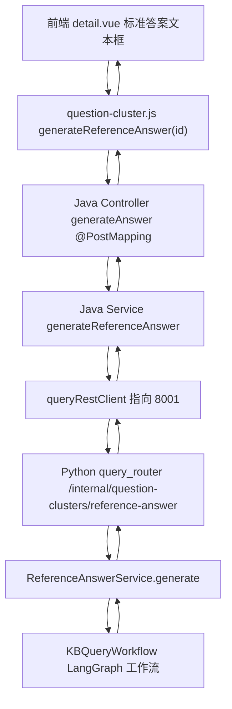

# 第1章 背景与目标

问题管理详情页提供"生成参考答案"按钮：管理员对某个**问题簇（Question Cluster）**点生成，系统用其**标准问题**走知识库查询工作流（LangGraph）实时生成一段答案，仅**回填到前端"标准答案"文本框**，不落库，管理员确认后再手工保存。

本文从 Java 接口方法定义出发，按调用链路自顶向下梳理"生成答案"功能。

# 第2章 调用链路总览



链路上有以下契约必须严格对齐：

**前端读 `response.data.referenceAnswer`** → **Java 响应 `Map{referenceAnswer}`** → **Python 响应 `{code,message,data:{referenceAnswer}}`** 

**Java→Python 请求体为 JSON（驼峰字段）**。

# 第3章 Java 接口方法定义

`KnowledgeQuestionClusterController`：

```java
@PreAuthorize("@ss.hasPermi('kmp:questionCluster:generate')")
@PostMapping("/{id}/reference-answer")
public AjaxResult generateAnswer(@PathVariable @Positive(message = "问题簇 ID 不正确") Long id)
{
    String answer = knowledgeQuestionClusterService.generateReferenceAnswer(id);
    Map<String, Object> result = new HashMap<>();
    result.put("referenceAnswer", answer == null ? "" : answer);
    return AjaxResult.success("生成参考答案成功", result);
}
```

要点：`result` 的键**必须叫 `referenceAnswer`**，与前端 `response.data.referenceAnswer` 一致。

# 第4章 Java 配置与新 Bean

## 4.1 `application.yml`（`kmp:` 下新增，与 `knowledge-system` 同级）

```yaml
  knowledge-query:
    base-url: http://localhost:8001
    connect-timeout: 3s
    read-timeout: 60s
```

## 4.2 `KmpConfig.java` 新增字段与 Bean

```java
@Value("${kmp.knowledge-query.base-url}")
private String knowledgeQueryBaseUrl;

@Value("${kmp.knowledge-query.connect-timeout}")
private Duration knowledgeQueryConnectTimeout;

@Value("${kmp.knowledge-query.read-timeout}")
private Duration knowledgeQueryReadTimeout;

@Bean("knowledgeQueryRestClient")
public RestClient knowledgeQueryRestClient()
{
    SimpleClientHttpRequestFactory requestFactory = new SimpleClientHttpRequestFactory();
    requestFactory.setConnectTimeout(knowledgeQueryConnectTimeout);
    requestFactory.setReadTimeout(knowledgeQueryReadTimeout);

    return RestClient.builder()
            .requestFactory(requestFactory)
            .baseUrl(knowledgeQueryBaseUrl)
            .build();
}
```

# 第5章 Java 契约模型

`ExternalQuestionClusterModels`：

```java
public static class ExternalResponse<T> { Integer code; String message; T data; }
public static class ReferenceAnswerRequest { String requestId; Long questionClusterId; String standardQuestion; String documentId; }
public static class ReferenceAnswerResult  { String referenceAnswer; }
```

> 注意：`ReferenceAnswerRequest` 无 `@JsonProperty`，序列化后是**驼峰** `requestId/questionClusterId/standardQuestion/documentId`，Python 侧必须按驼峰接收。

# 第6章 Java Service 与外部调用

`KnowledgeQuestionClusterServiceImpl.generateReferenceAnswer` 负责组装请求、调用 Python、解析响应。

## 6.1 新增queryRestClient

新增一个专供查询侧的 `queryRestClient`（指向 8001）：

```java
@Autowired
@Qualifier("knowledgeQueryRestClient")
private RestClient queryRestClient;
```

## 4.2 方法实现

```java
@Override
public String generateReferenceAnswer(Long id)
{
    KnowledgeQuestionCluster cluster = this.getById(id);
    KnowledgeUnit knowledgeUnit = knowledgeUnitService.getById(cluster.getKnowledgeUnitId());

    String requestId = UUID.randomUUID().toString();
    ReferenceAnswerRequest request = new ReferenceAnswerRequest();
    request.setRequestId(requestId);
    request.setQuestionClusterId(cluster.getId());
    request.setStandardQuestion(cluster.getStandardQuestion());
    request.setDocumentId(knowledgeUnit.getDocumentId());

    ExternalResponse<ReferenceAnswerResult> response = queryRestClient.post()
            .uri("/internal/question-clusters/reference-answer")
            .contentType(MediaType.APPLICATION_JSON)                 // 修复1：强制JSON，避免被序列化成XML
            .body(request)
            .retrieve()
            .body(new ParameterizedTypeReference<>() {});            // 修复2：保留泛型，避免data被反序列化成LinkedHashMap

    ReferenceAnswerResult result = response.getData();
    return result == null ? "" : result.getReferenceAnswer();
}
```

# 第7章 Python 接口

## 7.1  `query_router.py`（8001）

新增路由（用同步 `def`，让 FastAPI 在线程池执行，避免阻塞事件循环）：
```python
@app.post(
    "/internal/question-clusters/reference-answer",
    summary="生成问题簇参考答案",
    description="复用知识库查询工作流，为问题簇的标准问题生成参考答案（仅回填页面，不落库）",
    response_model=ReferenceAnswerResponse,
)
def generate_reference_answer(
        request: ReferenceAnswerRequest,
        service: ReferenceAnswerService = Depends(get_reference_answer_service),
):
    try:
        answer = service.generate(request)
        return ReferenceAnswerResponse(
            code=0, message="success",
            data=ReferenceAnswerData(referenceAnswer=answer),
        )
    except Exception as exc:
        logger.exception(f"生成参考答案失败: {exc}")
        return ReferenceAnswerResponse(
            code=500, message="生成参考答案失败",
            data=ReferenceAnswerData(referenceAnswer=""),
        )
```

# 第8章 Python 契约模型

`atguigu/schema/reference_answer_schema.py`：

```python
class ReferenceAnswerRequest(BaseModel):
    model_config = ConfigDict(populate_by_name=True)
    request_id: str = Field(default="", alias="requestId")
    question_cluster_id: int | None = Field(default=None, alias="questionClusterId")
    standard_question: str = Field(..., alias="standardQuestion")
    document_id: str = Field(default="", alias="documentId")

class ReferenceAnswerData(BaseModel):
    model_config = ConfigDict(populate_by_name=True)
    reference_answer: str = Field(default="", alias="referenceAnswer")

class ReferenceAnswerResponse(BaseModel):
    code: int = Field(default=0)
    message: str = Field(default="success")
    data: ReferenceAnswerData = Field(default_factory=ReferenceAnswerData)
```

要点：请求用 `alias` 兼容 Java 驼峰；响应用 FastAPI 默认 `response_model_by_alias=True`，把 `reference_answer` 输出为 `referenceAnswer`，对齐 Java。

# 第9章 Python 服务：复用 LangGraph 工作流

`atguigu/services/reference_answer_service.py`（不变）：

```python
class ReferenceAnswerService:
    def generate(self, request: ReferenceAnswerRequest) -> str:
        standard_question = (request.standard_question or "").strip()
        if not standard_question:
            return ""

        request_id = request.request_id or str(uuid.uuid4())
        init_state = {
            "original_query": standard_question,
            "task_id": request_id,
            "request_id": request_id,
            "session_id": f"reference-answer-{request_id}",   # 一次性会话，避免污染真实FAQ历史
            "user_id": 1,
            "request_start_time": datetime.now(ZoneInfo("Asia/Shanghai")),
            "is_stream": False,
        }
        # 未创建SSE队列、未注册指标上下文：工作流内 push_sse_event / record_usage 均为安全空操作
        final_state = KBQueryWorkflow.create_and_run(init_state, stream=False) or {}
        return final_state.get("answer") or ""
```

设计取舍：
- 直接调用生产同款 `KBQueryWorkflow`，用 `invoke`（`stream=False`）拿终态 `answer`。
- 不建 SSE 队列、不调 `query_metrics_registry.start/finish` → 不推流、不上报查询日志。
- 工作流按**商品名(item_name)**检索，不使用 `document_id`；识别不到商品名时会走澄清/拒答分支，返回的 `answer` 可能是提示语而非真正答案（属现有工作流固有行为）。

# 第10章 依赖注入

`atguigu/core/deps.py` 已提供：
```python
@lru_cache
def get_reference_answer_service() -> ReferenceAnswerService:
    return ReferenceAnswerService()
```
`query_router.py` 通过 `Depends(get_reference_answer_service)` 复用，无需新增。

# 第11章 前端回填（无需改动）

`frontend/src/views/kmp/quest/detail.vue`：
```js
const response = await generateReferenceAnswer(form.id)
form.standardAnswer = response.data?.referenceAnswer || originalAnswer
```
`frontend/src/api/kmp/question-cluster.js` 已定义 `generateReferenceAnswer(id)` → `POST /kmp/questionCluster/${id}/reference-answer`。前端契约与后端 `Map{referenceAnswer}` 对齐，迁移工作**不涉及前端改动**。

# 第12章 注意事项

1. **超时链路**：Java→Python 的 `read-timeout` 建议 60s；但前端 axios `timeout` 为 20s，工作流超过 20s 前端会先超时。必要时同步调大前端该请求超时。
2. **重启顺序**：改动生效需重启 Java 服务，并重启 8001 的 `query_router`。
