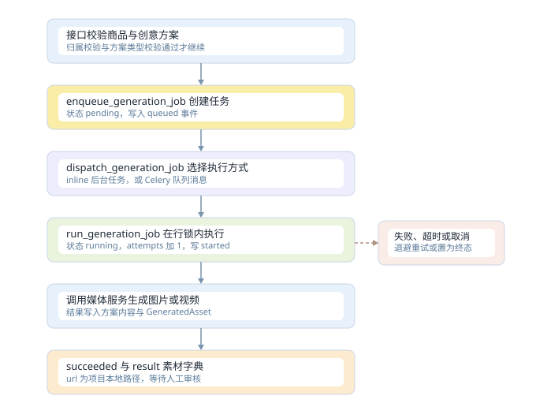
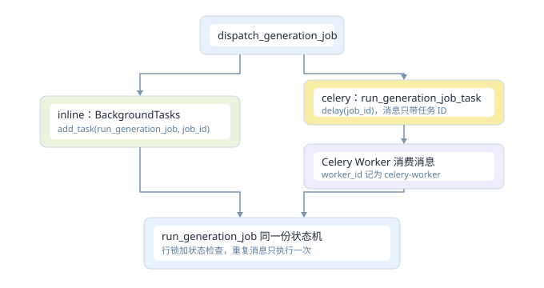
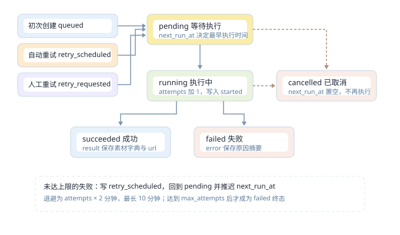
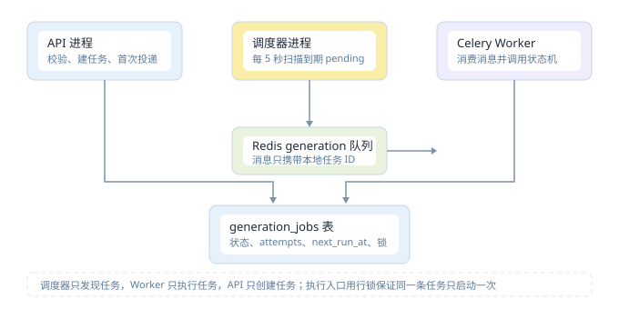

# 09 《电商运营助手》后台生成任务与可靠执行

> 媒体生成服务已经能产出图片与视频，但它有一个绕不过去的限制：一次生成要几十秒甚至几分钟，HTTP 请求不可能一直等到结果返回。本篇要解决的正是这件事——把耗时生成变成一条可查询、可重试、可取消的后台任务。
>
> 本篇完成后，提交主图或视频生成不再直接返回文件，而是返回 `202` 和一条本地任务记录。任务由 inline 后台线程或 Celery Worker 执行，状态、尝试次数、错误摘要与事件流都留在数据库里，随时可以查询。
>
> 有一条边界需要先讲清楚：本篇不新增任何媒体能力，也不改动素材服务与提示词逻辑。它只负责四件事——任务怎么建、怎么排队、怎么执行、失败之后怎么办。

本篇继续沿用同一个贯穿案例。

| 项目 | 贯穿案例取值 |
|---|---|
| 商品 | 便携装每日坚果 25g×30 袋 |
| 平台与类目 | 某电商平台 / 坚果炒货 |
| 售价与成本 | 39.9 元 / 22.5 元 |
| 已生成的主图方案 | 类型为 `main_image`，含 `image_prompt` |
| 已生成的视频脚本 | 类型为 `video_script`，含 `video_prompt` |
| 本篇要提交的任务 | 主图任务 `main_image_asset`、视频任务 `video_asset` |

## 一、生成任务与状态机

> 本章先讲清为什么耗时生成必须任务化，以及状态与事件如何分工，后面几章再逐个实现代码。

### 1.1 耗时生成必须任务化的原因

媒体生成与文本生成有一个本质区别：文本调用通常在几秒内返回，失败还能退回规则继续服务；媒体生成动辄几十秒，失败之后既不能伪造图片，也没有「规则版图片」可以兜底。

如果让 HTTP 请求一直等到生成结束，会遇到下面这些问题。

| 同步调用会遇到的问题 | 任务化之后的做法 |
|---|---|
| 网关、代理或客户端超时，连接断开后结果无人接收 | 接口立即返回 `202`，把执行交给后台 |
| 无法知道进行到哪一步、失败在哪一步 | 数据库保存状态、尝试次数、错误摘要与事件流 |
| 偶发失败即丢失，只能靠用户重新点一次 | 按退避时间自动重试，保留同一个任务 ID |
| 提交后无法中止，只能等它跑完 | 提供取消接口，执行前再次检查状态 |
| 用户连点或队列重投导致重复生成 | 行锁加状态检查，重复消息只会真正执行一次 |

任务化不是把耗时操作「挪到后台」这么简单。它要求**业务事实先落库**：任务记录必须先存在，后台进程才有东西可以查、可以改、可以汇报。

### 1.2 本篇在项目中的位置与产物

**图 1-1：后台生成任务数据流**



图中自上而下是本篇的完整链路。起点是商品详情里已经存在的创意方案，终点是可查询的任务记录与项目自己的素材文件。

链路中每一步的职责如下表所示。

| 阶段 | 输入 | 输出 | 失败时的行为 |
|---|---|---|---|
| 校验资源 | 商品 ID、方案 ID | 通过或 404 / 400 | 直接返回错误，不创建任务 |
| 创建任务 | 商品、方案、任务种类 | `pending` 任务与 `queued` 事件 | 校验不通过时不落库 |
| 分发任务 | 任务 ID | 一条队列消息或一个后台任务 | 分发失败保留 `pending`，由调度器补投 |
| 执行任务 | 任务 ID | 状态变更与事件 | 异常转为重试或失败，写 `error` |
| 生成素材 | 已审核方案 | 图片或视频文件 | 抛错，由执行流程统一处理 |
| 落地结果 | 素材字典 | `succeeded` 与素材记录 | 不留下半完成结果 |

理解这张表的关键在于：**前四步属于本篇，第五、六步属于媒体生成服务**。本篇不关心图片怎么生成，只关心生成动作如何被可靠地排上队、执行完、记录好。

### 1.3 任务状态与事件的分工

状态回答「现在是什么」，事件回答「经历过什么」。两者分开保存，是为了让查询与排查各取所需。

| 状态 | 含义 | 此时应该做什么 |
|---|---|---|
| `pending` | 已入队，等待执行或等待下一次重试 | 查询进度，不要重复提交 |
| `running` | 已开始执行 | 等待结果，必要时请求取消 |
| `succeeded` | 文件已下载并保存为素材 | 人工审核素材 |
| `failed` | 已达重试上限或不可恢复失败 | 查看错误摘要，修正后重试 |
| `cancelled` | 本项目不再继续执行 | 必要时创建新任务 |

一个任务会经历多个事件。事件只记录安全摘要、当时状态与本地结果地址，不保存供应商密钥或完整的外部响应。

| 事件类型 | 写入时机 | 关键内容 |
|---|---|---|
| `queued` | 任务创建时 | 任务种类与最大尝试次数 |
| `started` | 开始执行时 | 当前是第几次尝试、执行者 |
| `succeeded` | 素材落地后 | 结果地址与尝试次数 |
| `retry_scheduled` | 未达上限的失败 | 错误摘要与下次可执行时间 |
| `failed` | 已达上限的失败 | 错误摘要与尝试次数 |
| `cancelled` | 用户取消成功 | 取消原因 |
| `retry_requested` | 用户手动重试 | 重置后的下次执行时间 |
| `timeout_checked` | 超时任务被回收 | 超时阈值 |

有两个容易写错的地方要区分清楚：`queued` 是事件名，等待状态的值是 `pending`；`retry_scheduled` 不是终态，出现它只说明任务被安排了下一次执行。

### 1.4 两种执行方式的选择

同一个任务可以用两种方式执行，选择由配置项 `TASK_QUEUE_BACKEND` 决定。

| 对比项 | inline | Celery |
|---|---|---|
| 执行位置 | API 进程内的后台任务 | 独立 Worker 进程 |
| 依赖 | 无需额外服务 | 需要 Redis 与 Worker |
| 进程重启后 | 未完成的任务不会自动恢复 | 消息仍在队列中，可由 Worker 继续消费 |
| 并发与扩展 | 受 API 进程限制 | 可横向增加 Worker |
| 适合场景 | 本地开发、轻量部署、学习演示 | 接近生产的部署 |

两种方式复用同一条业务逻辑：无论消息来自哪里，最终都调用同一个 `run_generation_job()`。区别只在「谁来调用它」。

**图 1-2：inline 与 Celery 两种执行方式**



### 1.5 本篇开发总览

| 顺序 | 文件 | 先完成的能力 |
|---:|---|---|
| 1 | `services/generation_jobs.py` | 本地任务、事件、状态流转、重试、超时处理 |
| 2 | `api/routes/products.py` | 校验资源后创建任务，返回 `202 Accepted` |
| 3 | `worker/celery_app.py` | 连接 Redis 并注册生成任务队列 |
| 4 | `worker/tasks.py` | 把消息中的任务 ID 交给服务层 |
| 5 | `worker/generation_scheduler.py` | 扫描到期任务并重新投递 |

`GenerationJob` 与 `GenerationJobEvent` 两张表在数据模型设计中已经建好，本篇**不新建表、不生成迁移**，只在这两张表上实现状态机。

## 二、任务记录的数据契约

> 本章把两张表的字段与取值讲清楚。后面所有代码都在操作这些字段，先有准确印象再写代码会轻松很多。

### 2.1 生成任务记录的字段

`GenerationJob` 是一条任务的主记录。

| 字段 | 类型 | 含义 |
|---|---|---|
| `product_id` | 整数 | 所属商品，所有任务接口都要先校验它 |
| `creative_plan_id` | 整数 | 要生成的创意方案 |
| `kind` | 枚举 | 任务种类：`main_image_asset` 或 `video_asset` |
| `status` | 枚举 | 当前状态，`pending`、`running`、`succeeded`、`failed`、`cancelled` |
| `result` | JSON | 成功后的素材字典，等待执行时为空对象 |
| `error` | 文本 | 失败原因摘要，最长 2000 字符 |
| `attempts` | 整数 | 已实际开始执行的次数，不是页面刷新次数 |
| `max_attempts` | 整数 | 最大尝试次数，默认 3，包含第一次执行 |
| `locked_at` | 时间 | 加锁时间，用于判断执行是否超时 |
| `locked_by` | 字符串 | 执行者标识，结束执行后清空 |
| `next_run_at` | 时间 | 最早可执行时间，为 `null` 表示没有等待约束 |
| `started_at` | 时间 | 本次执行的开始时间 |
| `finished_at` | 时间 | 本次执行的结束时间，不代表成功 |

`locked_at` 与 `locked_by` 不是业务字段，而是并发保护留下的痕迹。任务开始执行时写入，执行结束（无论成功失败）清空；如果进程异常退出，这两个值会一直留着，正好成为超时回收的判断依据。

### 2.2 任务事件记录的字段

`GenerationJobEvent` 依附于任务，通过 `job.events` 关系访问，按创建时间倒序排列。

| 字段 | 类型 | 含义 |
|---|---|---|
| `job_id` | 整数 | 所属任务 |
| `event_type` | 字符串 | 事件类型，见 1.3 |
| `status` | 枚举 | 写入事件时的任务状态 |
| `message` | 文本 | 人类可读的说明，失败时为错误摘要 |
| `payload` | JSON | 结构化细节，如尝试次数、下次执行时间、结果地址 |
| `worker_id` | 字符串 | 执行者标识，由执行流程传入 |

事件是排查的主要依据。一个正常成功的任务至少有三条事件：`queued`、`started`、`succeeded`。

### 2.3 状态流转

**图 2-1：任务状态与事件**



图中有三条容易看漏的规则。

第一，`running` 只能由 `pending` 进入。执行入口在行锁内检查状态，任务已被取消、已成功或被其他 Worker 抢先处理时，本次调用直接返回。

第二，`failed` 与 `cancelled` 是终态。它们不会被自动改回 `pending`，只能由用户通过重试接口对 `failed` 任务发起一次新的执行。

第三，`pending` 可以来自三个方向：初次创建、失败后未达上限的自动重试、用户对 `failed` 任务手动重试。三者都会设置 `next_run_at`，区别只在于事件类型与 `attempts` 是否清零。

### 2.4 事件类型清单

| 事件类型 | 由哪个函数写入 | 任务状态如何变化 |
|---|---|---|
| `queued` | `enqueue_generation_job()` | 新建即 `pending` |
| `started` | `_mark_running()` | `pending` → `running` |
| `succeeded` | `run_generation_job()` | `running` → `succeeded` |
| `retry_scheduled` | `_mark_failed_or_retry()` | `running` → `pending` |
| `failed` | `_mark_failed_or_retry()` | `running` → `failed` |
| `cancelled` | `cancel_generation_job_record()` | `pending` / `running` → `cancelled` |
| `retry_requested` | `retry_generation_job_record()` | `failed` → `pending` |
| `timeout_checked` | `mark_stale_running_generation_jobs()` | `running` → `pending` 或 `failed` |

事件只增不改。即使任务被反复重试，历史事件也会完整保留，这正是「同一个 ID 串起完整生命周期」的基础。

## 三、运行环境与配置准备

> 本篇新增了进程间协作，运行依赖比只跑一个 API 进程时更多。动手写代码之前，先把配置项与检查项确认一遍。

### 3.1 配置项

这三个配置项在项目配置类中已经定义，本篇只需要在 `api/.env` 里设置正确的值，不需要修改配置类。

| 配置项 | 默认值 | 作用 |
|---|---|---|
| `TASK_QUEUE_BACKEND` | `inline` | 执行方式：`inline` 用后台任务，`celery` 用独立 Worker |
| `REDIS_URL` | `redis://127.0.0.1:6379/0` | Celery 的消息队列与结果存储地址 |
| `CELERY_TASK_DEFAULT_QUEUE` | `generation` | 生成任务使用的队列名 |

`api/.env` 中的写法如下。已有某项时修改它的值，没有时新增一行，不要重复写多行同名配置。

```dotenv
TASK_QUEUE_BACKEND=inline
REDIS_URL=redis://127.0.0.1:6379/0
CELERY_TASK_DEFAULT_QUEUE=generation
```

`REDIS_URL` 需要包含 Redis 密码时，写成 `redis://:密码@127.0.0.1:6379/0` 的形式。API、Worker 与调度器都从这一份配置读取，任何一处不一致都会导致消息投错地方或执行失败。

### 3.2 确认依赖已经安装

`celery[redis]` 已在项目的依赖清单中。首次使用或新环境里，用下面的命令确认 Celery 命令可用。

```powershell
cd api
uv sync
uv run celery --version
```

能打印版本号即说明依赖就绪。如果提示找不到命令，先执行 `uv sync` 再重试，不要用系统 Python 单独安装 Celery，避免与项目虚拟环境里的版本不一致。

### 3.3 运行前环境检查

| 检查项 | 为什么必须检查 |
|---|---|
| API、MySQL、Redis 地址 | Windows 本机、Docker、WSL2 中的 `127.0.0.1` 并不代表同一个服务 |
| API 与 Worker 的 `uploads` 目录 | Worker 把文件下载到另一个文件系统时，数据库虽然成功，浏览器却打不开素材 |
| `TASK_QUEUE_BACKEND` | 本地可先用 `inline`；没有 Redis 时不要切换到 `celery` |
| Redis 与 Celery 依赖 | 只有依赖安装、Redis 可访问且 Worker 已启动时，`.delay()` 才会被真正消费 |

本地开发优先使用 `inline`：响应返回后由后台任务执行，不会阻塞 HTTP。它不具备进程重启后的恢复能力，适合学习与轻量演示。使用 Celery 时，顺序是**先启动 Redis，再启动 Worker，最后启动 API**；消息里只传任务 ID，Worker 再通过数据库加载商品、方案与任务。

## 四、生成任务状态机实现

> 本章实现 `generation_jobs.py`，它是本篇的核心。按 4.1 的步骤逐段写，写完与 4.3 的完整代码一致。

`generation_jobs.py` 不负责登录、商品归属校验，也不解析 HTTP 请求——这些仍然在路由中完成；它也不在路由线程里做图片生成。它只负责创建记录、状态转换、调用媒体服务、保存生成素材、安排重试和写入事件。

### 4.1 增量接入步骤

#### 4.1.1 创建文件并写入导入与默认常量

在 `api/app/services/` 下新建 `generation_jobs.py`，第一步写入这个文件需要的全部导入。

```python
from datetime import UTC, datetime, timedelta

from sqlalchemy import select
from sqlalchemy.orm import Session

from app.core.config import get_settings
from app.db.session import SessionLocal
from app.models import CreativePlan, GenerationJob, GenerationJobEvent, GenerationJobKind, GenerationJobStatus
from app.services.generated_assets import create_generated_asset
from app.services.image_generation import generate_main_image_asset
from app.services.video_generation import generate_video_asset


# 默认最大尝试次数，包含第一次执行
DEFAULT_MAX_ATTEMPTS = 3
# 默认运行超时阈值，超过后由调度器回收
DEFAULT_RUNNING_TIMEOUT_MINUTES = 30
```

导入分成三组：时间与类型、数据库会话、配置项与模型，最后是媒体生成服务。三个媒体相关导入中，`generate_main_image_asset()` 与 `generate_video_asset()` 负责真正出图出视频，`create_generated_asset()` 负责把结果保存为素材记录。

两个常量控制重试与超时策略，它们只是默认值，实际每次任务的尝试上限存在任务记录里。

#### 4.1.2 实现任务入队

先写入队函数。它只做三件事：构造记录、加入会话、写第一条事件。注意它**不提交事务**，提交由调用方（路由）在校验通过后完成，这样校验失败时不会留下任务记录。

```python
def enqueue_generation_job(
    db: Session,
    product_id: int,
    creative_plan_id: int,
    kind: GenerationJobKind,
    max_attempts: int = DEFAULT_MAX_ATTEMPTS,
) -> GenerationJob:
    """创建生成任务记录，并写入第一条 queued 事件。"""
    # 任务创建时即为 pending，next_run_at 取当前时间，调度器可以立即投递。
    job = GenerationJob(
        product_id=product_id,
        creative_plan_id=creative_plan_id,
        kind=kind,
        status=GenerationJobStatus.PENDING,
        result={},
        attempts=0,
        max_attempts=max_attempts,
        next_run_at=datetime.now(UTC),
    )
    db.add(job)
    record_generation_job_event(
        job,
        "queued",
        message="生成任务已入队。",
        payload={"kind": kind.value, "max_attempts": max_attempts},
    )
    return job
```

`record_generation_job_event()` 在 4.1.6 中定义。`enqueue_generation_job()` 在函数体内按名字调用它，Python 在调用时解析名字，因此顺序不影响运行。

事件通过 `job.events.append(event)` 挂到关系上，不需要单独 `db.add()`，提交任务时会级联写入。

#### 4.1.3 实现人工重试与取消

这两个函数都由路由直接调用，执行的是「用户主动发起的状态变化」。

```python
def retry_generation_job_record(job: GenerationJob) -> None:
    """清理上一次执行的痕迹，让同一个任务 ID 重新回到待执行状态。"""
    # 保留任务 ID 与历史事件，页面与审计都能串起完整的生命周期。
    job.status = GenerationJobStatus.PENDING
    job.result = {}
    job.error = None
    job.locked_at = None
    job.locked_by = None
    job.started_at = None
    job.finished_at = None
    job.next_run_at = datetime.now(UTC)
    record_generation_job_event(
        job,
        "retry_requested",
        message="用户请求重试生成任务。",
        payload={"next_run_at": job.next_run_at.isoformat()},
    )


def cancel_generation_job_record(job: GenerationJob, *, reason: str | None = None) -> bool:
    """取消尚未结束的任务，返回是否取消成功。"""
    # 已成功或已失败的记录是历史事实，不做状态回滚。
    if job.status not in {GenerationJobStatus.PENDING, GenerationJobStatus.RUNNING}:
        return False
    job.status = GenerationJobStatus.CANCELLED
    job.error = reason or "任务已取消。"
    job.locked_at = None
    job.locked_by = None
    job.next_run_at = None
    job.finished_at = datetime.now(UTC)
    record_generation_job_event(
        job,
        "cancelled",
        message=job.error,
        payload={"reason": reason or "user_cancelled"},
    )
    return True
```

重试清空 `error`、锁与时间戳，但**不新建任务**，`attempts` 也不清零。取消只改变本地状态，它不能承诺供应商已经受理的请求会被中止。

#### 4.1.4 实现超时回收与两种调度选择

这一组函数负责「任务如何被送到执行者手里」，以及「卡住的任务如何被收回」。

```python
def mark_stale_running_generation_jobs(
    db: Session,
    *,
    timeout_minutes: int = DEFAULT_RUNNING_TIMEOUT_MINUTES,
    now: datetime | None = None,
) -> int:
    # 回收运行超时的任务，按重试策略重新排队或直接失败，返回处理条数。
    current_time = now or datetime.now(UTC)
    deadline = current_time - timedelta(minutes=timeout_minutes)
    jobs = db.scalars(
        select(GenerationJob).where(
            GenerationJob.status == GenerationJobStatus.RUNNING,
            GenerationJob.started_at.is_not(None),
            GenerationJob.started_at <= deadline,
        )
    ).all()
    for job in jobs:
        # 超时视为执行链路中断：释放锁并按重试策略处理，避免长期卡在 running。
        _mark_failed_or_retry(job, RuntimeError(f"生成任务运行超过 {timeout_minutes} 分钟，已按超时处理。"))
        job.locked_at = None
        job.locked_by = None
        job.finished_at = current_time
        record_generation_job_event(
            job,
            "timeout_checked",
            message="调度器已处理运行超时任务。",
            payload={"timeout_minutes": timeout_minutes},
        )
    db.commit()
    return len(jobs)


def dispatch_generation_job(job_id: int, background_tasks: object | None = None) -> None:
    """按配置选择执行方式：投递到 Celery 队列，或交给后台任务。"""
    settings = get_settings()
    if settings.task_queue_backend == "celery":
        # 耗时生成交给独立 Worker，避免阻塞 Web 进程。
        from app.worker.tasks import run_generation_job_task
        run_generation_job_task.delay(job_id)
        return

    if background_tasks is not None and hasattr(background_tasks, "add_task"):
        # 本地与轻量部署使用后台任务，保持部署简单。
        background_tasks.add_task(run_generation_job, job_id)
        return

    run_generation_job(job_id)


def process_next_generation_job(worker_id: str = "fastapi-background") -> int | None:
    """取出一条最早可执行的待执行任务并执行，返回任务 ID。"""
    now = datetime.now(UTC)
    with SessionLocal() as db:
        # 单次只取一条，便于用定时器或单 Worker 轮询时控制并发与重试节奏。
        statement = (
            select(GenerationJob)
            .where(
                GenerationJob.status == GenerationJobStatus.PENDING,
                (GenerationJob.next_run_at.is_(None)) | (GenerationJob.next_run_at <= now),
            )
            .order_by(GenerationJob.created_at.asc())
            .limit(1)
        )
        job = db.scalars(statement).first()
        if job is None:
            return None
        job_id = job.id

    run_generation_job(job_id, worker_id=worker_id)
    return job_id
```

`dispatch_generation_job()` 里的 Celery 导入写在函数内部，这样 `inline` 模式下不会强制加载 Celery 相关模块。`process_next_generation_job()` 给需要主动拉任务的场景使用，本篇的默认路径是路由分发加调度器扫描。

#### 4.1.5 实现执行主流程

`run_generation_job()` 是本篇唯一的执行入口，inline 与 Celery 最终都走到这里。

```python
def run_generation_job(job_id: int, worker_id: str = "fastapi-background") -> None:
    """执行一次生成任务：加锁、检查状态、调用媒体服务并记录结果。"""
    with SessionLocal() as db:
        # 行锁让 API 后台、调度器与 Worker 的重复消息只能有一个真正开始执行。
        job = db.get(GenerationJob, job_id, with_for_update=True)
        # 任务可能已被取消、重试或被其他 Worker 抢先处理，非 pending 直接返回。
        if job is None or job.status != GenerationJobStatus.PENDING:
            return

        # 部分驱动会返回不带时区的时间，统一按 UTC 解释后再比较。
        due_at = job.next_run_at
        if due_at is not None and due_at.tzinfo is None:
            due_at = due_at.replace(tzinfo=UTC)
        if due_at is not None and due_at > datetime.now(UTC):
            return

        _mark_running(job, worker_id)
        db.commit()

        try:
            creative_plan = db.scalars(
                select(CreativePlan).where(CreativePlan.id == job.creative_plan_id)
            ).first()
            if creative_plan is None:
                raise RuntimeError("Creative plan not found.")

            asset = _generate_asset(db, job, creative_plan)
            job.result = asset
            job.status = GenerationJobStatus.SUCCEEDED
            job.error = None
            job.next_run_at = None
            record_generation_job_event(
                job,
                "succeeded",
                message="生成任务执行成功。",
                payload={"result_url": asset.get("url"), "attempts": job.attempts},
                worker_id=worker_id,
            )
        except Exception as exc:
            _mark_failed_or_retry(job, exc)
        finally:
            job.locked_at = None
            job.locked_by = None
            job.finished_at = datetime.now(UTC)
            db.commit()


def _mark_running(job: GenerationJob, worker_id: str) -> None:
    """把任务切换到 running，记录本次尝试与执行者。"""
    job.status = GenerationJobStatus.RUNNING
    job.attempts += 1
    job.started_at = datetime.now(UTC)
    job.finished_at = None
    job.locked_at = job.started_at
    job.locked_by = worker_id
    record_generation_job_event(
        job,
        "started",
        message="worker 已开始执行生成任务。",
        payload={"attempts": job.attempts},
        worker_id=worker_id,
    )
```

三处细节值得留意：`with_for_update=True` 是并发保护的核心；`finally` 里一定清锁并记录完成时间，避免任务卡在 `running`；成功与失败都要提交事务，否则下一次查询看不到变化。

#### 4.1.6 实现素材生成、失败重试与事件记录

最后补上四个函数：三个私有函数把「调用媒体服务」和「处理失败」封装起来，`record_generation_job_event()` 是所有事件统一的写入入口。

```python
def _generate_asset(db: Session, job: GenerationJob, creative_plan: CreativePlan) -> dict:
    """按任务种类调用对应的媒体服务，并把结果写入方案内容与素材记录。"""
    if job.kind == GenerationJobKind.MAIN_IMAGE_ASSET:
        asset = generate_main_image_asset(creative_plan)
        _append_generated_asset(creative_plan, "generated_images", asset)
        create_generated_asset(db, creative_plan, "image", asset, job.id)
        return asset
    if job.kind == GenerationJobKind.VIDEO_ASSET:
        asset = generate_video_asset(creative_plan)
        _append_generated_asset(creative_plan, "generated_videos", asset)
        create_generated_asset(db, creative_plan, "video", asset, job.id)
        return asset
    raise RuntimeError(f"Unsupported generation job kind: {job.kind}")


def _mark_failed_or_retry(job: GenerationJob, exc: Exception) -> None:
    """记录失败原因，未达上限时安排重试，达到上限时置为失败。"""
    job.error = str(exc)[:2000]
    if job.attempts < job.max_attempts:
        # 供应商偶发超时较常见，采用短退避重试，最长退避 10 分钟。
        job.status = GenerationJobStatus.PENDING
        job.next_run_at = datetime.now(UTC) + timedelta(minutes=min(job.attempts * 2, 10))
        record_generation_job_event(
            job,
            "retry_scheduled",
            message=job.error,
            payload={"attempts": job.attempts, "next_run_at": job.next_run_at.isoformat()},
        )
        return
    job.status = GenerationJobStatus.FAILED
    job.next_run_at = None
    record_generation_job_event(
        job,
        "failed",
        message=job.error,
        payload={"attempts": job.attempts},
    )


def _append_generated_asset(creative_plan: CreativePlan, key: str, asset: dict) -> None:
    """把素材字典追加到方案内容的指定列表中，最新结果排在最前面。"""
    content = dict(creative_plan.content or {})
    existing = content.get(key, [])
    if not isinstance(existing, list):
        existing = []
    content[key] = [asset, *existing]
    creative_plan.content = content


def record_generation_job_event(
    job: GenerationJob,
    event_type: str,
    *,
    message: str | None = None,
    payload: dict | None = None,
    worker_id: str | None = None,
) -> GenerationJobEvent:
    """写入一条任务事件，记录当时的状态、说明与结构化细节。"""
    # 事件只保存安全摘要：不写入供应商密钥，也不保存完整的外部响应。
    event = GenerationJobEvent(
        event_type=event_type,
        status=job.status,
        message=message,
        payload=payload or {},
        worker_id=worker_id,
    )
    job.events.append(event)
    return event
```

到这里 `generation_jobs.py` 已经完整。六个步骤拼起来的内容与 4.3 的完整代码一致。

退避时间的计算方式值得记住：第 `attempts` 次失败后，等待 `attempts × 2` 分钟，最长 10 分钟。第一次失败退避 2 分钟，第二次 4 分钟，第三次达到 `max_attempts` 直接失败。

### 4.2 模块函数清单

下表按函数在文件中的出现顺序排列。下划线开头的是模块内部使用的私有函数。

<table>
<colgroup><col style="width:30%"><col style="width:14%"><col style="width:56%"></colgroup>
<thead><tr><th>函数名</th><th>公共 / 私有</th><th>说明</th></tr></thead>
<tbody>
<tr><td><code>enqueue_generation_job()</code></td><td>公共</td><td>创建 <code>pending</code> 任务并写入 <code>queued</code> 事件，不提交事务</td></tr>
<tr><td><code>retry_generation_job_record()</code></td><td>公共</td><td>清理执行痕迹，让同一个任务 ID 回到 <code>pending</code> 并写 <code>retry_requested</code></td></tr>
<tr><td><code>cancel_generation_job_record()</code></td><td>公共</td><td>取消尚未结束的任务，写入 <code>cancelled</code> 事件，返回是否成功</td></tr>
<tr><td><code>mark_stale_running_generation_jobs()</code></td><td>公共</td><td>回收运行超时的任务，按重试策略重排或失败，返回处理条数</td></tr>
<tr><td><code>dispatch_generation_job()</code></td><td>公共</td><td>按配置把任务 ID 投递到 Celery 队列或后台任务</td></tr>
<tr><td><code>process_next_generation_job()</code></td><td>公共</td><td>主动取出一条最早可执行的待执行任务并执行</td></tr>
<tr><td><code>run_generation_job()</code></td><td>公共</td><td>执行入口：行锁、状态检查、调用媒体服务、记录成功或失败</td></tr>
<tr><td><code>_mark_running()</code></td><td>私有</td><td>切换到 <code>running</code>，累加尝试次数并写入 <code>started</code> 事件</td></tr>
<tr><td><code>_generate_asset()</code></td><td>私有</td><td>按任务种类调用图片或视频服务，写入方案内容与素材记录</td></tr>
<tr><td><code>_mark_failed_or_retry()</code></td><td>私有</td><td>记录错误摘要，未达上限安排退避重试，达到上限置为失败</td></tr>
<tr><td><code>_append_generated_asset()</code></td><td>私有</td><td>把素材字典追加到方案内容列表的最前面</td></tr>
<tr><td><code>record_generation_job_event()</code></td><td>公共</td><td>写入一条事件，记录当时状态、说明、结构化细节与执行者</td></tr>
</tbody>
</table>

对外的主要入口有四个：`enqueue_generation_job()` 建任务，`dispatch_generation_job()` 选执行方式，`run_generation_job()` 真正执行，`retry_generation_job_record()` 与 `cancel_generation_job_record()` 处理用户发起的状态变化。其余函数要么被内部调用，要么供调度器等场景使用。

### 4.3 完整代码

```python
from datetime import UTC, datetime, timedelta

from sqlalchemy import select
from sqlalchemy.orm import Session

from app.core.config import get_settings
from app.db.session import SessionLocal
from app.models import CreativePlan, GenerationJob, GenerationJobEvent, GenerationJobKind, GenerationJobStatus
from app.services.generated_assets import create_generated_asset
from app.services.image_generation import generate_main_image_asset
from app.services.video_generation import generate_video_asset


# 默认最大尝试次数，包含第一次执行
DEFAULT_MAX_ATTEMPTS = 3
# 默认运行超时阈值，超过后由调度器回收
DEFAULT_RUNNING_TIMEOUT_MINUTES = 30


def enqueue_generation_job(
    db: Session,
    product_id: int,
    creative_plan_id: int,
    kind: GenerationJobKind,
    max_attempts: int = DEFAULT_MAX_ATTEMPTS,
) -> GenerationJob:
    """创建生成任务记录，并写入第一条 queued 事件。"""
    # 任务创建时即为 pending，next_run_at 取当前时间，调度器可以立即投递。
    job = GenerationJob(
        product_id=product_id,
        creative_plan_id=creative_plan_id,
        kind=kind,
        status=GenerationJobStatus.PENDING,
        result={},
        attempts=0,
        max_attempts=max_attempts,
        next_run_at=datetime.now(UTC),
    )
    db.add(job)
    record_generation_job_event(
        job,
        "queued",
        message="生成任务已入队。",
        payload={"kind": kind.value, "max_attempts": max_attempts},
    )
    return job


def retry_generation_job_record(job: GenerationJob) -> None:
    """清理上一次执行的痕迹，让同一个任务 ID 重新回到待执行状态。"""
    # 保留任务 ID 与历史事件，页面与审计都能串起完整的生命周期。
    job.status = GenerationJobStatus.PENDING
    job.result = {}
    job.error = None
    job.locked_at = None
    job.locked_by = None
    job.started_at = None
    job.finished_at = None
    job.next_run_at = datetime.now(UTC)
    record_generation_job_event(
        job,
        "retry_requested",
        message="用户请求重试生成任务。",
        payload={"next_run_at": job.next_run_at.isoformat()},
    )


def cancel_generation_job_record(job: GenerationJob, *, reason: str | None = None) -> bool:
    """取消尚未结束的任务，返回是否取消成功。"""
    # 已成功或已失败的记录是历史事实，不做状态回滚。
    if job.status not in {GenerationJobStatus.PENDING, GenerationJobStatus.RUNNING}:
        return False
    job.status = GenerationJobStatus.CANCELLED
    job.error = reason or "任务已取消。"
    job.locked_at = None
    job.locked_by = None
    job.next_run_at = None
    job.finished_at = datetime.now(UTC)
    record_generation_job_event(
        job,
        "cancelled",
        message=job.error,
        payload={"reason": reason or "user_cancelled"},
    )
    return True


def mark_stale_running_generation_jobs(
    db: Session,
    *,
    timeout_minutes: int = DEFAULT_RUNNING_TIMEOUT_MINUTES,
    now: datetime | None = None,
) -> int:
    """回收运行超时的任务，按重试策略重新排队或直接失败，返回处理条数。"""
    current_time = now or datetime.now(UTC)
    deadline = current_time - timedelta(minutes=timeout_minutes)
    jobs = db.scalars(
        select(GenerationJob).where(
            GenerationJob.status == GenerationJobStatus.RUNNING,
            GenerationJob.started_at.is_not(None),
            GenerationJob.started_at <= deadline,
        )
    ).all()
    for job in jobs:
        # 超时视为执行链路中断：释放锁并按重试策略处理，避免长期卡在 running。
        _mark_failed_or_retry(job, RuntimeError(f"生成任务运行超过 {timeout_minutes} 分钟，已按超时处理。"))
        job.locked_at = None
        job.locked_by = None
        job.finished_at = current_time
        record_generation_job_event(
            job,
            "timeout_checked",
            message="调度器已处理运行超时任务。",
            payload={"timeout_minutes": timeout_minutes},
        )
    db.commit()
    return len(jobs)


def dispatch_generation_job(job_id: int, background_tasks: object | None = None) -> None:
    """按配置选择执行方式：投递到 Celery 队列，或交给后台任务。"""
    settings = get_settings()
    if settings.task_queue_backend == "celery":
        # 耗时生成交给独立 Worker，避免阻塞 Web 进程。
        from app.worker.tasks import run_generation_job_task
        run_generation_job_task.delay(job_id)
        return

    if background_tasks is not None and hasattr(background_tasks, "add_task"):
        # 本地与轻量部署使用后台任务，保持部署简单。
        background_tasks.add_task(run_generation_job, job_id)
        return

    run_generation_job(job_id)


def process_next_generation_job(worker_id: str = "fastapi-background") -> int | None:
    """取出一条最早可执行的待执行任务并执行，返回任务 ID。"""
    now = datetime.now(UTC)
    with SessionLocal() as db:
        # 单次只取一条，便于用定时器或单 Worker 轮询时控制并发与重试节奏。
        statement = (
            select(GenerationJob)
            .where(
                GenerationJob.status == GenerationJobStatus.PENDING,
                (GenerationJob.next_run_at.is_(None)) | (GenerationJob.next_run_at <= now),
            )
            .order_by(GenerationJob.created_at.asc())
            .limit(1)
        )
        job = db.scalars(statement).first()
        if job is None:
            return None
        job_id = job.id

    run_generation_job(job_id, worker_id=worker_id)
    return job_id


def run_generation_job(job_id: int, worker_id: str = "fastapi-background") -> None:
    """执行一次生成任务：加锁、检查状态、调用媒体服务并记录结果。"""
    with SessionLocal() as db:
        # 行锁让 API 后台、调度器与 Worker 的重复消息只能有一个真正开始执行。
        job = db.get(GenerationJob, job_id, with_for_update=True)
        # 任务可能已被取消、重试或被其他 Worker 抢先处理，非 pending 直接返回。
        if job is None or job.status != GenerationJobStatus.PENDING:
            return

        # 部分驱动会返回不带时区的时间，统一按 UTC 解释后再比较。
        due_at = job.next_run_at
        if due_at is not None and due_at.tzinfo is None:
            due_at = due_at.replace(tzinfo=UTC)
        if due_at is not None and due_at > datetime.now(UTC):
            return

        _mark_running(job, worker_id)
        db.commit()

        try:
            creative_plan = db.scalars(
                select(CreativePlan).where(CreativePlan.id == job.creative_plan_id)
            ).first()
            if creative_plan is None:
                raise RuntimeError("Creative plan not found.")

            asset = _generate_asset(db, job, creative_plan)
            job.result = asset
            job.status = GenerationJobStatus.SUCCEEDED
            job.error = None
            job.next_run_at = None
            record_generation_job_event(
                job,
                "succeeded",
                message="生成任务执行成功。",
                payload={"result_url": asset.get("url"), "attempts": job.attempts},
                worker_id=worker_id,
            )
        except Exception as exc:
            _mark_failed_or_retry(job, exc)
        finally:
            job.locked_at = None
            job.locked_by = None
            job.finished_at = datetime.now(UTC)
            db.commit()


def _mark_running(job: GenerationJob, worker_id: str) -> None:
    """把任务切换到 running，记录本次尝试与执行者。"""
    job.status = GenerationJobStatus.RUNNING
    job.attempts += 1
    job.started_at = datetime.now(UTC)
    job.finished_at = None
    job.locked_at = job.started_at
    job.locked_by = worker_id
    record_generation_job_event(
        job,
        "started",
        message="worker 已开始执行生成任务。",
        payload={"attempts": job.attempts},
        worker_id=worker_id,
    )


def _generate_asset(db: Session, job: GenerationJob, creative_plan: CreativePlan) -> dict:
    """按任务种类调用对应的媒体服务，并把结果写入方案内容与素材记录。"""
    if job.kind == GenerationJobKind.MAIN_IMAGE_ASSET:
        asset = generate_main_image_asset(creative_plan)
        _append_generated_asset(creative_plan, "generated_images", asset)
        create_generated_asset(db, creative_plan, "image", asset, job.id)
        return asset
    if job.kind == GenerationJobKind.VIDEO_ASSET:
        asset = generate_video_asset(creative_plan)
        _append_generated_asset(creative_plan, "generated_videos", asset)
        create_generated_asset(db, creative_plan, "video", asset, job.id)
        return asset
    raise RuntimeError(f"Unsupported generation job kind: {job.kind}")


def _mark_failed_or_retry(job: GenerationJob, exc: Exception) -> None:
    """记录失败原因，未达上限时安排重试，达到上限时置为失败。"""
    job.error = str(exc)[:2000]
    if job.attempts < job.max_attempts:
        # 供应商偶发超时较常见，采用短退避重试，最长退避 10 分钟。
        job.status = GenerationJobStatus.PENDING
        job.next_run_at = datetime.now(UTC) + timedelta(minutes=min(job.attempts * 2, 10))
        record_generation_job_event(
            job,
            "retry_scheduled",
            message=job.error,
            payload={"attempts": job.attempts, "next_run_at": job.next_run_at.isoformat()},
        )
        return
    job.status = GenerationJobStatus.FAILED
    job.next_run_at = None
    record_generation_job_event(
        job,
        "failed",
        message=job.error,
        payload={"attempts": job.attempts},
    )


def _append_generated_asset(creative_plan: CreativePlan, key: str, asset: dict) -> None:
    """把素材字典追加到方案内容的指定列表中，最新结果排在最前面。"""
    content = dict(creative_plan.content or {})
    existing = content.get(key, [])
    if not isinstance(existing, list):
        existing = []
    content[key] = [asset, *existing]
    creative_plan.content = content


def record_generation_job_event(
    job: GenerationJob,
    event_type: str,
    *,
    message: str | None = None,
    payload: dict | None = None,
    worker_id: str | None = None,
) -> GenerationJobEvent:
    """写入一条任务事件，记录当时的状态、说明与结构化细节。"""
    # 事件只保存安全摘要：不写入供应商密钥，也不保存完整的外部响应。
    event = GenerationJobEvent(
        event_type=event_type,
        status=job.status,
        message=message,
        payload=payload or {},
        worker_id=worker_id,
    )
    job.events.append(event)
    return event
```

### 4.4 完成后的最小检查

文件写完后，执行下面的检查确认没有低级错误。前两项检查语法与导入路径，第三项确认模块能被 Python 加载。

```powershell
cd api
uv run python -c "import ast,pathlib; ast.parse(pathlib.Path('app/services/generation_jobs.py').read_text(encoding='utf-8')); print('syntax ok')"
uv run python -c "from app.services import generation_jobs; print(generation_jobs.DEFAULT_MAX_ATTEMPTS, generation_jobs.DEFAULT_RUNNING_TIMEOUT_MINUTES)"
```

第一条打印 `syntax ok` 说明语法正确；第二条打印 `3 30` 说明模块加载成功，且三个媒体服务导入都能解析。如果第二条报导入错误，先确认媒体生成服务的三个文件已经完成，本篇依赖它们。

下面这几条是这个模块刻意保证的行为，写完代码后可以对照检查。

| 检查点 | 代码位置 | 不满足时会怎样 |
|---|---|---|
| 只处理 `pending` 任务 | `run_generation_job()` 开头 | 已取消或已完成的任务会被重复执行 |
| 执行前检查到期时间 | `run_generation_job()` | 退避中的任务会被提前执行 |
| 行锁保护状态检查 | `db.get(..., with_for_update=True)` | 重复消息可能同时开始执行 |
| 结束必定清锁 | `finally` 分支 | 任务长期卡在 `running` |
| 错误摘要有长度上限 | `_mark_failed_or_retry()` | 超长外部响应写满 `error` 字段 |
| 事件不写敏感信息 | `record_generation_job_event()` | 密钥或完整响应进入日志 |

## 五、商品路由接入与接口设计

> 状态机已经能跑，但还没有入口。本章先给出四个任务接口的完整设计，再把它们接入既有商品路由，最后用 Swagger 逐个验证接口行为。

### 5.1 接口设计

四个接口都不需要请求体，参数全部来自路径。

#### 5.1.1 提交主图生成任务

**接口描述**

校验商品与主图方案后创建一条主图生成任务，返回 `202` 与任务记录。接口不等待生成结束。

**请求信息**

| 项目 | 内容 |
|---|---|
| 请求方式 | POST |
| 请求 URL | `/api/v1/products/{product_id}/creative-plans/{creative_plan_id}/images/generate` |
| 请求头 | `Authorization: Bearer <token>` |
| 鉴权要求 | 登录用户，且对该资源具备编辑权限 |

**请求参数**

<table>
<colgroup><col style="width:22%"><col style="width:14%"><col style="width:14%"><col style="width:50%"></colgroup>
<thead><tr><th>参数名</th><th>位置</th><th>类型</th><th>约束</th></tr></thead>
<tbody>
<tr><td><code>product_id</code></td><td>路径</td><td>整数</td><td>必填；商品必须存在且当前用户可访问</td></tr>
<tr><td><code>creative_plan_id</code></td><td>路径</td><td>整数</td><td>必填；方案必须存在且属于该商品，类型必须是 <code>main_image</code></td></tr>
</tbody>
</table>

**返回示例**

```json
{
  "id": 4001,
  "product_id": 1,
  "creative_plan_id": 2001,
  "kind": "main_image_asset",
  "status": "pending",
  "result": {},
  "error": null,
  "attempts": 0,
  "max_attempts": 3,
  "locked_at": null,
  "locked_by": null,
  "next_run_at": "2026-10-30T04:20:11.327Z",
  "started_at": null,
  "finished_at": null,
  "created_at": "2026-10-30T04:20:11.327Z",
  "updated_at": "2026-10-30T04:20:11.327Z",
  "events": [
    {
      "id": 8001,
      "job_id": 4001,
      "event_type": "queued",
      "status": "pending",
      "message": "生成任务已入队。",
      "payload": {
        "kind": "main_image_asset",
        "max_attempts": 3
      },
      "worker_id": null,
      "created_at": "2026-10-30T04:20:11.327Z",
      "updated_at": "2026-10-30T04:20:11.327Z"
    }
  ]
}
```

**返回字段说明**

<table>
<colgroup><col style="width:26%"><col style="width:16%"><col style="width:58%"></colgroup>
<thead><tr><th>字段</th><th>类型</th><th>说明</th></tr></thead>
<tbody>
<tr><td><code>id</code></td><td>整数</td><td>本地任务 ID，后续查询、重试与取消都用它</td></tr>
<tr><td><code>kind</code></td><td>字符串</td><td>任务种类，主图为 <code>main_image_asset</code></td></tr>
<tr><td><code>status</code></td><td>字符串</td><td>当前状态，刚创建时为 <code>pending</code></td></tr>
<tr><td><code>result</code></td><td>对象</td><td>生成结果，成功后为素材字典，等待时为空对象</td></tr>
<tr><td><code>attempts</code></td><td>整数</td><td>已实际开始执行的次数</td></tr>
<tr><td><code>max_attempts</code></td><td>整数</td><td>最大尝试次数，默认 3，包含第一次执行</td></tr>
<tr><td><code>next_run_at</code></td><td>时间</td><td>最早可执行时间，为 null 表示没有等待约束</td></tr>
<tr><td><code>events</code></td><td>数组</td><td>事件列表，按创建时间倒序</td></tr>
</tbody>
</table>

成功执行之后，`result` 会是媒体服务返回的素材字典，其中 `url` 是项目自己的本地路径。

```json
{
  "provider": "jimeng",
  "model": "jimeng_t2i_v30",
  "size": "1024*1024",
  "prompt": "明亮办公桌，手持撕开的小包装特写，坚果散落桌面……",
  "task_id": "cgm1a2b3c4d5e6f7",
  "source_url": "https://example-file.volcengineapi.com/tmp/xxxx.png",
  "url": "/uploads/generated/main-image-plan-2001-a1b2c3d4.png",
  "created_at": 1761800000
}
```

**状态码说明**

| 状态码 | 含义 | 排查方向 |
|---|---|---|
| 202 | 任务已创建并开始调度 | 正常，用返回的 `id` 查询进度 |
| 400 | 方案类型不是 `main_image` | 换用主图方案的 ID |
| 404 | 商品或方案不存在，或不属于该商品 | 检查两个 ID 是否配对 |
| 401 / 403 | 未登录或没有编辑权限 | 重新登录或检查权限 |

错误响应体统一为下面的形式，FastAPI 的校验错误会带上字段位置。

```json
{
  "detail": "Creative plan is not a main image plan"
}
```

#### 5.1.2 提交视频生成任务

**接口描述**

校验商品与视频脚本后创建一条视频生成任务，返回 `202` 与任务记录。

**请求信息**

| 项目 | 内容 |
|---|---|
| 请求方式 | POST |
| 请求 URL | `/api/v1/products/{product_id}/creative-plans/{creative_plan_id}/videos/generate` |
| 请求头 | `Authorization: Bearer <token>` |
| 鉴权要求 | 登录用户，且对该资源具备编辑权限 |

**请求参数**

<table>
<colgroup><col style="width:22%"><col style="width:14%"><col style="width:14%"><col style="width:50%"></colgroup>
<thead><tr><th>参数名</th><th>位置</th><th>类型</th><th>约束</th></tr></thead>
<tbody>
<tr><td><code>product_id</code></td><td>路径</td><td>整数</td><td>必填；商品必须存在且当前用户可访问</td></tr>
<tr><td><code>creative_plan_id</code></td><td>路径</td><td>整数</td><td>必填；方案必须存在且属于该商品，类型必须是 <code>video_script</code></td></tr>
</tbody>
</table>

**返回示例**

```json
{
  "id": 4002,
  "product_id": 1,
  "creative_plan_id": 3001,
  "kind": "video_asset",
  "status": "pending",
  "result": {},
  "error": null,
  "attempts": 0,
  "max_attempts": 3,
  "locked_at": null,
  "locked_by": null,
  "next_run_at": "2026-10-30T04:25:40.512Z",
  "started_at": null,
  "finished_at": null,
  "created_at": "2026-10-30T04:25:40.512Z",
  "updated_at": "2026-10-30T04:25:40.512Z",
  "events": [
    {
      "id": 8003,
      "job_id": 4002,
      "event_type": "queued",
      "status": "pending",
      "message": "生成任务已入队。",
      "payload": {
        "kind": "video_asset",
        "max_attempts": 3
      },
      "worker_id": null,
      "created_at": "2026-10-30T04:25:40.512Z",
      "updated_at": "2026-10-30T04:25:40.512Z"
    }
  ]
}
```

**返回字段说明**

字段与 5.2.1 完全一致，只有两处取值不同：`kind` 为 `video_asset`，成功后的 `result` 多两个键。

```json
{
  "provider": "jimeng",
  "model": "jimeng_t2v_v30",
  "size": "1280*720",
  "duration": 5,
  "prompt": "开箱瞬间特写，独立小包装整齐排列……",
  "workflow": {
    "mode": "text_to_video",
    "reference_images": [],
    "subtitle_lines": ["开袋即食", "控量一袋"],
    "voiceover_text": "这款每日坚果主打独立小包装，日常使用更省心。",
    "edit_notes": "前 3 秒突出包装，后 2 秒给出试吃画面"
  },
  "task_id": "cgm9z8y7x6w5v4u3",
  "source_url": "https://example-file.volcengineapi.com/tmp/yyyy.mp4",
  "url": "/uploads/generated-videos/video-plan-3001-e5f6a7b8.mp4",
  "created_at": 1761800500
}
```

**状态码说明**

| 状态码 | 含义 | 排查方向 |
|---|---|---|
| 202 | 任务已创建并开始调度 | 正常，用返回的 `id` 查询进度 |
| 400 | 方案类型不是 `video_script` | 换用视频脚本的 ID |
| 404 | 商品或方案不存在，或不属于该商品 | 检查两个 ID 是否配对 |
| 401 / 403 | 未登录或没有编辑权限 | 重新登录或检查权限 |

```json
{
  "detail": "Creative plan is not a video script"
}
```

#### 5.1.3 重试失败任务

**接口描述**

对一条 `failed` 任务清理执行痕迹并重新调度，复用同一个任务 ID。

**请求信息**

| 项目 | 内容 |
|---|---|
| 请求方式 | POST |
| 请求 URL | `/api/v1/products/{product_id}/generation-jobs/{job_id}/retry` |
| 请求头 | `Authorization: Bearer <token>` |
| 鉴权要求 | 登录用户，且对该资源具备编辑权限 |

**请求参数**

<table>
<colgroup><col style="width:22%"><col style="width:14%"><col style="width:14%"><col style="width:50%"></colgroup>
<thead><tr><th>参数名</th><th>位置</th><th>类型</th><th>约束</th></tr></thead>
<tbody>
<tr><td><code>product_id</code></td><td>路径</td><td>整数</td><td>必填；商品必须存在且当前用户可访问</td></tr>
<tr><td><code>job_id</code></td><td>路径</td><td>整数</td><td>必填；任务必须属于该商品，且状态为 <code>failed</code> 才有实际动作</td></tr>
</tbody>
</table>

**返回示例**

```json
{
  "id": 4001,
  "product_id": 1,
  "creative_plan_id": 2001,
  "kind": "main_image_asset",
  "status": "pending",
  "result": {},
  "error": null,
  "attempts": 3,
  "max_attempts": 3,
  "locked_at": null,
  "locked_by": null,
  "next_run_at": "2026-10-30T05:10:02.118Z",
  "started_at": null,
  "finished_at": null,
  "created_at": "2026-10-30T04:20:11.327Z",
  "updated_at": "2026-10-30T05:10:02.118Z",
  "events": [
    {
      "id": 8102,
      "job_id": 4001,
      "event_type": "retry_requested",
      "status": "pending",
      "message": "用户请求重试生成任务。",
      "payload": {
        "next_run_at": "2026-10-30T05:10:02.118Z"
      },
      "worker_id": null,
      "created_at": "2026-10-30T05:10:02.118Z",
      "updated_at": "2026-10-30T05:10:02.118Z"
    }
  ]
}
```

**返回字段说明**

<table>
<colgroup><col style="width:26%"><col style="width:16%"><col style="width:58%"></colgroup>
<thead><tr><th>字段</th><th>类型</th><th>说明</th></tr></thead>
<tbody>
<tr><td><code>id</code></td><td>整数</td><td>与原任务相同，不会新建任务</td></tr>
<tr><td><code>status</code></td><td>字符串</td><td>回到 <code>pending</code>，等待调度</td></tr>
<tr><td><code>attempts</code></td><td>整数</td><td>保留原值，人工重试不会清零</td></tr>
<tr><td><code>error</code></td><td>字符串</td><td>已清空，重新执行失败时会再次写入</td></tr>
<tr><td><code>events</code></td><td>数组</td><td>新增 <code>retry_requested</code>，历史事件保留</td></tr>
</tbody>
</table>

**状态码说明**

| 状态码 | 含义 | 排查方向 |
|---|---|---|
| 202 | 已重置并重新调度 | 正常，继续查询该任务 |
| 202 | 任务处于 `pending` 或 `running`，原样返回 | 幂等结果，不要重复提交 |
| 400 | 任务不是 `failed` | 只有失败任务可重试 |
| 404 | 任务不存在或不属于该商品 | 检查两个 ID 是否配对 |

```json
{
  "detail": "Only failed jobs can be retried"
}
```

#### 5.1.4 取消生成任务

**接口描述**

取消一条尚未结束的生成任务，把它置为 `cancelled`。

**请求信息**

| 项目 | 内容 |
|---|---|
| 请求方式 | POST |
| 请求 URL | `/api/v1/products/{product_id}/generation-jobs/{job_id}/cancel` |
| 请求头 | `Authorization: Bearer <token>` |
| 鉴权要求 | 登录用户，且对该资源具备编辑权限 |

**请求参数**

<table>
<colgroup><col style="width:22%"><col style="width:14%"><col style="width:14%"><col style="width:50%"></colgroup>
<thead><tr><th>参数名</th><th>位置</th><th>类型</th><th>约束</th></tr></thead>
<tbody>
<tr><td><code>product_id</code></td><td>路径</td><td>整数</td><td>必填；商品必须存在且当前用户可访问</td></tr>
<tr><td><code>job_id</code></td><td>路径</td><td>整数</td><td>必填；任务必须属于该商品，且状态为 <code>pending</code> 或 <code>running</code></td></tr>
</tbody>
</table>

**返回示例**

```json
{
  "id": 4003,
  "product_id": 1,
  "creative_plan_id": 2001,
  "kind": "main_image_asset",
  "status": "cancelled",
  "result": {},
  "error": "用户取消生成任务。",
  "attempts": 0,
  "max_attempts": 3,
  "locked_at": null,
  "locked_by": null,
  "next_run_at": null,
  "started_at": null,
  "finished_at": "2026-10-30T05:30:44.907Z",
  "created_at": "2026-10-30T05:30:20.001Z",
  "updated_at": "2026-10-30T05:30:44.907Z",
  "events": [
    {
      "id": 8120,
      "job_id": 4003,
      "event_type": "cancelled",
      "status": "cancelled",
      "message": "用户取消生成任务。",
      "payload": {
        "reason": "用户取消生成任务。"
      },
      "worker_id": null,
      "created_at": "2026-10-30T05:30:44.907Z",
      "updated_at": "2026-10-30T05:30:44.907Z"
    }
  ]
}
```

**返回字段说明**

<table>
<colgroup><col style="width:26%"><col style="width:16%"><col style="width:58%"></colgroup>
<thead><tr><th>字段</th><th>类型</th><th>说明</th></tr></thead>
<tbody>
<tr><td><code>status</code></td><td>字符串</td><td>变为 <code>cancelled</code>，是终态</td></tr>
<tr><td><code>next_run_at</code></td><td>时间</td><td>置为 null，调度器不会再选取它</td></tr>
<tr><td><code>finished_at</code></td><td>时间</td><td>取消发生的时间</td></tr>
<tr><td><code>error</code></td><td>字符串</td><td>记录取消原因，不是生成失败</td></tr>
<tr><td><code>events</code></td><td>数组</td><td>新增 <code>cancelled</code> 事件</td></tr>
</tbody>
</table>

**状态码说明**

| 状态码 | 含义 | 排查方向 |
|---|---|---|
| 200 | 已取消 | 正常，任务不会再被执行 |
| 400 | 任务已成功、已失败或已取消 | 只有等待中或执行中的任务可取消 |
| 404 | 任务不存在或不属于该商品 | 检查两个 ID 是否配对 |

```json
{
  "detail": "Only pending or running jobs can be cancelled"
}
```

### 5.2 增量接入步骤

商品路由中已经注册过这些路径，当时的函数体返回 `501`。现在打开 `api/app/api/routes/products.py`，按下面顺序**替换占位实现**；不要在文件末尾重复追加相同路径，也不需要再次修改 `main.py` 的路由注册。

下面每一步都与 5.1 的一节对应：那里给出的参数约束、状态码与错误提示，就是这段代码中校验分支的依据。

#### 5.2.1 增加任务服务导入

保留既有导入，在 `api/app/api/routes/products.py` 顶部与其他服务导入放在一起。

```python
from app.services.generation_jobs import (
    cancel_generation_job_record,
    dispatch_generation_job,
    enqueue_generation_job,
    retry_generation_job_record,
)
```

`BackgroundTasks`、`GenerationJob`、`GenerationJobKind`、`GenerationJobStatus` 与 `GenerationJobRead` 在既有导入中已经存在，直接复用，不要重复导入。

图片与视频路由先保存任务，再调度执行，不能在接口里直接调用耗时的媒体服务。

#### 5.2.2 替换图片生成接口

填入商品 ID 与主图方案 ID，校验归属与方案类型之后创建任务；事务提交后才允许后台读取这条记录。

```python
@router.post(
    "/{product_id}/creative-plans/{creative_plan_id}/images/generate",
    response_model=GenerationJobRead,
    status_code=status.HTTP_202_ACCEPTED,
)
def generate_creative_plan_image(
    product_id: int,
    creative_plan_id: int,
    background_tasks: BackgroundTasks,
    db: SessionDep,
    _current_user: Annotated[User, Depends(require_edit_permission)],
) -> GenerationJob:
    """提交一条主图生成任务，校验通过后返回 202 与任务记录。"""
    # 先完成认证、资源归属与方案类型校验，再进入会产生副作用的服务调用。
    get_product_or_404(db, product_id)
    creative_plan = db.get(CreativePlan, creative_plan_id)
    if creative_plan is None or creative_plan.product_id != product_id:
        raise HTTPException(status_code=status.HTTP_404_NOT_FOUND, detail="Creative plan not found")
    if creative_plan.type != CreativePlanType.MAIN_IMAGE:
        raise HTTPException(status_code=status.HTTP_400_BAD_REQUEST, detail="Creative plan is not a main image plan")

    job = enqueue_generation_job(
        db,
        product_id=product_id,
        creative_plan_id=creative_plan_id,
        kind=GenerationJobKind.MAIN_IMAGE_ASSET,
    )
    db.commit()
    db.refresh(job)
    # 接口返回 202 与任务记录，素材生成异步执行，可在工作台等待、取消或重试。
    dispatch_generation_job(job.id, background_tasks)
    return job
```

`db.commit()` 之后才调用 `dispatch_generation_job()`，顺序不能颠倒：后台进程读取的是数据库里的记录，事务未提交时它看不到这条任务。

#### 5.2.3 替换视频生成接口

视频接口与图片接口结构相同，差别只在方案类型与任务种类。

```python
@router.post(
    "/{product_id}/creative-plans/{creative_plan_id}/videos/generate",
    response_model=GenerationJobRead,
    status_code=status.HTTP_202_ACCEPTED,
)
def generate_creative_plan_video(
    product_id: int,
    creative_plan_id: int,
    background_tasks: BackgroundTasks,
    db: SessionDep,
    _current_user: Annotated[User, Depends(require_edit_permission)],
) -> GenerationJob:
    """提交一条视频生成任务，校验通过后返回 202 与任务记录。"""
    # 先完成认证、资源归属与方案类型校验，再进入会产生副作用的服务调用。
    get_product_or_404(db, product_id)
    creative_plan = db.get(CreativePlan, creative_plan_id)
    if creative_plan is None or creative_plan.product_id != product_id:
        raise HTTPException(status_code=status.HTTP_404_NOT_FOUND, detail="Creative plan not found")
    if creative_plan.type != CreativePlanType.VIDEO_SCRIPT:
        raise HTTPException(status_code=status.HTTP_400_BAD_REQUEST, detail="Creative plan is not a video script")

    job = enqueue_generation_job(
        db,
        product_id=product_id,
        creative_plan_id=creative_plan_id,
        kind=GenerationJobKind.VIDEO_ASSET,
    )
    db.commit()
    db.refresh(job)
    dispatch_generation_job(job.id, background_tasks)
    return job
```

主图方案与视频脚本不能混用：把视频脚本发给图片模型既浪费额度，也得不到可用的图。类型检查写在最前面，位于任何网络请求之前。

#### 5.2.4 替换失败任务重试接口

只有 `failed` 任务可以重试。`pending` 与 `running` 任务直接返回原记录，不重复投递。

```python
@router.post(
    "/{product_id}/generation-jobs/{job_id}/retry",
    response_model=GenerationJobRead,
    status_code=status.HTTP_202_ACCEPTED,
)
def retry_generation_job(
    product_id: int,
    job_id: int,
    background_tasks: BackgroundTasks,
    db: SessionDep,
    _current_user: Annotated[User, Depends(require_edit_permission)],
) -> GenerationJob:
    """重试一条失败任务，复用同一个任务 ID 并重新调度。"""
    # 先完成认证与资源归属校验，再进入会产生副作用的服务调用。
    get_product_or_404(db, product_id)
    job = db.get(GenerationJob, job_id)
    if job is None or job.product_id != product_id:
        raise HTTPException(status_code=status.HTTP_404_NOT_FOUND, detail="Generation job not found")
    if job.status in {GenerationJobStatus.PENDING, GenerationJobStatus.RUNNING}:
        # 已在队列或执行中的任务保持幂等返回，避免重复点击造成多条生成请求。
        return job
    if job.status != GenerationJobStatus.FAILED:
        raise HTTPException(status_code=status.HTTP_400_BAD_REQUEST, detail="Only failed jobs can be retried")

    retry_generation_job_record(job)
    db.commit()
    db.refresh(job)
    dispatch_generation_job(job.id, background_tasks)
    return job
```

`attempts` 不会因为人工重试而清零。如果此前已经达到 `max_attempts`，再次失败会直接变成 `failed`，不会自动重新获得三次尝试。

#### 5.2.5 替换任务取消接口

只允许取消 `pending` 与 `running` 记录，已结束的任务返回 `400`。

```python
@router.post(
    "/{product_id}/generation-jobs/{job_id}/cancel",
    response_model=GenerationJobRead,
)
def cancel_generation_job(
    product_id: int,
    job_id: int,
    db: SessionDep,
    _current_user: Annotated[User, Depends(require_edit_permission)],
) -> GenerationJob:
    """取消一条尚未结束的生成任务。"""
    # 先完成认证与资源归属校验，再进入会产生副作用的服务调用。
    get_product_or_404(db, product_id)
    job = db.get(GenerationJob, job_id)
    if job is None or job.product_id != product_id:
        raise HTTPException(status_code=status.HTTP_404_NOT_FOUND, detail="Generation job not found")
    if not cancel_generation_job_record(job, reason="用户取消生成任务。"):
        raise HTTPException(status_code=status.HTTP_400_BAD_REQUEST, detail="Only pending or running jobs can be cancelled")
    db.commit()
    db.refresh(job)
    return job
```

取消是本地状态操作，它不能承诺中止供应商已经受理的请求，也不能撤回已经产生的费用。

保存后重载 API 让改动生效，然后按 5.3 的步骤在 Swagger 中逐个验证。任务查询复用 `GET /api/v1/products/{product_id}` 返回的 `generation_jobs`，不需要额外的任务查询接口。

### 5.3 接口测试

接口实现完成后，用 Swagger 逐个验证。四组步骤彼此独立，每组都能单独执行；本轮使用 `inline` 模式，不需要 Redis，也不依赖调度器。

开始之前完成两项准备。

1. 打开 `http://127.0.0.1:8000/docs`，点右上角 **Authorize**，在输入框里填 `Bearer <token>`，其中 `<token>` 是登录接口返回的 `access_token`。填一次即可，同一次浏览器会话里的所有接口都会带上它。
2. 准备三个编号：商品 ID、类型为 `main_image` 的方案 ID、类型为 `video_script` 的方案 ID。用 `GET /api/v1/stores` 找到店铺，再用 `GET /api/v1/products/{product_id}` 打开商品详情，在 `creative_plans` 里按 `type` 挑出后两个编号。它们都是媒体生成服务阶段已经生成好的数据，直接读取即可，不需要重新生成。

任务状态统一通过 `GET /api/v1/products/{product_id}` 返回的 `generation_jobs` 列表查看，没有单独的任务查询接口。查询一律使用**本地任务 ID**，供应商返回的 `task_id` 不能代替它，两者是不同的编号体系。


| 检查项                       | 预期结果                               |
| ---------------------------- | -------------------------------------- |
| Swagger 中能找到四个任务接口 | 路径存在，且执行后不是 501             |
| 提交主图任务                 | 返回 202，`kind` 为 `main_image_asset` |
| 提交视频任务                 | 返回 202，`kind` 为 `video_asset`      |
| 传入错误类型的方案 ID        | 返回 400，提示方案类型不匹配           |
| 传入不存在的方案 ID          | 返回 404                               |
| 未登录直接调用               | 返回 401                               |


#### 5.3.1 提交主图生成任务

**Swagger 操作步骤**

1. 在接口列表里展开 `POST /api/v1/products/{product_id}/creative-plans/{creative_plan_id}/images/generate`，点 **Try it out**。
2. 在 `product_id` 填商品 ID，在 `creative_plan_id` 填主图方案 ID。该接口没有请求体，请求体区域保持为空。
3. 点 **Execute**，查看状态码与响应体。
4. 记下响应里的 `id`，这就是本地任务 ID。
5. 调用 `GET /api/v1/products/{product_id}`，在 `generation_jobs` 里找到这条任务，间隔几秒重复一次，观察 `status` 的变化。

**预期响应**

```json
{
  "id": 4001,
  "product_id": 1,
  "creative_plan_id": 2001,
  "kind": "main_image_asset",
  "status": "pending",
  "result": {},
  "error": null,
  "attempts": 0,
  "max_attempts": 3,
  "locked_at": null,
  "locked_by": null,
  "next_run_at": "2026-10-30T04:20:11.327Z",
  "started_at": null,
  "finished_at": null,
  "events": [
    {
      "event_type": "queued",
      "status": "pending",
      "message": "生成任务已入队。",
      "worker_id": null
    }
  ]
}
```

执行成功后再次查询，`status` 变为 `succeeded`，`result` 是媒体服务返回的素材字典，其中 `url` 是项目自己的本地路径。字段的完整形态以 5.1.1 的返回示例为准。

**检查要点**

| 检查项 | 预期 |
|---|---|
| 状态码 | 202，不是 200 也不是 201 |
| `kind` | `main_image_asset` |
| `product_id`、`creative_plan_id` | 与提交时填写的值一致 |
| `status` | 提交瞬间为 `pending`；执行很快时可能直接看到终态 |
| `attempts` | 初次为 0，每实际开始执行一次加 1 |
| `max_attempts` | 默认 3 |
| `events` | 至少有一条 `queued` |

**错误分支验证**

| 操作 | 预期状态码 | 响应 `detail` |
|---|---|---|
| `creative_plan_id` 填视频脚本的 ID | 400 | `Creative plan is not a main image plan` |
| `creative_plan_id` 填一个不存在的 ID | 404 | `Creative plan not found` |
| `product_id` 填一个不存在的 ID | 404 | `Product not found` |
| 点 **Authorize** 再点 **Logout**，然后重新 Execute | 401 | `Invalid auth token` |

**常见误判**

验收目标是「任务记录已创建并返回任务编号」，不是立刻拿到图片。反复点 Execute 只会不断新增任务，要看结果请用商品详情接口查询。`next_run_at` 有值不代表失败，它只是最早可执行时间。返回 `501` 说明占位函数还没有被替换，换密钥解决不了。

#### 5.3.2 提交视频生成任务

**Swagger 操作步骤**

1. 展开 `POST /api/v1/products/{product_id}/creative-plans/{creative_plan_id}/videos/generate`，点 **Try it out**。
2. 在 `product_id` 填商品 ID，在 `creative_plan_id` 填**视频脚本 ID**，请求体区域保持为空。
3. 点 **Execute**，查看状态码与响应体。
4. 记下响应里的 `id`，然后用商品详情接口观察 `status` 的变化。

**预期响应**

```json
{
  "id": 4002,
  "product_id": 1,
  "creative_plan_id": 3001,
  "kind": "video_asset",
  "status": "pending",
  "result": {},
  "error": null,
  "attempts": 0,
  "max_attempts": 3,
  "locked_at": null,
  "locked_by": null,
  "next_run_at": "2026-10-30T04:31:05.612Z",
  "started_at": null,
  "finished_at": null,
  "events": [
    {
      "event_type": "queued",
      "status": "pending",
      "message": "生成任务已入队。",
      "worker_id": null
    }
  ]
}
```

**检查要点**

| 检查项 | 预期 |
|---|---|
| 状态码 | 202 |
| `kind` | `video_asset`，与主图任务不同 |
| `creative_plan_id` | 等于视频脚本 ID，不是主图方案 ID |
| `status` | 提交瞬间为 `pending` |
| 执行时长 | 视频生成通常比图片久，`running` 状态会停留更长时间，属正常现象 |

**错误分支验证**

| 操作 | 预期状态码 | 响应 `detail` |
|---|---|---|
| `creative_plan_id` 填主图方案的 ID | 400 | `Creative plan is not a video script` |
| `creative_plan_id` 填一个不存在的 ID | 404 | `Creative plan not found` |
| 未授权直接 Execute | 401 | `Invalid auth token` |

**常见误判**

图片接口与视频接口共用同一套任务机制，区别只在方案类型与任务种类。传错方案类型会在接口最前面被拦下并返回 `400`，不会走到生成环节，因此不存在「视频任务生成出图片」这类结果。视频生成的耗时明显长于图片，`running` 停留几分钟是正常现象，不要据此判断任务卡死。

#### 5.3.3 重试失败任务

**先准备一条失败任务。** 在 `api/.env` 里把媒体供应商的访问密钥临时改成一个无效值，重启 API，再按 5.3.1 提交一条主图任务；查询到 `status` 为 `failed` 且 `error` 有内容时即可开始本组步骤。验证结束后把密钥改回正确值并重启 API。

**Swagger 操作步骤**

1. 调用 `GET /api/v1/products/{product_id}`，在 `generation_jobs` 里找到状态为 `failed` 的任务，记下它的 `id` 与 `attempts`。
2. 展开 `POST /api/v1/products/{product_id}/generation-jobs/{job_id}/retry`，点 **Try it out**。
3. 在 `product_id` 填商品 ID，在 `job_id` 填该失败任务的 ID，请求体区域保持为空。
4. 点 **Execute**，查看状态码与响应体。
5. 再次查询商品详情，确认这条任务回到 `pending` 并开始新一次执行。

**预期响应**

```json
{
  "id": 4001,
  "product_id": 1,
  "creative_plan_id": 2001,
  "kind": "main_image_asset",
  "status": "pending",
  "error": null,
  "attempts": 3,
  "max_attempts": 3,
  "locked_at": null,
  "locked_by": null,
  "next_run_at": "2026-10-30T05:10:02.118Z",
  "events": [
    {
      "event_type": "retry_requested",
      "status": "pending",
      "message": "用户请求重试生成任务。",
      "worker_id": null
    }
  ]
}
```

**检查要点**

| 检查项 | 预期 |
|---|---|
| 状态码 | 202 |
| `id` | 与原任务完全一致，不会新建任务 |
| `status` | 回到 `pending` |
| `error` | 已清空，再次失败时会重新写入 |
| `attempts` | 保留原值，人工重试不会清零 |
| `events` | 新增 `retry_requested`，历史事件完整保留 |

**错误分支验证**

| 操作 | 预期状态码 | 响应 `detail` |
|---|---|---|
| 对 `succeeded` 或 `cancelled` 任务调用重试 | 400 | `Only failed jobs can be retried` |
| 对 `pending` 或 `running` 任务调用重试 | 202 | 无错误，原样返回该任务记录，不新增调度 |
| `job_id` 填不存在或不属于该商品的 ID | 404 | `Generation job not found` |

**常见误判**

对等待中或执行中的任务返回 `202` 是幂等设计，不代表又投递了一次，不要靠反复点击来催促。`attempts` 已经达到 `max_attempts` 的任务，再次失败会直接变成 `failed`，不会重新获得三次机会；`max_attempts` 为 3 表示最多三次尝试，包含第一次执行。

#### 5.3.4 取消生成任务

**先准备一条未结束的任务。** 视频生成耗时较长，提交后立即取消最容易碰到 `running`；更稳的做法是先停掉调度器与 Worker，再提交一条任务让它停留在 `pending`。

**Swagger 操作步骤**

1. 调用 `GET /api/v1/products/{product_id}`，在 `generation_jobs` 里找到状态为 `pending` 或 `running` 的任务，记下它的 `id`。
2. 展开 `POST /api/v1/products/{product_id}/generation-jobs/{job_id}/cancel`，点 **Try it out**。
3. 在 `product_id` 填商品 ID，在 `job_id` 填该任务 ID，请求体区域保持为空。
4. 点 **Execute**，查看状态码与响应体。
5. 再次查询商品详情，确认状态变为 `cancelled`，且等待一段时间后不再变化。

**预期响应**

```json
{
  "id": 4003,
  "product_id": 1,
  "creative_plan_id": 2001,
  "kind": "main_image_asset",
  "status": "cancelled",
  "error": "用户取消生成任务。",
  "attempts": 0,
  "max_attempts": 3,
  "locked_at": null,
  "locked_by": null,
  "next_run_at": null,
  "finished_at": "2026-10-30T05:30:44.907Z",
  "events": [
    {
      "event_type": "cancelled",
      "status": "cancelled",
      "message": "用户取消生成任务。",
      "worker_id": null
    }
  ]
}
```

**检查要点**

| 检查项 | 预期 |
|---|---|
| 状态码 | 200，与提交任务的 202 不同 |
| `status` | `cancelled`，是终态 |
| `next_run_at` | 为 `null`，调度器不会再选取它 |
| `finished_at` | 记录取消发生的时间 |
| `error` | 记录取消原因，不是生成失败 |
| `events` | 新增 `cancelled` 事件 |

**错误分支验证**

| 操作 | 预期状态码 | 响应 `detail` |
|---|---|---|
| 对 `succeeded`、`failed` 或已 `cancelled` 的任务调用取消 | 400 | `Only pending or running jobs can be cancelled` |
| `job_id` 填不存在或不属于该商品的 ID | 404 | `Generation job not found` |

**常见误判**

对已结束的任务返回 `400` 是保护而不是故障：成功与失败的记录是历史事实，不做回滚。取消只改变本地状态，不能保证供应商已经受理的请求被中止，也无法撤回已经产生的费用。队列里残留这条消息不等于取消失败，执行函数会跳过非 `pending` 的任务。

四个接口都验证通过，说明路由注册、参数校验与状态机已经打通。任务执行过程、素材关联与自动重试的完整观察放在运行验证一节继续。


## 六、Celery Worker 实现

> 当 `TASK_QUEUE_BACKEND=celery` 时，`dispatch_generation_job()` 会调用 `.delay(job_id)`。本章把这条路打通，两个文件都很短，但每一项配置都有明确理由。

### 6.1 创建 Celery 应用

在 `api/app/worker/` 下新建 `celery_app.py`。

```python
from celery import Celery

from app.core.config import get_settings


settings = get_settings()

celery_app = Celery(
    "ecommerce_operation",
    broker=settings.redis_url,
    backend=settings.redis_url,
    include=["app.worker.tasks"],
)

celery_app.conf.update(
    task_default_queue=settings.celery_task_default_queue,
    task_routes={
        "generation.*": {"queue": settings.celery_task_default_queue},
    },
    task_track_started=True,
    task_acks_late=True,
    task_reject_on_worker_lost=True,
    worker_prefetch_multiplier=1,
)
```

这个文件只做四件事：连接 Redis、声明默认队列、注册生成任务的路由、设置三个可靠性开关。它不导入任何业务服务，也不注册尚未涉及的其他队列。

| 配置项 | 取值 | 作用 |
|---|---|---|
| `broker` / `backend` | `settings.redis_url` | 消息与结果都放在 Redis，与 API 读同一份配置 |
| `include` | `["app.worker.tasks"]` | Worker 启动时加载任务模块，否则消息无人消费 |
| `task_default_queue` | `settings.celery_task_default_queue` | 默认队列名，与启动时 `-Q` 参数一致 |
| `task_routes` | `"generation.*"` | 生成任务进入生成队列 |
| `task_track_started` | `True` | 任务开始执行时也会记录状态，便于观测 |

### 6.2 创建任务入口

在 `api/app/worker/` 下新建 `tasks.py`。Celery 任务保持极薄：队列消息只携带本地任务 ID，真正的业务状态转换仍然只在 `generation_jobs.py` 中发生。

```python
from app.services.generation_jobs import run_generation_job
from app.worker.celery_app import celery_app


@celery_app.task(name="generation.run_generation_job")
def run_generation_job_task(job_id: int) -> None:
    run_generation_job(job_id, worker_id="celery-worker")
```

这样 inline 与 Celery 两条路径复用同一条业务逻辑，状态机只有一份实现。任务名 `generation.run_generation_job` 与 6.1 的路由规则 `generation.*` 对应，改名字时两边都要改。

### 6.3 三个可靠性开关的作用

| 配置项 | 解决什么问题 |
|---|---|
| `task_acks_late` | 任务执行成功后再确认消息；Worker 中途崩溃时消息会被重新投递，而不是被当作已处理 |
| `task_reject_on_worker_lost` | Worker 子进程异常退出时把消息退回队列；重复消息由数据库行锁与状态检查吸收 |
| `worker_prefetch_multiplier` | 每个 Worker 进程一次只预取一个任务，避免耗时素材生成把后续任务长期占住 |

这三个开关减少的是「无声丢失」：任务既没成功也没失败，数据库里却卡在 `running`。它们不能保证供应商侧只收到一次请求，涉及费用的生成仍然需要任务记录与人工审核。

### 6.4 启动与最小检查

在 `api` 目录下用下面的命令启动 Worker。Windows 上使用单进程执行池，队列名要与 `CELERY_TASK_DEFAULT_QUEUE` 一致。

```powershell
cd api
uv run celery -A app.worker.celery_app:celery_app worker --loglevel=info --pool=solo -Q generation
```

启动后检查下面几项。

| 检查项 | 预期结果 |
|---|---|
| 启动日志中的任务列表 | 列出 `generation.run_generation_job` |
| 启动日志中的队列 | 显示 `generation` 队列 |
| 就绪提示 | 出现 ready 提示，终端保持运行 |
| 换用其他队列名 | 环境变量与 `-Q` 参数必须同时一致 |

启动完 Worker 再启动 API，顺序反过来也不影响运行，但先起 Worker 可以避免第一轮任务在队列中无人消费。

## 七、到期任务调度器实现

> `retry_scheduled` 只表示已经把重试时间写进了数据库。还需要有进程不断检查这张表，任务才能在到期后再次执行。

### 7.1 增量接入步骤

#### 7.1.1 创建文件并写入导入与常量

在 `api/app/worker/` 下新建 `generation_scheduler.py`，第一步写入导入与两个常量。

```python
"""扫描已到期的媒体任务；API、Worker 与调度进程使用同一份 api/.env。"""
import logging
import time
from datetime import UTC, datetime

from sqlalchemy import select

from app.db.session import SessionLocal
from app.models import GenerationJob, GenerationJobStatus
from app.services.generation_jobs import dispatch_generation_job

logger = logging.getLogger(__name__)
SCAN_INTERVAL_SECONDS = 5
BATCH_SIZE = 20
```

调度器是一个独立进程，它自己创建数据库会话，不经过 FastAPI 的依赖注入。两个常量控制扫描节奏：每 5 秒一轮，每轮最多处理 20 条。

#### 7.1.2 实现到期任务的扫描与投递

```python
def dispatch_due_generation_jobs() -> int:
    """重新投递到期的待执行任务，返回本轮成功投递的条数。"""
    now = datetime.now(UTC)
    with SessionLocal() as db:
        # 只取 ID，不持有 ORM 对象，会话关闭后仍然可用。
        job_ids = list(db.scalars(
            select(GenerationJob.id)
            .where(
                GenerationJob.status == GenerationJobStatus.PENDING,
                (GenerationJob.next_run_at.is_(None)) | (GenerationJob.next_run_at <= now),
            )
            .order_by(GenerationJob.created_at.asc(), GenerationJob.id.asc())
            .limit(BATCH_SIZE)
        ))

    dispatched = 0
    for job_id in job_ids:
        try:
            # celery 模式投递消息，inline 模式在当前调度进程内执行；
            # 执行服务仍会在行锁内检查状态与到期时间，重复消息不会重复启动。
            dispatch_generation_job(job_id)
            dispatched += 1
        except Exception as exc:
            # 不打印可能包含连接密码的完整异常，保留 pending 等下一轮再投递。
            logger.warning("任务 %s 调度失败，异常类型：%s", job_id, type(exc).__name__)
    return dispatched
```

先查出 ID 再关闭会话，是为了避免在长循环中持有数据库连接。单条投递失败不影响其他任务，失败的会留在 `pending` 等下一轮。

#### 7.1.3 实现常驻主循环

```python
def main() -> None:
    logging.basicConfig(level=logging.INFO, format="%(asctime)s %(levelname)s %(message)s")
    logger.info("媒体任务调度器启动：每 %s 秒扫描一次到期任务。", SCAN_INTERVAL_SECONDS)
    try:
        while True:
            try:
                count = dispatch_due_generation_jobs()
                if count:
                    logger.info("本轮处理 %s 条到期任务。", count)
            except Exception as exc:
                logger.warning("扫描失败，异常类型：%s；下一轮继续。", type(exc).__name__)
            time.sleep(SCAN_INTERVAL_SECONDS)
    except KeyboardInterrupt:
        logger.info("媒体任务调度器已停止。")


if __name__ == "__main__":
    main()
```

两层异常捕获的分工不同：内层保证单条任务失败不影响循环，外层保证扫描本身出错时进程不会退出。按 `Ctrl+C` 时打印停止提示后正常退出。

### 7.2 模块函数清单

<table>
<colgroup><col style="width:30%"><col style="width:14%"><col style="width:56%"></colgroup>
<thead><tr><th>函数名</th><th>公共 / 私有</th><th>说明</th></tr></thead>
<tbody>
<tr><td><code>dispatch_due_generation_jobs()</code></td><td>公共</td><td>扫描到期的待执行任务并逐条投递，返回成功投递的条数</td></tr>
<tr><td><code>main()</code></td><td>公共</td><td>常驻主循环，按固定间隔扫描，捕获异常后继续下一轮</td></tr>
</tbody>
</table>

对外入口是 `dispatch_due_generation_jobs()`，它可以被定时任务或测试直接调用；`main()` 只在命令行启动时使用。

### 7.3 完整代码

```python
"""扫描已到期的媒体任务；API、Worker 与调度进程使用同一份 api/.env。"""
import logging
import time
from datetime import UTC, datetime

from sqlalchemy import select

from app.db.session import SessionLocal
from app.models import GenerationJob, GenerationJobStatus
from app.services.generation_jobs import dispatch_generation_job

logger = logging.getLogger(__name__)
SCAN_INTERVAL_SECONDS = 5
BATCH_SIZE = 20


def dispatch_due_generation_jobs() -> int:
    """重新投递到期的待执行任务，返回本轮成功投递的条数。"""
    now = datetime.now(UTC)
    with SessionLocal() as db:
        # 只取 ID，不持有 ORM 对象，会话关闭后仍然可用。
        job_ids = list(db.scalars(
            select(GenerationJob.id)
            .where(
                GenerationJob.status == GenerationJobStatus.PENDING,
                (GenerationJob.next_run_at.is_(None)) | (GenerationJob.next_run_at <= now),
            )
            .order_by(GenerationJob.created_at.asc(), GenerationJob.id.asc())
            .limit(BATCH_SIZE)
        ))

    dispatched = 0
    for job_id in job_ids:
        try:
            # celery 模式投递消息，inline 模式在当前调度进程内执行；
            # 执行服务仍会在行锁内检查状态与到期时间，重复消息不会重复启动。
            dispatch_generation_job(job_id)
            dispatched += 1
        except Exception as exc:
            # 不打印可能包含连接密码的完整异常，保留 pending 等下一轮再投递。
            logger.warning("任务 %s 调度失败，异常类型：%s", job_id, type(exc).__name__)
    return dispatched


def main() -> None:
    logging.basicConfig(level=logging.INFO, format="%(asctime)s %(levelname)s %(message)s")
    logger.info("媒体任务调度器启动：每 %s 秒扫描一次到期任务。", SCAN_INTERVAL_SECONDS)
    try:
        while True:
            try:
                count = dispatch_due_generation_jobs()
                if count:
                    logger.info("本轮处理 %s 条到期任务。", count)
            except Exception as exc:
                logger.warning("扫描失败，异常类型：%s；下一轮继续。", type(exc).__name__)
            time.sleep(SCAN_INTERVAL_SECONDS)
    except KeyboardInterrupt:
        logger.info("媒体任务调度器已停止。")


if __name__ == "__main__":
    main()
```

### 7.4 调度器与 Worker 的分工

**图 7-1：调度器与 Worker 的分工**



调度器负责**发现到期任务**，Celery 模式下 Worker 才负责**真正生成**。两者的职责不重叠。

| 角色 | 做什么 | 不做什么 |
|---|---|---|
| 调度器 | 扫描 `pending` 且已到期的任务，重新投递 | 不执行生成，不回收 `running` 任务 |
| Worker | 消费队列消息，调用状态机执行生成 | 不主动扫描数据库 |
| API | 校验资源、创建任务、首次投递 | 不等待生成结果 |

inline 模式没有独立 Worker，调度器通过同一个服务在自身进程里执行到期任务，执行耗时会延长下一轮的扫描间隔。

调度器可能与初次提交、队列重复投递同时发现同一个任务，所以执行入口用行锁检查 `pending` 状态，并检查 `next_run_at` 不得早于到期时间。这个机制避免同一个等待状态被重复启动，**不等于**供应商侧具备恰好一次语义。

扫描器会处理首次投递失败而留在数据库里的 `pending` 记录，也会处理失败后的到期重试记录。它不会自动接管 `running` 任务；API 或 Worker 意外退出造成的超时回收需要另外启用 4.1.4 的超时处理函数。

### 7.5 完成后的最小检查

在 `api` 目录下启动调度器，确认它能常驻运行。

```powershell
cd api
uv run python -m app.worker.generation_scheduler
```

| 检查项 | 预期结果 |
|---|---|
| 启动日志 | 出现「媒体任务调度器启动」，并打印扫描间隔 |
| 运行稳定性 | 终端保持运行，不自动退出 |
| 停止方式 | 按 `Ctrl+C` 后打印停止提示并退出 |
| 配置文件 | 与 API、Worker 读取同一份 `api/.env` |

## 八、运行验证与任务验收

- 终端一：启动API

  ```powershell
  uv run uvicorn app.main:app --host 127.0.0.1 --port 8000 --reload
  ```

- 终端二：启动Worker

  ```
  uv run celery -A app.worker.celery_app:celery_app worker --loglevel=info --pool=solo -Q generation,agent,agent.workflow,maintenance
  ```

- 终端三：

  ```powershell
  uv run python -m app.worker.generation_scheduler
  ```

- 终端四：启动前端

  ```
  npm run dev
  ```

### 8.1 共享测试数据准备

> - 删除并新建数据库：ecommerce_operation
> - 重新完成数据表迁移：uv run alembic upgrade head
> - 创建初始帐号：api/scripts/bootstrap_user.py
> - 从第七篇添加测试数据

后续所有步骤都依赖同一份数据。本节默认后端正在运行、Swagger 已授权，全部操作在 `http://127.0.0.1:8000/docs` 完成。

授权方式：打开 Swagger 右上角的 **Authorize**，在输入框里填 `Bearer <token>`，其中 `<token>` 是登录接口返回的 `access_token`。填一次即可，同一次浏览器会话里的所有接口都会带上它。

接着准备三个编号。它们都是媒体生成服务阶段已经生成好的数据，直接读取即可，不需要重新生成。

1. 调用 `GET /api/v1/stores` 找到店铺，再用 `GET /api/v1/products/{product_id}` 确认「便携装每日坚果」的商品 ID。
2. 在同一个商品详情的 `creative_plans` 里，挑出类型为 `main_image` 的方案，记下它的 `id`。
3. 再挑出类型为 `video_script` 的方案，记下它的 `id`。

把编号记在下面的表里，后面每一步都要用。

| 编号 | 取值 | 来源 |
|---|---|---|
| 商品 ID | | 商品详情里的 `id` |
| 主图方案 ID | | `creative_plans` 中类型为 `main_image` 的记录 |
| 视频脚本 ID | | `creative_plans` 中类型为 `video_script` 的记录 |
| 每次提交后的任务 ID | | 提交接口返回的 `id`，每提交一条补记一行 |

有一条规则要贯穿全程：**查询任务用本地任务 ID**，供应商返回的 `task_id` 不能代替它。两者是不同的编号体系，混用会查不到任何东西。

### 8.2 接口测试

四个接口的 Swagger 操作步骤在 5.3 已经给出，本节沿用同一套操作，先用 `inline` 模式完成本轮；`celery` 模式下的操作完全相同，区别只在 8.4 的启动方式。这里的重点不是接口本身，而是把提交动作放进完整的运行流程里，观察任务状态与素材关联。

查询任务状态统一使用 `GET /api/v1/products/{product_id}` 返回的 `generation_jobs` 列表，不需要额外的任务查询接口。

#### 8.2.1 提交主图生成任务

**Swagger 操作步骤**

1. 找到 `POST /api/v1/products/{product_id}/creative-plans/{creative_plan_id}/images/generate`，点 **Try it out**。
2. 在 `product_id` 填商品 ID，在 `creative_plan_id` 填主图方案 ID，请求体区域留空。
3. 点 **Execute**，预期返回 `202`。

**预期响应**

```json
{
  "id": 4001,
  "product_id": 1,
  "creative_plan_id": 2001,
  "kind": "main_image_asset",
  "status": "pending",
  "result": {},
  "error": null,
  "attempts": 0,
  "max_attempts": 3,
  "next_run_at": "2026-10-30T04:20:11.327Z",
  "started_at": null,
  "finished_at": null,
  "events": [
    {
      "event_type": "queued",
      "status": "pending",
      "message": "生成任务已入队。",
      "worker_id": null
    }
  ]
}
```

**检查要点**

| 检查项 | 预期 |
|---|---|
| 状态码 | 202，不是 200 也不是 201 |
| `kind` | `main_image_asset` |
| `product_id`、`creative_plan_id` | 与提交时填的值一致 |
| `status` | 通常为 `pending`，执行很快时也可能直接看到终态 |
| `attempts` | 初始为 0 |
| `max_attempts` | 默认 3 |
| `events` | 至少有 `queued` 事件 |

**常见误判**

验收重点是「已经创建任务记录并返回任务编号」，不是立刻拿到图片。不要连续点击提交等待图片出现；查询请用商品详情接口。返回 `501` 说明占位函数还没有被替换，换密钥解决不了。

#### 8.2.2 提交视频生成任务

**Swagger 操作步骤**

1. 找到 `POST /api/v1/products/{product_id}/creative-plans/{creative_plan_id}/videos/generate`，点 **Try it out**。
2. 在 `product_id` 填商品 ID，在 `creative_plan_id` 填**视频脚本 ID**，请求体区域留空。
3. 点 **Execute**，预期返回 `202`。

**预期响应**

```json
{
  "id": 4002,
  "product_id": 1,
  "creative_plan_id": 3001,
  "kind": "video_asset",
  "status": "pending",
  "result": {},
  "error": null,
  "attempts": 0,
  "max_attempts": 3,
  "next_run_at": "2026-10-30T04:25:40.512Z",
  "started_at": null,
  "finished_at": null,
  "events": [
    {
      "event_type": "queued",
      "status": "pending",
      "message": "生成任务已入队。",
      "worker_id": null
    }
  ]
}
```

**检查要点**

与 8.2.1 相同，重点是 `kind` 为 `video_asset`。视频生成通常比图片更慢，停留在 `pending` 或 `running` 的时间更长。

**常见误判**

把主图方案的 ID 填到这里会返回 `400`。这不是接口故障，而是类型保护：视频脚本必须配视频接口，主图方案必须配图片接口。

#### 8.2.3 重试失败任务

**Swagger 操作步骤**

1. 先通过商品详情确认某条任务的状态为 `failed`，记下它的 `id` 与 `attempts`。
2. 找到 `POST /api/v1/products/{product_id}/generation-jobs/{job_id}/retry`，点 **Try it out**。
3. 在 `product_id` 填商品 ID，在 `job_id` 填那条失败任务的 ID，请求体区域留空。
4. 点 **Execute**，预期返回 `202`。

**预期响应**

```json
{
  "id": 4001,
  "status": "pending",
  "error": null,
  "attempts": 3,
  "max_attempts": 3,
  "next_run_at": "2026-10-30T05:10:02.118Z",
  "events": [
    {
      "event_type": "retry_requested",
      "status": "pending",
      "message": "用户请求重试生成任务。",
      "worker_id": null
    }
  ]
}
```

**检查要点**

| 检查项 | 预期 |
|---|---|
| `id` | 与原任务完全一致，没有新建任务 |
| `status` | 回到 `pending` |
| `error` | 已清空 |
| `attempts` | 保留原值，不会清零 |
| `events` | 新增 `retry_requested`，历史事件保留 |

**常见误判**

对 `succeeded` 或 `cancelled` 任务调用重试会返回 `400`；对 `pending` 或 `running` 任务调用会返回 `202`，但不会新增调度，这是幂等设计而不是失败。`attempts` 已经达到 `max_attempts` 的任务，再次失败会直接变成 `failed`，不会重新获得三次机会。

#### 8.2.4 取消生成任务

**Swagger 操作步骤**

1. 找一条状态为 `pending` 或 `running` 的任务，记下它的 `id`。
2. 找到 `POST /api/v1/products/{product_id}/generation-jobs/{job_id}/cancel`，点 **Try it out**。
3. 在 `product_id` 填商品 ID，在 `job_id` 填该任务 ID，请求体区域留空。
4. 点 **Execute**，预期返回 `200`。

**预期响应**

```json
{
  "id": 4003,
  "status": "cancelled",
  "error": "用户取消生成任务。",
  "attempts": 0,
  "next_run_at": null,
  "finished_at": "2026-10-30T05:30:44.907Z",
  "events": [
    {
      "event_type": "cancelled",
      "status": "cancelled",
      "message": "用户取消生成任务。",
      "worker_id": null
    }
  ]
}
```

**检查要点**

| 检查项 | 预期 |
|---|---|
| 状态码 | 200，与提交任务的 202 不同 |
| `status` | `cancelled` |
| `next_run_at` | 为 `null`，调度器不会再选取它 |
| `events` | 新增 `cancelled` 事件 |

**常见误判**

对已完成的任务调用取消会返回 `400`，这是保护而不是故障：成功与失败的记录是历史事实，不做回滚。取消只能改变本地状态，无法保证供应商已经受理的请求被中止，也无法撤回已经产生的费用。

### 8.3 inline 模式验证

inline 模式不需要 Redis，是本地验证的首选。

**第一步：设置执行方式。** 在 VS Code 中打开 `api/.env`，把已有配置项改成下面的值；没有该项时新增一行，不要重复写多行同名配置。

```properties
TASK_QUEUE_BACKEND=inline
```

**第二步：重启 API 并启动调度器。** 在原后端终端按 `Ctrl+C` 停止服务，然后重新启动，让缓存的环境配置重新加载。

```powershell
cd api
uv run uvicorn app.main:app --reload --host 127.0.0.1 --port 8000
```

再打开一个独立终端，启动调度器。

```powershell
cd api
uv run python -m app.worker.generation_scheduler
```

看到「媒体任务调度器启动」之后保持终端运行。它负责到期任务，不能代替后端 HTTP 服务。只有初次生成演示时可以暂不启动它；验收自动重试时必须运行。

**第三步：提交任务并观察。** 按 8.2.1 提交一条主图任务，记下任务 ID，然后用 `GET /api/v1/products/{product_id}` 查看 `generation_jobs`。

| 字段 | 如何检查 |
|---|---|
| `status` | 从 `pending` 进入 `running`，最终成功、失败或取消；执行很快时可能看不到中间状态 |
| `attempts` | 每实际开始执行一次加 1，不是刷新页面的次数 |
| `started_at`、`finished_at` | 判断开始与本次执行结束的时间；不单靠 `finished_at` 判定成功 |
| `locked_by` | 执行期间显示执行者；结束清锁后可能为 `null` |
| `next_run_at` | 待重试任务的最早可执行时间，不代表已经有调度器负责届时执行 |
| `error` | 失败原因摘要；成功时应清空 |
| `events` | 查看 `event_type`、`message`、`worker_id` 与时间，了解整个过程 |
| `result` | 成功后保存素材信息，重点检查实际 `url` |

成功路径应能看到 `queued → started → succeeded` 三条事件，inline 执行的 `started` 事件里执行者为 `fastapi-background`。反复点 GET 的 **Execute** 刷新的是同一个任务的视图，不是提交新任务。

**第四步：验证素材关联。** 任务 `status` 为 `succeeded` 之后，继续在同一个商品详情里检查四项。

1. `result.url` 对应真实生成结果。
2. `generated_assets` 中有相同任务 ID 的素材，`generation_job_id`、`creative_plan_id` 与本次任务一致。
3. 主图方案的 `content.generated_images` 里能找到对应 URL；视频则是 `content.generated_videos`。
4. 在浏览器中打开项目素材 URL，图片可以显示、视频可以播放。

需要验证视频时，对视频接口填视频脚本 ID，重复第三步与第四步，预期 `kind` 为 `video_asset`。

inline 模式由 API 进程内的后台任务执行，它可以在发送响应之后继续运行，但不是独立 Worker；API 重启时未完成的工作不能靠它自动恢复。生成过程中先不要保存代码触发热重载。

### 8.4 Celery Worker 验证

**第一步：启动 Redis。** 先等待当前 inline 任务结束，然后在调度器终端按 `Ctrl+C` 停止旧的调度器。打开新的终端，在项目根目录启动已有的 Redis 服务。

```powershell
docker compose up -d redis
docker compose ps redis
```

**第二步：切换执行方式。** 使用已经配置好的 Redis 端口与密码，不要重新创建数据库或修改密码。在 `api/.env` 中修改：

```dotenv
TASK_QUEUE_BACKEND=celery
CELERY_TASK_DEFAULT_QUEUE=generation
```

同时核对已有的 `REDIS_URL`，它必须与 Docker 暴露到本机的 Redis 端口与认证配置一致。API 与 Worker 都从本机启动时，要使用本机可访问的地址，不要把 Docker 服务名 `redis` 当成本机主机名。

**第三步：启动 Worker。** 打开一个独立终端，从项目的 `api` 目录启动 Worker。

```powershell
cd api
uv run celery -A app.worker.celery_app:celery_app worker --loglevel=info --pool=solo -Q generation
```

检查启动信息里列出了 `generation.run_generation_job` 并出现就绪提示，终端保持运行。如果自己使用其他队列名，环境变量与 `-Q` 后面的名字必须一致。

**第四步：重启 API 与调度器。** 用 8.3 第二步的两条命令分别重启 API 与调度器，让它们也读取新的 celery 模式。现在应保留三个终端：API、Worker、调度器。只重启 API 而不重启 Worker，不能保证 Worker 读到修改后的环境变量。

**第五步：提交任务并确认消费方。** 按 8.2.1 提交一条主图任务，记下新的任务 ID。预期 API 返回 `202`，同时 Worker 终端出现收到 `generation.run_generation_job` 的日志。

在商品详情里查询这条任务，检查 `started` 事件的 `worker_id` 为 `celery-worker`，并按 8.3 第四步核对成功素材。

Worker 出现「task succeeded」日志**不一定**表示图片生成成功：执行服务可能捕获了媒体调用异常并写入任务状态。最终必须检查数据库任务的 `status`、`error` 与素材结果。

### 8.5 取消与重试的确定性验证

**验证取消。** 为避免任务刚提交就执行完，本轮先停止调度器，再在 Worker 终端按 `Ctrl+C` 正常停止 Worker，等待它退出；保持 Redis 与 API 运行，API 仍为 `celery` 模式。如果还有其他 Worker 在消费 `generation` 队列，也要确保本轮没有消费者。

然后提交一条新的图片生成任务并记录任务 ID。此时 API 能把消息放进 Redis，但商品详情里的任务应保持 `pending`。按 8.2.4 取消它，预期 `200`，`status` 为 `cancelled`、`next_run_at` 为 `null`，事件中有 `cancelled`。

重新启动 Worker 与调度器，等 Worker 处理完队列消息后再次查询这条任务：应仍为 `cancelled`，没有因它新增素材。执行函数会跳过非 `pending` 任务，因此队列里残留这条消息不等于取消失败。

**验证自动重试。** 真实失败且 `attempts < max_attempts` 时，任务变回 `pending`，事件出现 `retry_scheduled`，并设置 `next_run_at`。首次失败后通常退避 2 分钟，第二次失败后退避 4 分钟。确认调度器仍在运行，等待响应里的实际到期时间；不要手工修改数据库时间，也不要用重试接口去催促一个 `pending` 任务。

到期后观察调度器日志：inline 模式由调度器执行，celery 模式应看到 Worker 再次收到消息。同一个任务的 `attempts` 增加，事件新增 `started`。随后要么成功并关联素材，要么再次安排退避；达到 `max_attempts` 后成为 `failed`，调度器不再自动选取它。

`max_attempts` 为 3 表示**最多三次尝试，包含第一次执行**，不是「第一次加三次重试」。

**验证同一个 ID 重试。** 已有 `failed` 任务且失败原因已修复时，按 8.2.3 执行一次重试，检查响应的 `id` 与原任务一致，旧错误与执行锁被清理，事件新增 `retry_requested`，然后继续查询执行结果。

### 8.6 状态机测试

本篇的核心逻辑在 `generation_jobs.py` 与 `generation_scheduler.py`，它们可以用临时数据库与替身来验证，不连接真实 Redis，也不请求真实媒体供应商。

需要覆盖的场景如下。

| 场景 | 构造 | 断言 |
|---|---|---|
| 入队字段正确 | 入队一条主图任务 | `status` 为 `pending`、`attempts` 为 0、`max_attempts` 为 3、`next_run_at` 非空，事件为 `queued` |
| 重试清理执行痕迹 | 把任务改成 `failed` 并写入 `error` 与 `locked_by`，再重试 | 回到 `pending`，`error` 与 `locked_by` 清空，事件为 `retry_requested` |
| 取消标记 | 对 `pending` 任务取消 | 返回成功，`status` 为 `cancelled`，`next_run_at` 为 `null` |
| 超时重排 | 任务 `running` 且 `started_at` 早于阈值 | 回到 `pending`，清锁，事件为 `timeout_checked` |
| 超时失败 | 同上但 `attempts` 已达上限 | 变为 `failed`，`error` 含超时说明 |
| 调度选择 inline | 配置 `task_queue_backend` 为 `inline`，传入假的后台任务对象 | 后台任务收到一次调用，参数为任务 ID |
| 调度选择 celery | 配置 `task_queue_backend` 为 `celery`，替换掉 Celery 任务对象 | Celery 任务的 `delay()` 收到任务 ID |
| 到期任务被投递 | 写入到期的 `pending` 任务后调用扫描函数 | 返回处理条数，任务被投递 |
| 重复消息被拒绝 | 让任务的 `next_run_at` 晚于当前时间 | 执行函数直接返回，不产生 `started` 事件 |

这些场景对应的测试代码不在本篇展开。编写时统一使用临时数据库与替身对象，断言只针对可观察状态与副作用，不要为了跑通测试去连接真实的 Redis 或媒体供应商。

如果暂时没有这些测试文件，可以直接用 8.2 到 8.5 的 Swagger 步骤完成端到端验收，两者覆盖的是同一批规则。

### 8.7 常见问题与排查

| 现象 | 检查什么 |
|---|---|
| 接口返回 501 | 占位函数还没有被替换；换模型密钥不能解决这个问题 |
| 任务一直是 `pending` | 先看 `next_run_at` 是否已到，再检查调度器是否运行、Redis 是否可访问、Worker 是否启动、队列名是否一致 |
| 任务卡在 `running` | 不属于扫描器的处理范围，检查执行进程是否存活，并启用超时回收 |
| 取消返回 400 | 任务已经是终态，只能取消等待中或执行中的任务 |
| 重试返回 400 | 只有 `failed` 任务可以重试 |
| 取消后仍产生了素材 | 检查取消是否发生在执行开始之前；取消不保证中止供应商已受理的请求 |
| 素材 URL 打不开 | 确认 API 与 Worker 使用同一个项目目录下的 `uploads`，`url` 应是本地路径 |
| Worker 收不到消息 | 检查 `TASK_QUEUE_BACKEND`、队列名、`REDIS_URL` 是否与 API 一致，以及 Worker 是否加载了任务模块 |
| Worker 报任务成功但没有素材 | 以数据库里的 `status`、`error` 与 `result` 为准，不看 Worker 日志的成功提示 |
| 查询不到刚提交的任务 | 用接口返回的本地任务 ID，不要用供应商返回的 `task_id` |
| 切回 inline 后队列里仍有消息 | 修改模式不会清空已有消息，必要时等 Worker 消费完或清理队列 |

### 8.8 本章小结

本篇让耗时媒体调用不再依附于一次 HTTP 连接：数据库任务记录保存业务事实，事件记录保存过程，inline 与 Celery 只是两种执行方式。四个文件分工明确——状态机负责状态流转与重试，路由负责校验与返回，Worker 负责真正执行，调度器负责发现到期任务。

有三条边界值得记住。其一，**`202` 不等于成功**，它只表示任务已经落库并开始调度，结果要看商品详情里的任务状态。其二，**取消是本地状态操作**，它不能承诺中止供应商已经受理的请求。其三，**调度器只扫描 `pending`**，卡在 `running` 的任务需要靠超时回收处理，不能靠反复点击重试解决。

完成后保持 API 与 Worker 的配置一致。如果切回 `inline`，修改 `api/.env` 之后要重启 API 与调度器；Celery 队列中已有的消息不会因为修改模式而消失。图片与视频的内容质量与人工审核仍按媒体生成服务的要求进行，本篇不再重复。

至此，「文本模型生成方案 → 媒体服务生成素材 → 后台任务可靠执行」这条链路完整闭合。
