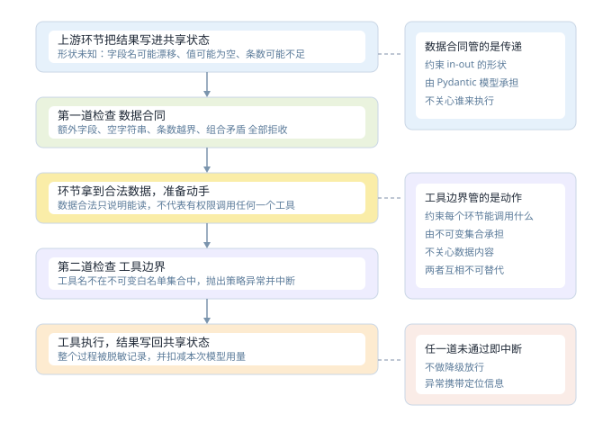
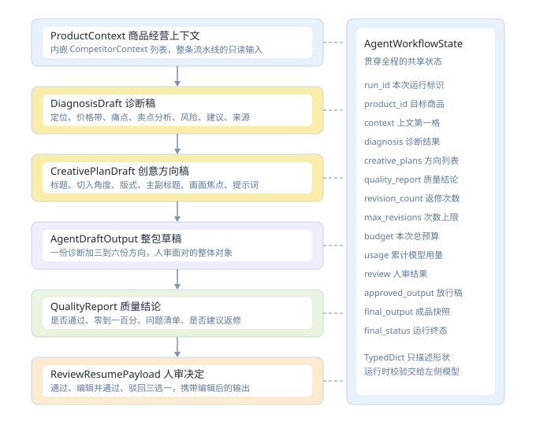
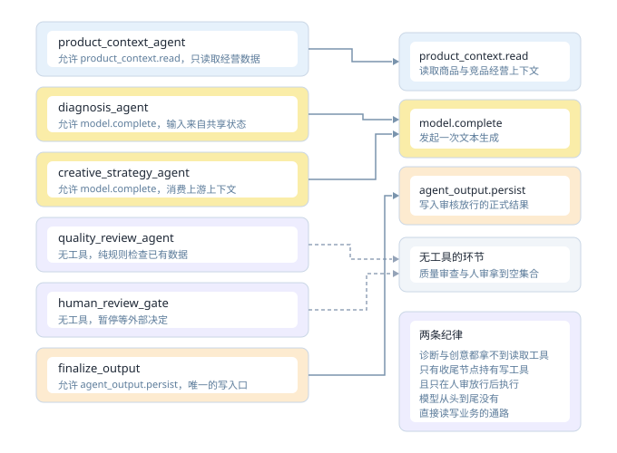
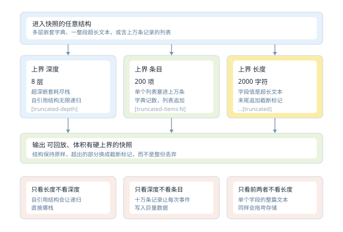
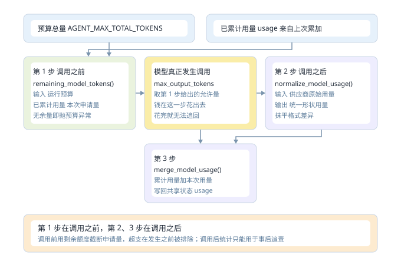
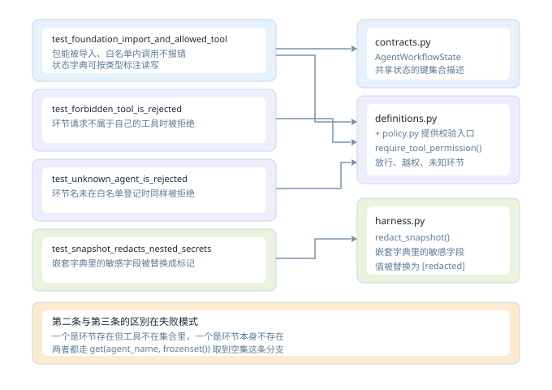
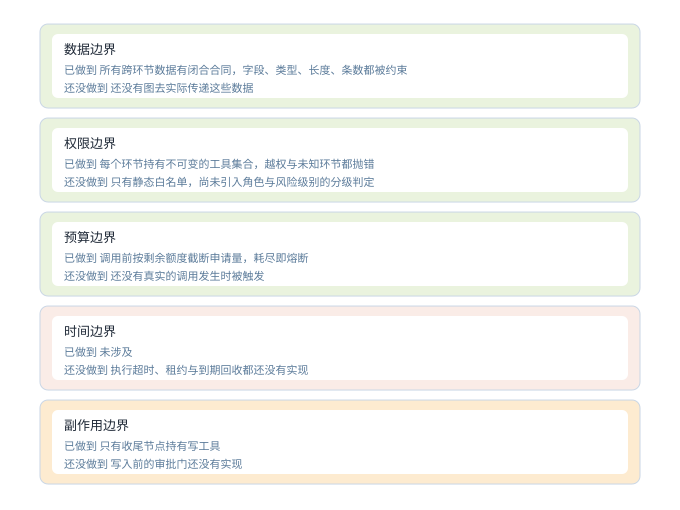

# 11 《电商运营助手》Agent 数据合同与工具边界

> 多 Agent 的第一批代码不是智能体本体，而是约束。
>
> 前面完成了业务服务、模型调用、媒体生成与后台任务，但那些代码都假设「调用者是人」：人传什么参数、字段对不对、有没有权限，由接口层一次性挡住。换成一串自动协作的环节之后，中间任何一步都可以产出意外形状的数据、发起本来不该发起的调用。
>
> 本篇要建的是这三样东西：
>
> 1. 节点之间允许交换什么数据
> 2. 每个环节允许调用哪些操作
> 3. 以及如何把执行过程安全地记录下来。
>
> 它们不产生任何业务结果，却是后面所有编排能够信任数据的前提。

本篇继续沿用同一个贯穿案例。

| 项目 | 贯穿案例取值 |
|---|---|
| 商品 | 便携装每日坚果 25g×30 袋 |
| 平台与类目 | 某电商平台 / 坚果炒货 |
| 售价与成本 | 39.9 元 / 22.5 元 |
| 本篇要约束的输入 | 商品经营上下文：商品资料 + 已录入竞品 |
| 本篇要约束的产出 | 诊断草稿一份、创意方向草稿三到六份 |
| 本篇要约束的动作 | 读取商品上下文、调用文本模型、写入最终输出 |

## 一、开发目标

多 Agent 结构里有两个容易被跳过、但跳过就一定会出事的位置：**数据在环节之间怎么走**、**每个环节能动手做什么**。前者由数据合同约束，后者由工具边界约束。

### 1.1 数据合同

数据合同约束的内容：数据合同规定的是**环节之间允许交换什么数据**。它不是数据库表，也不是接口的请求体，而是 Agent 内部每个节点产出与消费的数据形状。

它有三条硬要求：

| 要求 | 具体含义 | 违反之后发生什么 |
|---|---|---|
| 字段闭合 | 模型用 `extra="forbid"` 配置，出现未声明字段即校验失败 | 字段名漂移在进入下一环节前就被挡住，不会一路传到落库 |
| 形状明确 | 类型、是否可空、长度、取值范围都写在类声明里 | 缺字段、空字符串、超范围评分不会被当成合法数据 |
| 序列化可预期 | 状态字典只描述结构，真正的校验由 Pydantic 模型承担 | 任何进入节点的数据都能被还原成同一份形状 |

为什么必须有这一层：模型返回的是从自然语言转出来的结构化文本，字段名可能变化、类型可能漂移、条数可能不足。没有合同，下游只能各自做容错，错误会一路传递到最终结果，而且事后无法判断错误是在哪一步产生的。

### 1.2 工具边界

工具边界约束的内容：工具边界规定的是**每个环节允许调用哪些操作**。模型在整个流程里只负责产出文本建议，真正读数据、写结果的动作都由预先声明的工具完成。

| 要求 | 具体含义 | 违反之后发生什么 |
|---|---|---|
| 名称预先声明 | 工具名写成模块常量，模型不能在运行时凭空造出一个工具名 | 未知工具名在被调用前就不存在，无法进入执行 |
| 最小权限 | 每个环节只持有完成自己职责所必需的工具集合 | 读取资料的环节拿不到写入能力，审查与等待环节不持有任何工具 |
| 越权即中断 | 不在白名单内的调用直接抛出异常，不做降级放行 | 异常带上环节名与工具名，可以立刻定位到越权的位置 |

为什么必须有这一层：决策来自模型输出，而模型无法被信任去做权限判断。如果任何环节都能调用任意操作，「模型说什么就做什么」就会绕过全部业务规则；最小权限把这件事从「看模型的表现」变成「看一张静态集合」。

**图 1-1：数据合同与工具边界各自管住的范围**



这张图里两条路径是独立的：数据合同管「能不能传过去」，工具边界管「能不能动手做」。一个环节即使拿到了合法数据，也不代表它有权限使用任何一个工具——这正是两条边界要分开的原因。

### 1.3 交付的四个文件

四个新文件都在同一个包里，彼此之间的依赖是单向的。

| 文件 | 职责 | 管住的边界 |
|---|---|---|
| `contracts.py` | 定义环节之间交换的数据结构 | 数据边界 |
| `definitions.py` | 定义环节名称、版本清单与工具白名单 | 权限边界 |
| `policy.py` | 对外统一暴露权限校验入口与异常类型 | 权限边界 |
| `harness.py` | 输出脱敏、模型用量归一化与预算扣减 | 预算边界 |

此外还要调整一处测试配置、新增一个测试文件，见第二章与第七章。

### 1.4 本章不做什么

边界比内容更重要，先写清楚这一章结束之后**还不成立**的事情。

| 尚未出现的能力 | 说明 |
|---|---|
| 任何节点的具体实现 | 诊断、创意、质量检查这些真正干活的代码还没写，本章只定义它们交换什么数据 |
| 编排图 | 谁先谁后、什么时候停下，还没有任何代码描述顺序 |
| 数据库表 | 本章定义的数据合同是内存里的结构，不需要执行 Alembic 迁移 |
| 接口与后台任务 | 没有新的 HTTP 入口，也没有新的队列任务 |
| 外部 request / response 结构 | 本章不改动 `schemas.py` |

一句话概括：**模块能正常导入，不代表工作流已经能跑起来**。本章的验收标准只有一条——四个文件能被导入，四条基础断言全部通过。

## 二、开发准备

> 本章只需要建一个包目录、确认一处测试配置，不改动任何已有业务代码。

### 2.1 依赖与环境确认

本章用到的第三方能力只有 Pydantic 与 Python 标准库，两者都已在工程依赖中声明，不需要新增依赖。

| 用到的能力 | 来源 | 用途 |
|---|---|---|
| `BaseModel` / `Field` / `model_validator` | Pydantic | 定义严格数据合同 |
| `TypedDict` | 标准库 `typing` | 描述图的共享状态结构 |
| `Literal` / `Final` / `Any` | 标准库 `typing` | 取值枚举、常量标注与宽松字段 |
| `Mapping` / `Sequence` | 标准库 `collections.abc` | 脱敏函数处理任意容器 |
| `re` | 标准库 | 敏感字段名匹配 |

在 `api` 目录执行 `uv sync` 即可对齐虚拟环境；本章不需要重新安装整套依赖，也不要为了跑本章代码而升级 Pydantic 版本。

### 2.2 创建 Agent 包目录

确认 `api/app` 已经存在，在其中创建 `agents` 目录以及空的包初始化文件。

```
api/app/agents/           Agent 核心包（本章新建）
├─ __init__.py            本章为空文件
├─ contracts.py           第三章：定义环节之间交换的数据结构
├─ definitions.py         第四章：定义环节名称、版本清单与工具白名单
├─ policy.py              第五章：对外统一暴露权限校验入口与异常类型
└─ harness.py             第六章：输出脱敏、模型用量归一化与预算扣减
```

### 2.3 隔离测试配置

完整更新 `api/tests/conftest.py`。这份配置只在 pytest 进程里生效，不改动 `api/.env`，也不会连接开发环境数据库或使用真实模型密钥。

```python
"""测试进程使用内存 SQLite，不读取开发环境数据库连接。"""
import os

os.environ["DATABASE_URL"] = "sqlite:///:memory:"
os.environ["APP_ENV"] = "development"
os.environ["AUTH_SECRET_KEY"] = "course-test-secret-not-for-deployment"
```

三条环境变量的作用分别是：把数据库指向内存 SQLite，让测试进程里的建表与查询全部落在临时库；把环境标为开发环境，跳过生产环境的启动校验；给鉴权一个固定的测试密钥，避免测试因为缺少配置而失败。

这个文件后续章节会继续沿用，不会再重复给出。

## 三、结构化数据合同

> 合同规定节点之间交换的数据形状。先定义禁止额外字段的严格基类，再按「输入 → 产出 → 质量 → 用量 → 审批 → 观测 → 状态」的顺序逐个补齐。这里的类不是数据库表，不需要执行迁移。

### 3.1 合同成员清单

动手之前先看清楚 `contracts.py` 要提供哪些成员。下表按它们在文件中的出现顺序排列，其中只有最后一个不做运行时校验。

<table>
<colgroup><col style="width:26%"><col style="width:16%"><col style="width:58%"></colgroup>
<thead><tr><th>成员</th><th>运行时校验</th><th>说明</th></tr></thead>
<tbody>
<tr><td><code>StrictModel</code></td><td>基类</td><td>关闭多余字段容忍，是所有合同的根</td></tr>
<tr><td><code>CompetitorContext</code></td><td>是</td><td>单个竞品的名称、平台、价格、标题、卖点与评价关键词</td></tr>
<tr><td><code>ProductContext</code></td><td>是</td><td>商品与其竞品列表构成的只读经营上下文</td></tr>
<tr><td><code>DiagnosisDraft</code></td><td>是</td><td>诊断环节产出：定位、价格带、人群洞察、痛点、卖点分析、风险、建议与来源</td></tr>
<tr><td><code>CreativePlanDraft</code></td><td>是</td><td>单份创意方向：标题、切入角度、版式、主副标题、画面焦点、佐证点、画面提示词与来源</td></tr>
<tr><td><code>AgentDraftOutput</code></td><td>是</td><td>诊断加三到六份创意方向的整包草稿，人工审核面对的对象</td></tr>
<tr><td><code>QualityIssue</code></td><td>是</td><td>单条质量问题：编码、严重级别、说明与关联字段</td></tr>
<tr><td><code>QualityReport</code></td><td>是</td><td>质量门结论：是否通过、评分、问题清单、是否建议返修与已检查规则</td></tr>
<tr><td><code>ModelUsage</code></td><td>是</td><td>模型用量账本：输入输出 Token、总量与调用次数</td></tr>
<tr><td><code>ReviewResumePayload</code></td><td>是</td><td>人工审核决定，带组合合法性校验器</td></tr>
<tr><td><code>HarnessEvent</code></td><td>是</td><td>可观测事件：类型、环节、操作、状态、说明、脱敏快照与链路标识</td></tr>
<tr><td><code>AgentWorkflowState</code></td><td>否</td><td>共享状态的键集合描述，实际校验由上面的模型承担</td></tr>
</tbody>
</table>

对外真正被其它模块引用的是 `ProductContext`、`DiagnosisDraft`、`CreativePlanDraft`、`AgentDraftOutput`、`QualityReport`、`ModelUsage`、`ReviewResumePayload`、`HarnessEvent` 与 `AgentWorkflowState`——前八个用于约束数据，`AgentWorkflowState` 用于描述状态形状，其余三个（`StrictModel`、`CompetitorContext`、`QualityIssue`）服务于前者的定义。

### 3.2 增量编写步骤

文件路径：`api/app/agents/contracts.py`——在 `api/app/agents/` 目录下新建该文件，与 `__init__.py` 同级。

下面每一步只给出这一步新增的内容，按顺序从 3.2.1 追加到 3.2.7，`contracts.py` 就与 3.3 的完整代码一致。

#### 3.2.1 定义严格基类与竞品上下文

一切合同的根是 `StrictModel`。它通过 `extra="forbid"` 关闭 Pydantic 默认的字段宽容策略——多出来的字段不再是警告，而是错误。竞品上下文是商品上下文的内嵌结构，先于商品定义。

新建文件，写入以下内容：

```python
from typing import Any, Literal, TypedDict

from pydantic import BaseModel, ConfigDict, Field, model_validator


class StrictModel(BaseModel):
    model_config = ConfigDict(extra="forbid")


class CompetitorContext(StrictModel):
    name: str
    platform: str | None = None
    price: str | None = None
    sales_hint: str | None = None
    title: str | None = None
    selling_points: list[str] = Field(default_factory=list)
    review_keywords: list[str] = Field(default_factory=list)
```

`CompetitorContext` 只有 `name` 是必填——竞品可能只录了一条价格和一句话标题，其余字段允许为空。列表字段统一用 `default_factory=list`，避免可变默认值被多个实例共享。

#### 3.2.2 定义商品上下文

商品上下文是整条流水线的只读输入，诊断与创意环节都从这里取值，任何人都不应该修改它。

在 `contracts.py` 末尾留出两个空行，追加下面这段：

```python
class ProductContext(StrictModel):
    """商品+竞品经营上下文，诊断/创意的只读输入"""
    product_id: int
    name: str
    platform: str
    category: str | None = None
    price: str | None = None
    cost: str | None = None
    target_audience: str | None = None
    selling_points: list[str] = Field(default_factory=list)
    product_url: str | None = None
    images: list[str] = Field(default_factory=list)
    competitors: list[CompetitorContext] = Field(default_factory=list)
```

`product_id`、`name`、`platform` 三项必填，缺任何一项都无法定位到具体商品，因此不给默认值。`competitors` 是唯一的嵌套列表，它的每一项都会被 `CompetitorContext` 校验。

#### 3.2.3 定义诊断草稿

诊断草稿是第一个环节的输出。`source` 字段标记这份结论来自模型还是规则兜底，下游据此判断可信度；`provenance` 记录数据来源，供事后追溯。

在 `contracts.py` 末尾留出两个空行，追加下面这段：

```python
class DiagnosisDraft(StrictModel):
    """诊断草稿（定位/价格带/痛点/建议），`source` 区分 `llm`/`rules`"""
    source: Literal["llm", "rules"]
    positioning: str = Field(min_length=1)
    price_band: str = Field(min_length=1)
    audience_insights: list[str] = Field(default_factory=list)
    pain_points: list[str] = Field(default_factory=list)
    selling_point_analysis: list[str] = Field(default_factory=list)
    risks: list[str] = Field(default_factory=list)
    recommendations: list[str] = Field(default_factory=list)
    provenance: dict[str, Any] = Field(default_factory=dict)
```

`positioning` 与 `price_band` 用 `min_length=1` 约束，等于说「不能是空字符串」——模型在拿不到信息时最容易返回空字符串，这条约束把这种情况挡下来，而不是让空结论进入创意环节。

#### 3.2.4 定义创意方案草稿与整包输出

创意草稿比诊断更严格：除列表外的每个文字字段都要求非空，因为缺任何一项都无法构成可执行的画面描述。整包输出把诊断与三到六份创意方向绑在一起，这就是人工审核环节要看到的东西。

在 `contracts.py` 末尾留出两个空行，追加下面这段：

```python
class CreativePlanDraft(StrictModel):
    """创意方向草稿"""
    title: str = Field(min_length=1)
    angle: str = Field(min_length=1)
    layout: str = Field(min_length=1)
    headline: str = Field(min_length=1)
    sub_headline: str = Field(min_length=1)
    visual_focus: str = Field(min_length=1)
    proof_points: list[str] = Field(default_factory=list)
    suitable_audience: str = Field(min_length=1)
    image_prompt: str = Field(min_length=1)
    source: Literal["llm", "rules"]
    provenance: dict[str, Any] = Field(default_factory=dict)


class AgentDraftOutput(StrictModel):
    """``diagnosis` + `creative_plans`（`3–6` 条），人审前的草稿整体"""
    diagnosis: DiagnosisDraft
    creative_plans: list[CreativePlanDraft] = Field(min_length=3, max_length=6)
```

`AgentDraftOutput` 的 `min_length=3, max_length=6` 是一条业务规则而不是技术约束：少于三份没有挑选空间，多于六份会拖慢审核并稀释差异度。把它写进合同，意味着这条规则由数据形状保证，不依赖实现时记得检查。

#### 3.2.5 定义质量问题、质量报告与模型用量

质量端由三个结构组成：一个问题清单条目、一份报告、以及统计用的用量结构。三者都不区分来源模型或规则，因为它们描述的是结果本身的属性。

在 `contracts.py` 末尾留出两个空行，追加下面这段：

```python
class QualityIssue(StrictModel):
    code: str
    severity: Literal["warning", "error"]
    message: str
    field: str | None = None


class QualityReport(StrictModel):
    """质量门输出"""
    passed: bool
    score: int = Field(ge=0, le=100)
    issues: list[QualityIssue] = Field(default_factory=list)
    revision_recommended: bool = False
    checked_rules: list[str] = Field(default_factory=list)


class ModelUsage(StrictModel):
    """模型用量（输入/输出/总 Token/调用次数），用于预算"""
    input_tokens: int = Field(default=0, ge=0)
    output_tokens: int = Field(default=0, ge=0)
    total_tokens: int = Field(default=0, ge=0)
    calls: int = Field(default=0, ge=0)
```

`QualityIssue` 的 `severity` 只允许 `warning` 与 `error` 两个取值，`QualityReport` 的 `score` 限制在 0 到 100。`ModelUsage` 全部字段默认零且非负，因此任何环节都可以直接 `ModelUsage.model_validate({})` 拿到一份合法空账本，不必先判断字段是否存在。

#### 3.2.6 定义人工审核恢复载荷与观测事件

审核恢复载荷描述的是人工审核后要恢复流水线时提交的内容；观测事件是每次记录用的统一结构。前者带一个双向校验器，后者只做形状约束。

在 `contracts.py` 末尾留出两个空行，追加下面这段：

```python
class ReviewResumePayload(StrictModel):
    """人工审批恢复载荷，`decision` 三选一，并带校验器确保 `edit_and_approve` 必须有 `edited_output`"""
    decision: Literal["approve", "edit_and_approve", "reject"]
    edited_output: AgentDraftOutput | None = None
    note: str | None = Field(default=None, max_length=1000)

    @model_validator(mode="after")
    def validate_edited_output(self) -> "ReviewResumePayload":
        """校验编辑后输出，保证 Agent 输入、草稿和审批恢复载荷满足可序列化合同。"""
        # 节点只通过结构化状态和受控工具交换数据，禁止绕过策略边界写入结果。
        if self.decision == "edit_and_approve" and self.edited_output is None:
            raise ValueError("edit_and_approve requires edited_output")
        if self.decision != "edit_and_approve" and self.edited_output is not None:
            raise ValueError("edited_output is only allowed for edit_and_approve")
        return self


class HarnessEvent(StrictModel):
    """可观测事件（步骤开始/完成/失败），含脱敏后的输入/输出快照与 trace/span"""
    event_type: str
    agent_name: str | None = None
    operation_name: str | None = None
    status: str | None = None
    message: str | None = None
    input_snapshot: dict[str, Any] = Field(default_factory=dict)
    output_snapshot: dict[str, Any] = Field(default_factory=dict)
    metrics: dict[str, Any] = Field(default_factory=dict)
    trace_id: str | None = None
    span_id: str | None = None
```

`ReviewResumePayload` 的校验器管理两个方向的约束：选 `edit_and_approve` 必须带上编辑后的输出，走另外两条路径则不允许携带。这是一处典型的「两个字段的组合合法性」——单看每个字段都合法，合起来却不合法，只有模型后的校验器能表达。`note` 限制一千字符，避免备注被当成自由文本存储区。

#### 3.2.7 定义共享状态

最后补上共享状态。它用 `TypedDict` 而不是 Pydantic 模型描述，原因是编排框架需要在每一跳上读写一个可变字典；代价是它本身不做运行时校验——真正的校验由前面那些模型完成，凡是进出字典的关键数据，都应该先经过模型。

在 `contracts.py` 末尾留出两个空行，追加下面这段：

```python
class AgentWorkflowState(TypedDict, total=False):
    """
    【基础工作流的共享状态 TypedDict（所有节点读写的中枢）】
    run_id：本次工作流运行唯一 ID（agent_runs 主键），所有可观测事件与落库均挂在此 ID 上做审计追踪
    product_id：待分析运营的商品 ID，商品上下文节点据此加载完整经营数据
    context：商品上下文快照（ProductContext 序列化 dict），诊断/创意节点的只读输入
    diagnosis：诊断节点产出（DiagnosisDraft）：定位/价格带/痛点/卖点分析/风险/建议，source 区分 llm/rules
    creative_plans：创意节点产出（3-6 条 CreativePlanDraft）：标题、切入角度、版式、主副标题、画面提示词等
    quality_report：质量门报告（QualityReport）：passed/评分/问题清单，决定走受控返修还是进入人工审核
    revision_feedback：质量报告问题清单序列化，诊断/创意重跑时注入 prompt，实现带问题的受控返修
    revision_count：已执行返修次数，prepare_revision 节点累加，用于限制诊断-质量审核循环
    max_revisions：返修次数上限（配置 AGENT_MAX_REVISIONS），超限后强制进入人审，防止无限循环
    budget：本次运行 Token 预算（配置 AGENT_MAX_TOTAL_TOKENS），调用模型前计算剩余额度做成本护栏
    usage：累计模型用量（ModelUsage：输入/输出/总 Token、调用次数），每个 LLM 节点执行后合并累加
    review：人工审核结果（ReviewResumePayload）：approve/edit_and_approve/reject 三选一 + 备注
    approved_output：人审放行的最终草稿（AgentDraftOutput）；reject 时为空 dict，编辑通过时取人工编辑版
    final_output：finalize 节点落库后返回的最终结果快照（写入数据库的成品输出）
    final_status：工作流终态："completed"（通过/编辑后通过）或 "rejected"（人工驳回）
    """
    run_id: int
    product_id: int
    context: dict[str, Any]
    diagnosis: dict[str, Any]
    creative_plans: list[dict[str, Any]]
    quality_report: dict[str, Any]
    revision_feedback: list[dict[str, Any]]
    revision_count: int
    max_revisions: int
    budget: dict[str, Any]
    usage: dict[str, Any]
    review: dict[str, Any]
    approved_output: dict[str, Any]
    final_output: dict[str, Any]
    final_status: str
```

到这里文件已经完整，`contracts.py` 拼出来的内容与 3.3 的完整代码逐行一致。`total=False` 让所有键都可缺省，因此节点只需写入自己关心的字段，不必构造一份完整字典。

### 3.3 完整代码

下面是 3.2 的七个步骤全部追加完成后 `contracts.py` 应有的完整内容，用于核对最终结果。

```python
from typing import Any, Literal, TypedDict

from pydantic import BaseModel, ConfigDict, Field, model_validator


class StrictModel(BaseModel):
    model_config = ConfigDict(extra="forbid")


class CompetitorContext(StrictModel):
    name: str
    platform: str | None = None
    price: str | None = None
    sales_hint: str | None = None
    title: str | None = None
    selling_points: list[str] = Field(default_factory=list)
    review_keywords: list[str] = Field(default_factory=list)


class ProductContext(StrictModel):
    """商品+竞品经营上下文，诊断/创意的只读输入"""
    product_id: int
    name: str
    platform: str
    category: str | None = None
    price: str | None = None
    cost: str | None = None
    target_audience: str | None = None
    selling_points: list[str] = Field(default_factory=list)
    product_url: str | None = None
    images: list[str] = Field(default_factory=list)
    competitors: list[CompetitorContext] = Field(default_factory=list)


class DiagnosisDraft(StrictModel):
    """诊断草稿（定位/价格带/痛点/建议），`source` 区分 `llm`/`rules`"""
    source: Literal["llm", "rules"]
    positioning: str = Field(min_length=1)
    price_band: str = Field(min_length=1)
    audience_insights: list[str] = Field(default_factory=list)
    pain_points: list[str] = Field(default_factory=list)
    selling_point_analysis: list[str] = Field(default_factory=list)
    risks: list[str] = Field(default_factory=list)
    recommendations: list[str] = Field(default_factory=list)
    provenance: dict[str, Any] = Field(default_factory=dict)


class CreativePlanDraft(StrictModel):
    """创意方向草稿"""
    title: str = Field(min_length=1)
    angle: str = Field(min_length=1)
    layout: str = Field(min_length=1)
    headline: str = Field(min_length=1)
    sub_headline: str = Field(min_length=1)
    visual_focus: str = Field(min_length=1)
    proof_points: list[str] = Field(default_factory=list)
    suitable_audience: str = Field(min_length=1)
    image_prompt: str = Field(min_length=1)
    source: Literal["llm", "rules"]
    provenance: dict[str, Any] = Field(default_factory=dict)


class AgentDraftOutput(StrictModel):
    """``diagnosis` + `creative_plans`（`3–6` 条），人审前的草稿整体"""
    diagnosis: DiagnosisDraft
    creative_plans: list[CreativePlanDraft] = Field(min_length=3, max_length=6)


class QualityIssue(StrictModel):
    code: str
    severity: Literal["warning", "error"]
    message: str
    field: str | None = None


class QualityReport(StrictModel):
    """质量门输出"""
    passed: bool
    score: int = Field(ge=0, le=100)
    issues: list[QualityIssue] = Field(default_factory=list)
    revision_recommended: bool = False
    checked_rules: list[str] = Field(default_factory=list)


class ModelUsage(StrictModel):
    """模型用量（输入/输出/总 Token/调用次数），用于预算"""
    input_tokens: int = Field(default=0, ge=0)
    output_tokens: int = Field(default=0, ge=0)
    total_tokens: int = Field(default=0, ge=0)
    calls: int = Field(default=0, ge=0)


class ReviewResumePayload(StrictModel):
    """人工审批恢复载荷，`decision` 三选一，并带校验器确保 `edit_and_approve` 必须有 `edited_output`"""
    decision: Literal["approve", "edit_and_approve", "reject"]
    edited_output: AgentDraftOutput | None = None
    note: str | None = Field(default=None, max_length=1000)

    @model_validator(mode="after")
    def validate_edited_output(self) -> "ReviewResumePayload":
        """校验编辑后输出，保证 Agent 输入、草稿和审批恢复载荷满足可序列化合同。"""
        # 节点只通过结构化状态和受控工具交换数据，禁止绕过策略边界写入结果。
        if self.decision == "edit_and_approve" and self.edited_output is None:
            raise ValueError("edit_and_approve requires edited_output")
        if self.decision != "edit_and_approve" and self.edited_output is not None:
            raise ValueError("edited_output is only allowed for edit_and_approve")
        return self


class HarnessEvent(StrictModel):
    """可观测事件（步骤开始/完成/失败），含脱敏后的输入/输出快照与 trace/span"""
    event_type: str
    agent_name: str | None = None
    operation_name: str | None = None
    status: str | None = None
    message: str | None = None
    input_snapshot: dict[str, Any] = Field(default_factory=dict)
    output_snapshot: dict[str, Any] = Field(default_factory=dict)
    metrics: dict[str, Any] = Field(default_factory=dict)
    trace_id: str | None = None
    span_id: str | None = None


class AgentWorkflowState(TypedDict, total=False):
    """
    【基础工作流的共享状态 TypedDict（所有节点读写的中枢）】
    run_id：本次工作流运行唯一 ID（agent_runs 主键），所有可观测事件与落库均挂在此 ID 上做审计追踪
    product_id：待分析运营的商品 ID，商品上下文节点据此加载完整经营数据
    context：商品上下文快照（ProductContext 序列化 dict），诊断/创意节点的只读输入
    diagnosis：诊断节点产出（DiagnosisDraft）：定位/价格带/痛点/卖点分析/风险/建议，source 区分 llm/rules
    creative_plans：创意节点产出（3-6 条 CreativePlanDraft）：标题、切入角度、版式、主副标题、画面提示词等
    quality_report：质量门报告（QualityReport）：passed/评分/问题清单，决定走受控返修还是进入人工审核
    revision_feedback：质量报告问题清单序列化，诊断/创意重跑时注入 prompt，实现带问题的受控返修
    revision_count：已执行返修次数，prepare_revision 节点累加，用于限制诊断-质量审核循环
    max_revisions：返修次数上限（配置 AGENT_MAX_REVISIONS），超限后强制进入人审，防止无限循环
    budget：本次运行 Token 预算（配置 AGENT_MAX_TOTAL_TOKENS），调用模型前计算剩余额度做成本护栏
    usage：累计模型用量（ModelUsage：输入/输出/总 Token、调用次数），每个 LLM 节点执行后合并累加
    review：人工审核结果（ReviewResumePayload）：approve/edit_and_approve/reject 三选一 + 备注
    approved_output：人审放行的最终草稿（AgentDraftOutput）；reject 时为空 dict，编辑通过时取人工编辑版
    final_output：finalize 节点落库后返回的最终结果快照（写入数据库的成品输出）
    final_status：工作流终态："completed"（通过/编辑后通过）或 "rejected"（人工驳回）
    """
    run_id: int
    product_id: int
    context: dict[str, Any]
    diagnosis: dict[str, Any]
    creative_plans: list[dict[str, Any]]
    quality_report: dict[str, Any]
    revision_feedback: list[dict[str, Any]]
    revision_count: int
    max_revisions: int
    budget: dict[str, Any]
    usage: dict[str, Any]
    review: dict[str, Any]
    approved_output: dict[str, Any]
    final_output: dict[str, Any]
    final_status: str
```

### 3.4 合同里的四条关键约束

**图 3-1：合同数据在环节之间的流转**



看图之后，再把四条容易忽略的约束讲清楚。

| 约束 | 落在哪里 | 它挡住的是 |
|---|---|---|
| 多余字段即错误 | `StrictModel` 的 `extra="forbid"` | 模型多返回一个字段、或字段名与声明不一致，立刻失败而不是被静默丢弃 |
| 空字符串不算通过 | `min_length=1` | 模型拿不到信息时返回空结论，却被下游当成有效内容 |
| 条数既是上限也是下限 | `AgentDraftOutput` 的 3 到 6 | 只有一份方案的「没有挑选空间」，以及几十份方案的稀释与拖慢 |
| 跨字段组合也要合法 | `ReviewResumePayload` 的校验器 | 单个字段都合法但组合矛盾的情况，例如不带修改内容却声明「编辑并通过」 |

还有一条反向纪律：**不要把 `TypedDict` 当成校验层**。`AgentWorkflowState` 里的 `dict[str, Any]` 是刻意留下的宽松区——编排框架需要往里塞任意中间结果；一旦某个字段决定数据能否安全使用，就应该先把它过一遍对应的 Pydantic 模型，而不是指望类型标注兜底。

## 四、环节定义与工具白名单

> 数据确定之后，下一步是给流水线的每个环节取稳定名字，并规定它们各自能够调用哪些操作。不能让模型凭空造出工具名，也不能让只读环节顺便写入正式结果。

### 4.1 成员清单

 `definitions.py` 提供的成员：

<table>
<colgroup><col style="width:30%"><col style="width:16%"><col style="width:54%"></colgroup>
<thead><tr><th>成员</th><th>类别</th><th>说明</th></tr></thead>
<tbody>
<tr><td><code>WORKFLOW_KEY</code></td><td>常量</td><td>工作流稳定标识，取值 <code>product_operation</code></td></tr>
<tr><td><code>WORKFLOW_VERSION</code></td><td>常量</td><td>工作流版本号，改动定义时需要同步</td></tr>
<tr><td><code>PRODUCT_CONTEXT_AGENT</code></td><td>常量</td><td>商品上下文环节，负责读取经营数据</td></tr>
<tr><td><code>DIAGNOSIS_AGENT</code></td><td>常量</td><td>诊断环节，产出定位与价格带等结论</td></tr>
<tr><td><code>CREATIVE_STRATEGY_AGENT</code></td><td>常量</td><td>创意策略环节，产出数个主图方向</td></tr>
<tr><td><code>QUALITY_REVIEW_AGENT</code></td><td>常量</td><td>质量审查环节，做规则检查不调用模型</td></tr>
<tr><td><code>HUMAN_REVIEW_GATE</code></td><td>常量</td><td>人工审核等待点，暂停并等待外部决定</td></tr>
<tr><td><code>FINALIZE_NODE</code></td><td>常量</td><td>收尾节点，写入最终结果</td></tr>
<tr><td><code>AGENT_TOOL_ALLOWLIST</code></td><td>常量</td><td>环节到工具集合的映射，表达最小权限</td></tr>
<tr><td><code>VERSION_MANIFEST</code></td><td>常量</td><td>工作流、环节、提示词与策略的版本登记表</td></tr>
<tr><td><code>AgentPolicyError</code></td><td>异常类</td><td>策略拒绝时抛出，继承 <code>RuntimeError</code></td></tr>
<tr><td><code>require_tool_permission()</code></td><td>公共函数</td><td>唯一的工具权限校验入口，不允许即抛出</td></tr>
</tbody>
</table>

对外被使用的是 `require_tool_permission()`、`AgentPolicyError`、`AGENT_TOOL_ALLOWLIST`、`VERSION_MANIFEST` 以及六个环节名常量；其余文件不会再去重新定义这些字符串。

### 4.2 增量编写步骤

文件路径：`api/app/agents/definitions.py`——在 `api/app/agents/` 目录下新建该文件，与 `contracts.py` 同级。

下面每一步只给出这一步新增的内容，按顺序从 4.2.1 追加到 4.2.3，`definitions.py` 就与 4.3 的完整代码一致。

#### 4.2.1 定义工作流标识与环节名称

先给工作流与版本取名字，再逐个声明环节。这里用 `Final` 标注——它们是不可变的标识符，运行时被修改就说明代码出了问题。

新建文件，写入以下内容：

```python
from typing import Final

# 定义【产品运营】工作流的key和版本
WORKFLOW_KEY: Final = "product_operation"
WORKFLOW_VERSION: Final = "1.0.0"


# 定义各个agent的名称
PRODUCT_CONTEXT_AGENT: Final = "product_context_agent"
DIAGNOSIS_AGENT: Final = "diagnosis_agent"
CREATIVE_STRATEGY_AGENT: Final = "creative_strategy_agent"
QUALITY_REVIEW_AGENT: Final = "quality_review_agent"
HUMAN_REVIEW_GATE: Final = "human_review_gate"
FINALIZE_NODE: Final = "finalize_output"
```

六个名字里有五个是「环节」，最后一个 `FINALIZE_NODE` 在职责上不是决策者而是收尾动作，所以名字略有区别。`HUMAN_REVIEW_GATE` 也不是智能体，它是一个等待点——也会拥有自己的工具集合（空集）。

#### 4.2.2 定义工具白名单与版本清单

白名单用 `frozenset` 而不是 `list`：它表达的是「集合关系」，且不可被环节在执行途中修改。版本清单把工作流、环节、提示词与策略各自的当前版本集中登记。

在 `definitions.py` 末尾留出两个空行，追加下面这段：

```python
# 定义各个agent的工具权限白名单
AGENT_TOOL_ALLOWLIST: Final[dict[str, frozenset[str]]] = {
    PRODUCT_CONTEXT_AGENT: frozenset({"product_context.read"}),
    DIAGNOSIS_AGENT: frozenset({"model.complete"}),
    CREATIVE_STRATEGY_AGENT: frozenset({"model.complete"}),
    QUALITY_REVIEW_AGENT: frozenset(),
    HUMAN_REVIEW_GATE: frozenset(),
    FINALIZE_NODE: frozenset({"agent_output.persist"}),
}

# 定义各个组件的版本信息
VERSION_MANIFEST: Final = {
    "workflow": {"key": WORKFLOW_KEY, "version": WORKFLOW_VERSION},
    "agents": {
        PRODUCT_CONTEXT_AGENT: "1.0.0",
        DIAGNOSIS_AGENT: "1.0.0",
        CREATIVE_STRATEGY_AGENT: "1.0.0",
        QUALITY_REVIEW_AGENT: "1.0.0",
    },
    "prompts": {"diagnosis": "1.0.0", "creative_strategy": "1.0.0"},
    "policies": {"tool_allowlist": "1.0.0", "quality_rules": "1.0.0"},
}
```

三个工具名值得记一下：`product_context.read` 读经营数据，`model.complete` 发起一次文本生成，`agent_output.persist` 把最终结果写库。它们的名字本身就说明了作用域——模型既不能绕过第一个自己去读库，也不能拿到第三个来写库。

#### 4.2.3 定义策略异常与权限校验函数

最后补上异常类型与唯一的校验入口。异常继承 `RuntimeError`，调用方可以统一捕获；校验函数不做兜底，不允许就直接抛错。

在 `definitions.py` 末尾留出两个空行，追加下面这段：

```python
class AgentPolicyError(RuntimeError):
    pass

# 检验agent的工具权限
def require_tool_permission(agent_name: str, tool_name: str) -> None:
    """校验并获取工具权限，只从版本化注册表解析职责、工具白名单和工作流定义。"""
    allowed_tools = AGENT_TOOL_ALLOWLIST.get(agent_name, frozenset())
    if tool_name not in allowed_tools:
        raise AgentPolicyError(f"Agent {agent_name} is not allowed to use tool {tool_name}")
```

到这里文件已经完整，`definitions.py` 拼出来的内容与 4.3 的完整代码逐行一致。注意 `get(agent_name, frozenset())` 这个默认值的设计：**未知环节拿到的是空集合，而不是 `None` 或放行**。因此「环节名写错」和「环节没有权限」最终导向同一个结果——抛错。宁可拒绝一次本该允许的错误写法，也不能让一个拼错的名字悄悄通过。

### 4.3 完整代码

下面是 4.2 的三个步骤全部追加完成后 `definitions.py` 应有的完整内容，用于核对最终结果。

```python
from typing import Final

# 定义【产品运营】工作流的key和版本
WORKFLOW_KEY: Final = "product_operation"
WORKFLOW_VERSION: Final = "1.0.0"


# 定义各个agent的名称
PRODUCT_CONTEXT_AGENT: Final = "product_context_agent"
DIAGNOSIS_AGENT: Final = "diagnosis_agent"
CREATIVE_STRATEGY_AGENT: Final = "creative_strategy_agent"
QUALITY_REVIEW_AGENT: Final = "quality_review_agent"
HUMAN_REVIEW_GATE: Final = "human_review_gate"
FINALIZE_NODE: Final = "finalize_output"


# 定义各个agent的工具权限白名单
AGENT_TOOL_ALLOWLIST: Final[dict[str, frozenset[str]]] = {
    PRODUCT_CONTEXT_AGENT: frozenset({"product_context.read"}),
    DIAGNOSIS_AGENT: frozenset({"model.complete"}),
    CREATIVE_STRATEGY_AGENT: frozenset({"model.complete"}),
    QUALITY_REVIEW_AGENT: frozenset(),
    HUMAN_REVIEW_GATE: frozenset(),
    FINALIZE_NODE: frozenset({"agent_output.persist"}),
}

# 定义各个组件的版本信息
VERSION_MANIFEST: Final = {
    "workflow": {"key": WORKFLOW_KEY, "version": WORKFLOW_VERSION},
    "agents": {
        PRODUCT_CONTEXT_AGENT: "1.0.0",
        DIAGNOSIS_AGENT: "1.0.0",
        CREATIVE_STRATEGY_AGENT: "1.0.0",
        QUALITY_REVIEW_AGENT: "1.0.0",
    },
    "prompts": {"diagnosis": "1.0.0", "creative_strategy": "1.0.0"},
    "policies": {"tool_allowlist": "1.0.0", "quality_rules": "1.0.0"},
}


class AgentPolicyError(RuntimeError):
    pass

# 检验agent的工具权限
def require_tool_permission(agent_name: str, tool_name: str) -> None:
    """校验并获取工具权限，只从版本化注册表解析职责、工具白名单和工作流定义。"""
    allowed_tools = AGENT_TOOL_ALLOWLIST.get(agent_name, frozenset())
    if tool_name not in allowed_tools:
        raise AgentPolicyError(f"Agent {agent_name} is not allowed to use tool {tool_name}")
```

### 4.4 白名单逐环节解读

**图 4-1：六个环节与各自的白名单**



| 环节 | 允许的工具 | 为什么恰好是这些 | 为什么不给别的 |
|---|---|---|---|
| `product_context_agent` | `product_context.read` | 职责就是取值，只需要读取 | 不给写权限——取数环节写入正式结果等于绕过审核 |
| `diagnosis_agent` | `model.complete` | 需要发起一次文本生成来形成结论 | 不给任何读取或写入——它的输入由上游放进共享状态 |
| `creative_strategy_agent` | `model.complete` | 同样只需要生成能力 | 同上，它消费上游已经取好的上下文 |
| `quality_review_agent` | 空 | 纯规则检查，读的是共享状态里已有的数据 | 给它任何工具都是多余的权限面 |
| `human_review_gate` | 空 | 只是一个暂停点，等待外部传入决定 | 暂停期间不应有任何自动动作 |
| `finalize_output` | `agent_output.persist` | 唯一被允许写入正式结果的节点 | 不给读取与生成——收尾只负责落地审核通过的内容 |

两条值得单独记的边界：**诊断与创意都拿不到读取工具**，它们的输入必须来自上游放进共享状态的 `context`；**只有收尾节点持有写工具**，而且它只在人工审核放行之后才被执行。这两条合起来意味着，模型从头到尾没有直接读写业务的通路。

### 4.5 版本清单追踪的内容

`VERSION_MANIFEST` 登记了四组版本，每一组对应一类会变的东西。

| 分组 | 登记内容 | 什么时候需要改 |
|---|---|---|
| `workflow` | 工作流标识与整体版本 | 环节增减或顺序调整 |
| `agents` | 四个决策环节各自的 1.0.0 | 某个环节的提示词职责发生变化 |
| `prompts` | 诊断与创意的提示词版本 | 调整提示词措辞或输出要求 |
| `policies` | 工具白名单与质量规则版本 | 修改白名单内容或质量判定标准 |

版本清单会被写进每次运行的记录里。它的用处很实际：同一个目标今天跑出来的结果和下个月可能不同，出问题时要能回答「当时用的是哪一版提示词、哪一版白名单」。没有这份登记，就只能看到结果不同，却说不清为什么不同。

## 五、策略入口

> 权限判断分散在调用方会很快走样，因此单独给出一层入口文件。本章这一层只有一次转发。

### 5.1 文件完整内容

创建 `api/app/agents/policy.py`，内容如下。

```python
from app.agents.definitions import AgentPolicyError, require_tool_permission

# 复用本章 definitions.py 的白名单与异常，保持同一套基础校验规则。
__all__ = ["AgentPolicyError", "require_tool_permission"]
```

到这里文件已经完整。

### 5.2 为什么用一次转发

这个文件看起来可以省略，直接让人们从 `definitions.py` 导入即可。保留它的理由是三条。

| 理由 | 说明 |
|---|---|
| 稳定的对外名字 | 调用方只认 `app.agents.policy`，不必关心实现搬到了哪个模块 |
| 统一的异常类型 | 全工程只存在一种策略异常，捕获逻辑不会被分成两套 |
| 后续扩展的落点 | 平台级风险判定加入后仍从这同一个入口出去，调用方不需要改导入路径 |

注意这里的措辞是「复用」而不是「复制」。`policy.py` 没有重新实现一遍白名单，也没有复制一份异常类——它导入已有的实现再导出，因此两边使用的是**同一个类**，用 `except AgentPolicyError` 一定能捕获到。自己重定义一个同名异常会让这个保证失效。

### 5.3 关于工程现状的一点说明

本工程的 `policy.py` 已经不止这段内容——它后来加入了平台级的风险决策（按工作区角色、工具风险级别给出「允许 / 需要审批 / 拒绝」的判断），并且依赖了尚未出现的注册表与枚举。

因此动手时请注意：**如果这个文件在工程里已经存在并且有内容，不要把上面这段内容整文件覆盖上去**。按本章给出的内容进行增量补齐即可；已经存在的内容属于后续章节的范围，会在那里讲到。判断方法很简单——看导入语句里有没有来自 `app.agents.registry` 的名字，有就说明它已经成长过，保持原样。

## 六、脱敏与模型预算

> 环节执行过程中需要记录输入输出，否则事后无法解释发生了什么。但记录本身会变成泄露密钥的渠道，也会让一次失控的调用把成本跑满。这个文件解决两件事：怎么安全地留存快照，以及怎么在调用之前而不是之后制止超支。

### 6.1 模块成员清单

动手之前先看清楚 `harness.py` 要提供哪些成员，下表按它们在文件中的出现顺序排列。

<table>
<colgroup><col style="width:26%"><col style="width:14%"><col style="width:60%"></colgroup>
<thead><tr><th>成员</th><th>类别</th><th>说明</th></tr></thead>
<tbody>
<tr><td><code>SENSITIVE_KEY_PATTERN</code></td><td>常量</td><td>敏感字段名匹配规则，覆盖密钥类与各类 token</td></tr>
<tr><td><code>MAX_SNAPSHOT_STRING_LENGTH</code></td><td>常量</td><td>单个字符串留存的字符上限，超出截断</td></tr>
<tr><td><code>MAX_SNAPSHOT_DEPTH</code></td><td>常量</td><td>递归深度上限，防止深嵌套与自引用</td></tr>
<tr><td><code>MAX_SNAPSHOT_ITEMS</code></td><td>常量</td><td>单个字典或列表保留的条目上限</td></tr>
<tr><td><code>AgentBudgetExceededError</code></td><td>异常类</td><td>预算耗尽时抛出，继承 <code>RuntimeError</code></td></tr>
<tr><td><code>redact_snapshot()</code></td><td>公共</td><td>递归脱敏，返回结构可回放且体积有硬上界的快照</td></tr>
<tr><td><code>normalize_model_usage()</code></td><td>公共</td><td>把供应商格式各异的用量归一成统一结构</td></tr>
<tr><td><code>merge_model_usage()</code></td><td>公共</td><td>把本次用量累加到已有账本上，返回可序列化字典</td></tr>
<tr><td><code>remaining_model_tokens()</code></td><td>公共</td><td>计算本次允许的输出 Token，无余量即熔断</td></tr>
<tr><td><code>_non_negative_int()</code></td><td>私有</td><td>转非负整数，异常或无值时按 0 处理</td></tr>
</tbody>
</table>

对外入口是四个公共函数加一个异常类；`_non_negative_int()` 只服务于本模块内部的数值处理。

### 6.2 增量编写步骤

文件路径：`api/app/agents/harness.py`——在 `api/app/agents/` 目录下新建该文件，与 `contracts.py` 同级。

下面每一步只给出这一步新增的内容，按顺序从 6.2.1 追加到 6.2.4，`harness.py` 就与 6.3 的完整代码一致。

#### 6.2.1 定义敏感字段正则与上界常量

先写三个硬上界与一条匹配规则。这三个数字决定了任何一份快照的体积上限。

新建文件，写入以下内容：

```python
import re
from collections.abc import Mapping, Sequence
from typing import Any

from app.agents.contracts import ModelUsage

# 定义敏感字段匹配正则
SENSITIVE_KEY_PATTERN = re.compile(
    r"(api[_-]?key|authorization|password|secret|cookie|credential|"
    r"(access|refresh|auth|bearer|api)[_-]?token)",
    re.IGNORECASE,
)

MAX_SNAPSHOT_STRING_LENGTH = 2000  # 某个字段值是一段超大文本，截断到 2000 字符
MAX_SNAPSHOT_DEPTH = 8      # 防止数据结构嵌套极深（甚至自引用）导致递归爆炸
MAX_SNAPSHOT_ITEMS = 200    # 单个列表/字典包含成千上万条目，只保留前 200 条，剩余用计数标注


class AgentBudgetExceededError(RuntimeError):
    pass
```

正则覆盖的是字段名而不是字段值：`api_key`、`apiKey`、`api-key`、`Authorization`、`password`、`secret`、`cookie`、`credential`，以及若干种 `*token` 组合。之所以只匹配字段名，是因为密钥本身没有固定格式，扫描全文本会造成大量误判。

#### 6.2.2 实现递归脱敏

`redact_snapshot` 是整个文件里唯一的递归函数，按「深度闸 → 字典分支 → 列表分支 → 字符串分支 → 标量分支」的顺序处理。

在 `harness.py` 末尾留出两个空行，追加下面这段：

```python
def redact_snapshot(value: Any, *, depth: int = 0) -> Any:
    """
    保留可回放结构，同时移除密钥类字段并限制异常大文本。

    redact_snapshot 递归遍历任意输入值，在超过深度上限时截断、
    遇到字典/列表时限制条目数并逐项脱敏（命中 SENSITIVE_KEY_PATTERN 或 key 为 token 的字段值替换为 [redacted]）、
    遇到超长字符串时截到 2000 字符，其余标量原样保留，最终返回一份结构可回放、密钥不泄漏、体积有硬上界的安全快照。
    """

    # 【深度闸】嵌套超过 8 层就直接返回占位符，不再向下递归
    # 防御两类问题：超深嵌套导致递归爆炸、自引用结构导致无限循环
    if depth >= MAX_SNAPSHOT_DEPTH:
        return "[truncated-depth]"
    # 【字典分支】字典/列表超过 200 项就截断、不再向下递归
    if isinstance(value, Mapping):
        result: dict[str, Any] = {}
        for index, (key, item) in enumerate(value.items()):
            # 【项脱敏】值为字典/列表时递归脱敏，否则原样保留
            if index >= MAX_SNAPSHOT_ITEMS:
                result["[truncated-items]"] = len(value) - MAX_SNAPSHOT_ITEMS
                break
            # 【键脱敏】key 为 token 或命中 SENSITIVE_KEY_PATTERN 的字段值替换为 [redacted]
            key_text = str(key)[:200]
            if key_text.lower() == "token" or SENSITIVE_KEY_PATTERN.search(key_text):
                result[key_text] = "[redacted]"
            else:
                result[key_text] = redact_snapshot(item, depth=depth + 1)
        return result
    # 【列表分支】列表超过 200 项就截断、不再向下递归
    if isinstance(value, Sequence) and not isinstance(value, (str, bytes, bytearray)):
        result = []
        for index, item in enumerate(value):
            if index >= MAX_SNAPSHOT_ITEMS:
                break
            result.append(redact_snapshot(item, depth=depth + 1))
        if len(value) > MAX_SNAPSHOT_ITEMS:
            result.append(f"[truncated-items:{len(value) - MAX_SNAPSHOT_ITEMS}]")
        return result
    # 【字符串分支】字符串超过 2000 字符就截断
    if isinstance(value, str) and len(value) > MAX_SNAPSHOT_STRING_LENGTH:
        return f"{value[:MAX_SNAPSHOT_STRING_LENGTH]}...[truncated]"
    # 【标量分支】其他标量类型原样保留
    if isinstance(value, (str, int, float, bool)) or value is None:
        return value
    # 【其他分支】其他类型转换为字符串保留
    return str(value)
```

两个细节值得注意。第一，`Sequence` 判断之后要显式排除 `str`、`bytes`、`bytearray`——字符串也是序列，不排除的话每个字符都会被当成一项递归处理。第二，字典超限与列表超限的标记方式不同：字典写入一个 `[truncated-items]` 键记录剩余条数，列表则在末尾追加一条字符串。两者都保留了「被截断了多少」这个信息。

#### 6.2.3 实现用量归一化与累加

不同供应商返回的用量字段名不一样：有的叫 `prompt_tokens` / `completion_tokens`，有的叫 `input_tokens` / `output_tokens`。归一化函数把差异吸收掉，累加函数负责把一次次调用汇成一本总账。

在 `harness.py` 末尾留出两个空行，追加下面这段：

```python
def normalize_model_usage(raw_usage: Mapping[str, Any] | None) -> ModelUsage:
    """归一化不同模型供应商返回的用量字段，收敛成统一的内部计数结构。"""

    # normalize_model_usage 是一个【LLM 用量适配器/归一化器】
    # 把不同模型供应商返回的、字段名和形状各异的原始 usage 字典，
    # 收敛成项目内部统一的 ModelUsage Pydantic 结构，供后续的预算扣减、事件记录使用。
    raw_usage = raw_usage or {}
    input_tokens = _non_negative_int(
        raw_usage.get("prompt_tokens", raw_usage.get("input_tokens", 0))
    )
    output_tokens = _non_negative_int(
        raw_usage.get("completion_tokens", raw_usage.get("output_tokens", 0))
    )
    total_tokens = _non_negative_int(raw_usage.get("total_tokens", input_tokens + output_tokens))
    return ModelUsage(
        input_tokens=input_tokens,
        output_tokens=output_tokens,
        total_tokens=total_tokens,
        calls=1,
    )


def merge_model_usage(current: Mapping[str, Any] | None, addition: ModelUsage) -> dict[str, int]:
    """
    merge_model_usage 把已有的 usage 字典（通过 ModelUsage.model_validate 反序列化为对象）
    和本次新增的 ModelUsage 在 input/output/total/calls 四个维度逐项相加，
    再以 model_dump() 返回普通 dict，
    用于在整个 Agent 运行生命周期中持续累加多轮 LLM 调用的总用量账本。
    """
    existing = ModelUsage.model_validate(current or {})
    return ModelUsage(
        input_tokens=existing.input_tokens + addition.input_tokens,
        output_tokens=existing.output_tokens + addition.output_tokens,
        total_tokens=existing.total_tokens + addition.total_tokens,
        calls=existing.calls + addition.calls,
    ).model_dump()
```

`total_tokens` 的取值顺序是：优先用供应商给的总量，没有给就用输入加输出自己算。`merge_model_usage` 返回普通字典而不是模型对象，因为它要被写回共享状态的 `usage` 字段，那里需要的是可序列化的结构。

#### 6.2.4 实现预算扣减与辅助函数

最后是两个函数的组合：一个负责把任意取值转成非负整数，一个负责计算这次调用实际能用多少 Token。

在 `harness.py` 末尾留出两个空行，追加下面这段：

```python
def remaining_model_tokens(
    budget: Mapping[str, Any] | None,
    usage: Mapping[str, Any] | None,
    requested_output_tokens: int,
) -> int:
    """计算本次模型调用可用的输出 Token，并在总预算耗尽时阻止继续调用。"""
    # 用配置的运行总预算 max_total_tokens 减去已累计消耗 consumed 得到剩余额度，
    # 若 ≤ 0 直接抛 AgentBudgetExceededError 熔断本次运行，否则返回节点申请量与剩余额度的较小值，
    # 从而保证任意单次 LLM 调用都无法绕过全局 Token 预算上限。
    max_total = _non_negative_int((budget or {}).get("max_total_tokens", 12000))
    consumed = ModelUsage.model_validate(usage or {}).total_tokens
    remaining = max_total - consumed
    if remaining <= 0:
        raise AgentBudgetExceededError("Agent run token budget exhausted")
    return min(requested_output_tokens, remaining)


def _non_negative_int(value: Any) -> int:
    """把任意取值转成非负整数，无法转换或为空时按零处理。"""
    try:
        return max(int(value or 0), 0)
    except (TypeError, ValueError):
        return 0
```

到这里文件已经完整，`harness.py` 拼出来的内容与 6.3 的完整代码逐行一致。`remaining_model_tokens` 的形状是这一章最重要的一处设计：它不返回「还能不能继续」，而是**直接返回这次允许的量**，并且在没有余量时抛异常。调用方拿到的返回值可以直接作为请求参数，从而把「超支」的可能性从调用点彻底移走。

### 6.3 完整代码

下面是 6.2 的四个步骤全部追加完成后 `harness.py` 应有的完整内容，用于核对最终结果。

```python
import re
from collections.abc import Mapping, Sequence
from typing import Any

from app.agents.contracts import ModelUsage

# 定义敏感字段匹配正则
SENSITIVE_KEY_PATTERN = re.compile(
    r"(api[_-]?key|authorization|password|secret|cookie|credential|"
    r"(access|refresh|auth|bearer|api)[_-]?token)",
    re.IGNORECASE,
)

MAX_SNAPSHOT_STRING_LENGTH = 2000  # 某个字段值是一段超大文本，截断到 2000 字符
MAX_SNAPSHOT_DEPTH = 8      # 防止数据结构嵌套极深（甚至自引用）导致递归爆炸
MAX_SNAPSHOT_ITEMS = 200    # 单个列表/字典包含成千上万条目，只保留前 200 条，剩余用计数标注


class AgentBudgetExceededError(RuntimeError):
    pass


def redact_snapshot(value: Any, *, depth: int = 0) -> Any:
    """
    保留可回放结构，同时移除密钥类字段并限制异常大文本。

    redact_snapshot 递归遍历任意输入值，在超过深度上限时截断、
    遇到字典/列表时限制条目数并逐项脱敏（命中 SENSITIVE_KEY_PATTERN 或 key 为 token 的字段值替换为 [redacted]）、
    遇到超长字符串时截到 2000 字符，其余标量原样保留，最终返回一份结构可回放、密钥不泄漏、体积有硬上界的安全快照。
    """

    # 【深度闸】嵌套超过 8 层就直接返回占位符，不再向下递归
    # 防御两类问题：超深嵌套导致递归爆炸、自引用结构导致无限循环
    if depth >= MAX_SNAPSHOT_DEPTH:
        return "[truncated-depth]"
    # 【字典分支】字典/列表超过 200 项就截断、不再向下递归
    if isinstance(value, Mapping):
        result: dict[str, Any] = {}
        for index, (key, item) in enumerate(value.items()):
            # 【项脱敏】值为字典/列表时递归脱敏，否则原样保留
            if index >= MAX_SNAPSHOT_ITEMS:
                result["[truncated-items]"] = len(value) - MAX_SNAPSHOT_ITEMS
                break
            # 【键脱敏】key 为 token 或命中 SENSITIVE_KEY_PATTERN 的字段值替换为 [redacted]
            key_text = str(key)[:200]
            if key_text.lower() == "token" or SENSITIVE_KEY_PATTERN.search(key_text):
                result[key_text] = "[redacted]"
            else:
                result[key_text] = redact_snapshot(item, depth=depth + 1)
        return result
    # 【列表分支】列表超过 200 项就截断、不再向下递归
    if isinstance(value, Sequence) and not isinstance(value, (str, bytes, bytearray)):
        result = []
        for index, item in enumerate(value):
            if index >= MAX_SNAPSHOT_ITEMS:
                break
            result.append(redact_snapshot(item, depth=depth + 1))
        if len(value) > MAX_SNAPSHOT_ITEMS:
            result.append(f"[truncated-items:{len(value) - MAX_SNAPSHOT_ITEMS}]")
        return result
    # 【字符串分支】字符串超过 2000 字符就截断
    if isinstance(value, str) and len(value) > MAX_SNAPSHOT_STRING_LENGTH:
        return f"{value[:MAX_SNAPSHOT_STRING_LENGTH]}...[truncated]"
    # 【标量分支】其他标量类型原样保留
    if isinstance(value, (str, int, float, bool)) or value is None:
        return value
    # 【其他分支】其他类型转换为字符串保留
    return str(value)


def normalize_model_usage(raw_usage: Mapping[str, Any] | None) -> ModelUsage:
    """归一化不同模型供应商返回的用量字段，收敛成统一的内部计数结构。"""

    # normalize_model_usage 是一个【LLM 用量适配器/归一化器】
    # 把不同模型供应商返回的、字段名和形状各异的原始 usage 字典，
    # 收敛成项目内部统一的 ModelUsage Pydantic 结构，供后续的预算扣减、事件记录使用。
    raw_usage = raw_usage or {}
    input_tokens = _non_negative_int(
        raw_usage.get("prompt_tokens", raw_usage.get("input_tokens", 0))
    )
    output_tokens = _non_negative_int(
        raw_usage.get("completion_tokens", raw_usage.get("output_tokens", 0))
    )
    total_tokens = _non_negative_int(raw_usage.get("total_tokens", input_tokens + output_tokens))
    return ModelUsage(
        input_tokens=input_tokens,
        output_tokens=output_tokens,
        total_tokens=total_tokens,
        calls=1,
    )


def merge_model_usage(current: Mapping[str, Any] | None, addition: ModelUsage) -> dict[str, int]:
    """
    merge_model_usage 把已有的 usage 字典（通过 ModelUsage.model_validate 反序列化为对象）
    和本次新增的 ModelUsage 在 input/output/total/calls 四个维度逐项相加，
    再以 model_dump() 返回普通 dict，
    用于在整个 Agent 运行生命周期中持续累加多轮 LLM 调用的总用量账本。
    """
    existing = ModelUsage.model_validate(current or {})
    return ModelUsage(
        input_tokens=existing.input_tokens + addition.input_tokens,
        output_tokens=existing.output_tokens + addition.output_tokens,
        total_tokens=existing.total_tokens + addition.total_tokens,
        calls=existing.calls + addition.calls,
    ).model_dump()


def remaining_model_tokens(
    budget: Mapping[str, Any] | None,
    usage: Mapping[str, Any] | None,
    requested_output_tokens: int,
) -> int:
    """计算本次模型调用可用的输出 Token，并在总预算耗尽时阻止继续调用。"""
    # 用配置的运行总预算 max_total_tokens 减去已累计消耗 consumed 得到剩余额度，
    # 若 ≤ 0 直接抛 AgentBudgetExceededError 熔断本次运行，否则返回节点申请量与剩余额度的较小值，
    # 从而保证任意单次 LLM 调用都无法绕过全局 Token 预算上限。
    max_total = _non_negative_int((budget or {}).get("max_total_tokens", 12000))
    consumed = ModelUsage.model_validate(usage or {}).total_tokens
    remaining = max_total - consumed
    if remaining <= 0:
        raise AgentBudgetExceededError("Agent run token budget exhausted")
    return min(requested_output_tokens, remaining)


def _non_negative_int(value: Any) -> int:
    """把任意取值转成非负整数，无法转换或为空时按零处理。"""
    try:
        return max(int(value or 0), 0)
    except (TypeError, ValueError):
        return 0
```

### 6.4 脱敏的三重上界

**图 6-1：脱敏处理的三重上界**



| 上界 | 取值 | 挡住的情况 | 超过之后的标记 |
|---|---|---|---|
| 深度 | 8 层 | 超深嵌套耗尽栈、自引用结构无限递归 | `[truncated-depth]` |
| 条目 | 200 项 | 单个列表或字典塞进上万条记录 | 字典写入 `[truncated-items]` 计数；列表追加 `[truncated-items:N]` |
| 长度 | 2000 字符 | 某个字段值是一整段超长文本 | 末尾追加 `...[truncated]` |

三条上界缺一不可。只看长度不看深度，自引用结构会让递归直接爆栈；只看深度不看条目，一个含十万条记录的列表能让每次事件都写入巨量数据；只看前两者不看长度，单个字段塞进的整篇文本同样会拖垮存储。

### 6.5 预算扣减链路

**图 6-2：预算从总量到单次调用的扣减链路**



三个函数的调用顺序是固定的。

| 顺序 | 函数 | 输入 | 输出 |
|---|---|---|---|
| 1 | `remaining_model_tokens()` | 运行预算、已累计用量、节点申请量 | 本次允许的输出 Token，或直接抛出预算异常 |
| 2 | `normalize_model_usage()` | 供应商返回的原始用量字典 | 统一形状的 `ModelUsage` |
| 3 | `merge_model_usage()` | 状态里的累计用量、本次用量 | 累加后的普通字典 |

第 1 步发生在**调用之前**，第 2、3 步发生在调用之后。这个先后关系是全部预算控制的关键：如果是调用完再统计，钱已经花出去了，统计只能用于事后追责；而在调用前用剩余额度截断申请量，超支在发生之前就被排除了。

### 6.6 两个易错点

**不要把完整密钥拼进普通字符串指望被识别。** `redact_snapshot` 匹配的是字段名，不是字段值。一个形如 `{"message": "调用失败，api_key=sk-xxxxxx 请检查"}` 的字典不会得到任何脱敏——它的键是 `message`，而密钥藏在值里。正确做法是让密钥始终待在名为 `api_key` 之类的字段里，由写入者保证，不靠事后扫描。

**`redact_snapshot` 不是访问控制。** 它解决的是「记录时不泄密」，不解决「谁有权看到这条记录」。脱敏只是观测层的一道处理，访问权限仍然由接口与业务规则负责；两者不能互相替代。

### 6.7 关于工程现状的一点说明

本工程的 `harness.py` 与本章有两处文字差异，都只出现在注释里，不影响任何逻辑：`normalize_model_usage()` 与 `_non_negative_int()` 的 docstring 在工程里被改成了一段统一的说法（其中 `_non_negative_int()` 的那条写得并不完整），`normalize_model_usage()` 内还多了一行与函数职责无关的注释。

动手时按本章给出的内容写即可。如果这个文件在工程里已经存在，按 6.2 的步骤补齐缺失的部分就行，不必把工程里的 docstring 改回来，也不要为了对齐而覆盖整个文件。

## 七、本地验证

> 本章没有接口可以调，也没有图可以跑，验收完全依靠一组本地断言。这些用例不连数据库、不发真实模型请求，全部在本地内存中完成。

### 7.1 四个测试用例

创建 `api/tests/test_agent_foundation.py`。这是一个独立测试文件，不放进业务服务。按准备数据、调用目标、检查结果的三段结构阅读。

```python
import pytest

from app.agents.contracts import AgentWorkflowState
from app.agents.definitions import PRODUCT_CONTEXT_AGENT
from app.agents.harness import redact_snapshot
from app.agents.policy import AgentPolicyError, require_tool_permission


def test_foundation_import_and_allowed_tool():
    state: AgentWorkflowState = {"product_id": 1}
    assert state["product_id"] == 1
    require_tool_permission(PRODUCT_CONTEXT_AGENT, "product_context.read")


def test_forbidden_tool_is_rejected():
    with pytest.raises(AgentPolicyError):
        require_tool_permission(PRODUCT_CONTEXT_AGENT, "model.complete")


def test_unknown_agent_is_rejected():
    with pytest.raises(AgentPolicyError):
        require_tool_permission("unknown_agent", "product_context.read")


def test_snapshot_redacts_nested_secrets():
    result = redact_snapshot({"api_key": "test-key", "nested": {"password": "test-password"}})
    assert result["api_key"] == "[redacted]"
    assert result["nested"]["password"] == "[redacted]"
```

到这里文件已经完整。四条用例各自守一件事。

| 用例 | 验证的是 | 对应哪一章的内容 |
|---|---|---|
| `test_foundation_import_and_allowed_tool` | 包能被导入、白名单内的调用不报错、状态字典可按类型标注读写 | 第三章、第四章 |
| `test_forbidden_tool_is_rejected` | 环节请求不属于自己的工具时被拒绝 | 第四章、第五章 |
| `test_unknown_agent_is_rejected` | 环节名未在白名单登记时同样被拒绝 | 第四章、第五章 |
| `test_snapshot_redacts_nested_secrets` | 嵌套字典里的敏感字段值被替换成 `[redacted]` | 第六章 |

**图 7-1：四条用例各自覆盖的位置**



第三条容易被当成和第二条重复，它们的区别在失败模式：第二条是「环节存在但工具不在它的集合里」，第三条是「环节本身不存在」。两者走的是同一条 `get(agent_name, frozenset())` 分支——未知环节取到空集，于是任何工具都不在集合内，必然抛错。

### 7.2 执行测试与检查结果

在 `api` 目录执行下面这条命令。

```powershell
uv run pytest tests/test_agent_foundation.py -q
```

预期四条全部通过。

```text
....                                                                    [100%]
4 passed
```

四条通过说明：四个模块可以正常导入、白名单内的调用放行、越权与未知环节被拒绝、嵌套敏感字段被脱敏。

### 7.3 失败排查

| 现象 | 常见原因 | 处理 |
|---|---|---|
| 收集阶段就报错，提示找不到 `app.agents` | 包目录建错位置，或命令不是在 `api` 目录执行 | 确认路径是 `api/app/agents/`，且 `__init__.py` 存在 |
| 导入报错指向 `app.agents.registry` 之类的名字 | 把后续章节的文件提前拷了进来 | 本章不依赖注册表，删掉多余文件或退回本章给定内容 |
| 用例数量不是 4 | 混入其它测试文件的用例 | 命令里明确指定文件名，不带目录参数 |
| 脱敏断言失败，`api_key` 仍是原值 | 正则被改动，或字段名写成了整句中文键 | 确认键名命中匹配规则，不要用描述性句子做键 |
| `policy.py` 导入报错或不认识 `AgentPolicyError` | 文件被写成了重定义而非转发 | 文件内容应当只有导入与 `__all__` 两部分 |

### 7.4 本章边界再次确认

四条用例全部通过，只代表**约束本身成立**，不代表流水线已经能运行。到本章结束为止，下面这些事情仍然不存在。

| 尚未具备 | 表现 |
|---|---|
| 任何节点的实际执行逻辑 | 没有代码会去真正读取商品、调用模型或写库 |
| 编排顺序 | 六个环节名字已经取好，但谁来先跑、谁来接着跑没有定义 |
| 运行记录 | 还没有任何表或文件记录一次运行的过程 |
| 接口入口 | 无法从 HTTP 发起一次运行 |

换句话说，本章产出的是一组可以被信任的积木，以及一张说明「哪块积木能碰哪个玩具」的清单。把积木按什么顺序搭起来、谁来下发任务、失败怎么重来，都要在后面的章节里解决。

## 八、小结

### 8.1 交付清单

| 交付物 | 路径 | 验收点 |
|---|---|---|
| 包初始化 | `api/app/agents/__init__.py` | 导入包时不加载任何后续章节代码 |
| 数据合同 | `api/app/agents/contracts.py` | 12 个成员，多余字段被拒、空结论被拒、组合矛盾被拒 |
| 环节定义与白名单 | `api/app/agents/definitions.py` | 6 个环节名、3 个工具、4 组版本登记 |
| 策略入口 | `api/app/agents/policy.py` | 转发同一个异常类，不重复实现 |
| 脱敏与预算 | `api/app/agents/harness.py` | 三重上界生效、调用前截断而非事后统计 |
| 测试配置 | `api/tests/conftest.py` | 指向内存数据库，不动本地配置 |
| 测试文件 | `api/tests/test_agent_foundation.py` | 4 条用例全部通过 |

四个新文件加两处测试改动，工程里其它任何文件都不需要修改。

### 8.2 三条边界的当前状态

**图 8-1：本章落地的边界与尚未触及的部分**



| 边界 | 本章做到的 | 还没做到的 |
|---|---|---|
| 数据边界 | 所有跨环节数据有闭合合同，字段、类型、长度、条数都被约束 | 还没有图去实际传递这些数据 |
| 权限边界 | 每个环节持有不可变的工具集合，越权与未知环节都抛错 | 只有静态白名单，尚未引入角色与风险级别的分级判定 |
| 预算边界 | 调用前按剩余额度截断申请量，耗尽即熔断 | 还没有真实的调用发生时被触发 |
| 时间边界 | 未涉及 | 执行超时、租约与到期回收都还没有实现 |
| 副作用边界 | 只有收尾节点持有写工具 | 写入前的审批门还没有实现 |

三条边界已经落成可运行的代码，另外两条留待后续。这个顺序不是随意的：**先有合同才知道在约束什么数据，先有白名单才知道在控制哪些动作**——数据与权限是约束的对象，预算是运行时对这些对象施加的限制，而时间与副作用只有在真正开始执行之后才有意义。

**判断本章是否完成，只需要检查两件事**：四条用例是否全部通过，以及是否在没有建立前三条边界的情况下就开始写执行逻辑。第二件事比第一件更重要——跳过约束直接写执行代码，短期能跑通，代价是事后无法解释任何一个结果是怎么产生的。
