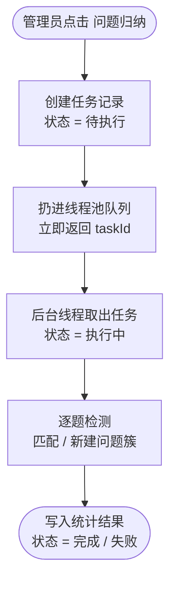
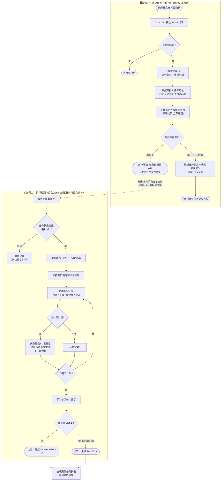
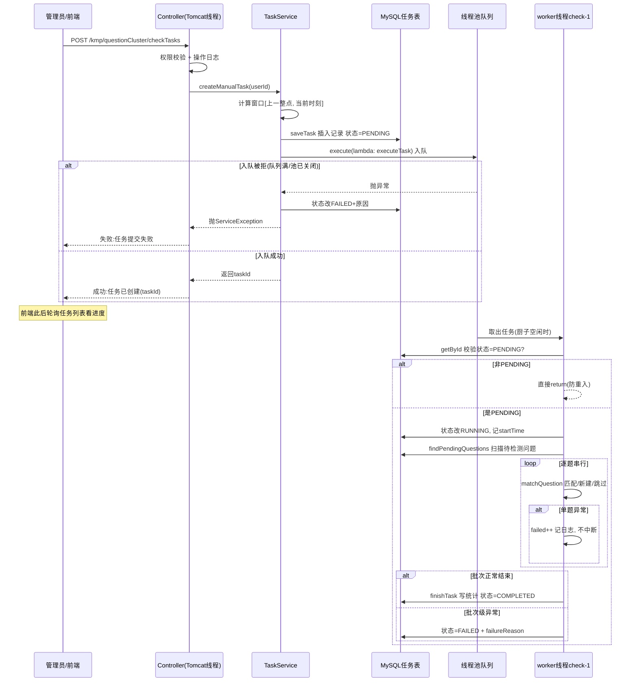

# 第1章 点选 FAQ

点选 FAQ」指用户在知识查询聊天页不发送自由问题，而是直接点击"热门推荐"或"输入联想"出来的 FAQ 标准问题，平台直接返回已发布的标准答案（不走外部 AI 问答）。

## 1 Controller

`KnowledgeQuestionClusterController`

```java
/**
 * POST /kmp/questionCluster/faq/{id}/answer：点选 FAQ 后查询答案并记录访问。
 *
 * @param id 问题簇 ID
 * @param request 携带可重放的请求 ID
 * @return FAQ 答案
 */
@PreAuthorize("@ss.hasPermi('kmp:knowledgeQuery:query')")
@PostMapping("/faq/{id}/answer")
public AjaxResult getFaqAnswer(
        @PathVariable @Positive(message = "FAQ ID 不正确") Long id,
        @Validated @RequestBody KnowledgeFaqModels.KnowledgeFaqAnswerRequest request)
{
    KnowledgeFaqModels.KnowledgeFaqAnswer answer = knowledgeQuestionClusterService.getFaqAnswer(
            id,
            this.getUserId(),
            request.getRequestId()
    );
    return AjaxResult.success(answer);
}
```

## 2 Service

`KnowledgeQuestionClusterService`

```java
/** 返回 FAQ 答案。 */
KnowledgeFaqModels.KnowledgeFaqAnswer getFaqAnswer(Long id, Long userId, String requestId);
```

## 3 ServiceImpl

`KnowledgeQuestionClusterServiceImpl`

```java
/** {@inheritDoc} */
@Override
public KnowledgeFaqModels.KnowledgeFaqAnswer getFaqAnswer(Long id, Long userId, String requestId)
{
    // 在数据落库之后，"发布"状态可能被别的操作破坏，所以读取时再做一次状态复核。
    KnowledgeQuestionCluster cluster = this.lambdaQuery()
            .eq(KnowledgeQuestionCluster::getId, id)
            .eq(KnowledgeQuestionCluster::getStatus, QuestionClusterConstants.STATUS_PUBLISHED)
            .one();

    // 如果不存在则抛出异常。
    if (cluster == null)
    {
        throw new ServiceException("该 FAQ 已失效，请刷新后重试");
    }

    // 组织返回结果
    KnowledgeFaqModels.KnowledgeFaqAnswer answer = new KnowledgeFaqModels.KnowledgeFaqAnswer();
    answer.setId(cluster.getId());
    answer.setStandardQuestion(cluster.getStandardQuestion());
    answer.setStandardAnswer(cluster.getStandardAnswer());

    try
    {
        // 点选累加问题簇点击次数
        boolean counted = increaseFaqClickCount(cluster.getId(), userId, LocalDateTime.now());
        if (!counted)
        {
            log.warn("FAQ 点选未计数（可能刚被取消发布），userId={}，questionClusterId={}", userId, id);
        }
    }
    catch (RuntimeException exception)
    {
        // 计数是失败不回滚答案，只告警留痕。
        //计数丢了如果没有任何痕迹，长期会悄悄低估热门榜。所以不报错的前提是至少留下告警日志，让运维/老师能发现统计在漏数。
        log.error("FAQ 点选计数失败，userId={}，questionClusterId={}，errorType={}",
                userId, id, exception.getClass().getSimpleName());
    }
    return answer;
}
```

# 第2章 任务检测流程

## 2.1 流程图

概要图：



细节图：



## 2.2  时序图




# 第3章 检测任务的数据与配置

## 3.1 实体类

实体：直接知识查询日志、问题簇检测批次摘要

实体类：`KnowledgeQueryLog `、`KnowledgeQuestionClusterCheckTask` 

数据表： `kmp_knowledge_query_log`、`kmp_knowledge_question_cluster_check_task`

## 3.2 Quartz 初始任务如下

```sql
INSERT INTO `sys_job` (`job_name`, `job_group`, `invoke_target`, `cron_expression`,
  `misfire_policy`, `concurrent`, `status`, `create_by`, `create_time`, `remark`)
SELECT '问题簇周期检测', 'KMP', 'knowledgeQuestionClusterCheckJob.execute()',
  '0 0 * * * ?', '3', '1', '0', 'admin', NOW(), '默认每小时整点处理截止当前整点的待检测问题'
WHERE NOT EXISTS (SELECT 1 FROM `sys_job`
  WHERE `job_name` = '问题簇周期检测' AND `job_group` = 'KMP');
```

- `'0 0 * * * ?'` 每小时触发
- 可以在 `系统管理-> 字典管理` 中添加一个任务分组 `KMP`

## 3.3 Quartz 入口

若依定时任务调用 `knowledgeQuestionClusterCheckJob.execute()`，因此创建对应的类和方法。

```java
package com.atguigu.kmp.task;

import lombok.extern.slf4j.Slf4j;
import org.springframework.stereotype.Component;

/**
 * 若依 Quartz 问题簇周期检测调用入口。
 */
@Slf4j
@Component("knowledgeQuestionClusterCheckJob")
public class KnowledgeQuestionClusterCheckJob
{
    public void execute()
    {
        log.info("Quartz 问题簇检测完成");
    }
}
```

**注意：**

为了方便观察任务的执行可以将 `0 0 * * * ?` 改成  `0/1 * * * * ?` 一秒执行一次。

在前端管理页面（系统监控 → 定时任务）修改 cron 表达式并保存后，调度器会立即同步生效。

在后台"定时任务"页面新增/修改任务时，会走 ScheduleUtils.whiteList() 校验，而白名单是硬编码的：

```java
// Constants.java
public static final String[] JOB_WHITELIST_STR = { "com.ruoyi.quartz.task", "com.atguigu.kmp.task" };
```

# 第4章 创建并执行检测任务

## 4.1 任务Service 接口

三个方法分别负责建小时任务、建手工任务和执行任务：

```java
package com.atguigu.kmp.service;

import com.atguigu.kmp.entity.KnowledgeQuestionClusterCheckTask;
import com.baomidou.mybatisplus.spring.service.IService;

/**
 * 问题簇检测批次任务服务。
 */
public interface KnowledgeQuestionClusterCheckTaskService
        extends IService<KnowledgeQuestionClusterCheckTask>
{
    /** 创建 Quartz 上一自然小时任务，不提交异步队列。 */
    Long createHourlyTask(LocalDateTime triggerTime);
    /** 创建截止当前时刻的待检测问题任务并异步提交。 */
    Long createManualTask(Long userId);
    /** 在当前线程串行执行指定待执行任务。 */
    void executeTask(Long taskId);
}
```

## 4.2 手工任务入口Controller

页面点击“问题归纳”创建任务并立即返回任务 ID。

在 `KnowledgeQuestionClusterCheckTaskController` 中创建`createManualTask` 方法定义手动创建问题簇检测任务接口：

```java
package com.atguigu.kmp.controller;

import com.atguigu.kmp.service.KnowledgeQuestionClusterCheckTaskService;
import com.ruoyi.common.annotation.Log;
import com.ruoyi.common.core.controller.BaseController;
import com.ruoyi.common.core.domain.AjaxResult;
import com.ruoyi.common.enums.BusinessType;
import org.springframework.beans.factory.annotation.Autowired;
import org.springframework.security.access.prepost.PreAuthorize;
import org.springframework.web.bind.annotation.PostMapping;
import org.springframework.web.bind.annotation.RequestMapping;
import org.springframework.web.bind.annotation.RestController;

import java.util.LinkedHashMap;
import java.util.Map;

/**
 * 问题簇检测任务接口。
 */
@RestController
@RequestMapping("/kmp/questionCluster/checkTasks")
public class KnowledgeQuestionClusterCheckTaskController extends BaseController
{
    @Autowired
    private KnowledgeQuestionClusterCheckTaskService taskService;

    /** 创建截止当前时刻的异步手工检测任务。 */
    @PreAuthorize("@ss.hasPermi('kmp:questionCluster:check')")
    @Log(title = "问题簇检测", businessType = BusinessType.OTHER)
    @PostMapping
    public AjaxResult createManualTask()
    {
        Long taskId = taskService.createManualTask(getUserId());
        Map<String, Object> result = new LinkedHashMap<>();
        result.put("taskId", taskId);
        return AjaxResult.success("问题簇检测任务已创建", result);
    }

}
```

## 4.3 createManualTask

在 `KnowledgeQuestionClusterCheckTaskServiceImpl` 中 定义创建任务的业务方法 `createManualTask`

```java
private static final ZoneId BUSINESS_ZONE = ZoneId.of("Asia/Shanghai");

/** {@inheritDoc} */
@Override
public Long createManualTask(Long userId)
{
    // BUSINESS_ZONE: 避免 Docker 容器 / 海外云服务器 / 某些 CI 环境中时区错误
    LocalDateTime triggerTime = LocalDateTime.now(BUSINESS_ZONE);
    // 当前小时开始时间: 例如 2026-10-20T11:00
    LocalDateTime currentHourStart = triggerTime.truncatedTo(ChronoUnit.HOURS);
    Long taskId = this.saveTask(
            KnowledgeQuestionClusterCheckConstants.TRIGGER_MANUAL, //手动任务
            currentHourStart.minusHours(1),  // 窗口起点：上一个整点
            triggerTime, // 窗口终点：当前时刻
            userId
    );
    this.submitTask(taskId, userId);
    return taskId;
}

/** 保存计数均为零的批次摘要。 */
private Long saveTask(int triggerType, LocalDateTime rangeStart, LocalDateTime rangeEnd, Long userId)
{
    KnowledgeQuestionClusterCheckTask task = new KnowledgeQuestionClusterCheckTask();
    task.setTriggerType(triggerType); // 触发类型
    task.setRangeStartTime(rangeStart);
    task.setRangeEndTime(rangeEnd);
    task.setTaskStatus(KnowledgeQuestionClusterCheckConstants.TASK_PENDING); // 待执行
    task.setTotalCount(0);
    task.setSuccessCount(0);
    task.setFailedCount(0);
    task.setSkippedCount(0);
    task.setCreatedClusterCount(0);
    task.setMatchedClusterCount(0);
    task.setCreateUserId(userId);
    task.setCreateTime(LocalDateTime.now(BUSINESS_ZONE));
    task.setIsDeleted(0);
    save(task);
    return task.getId();
}

@Override
public Long createHourlyTask(LocalDateTime triggerTime) {
    return 0L;
}

@Override
public void executeTask(Long taskId) {

}


/** 将手工任务提交到单线程执行器。 */
private void submitTask(Long taskId, Long userId)
{

}
```

为什么起点是"上一个小时"
1. 和定时任务的口径保持一致。 Quartz 自动任务的设计（看被注释的 createHourlyTask）是：每个整点处理"上一个完整自然小时"——11:00 的任务处理 10:00~11:00。手工任务的定位是"我等不及下个整点，现在就把最近一批问题跑掉"，所以它取一个和自动任务长度相当的时间范围：从上一个整点开始。这样手工和自动两种批次的扫描范围口径统一，日志、排查时不会混淆。
2. 当前小时是"没过完的小时"。 用快递类比：仓库每小时打包一批订单，11:20 你插一单"现在给我打包"，仓库会打包上一小时已封箱的那批（10:00~11:00），再加上 11:00 之后已经进来的单子的"快照"（截止 triggerTime）。11:20 之后还会不断有新问题进来，那部分不属于"这一批"，留给 12:00 的定时任务处理。以整点为界，批次之间不重叠、不漏项，边界清清楚楚。

## 4.4 选择要检测的日志

`KnowledgeQueryLogService`

```java
/** 读取截止时间前仍待检测且具有改写问题和知识单元的日志。 */
List<KnowledgeQueryLog> findPendingQuestions(LocalDateTime rangeEndTime);
```

它只取截止时间之前、状态仍为待检测、改写问题非空、`item_names` 非空的数据，并按请求时间和 ID 升序处理：

`KnowledgeQueryLogServiceImpl`

```java
@Override
public List<KnowledgeQueryLog> findPendingQuestions(LocalDateTime rangeEndTime)
{
    log.info("开始读取待检测问题，rangeEnd={}", rangeEndTime);
    List<KnowledgeQueryLog> questions = lambdaQuery()
            .lt(KnowledgeQueryLog::getRequestStartTime, rangeEndTime)
            .eq(KnowledgeQueryLog::getClusterCheckStatus, KnowledgeQuestionClusterCheckConstants.CHECK_PENDING)
            .apply("CHAR_LENGTH(TRIM(rewirtten_query)) > 0")
            .apply("JSON_LENGTH(item_names) > 0")
            .orderByAsc(KnowledgeQueryLog::getRequestStartTime, KnowledgeQueryLog::getId)
            .list();
    log.info("待检测问题读取完成，count={}", questions.size());
    return questions;
}
```

## 4.5 手动任务执行器配置

线程池——`ThreadPoolTaskExecutor` 是 Spring 对 JDK 原生 `ThreadPoolExecutor` 的包装。

```java
package com.atguigu.kmp.config;

import org.springframework.context.annotation.Bean;
import org.springframework.context.annotation.Configuration;
import org.springframework.scheduling.concurrent.ThreadPoolTaskExecutor;

import java.util.concurrent.ThreadPoolExecutor;

/**
 * 手动任务执行器配置。
 */
@Configuration
public class KnowledgeQuestionClusterCheckConfig
{
    /**
     * 手动检测任务单线程有界执行器。
     *
     * @return 检测任务执行器
     */
    @Bean("questionClusterCheckExecutor")
    public ThreadPoolTaskExecutor questionClusterCheckExecutor()
    {
        ThreadPoolTaskExecutor executor = new ThreadPoolTaskExecutor();
        // 一个线程异步跑,防止重复建立问题簇,计数错乱
        executor.setCorePoolSize(1); // 常驻 1 个线程
        executor.setMaxPoolSize(1); // 最多 1 个线程
        executor.setQueueCapacity(100); // 等待队列 100
        executor.setThreadNamePrefix("question-cluster-check-"); // 线程名前
        executor.setRejectedExecutionHandler(new ThreadPoolExecutor.AbortPolicy()); // 拒绝策略 AbortPolicy：线程池满拒绝执行
        executor.initialize();
        return executor;
    }
}
```

JDK 线程池的固定规则：先填核心线程 → 满了进队列 → 队列也满了才扩到 max 线程 → 还满就触发拒绝策略。

这里 core = max = 1，所以实际只有两条路：闲着就立刻做，忙就排队，排队超 100 就拒绝。

为什么故意设计成"单线程"

- 问题簇检测有先后依赖——两个批次并行跑，可能同时判断"这道题该归入哪个簇"，一边判新一边判旧就会产生重复建簇、计数错乱等并发问题；单线程天然免疫

## 4.6 submitTask 提交任务

```java
@Autowired
@Qualifier("questionClusterCheckExecutor")
private ThreadPoolTaskExecutor taskExecutor;

/** 将手工任务提交到单线程执行器。 */
private void submitTask(Long taskId, Long userId)
{
    try
    {
        // executeTask 异步执行: 耗时不可控
        taskExecutor.execute(() -> executeTask(taskId));
    }
    catch (RuntimeException exception)
    {
        log.warn("[问题簇检测][提交失败] taskId={}，异常类型={}，原因={}",
                taskId, exception.getClass().getSimpleName(), safeMessage(exception, "任务提交失败"));
        KnowledgeQuestionClusterCheckTask task = getById(taskId);
        task.setTaskStatus(KnowledgeQuestionClusterCheckConstants.TASK_FAILED);
        task.setFailureReason("检测任务提交失败");
        task.setFinishTime(LocalDateTime.now(BUSINESS_ZONE));
        task.setUpdateUserId(userId);
        task.setUpdateTime(LocalDateTime.now(BUSINESS_ZONE));
        updateById(task);
        throw new ServiceException("检测任务提交失败，请稍后重试");
    }
}

/** 提取适合业务日志展示的简短异常原因。 */
private String safeMessage(Throwable throwable, String fallback)
{
    Throwable cause = throwable.getCause() == null ? throwable : throwable.getCause();
    if (cause instanceof ServiceException && cause.getMessage() != null && !cause.getMessage().isBlank())
    {
        return cause.getMessage();
    }
    return fallback;
}
```

## 4.7 executeTask 执行任务

```java
@Autowired
private KnowledgeQueryLogService queryLogService;

private static final long SYSTEM_OPERATOR_USER_ID = 1L;

/** {@inheritDoc} */
@Override
public void executeTask(Long taskId)
{
    KnowledgeQuestionClusterCheckTask task = getById(taskId);
    // 如果任务不存在或者任务状态不是待执行，则返回
    if (task == null || !Integer.valueOf(KnowledgeQuestionClusterCheckConstants.TASK_PENDING).equals(task.getTaskStatus()))
    {
        // 日志信息
        log.warn("[问题簇检测][任务忽略] taskId={}，任务不存在或者任务状态不是待执行", taskId);
        return;
    }

    LocalDateTime startTime = LocalDateTime.now(BUSINESS_ZONE);
    task.setTaskStatus(KnowledgeQuestionClusterCheckConstants.TASK_RUNNING); // 设置任务状态为运行中
    task.setStartTime(startTime); // 设置开始时间为当前时间
    task.setUpdateTime(startTime); // 设置更新时间为当前时间
    this.updateById(task);

    log.info("==================== [问题簇检测][批次开始] taskId={}，触发类型={}，截止时间={} ====================",
            taskId, triggerName(task.getTriggerType()), task.getRangeEndTime());
    try
    {
        List<KnowledgeQueryLog> questions = queryLogService.findPendingQuestions(task.getRangeEndTime());
        log.info("[问题簇检测][批次扫描] taskId={}，待处理问题数={}，说明=包含历史失败后仍待检测的问题", taskId, questions.size());
        TaskStatistics statistics = this.executeQuestions(task, questions);
        this.finishTask(task, statistics, null);
    }
    catch (RuntimeException exception)
    {
        this.finishTask(task, new TaskStatistics(), safeMessage(exception, "检测任务执行失败"));
        log.error("==================== [问题簇检测][批次异常] taskId={}，异常类型={}，原因={} ====================",
                taskId, exception.getClass().getSimpleName(), safeMessage(exception, "检测任务执行失败"));
    }
}

/** 将触发类型转换为中文日志文案。 */
private String triggerName(Integer triggerType)
{
    return Integer.valueOf(KnowledgeQuestionClusterCheckConstants.TRIGGER_MANUAL).equals(triggerType)
            ? "管理员手工触发" : "Quartz自动触发";
}

/** 当前批次的内存统计，不承担单题持久化职责。 */
private static class TaskStatistics
{
    private int total;
    private int failed;
    private int skipped;
    private int created;
    private int matched;
}

/** 严格串行处理问题，单题失败只计数并保留待检测状态。 */
private TaskStatistics executeQuestions(KnowledgeQuestionClusterCheckTask task, List<KnowledgeQueryLog> questions)
{
    TaskStatistics statistics = new TaskStatistics();

    // 串行处理可以让日志顺序与实际业务顺序完全一致，便于教学和排查。
    for (KnowledgeQueryLog question : questions)
    {
        statistics.total++;
        try
        {
            // TODO: 拿一条用户提问，判断它和已有的"问题簇"是不是同一个问题，是就归进去，不是就新建一个簇,不合适自动处理的就跳过
            // 定时任务触发,没有用户id，使用默认管理员用户id
            Long operatorUserId = task.getCreateUserId() == null ? SYSTEM_OPERATOR_USER_ID : task.getCreateUserId();
            int action = matchService.matchQuestion(task.getId(), question, operatorUserId);
            //int action = KnowledgeQuestionClusterCheckConstants.ACTION_MATCHED;

            // 按单题最终动作生成批次摘要，不再读取任务明细表二次汇总。
            if (action == KnowledgeQuestionClusterCheckConstants.ACTION_MATCHED)
            {
                statistics.matched++;
            }
            else if (action == KnowledgeQuestionClusterCheckConstants.ACTION_CREATED)
            {
                statistics.created++;
            }
            else if (action == KnowledgeQuestionClusterCheckConstants.ACTION_SKIPPED)
            {
                statistics.skipped++;
            }
        }
        catch (RuntimeException exception)
        {
            statistics.failed++;
            log.warn("[问题簇检测][单题失败] taskId={}，questionId={}，异常类型={}，原因={}；状态保持待检测，下个批次自动重试",
                    task.getId(), question.getId(), exception.getClass().getSimpleName(),
                    safeMessage(exception, "单题处理失败"));
        }
    }
    return statistics;
}

/** 保存批次摘要并显著打印最终统计。 */
private void finishTask(KnowledgeQuestionClusterCheckTask task,
                        TaskStatistics statistics, String taskFailure)
{
    LocalDateTime finishTime = LocalDateTime.now(BUSINESS_ZONE);
    task.setTotalCount(statistics.total);
    task.setSuccessCount(statistics.created + statistics.matched);
    task.setFailedCount(statistics.failed);
    task.setSkippedCount(statistics.skipped);
    task.setCreatedClusterCount(statistics.created);
    task.setMatchedClusterCount(statistics.matched);
    task.setFinishTime(finishTime);
    task.setDurationMs(task.getStartTime() == null ? 0L : Duration.between(task.getStartTime(), finishTime).toMillis());
    task.setFailureReason(taskFailure);
    task.setTaskStatus(taskFailure == null
            ? KnowledgeQuestionClusterCheckConstants.TASK_COMPLETED
            : KnowledgeQuestionClusterCheckConstants.TASK_FAILED
    );
    task.setUpdateTime(finishTime);
    this.updateById(task);
    log.info("==================== [问题簇检测][批次完成] taskId={}，总数={}，关联={}，新建={}，跳过={}，本轮失败={}，耗时={}ms ====================",
            task.getId(), statistics.total, statistics.matched, statistics.created,
            statistics.skipped, statistics.failed, task.getDurationMs());
}
```

这段代码最关键的是 `executeQuestions`：它逐题捕获异常。某一题失败只增加 `failed`，不会跳出循环；这道题的查询日志仍是待检测，等待下次检测任务。

## 4.8 Quartz 入口 完善

若依定时任务调用 `knowledgeQuestionClusterCheckJob.execute()`。它创建上一自然小时的批次，然后在当前 Quartz 工作线程执行：

```java
/**
 * 若依 Quartz 问题簇周期检测调用入口。
 */
@Slf4j
@Component("knowledgeQuestionClusterCheckJob")
public class KnowledgeQuestionClusterCheckJob
{
    @Autowired
    private KnowledgeQuestionClusterCheckTaskService taskService;

    /** 创建上一自然小时任务并在当前 Quartz 工作线程执行。 */
    public void execute()
    {
        Long taskId = taskService.createHourlyTask(LocalDateTime.now(ZoneId.of("Asia/Shanghai")));
        log.info("Quartz 问题簇检测开始，taskId={}", taskId);
        taskService.executeTask(taskId);
        log.info("Quartz 问题簇检测完成，taskId={}", taskId);
    }
}
```

`KnowledgeQuestionClusterCheckTaskServiceImpl`

```java
/** {@inheritDoc} */
@Override
public Long createHourlyTask(LocalDateTime triggerTime)
{
    LocalDateTime end = triggerTime.atZone(BUSINESS_ZONE).withMinute(0)
            .withSecond(0).withNano(0).toLocalDateTime();
    return saveTask(KnowledgeQuestionClusterCheckConstants.TRIGGER_AUTO,
            end.minusHours(1), end, null);
}
```