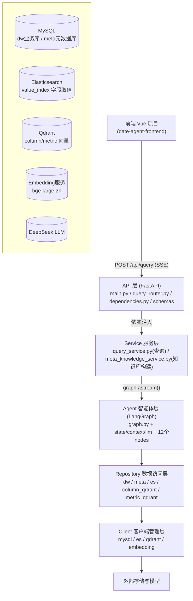
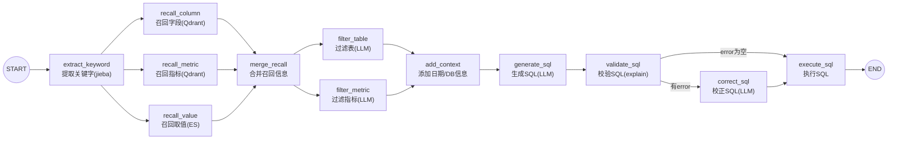
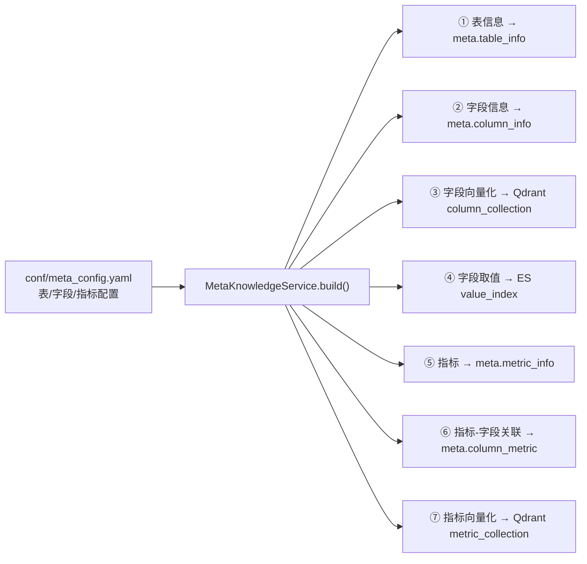

## 3.2 掌柜问数项目

元数据：
技术元数据： 表元数据（表名、注释、角色）、字段元数据（字段名、类型、注释、角色）
业务元数据： 指标（名字、什么意思、怎么算的（统计口径），跟哪些表/字段有关，关联键）


### 3.2.1 项目架构图🛫

分析完成。这是一个基于 **LangGraph + FastAPI** 的「NL2SQL 智能问数」项目（掌柜问数），我通读了全部核心代码，下面给出完整架构，未改动任何文件。

下面两段话术都基于你笔记里的真实内容整理，逻辑链完整，可以直接背。

---

#### 问题一：你是如何设计元数据表的？🛫

> 元数据是 NL2SQL 的基础，我的目标就是让大模型能"看懂"数据仓库里有哪些表、字段、指标。所以我先对元数据做了分类——分成**技术元数据**和**业务元数据**两类：
>
> - **技术元数据**描述数据本身长什么样，就是**表信息**和**字段信息**
> - **业务元数据**描述业务口径，就是**指标信息**
>
> 基于这个分类，我把元数据库设计成四张表：
>
> 1. **`table_info` 表信息表**：存表名、表角色（事实表/维度表）和业务描述
> 2. **`column_info` 字段信息表**：存字段名、别名、类型、字段角色（主键/维度/度量）、业务描述、字段取值示例，并通过 `table_id` 外键关联到表
> 3. **`metric_info` 指标信息表**：存指标名、别名、业务含义、计算口径和它依赖的字段
> 4. **`column_metric` 关联表**：专门表达"字段—指标"的多对多关系
>
> 这四张表统一存在 MySQL 里。之后为了做语义召回，我把字段和指标做向量化写入 Qdrant，把常用的维度字段取值写入 Elasticsearch 做全文检索。这样就形成了"结构化元数据中心 + 向量索引 + 全文索引"三块，支撑后面的召回和 SQL 生成。

---

#### 问题二：为什么是这 4 张表？🛫

| 表              | 本质            | 作用                     |
| --------------- | --------------- | ------------------------ |
| `table_info`    | 技术元数据·表   | 有哪些表、什么角色       |
| `column_info`   | 技术元数据·字段 | 表里有什么字段、字段含义 |
| `metric_info`   | 业务元数据·指标 | 指标怎么算               |
| `column_metric` | 关联表          | 指标↔字段多对多          |

**一句话总纲**：技术元数据 2 张（表+字段）+ 业务元数据 1 张（指标）+ 多对多关联 1 张 = 4 张。

> 这四张表不是随便定的，是从元数据的本质推出来的。
>
> **第一步，元数据天然分两类**：一类是技术元数据，回答"数据在物理上是什么"——就是表、字段；另一类是业务元数据，回答"业务上怎么算"——就是指标。所以先有 `table_info`、`column_info`、`metric_info` 三张实体表。
>
> **第二步，指标和字段是多对多关系**：一个指标（比如"销售总额"）依赖多个字段（`order_amount`、`date_id` 等），同一个字段又会被多个指标复用。如果直接在一张表里存，会产生大量冗余、口径也难维护，所以单独抽一张关联表 `column_metric`，用 `column_id` + `metric_id` 表达这种多对多。
>
> **第三步，表和字段是一对多**：一张表有多个字段，用 `column_info.table_id` 外键关联即可，不用单独拆表。
>
> 所以最终就是 **3 张实体表 + 1 张关联表 = 4 张**。这样设计的好处是职责单一、关系清晰，既能把表/字段/指标三类信息管理清楚，又能支撑后续的向量化和检索，还能让指标口径复用、方便维护。

---

#### 记忆口诀（帮你串联）

| 表              | 本质            | 为什么存在                     |
| --------------- | --------------- | ------------------------------ |
| `table_info`    | 技术元数据·表   | 描述"有哪些表、什么角色"       |
| `column_info`   | 技术元数据·字段 | 描述"表里有什么字段、字段含义" |
| `metric_info`   | 业务元数据·指标 | 描述"业务指标怎么算"           |
| `column_metric` | 关联表          | 表达指标↔字段的多对多          |

**一句话总纲**：技术元数据 2 张（表+字段）+ 业务元数据 1 张（指标）+ 多对多关联 1 张 = 4 张。

---

这两段话术建议你按"**先分类 → 再落表 → 后索引**"的顺序讲，面试官追问"为什么"时，就用"**3 张实体表 + 1 张关联表**"这个逻辑收尾，会显得很有条理。需要我再补一段"如果被追问 `column_metric` 为什么不用 JSON 字段存"的应对话术吗？

#### 一、技术栈

| 层         | 技术                                                        |
| ---------- | ----------------------------------------------------------- |
| Web 框架   | FastAPI（SSE 流式响应）                                     |
| Agent 编排 | LangGraph（状态图工作流）                                   |
| LLM 集成   | LangChain + DeepSeek (`deepseek-chat`)                      |
| 向量模型   | HuggingFace Embedding (`BAAI/bge-large-zh-v1.5`, 1024维)    |
| 关系库     | MySQL（`dw` 业务库 + `meta` 元数据库），SQLAlchemy 异步 ORM |
| 向量库     | Qdrant（字段/指标向量召回）                                 |
| 全文检索   | Elasticsearch（字段取值索引）                               |
| 分词       | jieba                                                       |
| 配置/日志  | OmegaConf / loguru                                          |

#### 二、整体分层架构图



#### 三、LangGraph Agent 工作流（核心）

这是系统的大脑，位于 `app/agent/graph.py`，由 12 个节点组成：



> 注：`filter_table`/`filter_metric` 并行执行后汇合到 `add_context`；`validate_sql` 是条件分支节点。

#### 四、两条业务主线

**1. 知识库构建（离线）**：`scripts/build_meta_knowledge.py` → `MetaKnowledgeService.build()`



**2. 在线问数查询（实时）**：`POST /api/query` → `QueryService.search()` → 上面的工作流 → SSE 流式返回 `{stage}` 进度 + `{result}` 结果。

#### 五、模块职责速览

| 目录/文件                           | 职责                                                         |
| ----------------------------------- | ------------------------------------------------------------ |
| `main.py`                           | FastAPI 入口，注册路由、请求中间件（注入 `request_id`）      |
| `app/core/lifespan.py`              | 服务启动/关闭时初始化/销毁 5 个客户端                        |
| `app/core/context.py`               | `ContextVar` 实现协程隔离的 request_id                       |
| `app/core/log.py`                   | loguru 日志，注入 request_id，文件滚动+过期                  |
| `app/api/dependencies.py`           | FastAPI 依赖注入，组装所有 Repository → QueryService         |
| `app/agent/state.py` / `context.py` | LangGraph 的状态数据模型与上下文依赖模型                     |
| `app/agent/nodes/*`                 | 12 个工作流节点（见上图）                                    |
| `app/models/mysql/*`                | `table_info`/`column_info`/`metric_info`/`column_metric` ORM |
| `app/repositories/*`                | MySQL/ES/Qdrant 的增查封装                                   |
| `app/prompt/*.prompt`               | 8 个提示词模板（扩展关键词/过滤/生成/校正 SQL）              |
| `conf/*.yaml`                       | 应用配置 + 元数据（表/字段/指标）配置                        |

#### 六、数据存储模型关系（meta 库）

```
table_info(表) 1─N column_info(字段) 1─N column_metric(字段-指标) N─1 metric_info(指标)
         │                                              │
         └── 向量化 → Qdrant(column_collection)          └── 向量化 → Qdrant(metric_collection)
                     column_info(sync=true) 取值 → ES(value_index)
```

---

**总结**：这是一个典型的 **RAG + Text2SQL 架构**——离线阶段把表/字段/指标元数据分别写入 MySQL（结构化）、Qdrant（向量）和 ES（全文），在线阶段通过 LangGraph 编排「分词 → 三路召回 → 合并 → LLM 过滤 → 生成 SQL → explain 校验 → 纠错 → 执行」流水线，最终流式返回查询结果。

需要我把这份架构图导出成 `.md` 或 `.drawio` 文件吗？（默认不创建文件，仅在此展示）

数仓中的 **ODS、DWD、DIM、DWS、ADS** 是数据仓库分层架构里的核心层级。你可以把它们理解为一个数据加工工厂的流水线：数据从原始状态进入，经过层层处理，最终变成可以直接使用的产品。

#### 🏗️ 各层级的定义与核心作用

**ODS (Operational Data Store)：贴源层**
它是数据进入数仓的第一站，也叫“原始层”或“缓冲区”。核心任务是**原封不动地同步业务系统的原始数据**，结构与源系统基本一致，几乎不做业务逻辑清洗，以此**隔离风险**，保护源系统不受分析查询的影响，并保留数据的历史原貌以供追溯。

**DIM (Dimension)：公共维度层**
这一层是数据的“**视角库**”或“**字典**”，存放的是**维度表**。维度是观察业务的角度，比如“时间”、“地区”、“商品类目”。DIM层的核心作用是建立**全企业一致的维度标准**，确保不同部门在分析“销售额”等指标时，对“华东地区”或“电子产品”的定义是统一的，从而**降低数据口径不一致的风险**。

**DWD (Data Warehouse Detail)：明细数据层**
这是数仓的**核心明细层**，以业务过程为驱动，存放**最细粒度的事实数据**（如每一次下单、每一次支付）。它的核心工作是**数据清洗与规范化**：去除脏数据、统一字段格式、进行脱敏，并通过关联DIM层的维度表来丰富信息（例如，将ID替换为可读的名称），为上层分析提供**干净、可信、一致的明细基础**。

**DWS (Data Warehouse Summary)：汇总数据层**
这一层以分析主题为驱动，对DWD层的明细数据进行**轻度汇总**，生成**面向主题的宽表**（如“用户主题宽表”、“商品主题宽表”）。其核心价值在于**提炼公共指标、提高复用性**：将多个应用中通用的汇总口径（如“近30天用户活跃天数”）在这里统一计算一次，避免下游重复开发，显著提升查询效率。

**ADS (Application Data Service)：应用数据层**
这是直接**面向最终业务应用**的层级，如报表、大屏、数据API等。它存放的是**高度个性化、直接可用的结果数据**。ADS层的数据通常已经根据特定业务需求（如“618大促杭州地区球类销量排行”）进行了深度加工和聚合，前端应用可以**不经任何处理直接读取使用**。

#### 🔗 层间关系与整体价值

这些层级并非孤立存在，它们之间有着清晰的**数据流向**和协作关系。

典型的数据流向是：**ODS → DWD/DIM → DWS → ADS**。
- 原始数据先进入 **ODS** 层。
- 在 **DWD** 层，数据得到清洗，并与 **DIM** 层的标准维度进行关联整合。
- **DWS** 层基于整合好的明细数据进行主题汇总。
- 最终，**ADS** 层根据具体的业务需求，从 DWS 或 DWD 层提取数据，加工成直接可用的产品。

这种分层设计的核心价值在于：通过**解耦**使每一层职责单一、结构清晰，让数据问题更容易**溯源**；通过中间层的**复用**避免重复计算；同时将源系统的复杂性**屏蔽**在数仓内部，使下游应用更加稳定。

需要注意的是，DIM层的位置比较特殊，它并非严格地位于某个单一层级，而是作为**公共维度**，通常与DWD、DWS层广泛关联，为它们提供一致的观察视角。

#### 2.1项目架构 概述

本项目以数据仓库的元数据为核心，使用 **MySQL** 存储结构化元数据信息，结合 **Qdrant** 构建语义向量索引、**Elasticsearch** 构建全文索引，形成统一的元数据知识库。查询过程中，系统首先根据用户自然语言问题进行多路召回，筛选相关表、字段及指标定义，再将元数据信息与用户问题共同输入大模型生成 SQL，最终完成自动查询与结果返回，确保生成结果的准确性与可控性。

 

#### 2.2 元数据知识库

元数据知识库作为数据仓库的语义基础设施，用于集中管理和高效检索表结构、字段定义、字段取值示例及复杂指标说明等元数据信息，支撑后续的智能检索与 SQL 生成。

元数据信息主要来源于两部分：一部分数据仓库自动采集，另一部分由人工进行补充与配置。完整的元数据统一存储于 MySQL 数据库中，并对其中部分关键信息构建**向量索引**和**全文索引**，以提升**语义召回**与**关键词召回**的效果。

#### 2.2.1 数据仓库(dw)

dim_customer：客户维度表

dim_date：日期维度表

dim_product：商品维度表

dim_region：区域维度表

fact_order：订单事实表

类型说明：

**（1）以`dim_`开头的是维度(dimension)表**：用于描述业务的 “维度属性”，比如客户信息、商品信息、时间维度、区域信息，是分析的 “上下文”，在实际使用中维度表主要用于分组和过滤操作

**（2）以`fact_`开头的是事实表**：存储核心业务的 “度量值”（如订单数量、订单金额），并通过外键关联各个维度表，是分析的 “核心数据”	，在实际使用中事实表主要用于聚合操作

特点：订单分析的星型模型**：fact_order（事实表）是中心，关联 4 张 dim_维度表，是数据仓库中最经典的建模方式。


`dim_date`（日期维度表）

| 字段名    | 类型         | 注释                                      |
| --------- | ------------ | ----------------------------------------- |
| `date_id` | `int`        | **日期 ID**（主键，唯一标识一条日期记录） |
| `year`    | `int`        | **年份**（如 2025）                       |
| `quarter` | `varchar(2)` | **季度**（如 Q1、Q2）                     |
| `month`   | `int`        | **月份**（1-12）                          |
| `day`     | `int`        | **日期**（1-31）                          |

`dim_region`（地区维度表）

| 字段名        | 类型          | 注释                                      |
| ------------- | ------------- | ----------------------------------------- |
| `region_id`   | `varchar(20)` | **地区 ID**（主键，唯一标识一条地区记录） |
| `province`    | `varchar(50)` | **省份**                                  |
| `region_name` | `varchar(50)` | **地区名称**                              |
| `country`     | `varchar(50)` | **国家**                                  |

`dim_customer`（客户维度表）

| 字段名          | 类型          | 注释                                  |
| --------------- | ------------- | ------------------------------------- |
| `customer_id`   | `varchar(20)` | **客户 ID**（主键，唯一标识一个客户） |
| `customer_name` | `varchar(50)` | **客户名称**                          |
| `gender`        | `varchar(10)` | **性别**                              |
| `member_level`  | `varchar(20)` | **会员等级**                          |

`dim_product`（商品维度表）

| 字段名         | 类型           | 注释                                  |
| -------------- | -------------- | ------------------------------------- |
| `product_id`   | `varchar(20)`  | **商品 ID**（主键，唯一标识一个商品） |
| `product_name` | `varchar(200)` | **商品名称**                          |
| `category`     | `varchar(50)`  | **商品类别**                          |
| `brand`        | `varchar(50)`  | **品牌**                              |

`fact_order`（订单事实表）

| 字段名           | 类型          | 注释                                                 |
| ---------------- | ------------- | ---------------------------------------------------- |
| `order_id`       | `varchar(30)` | **订单 ID**（主键，唯一标识一条订单记录）            |
| `customer_id`    | `varchar(20)` | **客户 ID**（外键，关联 `dim_customer.customer_id`） |
| `product_id`     | `varchar(20)` | **商品 ID**（外键，关联 `dim_product.product_id`）   |
| `date_id`        | `int`         | **日期 ID**（外键，关联 `dim_date.date_id`）         |
| `region_id`      | `varchar(20)` | **地区 ID**（外键，关联 `dim_region.region_id`）     |
| `order_quantity` | `int`         | **订单数量**（度量，本次订单购买的商品件数）         |
| `order_amount`   | `float`       | **订单金额**（度量，本次订单的总金额）               |

 

#### 2.2.2 元数据库(meta)

元数据库共包含四张表，具体结构如下图所示：

​		table_info：表描述信息表

​		column_info：字段描述信息表 

​		metric_info：指标描述信息表

​		column_metric：字段指标关联表

列角色说明：

```
primary_key：主键
foreign_key：外键
measure：度量，可计算的数值，主要用于做统计，例如：卖了多少钱、买了几件、耗时多少
dimension：维度 分析的“角度”,主要用来做筛选和分组，例如：按时间看、按区域看、按商品分类看
```


table_info（表信息表）

| 字段名        | 类型           | 注释                                         |
| ------------- | -------------- | -------------------------------------------- |
| `id`          | `varchar(64)`  | **表编号**（主键，唯一标识一个物理表）       |
| `name`        | `varchar(128)` | **表名称**（如 `fact_order`）                |
| `role`        | `varchar(32)`  | **表类型**（如 `fact` 事实表，`dim` 维度表） |
| `description` | `text`         | **表描述**（详细说明该表的业务含义）         |

column_info（列信息表）

| 字段名        | 类型           | 注释                                                   |
| ------------- | -------------- | ------------------------------------------------------ |
| `id`          | `varchar(64)`  | **列编号**（主键，唯一标识一个物理列）                 |
| `name`        | `varchar(128)` | **列名称**（如 `order_amount`）                        |
| `type`        | `varchar(64)`  | **数据类型**（如 `INT`, `VARCHAR`, `DATETIME`）        |
| `role`        | `varchar(32)`  | **列角色**（如 `primary key`, `dimension`, `measure`） |
| `examples`    | `json`         | **数据示例**（JSON 格式，记录该列的示例值）            |
| `description` | `text`         | **列描述**（详细说明该列的业务含义）                   |
| `alias`       | `json`         | **列别名**（JSON 格式，记录该列的别名）                |
| `table_id`    | `varchar(64)`  | **所属表编号**（外键，关联 `table_info.id`）           |

metric_info(指标信息表)

| 字段名             | 类型           | 注释                                                      |
| ------------------ | -------------- | --------------------------------------------------------- |
| `id`               | `varchar(64)`  | **指标编码**（主键，唯一标识一个指标）                    |
| `name`             | `varchar(128)` | **指标名称**（如 “销售总额”）                             |
| `description`      | `text`         | **指标描述**（详细说明指标的业务含义、计算口径）          |
| `relevant_columns` | `json`         | **关联列信息**（JSON 格式，记录该指标计算时依赖的物理列） |
| `alias`            | `json`         | **指标别名**（JSON 格式，记录指标的别名、简称等）         |

column_metric（列 - 指标关联表）

| 字段名      | 类型          | 注释                                        |
| ----------- | ------------- | ------------------------------------------- |
| `column_id` | `varchar(64)` | **列编号**（外键，关联 `column_info.id`）   |
| `metric_id` | `varchar(64)` | **指标编号**（外键，关联 `metric_info.id`） |

构建元知识库

~~~shell
python -m app.scripts.build_meta_knowledge
~~~


#### 2.2.3 向量索引

本项目选用 [Qdrant](https://qdrant.tech/) 作为向量数据库，向量索引主要用于对**指标信息**和**字段信息**进行索引存储，用于**语义召回**。向量索引的构建内容具体如下：

[Qdrant_python_client](https://python-client.qdrant.tech/)

- metric_info  需要建立向量索引的字段如下图所示：


具体示例如下图所示：

 

- column_info 需要建立向量索引的字段如下图所示：

  

  具体示例如下图所示：

   

#### 2.2.4 全文索引

本项目使用 **Elasticsearch** 作为全文检索引擎，全文索引主要用于对**字段取值**进行检索与匹配，索引内容以各类**维度值**为主，具体如下：

针对字段取值的索引建立，主要选择维度表的维度角色字段，只有维度字段在召回时，用于过滤匹配


具体示例如下图所示：


#### 2.3 问数智能体

本项目的智能体主体基于Langgraph构建，具体结构如下图所示：


1. 后台项目构建元数据知识库：运行build_meta_knowledge.py

2. 后端项目启动（data-agent）：运行 main.py

3. 前端项目启动（data-agent-frontend）：npm run dev 

元数据库构建很重要

> 权限：表，列，行

------

### 3.2.2 问数项目串讲稿

#### 3.2.2.1 项目开篇介绍

掌柜问数是一个面向数据仓库的智能问数系统，主要解决业务人员查数依赖开发或数据分析师写 SQL 的问题。用户可以直接用自然语言提问，比如"统计一下华北地区上个月的销售额"，系统会自动理解问题，找到相关表、字段和指标口径，生成 SQL，完成校验和执行，最后把查询结果返回给用户。

从技术上看，这个项目以 Text2SQL 为核心，并在 SQL 生成前后补充了元数据召回、上下文精筛、SQL 校验、权限控制和 bad case 评测闭环。项目里重点建设了一套元数据知识库，把数据仓库中的表信息、字段信息、指标定义和字段取值示例统一管理起来，再结合向量检索、全文检索和 LangGraph 编排，把自然语言问题稳定地转成可执行、可校验、可控的 SQL 查询。

#### 3.2.2.2 构建流程

系统构建时，第一步是做元数据治理。元数据主要分为表信息、字段信息和指标信息：

- **表信息**：记录表名、表角色和业务描述
- **字段信息**：记录字段名、字段别名、字段类型、字段角色、业务描述和字段取值示例
- **指标信息**：记录指标名、指标别名、业务含义、计算口径和依赖字段

第二步是建设元数据知识库：

- 完整元数据存储在 **MySQL** 中，形成结构化的元数据中心
- 字段信息和指标信息写入 **Qdrant** 构建向量索引，用于语义召回
- 常用维度字段的取值写入 **Elasticsearch** 构建全文索引，用于精确匹配地区、类目、状态这类具体字段值

> 业务对应事实表

#### 3.2.2.3 查询流程

查询时，问数 Agent 会用 **LangGraph** 编排整个执行链路，节点包括：问题理解、关键词提取、字段召回、指标召回、字段取值召回、上下文精筛、SQL 生成、SQL 校验、SQL 修正和 SQL 执行。

1. 用户提出自然语言问题后，系统先做**问题理解**，抽取时间范围、查询指标、过滤条件、分组维度和核心实体
2. 进入**多路召回**：通过向量索引召回相关字段、指标，通过全文索引召回字段取值
3. **信息整合**：
   - 命中某个指标时，补充该指标依赖的字段
   - 命中某个字段取值时，把取值挂到对应字段的示例值里
   - 字段按所属表进行分组，整理
4. **精筛**：只保留生成 SQL 真正需要的表结构、字段说明、指标口径和字段示例，形成最小充分上下文
5. 把用户问题和精筛后的元数据上下文交给大模型**生成 SQL**
6. **SQL 校验**：先做 SQL 解析、EXPLAIN 校验、权限校验和安全校验
   - 语法或字段错误 → 进入修正节点重新生成
   - 权限错误、危险 SQL 或连续修正失败 → 直接中断或返回澄清
7. 校验通过后**执行 SQL**，把查询结果返回给用户

#### 3.2.2.4 项目整体总结

项目的核心价值是把业务人员依赖数据开发写 SQL 的过程，变成了自然语言问数流程。业务层可以更快拿到数据结果，技术层也能通过元数据、检索、校验、权限和评测机制控制 SQL 的准确性和安全性。

项目的技术重点有四个：

1. **元数据知识库**：让模型理解数据仓库里的表、字段和指标
2. **多路召回**：从大量元数据里筛出当前问题需要的信息
3. **LangGraph 编排**：把问题理解、召回、生成、校验、修正和执行串成稳定链路
4. **评测和 bad case 闭环**：持续补充元数据、优化召回和提升 SQL 生成准确率

> 召回：jieba+3路，生成：合并+过滤+生成，执行：校验+校正+执行

---

### 3.2.3 项目相关指标数据

#### 3.2.3.1 模型选择

| 模块 | 配置 |
| --- | --- |
| 应用服务 | 2 台 8C32G 云主机，Docker Compose 部署 FastAPI 服务，Nginx 反向代理 |
| 模型服务 | 1 台 GPU 服务器，32C128G，1 张 NVIDIA L20 48GB |
| 推理框架 | vLLM，OpenAI compatible API |
| 主力生成模型 | Qwen3.5-35B-A3B-GPTQ-Int4，max_model_len=16384 |
| 轻量路由模型（生成扩展词、意图路由） | Qwen3.5-4B |
| Embedding | BGE-large-zh-v1.5 |
| 检索组件 | Qdrant、Elasticsearch |
| 数据库 | MySQL 8.0 |
| 监控 | Prometheus + Grafana + 结构化 trace 日志 |

#### 3.2.3.2 压测数据

| 并发 | QPS | TTFT P50 | TTFT P95 | TPOT P95 | GPU 利用率 |
| --- | --- | --- | --- | --- | --- |
| 16 | 14.8 | 310ms | 620ms | 38ms/token | 61% |
| 32 | 25.6 | 420ms | 880ms | 46ms/token | 78% |
| 64 | 38.9 | 690ms | 1.42s | 63ms/token | 91% |

#### 3.2.3.3 数据规模

| 类型 | 数量 |
| --- | --- |
| 数仓主题域 | 4 个：订单、客户、商品、区域 |
| 业务表 | 67 张 |
| 字段 | 913 个 |
| 指标 | 128 个 |
| 字段枚举值 | 18.6 万条 |
| 事实表最大数据量 | 3200 万行 |
| 元数据向量 | 字段 913 条，指标 128 条 |
| ES 字段值索引 | 18.6 万条 |

---

### 3.2.4 请介绍一下问数项目的整体流程和你主要负责的内容

掌柜问数是一个面向数据仓库的智能问数系统，目标是让业务人员通过自然语言查询数据，不需要自己写 SQL。系统会完成问题理解、元数据召回、SQL 生成、SQL 校验、查询执行和结果返回。

**整体流程**：用户提出问题后，系统先做关键词提取和语义理解，再从元数据知识库里召回相关表、字段、指标定义和字段取值，然后把精筛后的上下文交给大模型生成 SQL。SQL 生成后先做 EXPLAIN 校验和权限校验，校验通过后再执行查询，最后把查询结果返回给用户。

**主要负责内容**：问数智能体链路，包括元数据知识库建设、表字段和指标召回、SQL 生成、SQL 校验、异常修正以及 bad case 优化。

### 3.2.5 Text2SQL 链路是如何实现的🛫

Text2SQL 链路主要分为六步：问题理解、元数据召回、上下文组装、SQL 生成、SQL 校验、SQL 执行。

> 召回：jieba+3路，生成：合并+过滤+生成，执行：校验+校正+执行

1. **召回阶段**：用户提出自然语言问题后，系统先识别问题里的时间、指标、维度、过滤条件等信息，再召回相关字段、指标和字段取值
2. **生成阶段**：召回结果按表整理，补充字段角色、字段描述、字段别名、指标口径和依赖字段，之后把用户问题和精筛后的元数据上下文交给大模型生成 SQL
3. **执行阶段**：SQL 生成后先做 EXPLAIN 校验，确认语法和执行计划没有明显问题，再执行查询并返回结果

> 不是普通的TextSql；强调上下文的重要性

大厂做了语义层(获得业务知识)——>可以建立一个业务知识库rag

FDE--->**前沿部署工程师**--->钱少事多

### 3.2.6 自然语言转 SQL 是直接交给 LLM 吗，还做了哪些前置处理🛫

> jieba分词/大模型扩展，字段/字段值/指标召回，上下文合并+精筛

不是直接交给 LLM。直接生成很容易表选错、字段选错，尤其数据仓库表多的时候更明显，必须要和元数据进行对齐。

1. 前面会先做**关键词抽取**，代码里用了 jieba，再结合大模型扩展召回关键词
2. 之后分别召回字段、指标和字段值——字段和指标走 Qdrant 向量检索，字段值走 Elasticsearch
3. 最后做**上下文合并和精筛**，只给模型当前问题真正需要的表结构和指标口径

### 3.2.7 用户问题涉及哪些表和字段，这些表字段是怎么确定的

表和字段主要来自元数据知识库，而不是让模型凭空猜。

1. MySQL 里存表信息、字段信息、指标信息，字段和指标同步到 Qdrant，字段取值同步到 ES
2. 查询时先根据问题从 Qdrant 召回字段和指标，从 ES 召回字段值，再根据字段所属表、指标依赖字段、字段值命中结果把表结构补齐

这样模型拿到的是结构化上下文，知道有哪些表、哪些字段、字段含义和示例值。

### 3.2.8 SQL 召回的是全部表字段信息，还是只召回相关字段

SQL 生成前只召回相关表字段和指标定义，不会把全量 schema 直接传给模型。

### 3.2.9 如何保证给 LLM 的表结构和字段信息足够干净

核心做法是控制**最小充分上下文**。

除了通过 Qdrant 和 ES 召回指标、字段、字段值后，从 MySQL 提取相关表后，使用了 LLM 专门对数据表的字段进行精筛。

> FAQ:问题+答案：上下文+sql逻辑；bad case

> 大模型

### 3.2.10 关键表和字段是自动筛选还是人工配置，人工成本如何控制

人工治理的是元数据，不是每次查询人工参与。每次查询从元数据中提取信息。

> 

### 3.2.11 表过滤和字段过滤是怎么做的

表过滤和字段过滤分为**召回、补全和精筛**三层：

1. **召回阶段**：根据问题语义召回字段和指标，根据关键词召回字段取值
2. **补全阶段**：根据指标依赖补充字段，根据字段所属关系补充表信息，根据字段取值补充字段示例
3. **精筛阶段**：判断哪些表字段和当前问题真正相关，把无关信息过滤掉，最后生成 SQL 上下文

### 3.2.12 问数项目里用到了哪些关键词提取和语义理解技术🛫

1. **统计分词**：用 jieba 的 TF-IDF 算法做初始关键词提取，同时做词性过滤——只保留名词、动词、形容词等

   > jieba：TF-IDF+词性过滤

2. **LLM 语义扩展**：在提示词中针对字段、指标、字段值三种检索目标做不同的扩展策略

   - 字段扩展要求推断"最小必要字段集合"
   - 指标扩展专门做同义和缩写生成（比如"销售额"→"GMV"→"成交额"→"交易额"）
   - 字段值扩展提取用户问题中的实体名称和枚举值
   - 三者并行执行，互不等

3. **混合语义检索**：用 BGE-large-zh-v1.5 做向量语义匹配；Elasticsearch 的 IK_MAX_WORD 做中文分词全文检索
   BGE-large+Qdrant：向量语义匹配
   ES：IK_MAX_WORD 中文分词检索

### 3.2.13 问数项目中的三路召回策略是什么，如何做融合和重排🛫

#### 3.2.13.1 三路召回

字段召回、指标召回、字段值召回：

- **字段召回**：负责找到可能用到的表字段
- **指标召回**：负责找到业务指标
- **字段值召回**：负责找到 SQL where 条件里的具体值

#### 3.2.13.2 融合方式

这三路召回的并不是同一种上下文，所以做的并不是 RRF，而是把三种数据组合合并。

#### 3.2.13.3 三路合并

融合时会把字段值挂回对应字段，把指标依赖字段补进字段集合。然后按表分组，补充表描述和关键字段，最后再精筛一次，形成 SQL 上下文。

### 3.2.13.0 为什么三路召回，一路都必不可少？🛫

> 答：召回字段用于select，召回指标用于聚合(sum, count)，召回字段值(维度值)用于group by和where条件
> 缺少一路就无法构建完整的sql

##### 一、业务层原因：三路对应 SQL 的三个"零件"

一条 SQL 由三部分构成，三路召回正好一一对应：

| 召回路     | 对应的 SQL 部分              | 缺了会怎样                                                   |
| ---------- | ---------------------------- | ------------------------------------------------------------ |
| 字段召回   | `SELECT` 里选哪些**列**      | 不知道有哪些字段可用，SELECT 无从下手                        |
| 指标召回   | **聚合口径**（SUM 哪个字段） | 不知道"销售额"是 `SUM(order_amount)` 还是 `SUM(order_quantity)`，聚合错字段 |
| 字段值召回 | `WHERE` 里的**具体值**       | "华东地区""笔记本"这类过滤值对不上，过滤条件错               |

所以：
- 缺**字段召回** → SQL 选不出列
- 缺**指标召回** → 聚合口径错（这是最容易错的，`SUM` 错字段）
- 缺**字段值召回** → WHERE 过滤条件对不上

##### 二、技术层原因：三类的"匹配性质"不同，检索方式必须分开

这是更深的一层，笔记 `3.2.6` 和 `2.2.4` 有支撑：

```493:495:掌柜问数项目.md
1. 前面会先做**关键词抽取**，代码里用了 jieba，再结合大模型扩展召回关键词
2. 之后分别召回字段、指标和字段值——字段和指标走 Qdrant 向量检索，字段值走 Elasticsearch
```

- **字段、指标**：是"语义"匹配问题。用户说"收入"，数据库字段叫 `order_amount`，两者有**语义 GAP**，必须靠向量检索（Qdrant）把语义相近的匹配起来。所以字段、指标走向量召回。
- **字段值**：是"精确枚举"匹配问题。"华东""2025年1月"这类值需要**精确命中**，向量召回反而会召回一堆相似但不精确的值，所以用 ES 全文索引做关键词精确匹配。

两类匹配性质不同 → 检索方式不同 → 必须分开成不同路，**不能合并成一路上统一召回**。

##### 三、完整话术（可直接背）

> 三路召回分别对应 SQL 的三个组成部分，所以每一路都不能省：
>
> **字段召回**负责找到 SQL 里要 SELECT 的列——没有它，不知道有哪些字段可用；**指标召回**负责找到业务指标的计算口径，比如"销售额"到底是 `SUM(order_amount)` 还是 `SUM(order_quantity)`，这决定了聚合对不对；**字段值召回**负责找到 WHERE 条件里的具体值，比如"华东""笔记本"，这决定了过滤对不对。
>
> 更深一层的原因是，这三类信息的**匹配性质不同**：字段和指标是"语义匹配"问题——用户说"收入"，字段名却是 `order_amount`，有语义 GAP，必须用向量检索；字段值是"精确枚举匹配"——"华东""2025年1月"要精确命中，用全文索引更准。性质不同、检索方式不同，所以必须拆成三路分别召回，缺一路，SQL 要么选不出列、要么聚合口径错、要么过滤条件对不上。

---

##### 记忆锚点

**三路 = SQL 三个零件**：
- 字段 → `SELECT` 列
- 指标 → 聚合口径（`SUM` 什么）
- 字段值 → `WHERE` 值

**技术金句**：
- 「字段/指标是语义 GAP，用向量召回；字段值是精确枚举，用全文索引」
- 「缺一路，SQL 就缺一个零件：没列、算错、过滤错」

### 3.2.14 如何保证生成的 SQL 是用户想要的查询

> 多

#### 3.2.14.1 意图理解层

在生成 SQL 之前，先用 LLM 把用户的自然语言解析成结构化意图（维度、指标、过滤条件）。如果存在歧义就主动反问用户，让用户确认。比如"上个月"可以理解为自然月或最近 30 天。

#### 3.2.14.2 生成过程的控制

1. 在提示词中写入根据用户问题检索的 2-3 条最相似的历史正确 SQL 作为 Few-shot（少样本）示例，对 LLM 来说，实例比指令更有效
2. 强制要求 Chain-of-Thought（CoT，思维链），让 LLM 先分析意图、匹配 Schema、再写 SQL、最后自检

#### 3.2.14.3 SQL 语义校验（最核心）

生成 SQL 后，不只做 EXPLAIN 语法校验——加了一个 LLM 语义校验节点，专门检查五件事：

1. 指标口径对不对（SUM 的是 order_amount 还是 order_quantity）
2. GROUP BY 粒度对不对（按月还是按天）
3. 过滤条件对不对
4. JOIN 对不对
5. 时间范围对不对

还有一个**反向校验**——把 SQL 给另一个 LLM，问它"这条 SQL 在回答什么？"，然后和原问题对比，看是否一致。

#### 3.2.14.4 结果合理性校验

SQL 执行完后，检查结果是否异常：

- 空结果可能是因为 WHERE 太严格
- 返回 10000 行可能忘了 GROUP BY
- 聚合值过大可能因为重复 JOIN 数据膨胀

发现有异常就主动提示用户。

#### 3.2.14.5 用户反馈闭环

每次返回结果都附带"这个查询对吗？"的反馈入口。用户标记错误的 SQL 会被分析失败原因，用户纠正的 SQL 会自动进入 Few-shot 示例库，形成持续改进的飞轮。

**方案总结**：

1. 靠三路召回提取元数据让用户语义与数据库元数据尽量对齐
2. 粗筛精筛来压缩上下文
3. EXPLAIN 做可执行校验
4. 扩展：结果产生以后追加一步用 LLM 对最终数据与原始问题进行审查反思。如果审查不合理，交给校正节点校正并重新生成 SQL

### 3.2.15 如何校验生成 SQL 的语法、权限和业务正确性

- **语法层面**：使用 SQL 解析和 EXPLAIN，确认 SQL 可解析、表字段存在、执行计划能够生成
- **权限层面**：在生成 SQL 前，将登录用户的 id、要查询的数据表传入后端的权限审查接口，如果通过则继续生成 SQL，否则提示用户数据权限不足（扩展）
- **业务正确性**：数据生成后让大模型对数据与原问题进行反思（扩展）

### 3.2.16 EXPLAIN 能发现哪些 SQL 问题，哪些问题发现不了

**能发现**：SQL 语法错误，解决的是 SQL 能不能执行。也可以得到 Explain 计划后通过规则对性能指标做性能审查（扩展）。

**发现不了**：业务需求是否对齐、约束是否遗漏，可以增加数据反思的环节（扩展）。

### 3.2.17 SQL 生成失败时如何纠错，如何防止死循环

SQL 生成失败后，系统会把原始问题、生成的 SQL、错误信息和相关元数据上下文一起交给修正节点，让模型重新生成或局部修复 SQL。

防止死循环主要靠**最大重试次数、错误类型判断和兜底策略**：

- 语法错误和字段错误可以进入自动修复
- 权限错误、危险 SQL、连续多次修复失败会直接中断，返回澄清问题或转人工处理

### 3.2.18 如果 JOIN 的表选错了，如何发现和处理

如果 JOIN 的表选错，但语法却通过了，只能通过数据反思环节发现，然后把发现的问题传给校正节点进行修复（扩展）。

要通过问题集经过结果对账和 bad case 分析尽可能提前避免这种问题的发生（扩展）。

### 3.2.19 如何保证最终统计结果和业务系统数据对得上

- **执行层面**：通过召回元数据实现用户问题与数据库元数据进行对齐
- **验证层面**：通过数据反思节点进行节点纠偏（扩展）

要通过问题集经过结果对账和 bad case 分析（扩展）。

> 项目，用户，评估

### 3.2.20 Text2SQL 项目的准确率和 SQL 通过率是怎么评测的

通过测试集进行评估：

- **准确率** = 数据正确个数 / 总个数
- **通过率** = SQL explain 通过 / 总个数

> 刚上线只有80%；

### 3.2.21 SQL 正确率没有达到 100% 的原因有哪些，后续怎么优化

#### 原因

**召回字段失败**：项目中虽然采用了 jieba 分词 + LLM 扩展 + 三路召回，但仍有几个难以解决的问题：

1. 中文查询到英文字段名的语义 GAP——用户说"收入"，但数据库字段叫 order_amount，通用模型不一定能把它们映射到一起
2. 固定阈值 score_threshold=0.6 一刀切，导致某些查询的正确字段被硬截断

**上下文质量问题**：大模型裁剪本身也会出错——可能误删了需要的表，或保留了无关信息干扰生成。

**SQL 生成本身的局限**：大模型对复杂的查询容易写出语法正确但逻辑错误的 SQL。

**校验层的盲区**：EXPLAIN 只能检查表名和字段名是否存在，检查不了语义——把 SUM(order_quantity) 当 GMV 算，EXPLAIN 会告诉你 SQL 完全没问题。

#### 解决方案

1. 建 benchmark，让所有优化都有数据依据
2. 加 Few-shot 动态示例（性价比最高的优化）
3. 加 Chain-of-Thought 推理步骤
4. 在 EXPLAIN 之后加一层 LLM 语义校验，问"这个 SQL 真的回答了用户的问题吗"
5. 把硬编码的阈值改成动态的，SQL 正确率达不到 100%，常见原因包括用户问题有歧义，涉及的口径和关联比较复杂
6. 基于 bad case，提取更多的用户问题术语，提炼到元数据中增加匹配的准确度
7. 增加数据反思节点的纠偏策略（扩展）
8. 从终端层面引导用户使用标准语述，减少歧义，FAQ 等

### 3.2.22 问数项目的数据权限是怎么做的，在哪个阶段鉴权

数据权限主要分为**表级权限和行级权限**。

在生成 SQL 前，用召回的元数据表 + 用户 id 传给权限审查接口，获得：

- 是否能访问的标志（**表级权限**）
- 权限过滤条件（**行级权限**）

权限过滤条件会强制追加到 SQL 中，确保用户只能查询自己有权限的数据范围（扩展）。

涉及敏感字段时，还会在字段选择和结果返回阶段做字段级控制和脱敏（扩展）。

### 3.2.23 如何防止 SQL 注入、越权查询、全表更新等安全风险

- **SQL 注入**：目前 SQL 生成用到的数值都是和元数据匹配的，如果用户通过自然语义提供的恶意数值是匹配不到元数据的，或者匹配到正常的元数据，不会产生注入效果
- **权限控制**：在生成 SQL 前用召回的元数据表 + 用户 id 传给权限审查接口，获得是否能访问的标志（表级权限）和权限过滤条件（行级权限），权限过滤条件会强制追加到 SQL 中，确保用户只能查询自己有权限的数据范围。（扩展）
- **全表更新**：从 SQL 的执行函数就定死了，不允许写操作

> 不涉及注入问题，就算有也有校验；

### 3.2.24 为什么问数项目不能只靠 Text2SQL，还要结合 RAG、工具调用或规则校验

因为用户的自然语义是非常不稳定不规范的，而本身的元数据又很多。如果不做 RAG，不稳定的问题 + 大量的元数据上下文会让准确度大幅度下降。

> 模型有幻觉，不知道表信息，猜结果；

### 3.2.25 如何把 Skill 嵌入到问数项目里

Skill 的优势主要是：

1. 能够提炼一些通用的高复用的能力，在多个场景下使用
2. 能够让大模型自主决定是否使用某些能力

目前问数项目虽然有很多复用的场景，但基本主要在本项目内用，不太适合复用给其他场景。目前流程比较固定，暂时没有交给模型来判断是否使用某些能力。

综上，暂时没有特别需要提炼为 Skill 的场景。未来对于处理一些通用能力比如各种文档格式的生成，可以考虑提炼为 Skill。

> skill给不稳定的流程一个规则,zeng加延迟

### 3.2.26 问数项目的数据导入工作量大吗，数据是怎么导入和维护的

导入工作主要是元数据而不是实际数据，工作量还好，而且可以利用 AI 去整理。

同时也需要人工去审查、微调各种元数据，通过网页平台维护（扩展）。

### 3.2.27 问数项目中 LLM API 调用和部署方式如何保证数据安全

主要三个层面：

1. **私有化部署**：保证数据不会泄漏
2. **数据脱敏**：重要信息都不会直接展示给用户
3. **数据权限**：只展示系统放开的字段数据信息

> 后面两个节点考虑用本地模型

### 3.2.28 问数项目有没有涉及算法相关内容

简单回答：不涉及人工智能相关算法。

问数项目定位是大模型应用工程，主要是通过工程手段把整个从自然语言到数据产生，变得更加可控稳定。

### 3.2.29 查询语句优化做过哪些工作

1. 利用 jieba 分词 + LLM 语义扩展的双重关键词策略，全方位获取到元数据字段信息，保证后续 SQL 语句的准确性
2. 利用 set 集合去掉重复字段，减少上下文噪音；利用 prompt 做了精确的分层约束（安全约束、方言约束），进而保证生成 SQL 的准确性
3. 利用 EXPLAIN 校验与 LLM 自校正的闭环，保证 SQL 输入的准确性
4. 从历史查询记录中找出最相似的 3-5 条 SQL 直接写入到提示词中
5. 将高频查询 SQL 语句查询结果集直接放入缓存

目前暂时没有针对 EXPLAIN 反馈让大模型自动对 SQL 进行自动改写，主要考虑可能会影响业务数据的逻辑和正确性。

但是后台会监控慢查询日志，针对处理慢的 SQL，会复查，补充对应的索引等操作。

> 通用的sql优化原则

### 3.2.30 Text2SQL 在项目中占比是多少，最终项目效果怎么样

这个项目本质上就是一个完整的 Text2SQL 系统，它不是项目的一个模块，而是项目的全部核心。工作流有 12 个节点，覆盖了从自然语言理解到 SQL 执行的全链路。如果要分的话，核心 Agent 工作流和检索层占代码量的 60% 左右，其余是 API 服务、认证鉴权和部署配置。

**效果**：

1. **SQL 准确率**：常见的查询（例如统计销售总额或平均数据）等 SQL 准确率基本能在 90% 以上；复杂的多表关联查询能在 80% 以上
2. **自我校验 + 修复机制**：通过更高阶的大模型对生成的 SQL 自我修复，进而保证 SQL 的准确性
3. **响应时间**：端到端响应时间约 3-10 秒钟，主要耗时在大模型生成 SQL 时需要获取字段与表关系上

### 3.2.31 NL2SQL 采用了什么方案设计？核心难点是什么？有没有调研过业内做得好的产品？

整个方案中最大的难点其实不是把自然语言翻译成 SQL，而是把业务语义准确映射到正确的数据库、表、字段。

目前 NL2SQL 这个领域权威开源项目非常有限，很多都是 BI 厂商的闭源项目。大厂中开源的就是**阿里的 SpringAI DataAgent** 和**京东的 Data Agent**。本项目就是借鉴了京东 Data Agent 做的 Python 化改造。

阿里的 SpringAI DataAgent 过多依赖 Java SpringAI 生态，而且处理流程更长，利用 plan-execute 模式进行多轮理解和可行性判断。

> databuddy腾讯  springAI Data-agent
>
> 京 joy data agent;---->这个问数项目类似这个

### 3.2.32 查询涉及多少张表？最大表的数据量级大概多大？为什么不直接构建大宽表？

查询涉及多少张表？最大表的数据量级大概多大？系统生成的 SQL 是简单的宽表查询，还是会涉及七八张表的复杂 Join？为什么不直接构建大宽表来解决多表关联查询问题，而是要设计多表关联？（完整问题）

数据表已经是经过轻度聚合的宽表，但是部分维度表还是单独保存以提高灵活度、适当控制冗余。所以 JOIN 并不会太多，主要还是事实表和维度表的 JOIN。

- 涉及的表就几十张
- 最大表在千万级以内

> 一张事实表+

> 宽表用起来太费劲了，越用越大；

### 3.2.33 针对 Schema 理解的幻觉，是否设计了按意图分流的策略？

可以增加意图识别分流，把非 SQL 类的提问分流走，节省 token。

### 3.2.34 面对字段取值高度相似或实体名对齐后依然出现的幻觉，系统如何解决？

具体的字段值对齐使用 Elasticsearch，会匹配多个关键词。比如"苹果笔记本"，那么"笔记本"就会提高优先匹配名称带有"笔记本"的商品。同时也会通过 AI 和人工维护扩词表，比如"苹果笔记本"会被扩词为 Macbook。

> 用户的原文给模型筛选就能找到。 精筛还是有多个，可以做一个澄清；

### 3.2.35 现在的问数平台是否往上建了语义层或做了转换，而不是让大模型直接生成 SQL？

目前没有建语义层，而是让大模型直接生成 SQL。因为语义转 SQL 对于大模型本身不是难点，难点是如何把用户的语言拆解与标准语义或元数据进行对齐，实现精确召回。

> 

### 3.2.36 当前使用的模型较小，有考虑过使用更大的模型吗？

因为准确率问题的核心难点在于如何对齐用户丰富的语言，在于前期的召回流程上，而不在于模型能力上。

由于数据安全考虑，需要本地部署，大尺寸的模型会增加模型本地部署的难度。

> 14B的模型

这个问题笔记里**没有现成的完整答案**，但有**几个可以支撑的关键点**（尤其"推荐"和"笔记本"在笔记里其实出现过）。先说清楚出处，再给你话术。

### -------------------扩展-------------------

### 3.3.1 假设用户提问：推荐一款性价比高的笔记本，你要如何设计这个智能客服系统来处理这类请求，这个问题

> 这类"推荐一款性价比高的笔记本"的请求，和"查数"是**两类完全不同的意图**。所以我的核心设计思路是：**意图分流 + 路由编排**，让系统先判断"这是查数还是推荐"，再走不同的处理链路。
>
> **第一步，意图识别与分流**：我会用一个轻量路由模型先做意图分类，把请求分成"数据查询类"和"推荐/咨询类"。查数走原来的 NL2SQL 链路，推荐类则**分流到客服/推荐能力**，避免硬套 SQL 流程。
>
> **第二步，槽位抽取与澄清**：对于推荐类请求，先抽取出已明确的需求要素——品类（笔记本）、诉求（性价比高），同时识别缺失的槽位，比如**预算、用途（办公/游戏/剪辑）、品牌偏好**。"性价比高"是很模糊的，我会主动反问澄清，把模糊需求收敛成可检索的约束条件。
>
> **第三步，知识召回**：基于澄清后的约束，去商品知识库里做 RAG 检索。这里用向量检索做语义匹配，同时用**实体对齐和扩词表**把口语词映射到标准实体——比如"苹果笔记本"扩词成 Macbook、"笔记本"对齐到 laptop，避免口语和商品库字段对不上。
>
> **第四步，生成推荐**：把召回的商品（参数、价格、评分）+ 用户约束一起交给大模型，生成推荐结果，并附上"为什么推荐"的理由，而不是只给一个商品名。
>
> **第五步，能力编排**：用 Agent + 工具/Skill 的方式，让模型自主决定要不要调用比价、查库存、查评测等工具，而不是写死流程。
>
> 最后是**兜底和反馈**：FAQ 覆盖高频问题，解决不了的转人工；每次推荐都带"是否满意"的反馈入口，用户纠偏的结果沉淀下来，形成持续优化的闭环。
>
> **一句话总结**：这个系统的核心不是单点能力，而是"**意图分流 + 多轮澄清 + RAG 召回 + 工具编排**"——先用分流把推荐类和查数类分开，再用澄清和召回解决模糊需求，最后用工具编排把推荐做深。

---

##### 考点提示（面试官真正想听的）

这题表面是"推荐笔记本"，实际考的是**你能不能意识到"推荐 ≠ 查数"、并设计出通用架构**。三个得分点：

1. **分流意识**：主动说"这不是 SQL 能解决的，要先分流"（对应笔记 3.2.33）
2. **澄清意识**：主动说"性价比高太模糊，要反问预算/用途"（对应笔记 3.2.14.1）
3. **对齐意识**：主动说"苹果笔记本→Macbook 这种口语对齐，需要扩词表/实体对齐"（对应笔记 3.2.34）

30 秒电梯版

```
这类"推荐笔记本"的请求和"查数"是两类不同意图，所以我的核心是先分流、再按链路处理。

第一步用轻量模型做意图分流，推荐类不走 SQL 链路；第二步做槽位抽取和澄清——"性价比高"太模糊，我会反问预算和用途；第三步基于澄清后的约束去商品库做 RAG 召回，并用扩词表把"苹果笔记本"对齐成 Macbook；第四步让大模型生成带理由的推荐，再用 Agent 工具编排去查比价、查库存。

一句话：意图分流 + 多轮澄清 + 召回对齐 + 工具编排，让系统既能查数、也能推荐。
```

### 3.3.2  你是如何把 yaml 里定义的表/字段/指标配置映射到元数据表上的？

##### 话术

> 我们的元数据配置统一放在 `conf/meta_config.yaml` 里，用结构化方式声明每张表、每个字段、每个指标的信息。构建时跑 `scripts/build_meta_knowledge.py`，里面调用 `MetaKnowledgeService.build()` 解析这份 yaml，然后**按四张表的 schema 分门别类落库**：
>
> 1. yaml 里的**表定义**（表名、角色、描述）→ 写 `meta.table_info`
> 2. yaml 里的**字段定义**（字段名、别名、类型、角色、描述、示例值）→ 写 `meta.column_info`，用 `table_id` 关联所属表
> 3. yaml 里的**指标定义**（指标名、别名、口径、依赖字段）→ 写 `meta.metric_info`
> 4. 指标里声明的**依赖字段** → 解析成 `meta.column_metric` 的 `column_id + metric_id` 关联记录
>
> 落完 MySQL 后，再把字段、指标做向量化写入 Qdrant，把需要精确匹配的维度字段取值写入 Elasticsearch。
>
> 核心意义是**让 yaml 成为唯一事实来源**——表、字段、指标的定义都集中维护，改一处配置、跑一次 build，就能同步更新 MySQL、Qdrant、ES，避免多处手工维护导致口径不一致。

##### 如果被追问「具体怎么保证落库正确」

> 用稳定标识做主键（表名、`表名.字段名`、指标编码）做幂等，重复 build 不会产生重复数据；yaml 里缺的字段用默认值兜底（比如 role 默认 `dimension`、description 留空），保证映射容错。

---

##### 两题串联的讲法（面试官连环问时）

> 这两题其实是同一条链路：**先定 schema（四张表）→ 再用 yaml 驱动把配置灌进这四张表 → 最后建向量/全文索引**。我会按"**元数据分类 → 设计四张表 → yaml 作为唯一来源映射落库 → 三索引**"这个顺序串起来讲，显得有整体设计感。

---

需要我把这两个话术再压缩成「每题 30 秒电梯陈述版」，或者补一个「被追问 `column_metric` 为什么不用 JSON 字段存」的应对吗？

### 3.3.3系统之间互相调用时，你要如何确保请求的幂等性？

#### 话术

> 幂等就是**同一个请求，无论调用多少次，产生的副作用和第一次完全一致**。它的核心场景是：网络超时重试、用户重复点击、消息重复投递、调用链里的重试机制——这些都会让同一个请求被重复执行，如果服务端不处理，就会出现重复扣款、重复下单这类问题。
>
> 我一般会**分层来做幂等**：
>
> **第一层，接口层：用幂等键（Idempotency Key）**。客户端每次请求带一个全局唯一 ID（比如 UUID 或雪花算法生成的 `request_id`），服务端用它做标识。重复请求来了，直接返回第一次的结果，不再重复处理。还可以用 Token 机制：客户端先申请一个 token，提交时带上，服务端校验后让 token 失效，防止重复提交。
>
> **第二层，数据库层：这是最终的兜底**。最可靠的是**唯一索引**——用业务唯一键（订单号、幂等 ID）建唯一索引，重复请求插入时直接冲突报错，天然防重。对于更新操作，用**状态机 + 乐观锁**：比如 `UPDATE ... SET status='已支付' WHERE id=? AND status='未支付'`，只有状态还是"未支付"时才能改成"已支付"，重复请求匹配不到就失效了；或者加 version 字段做 CAS 更新。
>
> **第三层，分布式层：锁**。并发场景下用 Redis 的 SETNX 做分布式锁（带过期时间），或数据库悲观锁 `SELECT FOR UPDATE`，保证同一时刻只有一个请求在处理。但锁只解决并发，不解决"重复请求"，最终还得靠唯一索引兜底。
>
> **第四层，消息队列层**：如果走 MQ，消费端也要做幂等——给每条消息加唯一 ID，消费前查一张"去重表"或依赖业务唯一键，处理完标记已消费，避免重复投递导致重复消费。
>
> **总结一句话**：接口层用幂等键/Token 防重、数据库层用唯一索引 + 状态机兜底、消息层用去重表消费幂等，最终以"业务唯一键 + 唯一索引"作为最后一道防线。

---

##### 记忆框架（四层）

| 层       | 手段                     | 作用               |
| -------- | ------------------------ | ------------------ |
| 接口层   | 幂等键 / Token           | 拦截重复请求       |
| 数据库层 | 唯一索引 + 状态机/乐观锁 | **最终兜底**       |
| 分布式层 | Redis SETNX / 悲观锁     | 解决并发（非重复） |
| 消息层   | 消息 ID + 去重表         | 消费端幂等         |

**必背金句**：
- 「锁解决的是并发，不解决重复；真正防重靠**唯一索引 + 状态机**」
- 「业务唯一键建唯一索引，是幂等的最后一道防线」

> 在我们问数项目里，**查询类请求天然幂等**——只读 SQL，重复执行结果一致，不用特别处理；真正需要考虑幂等的是**元数据构建**，我用稳定的主键（表名、`表名.字段名`、指标编码）做 upsert，保证重复跑 build 不会产生重复数据。

### 3.3.4 如何是涉及到金额扣除的系统，你会如何设计？

这是上一个幂等题在「资金场景」的深化，考点从"防重复调用"升级到"**防重复扣 + 防超扣 + 防并发错乱**"。金额系统最怕三件事：**多扣、少扣、扣成负数**，所以设计核心围绕「幂等 + 原子条件扣减 + 事务 + 对账」四件事。

---

#### 面试话术

> 金额扣除系统，我的设计原则是：**宁可失败重试，也不能重复扣款或超扣**。围绕这个原则，我分四层来做：
>
> **第一层，防重复扣款——唯一流水号做幂等**。每笔扣款都有一个全局唯一的业务流水号（`out_trade_no`），流水表对它建**唯一索引**。处理请求时，先尝试按流水号插入流水表，如果唯一键冲突，说明这是重复请求，直接返回第一次的结果，不再重复扣款。
>
> **第二层，防超扣——余额用条件更新（原子操作）**。扣余额不是"先查余额再扣"，而是用一条带条件的 UPDATE 直接原子完成：
>
> ```sql
> UPDATE account
> SET balance = balance - #{amount}
> WHERE user_id = #{uid}
> AND balance >= #{amount}
> ```
>
> 关键在 `balance >= amount` 这个条件：**余额不足时匹配不到行，就不会扣，天然防止扣成负数**。这条 UPDATE 本身是原子的，MySQL 靠行锁 + 单语句原子性保证并发安全。执行后判断影响行数，`affected = 0` 就说明余额不足，直接回滚返回失败。
>
> **第三层，事务保证一致性**。扣减余额 + 写流水必须放在**同一个数据库事务**里，要么都成功、要么都失败，保证余额表和流水表不会出现"扣了钱没流水"或"有流水没扣钱"。
>
> **第四层，状态机 + 对账兜底**。扣款单有明确的状态流转（待处理 → 处理中 → 成功/失败/撤销），避免中间态混乱；同时定时和上游渠道做**对账**，一旦发现多扣或少扣，自动发起冲正，保证最终一致。
>
> **总结一句话**：唯一流水号防重复扣，条件 UPDATE 防超扣，事务保证余额流水一致，对账做最终兜底。

---

#### 记忆框架（四个"防"）

| 层       | 手段                            | 防什么            |
| -------- | ------------------------------- | ----------------- |
| 幂等     | 唯一流水号 + 唯一索引           | 防**重复扣款**    |
| 原子扣减 | `balance >= amount` 条件 UPDATE | 防**超扣/负余额** |
| 事务     | 扣款 + 流水同一事务             | 防**数据不一致**  |
| 兜底     | 状态机 + 定时对账               | 防**少扣/漏扣**   |

**必背金句**：
- 「余额不能『先查再扣』，要用 `WHERE balance >= amount` 一条原子 UPDATE 直接扣」
- 「判断影响行数，`affected = 0` 就是余额不足」

---

#### 面试官大概率追问的两个点

**追问 1：为什么不能"先 SELECT 查余额，再 UPDATE 扣"？**

> 先查再扣在并发下会出问题：两个请求同时查到余额 100，都判断够扣，最后都扣了 100，出现超扣或负数。所以必须用**一条带余额条件的 UPDATE 原子完成**，把"判断 + 扣减"合成一个原子操作。

**追问 2：余额放在单表单行，高并发下会不会成为热点、行锁瓶颈？**

> 会。单行余额会成为热点。常用的解法是：**分账户/分桶**（把一个大余额拆成多个子账户，扣款时随机或按 hash 选桶扣，最后汇总）；或者引入**流水记账 + 异步汇总余额**（扣款只追加流水，余额异步计算），用最终一致换吞吐。不过对一般业务，条件 UPDATE + 行锁已经够用，先用简单方案，瓶颈真到了再拆。

### 3.3.5 三路召回后，又做了什么处理才交给大模型

答：根据指标找到其计算所需的关联字段，根据字段关联到其所属的表，根据字段值补充示例值，最终补齐结构化的表交给大模型生成sql

补齐的表结构经过大模型精筛，召回的表中字段仅包含相关的，非全量

召回：语义->字段/指标，关键词->字段值
补全：指标依赖->字段，字段所属->表信息，字段取值->示例
精筛：过滤无关表/字段

### 3.3.6 

